**2026 선급 및 강선규칙**

**제6편 전기설비 및 제어시스템**

**2026 선급 및 강선규칙 적용지침**

**제6편 전기설비 및 제어시스템**

2026

선급 및 강선규칙

# 제 6 편 전기설비 및 제어시스템

RA-06-K

한 국 선 급

## 제 6 편 “전기설비 및 제어시스템”의 적용

1. 이 규칙은 별도로 명시하는 것을 제외하고 2026년 7월 1일 이후 건조 계약되는 선박에 적용한다.
2. 2025년판 규칙에 대한 개정사항 및 그 적용일자는 아래와 같다.

**적용일자 : 2026년 1월 1일 (건조계약일 기준, 관련 회보번호: 2025-13-E)**

**제 1 장 전기설비**

**제 5 절 케이블**

\- 504.의 3항 (2), (3)호를 개정함.

**제 16 절 전기추진설비**

\- 1603.의 7항을 신설함.

**적용일자 : 2026년 7월 1일**

**제 1 장 전기설비**

**제 1 절 일반사항**

\- 101.의 4항 (16)호를 신설함.

**제 2 절 시스템 설계**

\- 202.의 2항 (1)호를 개정함.

**제 11 절 선내 통신장치**

\- 1106.을 개정함.

**제 13 절 축전지**

\- 1306.의 7항을 신설함.

\- 1308.의 (3)호를 삭제함.

**제 15 절 고전압 전기설비**

\- 표 6.1.32를 개정함

## 차 례

- **제 1 장 전기설비**
  - 제 1 절 일반사항
  - 제 2 절 시스템 설계
  - 제 3 절 회전기계
  - 제 4 절 배전반, 구전반 및 분전반
  - 제 5 절 케이블
  - 제 6 절 동력 및 조명용 변압기
  - 제 7 절 전동기용 제어기 및 전자브레이크
  - 제 8 절 퓨즈, 차단기 및 전자접촉기
  - 제 9 절 방폭형 전기기기
  - 제 10 절 조명기구, 전열기구, 배선기구 및 기타 설비
  - 제 11 절 선내 통신장치
  - 제 12 절 반도체 전력변환장치
  - 제 13 절 축전지
  - 제 14 절 피뢰침
  - 제 15 절 고전압 전기설비
  - 제 16 절 전기추진설비
  - 제 17 절 선내시험
  - 제 18 절 예비품 및 일반 비품
- **제 2 장 제어설비**
  - 제 1 절 일반사항
  - 제 2 절 시스템 및 제어
  - 제 3 절 시험
  - 제 4 절 컴퓨터기반시스템

## 제 1 장 전기설비

### 제 1 절 일반사항

#### 101. 일반사항

**1. 적용** **【지침 참조】**

(1) 이 장의 규정은 항로 또는 용도에 특별한 제한이 없는 선박의 전기설비 및 전기추진설비에 적용한다. 다만, 항로 또는 용도에 특별한 제한이 있는 선박과 총톤수 500톤 미만인 소형선박의 전기설비 및 전기추진설비에 대하여는 우리 선급이 적절하다고 인정하는 범위로 완화하여 적용할 수 있다.

(2) 이 장의 규정은 특별히 언급하는 것을 제외하고 교류 및 직류전기설비에 동일하게 적용한다.

(3) 우리 선급이 적절하다고 인정하는 경우, 국제전기표준규격(IEC)에서 규정하는 요건을 적용할 수 있다.

**2. 특수한 전기설비** 이 장에 규정되어 있지 아니한 전기설비 및 전기추진설비는 우리 선급이 적절하다고 인정하는 바에 따른다. **【지침 참조】**

**3. 여객선**

국제항해에 종사하는 여객선의 전기설비는 이 편의 규정에 따르는 이외에 해상에서의 인명안전을 위한 국제협약(이하 SOLAS협약이라 한다)에서 규정하는 여객선의 전기설비에 대한 요건에도 적합하여야 한다.

**4. 용어** 이 장에서 사용하는 용어의 정의는 다음에 따른다.

(1) **위험구역**이라 함은 인화성 또는 폭발성 물질이 있거나, 그 물질로부터 인화성 또는 폭발성 가스 또는 증기를 일으킬 우려가 있는 아래와 같은 구역 또는 장소를 말하며, 이것은 가스 폭발 분위기의 생성 빈도와 지속 시간에 따라 분류한 것이다. **【지침 참조】**

(가) 구역 “0”(zone 0) : 가스 폭발 분위기가 연속적으로 또는 장기간 존재하는 구역

(나) 구역 “1”(zone 1) : 가스 폭발 분위기가 정상작동 상태에서 가끔 일어날 수 있는 구역

(다) 구역 “2”(zone 2) : 가스 폭발 분위기가 정상작동 상태에서는 발생하지 않고, 이상작동 상태에서만 일어날 수 있는 구역 (빈도가 극히 희박하고 아주 짧은 시간 지속)

(2) **선택차단**이라 함은 배전계통 중 회로에 단락사고가 발생한 경우 그 사고의 영향을 한정시키기 위하여 고장지점에 가장 가까운 보호장치만 작동하도록 하는 것을 말한다.

(3) **우선차단**이라 함은 발전기가 과부하된 경우 또는 과부하의 우려가 있는 경우 중요부하에 계속 급전되도록 하기 위하여 중요하지 않는 부하를 자동적으로 차단시키는 것을 말한다.

(4) **정상적인 운항 및 거주상태**라 함은 선박 전체로서 그 추진, 조타능력, 항해의 안전, 화재 및 침수에 대한 안전, 선내 및 선외의 통신과 신호장치, 탈출설비, 구명정 윈치 및 계획된 쾌적한 거주조건을 확보하는 기관, 설비, 수단 및 장치가 유효하면서도 정상적으로 작동하고 있는 상태를 말한다. 선박을 정상적인 운항 및 거주상태로 유지시키기 위하여 필요한 모든 전기적 기능이라 함은 중요용도 및 거주편의용도를 말한다.

(5) **비상상태**라 함은 정상적인 운항 및 거주상태를 확보하는데 필요한 설비가 주전원장치의 고장 때문에 운전할 수 없는 상태를 말한다.

(6) **주전원**이라 함은 선박을 정상적인 운항 및 거주상태로 유지시키기 위하여 필요한 모든 설비에 배전하는 주배전반에 전력을 공급하는 전원을 말한다.

(7) **주발전기**라 함은 주전원의 전력을 발생하는 발전기를 말한다.

(8) **주발전장소**라 함은 주전원장치가 설치되어 있는 장소를 말한다.

(9) **주배전반**이라 함은 주전원으로부터 직접 전력을 공급받아 선내의 여러 설비에 전력을 배분하기 위한 배전반을 말한다.

(10) **비상전원**이라 함은 주전원으로부터 전력공급이 상실된 경우 비상배전반에 급전하기 위한 전원을 말한다.

(11) **비상배전반**이라 함은 주전력 공급장치가 고장이 난 경우 비상전원장치 또는 임시 비상전원장치에서 직접 급전되어 비상설비에 전력을 분배하는 배전반을 말한다.

(12) **전기의 용도**(electrical service)는 중요용도 및 거주편의용도로 구분한다.

(13) **중요용도**라 함은 선박의 추진, 조타 및 안전에 필수적인 용도를 말한다. 중요용도는 일차중요용도와 이차중요용도로 구분되며 정의 및 예는 다음과 같다.

(가) **일차중요용도**라 함은 추진력 및 조타성능을 유지하기 위하여 연속적인 운전이 필요한 용도를 말하며 일차중요용도로 사용되는 장치는 다음과 같다.

(a) 조타기

(b) 가변피치프로펠러용 펌프

(c) 추진을 위해 필요한 주/보조 기관 및 터빈에 사용되는 소기송풍기, 연료유공급펌프, 연료밸브 냉각펌프, 윤활유펌프 및 냉각수펌프

(d) 증기터빈선박의 증기설비용 및 일차중요용도의 급전장치에 증기를 사용하는 선박의 보조보일러용 강제통풍팬, 급수펌프, 순환수펌프, 진공펌프 및 복수펌프

(e) 증기터빈선박의 증기설비용 분연펌프 및 일차중요용도의 급전장치에 증기를 사용하는 선박의 경우에는 보조보일러용 분연장치

(f) 추진/조타의 유일한 수단으로서의 선회식 추진장치 (윤활유펌프 및 냉각수펌프를 포함)

(g) 전기추진설비용 전기설비 (윤활유펌프 및 냉각수펌프를 포함)

(h) 일차중요용도 장치에 전력을 공급하는 발전기 및 관련 전원

(i) 일차중요용도 장치에 유압을 공급하는 유압펌프

(j) 중유용 점도제어장치

(k) 주추진기관 또는 발전기관의 연료로 사용되는 보일오프가스용 저압가스압축기와 그 외에 보일오프가스 처리장치

(l) 일차중요용도에 사용되는 장치의 제어, 감시 및 안전장치/시스템

(나) **이차중요용도**라 함은 선박의 안전을 유지하기 위하여 필요하지만 추진력 및 조타성능을 유지하기 위하여 연속적인 운전이 필요하지 않은 용도를 말하며 이차중요용도에 사용되는 장치는 다음과 같다.

(a) 윈들러스

(b) 연료유이송펌프 및 연료유처리장치

(c) 윤활유이송펌프 및 윤활유처리장치

(d) 중유용 예열기

(e) 시동 및 제어용 공기압축기

(f) 빌지, 평형수 및 힐링펌프

(g) 소화펌프 및 기타 고정식소화제용 펌프

(h) 기관실 및 보일러실 통풍팬

(i) 위험구역을 안전한 상태로 유지하기 위하여 필요하다고 인정되는 용도

(j) 항해등, 항해용구 및 항해신호

(k) 선내 통신장치

(l) 화재탐지 및 화재경보장치

(m) 조명장치

(n) 수밀폐쇄장치의 전기설비

(o) 이차중요용도 장치에 급전하는 발전기 및 관련 전원

(p) 이차중요용도 장치에 유압을 공급하는 유압펌프

(q) 액화가스운반선에 사용되는 재액화장치

(r) 위험구역용으로 사용되는 통풍팬

(s) 주/보조 기관 시동장치

(t) 불활성 가스 송풍장치 및 스크러버 및 역류방지 펌프

(u) 수밀문, 현측문 및 기타 전기구동 폐쇄장치

(v) 승강전동기(Jacking motors)

(w) 수위감지 경보장치

(x) 조타 또는 추진용이 아닌 스러스터

(y) 화물격납설비에 사용되는 제어, 감시 및 안전시스템

(z) 이차중요용도에 사용되는 장치의 제어, 감시 및 안전장치/시스템

(14) **거주편의용도**라 함은 선박에서 선원 및 여객을 위한 최소한의 쾌적한 환경을 유지하기 위하여 운전이 필요한 용도를 말한다. 거주편의상태를 유지하기 위한 장치는 다음과 같다.

(가) 취사

(나) 난방

(다) 선내 냉장/냉동

(라) 기계식 통풍

(마) 위생수 및 청수

(바) 상기 장치에 급전하는 발전기 및 관련 전원

(15) **데드쉽상태**라 함은 다음과 같은 상태를 말한다.

(가) 주전원의 상실로 인하여 주추진장치, 보일러 및 보기가 작동되지 아니하며,

(나) 추진력을 회복하기 위하여 추진장치, 주전원장치 및 기타 중요보기를 시동하기 위한 저장된 에너지를 사용할 수 없는 것으로 가정한다. 다만, 비상발전기를 시동하기 위한 수단은 항상 사용할 수 있다고 가정한다.

(16) **블랙아웃 상황**이라 함은 주전원 공급을 포함한 주 및 보조 기계 설비가 작동하지 않는 상태이지만, 이를 작동시킬 수 있는 서비스(예: 압축 공기, 배터리에서 공급되는 시동 전류 등)는 사용 가능한 상태를 말한다. *(2026)*

(17) **구전반**이라 함은 배전반으로부터 전력 공급을 제어하고 그것을 다른 구전반, 분전반 또는 최종 지회로에 분배하는 스위치 및 제어기 등의 조합을 말한다.

(18) **분전반**이라 함은 최종 지회로에 전력을 분배하기 위하여 설치된 하나 또는 그 이상의 보호 장치의 조합을 말한다.

(19) **부등률**이라 함은 개별 전력소비기기 정격의 합에 대한 통상의 작동 조건하에서 전력소비기기 그룹의 추정 총 소비 전력의 비를 말한다. *(2019)*

#### 102. 승인도면 및 자료

공사 착수 전에 다음의 도면 및 자료를 제출하여 승인을 받아야 한다.

**1. 조선소가 제출할 승인용 도면 및 자료**

(1) 전력조사표(주 및 비상전원(축전지 포함))

(2) 주전력 계통도(비상전원 포함)

(3) 조명 계통도(비상조명장치 포함)

(4) 제어 계통도

(5) 항해통신장치 계통도

(6) 무선장치 계통도

(7) 화재탐지장치 및 경보장치 계통도

(8) 전기 일반배치도(선교, 무선실, 거주구역, 기관실, 각 갑판 등)

(9) 항해등 배치도

(10) 위험구역 표시도(필요한 경우)

(11) 화물탱크용 계측장치 도면(필요한 경우)

(12) 고전압 전기기기 요목표(필요한 경우)

(13) 단락전류 계산서(합계출력 500 kVA(kW) 이상)

(14) 기타 특수한 구조를 가진 선박 등의 경우에는 우리 선급이 필요하다고 인정하는 도면 및 자료 **【지침 참조】**

**2. 전기기기 제조자가 제출할 승인용 도면 및 자료**

전기기기 제조자는 **103.**의 1항 **표 6.1.1**에 따라 도면 및 자료를 제출하여 승인을 받아야 한다.

#### 103. 시험 및 검사

**1. 일반사항**

(1) **표 6.1.1**의 전기기기 및 케이블은 우리 선급의 승인(도면승인, 형식승인)을 받거나 제조공장 또는 적절한 시험 및 검사설비를 갖춘 다른 장소에서 이 장의 관련 규정에 따라 시험을 하여야 한다.

(2) **표 6.1.1**에 명시된 전기기기 및 케이블은 「**제조법 및 형식승인 등에 관한 지침**」에 따라 형식승인을 받아야 한다. **【지침 참조】**

**2. 품질보증제도 등에 의한 검사**

「**제조법 및 형식승인 등에 관한 지침**」에 따라 우리 선급의 품질보증제도의 승인을 받고 제조한 전기설비에 대하여는 우리 선급 검사원의 입회하에 시행하는 시험 및 검사의 일부 또는 전부를 제조자에게 위임할 수 있다.

**3. 선내시험** 전기기기 및 케이블은 선박에 장비한 후 **17절**에 규정하는 선내시험을 하여야 한다.

**4. 시험의 추가** 우리 선급이 특히 필요하다고 인정하는 경우 이 장에 규정되어 있지 아니한 시험을 할 수 있다. **【지침 참조】**

**5. 시험의 생략** 우리 선급이 인정하는 증명서를 가진 전기기기 및 케이블에 대하여는 시험의 일부 또는 전부를 생략할 수 있다.

**6. 형식승인된 제품에 대한 시험 및 검사** **【지침 참조】**

형식승인된 제품의 시험 및 검사는 우리 선급이 별도로 정하는 바에 따른다.

**표 6.1.1 승인 및 시험 대상 전기기기 및 케이블** *(2025)*

| 번호 | 전기기기 및 케이블 | 도면 승인 | 시험 및 검사 | 형식 승인 |
|:-:|---|:-:|:-:|:-:|
| 1 | 발전기(1) | X(2) | X | |
| 2 | 전동기(3)(4)(5) | X(6) | X | |
| 3 | 전동기 제어장치(3)(4)(5) | X(6) | X | |
| 4 | 주배전반 및 비상배전반 | X | X | |
| 5 | 비상전원용 충·방전반 | X | X | |
| 6 | 전력변환장치 | X(17) | X(16) | X(16) |
| 7 | 전기추진설비용 제어장치 | X | X | X |
| 8 | 변압기(7)(8) | X(9) | X | |
| 9 | 전력용 반도체 정류기(10) | | X | |
| 10 | 무정전 전원장치(11) | | X | X |
| 11 | 케이블(18) | | | X |
| 12 | 퓨즈, 차단기, 보호계전기, 전자접촉기 | | | X |
| 13 | 방폭형 전기기기 **【지침 참조】** | | X(12) | X |
| 14 | 케이블 접속장치 | | | X |
| 15 | 항해등 제어반 | | X | |
| 16 | 선외수전 접속상자(9) | X | X | |
| 17 | 전기식 연료유 가열기(13) | X | X | |
| 18 | LED 조명등(14) | | | X |
| 19 | 플라스틱 재료로 만들어진 케이블 트레이/보호케이싱 | | | X |
| 20 | 부스바 트렁킹 시스템(15) | | X | X |

(비고)

(1) 정박용 발전기를 제외한 주발전기 및 비상발전기에 적용한다.

(2) 100 kVA 이상의 발전기에 적용한다.

(3) 7.5 kW를 초과하고 **지침 5편 1장 102.**에 언급된 중요 보기용 전동기 및 이의 제어장치에 적용한다.

(4) 추진용 전동기에 적용한다.

(5) 50 kW 이하에 대하여 우리선급이 적절하다고 인정하는 경우, 제조자의 자체 시험성적서로 우리 선급 검사원의 입회하에 시행하는 시험 및 검사의 일부 또는 전부를 대신할 수 있다. *(2018)* **【지침 참조】**

(6) **표 6.1.10**의 비고 (10)에 따른다 *(2018)*

(7) 단상 1 kVA 이상 또는 3상 5 kVA 이상의 동력 및 조명용 변압기에 적용한다.

(8) 운전용량 100 kVA 미만의 변압기에 대하여 우리 선급이 적절하다고 인정하는 경우, 제조자의 시험성적서로 우리 선급 검사원의 입회하에 시행하는 시험 및 검사의 일부 또는 전부를 대신할 수 있다. *(2018)* **【지침 참조】**

(9) 고전압(1 kV 이상) 전기설비에 적용한다.

(10) 5 kW 이상의 전력용 반도체 정류기에 적용한다.

(11) **제조법 및 형식승인 등에 관한 지침 3장 39절**에 따라 형식승인은 5 kVA 이상의 중요용도용 무정전 전원장치 및 50 kVA 이상의 비상 전원용 무정전 전원장치에 적용하며, **1203.**의 **6항**에 따라 시험 및 검사는 50 kVA 이상의 무정전 전원장치에 적용한다. *(2023)*

(12) 회전기기에 적용하며 비고 (5)를 적용할 수 있다. *(2018)*

(13) **표 6.1.24**에 따라 시험 및 검사를 받아야 한다. *(2019)*

(14) 선교에 설치되는 LED 조명등에만 적용한다.

(15) **표 6.1.25**에 따라 시험 및 검사를 받아야 하며 **제조법 및 형식승인 등에 관한 지침 3장 37절**에 따라 형식승인을 받아야 한다. *(2019)*

(16) **제조법 및 형식승인 등에 관한 지침 3장 39절**에 따라 아래의 전력변환장치는 형식승인을 받아야 한다. 다만, 형식승인된 전력변환모듈 및 제어모듈(예: IGBT)을 별도의 외함에 설치하는 경우 시험 및 검사로 진행할 수 있다, *(2023)*

- 50 kVA 이상의 전원공급용 전력변환장치
- 100 kW이상의 중요 보기의 전동기 제어용 전력변환장치
- 추진용 전력변환장치

(17) 아래의 전력변환장치에 적용한다. *(2023)*

- 100 kW이상의 중요 보기의 전동기 제어용 전력변환장치
- 추진용 전력변환장치

(18) 케이블 제조자는 **제조법 및 형식승인 등에 관한 지침 6장**에 따라 제조자 승인을 받아야 한다. *(2025)*

### 제 2 절 시스템 설계

#### 201. 일반사항

**1. 전기설비의 요건**

(1) 선박을 정상적인 운항 및 거주상태로 유지시키기 위하여 필요한 모든 전기적인 기능은 비상전원에 의하지 아니하고 확보되어야 한다.

(2) 안전상 중요한 전기설비의 운전은 각종 비상상태하에서도 확보되어야 한다.

(3) 전기적 위험으로부터 승무원의 안전이 확보되어야 한다.

**2. 구조 및 거치**

(1) **구조** 전기기기는 조작, 점검 및 분해 손질을 하기 쉬운 구조의 것이어야 한다.

(2) **방식처리**

(가) 볼트, 너트, 핀, 나사, 단자, 스터드볼트, 스프링 및 기타의 부품은 내식성재료를 사용하거나 적절한 방식처리를 시공한 것이어야 한다.

(나) 알루미늄재가 아닌 전기부품을 알루미늄재에 부착하는 경우, 부식을 방지하기 위한 적절한 조치를 하여야 한다.

(3) **보호조치** **【지침 참조】**

(가) 취급자가 선박의 경사, 진동 등에 의해 충전부에 닿을 염려가 있는 경우에는, 취급자가 감전되지 않도록 전기기기에 적절한 보호조치를 하여야 한다.

(나) 전기기기의 회전부분, 왕복운동부분, 고온부분 및 충전 부분에는 전기기기를 감시하거나 조작하는 사람 또는 전기기기에 접근하는 사람에게 해를 주지 아니하도록 적절한 보호장치를 설치하여야 한다.

(다) 상갑판 및 선루의 금속제 손잡이 또는 보호난간 등은 무선송신기에 의하여 유도되는 고주파전압에 의한 감전을 최소화하기 위하여 선체에 전기적으로 잘 접속하여야 한다.

(4) **추진용 회전기계의 설치** 추진용 회전기계(발전기, 전동발전기, 전동기, 전자 슬립커플링)의 하부에는 빌지가 고이지 아니하도록 하여야 한다.

(5) **전기기기의 설치장소와 보호외피** 전기기기는 인화성 가스가 축적되지 아니하고, 기계적인 위험성이 없으며, 또한 물, 증기, 기름 등에 의해 손상을 받지 아니하는 충분히 통풍되고 조명된 접근하기 쉬운 장소에 보수가 용이하도록 설치하여야 한다. 부득이 이러한 조건이 만족되지 아니하는 장소에 설치하는 전기기기는 다음 구조의 것이어야 한다. **【지침 참조】**

(가) 물방울, 기름 등이 낙하할 염려가 있는 장소에 설치하는 것은 적어도 방적구조

(나) 노출갑판 등에서 해수, 빗물 또는 빌지 등이 침입할 염려가 있는 장소에 설치하는 것은 방수구조

(다) 물속에서 사용하는 것은 수중형 구조

(라) 폭발 또는 인화하기 쉬운 물질이 발생, 축적 또는 저장되는 장소에 설치하는 것은 방폭구조

(6) **절연재료 및 절연권선** 절연재료 및 절연권선은 습기, 소금기, 기름기 등에 견디는 것이어야 한다.

(7) **전원 스위치** 전기기기는 전원 스위치를 열었을 경우에 제어회로 또는 표시등을 통하여 충전되어서는 아니 된다.

(8) **이완방지** 통전부분 및 가동부분에 사용하는 너트 및 나사는 유효한 풀림방지장치로써 시공하여야 한다.

(9) **자기콤파스에 대한 고려** 전기기기 및 케이블은 회로에서 발생하는 자계에 의하여 자기콤파스의 지침각도에 나쁜 영향을 미치지 아니하도록 자기콤파스로부터 떨어져 있는 곳에 설치하여야 한다. **【지침 참조】**

(10) **전자파 적합성** 선교에 설치되는 전기 및 전자 장비는 전자파 간섭이 항해시스템 및 설비의 적절한 기능에 영향을 미치지 아니하도록 설치되어야 한다.

**3. 전기기기의 접지** **【지침 참조】**

(1) **고정된 전기기기** 사람이 접촉할 우려가 있는 고정된 전기기기의 비대전(帶電) 금속부는 유효히 접지하여야 한다. 만약 접지도체를 필요로 하는 경우에는 접지도체의 단면적은 우리 선급이 적절하다고 인정하는 **지침**에 따른다.

(2) 대전부(帶電部)가 아니라도 고장시에 대전할 우려가 있는 전기기기의 노출금속부는 접지하여야 한다. 다만, 전기기기가 다음의 어느 것에 해당할 경우에는 제외한다.

(가) 도체간 전압이 직류 50 V, 교류 50 V를 넘지 아니하는 전압으로 급전되는 경우, 다만, 이 전압을 얻기 위하여 단권 변압기를 사용하는 것은 제외.

(나) 단일의 전력소비기기에 급전하는 안전절연 변압기에 의하여 250 V를 넘지 아니하는 전압으로 급전하는 경우.

(다) 2중 절연구조로 되어 있는 경우.

(3) 도전성 때문에 특별히 위험이 발생할 우려가 있는 협소한 장소 또는 습기가 많은 장소에 사용하는 이동식의 전기기기에 대하여는 필요에 따라 추가의 안전조치를 강구하여야 한다.

**4. 배전방법**

배전방법은 다음 각 호의 어느 것으로도 할 수 있다.

(1) 직류 2선식

(2) 직류 3선식 (3선 절연식 또는 중성선 접지식)

(3) 단상 교류 2선식

(4) 3상 교류 3선식

(5) 3상 교류 4선식

**5. 전압 및 주파수** *(2017)*

(1) **공급전압** 공급전압은 다음에 규정하는 값을 넘어서는 아니 된다.

(가) 고정배선되는 취사기 및 전열기 : 500 V

(나) 전기 추진설비 : 교류 15,000 V, 직류 3,000 V

(다) 발전기, 동력장치 : 교류 15,000 V, 직류 500 V

(라) 전등, 거실 또는 식당 등의 전열기 및 (가), (나) 및 (다) 이외의 것 : 250 V

(2) **표준 주파수** 표준 주파수는 50 Hz 또는 60 Hz로 한다.

(3) **전압 및 주파수의 변동**

(가) 주 및 비상전원으로부터 급전되는 모든 전기기기는 통상 일어나는 전압 및 주파수 변화에서 지장 없이 동작하는 것이어야 한다.

(나) 국내 또는 국제기준에서 특별히 규정하지 아니하는 한, 다음 조건에서 모든 전기기기는 정격치로부터 **표 6.1.2**의 변동에서도 지장없이 동작하는 것이어야 한다.

(a) 교류 회로에 대하여 **표 6.1.2**의 (a)에 표시된 전압 및 주파수변동률

(b) 직류발전기에서 공급되거나 정류기에서 변환하여 공급되는 직류 회로에 대하여 **표 6.1.2**의 (b)에 표시된 전압변동률

(c) 축전지에서 공급되는 직류 회로에 대하여 **표 6.1.2**의 (c)에 표시된 전압변동률

(다) 전자회로와 같은 특수한 계통이 **표 6.1.2**의 제한 범위내에서 정상적으로 동작할 수 없을 경우에는 전원에서 직접 급전하여서는 아니 되고 안정기와 같은 대체방법을 경유하여 급전하여야 한다.

**표 6.1.2 전압 및 주파수 변동**

**(a) 교류 배전계통 전압 및 주파수 변동**

<table>
<tr><th rowspan="2">구분</th><th colspan="2">변동률</th></tr>
<tr><th>정상상태</th><th>과도상태</th></tr>
<tr><td>주파수</td><td>± 5 %</td><td>± 10 % (5초)</td></tr>
<tr><td>전압</td><td>+ 6 %, -10 %</td><td>± 20 % (1.5초)</td></tr>
</table>

**(b) 직류 배전계통 전압 변동**

| 파라미터 | 변동률 |
|:-:|:-:|
| 전압 허용한계 (정상상태) | ± 10 % |
| 전압주기 변동 편차 | 5 % |
| 전압맥동 (정상직류전압에 대한 교류 실효치) | 10 % |

**(c) 축전지계통 전압 변동**

| 계통 | 변동률 |
|:-:|:-:|
| 충전하는 동안 축전지에 접속된 회로 (비고 참조) | +30 %, -25 % |
| 충전하는 동안 축전지에 접속되지 않는 회로 | +20 %, -25 % |

(비고)

충전장치에서의 맥동전압을 포함한 충/방전 특성에 따라 다른 전압변동률을 고려할 수 있다.

**6. 주위조건**

(1) 전기설비의 적절한 동작을 위하여 그 설계, 선정 및 배치에 적용하는 주위조건은 **5편 1장 표 5.1.2** 및 **표 5.1.3**에 따른다. 다만, 온도가 제어되는 구역 내에 설치되는 전기기기의 주위온도는 우리 선급이 적절하다고 인정하는 바에 따른다. **【지침 참조】**

(2) 전기기기는 통상 상태의 진동에서 지장 없이 동작하여야 한다.

**7. 절연거리** **【지침 참조】**

(1) 전위차가 있는 충전부사이, 충전부와 대지사이의 공간거리 및 연면거리(이하 절연거리라 한다.)는 재료의 성질과 사용상태에 따라 사용 전압에 대하여 충분한 것이어야 한다.

(2) 회전기계의 단자상 내부, 배전반 모선, 제어용 기기 등의 절연거리는 이 장의 해당규정에 정하여진 값에 따라야 한다.

**8. 고조파 왜곡** *(2020)*

(1) **일반사항**

(가) 배전시스템의 전압파형에 대한 전체 고조파 왜곡(THD)은 8 %를 초과하여서는 아니 되며, 단일 고조파는 5 %를 초과하여서는 아니 된다. *(2023)*

(나) 설치된 모든 장비와 시스템이 더 높은 특정한 제한치로 설계되고 제한치에 대한 여유가 문서화(고조파 왜곡 계산보고서)되어서 각 정기적 검사 시 검사원에게 참고용으로 제출할 경우에는 이 제한치를 초과할 수 있다.

(2) **고조파필터를 포함하는 선내 배전시스템에 대한 고조파왜곡**

(가) 적용범위

이 요건은 배전시스템의 주모선에 고조파필터가 설치된 선박에 적용하며, 펌프용 전동기와 같은 단일 용도의 주파수 드라이브에 설치된 것은 제외한다.

(나) 고조파필터가 설치된 선박의 고조파 왜곡 수준 감시

(a) 해당 선박에는 주 모선에 가해지는 고조파 왜곡 수준을 지속적으로 감시하는 장치가 설치되어야 하며, 허용한계치를 초과하는 고조파 왜곡 수준에 대해서 경보를 발하여야 한다. 기관실에 자동화 시스템이 제공될 경우, 고조파 왜곡 측정값이 전기적으로 기록되거나 검사원의 향후 검사를 위해서 기관 로그북에 기록되어야 한다.

(다) 선박의 운용 시 고조파필터 고장에 따른 영향의 완화

(a) 선내 배전시스템이 고조파필터를 포함할 경우, 배전시스템의 시스템 통합업체는 가해진 고조파 왜곡 수준에서 고조파필터의 고장에 따른 영향을 계산으로써 보여주어야 한다.

(b) 배전시스템의 시스템 통합업체는 고조파필터의 복합적인 고장뿐만 아니라 정상 작동 중에 허용 한도 내의 고조파 왜곡 수준을 유지하는 동안 배전시스템의 가능한 운용모드를 기록한 지침을 선주에게 제공하여야 한다.

(c) 제공된 지침의 계산 결과 및 유효성이 해상시운전 동안 검사원에 의해 입증되어야 한다.

(라) 고조파필터에 대한 보호조치

(a) 고조파필터 회로의 보호장치 작동 시 승무원에게 경보를 발하여야 한다.

(b) 고조파필터는 각 상의 개별 보호기능을 갖춘 3상단일 장치로 배치되어야 한다. 한 상에서 보호장치가 작동하면 전체 필터가 자동 분리되어야 한다. 추가적으로, 전류 불균형 시 승무원에게 경보를 발하는 과전류 보호장치와는 별도로 전류 불균형 감지 시스템이 설치되어야 한다.

(c) 파열로 인한 손상으로부터 보호하도록 도출밸브 또는 과압단로기와 같은 개별 콘덴서 성분에 대한 추가적인 보호장치가 고려되어야 한다. 이 경우 사용되는 콘덴서 종류를 감안하여야 한다.

#### 202. 주전원 *(2019)*

**1. 발전장치의 용량 및 배치**

(1) 주전원은 중요용도 및 거주편의용도에 급전하는데 충분한 용량을 갖추어야 한다. 이 주전원은 적어도 2조의 발전장치로 구성되어야 한다.

(2) 이러한 발전장치의 용량은 어느 1조의 발전장치가 정지된 경우에도 통상의 추진 및 안전성을 유지하는데 필요한 설비에 급전할 수 있어야 한다. 또한, 취사, 난방, 일상용 냉장, 기계식통풍, 위생수 및 청수를 사용하는 것을 포함한 최소한의 쾌적한 거주생활을 유지하도록 급전하여야 한다.

(3) 선박의 추진 및 조타를 위하여 주전원을 필요로 하는 경우, 사용 중인 어느 하나의 발전기에 고장이 발생한 때에도 추진 및 조타와 선박의 안전을 확보하기 위하여 필요한 장치에 대한 전원공급이 유지되거나 즉시 복구되도록 시스템을 배치하여야 한다. 뿐만 아니라 지속되는 과부하로부터 발전기를 보호하기 위하여 우선차단장치 또는 이와 동등한 다른 장치를 갖추어야 한다. **【지침 참조】**

(4) 주전원은 추진기관 또는 추진축계의 속도 및 회전방향에 관계없이 중요용도 및 거주편의용도를 유지할 수 있도록 배치하여야 한다. **【지침 참조】**

(5) 발전장치는 어느 한대의 발전기 또는 발전장치의 일차 동력원을 운전할 수 없는 상태에서도 나머지의 발전장치를 이용하여 데드쉽상태로부터 주추진설비를 시동하는데 필요한 전기의 용도에 급전할 수 있어야 한다. 비상전원 단독으로 또는 다른 전원과 결합하여 **203.**의 **2**항 (2)호 (가)부터 (마)에서 요구하는 모든 설비에 충분한 전력을 동시에 공급할 수 있는 경우, 데드쉽상태로부터 시동을 위한 용도로 비상전원을 사용할 수 있다.

**2. 변압기 및 전력변환장치**

(1) 변압기 및 전력변환장치의 용량과 수 *(2026)* **【지침 참조】**

급전회로에 사용하는 변압기 및/또는 전력변환장치의 용량과 수는 그 중 어느 1대가 사용할 수 없게 되어도 중요용도에 지장 없이 급전할 수 있는 것이어야 한다.

(2) 축전지 충전장치용 변압기 및 전력변환장치

(가) 단일 충전장치에 연결된 축전지가 중요용도용 장비에 직류전원을 공급하는 유일한 수단일 경우, 정상적인 작동조건에서 이러한 단일 충전장치가 고장 나더라도 축전지가 완전히 소모되자마자 이들 용도의 전체 손실로 이어지지 않아야 한다. 이러한 전원의 연속성을 보장하기 위해 다음 중 하나가 준비되어야 한다.

(a) 이중의 축전지 충전장치

(b) 하나의 축전지 충전장치 및 그 축전지 충전장치와는 독립된 전환스위치를 갖춘 변압기/정류기(또는 스위칭 전력변환장치)

(c) 단일 축전지 충전장치 내에 전환스위치를 갖춘 이중의 변압기/정류기(또는 스위칭 전력변환장치)

(나) (가)의 요건은 단일 교류전원 공급장치를 갖추고 단일 변압기/정류기를 포함하는 장비에는 적용하지 않는다.

#### 203. 비상전원

**1. 적용**

(1) 비상전원장치는 자기기전식(自己起電式)이어야 한다.

(2) 비상전원장치, 이와 관련있는 변압장치, 임시 비상전원장치, 비상배전반 및 비상조명용 배전반은 최상층의 전통갑판 상방에 설치되고 개방갑판으로부터 쉽게 접근할 수 있어야 한다. 또한 우리 선급이 특별히 승인한 경우를 제외하고 이러한 비상전원장치는 선수격벽 전방에 설치하여서는 아니 된다.

(3) 비상전원장치, 이와 관련있는 변압장치, 임시 비상전원장치, 비상배전반 및 비상조명배전반의 위치는 주전원장치, 이와 관련있는 변압장치 및 주 배전반을 설치한 장소 또는 *A*류 기관구역의 화재, 기타 사고가 비상전력공급, 제어 및 급전을 방해하지 아니하는 장소에 설치하여야 한다. 이 경우 비상전원장치, 이와 관련있는 변압장치, 임시 비상전원장치 및 비상배전반이 설치된 구역은 가능한 한 *A*류 기관구역 또는 주전원장치, 이와 관련있는 변압장치 및 주 배전반을 설치한 구역의 주위벽에 인접되어 있어서는 아니 된다.

(4) 어떠한 상황에서도 비상부하에 급전을 하기 위한 적절한 수단이 강구되어 있는 경우, 비상발전기는 예외적으로 또는 단시간동안 비상 이외의 급전회로에 사용할 수 있다. **【지침 참조】**

**2. 비상전원장치의 용량 및 급전시간**

(1) 비상전원장치의 용량은 동시에 운전되어야 할 부하를 고려하여 비상시의 안전상 불가결한 모든 부하에 충분히 급전할 수 있어야 한다.

(2) 비상전원장치는 특정한 부하의 기동전류와 과도적인 특성을 고려하고 최소한 다음의 부하(전기에 의존하는 것에 한한다.)에 각각 지정된 시간동안 동시에 급전할 수 있는 것이어야 한다. **【지침 참조】**

(가) SOLAS협약 제3장 제11규칙 4항에 의하여 요구되는 모든 소집장소 및 승정장소에서의 비상조명장치와 동 제16규칙 7항에 의하여 요구되는 비상조명장치에 대하여는 3시간.

(나) 다음에 설치된 비상조명장치에 대하여는 18시간.

(a) 모든 업무용 및 거주용 통로, 계단 및 출구, 승선자용 승강기 및 그 트렁크 내부

(b) 기관구역 및 주 발전장소와 그 제어장소

(c) 모든 제어장소 및 기관제어실 내부, 주 배전반 및 비상배전반 설치장소

(d) 모든 소방원장구의 격납장소

(e) 조타기 설치장소

(f) (바)에서 규정하는 소화펌프, 스프링클러 펌프, 비상빌지펌프의 각 설치장소 및 이들 전동기의 기동조작 장소

(g) 2002년 7월 1일 이후에 건조된 탱커의 모든 화물펌프실 내

(다) 국제해상충돌예방규칙에서 요구하는 항해등 및 기타 등화에 대하여는 18시간.

(라) 다음의 장치에 대하여는 18시간.

SOLAS협약 제4장 제7규칙(7.1.1 및 7.1.2항)에 의해 요구되는 VHF무선설비, 제4장 제9규칙(9.1.1 및 9.1.2항) 및 제10규칙(10.1.2 및 10.1.3항)에 의해 요구되는 MF무선설비, 제4장 제10규칙(10.1.1항)에 의해 요구되는 INMARSAT 선박지구국 및 제4장 제10규칙(10.2.1 및 10.2.2항) 및 제11규칙(11.1항)에 의해 요구되는 MF/HF 무선설비.

(마) 다음의 장치에 대하여는 18시간. 다만, 각 장치가 비상시 사용에 적합한 위치에 설치된 축전지에 의하여 18시간 독립적으로 급전을 받을 수 있도록 된 경우는 제외한다.

(a) 비상시에 요구되는 모든 선내 통신장치

(b) SOLAS협약 제5장 제19규칙에서 요구하는 항해설비. 다만, 이와 같은 설비를 설치하는 것이 불합리하거나 불가능한 경우, 총톤수 5,000톤 미만의 선박에 대하여는 이 규정의 적용을 면제시킬 수 있다.

(c) 화재탐지장치, 수동 및 자동 화재경보장치

(d) 단속적으로 사용하는 주간신호등, 기적 및 비상시에 요구되는 모든 선내 신호장치

(바) SOLAS협약 제2-2장 제10규칙에 의해 요구된 소화펌프(동력원을 비상용 발전기에 의존하는 경우에 한한다.) 1대에 대하여는 18시간.

(사) **5편 7장**에서 조타장치의 공급전원이 비상발전기에 의한 경우에는 동 규정에서 요구하는 시간.

(아) 단시간 항해에 규칙적으로 종사하는 선박으로서 적절한 안전기준에 만족된다고 인정되는 경우에는 (나)부터 (바)에서 규정하는 18시간을 12시간 이상의 범위로 단축할 수 있다.

**3. 비상전원장치의 종류 및 성능**

비상전원장치는 다음의 성능에 적합한 발전기, 축전지 또는 무정전 전원장치이어야 한다.

(1) 비상전원장치가 발전기인 경우에는 다음에 적합하여야 한다.

(가) 발전기는 인화점이 43℃(밀폐용기시험) 이상인 연료의 독립공급장치를 갖춘 적절한 원동기에 의하여 구동되어야 한다.

(나) (다)에서 규정하는 적합한 임시 비상전원장치가 비치되어 있지 않은 경우 비상발전기는 주전원장치로부터 급전이 정지될 때 자동적으로 기동되고 자동적으로 비상배전반에 접속되어야 한다. 또한 **4**항에 표시한 부하가 자동적으로 비상발전기에 접속되어야 한다.

(다) 비상발전기가 자동적으로 기동되고 **4**항에 규정하는 부하에 대하여 최대 45초 이내에 가능한 한 신속하고 안전하게 급전할 수 있도록 되어 있지 아니한 경우에는 **4**항에서 규정하는 임시 비상전원장치를 설치하여야 한다.

(2) 비상전원장치가 축전지인 경우에는 다음에 적합하여야 한다.

(가) 재충전하지 아니하고 방전하는 동안 전압이 ±12% 이내로 유지되면서 비상부하에 급전하여야 한다. **【지침 참조】**

(나) 주 전원이 상실된 경우에는 자동적으로 비상배전반에 접속되어야 한다.

(다) 최소한 **4**항에 규정된 부하에 즉시 공급하여야 한다.

(3) 비상전원장치가 무정전전원장치인 경우에는 **1203.**에 따른다. *(2021)*

(4) 추진력을 회복하기 위하여 전력이 필요한 경우, 비상전원의 용량은 데드쉽상태로부터 30분 이내에 선박의 추진력 및 관련 기기를 회복하기에 충분한 것이어야 한다. **【지침 참조】**

**4. 임시 비상전원장치**

**3**항의 (1)호 (다)에서 요구한 임시 비상전원장치는 비상시 사용에 적절한 위치에 설치되고, 다음의 규정에 적합한 축전지에 의하여 구성된 것이어야 한다.

(1) 재충전하지 아니하고 방전하는 동안 전압이 ±12 % 이내의 전압으로 유지되고, 또한 충분한 용량의 것이어야 한다. **【지침 참조】**

(2) 주전원장치 또는 비상전원장치 중 어느 하나에 고장이 발생하여도 최소한 다음 부하(전기에 의존하는 것에 한함)에 자동적으로 30분간 급전할 수 있는 것이어야 한다.

(가) **2**항 (2)호 (가)부터 (다)에서 요구하는 조명장치. 이 경우 기관구역, 거주구역 및 업무구역에서 일시적으로 요구되는 비상조명은 영구적으로 설치되고 각각 자동충전되는 릴레이(relay)에 의하여 동작하는 축전지등(lamp)을 사용할 수 있다.

(나) **2**항 (2)호 (마)의 (a), (c) 및 (d)에서 요구하는 모든 장치. 다만, 이러한 장치가 비상시 사용에 적합한 장소에 설치된 축전지에 의하여 규정된 시간동안 독립적으로 급전되는 경우에는 제외한다.

**5. 비상전기설비의 배치 등**

(1) 비상배전반은 가능한 한 비상전원장치에 근접하여 설치하여야 한다.

(2) 비상배전반은 조작에 지장이 없는 한 비상발전기와 동일장소에 설치하여야 한다. 또한, 원칙적으로 비상축전지와 동일장소에 설치하여서는 아니 된다.

(3) 비상전원장치가 축전지인 경우에는 축전지가 방전중임을 표시하는 장치를 주 배전반상 또는 기관제어 실내의 적절한 위치에 설치하여야 한다.

(4) 비상배전반은 정상적으로 작동시에 과부하 및 단락에 대하여 주 배전반측에서 적절히 보호되고, 또한 주전원의 고장시 비상배전반에서 자동적으로 차단할 수 있는 상호결합용 급전선에 의하여 주배전반으로부터 급전되어야 하며, 비상배전반으로부터 주배전반으로 역급전하도록 구성되어 있는 경우에는 비상배전반에 있어서도 최소한 단락에 대하여 보호되어야 한다.

(5) 비상전원이 신속한 사용을 위하여 필요하다면 비상회로만을 자동급전할 목적으로 비상회로 이외의 회로를 비상배전반에서 자동적으로 분리시키는 장치를 설치하여야 한다.

(6) 자동시동장치의 시험을 포함한 모든 비상설비에 대하여는 정기적 시험을 위한 조치가 강구되어야 한다.

**6. 비상전원용 원동기의 시동**

(1) 비상발전기는 0°C까지의 저온에서도 용이하게 시동할 수 있어야 한다. 다만, 이것이 어려울 경우 또는 보다 저온을 고려할 필요가 있을 경우에는 가열설비를 장비하는 등의 조치를 강구하여 언제라도 확실히 시동할 수 있도록 하여야 한다.

(2) 자동시동방식인 비상발전기에는 적어도 3회의 연속 시동이 가능한 에너지원을 가진 승인된 시동장치를 비치하여야 한다. 비상발전기를 기동하는 제2의 수단이 설치되어 있지 아니한 경우에는 저장된 에너지원이 자동기동 동작에 의해 완전히 소모되지 아니하도록 보호되어야 한다. 또한, 수동에 의한 시동의 유효성이 실증되지 아니한 경우에는 30분 이내에 추가로 3회 시동할 수 있도록 2차 에너지원을 비치하여야 한다. **【지침 참조】**

(3) 축적된 에너지를 계속 유지하기 위하여 다음의 조치를 강구하여야 한다. *(2025)*

(가) 전기식 또는 전기유압식 시동장치는 비상배전반으로부터 급전되어야 한다.

(나) 압축공기식 시동장치의 압축공기는 적절한 체크밸브를 통하여 주 또는 보조 공기탱크로부터 공급받거나 또는 비상배전반으로부터 급전되는 비상공기 압축기에 의하여 공급받을 수 있다.

(다) 시동장치, 충전 장치(charging device) 및 에너지 저장장치는 모두 비상발전기구역에 비치하여야 한다. 이들 장치는 비상용발전기의 작동이외의 목적에 사용하여서는 아니 된다. 다만, 이는 주 또는 보조압축공기계통에서 비상발전기구역에 설치된 체크밸브를 통하여 비상 발전기용 공기탱크에 급기하는 것을 배제하는 것은 아니다. *(2025)*

(4) 규칙에서 자동시동이 요구되지 않는 비상발전기는 수동 크랭킹 시동법, 관성시동법, 수동으로 충전되는 축압기에 의한 시동법, 화약 카트리지 시동법 등과 같은 수동조작에 의한 시동법의 유효성이 확인된 경우는 이와 같은 시동법을 사용할 수 있다.

(5) 수동시동이 곤란한 경우에는 (2)호 및 (3)호의 규정을 적용하여야 한다. 다만, 시동개시를 위한 조작은 인위적으로 할 수 있다.

#### 204. 배전

**1. 배전계통**

(1) **일반사항** 모든 전기기기에는 배전반, 구전반 또는 분전반중 어느 것에 의하여 급전하여야 한다.

(2) **전등 및 동력에의 급전** 전등 및 동력에의 급전은 배전반에서 각각 별개의 회로로 하여야 한다.

(3) 절연감시장치 **【지침 참조】**

(가) 동력, 전열 및 조명용의 비접지식 배전계통의 1차측 및 2차측에는 대지 절연레벨을 연속적으로 감시하고 비정상적으로 낮은 절연값을 나타낼 경우 작동하는 가시 혹은 가청 경보장치를 설치하여야 한다. *(2021)*

(나) (가)의 절연감시장치에 흐르는 접지전류는 어떠한 경우에도 30 mA를 넘어서는 아니 된다.

(4) 선체귀선방식

(가) 탱커 및 총톤수 1600톤 이상의 선박에서는 다음의 경우를 제외하고 동력설비, 전열설비 또는 조명설비 회로에는 선체귀선방식을 사용하여서는 아니 된다.

(a) 선체외판 보호용의 외부전원식 음극방식 장치

(b) 지락, 절연감시 또는 이것에 대신하는 장치. 다만, 접지순환전류는 어떠한 경우에도 30 mA를 넘어서는 아니 된다.

(c) 내연기관의 시동, 점화용 전기계통 등 국부적 회로

(d) 위험장소에 선체전류를 발생시킬 위험이 없는 전기계통에 있어서 우리 선급이 인정하는 회로

(나) 선체귀선방식을 사용하는 경우, 최후의 보호장치 후방에 설치하는 모든 부회로는 2선으로 배선하여야 하며 우리 선급이 인정하는 특별한 예방조치를 하여야 한다. **【지침 참조】**

**2. 부하의 불평형**

(1) **직류 3선식** 배전반, 구전반 및 분전반에 있어서 전압선과 중성선 사이의 부하의 불평형은 가급적 전부하전류의 15 %를 넘어서는 아니 된다.

(2) **교류 3선식** 배전반, 구전반 및 분전반에 있어서 각 상의 부하의 불평형은 가급적 전부하전류의 15 %를 넘어서는 아니 된다.

**3. 선외수전회로**

(1) **접속상자의 설치** 선외전원으로부터 수전하는 회로에는 선외로부터의 급전선을 접속하는 접속상자를 적절한 장소에 설치하여야 한다. 또한 고압(1 kV 초과) 선외수전 회로에 대하여는 이 장 **15절**의 요건에도 적합하여야 한다.

(2) **접속상자의 보호장치** 접속상자에는 수전전류에 상당하는 단자 및 차단기 또는 퓨즈 및 단로기를 비치하여야 한다. 또한, 교류인 경우에는 상회전 방향지시장치, 직류인 경우에는 극성검지장치(極性檢知裝置)를 설치하여야 한다. **【지침 참조】**

(3) **접속상자와 주배전반 사이의 케이블** 접속상자와 주배전반 사이의 케이블은 고정 배선으로 하고, 주배전반상에는 전원표시등과 스위치 또는 차단기를 설치하여야 한다.

(4) **인터록 장치**

모든 발전기(비상 발전기 포함)와 육전 장치 사이에는 육전이 선내 전원과 부주의하게 병렬운전이 되는 것을 방지하기 위하여 인터록 장치를 설치하여야 한다. 다만, 부하 이송을 위하여 선내 전원과 육전 사이의 단시간 병렬 운전은 허용될 수 있다.

**4. 동력장치**

(1) **중요한 동력회로** 중요용도로 사용되는 전기기기에 급전하는 동력회로에는 원칙적으로 항해중에 사용하지 아니하는 전기기기에 급전하는 회로를 접속하여서는 아니 된다.

(2) **회로의 용도별 분리** 주기관실 및 보일러실의 보기, 하역기계, 무선통신장치, 아크 탐조등 및 통풍장치 등에의 급전은, 배전반 또는 구전반에서 독립으로 배선하여야 한다.

(3) **통풍기회로** 화물창의 통풍기회로와 거주구획의 통풍기회로는 동일회로에서 급전하여서는 아니 된다.

**5. 조타장치**

조타장치의 전기설비는 **5편 7장**의 규정에 적합한 것이어야 한다.

**6. 항해등 회로**

(1) **항해등의 급전회로** 항해등에의 급전은 항해등 표시기에서 각 등에 독립하여 배선하여야 한다.

(2) **항해등의 조작스위치** 항해등은 표시기에 부착한 퓨즈가 붙은 스위치 또는 차단기에 의하여 점멸되어야 한다.

(3) **항해등 표시기로의 급전회로** 항해등 표시기로의 급전은 주전원 및 비상전원으로부터 각각 별개의 급전선으로 급전되어야 한다.

(4) **급전회로의 보호장치** 급전회로에는 배전반과 표시기 이외에 스위치나 퓨즈를 설치하여서는 아니 된다.

(5) **항해등 표시기의 설치장소** 항해등 표시기는 항해선교 상의 보기 쉬운 장소에 설치하여야 한다. **【지침 참조】**

**7. 조명회로**

(1) **기계실, 거주구 등의 조명** 주기관실, 보일러실, 넓은 기계실, 넓은 취사실, 선내통로, 단정 갑판으로 통하는 계단 및 공용실의 조명은 독립된 2회로로 하고 1회로에 고장이 발생하여도 암흑이 되지 아니하도록 전등을 배치하여야 한다. 2회로중 1회로는 비상전등회로로 할 수 있다.

(2) 주 조명장치는 주전원장치, 이와 관련된 주요변압장치, 주배전반 및 주조명배전반이 설치된 구획내의 화재 또는 기타의 사고에 의해 **203.**의 **2**항 (2)호 (가)부터 (다)에서 요구되는 비상조명장치의 기능이 상실되지 아니하도록 배치하여야 한다.

(3) 비상조명장치는 비상전원장치, 이와 관련된 변압장치, 비상배전반 및 비상조명배전반이 설치된 구획내의 화재 또는 기타의 사고로 **1**항에서 요구하는 주 조명장치의 기능이 상실되지 아니하도록 배치하여야 한다.

(4) **화물창, 석탄창고내의 고정전등** 화물창, 석탄창고내의 고정전등은 구획밖에 부착된 다극연결 스위치에 의하여 점멸되어야 한다. 또한 그 스위치 또는 스위치상자에는 자물쇠장치를 하여야 한다. 다만, 발화의 위험이 없는 화물을 적재하는 화물창에 설치하는 경우에는 그러하지 아니한다.

(5) 선내에서 통상 접근할 수 있고 여객 또는 선원에 의하여 사용되는 장소의 조명에 이용되는 주조명장치는 주전원으로부터 급전되어야 한다.

**8. 통신 및 신호계통장치, 기타 등화의 급전회로**

(1) **무선설비** 무선설비의 급전회로는 관계규칙의 요구에 따라서 설비하여야 한다.

(2) **선내통신설비** 선내통신설비의 급전회로는 **11절**의 규정에 따라야 한다.

(3) **주간신호등** 주간신호등의 급전은 전적으로 선박의 동력원에만 의존하여서는 아니 된다. 비상전원으로부터 급전하는 경우에는 **203.**의 **2**항 (2)호에 따라야 한다. **【지침 참조】**

(4) **비상경보장치** SOLAS협약 제3장 제6규칙 4.2항에 규정하는 선내방송장치 또는 기타 적절한 통신장치와 국제구명설비 코드(LSA Code) 제7장 7.2.1항에 규정하는 비상경보장치는 주전원 이외에 비상전원에 의하여도 급전될 수 있어야 한다.

(5) **홍등 및 정박등** 전기식의 홍등(not under command lights) 및 정박등(anchor lights)은 주전원 이외에 비상전원에 의하여도 급전될 수 있어야 한다.

**9. 최종 지회로**

(1) **전동기** 중요용도에 사용되는 전동기 및 1 kW 이상의 전동기에는 원칙적으로 각각 독립한 최종 지회로를 설치하여야 한다.

(2) **전등**

(가) 전등용의 최종 지회로에는 전열기 및 전동기를 접속하여서는 아니 된다.

(나) 16A 이하의 최종 지회로에 접속하는 전등의 갯수는 다음에 규정한 수량 이하이어야 한다. 다만, 접속된 기구의 합계 부하전류가 결정되어 있고 그 값이 최종 지회로의 보호장치 정격전류의 80 %를 넘지 아니하는 경우에는 이에 따르지 아니한다. *(2019)*

- 50 V 이하의 회로 : 10개
- 51 V 부터 130 V 까지의 회로 : 14개
- 131 V 부터 250 V 까지의 회로 : 24개

(다) 10 A 이하의 전등 최종 지회로에 소켓이 집합된 장식등, 전기표지 및 기타를 접속한 경우는 전등의 갯수를 제한하지 아니한다.

(3) **전열기** 전열기는 개별적으로 최종 지회로를 설치하여야 한다. 다만, 16 A 이하의 최종 지회로에는 10개 이내의 소형전열기를 접속해도 좋다. *(2019)*

(4) **16 A를 넘는 정격의 최종 지회로** 16 A를 넘는 정격의 최종 지회로에는 1개의 전력소비기기만을 접속하여야 한다. *(2019)*

(5) **최종 지회로의 보호장치** 최종 지회로의 각 절연극에는 퓨즈 또는 차단기를 설치하여야 한다.

**10. 회로의 정격표시**

각 회로의 통전용량은 과부하 보호장치의 정격 또는 조정치와 같이 표시하여야 한다.

#### 205. 보호장치

**1. 일반사항** 선박의 전기설비는 단락을 포함하는 모든 과전류에 대하여 보호하여야 한다. 이들의 보호장치는 고장회로를 차단하고 회로의 손상과 화재의 위험을 제거함과 동시에 가능한 한 다른 회로는 연속하여 사용할 수 있는 것이어야 한다.

**2. 회로의 보호**

(1) 중성선 회로 및 균압선 회로를 제외한 모든 절연회로의 각 극 또는 각 상에는 단락보호장치를 설치하여야 한다.

(2) 과부하가 될 염려가 있는 회로에는 우리 선급이 예외적으로 허용하는 경우를 제외하고는 다음의 과부하보호장치를 설치하여야 하며, 각 회로의 과부하보호장치의 정격 또는 적정한 설정치를 보호장치의 설치장소에 영구적으로 표시하여야 한다. **【지침 참조】**

(가) 2선식 직류회로 또는 단상교류회로 : 적어도 어느 한 극에 대하여 1개.

(나) 3선식 직류회로 : 양 외선에 각 1개.

(다) 3상 3선식 교류회로 : 적어도 어느 2상에 대하여 각 1개.

(라) 3상 4선식 교류회로 : 각 상에 대하여 각 1개.

(3) 접지된 도체 및 중성선에는 퓨즈 및 연결이 안된 차단기 또는 스위치를 설치하여서는 아니 된다.

**3. 차단기 및 퓨즈**

(1) 차단기 및 퓨즈는 **8절**의 규정에 적합한 것이어야 한다.

(2) 차단기는 그 접속도체를 떼어내거나 또는 전원을 끊는 일이 없이 수리 또는 교환이 가능하도록 고려되어야 한다. 다만, 별도로 단로장치가 설치된 경우에는 이에 따르지 아니한다.

(3) 발전기용 및 과부하 보호용 차단기의 과전류 계전기는 배선용 차단기를 제외하고 동작 전류치 또는 시한을 조정할 수 있는 것이어야 한다.

**4. 과부하보호**

(1) 차단기의 과전류 트립핑 특성 및 퓨즈의 용단특성은 전기기기 및 케이블의 열용량을 고려하여 적절하게 선정하여야 한다.

(2) 정격전류가 200 A를 넘는 퓨즈는 과부하 보호용에 사용하여서는 아니 된다.

**5. 단락보호** **【지침 참조】**

(1) 단락 보호장치의 정격 차단전류는 그 보호장치로 차단할 단락전류의 최대치 이상이어야 한다.

(2) 단락 보호장치의 정격 차단전류가 전호에 적합하지 아니할 경우에는 전원측에 단락전류 이상의 정격 차단전류를 가진 퓨즈 또는 차단기를 설치하여 보호하여야 한다. 그러나 발전기용 차단기를 뒷받침 차단기(back-up breaker)로서 사용하여서는 아니 된다. 또 다음의 경우에 부하측 차단기는 과도한 손상을 받는 일이 없이 계속하여 사용할 수 있는 것이어야 한다.

(가) 뒷받침차단기(back-up breaker)나 퓨즈가 단락전류를 차단할 경우.

(나) 부하측의 차단기는 단락전류를 투입하고, 차단을 뒷받침차단기 또는 퓨즈로 할 경우.

(3) 단락 전류를 통하게 할 수 있는 차단기 또는 스위치의 정격 투입 전류는 그 장치로서 투입할 단락전류의 최대치 이상이어야 한다.

(4) 회전기의 단락전류가 명료치 않을 경우에는 차단단락전류를 다음의 각호에 따라 결정할 수 있다. 그리고 전동기가 부하로 되어 있을 경우에는 발전기의 단락전류에 전동기의 단락전류를 가산하여야 한다.

(가) 직류인 경우

접속되는 발전기(예비를 포함)에 대하여 : 정격전류 총합의 10배 
동시에 사용되는 전동기에 대하여 : 정격전류 총합의 6배

(나) 교류인 경우

접속되는 발전기(예비를 포함)에 대하여 : 정격전류 총합의 10배 
동시에 사용되는 전동기에 대하여 : 정격전류 총합의 3배

**6. 발전기의 보호** **【지침 참조】**

(1) 단락 및 과부하 보호

발전기는 모든 절연극을 동시에 차단할 수 있는 다극차단기에 의해 단락 및 과부하 보호를 하여야 한다. 다만, 정격출력이 65 kVA 미만인 발전기는 각 절연극에 퓨즈를 가진 다극 연결스위치에 의해 보호할 수 있다. 과부하 보호는 발전기의 열용량에 대하여 적절한 것이어야 한다.

(2) 역전력 보호

(가) 병렬운전을 하는 직류발전기에는 전호에 규정하는 것 이외에 발전기의 정격전류의 2∼15 % 사이의 역전류의 일정치에 대하여 즉시 동작하는 보호장치를 설치하여야 한다. 다만, 윈치용 전동기 등과 같이 부하측에서 발생하는 역전류가 있는 경우는 예외이다.

(나) 병렬운전을 행하는 교류발전기에는 (1)호에 규정하는 것 이외에 원동기의 특성에 따라 발전기의 정격출력의 2∼15 % 사이의 일정치를 선택설정할 수 있는 한시부(限時付) 역전력 보호장치를 설치하여야 한다.

(3) 부족전압 보호

다른 발전기 또는 육전과 병렬 운전하는 발전기에 대하여 발전기가 발전하지 않고 있을 때는 발전기용 차단기가 닫히지 않도록 하고, 또한 발전기의 전압 저하시에 발전기가 모선에 접속되지 않도록 조치하여야 한다. 이 목적용으로 부족전압 트립장치를 설치하는 경우에는 차단기의 투입 방지에 대하여는 순시로 동작하지만, 차단기를 트립할 때는 선택 차단을 위하여 시한을 마련하도록 하여야 한다.

**7. 동력 및 조명용 변압기의 보호**

(1) 동력 및 조명용 변압기의 1차측은 차단기 또는 퓨즈에 의해서 단락 및 과부하 보호를 하여야 한다.

(2) 변압기가 병렬운전 될 경우에는 2차측에 단로장치를 설치하여야 한다. 스위치 및 차단기는 서지 전류에 견딜 수 있는 것이어야 한다.

**8. 전동기의 보호**

(1) 정격출력이 0.5 kW를 넘는 전동기 및 중요용도로 사용되는 전동기에는 각각 과부하 보호를 하여야 한다. 다만, 조타전동기는 **5편 7장 207.**의 규정에 따라야 한다.

(2) 보호장치는 전동기를 기동할 수 있는 한시 특성을 갖는 것이어야 한다.

(3) 연속적으로 사용하지 아니하는 전동기에 대해서는 사용조건을 고려하여 보호장치를 정하여야 한다.

**9. 급전회로의 보호** **【지침 참조】**

(1) 구전반, 분전반, 집합기동기반 등의 급전회로는 다극 차단기 또는 퓨즈에 의하여 단락 및 과부하보호를 하여야 한다. 또한 퓨즈를 사용할 경우는 원칙적으로 그 전원측에 **1004.**의 **3**항의 규정에 적합한 스위치를 설치하여야 한다.

(2) 과부하 보호장치를 가진 각 전동기에의 공급전류 회로에는 단락 보호장치만을 비치할 수 있다.

(3) 퓨즈를 3상교류 전동기회로의 보호에 사용하는 경우에는 단상 운전에 대한 보호에 대하여 주의하여야 한다.

**10. 축전지의 보호**

(1) 기관 시동용의 축전지를 제외하고 축전지에는 가능한 한 가까운 곳에 단락 및 과부하 보호장치를 설치하여야 한다. 다만, 중요용도에 공급되는 비상용 축전지에는 단락 보호장치만 설치하면 된다.

(2) 축전지와 충전장치간의 결선은 단락으로부터 보호되어야 하며, 다음 방법 중 하나를 적용할 수 있다. *(2025)*

(가) 양 끝을 열수축 슬리브로 완전히 절연한 편조가 있는 단심 케이블(절연 및 전체 외피가 있는 도체).

(나) 이중 절연 전선 또는 도체.

**11. 계기, 표시등 및 제어회로 보호**

(1) 전압계, 계기의 전압코일, 지락검출장치, 표시등 및 이들의 접속선은 각 절연극에 퓨즈를 설치하여 보호하여야 한다. 다만, 다른 장치와 일체로 되어 설치된 표시등은 그 표시등 회로의 사고가 중요한 장치에의 전류공급에 지장이 되지 아니하는 경우에는 단독 보호를 할 필요는 없다. 또한, 자동 전압조정기 등과 같이 전압의 상실로 인하여 중대한 영향을 받는 회로에는 퓨즈의 설치를 생략할 수 있다.

(2) 모선 및 발전기 주회로에 직결한 조작회로, 계기회로 등의 전선은 접속점에 가능한 한 가깝게 퓨즈를 설치하여 보호하여야 한다. 또한, 접속점으로부터 퓨즈까지의 전선은 다른 회로의 전선과 같이 묶어서 배선하여서는 아니 된다.

### 제 3 절 회전기계

#### 301. 일반사항

1. **고장 전류에 대한 고려** 발전기는 고장전류에 의해서 부하를 선택 차단하는 경우, 트립장치가 한시 동작하기까지 고장 전류에 의한 기계적 및 열적 영향에 견디는 것이어야 한다.

2. **회전기계의 단자상내의 절연거리** 회전기계의 단자상내부의 절연거리는 **표 6.1.3**에 규정하는 값 이상이어야 한다. 다만, 공간거리에 절연물이 있는 것 또는 소형전동기(조작 전동기, 싱크로 전동기 등)에는 적용하지 아니한다.

**표 6.1.3 회전기계의 단자상내 절연거리의 최소치**

| 기기의 정격전압(V) | 공간거리(mm) | 연면거리(mm) |
|:---:|:---:|:---:|
| 61 ∼ 250 | 5 | 8 |
| 251 ∼ 380 | 6 | 10 |
| 381 ∼ 500 | 8 | 12 |

3. **공기냉각기 및 수분응결 방지**

(1) 회전기계에 공기냉각기를 설치하는 경우에는 열교환기중의 누수 혹은 수분응결로 생긴 물이 회전기계에 침투할 염려가 없도록 하여야 한다.

(2) 회전기계의 내부에 수분이 응결하여 절연을 손상할 염려가 있을 경우에는 이를 방지하는 스페이스 히터(space heater) 등과 같은 적절한 수단을 강구하여야하며, 회전기계와 스페이스 히터(space heater)는 동시에 작동되지 않도록 인터록 되어야 한다.

#### 302. 발전기용 원동기

1. **적용** 원동기는 그 종류에 따라 해당 규정에 적합하여야 하며 다음 각 항의 규정에도 만족하여야 한다.

2. **원동기의 조속기** 원동기로 구동되는 주 및 비상발전기의 조속기는 다음의 조건을 만족하여야 한다.

(1) 주전원 및 비상전원용 발전기를 구동하는 원동기에는 최대전기스텝부하가 투입되거나 차단될 때 전기네트워크의 순간주파수변동이 정격주파수의 ± 10 %를 초과하는 것을 방지하고 안정상태로의 회복시간이 5초를 초과하지 않는 조속기를 설치하여야 한다. 발전기 한 대의 정격출력과 동등한 스텝부하가 차단되는 경우, (5)호에서 요구하고 있는 과속도방지장치의 작동을 야기하지 않는다는 것을 전제로 정격속도의 10 %를 초과하는 순간속도변동은 허용된다.

(2) 2단계 투입방식으로 전기적 부하를 투입할 수 있어야 하며 무부하에서 운전 중인 원동기에 발전기 정격출력의 50 %까지 갑자기 부하를 가한 다음 속도가 안정상태로 회복할 수 있는 충분한 시간이 경과한 후에 나머지 50 % 부하를 가한다. 안정상태란 속도변동 포락선이 새로운 출력에서 규정된 속도의 1%를 초과하지 않는 상태를 말하며 5초 이내에 안정상태에 도달하여야 한다. **【지침 참조】**

(3) 무부하와 정격출력 사이의 모든 부하에서 정상상태의 속도변동은 정격속도의 ± 5 % 이하이어야 한다.

(4) 다음의 경우에도 비상발전기는 (1)호 및 (3)호의 요건에 만족하여야 한다.

(가) 합계소비부하가 갑자기 가해질 경우

(나) 합계소비부하가 아래의 조건으로 단계적으로 주어질 경우

- 주배전반에 전력이 손실된 후 합계부하가 45초 이내에 공급될 것
- 최대 스텝부하가 표시되고 확인될 것
- 배전장치는 표시된 최대 스텝부하를 초과한 부하가 투입되지 않도록 설계될 것
- 상기 조건에 따른 시간지연과 순차적 부하투입이 시운전에서 확인될 것

(5) 조속기 이외에 발전기를 구동하고 정격 출력이 220 kW 이상인 각 원동기에는 정격속도의 115%를 넘지 않도록 조정된 별도의 과속도방지장치가 설치되어야 한다.

3. **병렬운전하는 교류발전기의 원동기의 조속기** 병렬운전하는 교류발전기를 구동하는 원동기의 조속기는 **306.**의 **4**항에 규정하는 부하분담을 확실히 행하는 것이어야 하고 또한 상용주파수에서 발전기 전부하의 5 % 이내의 부하이동을 용이하게 할 수 있는 것이어야 한다.

4. **병렬운전하는 터빈 구동의 직류발전기** 병렬운전하는 터빈 구동의 직류발전기는 과속도 조속기가 동작하였을 때 발전기의 차단기를 여는 장치를 설치하여야 한다.

#### 303. 회전기계축

1. **회전기계축** 회전기계축의 회전자가 부착된 부분으로부터 구동측 축끝부분 또는 부하측 축끝부분까지의 지름은 **5편 3장 203.**에 규정된 식에 의한 것 이상이어야 하며, 이 산식에서 $P$, $n$ 및 $F$는 다음에 의한다. **【지침 참조】**

- $P$ : 회전기계의 정격출력(kW)
- $n$ : 회전기계의 회전수(rpm)
- $F$ : 정수로서 **표 6.1.4**에 따른다.

  다만, 최소 축지름에 응력집중 부위가 있을 경우, 또는 운전중 통상 전달토크보다 현저하게 큰 토크가 발생할 우려가 있는 경우에는 이를 고려하여 이 $F$값을 우리 선급이 인정하는 값까지 증가시켜야 한다.

**표 6.1.4 $F$ 값**

<table>
<tr><th>회전기계축의 베어링 배치</th><th>증기기관 또는 가스터빈을 원동기로 하는 발전기의 경우, 디젤기관을 원동기로 하는 것 중 슬립커플링(1)을 가진 발전기의 경우 및 전동기의 경우</th><th>디젤기관을 원동기로 하는 발전기중 좌측에 해당되지 않는 경우</th></tr>
<tr><td>회전기계축의 양단에 베어링을 가진 경우</td><td align="center">110</td><td align="center">115</td></tr>
<tr><td>회전기계의 원동기측 또는 부하측의 축단에 베어링을 갖지 아니하는 경우</td><td align="center">120</td><td align="center">125</td></tr>
</table>

(비고) 
(1) 여기서 슬립커플링이라 함은 유체커플링, 전자커플링 또는 이것과 동등한 커플링을 말한다.

2. **축의 커플링 부근** 회전기계축의 양단에 베어링을 가진 경우 구동측의 커플링 부근 및 축베어링 접촉부분의 최소지름은 급격한 모양의 변화가 없는 것에 한하여 **1**항에 따른 계산상 소요지름의 0.93배로 할 수 있다.

3. **비틀림진동** 발전기 축계는 사용회전수 범위내에서 과대한 진동을 일으키지 아니하도록 설계되어야 한다. 이 경우 디젤기관으로 구동되는 발전기축의 비틀림진동에 대하여는 **5편 4장 203.**의 규정에 따른다.

#### 304. 온도상승 【지침 참조】

1. 정격부하로 연속 운전하는 경우 또는 각각의 시간정격에 대응하여 운전하는 경우, 회전기계의 온도상승은 **표 6.1.5**에 표시하는 값을 넘어서는 아니 된다.

2. 정지형 여자장치의 온도상승은 **406.**의 **2**항에 따른다.

3. 공기냉각기를 설치하여 강제 냉각하는 회전기계의 온도상승은 냉각기 입구의 냉각수 온도가 32 ℃ 이하인 경우에는 **표 6.1.5**의 값보다 13 ℃ 높게 할 수 있다.

4. 기준주위온도가 45 ℃를 초과하는 경우, 온도상승한도는 **표 6.1.5**의 값보다 그 차이만큼 낮게 해야 한다.

5. 기준주위온도가 45 ℃ 이하인 경우, 온도상승한도는 **표 6.1.5**의 값보다 그 차이만큼 높게 할 수 있다. 이 경우, 기준주위온도는 40 ℃ 아래로 설정하여서는 아니 된다.

**표 6.1.5 회전기계의 온도상승 한도 (°C)** (기준주위온도의 한도 45°C)

<table>
<tr><th colspan="2" rowspan="2">항</th><th rowspan="2">회전기계의 부분</th><th colspan="3">A종절연</th><th colspan="3">E종절연</th><th colspan="3">B종절연</th><th colspan="3">F종절연</th><th colspan="3">H종절연</th></tr>
<tr><th>온도계법</th><th>저항법</th><th>매입온도계법</th><th>온도계법</th><th>저항법</th><th>매입온도계법</th><th>온도계법</th><th>저항법</th><th>매입온도계법</th><th>온도계법</th><th>저항법</th><th>매입온도계법</th><th>온도계법</th><th>저항법</th><th>매입온도계법</th></tr>
<tr><td rowspan="5">1</td><td>a)</td><td>출력 5,000kW(kVA) 이상인 회전기계의 교류권선</td><td>-</td><td>55</td><td>60</td><td>-</td><td>-</td><td>-</td><td>-</td><td>75</td><td>80</td><td>-</td><td>95</td><td>100</td><td>-</td><td>120</td><td>125</td></tr>
<tr><td>b)</td><td>출력 200kW(kVA) 초과 5,000kW(kVA) 미만인 회전기계의 교류권선</td><td>-</td><td>55</td><td>60</td><td>-</td><td>70</td><td>-</td><td>-</td><td>75</td><td>85</td><td>-</td><td>100</td><td>105</td><td>-</td><td>120</td><td>125</td></tr>
<tr><td>c)</td><td>출력 200kW(kVA) 이하인 회전기계 교류권선에서 1d) 또는 1e)의 규정 이외의 것 *1</td><td>-</td><td>55</td><td>-</td><td>-</td><td>70</td><td>-</td><td>-</td><td>75</td><td>-</td><td>-</td><td>100</td><td>-</td><td>-</td><td>120</td><td>-</td></tr>
<tr><td>d)</td><td>출력 600W(VA) 미만인 회전기계의 교류권선 *1</td><td>-</td><td>60</td><td>-</td><td>-</td><td>70</td><td>-</td><td>-</td><td>80</td><td>-</td><td>-</td><td>105</td><td>-</td><td>-</td><td>125</td><td>-</td></tr>
<tr><td>e)</td><td>송풍기가 없고(또는) 밀폐된 권선을 가진 자기냉각 방식의 회전기계의 교류권선 *1</td><td>-</td><td>60</td><td>-</td><td>-</td><td>70</td><td>-</td><td>-</td><td>80</td><td>-</td><td>-</td><td>105</td><td>-</td><td>-</td><td>125</td><td>-</td></tr>
<tr><td colspan="2">2</td><td>정류자를 갖는 전기자 권선</td><td>45</td><td>55</td><td>-</td><td>60</td><td>70</td><td>-</td><td>65</td><td>75</td><td>-</td><td>80</td><td>100</td><td>-</td><td>100</td><td>120</td><td>-</td></tr>
<tr><td colspan="2">3</td><td>4항 이외의 직류 여자형 회전기계의 계자권선</td><td>45</td><td>55</td><td>-</td><td>60</td><td>70</td><td>-</td><td>65</td><td>75</td><td>-</td><td>80</td><td>100</td><td>-</td><td>100</td><td>120</td><td>-</td></tr>
<tr><td rowspan="4">4</td><td>a)</td><td>동기유도 전동기를 제외한 슬롯내에 매입된 직류 여자권선이 있는 원통형 회전자를 갖는 동기기의 계자권선</td><td>-</td><td>-</td><td>-</td><td>-</td><td>-</td><td>-</td><td>-</td><td>85</td><td>-</td><td>-</td><td>105</td><td>-</td><td>-</td><td>130</td><td>-</td></tr>
<tr><td>b)</td><td>2층권 이상인 직류 회전기계의 고정계자권선</td><td>45</td><td>55</td><td>-</td><td>60</td><td>70</td><td>-</td><td>65</td><td>75</td><td>85</td><td>80</td><td>100</td><td>105</td><td>100</td><td>120</td><td>130</td></tr>
<tr><td>c)</td><td>2층권 이상인 교류 및 직류회전기계의 저저항 계자권선 및 직류회전기계의 보상권선</td><td>55</td><td>55</td><td>-</td><td>70</td><td>70</td><td>-</td><td>75</td><td>75</td><td>-</td><td>95</td><td>95</td><td>-</td><td>120</td><td>120</td><td>-</td></tr>
<tr><td>d)</td><td>교류 및 직류회전기계의 노출된 나단층권선 또는 바니시 칠이 되어있는 단층권선 및 직류 회전기계의 단층보상권선 *2</td><td>60</td><td>60</td><td>-</td><td>75</td><td>75</td><td>-</td><td>85</td><td>85</td><td>-</td><td>105</td><td>105</td><td>-</td><td>130</td><td>130</td><td>-</td></tr>
<tr><td colspan="2">5</td><td>영구적으로 단락된 권선</td><td colspan="15" rowspan="2">기계적으로 지장이 없고, 또한 부근의 절연물에 손상을 주지 않는 온도</td></tr>
<tr><td colspan="2">6</td><td>직접 절연물에 접촉되거나 접촉되지 않는 전자철심 및 기타부품 (베어링 제외)</td></tr>
<tr><td colspan="2">7</td><td>브러시가 있는 정류자 및 슬립링</td><td colspan="15">기계적으로 지장이 없고, 또한 부근의 절연물에 손상을 주지 않는 온도 브러시와 정류자/슬립링의 접촉부분이 충분하게 작동하는 온도</td></tr>
</table>

(비고)

1. 출력 200 kW(kVA) 이하인 회전기계(*1로 표시된 것)의 A, E, B 및 F종절연의 권선에 대해 중첩시험법을 적용하는 경우에는, 저항법에 대한 온도상승 한도를 5 °C 높게 할 수 있다.
2. 하부층 권선이 각각 순환냉매에 접촉하는 경우, 다층의 계자권선도 적용한다.

#### 305. 선박용 직류발전기

1. **직류발전기의 종류** 직류 발전기는 **2**항에 규정하는 것을 제외하고 다음 중 어느 것이어야 한다.

(1) 복권발전기

(2) 자동전압조정기가 붙은 분권발전기

2. **축전지 충전용 직류발전기의 종류** 조정용 직렬저항을 갖지 않는 축전지 충전용 직류발전기는 다음 중 어느 것이어야 한다.

(1) 분권발전기

(2) 충전시에 직권권선을 차단할 수 있는 스위치를 갖는 복권발전기

3. **직류발전기의 계자조정기** 직류발전기의 계자조정기는 동작온도하에서 무부하로부터 전부하까지의 모든 부하에 걸쳐 100 kW를 넘는 발전기에서는 정격 전압의 0.5 % 이내, 100 kW 이하인 발전기에서는 정격전압의 1 % 이내로 각각 조정할 수 있는 것이어야 한다.

4. **직류발전기의 종합 전압변동 특성** 직류발전기의 종합 전압변동 특성은 각 호의 규정에 적합하여야 한다. 다만, 회전속도는 전부하에서 정격속도에 맞추어야 한다.

(1) 분권발전기 : 온도시험을 한 후 계속하여 전부하에서 정격전압에 맞춘 경우 무부하에서의 안정 전압은 전부하시 전압의 115 %를 넘어서는 아니 된다. 또한 모든 부하에 있어서의 전압은 무부하시의 전압을 넘어서는 아니 된다.

(2) 복권발전기 : 온도시험을 한 후 계속하여 20 % 부하에서 전압을 정격전압의 ±1 % 이내로 맞춘 경우 전부하시의 전압은 정격전압의 ±1.5 % 이내이어야 한다. 또한 20 % 부하와 100 % 부하간을 점차로 증가시키거나 점차로 감소시켰을 때 전압 변동곡선의 각 부하에 있어서의 평균치는 정격전압보다 3 % 이상 변동하여서는 아니 된다. 다만, 병렬 운전을 행하는 복권발전기는 부하를 20 %로부터 100 %까지 점차로 증가한 경우, 전압강하는 정격전압의 4 %까지 허용한다.

(3) 3선식 발전기 : 각 호의 규정에 적합한 이외에 양극선이나 음극선에는 정격전류를, 중성선에는 정격전류의 25 %를 통했을 경우 양극선과 중성선에 대한 전압과 음극선과 중성선에 대한 전압의 차이가 양극선과 음극선간의 정격전압의 2 %를 넘어서는 아니 된다.

5. **직류발전기의 부하부담** 직류발전기를 병렬 운전하는 경우 각 발전기 부하의 불평형은 각 발전기 정격 출력 총합의 20 %와 100 % 사이에 있는 모든 부하에 있어서 각 발전기 정격출력에 비례하여 분담한 부하와 각 발전기 출력과의 차가 각각 최대발전기 정격출력의 ±10 %를 넘어서는 아니 된다. 다만, 이 경우 각 발전기는 75 % 부하에 있어서 그 정격부하에 비례한 부하를 분담하도록 조정하여야 한다.

6. **직권 계자권선** 2선식 복권발전기의 직권계자권선은 음극측에 접속하여야 한다.

7. **균압선의 단면적** 직류발전기의 균압선의 단면적은 발전기와 배전반 사이의 음극 접속선의 단면적의 50 % 미만이어서는 아니 된다.

#### 306. 선박용 교류발전기

1. **자동 전압조정기** 각 교류발전기에는 자동 전압조정기를 비치하여야 한다. 다만, 자려식 발전기는 예외로 한다.

2. **교류발전기의 안정 종합 전압변동 특성** 교류발전기에 있어서 안정된 종합 전압변동 특성은 무부하에서 전부하까지의 모든 부하에 있어서 정격역률하에서 정격전압의 ±2.5 % 이내이어야 한다. 다만, 비상용 발전기의 경우에는 3.5 % 이내로 할 수 있다.

3. **교류발전기의 여자장치** 교류발전기의 여자장치는 발전기의 정격전류의 3배 이상의 단락전류를 2초간 지속할 수 있어야 한다. 다만, 차단기의 보호협조에 지장이 없는 경우에는 이에 따르지 아니한다.

4. **교류발전기의 부하분담**

(1) 교류 발전기를 병렬운전할 경우, 일반적으로 총 부하의 20%와 100% 사이에서 운전 중인 발전기의 정격 출력에 비례하여 분담한 부하와 각 발전기에서 실제 분담하는 부하의 불평형은 (가)와 (나)중에 작은 값을 초과하지 않아야 한다. 다만, 이 경우 각 발전기는 75% 부하에서는 그 정격 부하에 비례한 부하를 분담하도록 조정되어야 한다. *(2024)*

(가) 최대용량의 발전기 정격전력의 15%

(나) 해당 각 발전기 정격전력의 25%

(2) 교류발전기를 병렬운전할 경우, 각 발전기의 실제 무효전력과 전체 부하에서 각 발전기의 정격무효전력에 비례하여 분담한 무효부하와의 차이가 다음 (가) 또는 (나)중 낮은 값을 넘지 아니하고 안정적으로 운전할 수 있어야 한다.

(가) 최대용량의 발전기 정격무효전력의 10%

(나) 최소용량의 발전기 정격무효전력의 25%

#### 307. 축전류

회전기계의 축과 베어링과의 사이에 순환전류를 발생할 염려가 있을 경우에는 이를 방지하는 적절한 수단을 강구하여야 한다.

#### 308. 용접 【지침 참조】

회전기계의 축 및 동력전달 부분에 용접을 할 경우에는 우리 선급의 승인을 받아야 한다.

#### 309. 시험 및 검사

1. **일반사항** 중요 용도의 회전기계는 그 구조가 규정에 적합한 것을 확인하고 다음의 시험을 하여야 한다. 다만, 우리 선급이 지장이 없다고 인정하는 경우에는 소용량의 회전기계에 대하여 검사원의 입회검사를 생략할 수 있다.

2. **축재료 시험**

(1) 100 kW(kVA) 이상의 회전기계(비상발전기는 제외)의 축재료는 **2편 1장**의 규정에 따라 시험 및 검사를 하여야 한다.

(2) 100 kW(kVA) 미만 또는 비상발전기용 회전기계의 축재료는 한국산업규격에 적합한 것 또는 이와 동등한 것이어야 한다.

3. **온도시험** 회전기계를 전부하 상태에서 온도가 일정하게 될 때까지 연속 운전한 후 각 부분의 온도상승은 **304.**에 규정하는 값을 넘어서는 아니 된다. **【지침 참조】**

4. **과전류 또는 초과 토크 시험** 특수한 경우를 제외하고 회전기계는 온도시험후 전압, 회전수 및 주파수를 가능한 한 정격치로 유지하여 다음에 규정하는 과전류 또는 초과 토크 시험을 하고 여기에 견디어야 한다. 여기에서 특수한 경우라 함은 갑판기(윈치, 윈들러스, 무어링윈치 등)용 전동기 및 단상교류 전동기 등을 말한다. *(2017)* **【지침 참조】**

**표 6.1.6 회전기계의 과전류 또는 초과 토크 시험**

<table>
<tr><th>종류</th><th>과전류 또는 초과 토크</th><th>시간(초)</th></tr>
<tr><td align="center">직류발전기</td><td>50 % 과전류</td><td align="center">15</td></tr>
<tr><td align="center">교류발전기</td><td>50 % 과전류</td><td align="center">120</td></tr>
<tr><td align="center" rowspan="2">직류전동기</td><td>50 % 초과 토크</td><td align="center">15</td></tr>
<tr><td>또는 50 % 과전류</td><td align="center">120</td></tr>
<tr><td align="center" rowspan="2">동기전동기</td><td>50 % 초과 토크</td><td align="center">15</td></tr>
<tr><td>또는 50 % 과전류</td><td align="center">120</td></tr>
<tr><td align="center" rowspan="2">유도전동기</td><td>60 % 초과 토크</td><td align="center">15</td></tr>
<tr><td>또는 50 % 과전류</td><td align="center">120</td></tr>
</table>

5. **과속도 시험** 회전기계는 **표 6.1.7**에 규정하는 과속도시험을 하고 2분간 견디어야 한다. **【지침 참조】**

**표 6.1.7 회전기계의 과속도 시험**

<table>
<tr><th colspan="2">종류</th><th>시험속도</th></tr>
<tr><td align="center" rowspan="3">발전기</td><td>터빈 구동</td><td>정격속도 × 1.15</td></tr>
<tr><td>내연기관 구동</td><td>정격속도 × 1.20</td></tr>
<tr><td>기타의 것</td><td>정격속도 × 1.25</td></tr>
<tr><td align="center" rowspan="5">전동기</td><td>분권전동기</td><td>정격속도 × 1.25</td></tr>
<tr><td>직권전동기</td><td>정격속도 × 2.0</td></tr>
<tr><td>복권전동기</td><td>무부하속도 × 1.25</td></tr>
<tr><td>동기전동기</td><td>동기속도 × 1.25</td></tr>
<tr><td>유도전동기</td><td>동기속도 × 1.25</td></tr>
</table>

6. **절연저항 측정시험**

(1) 회전기계는 온도시험 및 내전압시험 후 즉시 직류절연저항측정기를 이용하여 다음 부분에 대해 절연저항을 측정하여야 한다.

(가) 접지와 모든 통전부 간

(나) 각 극 또는 상의 양끝단이 서로 근접한 경우, 서로 다른 극 또는 상의 통전부 간

(2) 시험전압 및 절연저항의 최소값은 **표 6.1.8**과 같다. *(2017)*

**표 6.1.8 회전기계의 절연저항 측정시험**

<table>
<tr><th>정격전압 $Un$ (V)</th><th>최소시험전압 (V)</th><th>시험최소절연저항 (MΩ)</th></tr>
<tr><td align="center">$Un \le 250$</td><td align="center">$2 \times Un$</td><td align="center" rowspan="2">1</td></tr>
<tr><td align="center">$250 \lt Un \le 1{,}000$</td><td align="center">500</td></tr>
<tr><td align="center">$1{,}000 \lt Un \le 7{,}200$</td><td align="center">1000</td><td align="center" rowspan="2">$1+\dfrac{U_n}{1000}$</td></tr>
<tr><td align="center">$7{,}200 \lt Un \le 15{,}000$</td><td align="center">5000</td></tr>
</table>

7. **내전압시험** 회전기계는 **표 6.1.9**에 규정하는 상용 주파수의 교류전압으로 충전부분 상호간 및 충전부와 대지사이에 내전압시험을 하고 1분간 이에 견디어야 한다.

**표 6.1.9 회전기계의 내전압시험**

<table>
<tr><th>항</th><th colspan="2">시험부분</th><th>시험전압(실효치)(V)</th></tr>
<tr><td align="center">1</td><td colspan="2">정격출력이 1 kW(또는 kVA) 미만이고 정격전압이 100V 미만인 회전기계의 절연권선 (다만, 3항∼6항에 규정한 것은 제외)</td><td>$2E + 500$</td></tr>
<tr><td align="center">2</td><td colspan="2">회전기계의 절연권선 (다만, 1항 및 3항∼6항에 규정한 것은 제외)</td><td>$2E + 1{,}000$ (최소 1,500 V)</td></tr>
<tr><td align="center">3</td><td colspan="2" align="center">직류기의 타려권선(他勵卷線)</td><td>$2E_f + 1{,}000$ (최소 1,500 V)</td></tr>
<tr><td align="center" rowspan="3">4</td><td rowspan="3">동기발전기, 동기전동기 및 동기조상기의 계자권선</td><td>$E_x \le 500$ V $E_x \gt 500$ V</td><td>$10E_x$ (최소 1,500 V) $2E_x + 4{,}000$</td></tr>
<tr><td>계자권선을 단락하여 시동하거나 계자권선저항의 10배 미만의 저항에 접속하여 기동하고자 할 때</td><td>$10E_x$ (최소 1,500 V, 최대 3,500 V)</td></tr>
<tr><td>계자권선을 개로하여 시동하거나 계자 권선저항의 10배 이상의 저항에 접속하여 기동하고자 할 때</td><td>$2E_y + 1{,}000$ (최소 1,500 V)</td></tr>
<tr><td align="center" rowspan="2">5</td><td rowspan="2">영구적으로 단락되지 않는 경우(예, 가변저항기동을 하려는 경우)의 유도전동기 또는 동기유도전동기의 2차 (통상 회전자)권선</td><td>비역전식 전동기 또는 정지상태에서만 역전시킬 수 있는 전동기</td><td>$2E_s + 1{,}000$</td></tr>
<tr><td>운전중에 1차 전원을 바꿈으로써 역전되거나 제동되는 경우</td><td>$4E_s + 1{,}000$</td></tr>
<tr><td align="center">6</td><td colspan="2">여자기 (다만, 동기전동기 또는 동기유도전동기 기동시에 접지되어 있거나 계자권선으로부터 분리되어지는 여자기 또는 타여자 계자권선의 여자기는 제외)</td><td>$2E_i + 1{,}000$ (최소 1,500 V)</td></tr>
</table>

(비고)

1\.

- $E$ : 정격전압
- $E_f$ : 계자회로의 최대정격전압
- $E_x$ : 정격계자전압
- $E_y$ : 회전자를 정지하고 기동전압을 전기자권선에 가했을 경우의 계자권선 또는 기동용 회전자권선의 단자에서의 유기전압. 다만, 계자권선 또는 기동용 회전자권선에 저항을 접속하여 기동하는 경우에는 그 상태에서의 단자전압.
- $E_s$ : 회전자가 정지된 상태에서 2차권선 단자사이의 정지유도전압
- $E_i$ : 정격여자전압

2\. 하나의 공통단자를 갖는 2상 권선에 있어서 정격전압($E$)는 운전중 어떤 두단자 사이에서 나타나는 최대실효전압을 기준으로 한다.

3\. 계층 절연을 갖는 회전기계의 내전압시험은 우리 선급이 적절하다고 인정하는 바에 따른다. **【지침 참조】**

4\. 여자장치의 반도체 정류기에 대하여는 **12절**의 규정에 따른다.

8. **전압변동 특성시험** 발전기는 다음과 같은 전압변동 특성시험을 하고 합격하여야 한다. **【지침 참조】**

(1) **305.**의 **4**항 또는 **306.**의 **2**항의 요건에 대한 시험

(2) 정격전압 및 정격속도로 운전중인 교류발전기에 지정된 전류 및 역률 한도내의 급격한 부하변동의 경우에도 전압은 정격전압의 85 % 미만이 되거나 120 %를 초과하여서는 아니 되며, 주발전기의 경우 1.5초 이내에 정격전압의 ±3 %이내, 비상발전기의 경우 5초 이내에 정격전압의 ±4 % 이내로 회복되어야 한다.

9. **권선저항 측정시험** 회전기계의 권선저항을 브리지방식 또는 전류 및 전압방식으로 측정하여야 한다.

10. **정류시험** 정류자를 가지는 회전기계는 무부하로부터 50 % 과부하까지의 모든 부하에 있어서 브러시를 이동하지 않고 정류자면에 유해한 불꽃이 발생하여서는 아니 된다. **【지침 참조】**

11. **정상 단락회로상태의 확인** 전압조정장치를 갖는 발전기는 정상 단락회로상태에서 2초동안(정확한 자료가 있는 경우에는 트립핑장치에 설정된 지연시간동안) 정격전류의 3배 이상의 전류를 기기의 손상없이 유지할 수 있어야 한다. **【지침 참조】**

12. **무부하시험** 전동기는 정격전압 및 정격주파수로 무부하에서 운전하며, 발전기는 정격전압 및 정격속도에서 무부하로 운전하여야 한다. 운전중 회전기계의 진동과 가능하면 베어링의 윤활장치의 작동상태를 검사한다.

13. **병렬운전시험** 병렬운전을 하는 발전기는 병렬운전시험을 하고 **305.**의 **5**항 또는 **306.**의 **4**항의 규정에 합격하여야 한다.

14. **베어링의 확인** 플레인 베어링(plane bearing)을 갖는 회전기계는 검사원이 필요하다고 인정하는 경우 시험이 끝난 후 개방하여 축 및 베어링의 상태를 검사할 수 있다.

15. **보호등급 확인**

보호등급에 대해서는 **지침 표 6.1.1 ∼ 6.1.6** 또는 IEC 60034-5:2000+AMD1:2006에 따라 확인하여야 한다. *(2022)*

16. **시험**

회전기계의 시험은 그 종류에 따라 **표 6.1.10**과 같다.

**표 6.1.10 회전기계의 시험 *(2025)***

<table>
<tr><th rowspan="2">번호</th><th rowspan="2">시험</th><th colspan="2">교류 발전기</th><th colspan="2">교류 전동기</th><th colspan="2">직류기</th></tr>
<tr><th>형식 시험 (type test)(1)</th><th>일반 시험 (routine test)(2)</th><th>형식 시험 (type test)(1)</th><th>일반 시험 (routine test)(2)</th><th>형식 시험 (type test)(1)</th><th>일반 시험 (routine test)(2)</th></tr>
<tr><td align="center">1</td><td align="center">도면승인(10)</td><td align="center">X</td><td align="center">X</td><td align="center">X</td><td align="center">X</td><td align="center">X</td><td align="center">X</td></tr>
<tr><td align="center">2</td><td align="center">육안검사</td><td align="center">X</td><td align="center">X</td><td align="center">X</td><td align="center">X</td><td align="center">X</td><td align="center">X</td></tr>
<tr><td align="center">3</td><td align="center">축재료 시험</td><td align="center">X(3)</td><td align="center">X(3)</td><td align="center">X(3)</td><td align="center">X(3)</td><td align="center">X(3)</td><td align="center">X(3)</td></tr>
<tr><td align="center">4</td><td align="center">온도 시험</td><td align="center">X</td><td align="center">X(9)</td><td align="center">X</td><td align="center">X(9)</td><td align="center">X</td><td align="center">X(9)</td></tr>
<tr><td align="center">5</td><td align="center">과전류 및 초과 토크 시험</td><td align="center">X</td><td align="center">X(4)</td><td align="center">X</td><td align="center">X(4)</td><td align="center">X</td><td align="center">X(4)</td></tr>
<tr><td align="center">6</td><td align="center">과속도 시험</td><td align="center">X</td><td align="center">X</td><td align="center">X(5)</td><td align="center">X(5)</td><td align="center">X(5)</td><td align="center">X(5)</td></tr>
<tr><td align="center">7</td><td align="center">절연저항 측정시험</td><td align="center">X</td><td align="center">X</td><td align="center">X</td><td align="center">X</td><td align="center">X</td><td align="center">X</td></tr>
<tr><td align="center">8</td><td align="center">내전압 시험</td><td align="center">X</td><td align="center">X</td><td align="center">X</td><td align="center">X</td><td align="center">X</td><td align="center">X</td></tr>
<tr><td align="center">9</td><td align="center">전압변동 특성시험</td><td align="center">X(11)</td><td align="center">X(6)(11)</td><td></td><td></td><td></td><td></td></tr>
<tr><td align="center">10</td><td align="center">권선저항 측정시험</td><td align="center">X</td><td align="center">X</td><td align="center">X</td><td align="center">X</td><td align="center">X</td><td align="center">X</td></tr>
<tr><td align="center">11</td><td align="center">정류시험</td><td></td><td></td><td></td><td></td><td align="center">X(7)</td><td></td></tr>
<tr><td align="center">12</td><td align="center">정상 단락회로상태의 확인(8)</td><td align="center">X</td><td align="center">X(9)</td><td></td><td></td><td></td><td></td></tr>
<tr><td align="center">13</td><td align="center">무부하 시험</td><td align="center">X</td><td align="center">X</td><td align="center">X</td><td align="center">X</td><td align="center">X</td><td align="center">X</td></tr>
<tr><td align="center">14</td><td align="center">베어링 확인</td><td align="center">X</td><td align="center">X</td><td align="center">X</td><td align="center">X</td><td align="center">X</td><td align="center">X</td></tr>
<tr><td align="center">15</td><td align="center">보호등급 확인</td><td align="center">X(9)</td><td align="center">X(9)</td><td align="center">X(9)</td><td align="center">X(9)</td><td align="center">X(9)</td><td align="center">X(9)</td></tr>
</table>

(비고) 
(1) 프로토타입에 대한 형식 시험 또는 최소한 첫 번째 배치되는 장비에 대한 시험. 
(2) 시험 및 검사 시 시험 성적서에는 형식 시험을 거친 기계의 제조자 일련번호와 그 시험 결과를 포함하여야 한다. 
(3) 100 kW(발전기는 100 kVA) 이상의 회전기계(비상발전기는 제외)에만 적용한다. 
(4) 100 kW(발전기는 100 kVA) 이상의 중요용도에 사용되는 회전기계에만 적용한다. 
(5) 농형전동기에는 적용되지 않는다. 
(6) 전압변동장치의 기능시험만 확인한다. 
(7) 정류자를 가지는 회전기계에만 적용한다. 
(8) 동기발전기에만 적용한다. 
(9) 우리 선급이 적합하다고 인정하는 경우, 시험을 생략할 수 있다. **【지침 참조】** 
(10) 100 kW(발전기는 100 kVA) 이상의 회전기계에만 적용하며 우리 선급이 적합하다고 인정하는 경우 도면승인을 생략할 수 있다. **【지침 참조】** 
(11) 부득이 한 경우, 축발전기의 경우에는 전력변환장치, 변압기 등을 포함하여 선내에서 시험을 실시할 수 있다. *(2025)*

### 제 4 절 배전반, 구전반 및 분전반

#### 401. 일반사항 【지침 참조】

1. **설치장소**

(1) 배전반은 증기관, 수관, 유관 등으로부터 가능한 한 떨어진 건조한 장소에 설치하여야 한다.

(2) 주배전반은 가능한 한 1개소의 화재 또는 기타의 사고 이외에는 통상의 급전상태에 영향을 받지 않는 주발전 장소와 동일한 구역내에 설치하여야 한다. 주발전장소와 동일한 구역 내에 위치한 기관제어실의 내부에 주배전반이 설치된 경우, 주배전반과 발전기가 서로 분리되어 있는 것으로 간주하지 아니한다.

2. **조작 및 보수를 위한 공간** 배전반의 앞면에는 조작하기 위하여 0.9 m 이상의 공간을 두어야 한다. 또 배전반의 후방에 조작 또는 보수를 필요로 하는 단로기, 스위치, 퓨즈 및 기타의 부품을 붙일 경우에는 폭 0.5 m 이상의 통로를 설치하여야 한다.

3. **조작자의 안전** 배전반의 충전부가 통로로 향한 곳에서는 다음의 조치를 하여야 한다.

(1) 절연성의 손잡이를 설치하여야 한다.

(2) 통로의 바닥에는 절연성의 발판을 설치하여야 한다.

#### 402. 구조 【지침 참조】

1. **구조**

(1) 주배전반은 2중으로 장비한 중요용도의 전기설비가 어떠한 사고에 의하여 동시에 사용할 수 없는 경우가 생기지 아니하도록 모선, 차단기 및 기타 기구를 배치하여야 한다.

(2) 발전기반은 각 발전기마다 설치하고 인접한 발전기반의 사이는 철판 또는 난연성 재료로 된 격벽으로 분리하여야 한다. 또한, 주모선은 적어도 2개의 모선으로 분리하고, 이들은 통상 회로차단기 또는 기타의 승인된 수단에 의하여 연결하여야 한다. 발전장치 및 기타 이중장비가 요구되는 중요용도의 기기는 가능한 한, 분리된 2개의 모선에 균등하게 나누어져야 한다.

(3) 배전반의 케이블 인입부는 케이블을 따라서 물이 배전반 내부로 침입할 염려가 없는 구조로 하여야 한다.

2. **폐쇄형** 선간 전압 또는 대지에 대한 전압이 직류 55 V, 교류 55 V를 넘는 배전반은 폐쇄형으로 하여야 한다.

3. **배전반에 사용하는 절연재료 및 배선재료**

(1) 배전반에 사용하는 절연재료는 내구성이 있고 또한 난연성(難燃性), 비흡습성인 것이어야 한다.

(2) 배전반에 사용하는 절연전선은 난연성, 비흡습성인 것으로서 도체 최고 허용온도가 75℃이상인 것이어야 한다.

(3) 배선용 덕트, 묶음선의 재료 등은 난연성인 것이어야 한다.

(4) 조작회로, 계기회로 등의 전선은 주회로의 전선과 같이 묶어서 배선하여서는 아니 된다. 다만, 전선의 정격전압 및 도체 최고 허용온도가 동일한 경우는 그러하지 아니하다.

#### 403. 모선 및 균압선 【지침 참조】

1. **모선**

(1) 모선은 97 % 이상의 도전율을 가진 동으로 만들어진 것이어야 한다.

(2) 모선의 접합부에는 부식 또는 산화를 방지하는 조치를 하여야 한다.

(3) 모선 및 접속도체는 단락에 의해 생기는 전자력에 견딜 수 있도록 지지하여야 한다.

(4) 모선 및 접속도체 또는 이들 접속부의 온도상승은 전부하 전류를 통한 경우 기준 주위온도 45℃에서 45℃를 넘어서는 아니 된다.

(5) 모선의 절연거리는 **표 6.1.11**에 표시하는 값 이상이어야 한다.

**표 6.1.11 최소절연거리**

| 정격절연전압(V) | 공간거리(mm) | 연면거리(mm) |
|:---|:---:|:---:|
| 250 이하 | 15 | 20 |
| 251 ∼ 660 | 20 | 30 |
| 660 초과 | 25 | 35 |

2. **직류발전기의 균압선**

(1) 각 직류발전기의 균압선 및 균압선 스위치의 전류정격은 발전기의 정격전류의 50 % 미만이어서는 아니 된다.

(2) 균압선용 모선의 전류정격은 병렬운전하는 발전기 중 최대인 것의 정격전류의 50 % 미만이어서는 아니 된다.

#### 404. 배전반용 계기

1. **선박용 직류발전기의 배전반** 선박용 직류발전기용 배전반에는 적어도 **표 6.1.12**에 표시하는 계기를 비치하여야 한다.

**표 6.1.12 계기의 수량**

<table>
<tr><th rowspan="2">운전상태</th><th rowspan="2">계기의 종류</th><th colspan="2">수량</th></tr>
<tr><th>2선식</th><th>3선식</th></tr>
<tr><td align="center" rowspan="2">단독운전의 경우</td><td align="center">전류계</td><td align="center">각 발전기에 1개(양극용)</td><td>※ 각 발전기에 2개(양극 및 음극용)</td></tr>
<tr><td align="center">전압계</td><td align="center">각 발전기에 1개</td><td>각 발전기에 1개(양, 음의 양극간, 양극 또는 음극과 중성극의 전압측정용)</td></tr>
<tr><td align="center" rowspan="2">병렬운전의 경우</td><td align="center">전류계</td><td align="center">각 발전기에 1개(양극용)</td><td>※ 각 발전기에 2개(복권의 경우는 균압선과 전기자간, 분권의 경우에는 양극 및 음극용)</td></tr>
<tr><td align="center">전압계</td><td align="center">2개(모선 및 각 발전기용)</td><td>2개(모선 및 각 발전기의 양, 음의 양극간, 양극 또는 음극과 중성극의 전압측정용)</td></tr>
</table>

(비고)

1\. 표 중에 ※ 표시는 중성선 접지식의 경우 영점 중심 전류계 1개를 접지선에 추가한다.

2\. 전압계의 어느 1개는 선외 급전전압을 측정할 수 있는 것이어야 한다.

3\. 발전기의 자동제어를 위한 제어반을 비치한 경우에는 이 표의 계기를 제어반에 부착할 수 있다. 다만, 제어반이 기관실 밖에 설치된 경우에는 발전기측에서 발전기를 단독 또는 병렬운전을 하는데 필요한 최소한의 계기는 배전반에 비치하여야 한다.

2. **선박용 교류발전기의 배전반** 선박용 교류발전기용 배전반에는 적어도 **표 6.1.13**에 표시하는 계기를 비치하여야 한다.

**표 6.1.13 계기의 수량**

<table>
<tr><th>운전상태</th><th>계기의 종류</th><th>수량</th></tr>
<tr><td align="center" rowspan="5">단독운전의 경우</td><td align="center">전류계</td><td>각 발전기에 1개(각 상의 전류측정용)</td></tr>
<tr><td align="center">전압계</td><td>각 발전기에 1개(각 상간의 전압측정용)</td></tr>
<tr><td align="center">전력계</td><td>각 발전기에 1개(50 kVA 이하는 생략할 수 있다.)</td></tr>
<tr><td align="center">주파수계</td><td>1개(각 발전기의 주파수 측정용)</td></tr>
<tr><td align="center">전류계*</td><td>여자회로용으로 각 발전기에 1개</td></tr>
<tr><td align="center" rowspan="6">병렬운전의 경우</td><td align="center">전류계</td><td>각 발전기에 1개(각 상의 전류측정용)</td></tr>
<tr><td align="center">전압계</td><td>2개(각 발전기의 각 상간 및 모선의 전압측정용)</td></tr>
<tr><td align="center">전력계</td><td>각 발전기에 1개</td></tr>
<tr><td align="center">주파수계</td><td>2개(각 발전기 및 모선의 주파수 측정용)</td></tr>
<tr><td align="center">동기검정계</td><td>1조</td></tr>
<tr><td align="center">전류계*</td><td>여자회로용으로서 각 발전기에 1개</td></tr>
</table>

(비고)

1. 표 중에 * 표시의 것은 필요한 경우에 한하여 장비할 것.
2. 전압계의 어느 1개는 선외급전의 전압을 측정할 수 있는 것으로 한다.
3. 발전기의 자동제어를 위한 제어반을 비치한 경우에는 이 표의 계기를 제어반에 부착할 수 있다. 다만, 제어반이 기관실 밖에 설치된 경우에는 발전기측에서 발전기를 단독 또는 병렬운전을 하는데 필요한 최소한의 계기는 배전반에 비치하여야 한다.

3. **계기의 눈금** **【지침 참조】**

(1) 전류계의 눈금은 회로의 정격전류를 약 130 %까지 읽을 수 있는 것이어야 한다.

(2) 전압계의 눈금은 회로의 정격전압을 약 120 %까지 읽을 수 있는 것이어야 한다.

(3) 병렬운전을 하는 직류 발전기의 전류계 또는 교류 발전기의 전력계는 약 15%의 역전류 또는 역전력을 측정할 수 있는 것이어야 한다.

#### 405. 구전반 및 분전반

1. **일반사항** 구전반 및 분전반에 사용하는 절연재료, 모선, 배선재료 및 보호장치는 이 절의 각 규정에 적합한 것이어야 한다.

2. **보호외피** 구전반 및 분전반은 설치할 장소에 따라 적절한 보호외피를 가진 것이어야 한다. 보호외피의 재료는 불연성 및 비흡습성이어야 한다.

3. **기구배치** 전압이 다른 급전회로에 동일한 구전반 또는 분전반을 사용할 경우에는 정격전압이 다른 케이블이 반내에서 접촉하지 아니하게 결선되도록 기구를 배치하여야 한다. 다만, 비상 배전회로용은 원칙적으로 독립하여 설치하여야 한다.

#### 406. 시험 및 검사

1. **일반사항** 배전반은 그 구조가 규정에 적합한 것을 확인하고 다음 각 항의 시험 및 검사를 하여야 한다. 다만, 우리 선급이 지장이 없다고 인정할 경우에는 동일 형식인 2대째 이후의 배전반에 대하여는 **2**항의 시험을 생략할 수 있다. **【지침 참조】**

2. **온도시험** *(2024)*

(1) 배전반의 온도상승은 이 장 각 절에 규정된 것을 제외하고 규정 전류 또는 정격전압에서 **표 6.1.14**의 값을 넘어서는 아니 된다.

(2) 고전압 배전반의 온도시험은 **1506.**의 **4**항에 따른다.

**표 6.1.14 배전반용 기구의 온도상승한도** (기준주위온도의 한도 45℃)

<table>
<tr><th colspan="3" rowspan="2">품명 또는 부분</th><th colspan="2">온도상승한도(℃)</th></tr>
<tr><th>온도계법</th><th>저항법</th></tr>
<tr><td align="center" rowspan="4">코일</td><td align="center" colspan="2">A종 절연</td><td align="center">45</td><td align="center">65</td></tr>
<tr><td align="center" colspan="2">E종 절연</td><td align="center">60</td><td align="center">80</td></tr>
<tr><td align="center" colspan="2">B종 절연</td><td align="center">75</td><td align="center">95</td></tr>
<tr><td align="center" colspan="2">단층권나선</td><td align="center">75</td><td align="center">-</td></tr>
<tr><td align="center" rowspan="4">접촉자</td><td align="center" rowspan="2">괴상(塊狀)의 것</td><td align="center">동 또는 동합금</td><td align="center">40</td><td align="center">-</td></tr>
<tr><td align="center">은 또는 은합금</td><td align="center">70</td><td align="center">-</td></tr>
<tr><td align="center">성층형</td><td align="center">동 또는 동합금</td><td align="center">25</td><td align="center">-</td></tr>
<tr><td align="center">칼날형</td><td align="center">동 또는 동합금</td><td align="center">25</td><td align="center">-</td></tr>
<tr><td align="center" colspan="3">외부 케이블 접속용 단자</td><td align="center">45</td><td align="center">-</td></tr>
<tr><td align="center" rowspan="4">금속 저항기</td><td align="center" colspan="2">매입형인 것</td><td align="center">245</td><td align="center">-</td></tr>
<tr><td align="center" rowspan="2">매입형 이외인 것</td><td align="center">연속 사용의 것</td><td align="center">295</td><td align="center">-</td></tr>
<tr><td align="center">단속 사용의 것</td><td align="center">345</td><td align="center">-</td></tr>
<tr><td align="center" colspan="2">배기(배기출구에서 약 25 mm 위에 있는 것)</td><td align="center">170</td><td align="center">-</td></tr>
</table>

(비고) 
기준주위온도의 한도 50℃를 적용하는 발전기에 조립한 여자장치의 온도상승한도는 이 표의 값에서 5°C 감한 것으로 한다.

3. **작동시험** 배전반상의 계기, 차단기, 개폐장치 등의 작동을 확인하여야 한다.

4. **내전압시험** *(2024)*

(1) 내전압시험은 모든 개폐장치 및 제어장치의 도전부를 접속한 것과 대지간, 각 극 또는 각상의 도전부간에 상용 주파수의 다음 전압을 1분간 가하여 이에 견디어야 한다. 한편 내전압시험 중에는 계기 및 보조기구를 떼어낼 수 있다. **【지침 참조】**

정격전압이 60 V 이하인 것 : 500 V 
정격전압이 60 V를 넘는 것 : 1,000 V + 2배의 정격전압(다만, 최소 1,500 V)

(2) 고전압 배전반의 내전압시험은 **1506.**의 **4**항에 따른다.

5. **절연저항시험** 내전압시험이 끝난후, 모든 도전부를 접속한 것과 대지간 및 각 극 또는 각 상의 도전부간은 직류 500 V 이상인 절연저항계로 절연저항을 측정하고, 그 값은 1 MΩ보다 작아서는 아니 된다.

### 제 5 절 케이블 *(2025)*

#### 501. 일반사항 【지침 참조】

선내 전기설비에 사용하는 케이블의 적용은 이 절의 규정에 따른다. 이 절에 규정되어 있지 아니한 케이블에 대하여는 우리 선급이 적절하다고 인정하는 바에 따른다.

#### 502. 케이블의 적용

1. **절연물** 케이블 절연물의 적용은 **표 6.1.15**에 따라야 한다.

2. **피복, 외장** 케이블을 포설하는 장소에 따라 다음 각 호에 따른 피복 또는 외장을 가진 것이어야 한다.

(1) 노출갑판, 욕실, 화물창 또는 물, 기름, 인화성 혹은 폭발성 혼합기체가 축적될 염려가 있는 장소에 포설하는 케이블은 방수성의 피복(비닐, 클로로프렌)을 가져야 한다.

(2) 기계적 손상을 받기 쉬운 장소에 포설하는 케이블은 외장을 가지는 것이어야 한다. 다만, 금속제 또는 비금속제의 케이싱을 사용하여 보호되거나, 기계적인 손상에 대해 특별히 우리 선급의 승인을 받은 경우에는 그러하지 아니하다. **【지침 참조】**

3. **화재안전성** 케이블은 요구되는 난연성 또는 내연성을 만족하여야 한다. 다만, 무선주파수 케이블 등 특수한 용도의 것은 그러하지 아니한다. **【지침 참조】**

**표 6.1.15 절연물의 적용 *(2020)***

<table>
<tr><th rowspan="2">절연재료</th><th rowspan="2">약자</th><th colspan="2">도체 최고 허용온도 (℃)</th></tr>
<tr><th>정상 운전</th><th>단 락</th></tr>
<tr><td align="center">에틸렌 프로필렌 고무</td><td align="center">EPR</td><td align="center">90</td><td align="center">250</td></tr>
<tr><td align="center">고등급 에틸렌 프로필렌 고무</td><td align="center">HEPR</td><td align="center">90</td><td align="center">250</td></tr>
<tr><td align="center">가교폴리에틸렌</td><td align="center">XLPE</td><td align="center">90</td><td align="center">250</td></tr>
<tr><td align="center">무 할로겐 에틸렌 프로필렌 고무</td><td align="center">HF EPR</td><td align="center">90</td><td align="center">250</td></tr>
<tr><td align="center">무 할로겐 고등급 에틸렌 프로필렌 고무</td><td align="center">HF HEPR</td><td align="center">90</td><td align="center">250</td></tr>
<tr><td align="center">무 할로겐 가교폴리에틸렌</td><td align="center">HF XLPE</td><td align="center">90</td><td align="center">250</td></tr>
<tr><td align="center">무 할로겐 케이블용 가교폴리올레핀</td><td align="center">HF 90</td><td align="center">90</td><td align="center">250</td></tr>
<tr><td align="center">규소 고무</td><td align="center">S 95</td><td align="center">95</td><td align="center">350*</td></tr>
<tr><td align="center">무 할로겐 규소 고무</td><td align="center">HF S 95</td><td align="center">95</td><td align="center">350*</td></tr>
</table>

\* : 이 온도는 전력용 케이블에만 적용하며 주석도금 구리 도체에는 적용하지 않는다.

#### 503. 케이블의 허용 전류

1. **최대연속부하** 케이블에 작용하는 최대연속부하는 **5**항에 규정하는 케이블의 허용전류를 넘어서는 아니 된다. 최대연속부하를 계산하는 경우에는 각 부하의 부등률을 고려할 수 있다.

2. **전압강하** 배전반 모선과 전기기기 사이의 전압강하는 항해등 회로를 제외하고 케이블에 통상의 사용상태에 있어서의 최대부하전류를 통했을 경우 정격공급전압의 6 %를 넘어서는 아니 된다. 다만, 24 V 이하의 축전지로부터의 급전회로에 대하여는 전압강하를 10 %까지 허용할 수 있다. **【지침 참조】**

3. **전등회로의 부하전류** 전등회로의 부하전류는 그 회로에 접속되는 모든 전등 및 기구에 최대부하가 작용하는 것으로 하여 계산하여야 한다. 이 경우 한 개의 전등은 60 W보다 적게 계산할 수 없다. 다만, 구조상 최대 적합전구가 60 W 미만의 전등인 경우에는 예외이다.

4. **단시간 정격의 기기** 윈치, 윈들러스 및 무어링윈치용 전동기 등이 단시간 정격인 경우에는 케이블은 전동기의 시간정격에 따라서 허용전류를 증가할 수 있다.

5. **케이블의 허용전류**

케이블의 허용전류는 (1)호부터 (5)호에 따라야 한다.

(1) 연속사용 허용전류

케이블의 연속사용 허용전류는 **표 6.1.16**의 값을 넘어서는 아니 된다.

(2) 주위온도와 허용전류

주위온도가 (1)호에 규정하는 값과 상이한 경우, 케이블의 허용전류는 **표 6.1.17**의 보정계수를 곱하여 계산한다.

(3) 단시간 허용전류

단시간 사용 (30분 또는 60분)을 위한 케이블의 허용전류는 **표 6.1.16**에 다음의 보정계수를 곱하여 계산한다.

$$\text{보정계수} : \sqrt{\dfrac{1.12}{1-\exp\left(\dfrac{-t_s}{0.245 \cdot d^{1.35}}\right)}}$$

여기서,

- $t_s$ : 30 또는 60 (분)
- $d$ : 케이블 완성품의 지름 (mm)

(4) 단속사용 허용전류

단속사용 (4분간의 일정부하 및 6분간의 무부하 상태로 10분을 주기로 함)을 위한 케이블의 허용전류는 **표 6.1.16**에 다음의 보정계수를 곱하여 계산한다.

$$\text{보정계수} : \sqrt{\dfrac{1-\exp\left(-\dfrac{10}{0.245 \cdot d^{1.35}}\right)}{1-\exp\left(-\dfrac{4}{0.245 \cdot d^{1.35}}\right)}}$$

여기서,

- $d$ : 케이블 완성품의 지름 (mm)

(5) 모든 정격용량으로 동시에 통전될 것으로 예상되는 6조를 초과하는 케이블이 그 주위에 공기의 자유로운 유통이 없도록 함께 묶여 밀접하게 포설되는 경우, 케이블의 허용전류는 **표 6.1.16**의 85 %로 한다.

**표 6.1.16 케이블의 허용전류 (연속사용의 경우) *(2020)*** (주위온도 45℃일 경우)

<table>
<tr><th rowspan="3">공칭단면적 (mm2)</th><th colspan="6">전류정격(A)</th></tr>
<tr><th colspan="3">에틸렌 프로필렌 고무, 고등급 에틸렌 프로필렌 고무. 가교폴리에틸렌, 무 할로겐 에틸렌 프로필렌 고무, 무 할로겐 고등급 에틸렌 프로필렌 고무, 무 할로겐 가교폴리에틸렌, 무 할로겐 케이블용 가교폴리올레핀 절연 (90℃)</th><th colspan="3">규소 고무, 무 할로겐 규소 고무 절연 (95℃)</th></tr>
<tr><th>1심</th><th>2심</th><th>3심</th><th>1심</th><th>2심</th><th>3심</th></tr>
<tr><td align="center">1</td><td align="center">18</td><td align="center">15</td><td align="center">13</td><td align="center">20</td><td align="center">17</td><td align="center">14</td></tr>
<tr><td align="center">1.5</td><td align="center">23</td><td align="center">20</td><td align="center">16</td><td align="center">24</td><td align="center">20</td><td align="center">17</td></tr>
<tr><td align="center">2.5</td><td align="center">30</td><td align="center">26</td><td align="center">21</td><td align="center">32</td><td align="center">27</td><td align="center">22</td></tr>
<tr><td align="center">4</td><td align="center">40</td><td align="center">34</td><td align="center">28</td><td align="center">42</td><td align="center">36</td><td align="center">29</td></tr>
<tr><td align="center">6</td><td align="center">52</td><td align="center">44</td><td align="center">36</td><td align="center">55</td><td align="center">47</td><td align="center">39</td></tr>
<tr><td align="center">10</td><td align="center">72</td><td align="center">61</td><td align="center">50</td><td align="center">75</td><td align="center">64</td><td align="center">53</td></tr>
<tr><td align="center">16</td><td align="center">96</td><td align="center">82</td><td align="center">67</td><td align="center">100</td><td align="center">85</td><td align="center">70</td></tr>
<tr><td align="center">25</td><td align="center">127</td><td align="center">108</td><td align="center">89</td><td align="center">135</td><td align="center">115</td><td align="center">95</td></tr>
<tr><td align="center">35</td><td align="center">157</td><td align="center">133</td><td align="center">110</td><td align="center">165</td><td align="center">140</td><td align="center">116</td></tr>
<tr><td align="center">50</td><td align="center">196</td><td align="center">167</td><td align="center">137</td><td align="center">200</td><td align="center">170</td><td align="center">140</td></tr>
<tr><td align="center">70</td><td align="center">242</td><td align="center">206</td><td align="center">169</td><td align="center">255</td><td align="center">217</td><td align="center">179</td></tr>
<tr><td align="center">95</td><td align="center">293</td><td align="center">249</td><td align="center">205</td><td align="center">310</td><td align="center">264</td><td align="center">217</td></tr>
<tr><td align="center">120</td><td align="center">339</td><td align="center">288</td><td align="center">237</td><td align="center">360</td><td align="center">306</td><td align="center">252</td></tr>
<tr><td align="center">150</td><td align="center">389</td><td align="center">331</td><td align="center">272</td><td align="center">410</td><td align="center">349</td><td align="center">287</td></tr>
<tr><td align="center">185</td><td align="center">444</td><td align="center">377</td><td align="center">311</td><td align="center">470</td><td align="center">400</td><td align="center">329</td></tr>
<tr><td align="center">240</td><td align="center">-</td><td align="center">-</td><td align="center">-</td><td align="center">-</td><td align="center">-</td><td align="center">-</td></tr>
<tr><td align="center">300</td><td align="center">-</td><td align="center">-</td><td align="center">-</td><td align="center">-</td><td align="center">-</td><td align="center">-</td></tr>
</table>

**표 6.1.17 주위온도에 대한 보정계수**

<table>
<tr><th rowspan="2">절연물의 도체최고허용온도</th><th colspan="11">주위공기온도</th></tr>
<tr><th>35℃</th><th>40℃</th><th>45℃</th><th>50℃</th><th>55℃</th><th>60℃</th><th>65℃</th><th>70℃</th><th>75℃</th><th>80℃</th><th>85℃</th></tr>
<tr><td align="center">60℃</td><td>1.29</td><td>1.15</td><td>1.00</td><td>0.82</td><td>-</td><td>-</td><td>-</td><td>-</td><td>-</td><td>-</td><td>-</td></tr>
<tr><td align="center">65℃</td><td>1.22</td><td>1.12</td><td>1.00</td><td>0.87</td><td>0.71</td><td>-</td><td>-</td><td>-</td><td>-</td><td>-</td><td>-</td></tr>
<tr><td align="center">70℃</td><td>1.18</td><td>1.10</td><td>1.00</td><td>0.89</td><td>0.77</td><td>0.63</td><td>-</td><td>-</td><td>-</td><td>-</td><td>-</td></tr>
<tr><td align="center">75℃</td><td>1.15</td><td>1.08</td><td>1.00</td><td>0.91</td><td>0.82</td><td>0.71</td><td>0.58</td><td>-</td><td>-</td><td>-</td><td>-</td></tr>
<tr><td align="center">80℃</td><td>1.13</td><td>1.07</td><td>1.00</td><td>0.93</td><td>0.85</td><td>0.76</td><td>0.65</td><td>0.53</td><td>-</td><td>-</td><td>-</td></tr>
<tr><td align="center">85℃</td><td>1.12</td><td>1.06</td><td>1.00</td><td>0.94</td><td>0.87</td><td>0.79</td><td>0.71</td><td>0.61</td><td>0.50</td><td>-</td><td>-</td></tr>
<tr><td align="center">90℃</td><td>1.10</td><td>1.05</td><td>1.00</td><td>0.94</td><td>0.88</td><td>0.82</td><td>0.74</td><td>0.67</td><td>0.58</td><td>0.47</td><td>-</td></tr>
<tr><td align="center">95℃</td><td>1.10</td><td>1.05</td><td>1.00</td><td>0.95</td><td>0.89</td><td>0.84</td><td>0.77</td><td>0.71</td><td>0.63</td><td>0.55</td><td>0.45</td></tr>
</table>

#### 504. 케이블 공사 【지침 참조】

1. **일반사항** 케이블은 가능한 한 접근하기 쉬운 장소에 직선상으로 포설하여야 한다.

2. **신축부** 케이블은 가능한 한 선체구조물이 신축하는 부분에 포설하는 것을 피하여야 한다. 부득이 포설하는 경우에는 케이블은 신축하는 부분의 길이에 따라 구부려서 여유를 가지게 하고 그 안쪽반지름은 케이블 바깥지름의 12배 이상으로 하여야 한다.

3. **방화에 대한 고려**

(1) 케이블을 묶어서 수직으로 길게 포설하는 경우 등 화재가 확대될 염려가 있는 경우에는 케이블 공사에 특별한 주의를 하여야 한다.

(2) 중요용도 또는 비상용의 동력, 조명, 선내통신, 신호 및 항해장치용의 모든 케이블은 조리실, 세탁실, A류 기관구역 및 그 주위벽, 그리고 기타 화재위험성이 높은 구역을 가능한 한 통과하지 않아야 한다. 비상배전반과 소화펌프를 접속하는 케이블이 화재위험성이 높은 구역을 통과하는 경우 이 케이블은 내연성의 것이어야 한다. 또한, 이러한 케이블은 인접구역의 화재에 의하여 격벽을 따라 전도되는 열이 전력공급에 손상을 주지 아니하도록 포설하여야 한다. *(2026)*

(3) 급전용 케이블을 포함하여 화재상황에서도 작동되어야 하는 용도에 사용하는 케이블이 화재위험성이 높은 구역 또는 여객선에 있어서는 주수직 화재구역을 통과하는 경우, 이들 장소/지역에서의 화재가 다른 장소/지역의 작동에 영향을 끼치지 아니하도록 배치하여야 한다. 다만, 해당 구역의 용도로 사용되는 케이블은 적용하지 아니한다. *(2026)*

4. **허용온도의 상이** 도체의 최고 허용온도가 상이한 절연케이블은 가능한 한 동일밴드로 묶어서 포설하는 것을 피하여야 한다. 부득이 묶어서 포설할 경우에는 모든 케이블의 도체의 최고 허용온도는 그들 중 최저인 것으로 하여 허용전류를 낮추어야 한다.

5. **보호피복의 손상방지** 다른 케이블의 보호피복에 손상을 주기 쉬운 보호피복을 가진 케이블은 동일밴드에 묶어서 포설하여서는 아니 된다.

6. **케이블의 굽힘반지름** 케이블을 구부려서 포설하는 경우에는 케이블의 굽힘 안쪽반지름은 다음의 값보다 작아서는 아니 된다.

(1) 외장이 있는 고무 및 비닐 절연의 것 : 케이블 바깥지름의 6배

(2) 외장이 없는 고무 및 비닐 절연의 것 : 케이블 바깥지름의 4배

(3) 무기절연의 것 : 케이블 바깥지름의 4배

7. **냉장창 내의 배선** 냉장창 내에는 가능한 한 배선을 피하여야 한다. 부득이 포설하는 경우에는 다음의 각 호에 따라야 한다.

(1) 비닐절연 케이블을 사용하여서는 아니 된다.

(2) 케이블은 납피복 또는 방수가 잘 되고 저온에 견디는 재질의 피복을 가지는 것이어야 한다.

(3) 케이블은 원칙적으로 방열장치의 내부에 매입하여서는 아니 된다.

(4) 케이블이 방열장치를 관통할 경우에는 이것과 직각으로 포설하고 양단을 밀봉한 관에 넣어야 한다.

(5) 케이블은 천정, 측벽 또는 풍로(風路)의 표면에서 떨어져서 포설하여야 하며 도관, 행거 또는 누르개로 지지하여야 한다.

(6) 케이블 지지용의 밴드, 도관, 행거 등은 아연도금 또는 그 외의 적절한 방식처리를 시공하여야 한다.

#### 505. 케이블의 기계적 보호

1. **화물창 등** 화물창 등 기계적 손상을 받기 쉬운 곳에 포설하는 케이블은 외장케이블이라도 이것을 적절히 보호하여야 한다. 다만, 기계적인 손상에 대해 특별히 우리 선급의 승인을 받은 경우에는 그러하지 아니하다.

2. **기계적 보호용 금속외장** 케이블의 기계적 보호에 사용되는 금속 외장은 적절히 방식처리를 한 것이어야 한다.

3. **비금속재인 덕트, 도관** 비금속재인 덕트, 도관 등은 난연성인 것이어야 한다. 냉장창 또는 노출갑판에는 비닐도관을 사용하여서는 아니 된다.

#### 506. 접지

1. **금속피복의 접지** 케이블의 금속피복은 양단에서 유효하게 접지되어야 한다. 다만, 최종 회로는 급전측만을 접지하면 된다. **【지침 참조】**

2. **금속피복의 전기적 연속** 케이블의 금속피복은 전 길이에 걸쳐 전기적으로 연속되어 있어야 한다.

3. **납피복** 납피복 케이블의 납피복은 기기의 비도전 금속부용 접지에 사용하여서는 아니 된다.

#### 507. 케이블의 지지

1. **일반사항** 이동기구의 케이블 및 파이프, 도관 등의 내부에 포설하는 케이블을 제외하고 케이블은 고정되어야 한다.

2. **케이블의 지지 및 고정간격** 케이블의 지지 및 고정간격은 **표 6.1.18**에 표시하는 값을 초과하여서는 아니 된다.

**표 6.1.18 케이블의 지지 및 고정간격 *(2018)***

<table>
<tr><th>케이블의 포설</th><th>포설구역</th><th>지지간격 (cm)</th><th>고정간격 (cm)</th></tr>
<tr><td align="center">수직포설</td><td align="center">전구역</td><td align="center">40</td><td align="center">40</td></tr>
<tr><td align="center" rowspan="2">수평포설</td><td align="center">폭로구역</td><td align="center">40</td><td align="center">40</td></tr>
<tr><td align="center">폭로구역 이외</td><td align="center">40</td><td align="center">*90</td></tr>
</table>

(비고) 
\* 행거 등의 상부에 포설하지 않는 경우, 고정간격은 40 cm를 초과하지 아니하여야 한다.

3. **밴드, 지지물 및 부속품** **【지침 참조】**

(1) 밴드는 충분한 강도를 가지고 케이블의 피복을 손상하지 아니하고 고정할 수 있는 것이어야 한다.

(2) 금속성인 밴드, 지지물 및 부속품은 내식재료 또는 적절한 방식처리를 시공한 것이어야 한다.

(3) 비금속성인 밴드 및 지지물은 난연성인 것이어야 한다.

(4) 비금속성인 밴드로 고정한 케이블이 지지물 위에 수평으로 설치된 경우를 제외하고 화재로 인한 케이블의 풀림을 고려하여야 한다.

4. **플라스틱재료로 만들어진 케이블트레이/보호케이싱**

(1) 설치

플라스틱재료로 만들어진 케이블트레이/보호케이싱은 금속 고정물 및 스트랩으로 고정하여야 하며 화재가 발생한 경우에도 케이블트레이/보호케이싱 및 케이블이 떨어져서 인명에 손상을 야기시키거나 탈출에 방해가 되지 아니하도록 하여야 한다. 플라스틱 케이블트레이/보호케이싱을 개방갑판 상에서 사용하는 경우, 자외선으로부터도 보호되어야 한다.

플라스틱이라 함은 PVC 및 FRP와 같이 강화되었거나 강화되지 않은 열가소성 및 열경화성 수지 재료를 말한다. 보호케이싱이라 함은 관 형태의 밀폐된 커버 또는 원형이 아닌 기타의 밀폐된 덕트를 말한다.

(2) 안전사용하중

케이블트레이/보호케이싱에 작용하는 하중은 안전사용하중($SWL$)을 넘지 않아야 한다. 지지물의 간격은 안전사용하중시험에서의 간격을 초과하여서는 아니 된다. 일반적으로 지지물 사이의 간격은 2 m를 초과하여서는 아니 된다. 케이블트레이/보호케이싱 지지물의 간격 및 선택시에는 다음 사항을 고려하여야 한다.

(가) 케이블트레이/보호케이싱의 치수

(나) 사용 재료의 기계적 및 물리적 특성

(다) 케이블트레이/보호케이싱의 질량

(라) 케이블, 외력, 추력 및 진동에 기인하는 하중

(마) 장치(케이블트레이/보호케이싱)에 작용하는 최대가속도

(바) 조합하중

(3) 보호케이싱 내 케이블의 점유율

케이블 외경을 기준으로 한 케이블의 총 단면적은 보호케이싱 내부 단면적의 40 %를 초과하여서는 아니 된다. 다만, 보호케이싱 내에 한 가닥의 케이블이 포설된 경우에는 이 요건을 적용하지 않는다.

#### 508. 격벽 및 갑판의 관통

1. **수밀 및 기밀유지** 케이블이 격벽 또는 갑판을 관통하는 부분의 구조는 격벽 및 갑판의 강도, 수밀성 및 기밀성을 손상할 우려가 없는 것이어야 한다. **【지침 참조】**

2. **방화벽의 관통** 케이블이 방화벽을 관통하는 부분의 구조는 방화벽의 방화성을 손상할 우려가 없는 것이어야 한다. **【지침 참조】**

3. **부싱** 케이블이 수밀이 아닌 격벽 또는 강재 구조물을 관통하는 경우에는 납(鉛) 또는 적절한 재료로 된 부싱을 사용하여 케이블에 손상을 주지 아니하도록 하여야 한다. 격벽 또는 강제 구조물이 충분한 두께를 가지고 케이블에 손상을 줄 염려가 없을 경우에는 양단 모서리에 곡률을 주면 부싱을 사용할 필요는 없다.

#### 509. 금속관

1. **일반사항** 케이블용 금속관은 접합부를 기계적 및 전기적으로 연속시키고 유효하게 접지시켜야 한다.

2. **관의 굽힘 반지름** 전선도관을 굽히는 경우에는 그 굽힘 안쪽반지름은 **504.**의 **6**항에 따라야 한다. 다만, 바깥지름이 64 mm를 넘는 관의 굽힘 안쪽반지름은 관의 바깥지름의 2배 보다 작아서는 아니 된다.

3. **전선도관 내 케이블의 점유율** 전선도관 내에 포설되는 케이블의 총 단면적은 전선도관 내부 단면적의 40%를 초과하여서는 아니 된다. 다만, 전선도관 내에 한 가닥의 케이블이 포설된 경우에는 이 요건을 적용하지 않는다.

4. **배수장치** 수평으로 배관하는 관에는 적절한 배수장치를 설치하여야 한다.

5. **신축이음** 신축이음부를 설치하는 경우, 팽창·수축 허용치는 고정 위치로부터 적어도 10m 당 최소 ±10mm 이상이어야 한다. *(2022)*

6. **금속관 내의 케이블 보호** 케이블 금속관이 수직으로 설치될 경우, 금속관 내의 케이블 무게로 인한 케이블 손상을 방지하도록 케이블은 적절하게 지지되어야 한다(예: 모래 채우기). 대안으로, 케이블의 기계적 강도가 금속관 내의 케이블 무게로 인한 케이블 손상을 방지하기에 충분하다면 수직 금속관 내의 케이블은 지지 없이 인정될 수 있다. *(2018)*

7. **탱크 내의 케이블 보호** 케이블이 액체 탱크 내에 설치되는 경우, 모든 접합부가 용접되고 효과적인 부식방지가 되어 있는 금속관에 케이블을 설치하여야 한다. *(2018)*

#### 510. 교류회로용 케이블

부하전류가 20 A를 넘는 교류회로에 단심 케이블을 사용할 경우는 케이블은 다음 각호에 따라야 한다.

(1) 케이블은 외장이 없는 것 또는 비자성(非磁性) 재료의 외장을 가지는 것이어야 한다.

(2) 케이블을 금속관내에 포설하는 경우 동일회로인 케이블은 1개의 관내에 넣어야 한다.

(3) 케이블 클립이 비자성재료가 아닌 경우에는 1회로의 모든 상의 케이블을 1개의 클립내에 넣어야 한다.

(4) 단상 또는 3상회로에 2조 또는 3조로 단심케이블을 포설할 경우에는 케이블은 가능한 한 서로 근접시켜야 한다. 어느 경우에도 케이블간의 간격은 케이블의 바깥지름을 넘어서는 아니 된다.

(5) 부하전류가 250 A를 넘는 회로에 사용하는 단심 케이블을 강재격벽 등에 따라서 포설할 때에는 케이블은 격벽 등으로부터 가능한 한 떨어지게 하여야 한다. **【지침 참조】**

(6) 단심 케이블이 큰 단면적을 가지고 또 길이가 30 m 넘을 경우에는 각 상의 케이블은 약 15 m 마다 위치를 바꾸어 임피던스의 평형을 이루도록 하여야 한다. **【지침 참조】**

(7) 각 상에 2조 이상의 케이블을 병렬로 하여 사용할 경우에는 모든 케이블은 동일 단면적으로 하고, 또한 동일 길이로 한다.

(8) 일군(一群)의 단심 케이블간에는 자성 재료를 두어서는 아니 된다. 케이블이 강판을 관통할 경우에는 동일회로의 케이블은 비자성재료인 1개의 관통쇠붙이 또는 적절한 판을 사용하여 포설하고 케이블과 자성재료 사이의 간격은 가능한 한 75 mm 이상으로 하여야 한다.

#### 511. 케이블의 접속 및 분기

1. **케이블 접속장치(splice)**

케이블 접속장치(splice)는 원래 절연물의 전기적, 열적 특성과 동등한 내연성 절연물로 만들어져야 한다. 대체되는 피복은 원래 임퍼비어스 피복과 동등하여야 하며, 방수성이 유지되어야 한다. 접속장치(splice) 킷트는 다음으로 구성되어야 한다.

(1) 정확한 크기 및 수량의 커넥터

(2) 대체 절연물

(3) 대체 피복

(4) 사용 설명서

모든 케이블 접속장치(splice)는 사용전에 형식승인이 되어야 한다.

2. **케이블 접속장치(splice)의 설치** **【지침 참조】**

본질 안전회로용인 경우를 제외하고, 위험 구역에는 케이블 접속장치(splice)가 허용되지 않는다. 또한 추진용 케이블에도 어떠한 접속장치(splice)도 허용되지 않는다. 케이블 접속장치(splice)가 적용되는 경우에는 다음을 만족하여야 한다.

(1) 모든 접속장치(splice)는 케이블이 포설된 후 설치되어야 하며, 점검이 가능한 곳에 위치하여야 한다.

(2) 도체 접속장치(splice)는 압착식 도체를 이용하여 접속되어야 한다.

(3) 외장형 케이블의 경우, 외장이 전기적으로 연속이 되면, 교체할 필요는 없다.

(4) 기계적 응력을 받지 않도록 설치되어야 한다.

3. **케이블 접속함(cable junction box)**

케이블 접속함은 난연성이어야 하며, 접속함 내의 도전부는 적절한 연면 거리 및 공간 거리를 확보하거나, 난연성의 절연물로 차폐되어야 한다. 케이블 접속함 내에 서로 다른 전압을 가지는 구획이 있는 경우에는 정격 전압으로 적절히 식별되어야 한다. 케이블 접속함 내의 케이블은 단자에 응력이 발생하지 않도록 지지되어야 한다.

4. **케이블 접속함(cable junction box)의 설치**

케이블 접속함(cable junction box)은 추진용 케이블에 사용되어서는 아니 된다. 케이블 접속함이 적용되는 경우에는, 다음을 만족하여야 한다.

(1) 케이블 접속함은 점검이 가능한 곳에 위치하여야 한다.

(2) 저전압(1 kV 이하) 시스템에 대해서, 전압이 서로 다른 경우, 별도의 케이블 접속함을 사용하거나, 같은 케이블 접속함을 공유할 경우 접속함 내에 격벽으로 분리하여야 하며, 고전압(1 kV 초과) 시스템에 대해서는, 서로 다른 케이블 접속함을 사용하여야 한다.

(3) 비상용 회로와 일반용 회로는 같은 케이블 접속함을 공유할 수 없다.

(4) 외장형 케이블의 외장은 전기적으로 연속이 되도록 하여야 한다.

(5) 도체의 접속부위에 응력이 발생하지 않도록 케이블을 잘 고정하여야 한다.

5. **케이블 단자** *(2024)*

방수성 절연물이 제거된 케이블은 습기가 유입되지 않도록 밀봉되어야 한다. (예를 들면 절연 콤파운드, 밀봉장치 또는 테이핑 등) 단자에 연결하기 위한 케이블 도체에는 해당 정격 전류 또는 이와 동등한 크림프 러그가 장착되어야 한다. 도체 단면적이 2.5 mm2 까지는 러그(lug)에 납땜이 허용된다. 단자에 응력이 전해지지 않도록 케이블은 단자함 또는 기타 견고한 구조물에 고정되어야 한다. 적용된 케이블의 난연성, 내연성이 단자함을 포함하여 유지되어야 한다.

### 제 6 절 동력 및 조명용 변압기

#### 601. 일반사항

1. **적용** 단상 1 kVA 이상 및 3상 5 kVA 이상의 변압기는 이 절의 규정에 적합하여야 한다.

#### 602. 구조

1. **거주구획의 변압기** 거주구획에 설치한 변압기는 건식 자냉식인 것이어야 한다. 다만, 기계실에 설치하는 변압기는 유입 자냉식으로 할 수 있다. **【지침 참조】**

2. **변압기의 권선** 변압기의 1차 권선과 2차 권선은 완전히 절연하여야 한다. 다만, 전동기 기동용의 변압기는 그러하지 아니하다.

3. **10 kVA 이상인 유입변압기** 10 kVA 이상인 유입변압기에는 유면계 및 배유(排油)장치를 설치하여야 한다. 또한 75 kVA 이상인 유입변압기에는 온도계도 설치하여야 한다.

4. **단락 전류에 대한 고려** 변압기는 사용중에 최대 단락전류를 통하여도 2초간 지장없이 이에 견딜 수 있어야 한다.

#### 603. 온도상승

변압기의 온도상승은 정격출력으로 연속 사용하여도 **표 6.1.19**에 정한 값을 넘어서는 아니 된다. 다만, 기준 주위온도가 40°C 이하인 경우에는 표의 값에서 그 차만큼 높게 할 수 있다.

**표 6.1.19 변압기의 온도 상승한도** (기준주위온도의 한도 45℃)

<table>
<tr><th colspan="2" rowspan="2">부분</th><th colspan="6">온도상승한도(℃)</th></tr>
<tr><th>측정방법</th><th>A종절연</th><th>E종절연</th><th>B종절연</th><th>F종절연</th><th>H종절연</th></tr>
<tr><td align="center" rowspan="2">권선</td><td align="center">건식변압기</td><td align="center">저항법</td><td align="center">55</td><td align="center">70</td><td align="center">75</td><td align="center">95</td><td align="center">120</td></tr>
<tr><td align="center">유입변압기</td><td align="center">저항법</td><td align="center">60</td><td align="center">-</td><td align="center">-</td><td align="center">-</td><td align="center">-</td></tr>
<tr><td align="center" colspan="2">기름</td><td align="center">온도계법</td><td align="center" colspan="5">45</td></tr>
<tr><td align="center" colspan="2">철심표면</td><td align="center">온도계법</td><td align="center" colspan="5">절연물을 손상하지 않는 온도</td></tr>
</table>

#### 604. 전압 변동률

전 부하, 역률 100%에서의 변압기의 전압변동률은 다음에 정하는 값을 넘어서는 아니 된다.

단상 5 kVA, 3상 15 kVA 이상 : 2.5 % 
단상 5 kVA, 3상 15 kVA 미만 : 5 %

#### 605. 시험 및 검사

1. **일반사항** 변압기는 그 구조가 규정에 적합한 것인가를 확인하고 다음의 각 항에 따른 시험 및 검사를 하여야 한다. 다만, 우리 선급이 인정하는 경우에는 동일 형식인 2대째 이후의 변압기에 대하여는 **2**항의 시험을 생략할 수 있다. **【지침 참조】**

2. **온도시험** 변압기를 전부하에서 온도가 일정하게 될 때까지 연속 운전한 후의 온도상승은 **603.**에 규정한 값을 넘어서는 아니 된다.

3. **전압변동률 시험** 변압기는 전압변동률 시험을 하고 **604.**의 규정에 합격하여야 한다. 다만, 식에 의하여 전압변동률을 구할 수 있다. **【지침 참조】**

4. **내전압시험** 변압기는 온도시험 직후, 상용 주파수로서 선간 최고전압의 2배에 1,000V를 더한 교류전압을 권선 상호간 및 권선과 대지간에 1분간 가해서 이에 견디어야 한다. 이 경우 시험전압의 최저는 1,500V로 한다.

5. **유도절연시험** 100∼500 Hz의 주파수를 사용하여 권선에 정규 유기전압의 2배인 전압을 유기시켰을 경우 다음 시간동안 이에 견디어야 한다. 다만, 시험시간은 최대 60초, 최소 15초로 한다.

$$\text{시험시간} = 60 \times \frac{2 \times \text{정격주파수}}{\text{시험주파수}} \quad (\text{초})$$

**6. 절연저항시험** 내전압 시험 전․후 모든 도전부에 대해 절연저항을 측정하여 적어도 **표 6.1.20** 이상이어야 한다.

**표 6.1.20 변압기의 절연저항시험**

<table>
<tr><th>정격전압 $Un$ (V)</th><th>최소 시험전압 (V)</th><th>최소절연저항 (MΩ)</th></tr>
<tr><td>$Un \le 250$</td><td>$2 \times Un$</td><td rowspan="2">1</td></tr>
<tr><td>$250 < Un \le 1{,}000$</td><td>500</td></tr>
<tr><td>$1{,}000 < Un \le 7{,}200$</td><td>1,000</td><td rowspan="2">$1+\dfrac{U_n}{1{,}000}$</td></tr>
<tr><td>$7{,}200 < Un \le 15{,}000$</td><td>5,000</td></tr>
</table>

### 제 7 절 전동기용 제어기 및 전자브레이크

#### 701. 구조

**1. 일반사항**

(1) 전동기용 제어기는 전동기의 기동, 정지, 역전, 속도제어 등을 할 수 있고 필요한 안전장치를 설치하여야 하며 튼튼한 구조인 것이어야 한다.

(2) 전동기용 제어기는 설치장소에 적절한 보호외피를 갖추어 취급자가 안전하게 조작할 수 있는 구조인 것이어야 한다.

(3) 전동기용 제어기에 본질 안전 방폭형기기를 조립할 경우 **902.**의 **3**항 (3)호 규정 이외에 본질 안전회로를 다른 회로로부터 격리시키고 필요에 따라서 차폐시켜야 한다. 또한 본질 안전회로의 배선은 용이하게 식별할 수 있도록 하여야 한다.

**2. 집합제어기반**

(1) 2중으로 장비되고 중요용도로 사용되는 전동기용 제어기를 1개의 집합반 내에 설치할 경우 1개의 기구 또는 회로의 사고에 의해 동일용도인 전동기가 동시에 사용할 수 없는 경우가 생기지 아니하도록 모선, 기구 등을 배치하여야 한다.

(2) 조작회로의 전원변압기는 전동기마다 또는 1개의 장치에 속하는 전동기군마다 설치하여야 한다.

**3. 제어용 기기의 소모부품** 전동기용 제어기의 소모부품은 용이하게 바꾸거나 또는 손질할 수 있도록 하여야 한다.

**4. 0.5 kW를 넘는 전동기용 제어기** 0.5 kW를 넘는 전동기에는 다음의 장치를 설치하여야 한다.

(1) 정전에 의하여 전동기가 정지한 후, 그 상태에서 재기동할 수 없는 수단을 강구하여야 한다. 다만, 선박의 안전운전에 필요한 것 및 자동운전하는 것은 그러하지 아니하다.

(2) 전동기용 제어기에는 전원을 차단하는 장치를 비치하여야 한다. 다만, 전동기용 제어기의 가까이에 그 기기를 전원에서 차단하는 장치가 있을 경우에는 적용하지 아니한다.(예를 들면 배전반, 급전반, 개폐기 등에 한함)

(3) 전동기의 과부하 보호로서 급전선에서 자동적으로 전동기 회로를 차단시켜야 한다. 다만, 조타전동기에는 이것을 적용하지 아니한다.

**5. 전자접촉기 및 전동기용 과전류계전기** **【지침 참조】**

(1) 전자접촉기는 **8절**의 규정에 적합한 것이어야 한다.

(2) 전동기용 과전류 계전기는 전동기의 열용량에 대하여 적절한 동작 특성을 갖는 것이어야 한다.

**6. 기계측/원격 선택스위치** *(2017)*

컴퓨터기반시스템에서 원격제어를 하는 일차중요용도 및 이차중요용도용 전동기 기동장치와 기관실 외부에서 원격제어를 하는 일차중요용도용 전동기 기동장치에는 기계측/원격 선택스위치가 제공되어야 한다.

#### 702. 온도상승

전동기용 제어기의 온도상승은 이 장 각 절에 규정한 것을 제외하고는 규정 전류 또는 정격전압하에서 **표 6.1.21**의 값을 넘어서는 아니 된다.

**표 6.1.21 전동기용 제어기의 온도 상승한도** (기준주위온도의 한도 45℃)

<table>
<tr><th colspan="4" rowspan="2">품명 또는 부품</th><th colspan="2">온도상승한도(℃)</th></tr>
<tr><th>온도계법</th><th>저항법</th></tr>
<tr><td rowspan="12">코일 (공기중)</td><td>A종 절연</td><td colspan="2"></td><td>60</td><td>80</td></tr>
<tr><td>E종 절연</td><td colspan="2"></td><td>75</td><td>95</td></tr>
<tr><td>B종 절연</td><td colspan="2"></td><td>85</td><td>105</td></tr>
<tr><td>F종 절연</td><td colspan="2"></td><td>110</td><td>130</td></tr>
<tr><td>H종 절연</td><td colspan="2"></td><td>135</td><td>155</td></tr>
<tr><td>C종 절연</td><td colspan="2"></td><td>제한 없음</td><td>제한 없음</td></tr>
<tr><td rowspan="6">단층권 에나멜선</td><td>A종 절연</td><td></td><td>80</td><td>-</td></tr>
<tr><td>E종 절연</td><td></td><td>95</td><td>-</td></tr>
<tr><td>B종 절연</td><td></td><td>105</td><td>-</td></tr>
<tr><td>F종 절연</td><td></td><td>130</td><td>-</td></tr>
<tr><td>H종 절연</td><td></td><td>155</td><td>-</td></tr>
<tr><td>C종 절연</td><td></td><td>제한 없음</td><td>-</td></tr>
<tr><td rowspan="5">접촉자</td><td rowspan="4">괴상(塊狀)</td><td rowspan="2">8시간을 넘도록 연속사용하는 것</td><td>동 또는 동합금</td><td>40</td><td>-</td></tr>
<tr><td>은 또는 은합금</td><td>70</td><td>-</td></tr>
<tr><td rowspan="2">약 8시간에 1회 이상 개폐하는 것</td><td>동 또는 동합금</td><td>60</td><td>-</td></tr>
<tr><td>은 또는 은합금</td><td>70</td><td>-</td></tr>
<tr><td colspan="2">성층형 또는 칼날형</td><td>동 또는 동합금</td><td>35</td><td>-</td></tr>
<tr><td colspan="4">모선 또는 접속도체 (나(裸) 또는 A종 절연 이상의 것)</td><td>60</td><td>-</td></tr>
<tr><td colspan="4">외부 케이블 접속용 단자</td><td>45</td><td>-</td></tr>
<tr><td rowspan="5">금속저항기</td><td colspan="3">매입형의 것</td><td>245</td><td>-</td></tr>
<tr><td rowspan="3">매입형 이외의 것</td><td colspan="2">연속사용의 것</td><td>295</td><td>-</td></tr>
<tr><td colspan="2">단속사용의 것</td><td>345</td><td>-</td></tr>
<tr><td colspan="2">기동용의 것</td><td>345</td><td>-</td></tr>
<tr><td colspan="3">배기(배기출구에서 약 25 mm 위에 있는 것)</td><td>170</td><td>-</td></tr>
</table>

(비고)

1. 전압코일의 온도측정은 원칙적으로 저항법만을 사용한다.
2. 단층권 에나멜선 절연의 종류에 비해 인접부의 절연 등급이 낮을 경우에는 인접부의 절연의 종류에 따라 결정한다.
3. 단층권 나선은 인접부의 절연 종류에 따라 결정한다.
4. 매입형 금속저항기라 함은 금속저항체의 표면이 노출되지 않도록 매입시킨 것을 말한다.

#### 703. 비상정지장치 【지침 참조】

통풍기, 연료유이송펌프, 연료유장치펌프, 윤활유서비스펌프, 열매체유펌프, 유청정기 및 화물유 펌프용 전동기는 거치장소 및 그 부근에 화재가 났을 때에도 접근할 수 있는 다른 적절한 장소에서 이것을 정지할 수 있어야 한다. 다만, 기관구역의 통풍장치와 기타 구역용의 통풍장치 정지회로는 분리되어야 한다.

#### 704. 조타전동기용 기동기

**1.** 조타전동기용 기동기는 저전압 해방 방식으로 하고 전원 회복후 조타전동기를 자동적으로 안전하게 재시동 할 수 있어야 한다.

**2.** 조타전동기의 운전표시장치 및 과부하 경보장치는 **5편 7장**의 해당 규정에 따라 설치하여야 한다.

#### 705. 전자브레이크

**1. 방수형 전동기의 전자 브레이크** 방수형 전동기에 사용하는 전자 브레이크의 전기부분은 방수형인 것이어야 한다.

**2. 분권 브레이크** 직류 분권브레이크는 사용온도에서 정격전압의 85%를 가했을 경우 확실히 제동을 풀 수 있으며 또한 복권 브레이크는 이것과 같은 조건하에서 직권 코일에 기동전류의 85%를 통했을 경우 확실히 제동을 푸는 것이어야 한다.

**3. 직권 브레이크** 직권 브레이크는 전부하 전류의 40% 이상이 흐를 때와 모든 경우의 기동전류로써 확실히 제동을 풀 수 있고 또한 전부하전류의 10% 이하가 되면 확실히 제동하는 것이어야 한다.

**4. 교류 전자 브레이크** 교류 전자 브레이크는 다음 각 호의 규정에 적합하여야 한다.

(1) 교류 전자브레이크는 사용온도에서 정격전압의 80%를 가했을 때 확실히 제동을 풀 수 있어야 한다.

(2) 교류 전자브레이크는 동작상태에서 자기작용에 의한 소음을 발생하여서는 아니 된다.

#### 706. 제어기기의 절연거리 【지침 참조】

제어기기(접촉기, 저항기, 제어용 조작스위치, 리밋 스위치, 전동기 보호용 및 제어용 계전기, 단자대, 반도체가 조립된 기기 및 이들을 조합한 장치를 말한다)의 절연거리는 기기의 보호상태 및 주위조건에 따라 (1)호 및 (2)호의 규정에 따른다.

(1) 습기와 먼지 등을 고려한 절연구조의 제어기기(전자개폐기, 제어용 조작스위치, 단자대 등) 또는 과도한 습기, 가스의 영향, 먼지의 퇴적 등이 없는 주위조건에서 사용되는 제어기기의 절연거리는 **표 6.1.22**에 따른다.

**표 6.1.22 제어기기의 절연거리의 최소치**

<table>
<tr><th rowspan="2">정격 절연 전압(V)</th><th colspan="6">공간거리(mm)</th><th colspan="6">연면거리(3)(4) (mm)</th></tr>
<tr><th colspan="2">15A 미만(5)</th><th colspan="2">15A 이상(5) 63A 이하</th><th colspan="2">63 A 초과(5)</th><th colspan="2">15 A미만(5)</th><th colspan="2">15A 이상(5) 63A 이하</th><th colspan="2">63A 초과(5)</th></tr>
<tr><th>(직류·교류)</th><th>$L-L$(1)</th><th>$L-A$(2)</th><th>$L-L$(1)</th><th>$L-A$(2)</th><th>$L-L$(1)</th><th>$L-A$(2)</th><th>$a$</th><th>$b$</th><th>$a$</th><th>$b$</th><th>$a$</th><th>$b$</th></tr>
<tr><td>60 이하</td><td>2</td><td>3</td><td>2</td><td>3</td><td>3</td><td>5</td><td>2</td><td>3</td><td>2</td><td>3</td><td>3</td><td>4</td></tr>
<tr><td>60 초과 250 이하</td><td>3</td><td>5</td><td>4</td><td>5</td><td>5</td><td>6</td><td>3</td><td>4</td><td>6</td><td>6</td><td>6</td><td>8</td></tr>
<tr><td>250 초과 380 이하</td><td>4</td><td>6</td><td>4</td><td>6</td><td>6</td><td>8</td><td>4</td><td>6</td><td>6</td><td>6</td><td>6</td><td>10</td></tr>
<tr><td>380 초과 500 이하</td><td>6</td><td>8</td><td>6</td><td>8</td><td>8</td><td>10</td><td>6</td><td>10</td><td>6</td><td>10</td><td>8</td><td>12</td></tr>
<tr><td>500 초과 660 이하</td><td>6</td><td>8</td><td>6</td><td>8</td><td>8</td><td>10</td><td>8</td><td>12</td><td>8</td><td>12</td><td>10</td><td>14</td></tr>
<tr><td>660 초과</td><td>10</td><td>14</td><td>10</td><td>14</td><td>10</td><td>14</td><td>10</td><td>14</td><td>10</td><td>14</td><td>14</td><td>20</td></tr>
</table>

(비고)

표의 (1) 내지 (5)는 아래의 조건에 따른다.

(1) 공간거리 $L-L$은 나충전부 사이 및 충전부와 접지 접속체와의 사이에 적용한다.

(2) 공간거리 $L-A$는 충전부와 우발적으로 위험하게 되는 금속체와의 사이에 적용한다.

(3) 연면거리는 절연물의 종별과 형상에 따라서 결정한다.

“$a$”는 세라믹(스테아타이트(steatite)와 자기) 및 기타 절연재료에도, 특히 누설전류에 대하여 안전한 리브 또는 수직면을 가진 절연물로서 실험적으로 세라믹을 사용한 것과 같은 것으로 인정되는 트래킹 지수 140이상의 재료(예를 들면 페놀수지 성형품 등)에 적용한다.

“$b$”는 기타의 절연재료의 경우에 적용한다.

(4) 공간거리 $L-A$가 그것에 대응한 연면거리 “$a$” 또는 “$b$”보다 큰 경우에는 조작자가 나충전부에 쉽게 닿을 수가 있어, 각 절연이 열화되어 충전부가 되는 절연금속체와의 사이의 연면거리는 $L-A$ 이상이어야 한다.

(5) 전류치는 정격통전전류의 값으로 나타낸다.

(2) 정격통전전류가 15 A 이하인 소형제어기기의 절연거리는 (1)호의 규정에 불구하고 기기의 보호상태 및 설치된 주위조건에 따라 우리 선급이 적절하다고 인정하는 값으로 할 수 있다.

(3) 전 각 호의 규정은 다음의 것에는 적용하지 아니한다.

(가) 아크를 발생하는 접점간격

(나) 유도전동기의 2차회로에 사용하는 기구

(다) 유입기구(油入器具)

(라) 표시등의 조임쇠 및 소켓

(마) 거주구역내의 소형 스위치류

(바) 밀폐구조기구의 밀폐부분

#### 707. 시험 및 검사

**1. 일반사항** 전동기용 제어기기는 그 구조가 규정에 적합한가를 확인하고 **2**항 부터 **5**항에 의한 시험 및 검사를 행하여야 한다. 다만, 우리 선급이 지장이 없다고 인정하는 경우에는 동일형식의 2대째 이후의 전동기용 제어기에 대하여는 **2**항의 시험을 생략할 수 있다. **【지침 참조】**

**2. 온도시험** 전동기용 제어기는 정규의 사용상태에서 온도시험을 하고 **702.**에서 규정하는 값을 넘어서는 아니 된다.

**3. 동작시험** 전동기용 제어기의 계기, 개폐장치, 보호장치 등의 동작을 확인하여야 한다.

**4. 내전압시험** 내전압시험은 모든 개폐장치 및 제어장치의 도전부를 접속한 것과 대지간 및 각 극 또는 각 상의 도전부간에 사용 주파수에서 다음의 전압을 1분간 가하여 행하고 이에 견디어야 한다. 또한 내전압시험중에는 계기 및 보조기구를 떼어 낼 수 있다. **【지침 참조】**

정격전압이 60 V 이하인 것 : 500V

정격전압이 60 V를 넘는 것 : 1,000 V + 2배의 정격전압(단, 최소1,500V)

**5. 절연저항시험** 내전압시험 직후 모든 도전부를 접속한 것과 대지간 및 각극 또는 각상(相) 도전부간의 절연저항을 직류 500 V 이상의 절연저항계로 측정하여 그 값이 1 MΩ보다 작아서는 아니 된다.

### 제 8 절 퓨즈, 차단기 및 전자접촉기

#### 801. 일반사항 【지침 참조】

퓨즈, 차단기 및 전자접촉기는 한국산업표준에 적합한 것 또는 이와 동등 이상인 것으로서 이 절의 규정에도 적합하여야 한다.

#### 802. 퓨즈

**1. 일반사항**

(1) 퓨즈에 관한 용어 및 정의는 IEC 60269-1을 적용한다. *(2018)*

**2. 구조**

(1) 퓨즈는 포장형인 것으로서 가용체가 용단될 때 케이스를 파손 또는 연소시키거나 용융금속의 유출 또는 가스의 분출로 절연이 상할 염려가 없는 구조이어야 한다.

(2) 퓨즈는 취급자가 충전부에 닿거나 화상을 받지 않고 쉽게 예비품을 교환할 수 있는 것이어야 한다.

(3) 퓨즈에는 정격전압, 정격전류 이외에 그 종류에 따른 정격 차단용량, 용단특성 및 한류(限流) 특성을 수치 또는 기호로써 명백히 표시한 것이어야 한다.

(4) 퓨즈 소자는 완전히 밀폐된 구조이어야 하며, 퓨즈가 용단된 경우 인접한 부품에 아크(외부로의 아크 배출), 스파크 또는 기타 유해한 영향을 미치지 않아야 한다. *(2018)*

(5) 퓨즈 소자는 불연성 및 비 흡습성의 절연재료로 제작되어야 한다. *(2018)*

**3. 성능**

(1) 퓨즈는 퓨즈홀더와 더불어 통상의 사용상태로 붙여 정격전류의 100 %의 전류를 통한 경우, 케이블의 접속단자의 온도상승이 45℃를 넘어서는 아니 된다.

(2) 퓨즈는 그 종류에 따라 용단특성을 갖는 것으로 **801.**에 표시된 규격에서 정한 회로 조건으로 정격차단용량 이하, 용단전류 이상의 어떠한 전류에도 확실히 차단될 수 있는 것이어야 한다.

(3) 주위온도, 습도, 염분 및 진동 수준과 관련된 형식시험 조건은 적용 가능한 경우 IEC 60269-2, IEC 60068-2 및 IEC 60721-3의 요건을 따라야 한다. 이러한 환경 작동 조건은 더 높은 주위온도, 습도 및 염분의 존재, 퓨즈 링크(fuse link)의 동작에 영향을 미치는 모든 저하 요인을 반영한다. *(2018)*

(4) 시스템 전압, 통전 및 차단 전류, 교류시스템의 정격주파수 및 역률 또는 직류시스템의 시정수는 IEC 60269-1에 따라야 한다. *(2018)*

#### 803. 차단기

**1. 구조**

(1) 차단기는 트립프리형(trip-free type)으로서 용도에 따라 한시과전류 트립, 순시과전류 트립장치 또는 그의 양측을 구비한 것이어야 한다.

(2) 차단기의 주접촉자는 소손할 염려가 적은 구조인 것이어야 한다. 또한 그것의 아아크 접촉자는 배선용 차단기를 제외하고 쉽게 교환할 수 있는 것이어야 한다.

(3) 순시과전류 트립장치는 각 극마다 설치하고 단락전류에 따라 직접차단기를 동작시키는 구조인 것이어야 한다.

(4) 차단기는 선박의 진동에 의하여 개폐되는 일이 없고 또한 어느 방향으로나 30°경사시켜도 착오동작이 생기지 아니하는 것이어야 한다.

(5) 퓨즈가 붙은 배선용 차단기는 퓨즈의 용단에 따라 단상운전을 방지할 수 있는 것이어야 한다. 또한 용단된 퓨즈를 충전부에 닿지 아니하고 쉽게 교환할 수 있는 것이어야 한다.

(6) 차단기는 정격전압, 정격정류 외에 그 종류에 따라서 정격차단전류, 정격투입전류, 단시간 전류용량 등을 명백히 표시하여야 한다. 또 배선용 차단기를 제외하고 차단기의 한시과전류 트립장치에는 동작 특성을 표시하여야 한다.

**2. 성능**

(1) 차단기는 정격전류의 100 %를 통할 경우 케이블의 접속단자의 온도상승이 45℃를 넘어서는 아니 된다.

(2) 차단기는 그 종류에 따라 **801.**에 표시된 규격에서 정한 회로조건으로써 정격차단 전류이하의 과전류를 확실히 차단할 수 있고 정격투입 전류이하의 전류를 안전하게 투입할 수 있는 것이어야 한다.

(3) 발전기 회로에 사용하는 차단기의 한시과전류 트립장치는 조정치를 변경시켜도 동작시한에 현저한 차이가 생기지 아니하는 것이어야 한다.

(4) 한시과전류 트립장치는 주위온도에 따라 동작시한에 현저한 차이가 생기지 아니하는 것이어야 한다.

#### 804. 전자 접촉기

**1. 구조**

(1) 전자접촉기는 선박의 진동에 따라 개폐되는 일이 없고 또한 어느 방향으로나 30°경사시켜도 착오동작이 생기지 아니하는 것이어야 한다.

(2) 접촉자 및 조작전자 코일은 쉽게 교환될 수 있는 구조인 것이어야 한다.

(3) 전자접촉기에는 정격전압, 정격전류 외에 조작전자 코일의 전압, 차단기의 전류용량 및 폐로전류 용량을 수치 또는 기호로 명백히 표시하여야 한다.

**2. 성능**

(1) 전자접촉기는 주개폐부에 정격용량에 대응하는 전부하 전류를 통하고 또한 조작전자 코일에 정격전압을 가하여 연속적으로 전류를 통할 경우 각 부의 온도상승이 **702.**에 규정한 값을 넘어서는 아니 된다.

(2) 전자접촉기는 용도에 따라 적절한 차단전류 용량 및 폐로전류 용량을 가진 것이어야 한다.

#### 805. 시험 및 검사

퓨즈, 차단기 및 전자접촉기의 시험 및 검사는 **103.**의 **1**항부터 **6**항에 따른다.

### 제 9 절 방폭형 전기기기

#### 901. 일반사항

**1. 적용규격** 방폭형 전기기기는 IEC 60079 시리즈 (KS C IEC 60079 시리즈) 또는 이와 동등 이상의 규격에 따라야 하며 이 절의 규정에도 적합하여야 한다.

**2. 방폭구조의 종류** 선박에 사용하는 방폭형 전기기기는 다음에 열거하는 방폭구조 중에서 선정하여야 한다.

(1) 내압 방폭구조(Ex-d)

(2) 본질안전 방폭구조

(가) a형 본질안전 방폭구조(Ex-ia)

(나) b형 본질안전 방폭구조(Ex-ib)

(3) 안전증가 방폭구조(Ex-e)

(4) 압력 방폭구조(Ex-p)

(5) 충전 방폭구조(Ex-q)

(6) 유입 방폭구조(Ex-o)

(7) 몰드 방폭구조(Ex-m)

(8) 비점화 방폭구조(Ex-n)

**3. 구역별 전기기기의 선정** 위험구역에서 사용되는 전기기기는 다음에 따라 선정하여야 한다.

(1) 구역 “0”(zone 0)

(가) a형 본질안전 방폭구조(Ex-ia)

(2) 구역 “1”(zone 1)

(가) 구역 “0”에 적합한 방폭구조

(나) 내압 방폭구조(Ex-d)

(다) 본질안전 방폭구조(Ex-i)

(라) 안전증가 방폭구조(Ex-e)

(마) 압력 방폭구조(Ex-p)

(바) 충전 방폭구조(Ex-q)

(사) 유입 방폭구조(Ex-o)

(아) 몰드 방폭구조(Ex-m)

(3) 구역 “2”(zone 2)

(가) 구역 “0” 또는 구역 “1”에 적합한 방폭구조

(나) 비점화 방폭구조(Ex-n)

**4. 최대표면온도에 따른 전기기기의 선정**

(1) 전기기기는 그 기기의 최대표면온도가 존재하는 가스, 증기 또는 분진의 발화온도에 도달하지 않도록 선정되어야 한다. 전기기기의 온도등급별 최대표면온도는 **표 6.1.23**과 같다.

**표 6.1.23 전기기기의 온도등급별 최대표면온도**

| 온도등급 | 최대표면온도(℃) |
|---|---|
| T1 | 450 |
| T2 | 300 |
| T3 | 200 |
| T4 | 135 |
| T5 | 100 |
| T6 | 85 |

**5. 재료**

(1) 방폭구조의 구성재료는 설치장소의 환경조건 및 폭발성가스 또는 증기(이하 **가스**라 한다.)에 대해서 전기적, 기계적, 열적 및 화학적으로 충분한 저항력을 갖는 것이어야 한다.

(2) 휴대형 기구의 용기 및 외부부품은 마찰에 의한 불꽃발생의 염려가 적은 재료로 하든가 또는 들 수 있는 끈을 붙인 비금속성인 튼튼한 덮개를 부착한 것이어야 한다. **【지침 참조】**

(3) 방폭구조의 중요부에 사용하는 절연콤파운드 및 실링콤파운드는 사용중에 유해한 팽창, 수축, 연화 또는 균열 등이 생기지 아니하는 것이어야 한다. 또 나충전부에 충전(充塡)하는 콤파운드는 난연성이어야 한다.

**6. 구조** **【지침 참조】**

(1) 내압 방폭구조, 안전증가 방폭구조 및 압력 방폭구조인 전등기구의 투광체 및 기타기기의 엿보기 창에는 원칙적으로 튼튼한 금속제 가드를 설치하여야 한다.

(2) 노출갑판 등에 설치하는 방폭형 전기기기로서 방수용 패킹류를 사용할 경우에 그것의 노화 및 파손에 의해 방폭성능이 손상될 염려가 없도록 붙여야 한다.

(3) 케이블 인입부의 구조는 선박용 케이블에 적합한 것으로서 인입부에 케이블이 확실히 고정되도록 하여야 한다. 다만, 케이블을 도관에 배선할 경우에는 이에 따르지 아니한다.

(4) 본질 안전회로에 접속하는 기기로서 위험장소에 설치하는 것은 원칙적으로 전폐형 구조인 것이어야 한다.

(5) 방폭형 전기기기에는 방폭구조의 종류 및 대상가스의 종류를 명백히 표시하여야 한다. 또한 전등기구에는 적합한 전구의 종류 및 와트숫자를 표시하여야 한다.

**7. 단순 기기(simple apparatus)** 수동형 스위치 등 에너지를 저장하지 않는 형태의 단순 기기가 본질안전 회로에 사용이 될 경우 방폭 구조로 인정할 수 있다. 다만, 이 경우 단순 기기는 IEC 60079-11 또는 60079-14의 관련 요건을 만족하여야 한다. **【지침 참조】**

#### 902. 개별요건 【지침 참조】

**901.**의 **2**항 방폭구조의 종류에 대한 방폭형 전기기기는 우리 선급이 적절하다고 인정하는 바에 따른다.

#### 903. 시험 및 검사

방폭형 전기기기의 시험 및 검사는 **103.**의 **1**항부터 **6**항에 따른다.

### 제 10 절 조명기구, 전열기구, 배선기구 및 기타 설비 *(2019)*

#### 1001. 일반사항 【지침 참조】

조명기구, 전열기구 및 배선기구는 한국산업표준에 적합한 것 또는 이것과 동등 이상의 것이어야 하며 이절의 규정에도 적합하여야 한다.

#### 1002. 조명기구

**1. 구조 및 거치**

(1) 외피는 금속, 유리 또는 기계적, 열적 및 화학적으로 충분한 저항력을 갖는 합성수지로 구성하고 설치장소에 따른 보호형식을 가진 것이어야 한다. 또한 합성수지의 외피가 충전부의 지지를 겸하게 된 것은 난연성이어야 한다.

(2) 단자상 및 케이블의 연결부는 선박용 케이블에 적합한 구조이어야 한다. 또한 단자 및 기타 부분의 온도상승에 따라 케이블의 절연물이 조기에 열화되는 염려가 없도록 고려하여야 한다.

(3) 기관구역 등 기계적 손상을 받을 염려가 있는 장소에 부착하는 전등기구에는 석쇠형의 보호망을 설치하여 전구 및 글로브를 보호하여야 한다. **【지침 참조】**

(4) 케이블의 절연물이 자외선(UV light)에 노출될 수 있는 구조의 경우에는 케이블의 절연물이 손상되는 것을 방지하도록 적절한 보호조치를 취해야 한다.

(5) 비상조명기구는 쉽게 식별할 수 있도록 표시되어야 한다. *(2019)*

**2. 형광등**

(1) 안정기, 콘덴서 및 기타 부속품은 등몸체의 고온장소에 부착하여서는 아니 된다.

(2) 0.5 μF 이상의 콘덴서에는 전원을 끊은 후 1분 이내에 콘덴서의 전압을 50 V 이하로 낮추는 장치를 설치하여야 한다.

(3) 안정기는 가능한 한 방전관에 근접하여 설치하여야 한다.

(4) 선교에 설치되는 전자식 안정기 방식의 형광등은 우리 선급의 형식 승인을 받은 것을 원칙으로 한다. **【지침 참조】**

**3. LED 조명등** **【지침 참조】**

선교에 설치되는 LED 조명등은 우리 선급의 형식 승인을 받은 것을 원칙으로 한다.

#### 1003. 전열기구 【지침 참조】

**1. 구조 및 거치**

(1) 나(裸) 전열소자는 원칙적으로 사용하여서는 아니 된다.

(2) 액중에 잠기는 전열소자는 내식성의 금속피복으로 보호한 것이어야 한다.

(3) 전열기의 고열부분은 통상 사용상태에서 가연물이 접촉할 우려가 없도록 보호되어야 한다.

(4) 전기 난방기는 갑판, 격벽 및 기타 주위의 물품을 과열할 염려가 없도록 설치하여야 한다.

**2. 조작스위치**

전열기구 회로의 개폐는 고정스위치에 의하여야 한다. 또한 플러그를 사용할 경우에는 리셉터클측에 스위치를 설치하여야 한다.

#### 1004. 배선기구

**1. 재료**

(1) 외피는 금속 또는 난연성의 재료이어야 한다.

(2) 충전부에 사용하는 절연재료는 난연성, 비흡습성의 재료이어야 한다.

**2. 온도상승**

충전부의 온도상승은 30°C를 넘어서는 아니 된다.

**3. 스위치**

스위치는 정격전압에서 정격전류의 150% 전류를 안전하게 개폐할 수 있는 것이어야 한다.

**4. 리셉터클 및 플러그**

(1) 정격전류가 15 A를 넘는 리셉터클에는 스위치를 설치하고 스위치가 닫혀 있을 때 플러그를 뽑거나 꽂을 수 없는 구조로 하여야 한다.

(2) 전압이 상이한 배전계통에 사용되는 리셉터클 및 플러그는 상호 접속할 수 없는 구조로 하여야 한다.

(3) 정격전압이 직류 55 V, 교류 55 V 이상인 리셉터클 및 플러그의 노출금속부분은 접지극을 가져야 한다. 또한 플러그는 연결시 도전부 전극이 접촉하기 전에 접지극이 먼저 접촉될 수 있는 구조이어야 한다. 다만, 2중 절연구조 기기용의 것 및 접지를 필요로 하는 비도전 금속부를 가지고 있지 아니한 소형전기 기구용의 것은 이에 따르지 아니한다.

#### 1005. 전기식 연료유 가열기 *(2019)*

**1.** 전기식 연료유 가열기의 시험 및 검사는 **표 6.1.24**에 따른다.

**표 6.1.24 전기식 연료유 가열기의 시험 및 검사**

| 항 | 시험명 | 시험방법 | 비고 |
|---|---|---|---|
| 1 | 육안검사 |  | - |
| 2 | 기능시험 | **406.**의 **3**항 | - |
| 3 | 절연저항시험 | **406.**의 **5**항 | - |
| 4 | 내전압시험 | **406.**의 **4**항 | - |
| 5 | 압력시험 | **5편 6장 1404.**의 **3**항 | 적용되는 경우 |

#### 1006. 부스바 트렁킹 시스템 *(2019)*

**1.** 부스바 트렁킹 시스템의 시험 및 검사는 **표 6.1.25**에 따른다.

**표 6.1.25 부스바 트렁킹 시스템의 시험 및 검사**

<table>
<tr><th>항</th><th>시험명</th><th colspan="2">시험방법</th><th>비고</th></tr>
<tr><td>1</td><td>육안검사</td><td colspan="2"></td><td>-</td></tr>
<tr><td>2</td><td>절연저항시험</td><td>No. 10</td><td rowspan="2"><b>제조법 및 형식승인 등에 관한 지침 표 3.23.1</b></td><td>-</td></tr>
<tr><td>3</td><td>내전압시험</td><td>No. 11</td><td>고전압의 경우, <b>규칙 1506.</b>의 <b>4</b>항 적용</td></tr>
</table>

### 제 11 절 선내 통신장치

#### 1101. 적용규격

선내 통신용 기기는 한국산업표준에 적합한 것 또는 이것과 동등 이상인 것이어야 한다.

#### 1102. 중요한 선내통신 장치 【지침 참조】

선박의 운항과 중요한 관계가 있는 전기통신 및 신호 장치는 될 수 있는 한 독립된 회로를 가지고 그 장치 자체로서 완전히 기능을 유지할 수 있는 것이어야 한다.

#### 1103. 유도장애방지

통신용 케이블은 유도장애가 발생할 염려가 없도록 포설하여야 한다.

#### 1104. 보호장치

많은 통신회로가 공통의 급전선에서 분기(分岐)하여 급전되어 있을 경우에는 각 회로 및 급전선은 모두 퓨즈 등에 의하여 보호하고 급전선 퓨즈의 정격은 접속부하의 합계에 상응하는 것이어야 한다.

#### 1105. 총비상 경보장치

**1. 일반사항** 총비상 경보장치는 선박의 기적 또는 사이렌 그리고 이에 추가하여 선박의 주전원 및 SOLAS II-1/42 또는 II-1/43 규칙에 규정한 비상전원으로부터 급전되는 전기작동 벨 또는 크락숀 또는 다른 동등한 경고장치에 의한 7회 이상의 단음에 이어 1회의 장음으로 구성된 총비상 경보신호를 발할 수 있어야 한다. 그 장치는 항해선교에서 운용할 수 있어야 하며, 선박의 기적을 제외하고는 다른 중요 위치로부터 작동할 수 있어야 한다. 이 경보는 작동이 된 후 수동으로 정지시킬 때까지 또는 선내방송으로 인하여 일시 중단될 때까지 계속 작동하여야 한다.

**2. 회로** 일반 경보장치에의 급전회로는 조작스위치 이외의 스위치를 설치하여서는 아니 된다. 또한 과전류보호에 차단기를 사용할 경우에는 **“오프”** 위치에 놓인 상태로 방치되는 일이 없도록 적절한 방법을 강구하여야 한다. **【지침 참조】**

**3. 음압수준**

(1) 내부 및 외부 구역에서 비상경보음에 대한 최소 음압수준은 80 dB(A) 이상이어야 하며, 평온한 기상 상태에서 선박을 운항할 때 정상적인 설비 운용동안 존재하는 주위 소음수준보다 10 dB(A) 이상이어야 한다.

(2) 선실 내 수면장소 및 선실 내 욕실에서의 음압수준은 75 dB(A) 이상이어야 하며 주위 소음수준보다 10 dB(A) 이상이어야 한다.

(3) 어떠한 경우에도 가청경보는 120 dB(A)을 초과하여서는 아니 되며, 기관구역과 같은 고소음 구역에서는 가시경보장치를 보조장치로 사용할 수 있다.

(4) 일반적으로 음압수준은 선실 내 수면장소 및 가청경보가 울리는 경보원으로부터 1 m 거리에서 계측하여야 한다.

#### 1106. 선내 방송장치 *(2026)* 【지침 참조】

**1.** 선내방송장치는 선교 및 우리 선급이 필요하다고 간주하는 적어도 1개의 선내 다른 장소 (화물제어실, 화재제어실, 기관제어실 등)에서부터 방송이 가능해야하며, 이 방송은 확성기시스템(loudspeaker)를 통해서 선원, 승객 또는 선원과 승객이 통상적으로 거주하는 모든 장소와 소집 장소에 전달되어야 한다.

**2.** 총비상 경보장치를 보완하기 위해서 사용되는 경우, 전원은 주전원 및 비상전원으로부터 공급되어져야 한다.

**3.** 무단으로 사용할 수 없도록 보호되어야 한다.

**4.** 방송시스템은 음향학적 한계상태를 고려하여 설치되어야 하며 방송을 듣기 위하여 수신인이 어떤 동작을 취하는 것을 요구하지 않아야 한다.

**5.** 선박이 정상적으로 항해중일 때, 비상 방송을 위한 최소 음압수준은 다음과 같아야 한다.

(1) 내부구역에서는 75 dB(A)이고 담화로 인한 방해 수준보다 20 dB(A)이상일 것

(2) 외부구역에서는 80 dB(A)이고 담화로 인한 방해 수준보다 15 dB(A)이상일 것

(3) 일반적으로 음압수준은 선실 내 수면장소 및 가청경보가 울리는 경보원으로부터 1 m 거리에서 계측하여야 한다.

**6.** 총비상 경보장치를 보완하기 위해서 사용되는 경우, 어떤 단일 고장의 영향을 최소화하도록 배치하여야 한다.

### 제 12 절 반도체 전력변환장치 *(2023)*

#### 1201. 일반사항

**1.** 이 절의 규정은 반도체 전력변환장치(이하 ‘전력변환장치’라 한다), 무정전전원장치 및 5 kW 이상의 반도체 정류기(이하 **정류기**라 한다.)에 적용한다. *(2023)*

**2.** 정류기의 부속장치는 이 장의 관련 규정에도 적합하여야 한다.

#### 1202. 전력변환장치 *(2023)*

**1. 설계 요건**

(1) 지정된 용량은 적어도 100 %의 연속부하와 최대 지속시간의 전류에 의해 주어진 지정된 과부하 용량을 포함하여야 한다.

(2) 전동기 구동(소프트 스타터 포함)용 전력변환장치는 적어도 정지 직후에 두 번의 연속 시동 시도 또는 냉간 상태에서 과열되지 않고 시동을 견뎌야 한다.

(3) 전원공급용 전력변환장치는 개별 제어 및 감시시스템을 갖추어야 한다.

(4) **선급 및 강선규칙 6편 1장 201.**의 **8**항 고조파 요건을 만족해야 한다.

(5) 전원공급용 전력변환장치 고장 시, 고장의 영향을 전력계통에 파급시키지 않도록 즉시 계통에서 분리되어야 한다.

(6) 전원공급용 전력변환장치는 비상시 분리를 위한 비상정지 장치가 설치되어야 한다.

(7) 전원공급용 전력변환장치의 전력 반도체 소자 혹은 기타 열원에 대한 온도 감시가 이루어져야 한다. 다만, 발생한 열원이 전력변환장치의 구동에 영향을 미치지 않는다면 제외할 수 있다.

(8) 내부의 커패시터는 전원제거 후 5초 이내에 60V 미만의 전압으로 방전되어야 한다. 단, 잔류 충전전하량이 50μC 이하인 경우는 예외로 하며, 이를 충족시키지 못할 경우 외함을 개방하기 전에 일정시간 대기할 수 있도록 경고문을 취급자가 쉽게 볼 수 있는 위치에 표시하여야 한다.

**2. 연면거리 및 공간거리**

(1) 연면거리 및 공간거리는 관련 제품 표준에 따라야 한다. 관련 IEC 표준에 따른 연면거리 및 공간거리를 **표 6.1.26**부터 **표 6.1.28**에 나타내었다.

**표 6.1.26 저전압용 전력변환장치의 공간거리**

| 정격전압 (V) | 공간거리(mm) |
|---|---|
| 120 | 0.80 |
| 220, 230, 240 | 1.5 |
| 380, 400, 415, 440, 480 | 3.0 |
| 600, 630, 660, 690 | 5.5 |

**표 6.1.27 고전압용 전력변환장치의 공간거리**

| 정격전압 (V) | 공간거리(mm) |
|---|---|
| 1732 | 8.0 |
| 6235 | 25 |
| 12470 | 60 |
| 20785 | 90 |

**표 6.1.28 전력변환장치의 연면거리**

| 정격전압 (V) | 연면거리(mm) |
|---|---|
| 100 | 2.2 |
| 160 | 2.5 |
| 200 | 3.2 |
| 250 | 4.0 |
| 320 | 5.0 |
| 400 | 6.3 |
| 500 | 8.0 |
| 630 | 10.0 |
| 800 | 12.5 |
| 1000 | 16 |
| 1250 | 20 |
| 1600 | 25 |
| 2000 | 32 |
| 2500 | 40 |
| 3200 | 50 |
| 4000 | 63 |
| 5000 | 80 |
| 6300 | 100 |
| 8000 | 125 |
| 10000 | 160 |

**3. 냉각**

(1) 전력변환장치 어셈블리는 공기 순환이 원활이 이루어지고 공랭식 전력변환장치로 유입되는 공기 온도가 변환장치의 설계 온도를 초과하지 않는 위치에 설치되어야 하며 복사 에너지원으로부터 떨어진 곳에 설치되어야 한다.

(2) 강제 냉각방식의 경우, 특별히 요구되지 않는 한 장비는 효과적인 냉각이 유지되는 경우 외에는 반도체 회로에 전력을 인가하거나 유지할 수 없도록 설계되어야 한다. 구동 부하 감소와 같은 장비 과열에 대한 다른 효과적인 보호 수단도 허용될 수 있다.

(3) 강제 냉각방식의 반도체 어셈블리에는 냉각 매체의 온도를 모니터링하는 수단이 제공되어야 한다. 냉각 매체 과열 시 경보를 발하여야 하며 온도가 제조업체가 지정한 값을 초과하면 장비는 차단되어야 한다.

(4) 액체냉각식의 반도체 어셈블리에는 냉각매체의 누출을 감지할 수 있는 수단이 제공되어야 한다. 누출이 발생하는 경우 가시가청경보를 발하여야 한다. 냉각액이 반도체 어셈블리 또는 컨버터 근처에 위치한 다른 전기기기의 고장을 일으키지 않도록 누출을 방지하는 수단이 제공되어야 한다. 비전도성 냉각액이 요구되는 경우, 냉각액의 전도도를 모니터링하고 전도도가 제조업체가 지정한 값을 초과하는 경우 경보를 발하여야 한다.

(5) 냉각시스템이 고장난 경우 경보를 발하여야 하며 출력 전류를 자동으로 감소시켜야 한다. 어셈블리의 비접지 충전부와 접촉하는 냉각액은 비전도성 및 불연성이어야 한다.

**4. 비상정지**

필요한 경우, 전력변환장치 어셈블리에는 비상정지 기능이 제공되어야 한다. 비상정지 회로는 하드와이어를 사용한 별도의 배선이어야 하며 모든 제어 시스템 신호로부터 독립되어야 한다.

**5. 설치**

(1) 전력변환장치는 증기관, 수관, 유관 등으로부터 가능한 한 떨어진 장소에 설치하여야 한다.

(2) 작업자의 접근이 용이한 장소에 설치하여야 한다.

(3) 엔진 배기 매니폴드 등 열원으로부터 떨어진 곳에 설치하여야 한다.

(4) 전력변환장치는 조작 및 보수를 위한 공간이 확보되어야 한다.

(5) 진동 등에 견딜 수 있도록 단단히 고정시킬 수 있는 장소에 설치하여야 한다.

(6) 공랭식인 경우, 인입구의 공기 온도가 제조 사양서의 허용치를 넘지 아니하는 장소에 설치하여야 한다.

**6. 보호시스템**

(1) 전력변환장치는 회로 개폐에 의한 서지전압, 회생제동에 의한 전압상승과 같은 순간적인 과전압에 의한 손상으로부터 보호되어야 한다.

(2) 정상작동 상태에서 반도체 소자는 허용 전류를 초과하지 않도록 제어되어야 한다.

**7. 시험 및 검사**

(1) 우리 선급으로부터 제조공장에서 시험 및 검사를 받아야 하며, 전원공급용 전력변환장치는 최소한 **표 6.1.29**의 시험항목이 포함되어야 한다.

(2) 전동기 구동용 전력변환장치는 해당되는 경우 **707.**의 시험 및 검사를 받아야 한다.

**표 6.1.29 전원공급용 전력변환장치의 시험 및 검사**

<table>
<tr><th>번호</th><th>시험명</th><th>시험 규격</th></tr>
<tr><td>1</td><td>육안 검사(1)</td><td>-</td></tr>
<tr><td>2</td><td>기능 시험</td><td>a) 기본적으로 사양서에 언급된 기능이 확인되어야 한다. b) 비상정지 및 재시동 기능이 확인되어야 한다. c) 기타 선급이 요구하는 기능이 확인되어야 한다.</td></tr>
<tr><td>3</td><td>내전압 시험</td><td>IEC 60146-1-1, 7.2</td></tr>
<tr><td>4</td><td>절연저항 시험</td><td>IEC 60146-1-1, 7.2.3.1</td></tr>
<tr><td>5</td><td>냉각 실패 시험(2)</td><td>IEC 61800-5-1, 5.2.4.5</td></tr>
<tr><td>6</td><td>냉각배관/호스 수압 시험(3)</td><td>a) 수압 시험은 배관/호스의 정격압력의 최소 1.5배 이상의 압력으로 최소 1시간 동안 진행되어야 한다. b) 판정기준 : 누수 혹은 연결부위의 손상이 발생되어서는 안 됨</td></tr>
</table>

(비고)

(1) 보호등급, 공간거리 및 연면거리와 사양서에 제시된 항목(명판 등) 확인

(2) 강제 냉각식일 경우에만 적용

(3) 수냉식일 경우에만 적용

#### 1203. 무정전전원장치(UPS) *(2025)*

**1. 적용**

(1) 다음과 같은 경우, **1203.**의 요건을 에너지저장장치에 적용한다.

(가) SOLAS II-1/42.2.3 또는 SOLAS II-1/43.2.4에 정의된 비상 용도를 위한 독립된 전원 공급장치로서 축전지로 대체 전원을 공급하는 경우.

(나) SOLAS II-1/42 및 SOLAS II-1/43에 정의된 기타 비상 용도에 대체 전원 또는 임시 전원을 공급하는 경우.

(다) **101.**의 **4**항 (13)호에 정의된 중요용도에 대하여 지속적이고 무정전 전원 공급 수단을 구성하는 경우. (요구되는 경우)

(라) FSS Code 9장, 2.2.2부터 2.2.4에 지정 및 규정된 조건에 따라 전원을 공급하는 경우.

(2) **1203.**의 요건은 (1)호 이외의 UPS 장치에 참조될 수 있으며 요건의 적용은 우리 선급이 적절히 참작할 수 있다.

**2. 정의**

(1) UPS

교류 입력 전원이 정전되었을 때 교류 전력공급의 연속성을 유지하기 위하여 구성되는 전력변환장치, 스위치 및 에너지저장장치(예: 배터리)의 조합. (IEC 62040-3:2021)

(2) 이중 변환 토폴로지(double convertion topology)

이 UPS 토폴로지는 일반적으로 정류기인 교류-직류 변환장치와 일반적으로 인버터인 직류-교류 변환장치로 구성된다. 교류 입력 전원이 UPS의 미리 설정된 한계치를 벗어나면 UPS는 에너지 방전 모드(stored energy mode)로 실행된다. (IEC 62040-3:2021의 부록 B 참조)

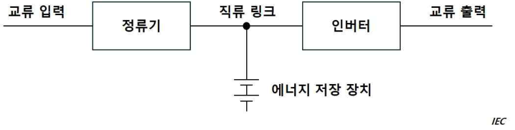
> 설명: 이중 변환 토폴로지 UPS 구성도. 교류 입력 → 정류기 → 직류 링크 → 인버터 → 교류 출력으로 직렬 연결되며, 직류 링크 접속점에 에너지 저장 장치가 연결되어 있다. 우측 하단에 출처 표기 "IEC"가 있다.

(3) 라인인터랙티브 토폴로지(line interactive topology)

이 UPS 토폴로지는 일반적으로 양방향 변환장치와 교류 전력 인터페이스를 통해 이루어지는 양방향 교류-직류 전력 변환으로 구성된다. 교류 입력 전원의 전압 또는 주파수가 UPS의 미리 설정된 한계치를 벗어나면 UPS는 에너지 방전 모드로 실행된다. (IEC 62040-3:2021의 부록 B 참조)

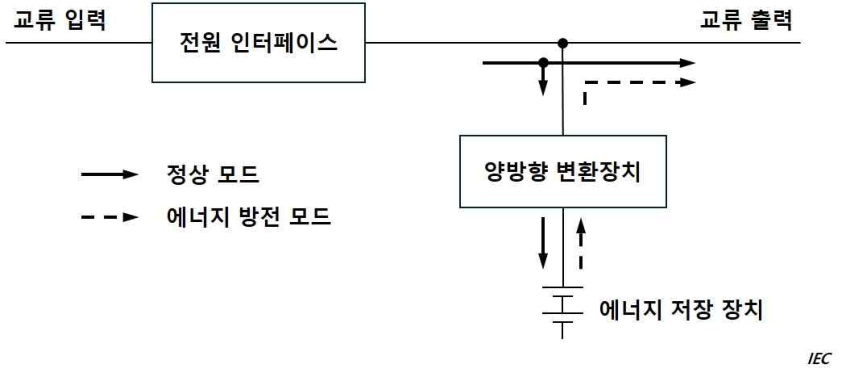
> 설명: 라인인터랙티브 토폴로지 UPS 구성도. 교류 입력이 전원 인터페이스를 거쳐 교류 출력으로 연결되고, 출력선의 분기점에 양방향 변환장치와 그 아래 에너지 저장 장치가 연결된다. 실선 화살표는 정상 모드(교류 입력 → 교류 출력 및 에너지 저장 장치 충전), 점선 화살표는 에너지 방전 모드(에너지 저장 장치 → 양방향 변환장치 → 교류 출력)의 전력 흐름을 나타내며, 우측 하단에 "IEC" 표기가 있다.

(4) 스탠바이 토폴로지(standby topology)

이 UPS 토폴로지는 배터리 충전기, 일반적으로 단방향 인버터인 직류-교류 변환장치 및 UPS 스위치로 구성된다. 교류 입력 전원이 UPS의 미리 설정된 한계치를 벗어나면 UPS는 에너지 방전 모드로 실행된다. (IEC 62040-3:2021의 부록 B 참조)

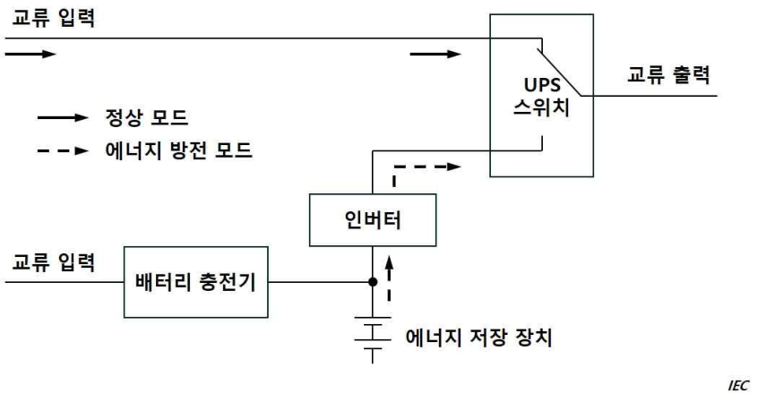
> 설명: 스탠바이 토폴로지 UPS 구성도. 정상 모드(실선 화살표)에서는 교류 입력이 UPS 스위치를 거쳐 교류 출력으로 공급되고, 별도의 교류 입력이 배터리 충전기를 통해 에너지 저장 장치를 충전한다. 에너지 방전 모드(점선 화살표)에서는 에너지 저장 장치 → 인버터 → UPS 스위치 → 교류 출력으로 급전되며, 우측 하단에 "IEC" 표기가 있다.

(5) 에너지저장장치(energy storage device)

UPS 인버터/컨버터에 전원을 공급하도록 설계된 단일 또는 다중 장치로 구성된 시스템. (IEC 62040-3:2021)

(6) 교류 입력 정전(AC input power failure)

UPS의 에너지 방전 모드를 유발하는 교류 입력 전력의 변동. (IEC 62040-3:2021)

(7) 양방향 변환장치(bidirectional converter)

교류에서 직류로, 그리고 그 반대로도 전력 흐름을 바꿀 수 있는 정류기와 인버터 기능을 모두 갖춘 변환장치. (IEC 62040-3:2021)

**3. 설계 및 구조**

(1) UPS의 구조는 적용 가능한 IEC 62040-1:2017+AMD1:2021+AMD2: 2022, IEC 62040-2:2016, IEC 62040-3:2021, IEC 62040-4:2013 및/또는 IEC 62040-5-3:2016 또는 이와 동등한 국제표준 및 적절한 국내표준에 따른다.

(2) UPS는 외부전원에 의존하지 않고 작동되어야 한다.

(3) 사용되는 UPS 장치의 구성 및 토폴로지는 접속된 부하설비의 전원요건에 적합하도록 선정되어야 한다.

(4) 외부 바이패스가 제공되는 경우, 바이패스 전환 스위치는 돌입 전류 또는 고장 전류로 인해 발생하는 전력 교란 또는 중단으로부터 부하를 보호하도록 배치되어야 한다. (IEC 62040-3:2021의 부록 C 참조)

(5) UPS 장치는 모니터링되어야 하며 지속적으로 인원이 배치되는 스테이션에 가시가청 경보를 발하여야 한다.

(가) 연결된 부하에 대한 전원상실 (전압 및 주파수)

(나) 지락

(다) 배터리 보호장치의 작동

(라) 배터리가 방전되는 경우

(마) 외부 바이패스가 제공되는 경우, 바이패스가 작동될 때

(바) UPS 장치의 기타 결함 및 비정상적인 상태 (해당하는 경우)

**4. 배치**

(1) **1**항 (1)호 (가)및 (나)의 비상용도용 UPS 장치는 비상시에 사용하기에 적합한 위치에 설치하여야 한다.

(2) 밸브조절식 밀폐형 축전지를 사용하는 UPS는 환기장치가 적용 가능한 IEC 62040-1:2017+AMD1:2021+AMD2:2022, IEC 62040-2:2016, IEC 62040-3:2021, IEC 62040-4:2013 및/또는 IEC 62040-5-3:2016 또는 이와 동등한 국제표준 및 적절한 국내표준에 적합할 경우 일반전기설비가 배치된 구획에 설치할 수 있다.

**5. 성능**

(1) UPS는 **규칙 203.**의 **2**항에 열거한 부하에 대하여 지정된 시간동안 출력이 유지되어야 한다.

(2) UPS가 충분한 용량임을 검증하지 아니하고 UPS에 추가의 회로를 접속하여서는 아니 된다. UPS 축전지 용량은 항상 지정된 부하를 정해진 시간내에 공급할 수 있어야 한다.

(3) UPS의 입력전원 복구에 있어서는 부하로의 급전을 유지하는 동시에 축전지에 재충전할 수 있도록 충전기의 정격을 충분한 것으로 하여야 한다.

**6. 시험 및 검사**

(1) 50 kVA 이상의 UPS는 (2)호에 따라 우리 선급으로부터 제조공장에서 시험 및 검사를 받아야 한다.

(2) UPS는 해당 장치가 설치된 환경에서 적합함을 증명하기 위해서 적절한 시험을 수행해야 한다. 여기에는 최소한 다음의 시험항목이 포함되어야 한다.

(가) 육안검사

(나) 3항 (5)호의 경보작동을 포함한 기능확인

(다) 온도상승시험

(라) 환기율 확인

(마) 배터리 용량 확인

(3) 입력 전원 상실 후에도 전원공급이 중단 없이 유지되어야 하는 경우, 이는 설치 후 실제 시험을 통해 검증되어야 한다.

#### 1204. 정류기

**1. 구조**

(1) 정류밸브 유니트, 정류스태크 또는 정류소자는 정류기로부터 용이하게 떼어낼 수 있는 구조의 것이어야 한다.

(2) 자냉식 및 풍냉식의 정류기는 염분을 포함한 공기 또는 습기로 인하여 지장이 생기지 아니하도록 장치하거나 또는 보호하여야 한다.

(3) 수은증기를 발생할 염려가 있는 장소에서는 자냉식 및 풍냉식의 다결정 반도체 정류기(多結晶 半導體 整流器)를 사용하여서는 아니 된다.

(4) 정류소자를 직렬 또는 병렬로 접속해서 사용할 경우에는 각각의 소자에 가하는 전압 또는 전류는 가능한 한 균등하도록 하여야 한다.

**2. 배치**

(1) 정류기는 냉각공기의 순환에 방해가 되지 아니하도록 또한 풍냉식에 있어서는 입구 공기온도가 그 허용치를 넘지 아니하도록 설치하여야 한다.

(2) 정류기는 저항기, 증기관 및 기타의 복사열원으로부터 될 수 있는 한 떨어져서 설치하여야 한다.

**3. 보호장치**

(1) 강제냉각을 하는 정류기는 냉각계통에 이상이 있을 때 동작하는 보호장치를 갖추어야 한다.

(2) 정류기는 회로개폐에 따른 서지전압, 발전제동(發電制動)에 따른 전압상승 등 과도적 과전압에 의하여 손상되지 아니하도록 보호하여야 한다.

**4. 정류소자의 온도** 정류소자의 접합부 최고 허용온도는 제조자의 지정에 따른 것으로 하고 지정이 없을 경우에는 다음에 따라야 한다.

셀렌 : 70℃

실리콘 : 150℃ (다이리스터 : 125℃)

**5. 정류기용 변압기** 정류기용 변압기는 단권이어서는 아니 된다.

**6. 다이리스터 제어**

(1) 게이트 제어회로

(가) 다이리스터의 게이트 제어회로는 게이트의 정격을 넘는 일이 없고 점호(點弧)시키는데 충분한 폭의 펄스를 발생시키고 정전유도 및 전자유도에 의해 잘못 점호를 일으킬 염려가 없는 것이어야 한다.

(나) 다이리스터를 직렬 또는 병렬로 접속하여 사용할 경우에는 게이트 제어회로는 각 다이리스터의 점호의 시기가 불규칙적으로 되지 아니하도록 하여야 한다.

(2) 다이리스터에 의한 직류전동기의 제어

(가) 다이리스터 출력의 맥동이 전동기의 정류에 유해한 영향을 미칠 염려가 있을 경우에는 맥동을 저감하는 방법을 강구하여야 한다.

(나) 다이리스터의 위상제어에 따른 역률의 저하가 전원에 유해한 영향을 미칠 우려가 있을 경우에는 이것을 적절히 보상하는 장치를 구비하여야 한다.

(다) 계자극성 절환방식에 따라 전동기의 정역(正逆)운전을 할 경우는 전기자 전류가 영(零)이 된 후 계자의 극성이 전환되도록 인터록을 장치하여야 한다. 또한 전기자의 무구속 상태를 제한하기 위하여 적절한 장치를 구비하여야 한다.

**7. 시험 및 검사**

(1) 일반사항

정류기 및 부속장치는 다음 각 항에 규정하는 시험을 하여야 한다. 다만, 우리 선급이 인정할 경우는 동일형식의 2대째 이후의 것에 대해서는 (2)호의 시험을 생략할 수 있다. **【지침 참조】**

(2) 온도시험

정류기 및 부속장치는 정상 사용 상태에서 온도시험을 하여 **4**항에 적합하고 또한 **702.**에 규정하는 값을 넘지 아니하는가를 확인하여야 한다. **【지침 참조】**

(3) 동작시험

계기, 개폐장치, 보호장치 등의 동작을 확인하여야 한다. **【지침 참조】**

(4) 내전압시험

정류소자 또는 주회로의 전위를 가진 부속장치의 충전부와 대지 사이에 **표 6.1.30**의 전압을 1분간 가하여 이에 견디어야 한다. *(2018)*

**표 6.1.30 주회로에 연결된 기기의 시험 전압** *(2018)*

<table>
<tr><th rowspan="2">정격 절연 전압 (V)</th><th colspan="2">시험전압 (V)</th></tr>
<tr><th>교류 (r.m.s)</th><th>직류</th></tr>
<tr><td>$\le 50$</td><td>1250</td><td>1770</td></tr>
<tr><td>$\le 100$</td><td>1300</td><td>1840</td></tr>
<tr><td>$\le 150$</td><td>1350</td><td>1910</td></tr>
<tr><td>$\le 300$</td><td>1500</td><td>2120</td></tr>
<tr><td>$\le 600$</td><td>1800</td><td>2550</td></tr>
<tr><td>$\le 1000$</td><td>2200</td><td>3110</td></tr>
</table>

(5) 절연저항시험

정류기 및 부속장치의 충전부분과 대지사이의 절연저항은 내전압시험 완료 후 직류 500 V이상의 절연저항계로 측정하여 1 MΩ 보다 작아서는 아니 된다.

### 제 13 절 축전지

#### 1301. 일반사항 【지침 참조】

**1.** 이 절의 규정은 납축전지 및 알칼리(니켈-카드뮴)축전지에 적용한다.

**2.** 축전지는 국가표준, 공인된 국제기준 또는 이와 동등하다고 인정하는 것이어야 한다.

**3.** 벤트형 축전지라 함은 전해액의 교환이 가능한 것으로 충전 및 과충전시에 가스를 방출하는 것을 말한다.

**4.** 밸브조절형 밀폐식 축전지라 함은 일반적으로 전해액의 교환이 불가능한 것으로 정상 상태에서는 닫혀있지만 내부압력이 미리 정해 놓은 값을 넘어서면 가스를 방출시키는 장치를 갖춘 것을 말한다.

#### 1302. 구조

축전지는 선박의 진동, 경사 등에 따라 전해액이 넘치거나 산 또는 알칼리성의 분무(噴霧)를 방출하지 아니하는 구조이어야 한다.

#### 1303. 설치장소

**1.** 축전지는 고온 또는 저온인 장소와 증기, 물 또는 유증기 등에 닿는 장소에 설치하여서는 아니 된다.

**2.** 알칼리축전지와 납축전지는 동일 구획에 설치하여서는 아니 된다.

**3.** 축전지는 거주구역내에 설치하여서는 아니 된다.

**4.** 용량이 큰 축전지는 전용의 축전지실에 설치하여야 한다. 다만, 밸브조절형 밀폐식 축전지는 적절한 장소에 설치할 수 있다. **【지침 참조】**

**5.** 기관시동용 축전지는 기관에 가능한 한 가까이 설치해야 한다. 만약, 이 축전지가 축전지실 내에 설치되어 있지 않은 경우에는 통풍이 양호한 곳에 설치해야 한다. *(2025)*

#### 1304. 축전지실의 전기장치

**1.** 축전지실에 붙인 전등기구는 방폭형인 것이어야 한다. **【지침 참조】**

**2.** 불꽃을 발생할 우려가 있는 퓨즈, 스위치 등은 축전지실에 설치하여서는 아니 된다.

**3.** 축전지실에는 원칙적으로 축전지용 케이블 및 실내 전등용 케이블 이외의 케이블을 포설하여서는 아니 된다.

#### 1305. 방식보호

납(鉛)축전지실내는 다음의 각 호에 의하여 두께 1.6 mm 이상의 납판을 깔든가 또는 내산도장(耐酸塗裝)에 의하여 보호하여야 한다.

(1) 축전지실 바닥 전면과 주위 벽 150 mm 높이까지에는 납판을 깔고 수밀을 유지하여야 한다. 다만, 우리 선급의 승인을 얻은 경우에 한하여 내산도장을 함으로써 납판을 까는 공사에 대신할 수 있다.

(2) 축전지실의 천정, 전 호의 규정 이외의 주위벽, 축전지시렁 및 나무상자에는 내산도장을 하여야 한다.

(3) 축전지 받침그릇 및 유산병 받침내면에는 납판을 깔아야 한다. **【지침 참조】**

(4) 통풍용 도관 및 환기통풍기는 내식성 재료로 제조하던가 또는 내면을 내산도장한 것이어야 한다.

#### 1306. 환기 【지침 참조】

**1.** 축전지실, 록커 및 축전지 상자는 인화성 가스가 고이지 아니하도록 하여야 한다. 축전지를 2단 이상으로 배열할 경우에는 시렁의 전후부에는 원칙으로 50 mm 이상의 빈자리를 설치하여야 한다.

**2.** 축전지실의 환기는 자연환기 또는 환기통풍기 중 어느 것으로든 할 수 있다.

**3.** 축전지실에는 유효한 흡기구멍을 바닥부근에 설치하여야 한다.

**4.** 환기통풍기는 날개가 케이싱에 접촉하여도 불꽃이 생기지 아니하는 것이어야 한다.

**5.** 축전지실의 배기 통풍기용 전동기는 원칙적으로 통풍도관 밖에 설치하여야 한다.

**6.** 축전지 상자에는 정부(頂部)에 배기용도관을 설치하고 그 선단을 구즈넥형 등으로 하며 상자의 정부(頂部)로부터 구즈넥까지의 거리는 1.25 m 미만이어서는 아니 된다. 또한 흡기구멍은 적어도 상자의 맞은 면에 2개 설치하여야 한다.

**7.** 밸브조절형 밀폐식 축전지 및/또는 벤트형 축전지를 설치하는 경우, 적절한 통풍을 확보해야 한다. 벤트형 축전지의 경우, 위치 및 설치에 대한 해당 요건을 만족해야 한다. *(2026)*

#### 1307. 충전장치

**1.** 부동충전(浮動充電) 하는 축전지의 최대 전지전압은 그 부하의 허용 최고전압을 넘어서는 아니 된다. 이를 위하여 전압조정기 또는 전압제어장치를 설치할 수 있다. *(2025)*

2. 축전지를 직류발전기로 직렬저항을 통하여 충전할 경우 충전전압이 선간전압의 20% 이상이 될 때에는 충전과 방전 전반에 역류보호장치를 설치하여야 한다.

3. 충전장치는 유지 보수가 용이하도록 제조해야 한다. 또한 충전장치의 동작여부 및 경보를 시각화할 수 있도록 표시기를 제공해야 한다. *(2025)*

#### 1308. 축전지 보수 기록서 *(2026)*

**1.** 축전지를 중요용도 및 비상용으로 설치할 경우에는 축전지의 보수 계획서를 선내에 보관하여야 한다. 이러한 계획서는 최소한 다음의 정보를 포함하여야 하며, 신조검사 동안 우리선급의 현장검사원에 의해 검토되어야 한다.

(1) 형식 및 제조자의 모델명

(2) 전압 및 암페어-시간 정격

(3) 설치위치

(4) 축전지의 전원이 공급되는 설비 및 시스템 목록

(5) 보수유지/교체 주기

(6) 최종 보수일 및 교체일

(7) 교체용으로 보관하고 있는 축전지의 제조일 및 보관 수명

**2.** 축전지를 교체하는 경우 동등 이상의 성능을 갖는 형식으로 교체하도록 하는 절차서를 축전지 설치 장소에 비치하여야 한다.

**3.** 계획표 및 절차서는 선박안전관리시스템에 포함되어야 하며 일상적인 선박 운전 관리에 통합되어 우리 선급 검사원에 의해 적절히 검증되어야 한다.

### 제 14 절 피뢰침

#### 1401. 일반사항

목재로 된 마스트를 설치한 선박에는 각 마스트에 피뢰침을 설치하여야 한다.

#### 1402. 피뢰도선

1. 피뢰도선은 단면적 75 mm² 이상인 구리줄 또는 구리띠로 하여야 한다. 피뢰도선을 포설할 경우에는 가능한 한 직선상으로 부착하고 예각으로 굽혀서는 아니 된다.

2. 피뢰침의 첨두와 선체 또는 전극과의 사이의 저항은 0.02 Ω를 넘어서는 아니 된다.

### 제 15 절 고전압 전기설비

#### 1501. 일반사항

1. **적용 【지침 참조】**

(1) 이 절의 규정은 공칭전압이 1 kV를 넘고 15 kV를 넘지 아니하는 3상 교류 배전계통에 적용한다. 공칭전압은 상간전압을 말한다.

(2) 고전압전기설비의 구조 및 설치에 대하여는 이 절의 규정에 따르는 외에 IEC 60092-503:2007 및 이 장의 관련 규정에도 적합하여야 한다. *(2022)*

2. **격리** 1 kV를 넘는 고전압전기설비와 저전압전기설비는 서로 격리하여 설치하여야 한다. 다만, 안전하게 저전압전기설비에 접근할 수 있도록 격리하거나 다른 적절한 수단을 갖춘 경우에는 예외로 한다.

#### 1502. 시스템 설계 【지침 참조】

1. **배전**

(1) 선내 전력공급의 연속성

주배전반은 적어도 하나의 회로차단기 또는 다른 적절한 분리장치를 사용하여 최소한 2개의 독립된 부분으로 나눌 수 있어야 하며, 배전반의 독립된 각 부분에는 적어도 1대의 발전기에 의하여 급전되어야 한다. 2개의 분리된 배전반으로 되어 있고 케이블로 상호 연결되어 있는 경우, 케이블의 각 말단에는 회로차단기를 설치하여야 한다. 2중장비가 요구되는 기기의 부하는 분리된 각 부분의 배전반에 균등하게 분담되어야 한다.

(2) 중성점 접지방식

지락사고의 경우, 지락전류는 배전반 또는 관련 배전반에 연결된 최대 용량의 발전기의 전부하를 초과하여서는 아니 되며, 지락보호장치를 작동시키는데 필요한 최소전류의 3배 이상이어야 한다. 계통에 전원이 공급되고 있을 때에는 적어도 1개의 전원중성점이 항상 접지되어 있어야 한다. 직접중성점 접지방식 또는 다른 중성점 접지방식의 전기설비는 단상의 지락사고의 경우, 트립에 필요한 시간 동안 지락전류에 견딜 수 있어야 한다.

(3) 중성점 접지선의 단로

각 발전기의 접지선에는 발전기의 정비 및 절연저항 측정을 위한 단로장치를 설치하여야 한다.

(4) 접지 임피던스의 선체 연결

모든 접지 임피던스는 선체에 접속되어야 한다. 이로 인한 순환전류에 의하여 무선설비, 레이다, 통신 및 제어회로에 간섭이 일어나지 않도록 하여야 한다.

(5) 분할된 계통

중성점 접지계통에서 선체에 중성점을 연결할 때에는 분할된 각 부분마다 연결하여야 한다.

2. **보호등급**

(1) 일반사항

고전압전기설비의 각 부분은 설치장소에 적절한 보호 등급의 것이어야 하고 IEC 60092-201:2019를 최소요건으로 한다. *(2022)*

(2) 회전기계

회전기계의 외피에 대한 보호등급은 적어도 IP23 이상이어야 하며, 단자의 보호등급은 적어도 IP44 이상이어야 한다. 취급자격이 없는 인원이 접근할 수 있는 구역에 설치되는 전동기의 경우, 충전부 및 회전부에 접촉하거나 접근하는 부분에 대한 보호등급은 IP4X 이상이어야 한다.

(3) 변압기

변압기 외피의 보호등급은 적어도 IP23 이상이어야 한다. 취급자격이 없는 인원이 접근할 수 있는 구역에 설치되는 변압기에 대한 보호등급은 적어도 IP4X 이상이어야 한다. 외피로 보호되지 않은 변압기에 대하여는 **1507.**의 **1항**에 따른다.

(4) 스위치, 제어기 및 변환장치

금속외피형 스위치, 제어기 및 정지형변환장치의 보호등급은 적어도 IP32 이상이어야 한다. 취급자격이 없는 인원이 접근 할 수 있는 구역에 설치되는 스위치, 제어기 및 정지형변환장치의 보호등급은 적어도 IP4X 이상이어야 한다.

3. **절연**

(1) 공간거리

고전압전기설비의 공칭전압에 따른 공간거리는 **표 6.1.31**에서 표시하는 값 이상이어야 한다. 다만, 우리 선급이 적절하다고 인정하는 경우에는 공간거리를 감소할 수 있다.

**표 6.1.31 고전압전기설비의 공간거리**

| 공칭전압(kV) | 공간거리(mm) |
|---|---|
| 3(3.3) | 55 |
| 6(6.6) | 90 |
| 10(11) | 120 |
| 15 | 160 |

(2) 연면거리

충전부 사이 및 충전부와 접지된 금속부 사이의 연면거리는 계통의 공칭전압, 절연재료의 특성과 스위칭 및 고장으로 인하여 발생하는 과도 과전압에 관한 IEC 60092-503:2007의 요건에 따라야 한다. *(2022)*

4. **보호**

(1) 회로차단기의 발전기측 고장

발전기와 주배전반 사이를 연결하는 케이블에서의 상간사고 및 발전기 내부의 권선사고에 대한 보호장치를 설치하여야 한다. 이 보호장치는 발전기 회로차단기를 트립시키고 자동적으로 발전기의 여자계통을 차단하여야 한다. 중성점 접지방식의 배전계통에서 상과 접지간의 사고에 대해서도 위와 같이 보호하여야 한다.

(2) 지락사고

계통의 모든 지락사고는 가시가청의 경보로 표시하여야 한다. 저임피던스 또는 직접접지계통에는 고장회로를 자동적으로 차단하는 수단을 갖추어야 한다. 고임피던스 접지계통에 있어서 지락사고가 일어남에도 불구하고 급전반이 분리되지 않을 경우, 설비의 절연은 상간전압을 기준으로 설계하여야 한다.

(3) 전력변압기

전력변압기에는 과부하 및 단락회로 보호장치를 갖추어야 한다. 변압기가 병렬로 연결되는 경우, 1차측의 보호장치는 2차측에 연결된 스위치가 자동적으로 트립되도록 하여야 한다.

(4) 제어 및 계기용 변압기

변압기의 2차측에는 과부하 및 단락회로 보호장치를 갖추어야 한다.

(5) 퓨즈

퓨즈는 과부하보호에 사용하여서는 아니 된다.

(6) 저전압계통

고전압계통으로부터 변압기를 통하여 전력이 공급되는 저전압계통은 다음과 같은 방법으로 과전압으로부터 보호되어야 한다.

- 저전압회로의 직접접지
- 적절한 중성전압제한기
- 변압기의 1차 및 2차 권선 사이의 접지차폐

#### 1503. 회전기계

1. **발전기 고정자권선** 발전기의 고정자권선은 차동보호장치를 위하여 모든 상의 말단을 단자상(box)에 인출하여 두어야 한다.

2. **온도감지기** 회전기계의 온도가 허용한도를 넘는 경우, 가시가청의 경보를 작동할 수 있도록 고정자권선 내에 온도감지기를 설치하여야 한다. 내장형 온도감지기를 사용하는 경우, 과전압으로부터 회로를 보호하는 수단을 갖추어야 한다.

3. **시험** 회전기계에 일반적으로 요구되는 시험에 추가하여 급격한 스위칭서지에 대한 내부권선-턴간의 내절연성을 확인하기 위하여 각 코일마다 IEC 60034-15:2009에 따른 내전압시험을 하여야 한다. *(2022)*

#### 1504. 전력변압기

1. 건식변압기는 IEC 60076-11:2018의 요건에 적합하여야 하며, 액체냉각식 변압기(liquid cooled transformers)는 IEC 60076에 적합하여야 한다. 유입식변압기는 다음과 같은 경보 및 보호장치를 갖추어야 한다. *(2022)*

- 액면이 저하하였을 때 : 경보/트립 또는 부하감소
- 액온이 상승하였을 때 : 경보/트립 또는 부하감소

- 가스압력이 상승하였을 때 : 트립

2. 내전압시험의 시험전압은 **표 6.1.32**와 같다.

**표 6.1.32 전력변압기의 내전압시험** *(2026)*

<table>
<tr><th>장비의 최대전압(kV)</th><th>교류시험전압(kV), 1분 상용주파수(50Hz 또는 60Hz)</th></tr>
<tr><td>≤ 1.1</td><td>3</td></tr>
<tr><td>3.6</td><td>10</td></tr>
<tr><td>7.2</td><td>20</td></tr>
<tr><td>12</td><td>28</td></tr>
<tr><td>15</td><td>38</td></tr>
</table>

#### 1505. 케이블 【지침 참조】

1. 고전압전기설비에 사용하는 케이블은 IEC 60092-353:2016과 IEC 60092-354:2020 또는 동등 이상의 규격에 적합한 것이어야 한다. *(2022)*

2. 내전압시험의 시험전압은 **표 6.1.33**과 같다.

**표 6.1.33 케이블의 내전압시험**

<table>
<tr><th>공칭전압(kV)</th><th>교류시험전압(kV), 5분 상용주파수(50Hz 또는 60Hz)</th></tr>
<tr><td>1 ∼ 1.1</td><td>3.5</td></tr>
<tr><td>3 ∼ 3.3</td><td>6.5</td></tr>
<tr><td>6 ∼ 6.6</td><td>11</td></tr>
<tr><td>10 ∼ 11</td><td>15</td></tr>
<tr><td>15</td><td>22</td></tr>
</table>

#### 1506. 개폐장치 및 제어장치

1. **일반사항** *(2024)*

개폐장치 및 제어장치는 IEC 62271-200:2011과 **2항**, **3항** 및 **4항**의 해당 요건에 적합한 것이어야 한다.

2. **구조**

(1) 구조

스위치는 IEC 62271-200:2011에 따른 금속외피형이거나 IEC 62271-201:2014에 따른 절연외피형이어야 한다. *(2022)*

(2) 잠금장치

인출형 회로차단기 및 스위치에는 사용위치 및 인출위치에 기계적인 잠금장치를 갖추어야 한다. 또한, 정비시에 안전하게 작업하기 위하여 인출형 회로차단기 및 스위치의 키(key)에 의한 잠금과 고정식 차단이 가능하여야 한다. 인출형 회로차단기는 고정부 및 가동부 사이에 상대적인 움직임이 없도록 설치하여야 한다.

(3) 셔터(shutters)

인출형 회로차단기 및 스위치의 고정접점은 인출위치에서 충전접점을 자동적으로 덮도록 하여야 한다. 셔터는 입·출력 회로가 명확히 표시되어야 하며, 색상이나 라벨을 사용하여 표시할 수 있다.

(4) 접지 및 단락

정비시에 안전하게 작업하게 하기 위하여 적절한 수의 접지 및 단락장치를 갖추어야 한다.

(5) 내부아크분류(Internal Arc Classification : IAC)

개폐장치 및 제어장치는 내부아크에 따라 분류되어야 한다(IEC 62271-200:2011, Annex AA 참조). 허가받은 인원만 개폐장치 및 제어장치에 접근할 경우 접근유형 A가 요구되며, 비인가자의 접근에 대해서는 접근유형 B가 요구된다. 개폐장치 및 제어장치는 내부아크분류 및 분류면(F. L 및 R)에 적합하도록 설치되고 위치하여야 한다. *(2022)*

3. **보조계통**

(1) 동력원 및 그 용량

차단기 또는 스위치 등의 조작에 전기적 또는 물리적인 보조동력원이 필요한 경우, 저장된 형태의 동력원은 모든 구성품을 최소 2회 조작할 수 있어야 한다. 이러한 에너지원은 과부하 또는 단락 과 및 저전압으로 인한 트립과는 별개의 것이어야 한다. 다만, 트립회로(release circuits)의 연속성 결여 및 전력공급상실에 따라 경보를 발하는 경우에는 분로 트립(shunt tripping)을 허용할 수 있다.

(2) 외부전원의 수

보조회로용으로 외부전원이 필요한 경우, 적어도 2개의 외부전원을 설치하여야 하며 이들 외부전원 중의 하나가 고장이 나거나 상실되더라도 두 대 이상의 발전기 및/또는 2개 그룹 이상의 중요용도에 사용되는 장치들의 전원이 상실되지 않도록 배치하여야 한다. 필요한 경우, 데드쉽상태에서 시동을 위하여 그 중 하나는 비상전원으로부터 전원이 공급되어야 한다.

4. **시험 및 검사** *(2024)* **【지침 참조】**

(1) 온도시험

우리 선급이 적합하다고 인정하는 경우, 시험을 생략할 수 있다.

(2) 내전압시험

모든 개폐장치 및 제어장치는 조립된 상태에서 내전압시험을 하여야 한다. 시험전압은 **표 6.1.34**에 따르며 시험절차는 IEC 62271-200:2011의 7절 일반시험(routine tests)에 따른다.

**표 6.1.34 개폐장치 및 제어장치의 내전압시험**

<table>
<tr><th>시스템 공칭전압(kV)</th><th>교류시험전압[(kV), 1분] 상용주파수(50Hz 또는 60Hz)</th></tr>
<tr><td>1 ∼ 1.1</td><td>2.8</td></tr>
<tr><td>3 ∼ 3.3</td><td>10</td></tr>
<tr><td>6 ∼ 6.6</td><td>20</td></tr>
<tr><td>10 ∼ 11</td><td>28</td></tr>
<tr><td>15</td><td>38</td></tr>
</table>

#### 1507. 설치

1. **전기설비**

(1) 고전압전기설비가 외피 내에 설치되지 않고 외피를 대신하는 실내에 설치되는 경우, 전원공급이 차단되고 설비가 접지되지 않으면 출입문이 열리지 않도록 인터록하여야 한다.

(2) 고전압전기설비가 설치되어 있는 장소에 출입하는 경우, 고전압의 위험을 표시해주는 적절한 표시를 부착하여야 한다. 위에서 언급하고 있는 장소의 바깥에 설치되는 고전압전기설비에 대하여도 이와 유사한 표시를 하여야 한다.

(3) 배전반에는 고장시 발생할 수 있는 아크가스를 안전하고 유효하게 배출할 수 있는 설비를 갖추어야 한다. **【지침 참조】**

(4) 유지보수작업을 수행하는 인원의 심각한 부상을 예방하기 위하여 고전압 장비 근처에는 막힘없는 적절한 작업 공간이 확보되어야 한다. 추가로, 배전반과 천정 및 상부갑판(ceiling/deckhead) 사이의 거리는 내부아크분류 요건에 적합하여야 한다(**1506.**의 **2항** (5)호 참조).

2. **케이블**

(1) 케이블의 포설

고전압 케이블이 거주구역에 설치되는 경우에는 밀폐된 케이블포설장치(cable transit system) 안에 설치하여야 한다.

(2) 격리

고전압 케이블은 정격이 다른 경우 서로 격리하여야 한다. 특히, 동일한 케이블 묶음으로 이들을 포설하여서는 아니 되며, 동일한 덕트 또는 파이프 혹은 상자에도 함께 포설하여서는 아니 된다. 동일한 케이블 트레이 상에 다른 정격의 고전압 케이블을 설치하는 경우, 공간거리는 **1502.**의 **3항** (1)호에서 규정하고 있는 더 높은 전압측의 최소 공간거리 이상이어야 한다. 또한, 1 kV 이하의 공칭계통전압에서 사용되는 케이블과 고전압 케이블은 동일한 케이블 트레이에 포설하여서는 아니 된다.

(3) 설치방법 *(2023)*

일반적으로 접지 가능한 연속적인 금속 시스 또는 외장을 가진 고전압 케이블의 경우 케이블 트레이에 포설할 수 있다. 그렇지 않은 경우, 접지가능한 금속함내에 전체 고전압 케이블을 포설하여야 한다.

(4) 말단처리 *(2024)*

고전압 케이블의 모든 도체단자는 가능한 한 적절한 절연재를 사용하여 효과적으로 피복되어야 한다. 단자함 내에서 도체가 절연되지 않는 경우, 각 상은 적절한 절연재로 된 차폐물에 의해 상간 및 접지와 분리되어야 한다. 절연체에 전계를 제어하기 위한 도전층을 갖는 방사계 형식(radial field type)의 고전압 케이블은 전기응력을 효과적으로 제어할 수 있어야 한다. 말단처리는 케이블의 절연체 및 피복재에 적합한 형식이어야 하며, 모든 금속성 차폐요소를 접지시킬 수 있는 수단이 제공되어야 한다(예: 테이프, 와이어 등).

(5) 표시

고전압 케이블은 적절한 표시를 사용하여 쉽게 식별할 수 있어야 한다.

(6) 설치 후 시험

(가) 새로운 고전압 케이블을 설치하거나 기존에 설치된 것에 추가하여 고전압 케이블을 설치하는 경우, 사용하기 전에 모든 케이블과 부속품이 조립된 상태에서 내전압시험을 하여야 한다. 내전압시험은 절연저항시험 후에 실시하여야 한다.

(나) 정격전압($U_0/U$)이 1.8/3 kV(Um=3.6 kV)를 초과하는 케이블의 경우, 교류 내전압시험은 고전압 케이블 제조업자의 권고에 따라 시행될 수 있으며 다음 시험방법 중 하나가 사용되어야 한다.

(a) 도체와 금속성 차폐/시스 간에 상간전압으로 5분 동안 시험

(b) 시스템의 정상 작동 전압으로 24 시간 동안 시험

여기서,

- $Uo$ : 설계된 케이블의 도체와 접지 또는 금속 차폐 사이의 정격전압
- $U$ : 설계된 케이블의 도체 사이에 가해지는 정격전압
- $Um$ : 장비가 사용될 수 있는 “가장 높은 계통 전압”의 최대값

(다) 전 (나)의 규정에도 불구하고, 교류 내전압시험의 대안으로 4 $U_0$와 동일한 직류 시험 전압으로 15분간 시험할 수 있다.

(라) 정격전압($U_0/U$)이 1.8/3 kV(Um=3.6 kV) 이하인 케이블의 경우, 4 $U_0$와 동일한 직류 전압으로 15분간 시험하여야 한다.

(마) 시험을 종료한 후에는 도체 내에 충전되어 있는 전하를 방전하기 위하여 충분한 시간 동안 접지한 다음 절연저항시험을 반복하여 실시한다.

### 제 16 절 전기추진설비

#### 1601. 일반사항

1. **적용** *(2023)*

(1) 이 절의 요건은 2절부터 15절의 해당 요건에 추가하여 주추진이 전동기에 의해 수행되는 추진시스템에 적용한다.

(2) 보조 조타를 위한 선수 및 선미 스러스터, 축발전기의 PTI(Power Take-In), PTH(Power Take-Home) 모드는 이 절의 요건을 적용하지 않는다.

2. **비틀림 진동방지** 원동기, 발전기, 전동기 축계 및 프로펠러는 통상 사용회전수의 범위내에서 해로운 비틀림진동, 교류인 경우에는 특히 과도한 진동이 발생하지 아니하는 것이어야 한다.

3. **통합 전기추진설비**

(1) 통합 전기추진설비라 함은 추진 부하뿐만 아니라 선용 부하에 전원을 공급하는 설비를 말한다.

(2) 통합 전기추진설비의 발전 용량은 다음과 같다.

정상 운항 상태 하에서, 1대의 발전기가 부하에 전원을 공급하지 못할 경우, 나머지 발전기의 용량은 선용(중요용도 및 거주편의용도)부하의 100 %를 만족하여야 하며, 또한 7 knots 또는 설계 속도의 50 % 중 낮은 값에 해당하는 추진부하에 전력을 공급하기에 충분한 것이어야 한다.

4. **습기 및 응결 방지** 발전기, 추진용 전동기, 전력변환장치, 변압기 및 배전반은 습기가 생기거나 응결되지 아니하도록 스페이스히터(space heater) 또는 공기건조기(air dryer) 등과 같은 적절한 방법을 강구하여야 한다.

#### 1602. 전기추진장치용 원동기

1. **일반사항** 원동기는 **5편 2장 2절** 또는 **3절**의 규정에 적합한 것으로서 그 정격출력은 과부하 특성 및 부하확립 특성과 같이 전기장치의 운전상태가 과도적으로 변화되는 사이에 필요한 동력을 공급하기에 충분한 것이어야 한다.

2. **조속기**

(1) 원동기는 미리 설정된 정상속도를 유지하도록 조속기를 설치하여야 한다. 이 정상속도는 전부하로부터 무부하까지의 부하변화에 대하여 정격 전부하 속도의 5 %를 넘지 아니하여야 한다.

(2) 전 (1)호에서 규정하는 조속기는 발전기의 정격출력을 급격히 차단한 경우 순시 속도변동을 정격속도의 10 % 이내로 유지할 수 있는 것이어야 한다.

(3) 병렬운전하는 발전기에 사용하는 조속장치는 원동기의 전운전 속도범위에 걸쳐 안정된 운전을 확보할 수 있는 것이어야 한다.

(4) 원동기의 조속기 특성은 병렬운전에서 개별 발전기에 대한 부하가 가능한 각 발전기 출력에 비례하여 분배되도록 해야 한다.

(5) 프로펠러의 속도조정을 위해서 원동기의 속도를 변화시킬 필요가 있을 경우 조속기는 필요한 속도 범위내에서 미세한 속도조정이 가능한 것으로 하고 원격조정 및 기계쪽 수동조정이 가능하도록 해 두어야 한다.

(6) 과속도 조속기는 동력이 다시 살아나는 중에 발생하는 최고속도 이상으로 조정되어야 한다. 또한 원동기 및 발전기는 그 조정속도에 대하여 손상될 염려가 없는 구조이어야 한다.

#### 1603. 회전기계 *(2025)*

1. **일반사항**

(1) 자기통풍식인 가변속도 회전기계는 정격속도 이하로 운전하고 또한 그 속도에서 전부하 토크, 전부하 전류, 전부하 여자 등의 상황에서도 각부의 온도상승이 **표 6.1.5**에 표시한 값을 넘어서는 아니 된다.

(2) 회전자는 **표 6.1.7**에 규정한 과속도에 2분간 견디는 구조이어야 한다. 다만, 터빈 구동발전기 및 전자 슬립 커플링의 과속도는 정격속도의 120 %로 한다.

(3) 슬립링 및 정류자는 쉽게 보수할 수 있도록 배치하여야 한다. 또한 각종 권선 및 베어링은 점검 및 수리를 위해 쉽게 접근할 수 있고 또한 계자권선의 떼어내기 및 교환을 할 수 있도록 고려하여야 한다.

(4) 500 kVA를 넘는 발전기의 고정자 권선, 500 kW를 넘는 교류 전동기의 고정자 권선 및 500 kW를 넘는 직류 전동기의 보극, 주극 및 보상권선의 온도를 계측하는 장치를 비치하여 가능한 한 제어반의 편리한 위치에서 온도를 읽을 수 있도록 하여야 한다.

(5) 1 500 kVA를 넘는 발전기는 차동전류 보호장치를 갖추어야 한다.

(6) 직류전동기가 과속도로 될 염려가 있으면 과속도 보호장치를 설치하고 또 전기자는 일시적인 과속도에 대해 손상되지 아니하는 구조인 것이어야 한다.

2. **전동기 토크**

(1) 전동기의 토크는 선박이 연속 최대출력으로 항해하고 있을 때 선박을 신속하게 정지시키고 후진시킬 수 있어야 한다.

(2) 교류인 경우 전동기는 황천중 및 다축선(多軸船)에 있어서 선회시 난조가 야기되지 아니하도록 토크에 충분한 여유가 있어야 한다.

3. **베어링 및 윤활**

(1) 전동기축의 베어링의 윤활은 기동시를 포함한 모든 사용 상태에 대하여 유효한 것이어야 한다.

(2) 회전기계 및 원동기의 베어링의 윤활에 강제 윤활을 할 경우에는 유압저하 경보장치 및 과도한 베어링 온도 상승에 대한 경보장치가 설치되어야 한다.

(3) 윤활유가 베어링 외부로 유출되어 회전기계 내부로 침투되어서는 아니 된다.

(4) 모든 베어링은 온도감시장치를 갖추거나 온도계를 설치하여야 한다.

(5) 경사진 위치에서도 적절한 윤활이 되어야 하며, 베어링 윤활을 확인할 수 있는 장비가 준비되어야 한다.

(6) 슬리브 베어링은 쉽게 교체할 수 있어야 한다.

(7) 롤러 베어링은 충분히 예압(preload)되어야 한다.

4. **여자장치**

(1) 타려식인 회전기계에는 적어도 2개의 여자장치를 설치하여야 한다.

(2) 여자기의 축 및 커플링의 강도는 조종(操縱)중의 최대출력 및 돌발 단락시의 출력증가에 대하여 충분한 것이어야 한다.

5. **전자 슬립커플링**

(1) 전자 슬립커플링은 자기회로의 간극을 정기적으로 점검할 수 있는 구조로 하고 점검시 필요한 눈금있는 계기를 설치하여야 한다.

(2) 전자 슬립커플링은 적어도 방적형으로 하고, 폐쇄형이 아닌 경우에는 회전부에 사람이 접촉하거나 이물질이 들어가지 못하도록 보호하여야 한다.

6. **냉각**

(1) 풍냉식 장비, 공기덕트, 공기필터 또는 워터쿨러(water cooler)의 냉각 공기 온도는 기기 외부에서 읽을 수 있는 온도계를 통해 지속적으로 감시되어야 하며, 경보를 발하도록 온도 센서가 제공되어야 한다.

(2) 수냉식 열교환기를 갖춘 기기의 경우, 누설이 감시되어야 한다.

7. **단일 중요 추진 구성품 및 해당 신뢰성 (UI SC305)** *(2026)*

해상인명안전협약(SOLAS) 제2-1장 26규칙의 26.2항에 따라 단일 중요 추진 구성품 및 해당 신뢰성에 대해서는 다음 사항에 따라야 한다.

(1) 전기 기계의 고장 가능성을 고려해야 한다. 최소한 다음과 같은 전기 기계의 고장 모드에 대해 적절한 시간 내에 충분한 추진 용량을 유지하거나 복구해야 한다.

(가) 권선 절연 고장

(나) 여자 고장

(2) 주추진을 위한 단일 전기추진 전동기(단일 회전자를 사용하는 단일 권선 및 이중 권선 모두)는 단일 중요 추진 구성품에 필요한 신뢰성을 제공하는 것으로 간주되지 않는다. 이러한 배치에는 선박에 항해 속도를 제공하기에 충분한 별도의 추진 장치가 요구된다.

(3) 하나의 축에 두 개의 독립된 회전자가 있는 추진 장치는 각 회전자를 개별적으로 탈여자 또는 탈자속화하고 고정자에 독립적으로 전원을 공급할 수 있는 경우 요구되는 신뢰성을 제공하는 것으로 간주된다.

#### 1604. 제어장치 【지침 참조】

1. **일반사항**

(1) 추진설비에 대한 제어장치는 적절한 전압의 것으로서 계기, 안전장치를 포함한 전동기의 기동, 정지, 역전 및 속도제어용의 기구를 설비한 것이어야 한다.

(2) 프로펠러를 정지 또는 역전할 때, 전동기에 의해 전달되는 회생에너지가 원동기에 위험한 속도증가를 발생시킬 경우, 이 에너지를 적절히 흡수하거나 또는 제한하는 장치(예: 제동저항기)를 갖추어야 한다. *(2017)*

(3) 스위치 및 접촉기의 조작용 레버, 핸들 및 그 부속품은 원활하게 수동조작 할 수 있는 것이어야 한다.

(4) 접촉기, 주회로스위치, 계자스위치 및 유사한 기구류의 조작레버는 잘못 동작이 되지 아니하도록 인터록을 설치하여야 한다. 인터록은 가능한 한 기계적 방식이어야 한다.

(5) 증기 및 기름에 사용되는 계기를 집합제어반에 설치하였을 경우에는 증기 또는 기름이 누설되어도 대전부에 접촉하지 아니하도록 하여야 한다.

(6) 조종장치에 동력을 사용할 경우에는 동력에 고장이 생겼을 때 다른 적절한 방법으로 단시간에 조작을 회복할 수 있도록 하여야 한다.

(7) 조종제어장치는 기관실이외의 장치에 손상이 일어났을 경우에 기관실의 조종 장소로 부터 제어할 수 있도록 배치하여야 한다.

(8) 조종제어장치가 고장나거나 조종제어장치에 전력공급이 상실된 경우에도 프로펠러의 속도가 과도하게 상승하지 않도록 하여야 한다.

2. **조종장치의 배치**

(1) 추진용 회전기계의 제어는 선교 또는 갑판에서 하여도 좋으나 이런 경우 주기관실에도 제어장치를 설치하여야 한다. 비상시에 있어서 주기관실에의 제어전환은 가능한 한 신속히 할 수 있는 것이어야 한다.

(2) 2개 이상의 제어장소를 설비할 경우는 그 어느 장소에서 제어중인가를 표시하는 표시등을 각 제어장소에 설치하여야 한다. 또한 동시에 상이한 장소에서 제어하지 못하도록 하여야 한다.

(3) 기계측제어장소는 추진의 제어 변화를 인지할 수 있도록 구동기나 전력변환장치 근처에 위치하여야 한다.

(4) 각 제어장소에는 구동기의 제어와 독립적으로 비상정지장치를 비치하여야 한다.

3. **주회로 및 제어회로**

(1) 2대 이상의 발전기 또는 2대 이상의 전동기로 1개의 프로펠러축을 구동하는 장치에는 어느 한쪽의 회전기가 다른 쪽의 회전기의 운전을 방해하는 일이 없이 전기적으로 차단될 수 있도록 배치하여야 한다.

(2) 계자회로에는 계자스위치를 열때 전압상승을 억제할 수 있는 수단을 강구하여야 한다.

4. **보호장치**

(1) 주회로에 과전류 보호장치가 설치된 경우에는 황천시의 조선(操船) 또는 통상운전시에 생기는 과전류로 작동하는 일이 없도록 충분히 높게 조정하여야 한다.

(2) 개별로 구동되는 직류발전기가 전기적으로 직렬로 접속된 경우 1대의 원동기가 구동력 상실에 따라 그 발전기가 역회전 하는 것을 방지하는 수단을 강구하여야 한다.

(3) 여자회로는 회로의 개방원인이 되는 과부하 보호를 하여서는 아니 된다.

(4) 주회로에는 돌발 단락전류를 검출하는 장치 및 상간의 불평형을 검출하는 장치를 설치하고 전기적 사고에 따라 전기장치에 일어나는 손상이 추진력의 상실에 따라 생기는 결과보다 중대할 경우에는 발전기 또는 전동기의 자속을 급속히 감소시킬 수 있도록 하여야 한다.

(5) 주회로에는 지락검출장치를 설치하고 지락이 생길 경우 경보가 울리도록 하여야 한다.

(6) 절연된 여자회로에는 지락검출장치를 비치하여야 한다. 그 장치는 전압계 또는 표시등으로 구성할 수 있다.

(7) 부하 저감

다음과 같은 경우, 수동 부하 저감에 대한 요청이 선교에 가시가청 되거나 자동 부하 저감 장치가 작동되어야 한다.

(가) 추진 발전기 및 전동기의 베어링 윤활유 압력 저하

(나) 추진 발전기 및 전동기의 권선온도 상승

(다) 기기 및 전력변환장치의 냉각수 부족 *(2017)*

(라) 기기 및 전력변환장치에 사용되는 강제 통풍식 송풍기의 고장 또는 냉각 설비의 고장 *(2017)*

(마) 발전기의 부하 제한 또는 불충분한 가용 전력

5. **전자 슬립커플링용 제어장치** 전자슬립커플링용 제어장치에는 2극스위치, 단락보호장치 및 커플링 여자회로용 전류계를 설치하여야 한다. 주기계의 조종레버가 부적절한 위치에 있을 때 커플링이 여자되지 아니하도록 인터록을 하여야 한다. 또한 이 제어장치는 구동하는 원동기의 속도제어장치 및 역전제어장치와 조합으로 할 수 있다.

6. **계측, 지시, 제어 및 감시 장치** *(2017)*

(1) 주요 추진설비들은 제어장소에 적어도 다음의 계측장치, 제어장치 및 지시기들이 공급되어야 한다.

(가) 기계측제어장소

- 속도 설정
- 기계측 원격 스위치
- 각 부하구성품의 전원공급측 전류에 대한 전류계
- 여자 상태 표시
- 각 축의 회전지시기
- 가변 피치 제어를 하는 경우 피치 표시
- 설비의 운용 대기 표시
- 전력변환장치 온/오프 표시
- 설비 장애 표시
- 전력 제한 표시
- 기관제어실에서 제어됨을 표시
- 선교에서 제어됨을 표시
- 기계측에서 제어됨을 표시

(나) 선교의 (주)제어장소

- 제어 레버
- 각 축의 회전지시기
- 축 전력계
- 설비의 전원공급 대기 표시
- 설비의 운용 대기 표시
- 설비 장애 표시
- 전력 제한 표시
- 전력 감소 요청 표시 (자동으로 제어되지 않거나 오버라이드 누름단추가 설치될 경우)
- 기관제어실에서 제어됨을 표시
- 기계측제어장소에서 제어됨을 표시
- 추진용으로 사용되는 발전기 표시

(다) 기관제어실의 (주)제어장소

- 제어 레버
- 각 축의 회전지시기
- 축 전력계
- 설비의 전원공급 대기 표시
- 설비의 운용 대기 표시
- 설비 장애 표시
- 전력 제한 표시
- 전력 감소 요청 표시 (자동으로 제어되지 않거나 오버라이드 누름단추가 설치될 경우)
- 기계측제어장소에서 제어됨을 표시
- 선교에서 제어됨을 표시
- 추진용으로 사용되는 발전기 표시

7. **시동 차단** *(2017)*

(1) 추진설비의 시동 프로세스는 기존의 고장으로 비상차단된 경우 또는 시동 프로세스 자체가 추진설비에 손상을 일으킬 경우에는 시동이 되지 않도록 인터록 되어야 한다. 다음 사항에 대한 인터록이 고려되어야 한다(적용될 경우).

- 축 잠금 장치가 해제되지 않음
- 전력변환장치가 냉각되지 않음 (오버라이드 가능)
- 추진용 전동기가 냉각되지 않음 (오버라이드 가능)
- 추진용 변압기가 냉각되지 않음 (오버라이드 가능)
- 여자장치 고장
- 전력변환장치 고장
- 전력변환장치 제어 : 차단 기능 작동
- 추진용 배전반 전원 차단
- 비상 정지 작동
- 설정치가 “0”으로 맞춰지지 않음
- 베어링: 윤활유 압력 저하
- 냉각 매체의 높은 전도율
- 보호장치 작동
- 개폐장치의 차단기 고장
- 가변피치 프로펠러로부터 작동가능 신호 누락

(2) 시동을 위한 모든 전제 조건이 충족될 때만 “설비의 전원 공급 대기” 표시등이 작동되어야 한다.

(3) 추진설비가 설정값에 맞게 운용 가능한 경우에만 “설비의 운용 대기” 표시등이 작동되어야 한다.

#### 1605. 추진용 변압기

1. **일반사항** *(2023)*

(1) 변압기의 1차 권선과 2차 권선은 완전히 절연되어야 한다. 다만, 단권변압기는 전동기 기동용으로 허용된다.

(2) 고전압으로부터 저전압을 생산하는 변압기에는 고전압권선과 저전압권선 사이에 차폐용 접지선이 설치되어야 한다.

(3) 추진용 변압기의 권선 온도를 감시할 수 있는 수단이 제공되어야 한다.

(4) 보호 등급

기관구역에 설치되는 변압기는 적어도 IP 23 이상이어야 하며, 고전압 변압기는 적어도 IP44 이상이어야 한다. 다만, 잠금장치를 이용하는 지정된 전기구역 또는 기관구역과 같이 취급자격이 있는 인원만이 출입할 수 있는 구역에 설치되는 모든 변압기는 최소 IP 2X의 보호등급을 가질 수 있다.

2. **냉각장치**

(1) 액체냉각식 변압기

(가) 화재감지기 및 적절한 화재 소화장치가 변압기 근처에 설치되어야 한다.

(나) 가스 작동식 보호장치가 제공되어야 한다.

(다) 액체 온도를 감시할 수 있는 수단이 제공되어야 한다. 최대허용온도에 도달하기 전에 예비경보가 동작되어야 하고, 최대허용온도의 한계에 도달했을 경우 변압기의 작동을 멈추어야 한다

(라) 액체 수위는 두 개의 개별 센서를 통해 감시되어야 한다. 감시시스템은 허용치를 초과하는 첫 번째 단계에서는 경보를 울려야 하고, 두 번째 단계에서는 변압기의 작동을 멈추어야 한다.

(2) 공기냉각식 변압기의 경우, 환풍기 및 강제 풍냉식 변압기에 대한 냉각공기의 온도를 감시할 수 있는 수단이 제공되어야 한다.

(3) 열 교환기를 가지는 폐회로 냉각방식 변압기의 경우, 1차측과 2차측 냉각수의 흐름을 감시할 수 있는 수단이 제공되어야 한다. 누수 및 응결수는 권선으로부터 멀리 떨어져야 하고 누설감시가 요구된다.

3. **계기** 추진용 변압기는 1차측에 3상 전류계가 설치되어야 한다.

4. **보호장치**

(1) 각 추진용 변압기는 1차측과 2차측에 과전류 및 단락에 대해서 보호되어야 한다.

(2) 2차측의 보호는 전력변환장치에 의하여 이루어질 수 있다.

#### 1606. 전력변환장치

1. **일반사항** *(2023)*

전력변환장치가 영구자석 동기 전동기에 전원을 공급하는 경우, 전력변환장치 고장시 자동적으로 개방되는 단로장치를 전동기-전력변환장치간의 선상에 설치하여야 한다. 즉, 고장 진단을 지원하는 장치를 설치하여야 한다.

2. **반도체 전력변환장치의 설계**

(1) 추진용 전력변환장치는 구동기의 공칭토크에 맞추어 설계되어야 한다. 단기적인 과부하 및 과부하로 인한 속도변화에 의해 시스템의 정지를 유발해서는 아니 된다.

(2) 반도체 전력변환장치 외함은 주배전반의 관련 요건을 만족해야 한다.

(3) 반도체 전력변환장치의 전력 구성품은 쉽게 교환할 수 있어야 한다.

3. **반도체 전력변환장치의 냉각**

(1) 반도체 전력변환장치가 강제 냉각방식인 경우, 냉각시스템을 감시할 수 있는 수단이 제공되어야 한다.

(2) 냉각시스템이 고장날 경우, 전력변환장치의 손상을 방지하도록 경보장치를 설치하여야 한다. 경보신호는 냉각수의 흐름 또는 반도체 소자의 온도감지 방식을 적용할 수 있다.

(3) 전력변환장치 냉각시스템의 단일 고장으로 인해 선박 추진용 전체 전력변환장치의 고장을 초래해서는 아니 된다.

4. **보호장치**

(1) 전력변환장치가 접속되는 급전 시스템에는 손상을 방지할 수 있도록 적절한 과전압 제한장치를 설치하여야 한다. 이들 장치용으로 보호 퓨즈를 사용할 경우 보호 퓨즈의 고장을 감시할 수 있는 수단이 제공되어야 한다.

(2) 정상작동 상태에서 반도체 소자는 허용전류를 초과하지 않도록 적절히 제어되어야 한다.

(3) 반도체 소자는 단자에서 직접적으로 단락에 의한 손상을 받아서는 아니 된다. 퓨즈에 의한 보호는 허용된다. 전력변환장치가 구속된 전동기로 전환될 때 어떤 구성품도 손상을 받지 않도록 전력변환장치의 전류가 제어되어야 한다.

#### 1607. 케이블

케이블 및 배선용 전선의 도체는 7가닥 이상의 연선으로 하고 단면적은 1.5 mm² 이상인 것으로 하여야 한다. 다만, 자동화기기 등에 사용하는 케이블 혹은 전선으로서 주회로에 직접 접속되지 않는 것은 이에 따르지 아니한다.

#### 1608. 시험 및 검사

전기추진설비는 선내에 설치한 후 시운전을 하여야 한다.

### 제 17 절 선내시험

#### 1701. 절연저항시험

1. **전기추진회로, 동력회로 및 전등회로** 모든 전기추진회로, 동력회로 및 전등회로의 도체 상호사이 및 도체와 대지사이의 절연저항은 **표 6.1.35**의 값보다 작아서는 아니 된다.

**표 6.1.35 절연저항** *(2025)*

<table>
<tr><th>정격전압 $U_n$ (V)</th><th>최소 시험전압 (V)</th><th>최소절연저항 (MΩ)</th></tr>
<tr><td>$U_n \le 250$</td><td>$2 \times U_n$</td><td rowspan="2">1</td></tr>
<tr><td>$250 < U_n \le 1{,}000$</td><td>500</td></tr>
<tr><td>$1{,}000 < U_n \le 7{,}200$</td><td>1,000</td><td rowspan="2">$1 + (U_n / 1{,}000)$</td></tr>
<tr><td>$7{,}200 < U_n \le 15{,}000$</td><td>5,000</td></tr>
</table>

2. **선내통신장치** 선내통신회로의 절연저항은 다음 각 호의 규정에 따라야 한다.

(1) 100 V 이상의 회로에서는 도체 상호사이 및 각 도체와 대지사이의 절연저항이 1 MΩ 이상이어야 한다.

(2) 100 V 미만의 회로에서는 절연저항이 1/3 MΩ 이상이어야 한다.

(3) **2항**에서 규정하는 시험에서는 회로내의 모든 전기기구를 떼어내고 할 수 있다.

3. **발전기 및 전동기** 모든 발전기 및 전동기의 절연저항은 동작온도 하에서 **표 6.1.8**의 값을 유지하여야 한다.

4. **배전반** 배전반의 절연저항은 사용온도 하에서 **406.**의 **5항**에 규정하는 값을 유지하여야 한다.

#### 1702. 성능시험 *(2025)*

1. **선박용 발전기** 선박용 발전기는 다음 각 호의 규정에 따른 시험을 하여야 한다.

(1) 과속도 트립핑 및 기타의 안전장치의 동작을 확인하여야 한다.

(2) 전압 변동률을 확인하고, 여러가지로 조합한 병렬운전을 지장없이 할 수 있는 것을 확인하여야 한다.

(3) 전부하에서 운전하고 온도상승, 정류, 진동 기타 모든 점에 대하여 이상이 없는 것을 확인하여야 한다.

2. **배전반** 배전반상의 모든 스위치, 차단기 및 이와 관련된 장치는 실제로 동작시켜서 그 동작에 이상이 없는 것을 확인하여야 한다. 또한 구전반, 분전반에 대하여도 이에 따른다.

3. **전동기** 전동기는 다음 각 호의 규정에 따른 시험을 하여야 한다.

(1) 각종 전동기 및 그 제어장치가 사용상태에서 배선, 용량, 속도 및 동작 등에 이상이 없는 것을 확인하여야 한다.

(2) 각 종의 보기, 펌프 등을 구동하는 전동기를 운전하여 이상이 없는 것을 확인하여야 한다.

(3) 윈치 및 양묘기용 전동기는 그 사양에 의한 부하를 감아올리고, 감아내리는 시험을 하여야 한다.

4. **조명설비** 조명설비는 다음 각 호에 의한 시험을 하여야 한다.

(1) 각 회로마다 시험을 하고 등부속품, 분기상자, 스위치, 플러그, 리셉터클 등의 접속 또는 접촉이 완전한 상태에 있는 것을 확인하여야 한다.

(2) 비상등 회로에 대하여도 (1)호와 같은 시험을 할 것.

5. **전열기, 전기 취사기류** 전열기, 전기취사기 등은 그 전열선, 접속부 등에 이상이 없고 소요의 발열을 하는 것을 확인하여야 한다.

6. **선내통신장치** 모든 선내 통신장치는 만족한 동작을 하는 것을 충분히 확인하여야 한다. 특히 텔레그라프, 타각지시기, 화재경보, 응급신호, 모스 신호, 항해등 표시기 및 전화 등의 선박의 중요한 통신장치는 신중히 시험을 해야 한다.

7. **전압강하** 전 각 조의 시험중 급전회로의 전압강하가 **503.**의 **2항**에 규정하는 값을 넘지 않는가를 확인하여야 한다.

### 제 18 절 예비품 및 일반 비품

#### 1801. 예비품

1. **일반사항 【지침 참조】**

(1) 전기추진용의 회전기계 및 제어장치에는 **표 6.1.36**, **표 6.1.38** 및 **표 6.1.40**에 규정하는 예비품을 설치하여야 한다.

(2) 선박용 발전기, 중요용도의 전동기 및 그 제어장치와 배전반 등의 예비품의 공급 표준은 **표 6.1.36**부터 **표 6.1.40**에 의한다.

**표 6.1.36 발전기, 여자기 및 전동기에 대한 예비품**

| 예비품 | 수량 | 비고 |
|---|---|---|
| 베어링 또는 베어링 라이닝 | 4개 또는 그 단수마다 1개 | 오일 링을 포함함. |
| 브러시 홀더 | 10개 또는 그 단수마다 1개 | |
| 스프링 | 4개 또는 그 단수마다 1개 | 브러시 홀더용 |
| 브러시 | 상용수와 동수(同數) | |
| 계자코일 | 10개 또는 그 단수마다 1개 | 직류기의 경우만으로 한다. 다만, 나보극(裸補極) 코일은 제외함. |
| 계자조정기 저항 및 방전저항 | **표 6.1.38** 참조 | 발전기 및 여자기용 |
| 윈치용 전기자 | 6대 이상의 경우 1개 | 농형유도전동기의 경우에는 고정자, 권선형유도전동기의 경우에는 회전자로 한다. |
| 슬립링 | 각종 1개 | 전기추진용 회전기에만 필요 |

(3) (1)호 및 (2)호의 예비품의 수량은 1선박분의 동종, 동형의 기기에 대한 것을 표시한다.

(4) 예비의 조타용 전동기 또는 전동 발전기를 장비하지 아니하는 전동조타장치에 대하여는 **표 6.1.36**부터 **표 6.1.37**에 규정하는 예비품을 공급하여야 한다.

**표 6.1.37 예비의 조타용 전동기 또는 전동발전기를 장비하지 아니하는 전동 조타장치에 대한 예비품**

<table>
<tr><th colspan="2">예비품</th><th>수량</th></tr>
<tr><td>직류</td><td>전동기 및 전동발전기의 전기자</td><td>각 형식의 1개(축 및 커플링 포함)</td></tr>
<tr><td rowspan="2">교류</td><td>농형전동기의 고정자</td><td>1개</td></tr>
<tr><td>권선형전동기의 회전자</td><td>1개 (축 및 커플링 포함)</td></tr>
</table>

**표 6.1.38 제어장치에 대한 예비품**

| 예비품 | 수량 | 비고 |
|---|---|---|
| 접촉편 | 2대 또는 그 단수마다 1대분 | 소모 또는 마모되는 것에 한함. |
| 스프링 | 4개 또는 그 단수마다 1개 | |
| 동작 및 분권 코일 | 10개 또는 그 단수마다 1개 | |
| 저항자 | 10개 또는 그 단수마다 1개 | 각 종류 및 형식마다 |
| 퓨즈 및 소자 | **표 6.1.40** 참조 | |
| 표시등의 렌즈 및 전구 | **표 6.1.40** 참조 | |

**표 6.1.39 브레이크에 대한 예비품**

| 예비품 | 수량 | 비고 |
|---|---|---|
| 슈라이너 및 리벳 | 4대 또는 그 단수마다 1대분 | |
| 스프링 | 4개 또는 그 단수마다 1개 | |
| 코일 | 10개 또는 그 단수마다 1개 | |

**표 6.1.40 배전반, 제어반 및 구분전반 등에 대한 예비품**

| 예비품 | 수량 | 비고 |
|---|---|---|
| 퓨즈(다시 사용할 수 없는 형) | 상용수와 동수 | 각종 20개를 넘을 필요 없음. |
| 퓨즈(다시 사용할 수 있는 형) | 10개마다 1개 | 각종 10개를 넘을 필요 없음. |
| 퓨즈용 소자 | 상용수와 동수 | |
| 접촉편(불꽃이 나는 것) | 상용수와 동수 | 각종 10개를 넘을 필요 없음. |
| 스프링 | 상용수 | 각종 10개를 넘을 필요 없음. |
| 열동식 배선용 차단기(트립장치가 교환가능한 경우는 트립장치에 한함) | 동종(同種) 10개 또는 그 단수마다 1개 | |
| 열동식 배선용 차단기(트립장치가 교환불가능한 경우는 완비된 차단기) | 동종(同種) 10개 또는 그 단수마다 1개 | |
| 전압코일 | 각종 1개 | |
| 저항자 | 각종 1개 | |
| 표시등 및 신호등의 렌즈 | 동종(同種) 10개 또는 그 단수마다 1개 | |
| 표시등 및 신호등의 전구 | 상용수와 동수 | |

2. **비상등** 비상등 회로에 일반 전등회로와 전압이 상이한 전구를 사용할 경우에는 그 장비수의 반을 예비품으로 비치하여야 한다.

#### 1802. 시험용계기

50 kW 이상의 전기설비를 가진 선박에서는 정기적으로 회로의 절연저항을 측정하기 위하여 직류 500 V의 절연저항계 1개를 비치하여야 하며 다음의 휴대용 계기도 비치할 것을 권장한다.

(1) 휴대용 전압계(직류, 교류 또는 그 양쪽) 1개

(2) 휴대용 전류계(직류, 교류 또는 그 양쪽, 필요에 따라서 분류기 또는 전류 변성기가 붙은 것) 1개

#### 1803. 분해도구

전기기기의 분해 손질을 위하여 특수한 도구를 필요로 할 경우에는 각종의 것 1개를 비치하여야 한다.

#### 1804. 격납방법

상기 예비품, 계기 및 도구 등은 이것을 적절한 나무상자 또는 방식처리를 한 철판상자에 넣고 사용상의 편리를 도모하여 그 표면에 용도를 명기하여 선내의 적당한 장소에 비치하여야 한다. 다만, 예비품 등을 격납하기 위한 로커를 설치할 경우에는 각각의 상자는 생략할 수 있다.

## 제 2 장 제어설비

### 제 1 절 일반사항

#### 101. 일반사항

1. **적용 【지침 참조】**

(1) 이 장의 규정은 규칙에서 요구되는 모든 기기 및 장치의 제어, 경보 및 안전시스템에 대하여 적용한다.

(2) 기타 우리 선급이 필요하다고 인정하는 기기 및 장치의 제어, 경보 및 안전시스템에 대하여도 본 규정을 준용할 수 있다.

2. **용어** 이 장에서 사용하는 용어의 정의는 다음에 따른다.

(1) **감시장소**(제어장소를 제외한다.)라 함은 기기 및 장치의 계기 등을 1개소에 모아, 이러한 기기 및 장치의 운전상태를 파악하는 데 필요한 정보를 얻을 수 있는 장소를 말한다. 다만, 선박에 (2)호에서 정하는 제어장소에 추가하여 감시장소가 있는 경우에는 이 장의 감시장소에 관련한 규정은 해당 감시장소에 적용하지 아니 한다.

(2) **제어장소**라 함은 감시장소의 기능에 추가하여 해당 기기 및 장치의 제어를 할 수 있는 장소를 말한다.

(3) **주제어장소**라 함은 주추진기관의 제어를 행하기 위해 필요충분한 설비(이하, (3)호 및 (4)호에서는 **주제어설비**라 한다.)를 선교 이외에 갖춘 선박 중, 주제어설비를 갖춘 장소에 있어서 통상 주추진기관을 제어하는 장소를 말한다.

(4) **선교주제어장소**라 함은 주제어설비를 선교에 갖추고 통상 주추진기관을 선교에서 제어하는 선박의 선교를 말한다.

(5) **보조제어장소**라 함은 주제어설비를 선교에 갖춘 선박의 제어장소 중 기관실 내의 제어장소에 있어서 주추진기관을 제어할 수 있는 장소(주추진기관의 기계측제어장소를 제외한다.)를 말한다.

(6) **선교제어장치**라 함은 선교 또는 선교주제어장소에 설치된 주추진기관 또는 가변피치프로펠러의 원격제어장치를 말한다.

(7) **순차제어**라 함은 미리 정해진 순서에 따라서 제어의 각 단계를 순차 진행시키는 제어를 말한다.

(8) **프로그램제어**라 함은 목표치가 미리 정해진 계획에 따라 변화하는 제어유형을 말한다.

(9) **기계측제어**라 함은 기기 및 장치를 이들의 설치장소 또는 그 근방에서 필요한 감시계기에 따라 직접 제어하는 것을 말한다.

(10) **원격제어시스템**은 운영자가 조치 결과를 직접 관찰할 수 없는 제어위치에서 장치를 구동시키는 데 필요한 모든 기기를 포함한다. *(2017)*

(11) **안전시스템**이라 함은 운전 중의 기기 및 장치에 중대한 기능장애가 발생한 때, 기기 및 장치의 손상을 방지하기 위하여 자동적으로 다음의 어느 동작을 행하는 시스템을 말한다.

(가) 예비장치의 시동

(나) 기기 및 장치의 출력저감

(다) 기기 및 장치의 정지 또는 연료공급의 차단

(12) **컴퓨터기반시스템**이라 함은 하나 또는 그 이상의 컴퓨터(programmable electronic device 포함), 관련 소프트웨어, 주변장치 및 인터페이스와 컴퓨터네트워크 및 그 프로토콜을 말한다.

(13) **통합시스템**이라 함은 2개 이상의 부시스템으로 구성된 것으로서, 데이터전송 네트워크로 연결되고 독립의 기능이 있으며 하나 이상의 워크스테이션에서 운전되는 시스템을 말한다.

(14) **전문가시스템**이라 함은 인간의 전문적 기술 또는 지식의 어떤 형태를 이용하여 수집된 정보를 통해 문제를 해결하도록 설계된 지능화한 지식기반시스템을 말한다.

(15) **소프트웨어**라 함은 컴퓨터시스템의 운전에 관한 프로그램, 절차 및 관련 문서를 말한다.

(16) **기본소프트웨어**라 함은 응용소프트웨어를 지원하는데 필요한 최소한의 소프트웨어로서 펌웨어 및 미들웨어를 포함한다.

(17) **응용소프트웨어**라 함은 컴퓨터기반시스템의 실제 구성에 대하여 특정의 임무를 수행하는 소프트웨어를 말하며 기본소프트웨어의 지원을 받는다.

(18) **인터페이스**라 함은 정보교환이 이루어지는 이송점을 말한다.(예: 입출력인터페이스, 통신인터페이스)

(19) **주변장치**라 함은 컴퓨터기반시스템에서 보조기능을 수행하는 것을 말한다.(예: 프린터, 데이터 저장장치)

(20) **고장모드 및 영향분석(FMEA)**이라 함은 설계에 있어서 모든 고장모드 및 이와 관련된 효과 또는 결과를 가정하는데 사용하는 고장분석의 방법론을 말한다.

(21) **컴비네이터 커브(combinator curve)**라함은 프로펠러 피치 설정과 프로펠러 속도 간의 관계를 말한다. *(2025)*

3. **제출도면 및 자료** *(2017)*

(1) 자동화에 관한 도면 및 자료

(가) 측정점 일람표

(나) 경보점 일람표

(다) 제어장치 및 안전장치

(a) 제어대상 및 제어량의 일람표

(b) 제어에너지원의 종류(자력식, 공기식, 전기식 등)

(c) 비상정지, 감속(자동감속 또는 감속요구) 등의 조건일람표

(2) 주추진기관 또는 가변피치프로펠러의 자동제어 및 원격제어장치에 관한 도면 및 자료

(가) 주추진기관의 시동 및 정지, 전후진 전환, 출력증감 등의 동작설명서

(나) 안전장치(기관부속의 것도 포함한다.) 및 표시등의 배치도

(다) 제어계통도

(3) 보일러의 자동제어 및 원격제어장치에 관한 다음의 도면 및 자료

(가) 순차제어, 급수제어, 압력제어 및 연소제어와 안전장치의 동작설명서

(나) 자동연소제어장치 및 자동급수장치의 계통도

(4) 발전장치의 자동제어장치(자동부하분담장치, 우선차단장치, 자동시동장치, 자동동기투입장치, 순차시동장치 등)의 계통도 및 동작설명서

(5) 선교제어반 도면

(6) 기관실제어반 도면

(7) 원격제어 장치도면(주추진기관, 발전기 및 보일러용)

(8) 경보 및 제어장치용 제작도면(경보점 일람표 포함)

(9) 각 제어장소에 설치되는 감시반, 경보반 및 제어콘솔의 배치도

(10) 선내시험방안 및 해상시운전방안

### 제 2 절 시스템 및 제어

#### 201. 시스템 설계 *(2017)*

1. **시스템 설계의 요건**

(1) 제어시스템, 경보시스템 및 안전시스템은 가능한 한 하나의 고장이 다른 고장으로 확대되지 않도록 하여야 하며, 그 기능을 저해하는 범위가 최소한으로 되도록 설계하여야 한다.

(2) 제어시스템, 경보시스템 및 안전시스템은 페일세이프의 원칙으로 설계하여야 한다. 또한, 페일세이프의 특성은 각각의 시스템 자체 및 이들에 관련된 기기 및 장치뿐만 아니라 선박의 종합적인 안전을 고려하여야 한다.

(3) 자동제어 및 원격제어를 행하기 위한 설비는 사용조건하에서 충분한 신뢰성이 있는 것이어야 한다.

(4) 신호전송용 케이블은 유해한 유도장해를 받을 위험이 없도록 포설하여야 한다.

2. **동력의 공급**

(1) 전력의 공급

전력의 공급에 대하여는 다음에 따라야 한다.

(가) 제어시스템, 경보시스템 및 안전시스템으로의 급전회로는 동력회로 및 전등회로와 분리하여야 한다. 다만, 동력기기에 있어서 그 제어전원이 각각의 동력회로에서 급전되는 경우에는 이에 따르지 않는다.

(나) 발전장치의 경보시스템 및 안전시스템으로의 급전은 축전지전원에서도 가능하여야 한다.

(2) 유압의 공급

제어용 유압의 공급에 대하여는 다음에 따라야 한다.

(가) 유압원은 필요한 유압 및 유량의 청정한 기름을 안정하게 공급할 수 있어야 한다.

(나) 유압펌프의 토출 측에는 과압방지장치를 설치하여야 한다.

(다) 주추진기관 및 추진축계의 제어에 사용되는 유압펌프는 2대 이상 설치하여 어느 1대가 고장 난 경우에 예비펌프가 자동시동하거나 신속히 예비펌프를 원격시동할 수 있도록 하여야 한다. 이 경우, 유압펌프는 다른 기기 및 장치의 제어용으로 사용하여서는 아니 된다.

(3) 공기압의 공급

제어용공기의 공급에 관하여는 다음에 따라야 한다.

(가) 제어시스템에는 제어용공기압축기가 고장 난 경우에 적어도 5분간 제어장치에 공기를 공급할 수 있는 용량의 공기탱크를 설치하여야 한다.

(나) 추진용 디젤기관의 시동용 공기탱크가 제어용 공기탱크를 겸용하는 경우에는 감압장치를 2중으로 설치하여야 한다.

(다) 제어용 공기원으로 사용하는 압축기는 2대 이상 설치하여야 한다. 이들 압축기의 용량은 어느 1대의 압축기가 고장 난 경우에도 충분한 여유가 있는 것이어야 한다.

(라) 제어용 공기는 필터 및 필요한 경우 제습기를 통하여 고형분, 유분, 수분 등을 가능한 한 제거하여야 한다.

(마) 제어용 공기관은 잡용 공기관 및 시동용 공기관과는 별도로 배관하여야 한다.

3. **주위조건**

자동제어 및 원격제어에 관련된 설비는 설치장소의 주위조건에 견디는 것이어야 한다.

4. **제어시스템**

(1) 시스템의 독립성

주추진기관 또는 가변피치프로펠러, 보일러, 발전장치 및 추진상 필요한 보기(이하, 이 장에 있어서 **추진보기**라 한다.)의 제어시스템은 각각의 독립 시스템으로 하거나, 시스템이 고장난 경우에도 다른 시스템의 성능을 저해하지 아니하는 것이어야 한다.

(2) 제어장치의 연계장치

복수의 주추진기관 또는 가변피치프로펠러, 발전장치 또는 중요보기가 동시에 동일조건하에서 복수로 운전하도록 설계되어 있는 경우에는 이들 설비의 제어장치 사이에 연계장치를 설치할 수 있다.

(3) 제어특성

원격제어장치 및 자동제어장치는 제어하고자 하는 장치의 동적특성에 적합한 제어특성을 가지는 것으로 하고, 외란에 의한 오동작이나 헌팅이 일어나지 않도록 고려한 것이어야 한다.

(4) 인터록

원격제어장치에는 예상되는 오동작 및 오조작에 의한 기기 또는 장치의 손상을 방지하기 위하여 적당한 인터록을 설치하여야 한다.

(5) 수동운전 전환

수동운전에의 전환에 대하여는 다음에 따라야 한다.

(가) 주추진기관 또는 가변피치프로펠러, 보일러, 발전장치 및 추진보기는 자동제어장치가 고장 난 경우에 있어서도 수동으로 시동, 운전 및 제어할 수 있도록 하여야 한다.

(나) 자동제어장치에는 일반적으로 수동으로 이들 장치의 자동기능을 정지시키기 위한 수단을 갖추어야 한다.

(다) (나)의 수단은 자동제어장치의 어느 부분이 고장 난 경우에도 이들 장치의 자동기능을 정지시킬 수 있는 것이어야 한다.

(6) 원격제어기능의 해제

원격제어장치는 원격제어기능을 수동으로 해제할 수 있는 것이어야 한다.

(7) 제어장소의 명시 등 **【지침 참조】**

두 곳 이상에서 기기 및 장치의 운전이 가능한 경우, 그 제어장치는 다음에 따라야 한다. 다만, 우리 선급이 적당하다고 인정하는 다른 방법으로 기기 및 장치의 안전과 보안상의 안전을 얻을 수 있는 경우에는 이에 따르지 아니한다.

(가) 각 제어장소에는 현재 어느 장소에서 운전을 행하고 있는지 식별할 수 있는 장치를 갖추어야 한다.

(나) 동시에 두 곳 이상의 제어장소에서 운전할 수 없도록 하여야 한다.

5. **경보시스템**

(1) 경보시스템은 다음의 기능을 갖추어야 한다.

(가) 이상상태를 검지한 경우에는 가시가청경보를 발하는 장치(이하, 이 장에 있어서 **경보장치**라 한다.)가 작동하여야 한다.

(나) 가청경보를 정지시키는 장치가 갖추어진 경우에는 가청경보를 정지시켜도 가시경보는 동시에 소멸되지 않아야 한다.

(다) 2개 이상의 이상 상태를 동시에 경보할 수 있어야 한다.

(라) 기기 및 장치에 대한 가청경보는 일반경보, 화재경보, 탄산가스방출경보 등의 가청경보와는 용이하게 구별할 수 있어야 한다.

(2) 주추진기관 또는 가변피치프로펠러의 감시장소에 설치되는 경보시스템은 전 호에서 정하는 기능에 추가하여 다음의 기능을 가진 것이어야 한다.

(가) 가시경보는 그 원인이 완전히 제거될 때까지 표시되어야 한다.

(나) 어떤 경보의 확인동작에 의해 다른 경보의 작동이 방해받지 않아야 한다.

(다) 최초의 경보가 확인되어 고장이 회복되기 이전에 제2의 고장이 발생한 경우, 경보장치는 다시 작동하여야 한다.

(라) 경보시스템의 일부를 수동으로 정지시키는 경우에는 정지의 내용을 명확하게 표시하여야 한다.

(3) 가시경보는 기기 및 장치의 이상상태의 종류를 용이하게 식별할 수 있도록 하여야 한다.

6. **안전시스템**

(1) 안전시스템의 구성

안전시스템의 구성에 대하여는 다음에 따라야 한다.

(가) 안전시스템은 가능한 한 제어시스템 및 경보시스템에 독립하여 작동하도록 설치하여야 한다.

(나) 주추진기관, 보일러, 발전장치 및 추진보기의 안전시스템은 각각 독립된 시스템으로 하여야 한다.

(2) 안전시스템의 기능

안전시스템은 다음의 기능을 갖춘 것이어야 한다.

(가) 안전시스템이 동작한 때에는 **201.**의 **5항**에서 규정하는 기능을 가진 경보시스템이 작동하여야 한다.

(나) 안전시스템이 작동하여 기기 및 장치의 운전이 정지된 경우, 그 기기 및 장치는 수동으로 리세트 조작하기 전에 자동적으로 재시동하지 않아야 한다.

(3) 오버라이드장치

안전시스템의 일부 또는 전부의 기능을 일시적으로 정지하기 위한 장치(이하 오버라이드장치라 한다.)를 설치하는 경우에는 다음에 따라야 한다.

(가) 기기 및 장치의 제어장소에는 오버라이드장치의 작동상태를 명확하게 표시하여야 한다.

(나) 오버라이드장치는 부주의한 조작에 의해 작동상태로 되지 않도록 하여야 한다.

#### 202. 주추진기관 또는 가변피치프로펠러의 자동제어 및 원격제어 【지침 참조】

1. **일반사항**

주추진기관 또는 가변피치프로펠러의 자동제어 및 원격제어를 행하기 위한 장치는 이 **202.**의 규정에 따라야 한다.

2. **주추진기관 또는 가변피치프로펠러의 원격제어장치**

(1) 일반사항

주추진기관 또는 가변피치프로펠러의 원격제어장치에 대하여는 다음에 따라야 한다.

(가) 주추진기관 또는 가변피치프로펠러의 원격제어장치는 단순한 조작으로 프로펠러회전 및 추력의 방향 (가변피치프로펠러에 있어서는 프로펠러의 날개각)을 제어할 수 있어야 한다.

(나) 주추진기관 또는 가변피치프로펠러의 원격제어장치는 프로펠러마다 설치하여야 한다. 또한, 복수의 프로펠러를 동시에 조작하도록 설계되어 있는 경우에는 해당 프로펠러는 하나의 제어핸들로 조작하여도 무방하다. *(2025)*

(다) 디젤주기관의 회전수가 조속기로 제어되는 경우, 조속기는 연속최대회전수의 103 %에 상당하는 회전수를 넘지 않도록 조정되어야 한다. 또한, 조속기는 원활한 최저회전수를 확보할 수 있어야 한다.

(라) 프로그램제어를 채용한 경우, 출력증감 프로그램은 기관 각부에 위험한 기계적응력 및 열응력이 생기지 않도록 조정되어야 한다.

(마) 주추진기관 또는 가변피치프로펠러의 모든 제어장소 및 감시장소에는 다음의 계기를 갖추어야 한다.

(a) 고정피치프로펠러의 경우에는 프로펠러 회전수 및 회전방향의 지시기

(b) 가변피치프로펠러의 경우에는 프로펠러 회전수 및 프로펠러 날개각의 지시기

(바) 주추진기관 또는 가변피치프로펠러의 원격제어장소에는 주추진기관의 제어에 필요한 경보장치를 갖추어야 한다.

(2) 제어장소의 전환

주추진기관 또는 가변피치프로펠러의 원격제어장치는 제어장소의 전환에 대하여 다음의 요건에 적합한 것이어야 한다.

(가) 주추진기관 또는 가변피치프로펠러 각각의 제어장소에는 현재 어느 장소에서 제어를 행하고 있는지를 명시할 수 있어야 한다.

(나) 주추진기관 또는 가변피치프로펠러를 동시에 2개소 이상의 제어장소에서 제어할 수 없도록 하여야 한다.

(다) 제어계통은 제어권을 양보하는 쪽의 지령조작과 받는 쪽의 확보조작을 행하는 것으로 전환하는 것이어야 한다. 다만, 다음 어느 것에 해당하는 경우에 있어서는 이에 따르지 않는다.

(a) 주추진기관 또는 가변피치프로펠러의 기계측제어장소와 주제어장소 또는 보조제어장소의 제어계통의 전환.

(b) 주추진기관이 정지하고 있는 동안 제어계통의 전환.

(라) 선교 또는 선교제어장소에서 주추진기관 또는 가변피치프로펠러의 제어를 행하는 경우, 선교 또는 선교주제어장소에서의 전환지령이 없어도 주추진기관 또는 가변피치프로펠러의 기계측제어장소, 주제어장소 또는 보조제어장소에서 제어계통의 전환을 할 수 있어야 한다.

(마) 제어장소의 전환으로 추력이 현저하게 변화하는 것을 방지하는 조치를 강구하여야 한다. 다만, (다)의 (a) 또는 (라)에 해당하는 경우에 있어서는 이에 따르지 않는다.

(3) 주추진기관 또는 가변피치프로펠러의 원격제어장치의 고장

주추진기관 또는 가변피치프로펠러의 원격제어장치는 고장 난 경우에 대비하여 다음에 따라야 한다.

(가) 주추진기관 또는 가변피치프로펠러의 원격제어장소에는 주추진기관 또는 가변피치프로펠러의 원격제어장치가 고장 난 경우에 작동하는 경보장치를 설치하여야 한다.

(나) 주추진기관 또는 가변피치프로펠러의 원격제어장치가 고장 난 경우에도 주추진기관 또는 가변피치프로펠러는 기계측제어장치로 원활한 운전이 가능하여야 한다.

(다) 주추진기관 또는 가변피치프로펠러의 원격제어장치가 고장 난 경우에 있어서, 주제어장소, 보조제어장소 또는 기계측제어장소에서 제어가 이루어지기까지 주추진기관 또는 가변피치프로펠러의 회전수 및 추력의 방향은 고장 전과 같은 상태로 유지되어야 한다. 다만, 우리 선급이 시행하기 어렵다고 인정하는 경우에는 이에 따르지 않는다. 특히, 동력(전기, 공압, 유압)이 부족해도 추진력이나 프로펠러 회전 방향에 크고 급격한 변화가 발생하지 않아야 한다. *(2025)*

(라) 주추진기관 또는 가변피치프로펠러의 원격제어장치가 고장 난 경우에도 주제어장소, 보조제어장소 또는 기계측제어장소로의 전환이 간단한 조작으로 가능하도록 설비하여야 한다.

(마) 주추진기관 또는 가변피치프로펠러의 원격제어장소에는 주추진기관 또는 가변피치프로펠러의 원격제어장치가 고장 난 경우에도 사용할 수 있는 독립의 주추진기관 비상정지장치를 설치하여야 한다.

(4) 주추진기관의 원격시동

주추진기관의 원격제어장치에 의한 시동에 대하여는 다음에 따라야 한다.

(가) 주추진기관의 시동회수는 **5편 6장 1101.**의 회수를 만족하는 것이어야 한다.

(나) 자동 시동방식을 채용한 주추진기관의 원격제어장치는 자동시동 연속 시도 횟수가 3회로 제한되도록 하여야 한다. 또한, 시동에 실패한 경우에는 해당 제어장소 및 선교주제어장소 또는 주제어장소 또는 주추진기관의 감시장소(선교주제어장소 및 주제어장소가 설치되어 있지 않은 경우에 한한다.)에 가시가청경보를 발하여야 한다.

(다) 주추진기관의 시동에 압축공기를 사용하는 선박에서는 시동공기압의 저하를 알리는 경보장치를 주추진기관의 원격제어장소 및 주추진기관의 감시장소에 설치하여야 한다.

(라) 앞 (다)에서 정하는 경보의 설정압력은 주추진기관의 시동이 가능한 압력이어야 한다.

**3. 선교제어장치 (2025)**

선교제어장치는 202.의 2항에 따르는 이외에 다음에 따라야 한다.

(1) 선교 또는 선교주제어장소에서 주추진기관 또는 가변피치프로펠러를 제어하는 경우에도 선교 또는 선교주제어장소에 있어서 텔레그라프 명령은 주추진기관 또는 가변피치프로펠러를 제어하는 장소에 표시되어야 한다.

(2) 추진기관(propulsion machinery)의 원격제어장치에는 추진기관(propelling machinery)의 과부하 및 임계속도 범위에서의 장시간 운전을 방지하는 수단이 제공되어야 한다.

(3) 선교제어시스템은 다른 제어시스템(the other transmission system)으로부터 독립되어야 한다. 다만, 두 시스템 모두에 대해 하나의 제어 레버가 허용될 수 있다.

(4) 비상시 최대 전방 운항 속도로부터 후진을 포함한 선교 제어장치의 설정에 따른 작동은 자동 순서로서 기관이 허용할 수 있는 시간 간격으로 이루어져야 한다.

(5) 자동화시스템은 추진시스템의 긴박한 감속이나 정지등에 대한 조기경보를 적시에 항해당직 사관에게 주어, 비상시에 항해에 관련된 상황을 판단할 수 있도록 설계되어야 한다. 특히, 동 시스템은 추진기관에 대한 제어, 감시, 보고, 경고 및 추진기의 감속 또는 정지 등의 안전조치를 행할 수 있어야 하며, 이러한 기능들은 과속도의 경우와 같이 단시간 내에 기관 및/또는 추진장치 전체의 고장을 초래할 수 있는 경우를 제외하고는, 항해 당직 사관이 수동으로 오버라이드할 수 있도록 하여야 한다.

**4. 안전조치**

(1) 주추진기관 또는 가변피치프로펠러의 안전조치

주추진기관 또는 가변피치프로펠러의 안전조치에 대하여는 다음에 따라야 한다.

(가) 주추진기관 또는 가변피치프로펠러의 원격제어장치에는 다음의 안전조치를 강구하여야 한다.

(a) 착오조작으로 인해 중대한 사고가 발생하는 것을 방지하기 위하여 필요한 인터록을 갖추어야 한다.

(b) 추진에 필요한 보기가 전동기로 구동되는 경우, 주전원이 상실되면 주추진기관이 자동적으로 정지하거나 주추진기관을 정지할 수 있어야 한다.

(c) 주전원의 상실로 인하여 주추진기관이 정지한 경우, 주전원이 복귀할 때 주추진기관이 자동적으로 재시동하지 않도록 하여야 한다.

(d) 주추진기관 또는 가변피치프로펠러의 원격제어장치에 고장이 발생하여도 주추진기관이 이상 과부하로 되지 않도록 하여야 한다.

(나) 주추진기관 또는 가변피치프로펠러의 감시장소에는 주추진기관의 정지장치를 갖추어야 한다.

(2) 주추진기관 또는 가변피치프로펠러의 안전시스템

주추진기관 또는 가변피치프로펠러의 안전시스템은 다음에 따라야 한다.

(가) 안전시스템 중 연료 또는 증기의 공급을 자동적으로 차단하는 장치에 있어서, 주추진기관에 사용되는 것은 완전한 파괴, 중대한 손상 또는 폭발에 이르는 경우를 제외하고 자동적으로 동작하지 않아야 한다.

(나) 주추진기관 또는 가변피치프로펠러의 안전시스템은 주전원 및 공기원의 상실 등이 발생한 경우에 있어서도 그 기능이 상실되지 않도록 하거나 안전한 방향으로 작동하도록 하여야 한다.

(3) 자기역전식 디젤기관

자기역전식 디젤기관의 원격제어장치에는 적어도 다음과 같은 안전조치를 강구하여야 한다.

(가) 캠축이 전진 또는 후진의 위치에 확실히 있는 경우에만 시동조작이 이루어져야 한다.

(나) 역전조작을 할 때 연료분사가 이루어지지 않아야 한다.

(다) 전진회전수가 미리 정해진 값 이하로 저하한 다음에만 후진운전으로 이행하여야 한다.

(4) 다기1축선의 주추진기관

다기1축선의 주추진기관의 원격제어장치에는 적어도 다음의 안전조치를 강구하여야 한다.

(가) 각 주추진기관에는 과부하방지장치를 설치하여야 한다.

(나) 각 주추진기관에 비정상적인 불평형부하가 생기지 않도록 하여야 한다.

(5) 클러치붙이의 주추진기관

클러치붙이 주추진기관의 원격제어장치에는 적어도 다음의 안전조치를 강구하여야 한다.

(가) 다기1축선의 주추진기관에 있어서 비상정지된 주추진기관은 클러치가 떨어지도록 하여야 한다. 또한, 회전방향이 다른 여러 개의 주추진기관을 운전하는 경우, 이들 클러치가 동시에 붙지 않도록 하여야 한다.

(나) 주추진기관의 회전수가 미리 정해진 값 이하에서 클러치의 탈착이 이루어져야 한다.

(다) **5편 2장 203.**의 1항 또는 304.의 1항에서 규정하는 과속도방지장치를 갖추어야 한다.

(라) 클러치를 뗄 때 추진용전동기가 정격회전수의 125 %를 넘지 않도록 우리 선급이 적당하다고 인정하는 과속도방지장치를 갖추어야 한다.

(6) 가변피치프로펠러를 구동하는 주추진기관

가변피치프로펠러를 구동하는 주추진기관의 원격제어장치에는 적어도 다음과 같은 안전조치를 강구하여야 한다.

(가) 과부하방지장치를 갖추어야 한다.

(나) 기관의 시동 또는 클러치의 물림은 프로펠러 블레이드가 중립위치에 있을 때만 이루어져야 한다.

(다) **5편 2장 203.**의 1항 또는 304.의 1항의 과속도방지장치를 갖추어야 한다.

(라) 프로펠러피치를 변화시킬 때 추진용전동기가 정격회전수의 125 %를 넘지 않도록 우리 선급이 적당하다고 인정하는 과속도방지장치를 갖추어야 한다.

(7) 기관에 위험을 초래할 수 있는 조건이 있는 경우 추진기관의 원격 시동이 자동으로 금지되어야 한다(예: 샤프트 터닝기어가 체결되어 있는 경우, 윤활유 압력이 저하된 경우). (2025)

(8) 증기터빈의 경우 터빈이 허용 가능한 시간보다 오랫동안 정지하면 자동으로 작동하는 저속회전장치가 제공되어야 하며, 선교에서 자동 회전을 중단할 수 있어야 한다. 인원이 배치되는 기관구역의 경우, 저속회전장치를 수동으로 작동하도록 배치할 수 있다. (2025)

#### 203. 보일러의 자동제어 및 원격제어

**1. 일반사항**

(1) 기름보일러의 연소 및 급수에 대하여 자동제어를 행하는 경우, 사용되는 장치는 각각 203.의 2항 내지 4항의 규정에 적합한 것이어야 한다.

(2) 기름보일러의 연소 또는 급수의 어느 것에 대하여 자동제어를 행하는 경우, 사용되는 장치는 203.의 2항 또는 3항의 해당 규정과 203.의 4항의 규정에 적합한 것이어야 한다.

(3) 기름보일러 이외의 보일러 또는 특수한 구조의 보일러제어를 자동으로 행하는 경우에는 우리 선급이 적당하다고 인정하는 바에 따른다. **【지침 참조】**

(4) 원격수면계에 대하여는 **5편 5장 129.**의 규정에 따른다.

**2. 자동연소제어장치**

(1) 일반사항

자동연소제어장치에 대하여는 다음에 따라야 한다.

(가) 자동연소제어장치는 보일러의 계획된 증기량, 압력 및 온도를 얻을 수 있도록 제어되고 안정한 연소를 확보할 수 있는 것이어야 한다.

(나) 부하에 따라 연료공급량을 가감하는 장치는, 연료공급량을 조정 가능한 범위에 있어서, 안정한 화염을 유지할 수 있는 것이어야 한다.

(다) 압력을 검출하여 연소제어를 행하는 보일러에 있어서 조정압력의 상한은 안전밸브의 조정압력보다 낮은 압력으로 행하여야 한다.

(2) 단속 운전용 연소제어장치

단속 운전용 연소제어장치는 다음의 규정에 적합하여야 하며, 계획된 순서에 따라 작동하는 것이어야 한다.

(가) 점화용버너에 착화전 또는 점화용버너가 없는 것에 있어서는 주버너 점화전에, 연소실 및 보일러출구까지의 연로용적의 4배 이상의 공기로 연소실 및 연로를 환기하여야 한다. 다만, 버너가 1개인 소형보일러에 있어서는 30초 이상의 환기로 그쳐도 무방하다.

(나) 직접점화(점화용불꽃을 사용하여 주버너에 점화하는 방식)의 경우, 연료밸브의 ‘개방’은 점화용 불꽃에 선행되지 않아야 한다.

(다) 간접점화(점화용버너를 사용하여 주버너에 점화하는 방식)의 경우에는 점화용버너의 연료밸브(이하, ‘점화용밸브’라 한다.)의 ‘개방’은 착화용불꽃에, 또한 주버너의 연료밸브(이하, ‘주연료밸브’라 한다.)의 ‘개방’은 점화용연료밸브의 ‘개방’에 각각 선행하지 않아야 한다.

(라) 점화동작은 계획된 시간 내에 확실하게 행하여지는 것으로 하고, 점화시간(주연료밸브가 열리고부터 점화에 실패하여 닫히기까지의 시간)은 직접점화의 경우에는 10초, 간접점화의 경우에는 15초를 넘지 않아야 한다.

(마) 주버너의 점화는 저연소 상태에서 행하여야 한다.

(바) 주연료밸브가 닫힌 후, 연료밸브와 버너노즐과의 사이에 있는 연료를 연소시키기 위해 20초 이상 환기하여야 한다. 다만, 보조보일러에 있어서 우리 선급이 적당하다고 인정한 것에 대하여는 이 환기를 생략하여도 무방하다. **【지침 참조】**

(3) 버너의 갯수제어에 의한 연소제어장치

버너의 갯수제어에 의한 연소제어장치는 다음의 규정에 적합한 것이어야 한다.

(가) 각 버너는 계획된 순서에 따라 점화 및 소화되는 것이어야 한다. 또한, 기본버너의 점화는 수동조작에 의하고 기본버너 이외의 버너의 점화는 이미 점화된 버너의 불꽃으로 하여도 무방하다.

(나) 소화된 버너의 잔유는 재점화에 지장이 없도록 자동적으로 연소되게 하여야 한다. 다만, 기본버너에 대하여는 점화용버너가 착화하여 있지 않는 경우, 보일러에 장비된 채로 증기 또는 공기로 잔유의 제거를 행하지 않아야 한다.

(다) 주보일러의 버너는 주제어장소 또는 선교제어장소에서 점화 및 소화가 가능한 것으로 하여야 한다. 다만, 기본버너의 점화에 대하여는 이에 따르지 아니 한다.

(4) 기타 연소제어장치 **【지침 참조】**

기타의 연소제어장치는 (2)호 및 (3)호의 해당 규정 외에 우리 선급이 적절하다고 인정하는 바에 따른다.

**3. 자동 급수제어장치**

(1) 자동 급수제어장치는 보일러 수면을 미리 정한 범위내에 유지하기 위하여 자동적으로 급수량을 조정하는 것이어야 한다.

(2) 주보일러는 급수제어장치, 원격수면계, 저수면안전장치 및 저수면경보장치에 사용되는 수면검출기를 3개 이상 설치하여야 한다.

**4. 안전조치**

(1) 안전장치

안전장치에 대해서는 **5편 5장 133.**의 1항의 규정에 따른다.

(2) 연료유 가열

연료유를 가열하여 사용하는 경우는 가열기에 자동온도조절기를 비치하고 온도가 미리 정해진 온도 이하로 떨어진 경우에는 자동적으로 버너의 연료공급을 차단하는 장치 또는 경보장치를 설치하여야 한다.

**5. 경보** 경보장치에 대해서는 **5편 5장 133.**의 2항의 규정에 따라야 한다.

#### 204. 발전장치의 제어설비

**1. 일반사항**

(1) 자동시동 또는 원격시동되는 발전장치에는 안전운전에 필요한 인터록을 설치하여야 한다.

(2) 자동 시동방식을 채용한 발전장치에 있어서는 자동시동 연속 시도 횟수가 2회로 제한되도록 하여야 하고 시동실패의 경우에 작동하는 경보장치를 설치하여야 한다.

(3) 추진용 발전기를 구동하는 디젤기관을 원격시동하는 경우의 시동회수는 **5편 2장 202.**의 5항에 따른 회수를 만족하여야 한다.

(4) 예비 발전장치가 자동시동한 후, 자동적으로 배전반 모선에 접속되는 것에 있어서는 선행 발전장치의 전력상실의 원인이 단락사고에 기인하는 경우, 발전기용차단기의 투입동작이 2회 이상 행하여지지 않도록 하여야 한다.

(5) **1장 201.**의 1항 (1)호에 관련한 전기설비에 전력을 공급하는 발전기에 있어서, 주추진기관에 의하여 구동되는 발전기를 장비하고 이것을 사용하는 중에 주추진기관을 선교제어하는 경우의 자동제어 및 원격제어에 대하여는 이 204.의 규정에 따르는 이외에 **1장 202.**에 따라야 한다.

**2. 비상용 왕복동 내연기관의 경보 및 안전장치 (2024)**

이 요건은 ISO 8217:2017에 따른 증류된 해양 연료를 사용하고 비상시 즉시 사용할 수 있으며, 원격제어 또는 자동 작동할 수 있는 왕복동 내연기관에 적용한다.

(1) 경보 및 안전장치는 **표 6.2.1**에 따라야 한다.

(2) (1)호에 열거한 장치의 경보는 기계측 및 제어장소에 발하여야 한다. 이 경우 제어장소에 설치된 가시경보는 그룹으로 표시하여도 무방하다.

(3) 연속최대출력이 220 kW 이상의 경우에는 **5편 2장 203.**의 1항 (2)호에서 규정하는 과속도 방지장치를 갖추어야 한다.

(4) **표 6.2.1**에 표시된 것에 추가하여 긴급 정지가 제공되는 경우에는, 항해중에 엔진이 자동 또는 원격 제어 모드일 때, 과속도로 인한 긴급 정지이외의 긴급 정지는 자동으로 오버라이딩될 수 있어야 한다.

(5) 해당 구역 외부에서의 연료유 제어에 추가하여, 기계측에 엔진 긴급정지를 위한 수단이 제공되어야 한다.

(6) 제어장소에 대한 가청경보를 정지하여도 기계측에 대한 가청경보가 정지되어서는 아니 된다.

**표 6.2.1 비상용 왕복동 내연기관의 경보 및 안전장치 (2024)**

<table>
<thead>
<tr><th colspan="2">파라미터</th><th>경보 발생</th><th>자동긴급정지</th></tr>
</thead>
<tbody>
<tr><td colspan="2">고압관 연료 누설 (연료 분사 파이프 및 커먼 레일)</td><td>O</td><td></td></tr>
<tr><td>윤활유 온도(1)</td><td>High</td><td>O</td><td></td></tr>
<tr><td>윤활유 압력</td><td>Low</td><td>O</td><td></td></tr>
<tr><td colspan="2">오일미스트 감지장치 작동 (또는 다음과 같은 온도 모니터링 시스템 또는 동등한 장치의 활성화: - 기관 주베어링 및 크랭크베어링 오일 배출구; 또는 - 기관 주베어링 및 크랭크베어링)(2)(3)</td><td>O</td><td></td></tr>
<tr><td>냉각수 압력 또는 유량(1)</td><td>Low</td><td>O</td><td></td></tr>
<tr><td>냉각수 온도(또는 냉각 공기)</td><td>High</td><td>O</td><td></td></tr>
<tr><td colspan="2">과속도 발생(1)</td><td>O</td><td>O</td></tr>
</tbody>
</table>

(비고)

(1) 연속최대출력이 220 kW 이상인 기관에 적용

(2) 연속최대출력이 2,250 kW 초과 또는 실린더 지름이 300 mm를 초과하는 기관에 적용

(3) 오일미스트 감지장치는 우리 선급에 의해 승인된 형식이어야 하며, **제조법 및 형식승인 등에 관한 지침 3장 10절**에 의해 시험되고, **규칙 5편 2장 203.**에 따라야 한다.

#### 205. 보기 등의 자동제어 및 원격제어

**1. 공기압축기의 자동운전** 시동용 공기압축기 및 제어용 공기압축기가 자동운전되는 경우는 공기탱크내의 압력저하 경보장치를 설치하여야 한다.

**2. 빌지장치의 자동시동 및 정지** 빌지장치가 자동시동 및 정지되는 경우는 빌지고액면 및 펌프의 장시간 운전경보장치를 설치하여야 한다.

**3. 열매체유설비**

자동제어되는 열매체유설비는 다음에 따라야 한다.

(1) 예비펌프

열매체유설비의 중요한 용도에 사용되는 다음의 펌프는 2대 이상 설치하고 운전중의 펌프토출압력 혹은 유량이 미리 설정된 값보다 저하된 경우에 또는 펌프가 정지된 경우에 예비펌프가 자동적으로 시동하거나 또는 해당 설비의 감시장소 등으로부터 직접 시동이 가능하도록 설비하여야 한다.

(가) 열매체유 순환펌프

(나) 연료유 공급펌프

(2) 제어장치

제어장치는 203.의 2항 (1)호 및 (2)호 규정에 의한 것 외에 **5편 5장 202.**의 1항 및 2항에도 적합하여야 한다.

(3) 안전장치

안전장치에 대해서는 **5편 5장 201.** 및 202.의 5항에 적합하여야 한다.

(4) 경보장치

열매체유설비에는 다음의 경우에 동작하는 경보장치를 설치하여야 한다.

(가) 전 호에 규정하는 안전장치가 동작한 경우

(나) 버너입구의 연료온도가 저하된 경우

**4. 기름가열기의 고온경보장치** 연료유 및 윤활유의 가열온도가 자동제어되는 경우는 높은 기름온도에 의하여 동작하는 경보장치를 설치하여야 한다. 다만, 인화점 이상으로 가열될 염려가 없는 경우는 이에 따르지 아니한다.

**5. 선저밸브 등의 개폐장치** 만재흘수선보다 아래의 외판에 부착된 선저밸브 및 선외밸브가 원격제어 또는 자동제어 되는 경우에는 이들 제어장치가 고장난 경우에도 용이하게 조작할 수 있는 별개의 개폐장치를 설치하여야 한다.

**6. 연료유 탱크의 고저액면 경보장치** 연료유 탱크로의 연료이송이 자동제어되는 경우는 연료유를 공급받는 쪽 탱크의 고저유면에 의해 동작하는 경보장치를 설치하여야 한다.

**7. 계선장치** 계선장치에 원격제어장치를 설치하는 경우에는 기계측에서도 조작할 수 있어야 한다.

**8. 연료유 수급장치** 각 연료유 탱크에 선외로부터 연료유를 수급하기 위한 장치(이하 **연료유 수급장치**라 한다)에 원격제어장치를 비치할 경우, 연료유 수급장치는 원격제어장치가 고장난 경우에도 연료의 수급에 지장이 없도록 하여야 한다.

**9. 비상용 디젤기관** 204.의 2항 이외의 비상용도로 사용하는 디젤기관을 비상용도이외의 목적으로 자동제어 또는 원격제어하기 위한 설비에 있어서는 204.의 2항의 규정을 준용한다.

#### 206. 전기추진장치의 제어설비

이 장의 규정 외에 **1장 16절**의 규정을 적용한다.

### 제 3 절 시험 (2017)

#### 301. 공장시험 【지침 참조】

**1. 형식승인**

이 장에서 규정하는 기기 및 장치의 자동제어 및 원격제어용 설비 중 자동화기기(장치, 유니트 및 감지기 등) 및 기본소프트웨어는(해당되는 경우) 사용에 앞서 우리 선급이 별도로 정하는 규정에 따라 원칙적으로 형식승인을 받아야 한다.

**2. 자동화시스템의 완성시험**

1항에 의한 형식승인을 받은 자동화기기로 구성되는 자동화시스템은 조립완료 후 다음 시험을 하여야 한다.

(1) 하드웨어

(가) 외관시험

(나) 작동시험 및 성능시험

(다) 절연저항시험 및 내전압시험(전기기기, 전자기기 등에 적용)

(라) 내압력시험(유압기기, 공기압기기 등에 적용)

(마) 기타 우리 선급이 필요하다고 인정하는 시험

(2) 소프트웨어 (2017)

컴퓨터기반시스템의 소프트웨어 시험은 4절에 따른다.

#### 302. 선내시험 【지침 참조】

기기 및 장치를 자동제어 및 원격제어하기 위한 설비에 대하여는 선내설치 후 가능한 한 실제에 가까운 상태로 유효하게 작동하는 것을 각각 확인하여야 한다. 또한, 제어장치 중 우리 선급이 필요하다고 인정하는 것에 대하여는 제어장치가 고장 난 경우의 제어대상기기의 작동에 대하여도 함께 확인하여야 한다. 다만, 이러한 시험의 일부를 해상시운전에서 행하여도 무방하다. 또한, 시험방법, 경보설정치, 안전시스템의 작동설정점 등을 기재한 자료를 본선에 보관하여야 한다.

#### 303. 해상시험 【지침 참조】

**1. 주추진기관 (2025)**

주추진기관의 제어시스템은 다음에 규정하는 시험을 하여야 한다. 또한, (3)의 전환시험 종료 후 각각 주추진기관의 제어장소로부터 주추진기관의 원활한 운전이 가능하여야 한다.

(1) 주추진기관은 주제어장소로부터 원격제어장치로써 시동시험, 전후진시험 및 모든 출력범위에 걸쳐 운전시험.

(2) 출력증감 이외에 우리 선급이 적당하다고 인정하는 바에 따라 선교제어장치에 의한 주추진기관의 운전시험.

(3) 선교 등, 다른 주추진기관 제어장소가 있는 경우에는 주추진기관의 전진 및 후진 운전 중에 주추진기관 제어장소의 전환시험. 다만, 우리 선급이 적절하다고 인정하는 경우는 주추진기관의 기계측 제어장소와의 전환시험은 주추진기관의 정지 중에 할 수 있다.

**2. 가변피치프로펠러 (2025)**

(1) 시험의 범위

(가) 피치 응답시험

(a) 피치 응답을 확인하고 프로펠러의 컴비네이터 커브와 일치하는지 확인하기 위해 전체 범위의 시험을 수행해야 한다. 시험은 제어 레버의 앞뒤 방향 (예: 미속 전진/후진, 반속 전진/후진, 전속 전진/후진)에서 최소 세 가지 위치에 대해 수행되어야 한다.

(b) 시험은 정상 및 비상 운항 조건에서 수행해야 한다.

(c) 제어 위치에 영향을 받지 않는 시험은 제어 위치 한 곳에서만 수행하는 것을 허용할 수 있다.

(나) 페일세이프 특성 시험

피치 명령과 제어 또는 피드백 신호의 실패에 대해 경보를 발하고 추력이 변경되지 않도록 프로펠러 피치 제어 시스템의 페일세이프 특성을 시험해야 한다. 이러한 실패는 명확히 식별되고 시험 절차에 포함되어야 한다.

(다) 시험 절차

시험 절차는 피치 제어 시스템 제조자 또는 통합자에 의해 준비되고 우리 선급에 제출하여 승인되어야 한다.

(2) 파라미터의 기록

(가) 이 규정 내 피치 응답 시험 중 기록해야 할 파라미터 목록은 피치 제어 시스템 제조자 또는 통합자에 의해 작성되고 우리 선급에 제출하여 승인되어야 한다. 최소한 다음과 같은 파라미터가 포함되어야 한다.

(a) 제어 핸들의 위치

(b) 실제 피치위치 표시 (기계측 표시, 원격 표시)

(c) 프로펠러의 회전 속도

(d) 피치 변경 명령(레버 위치 변경)과 피치 및 프로펠러 속도가 최종 위치에 도달하는 순간 사이의 응답 시간

(e) 한 위치에서 다른 위치로 제어를 전환하는 동안의 추진 추력 변화

(3) 시험 결과

시험은 다음을 입증해야 한다.

(가) 한 위치에서 다른 위치로 제어를 전환할 때나 피치 명령과 제어 또는 피드백 신호에서 실패가 발생할 경우에도 추진 추력이 크게 변하지 않음을 입증해야 한다.

(나) 시험 중 측정된 피치 응답 시간이 피치 제어 시스템 제조자 또는 통합자에 의해 정의된 최대 값을 초과하지 않음을 입증해야 한다.

**3. 보일러**

보일러제어시스템은 다음에 규정하는 시험을 하여야 한다.

(1) 주보일러는 기계측에서 수동조작을 하지 않고 급수제어장치, 연소제어장치 등이 주보일러의 부하변동에 따라서 안정된 동작을 하고 주추진기관, 발전장치 및 추진보기 등에 안정되게 증기를 공급할 수 있는 것을 확인한다.

(2) 중요 보조보일러는 수동조작을 하지 않고 추진보기 등에 안정된 증기를 공급할 수 있음을 확인하는 시험.

(3) 이코노마이저가 발전원동기의 증기공급원으로써 사용되고 주추진기관의 출력저하의 경우에 보일러의 점화가 자동적으로 행하여지는 경우에는 이들 자동제어장치의 작동시험.

**4. 발전장치**

선박의 추진에 필요한 전력을 공급하는 발전기에서 선박의 추진장치에 의하여 구동되는 발전기를 장비하는 경우에는 여기에 관련된 발전장치의 자동제어 및 원격제어를 행하기 위한 설비의 작동시험.

**5. 전기추진설비**

선내에 설치한 후 시운전절차에 따라 해상시운전을 하여야 한다.

### 제 4 절 컴퓨터기반시스템 (2024)

#### 401. 개요

**1. 적용**

(1) 이 절의 규정은 시스템의 기능을 적절히 구현시키기 위해 소프트웨어에 의해 결정되는 컴퓨터기반시스템의 설계, 구성, 시운전 및 유지보수에 적용된다.

(2) 이 절의 규정은 선급기술규칙의 대상이 되는 제어, 경보, 감시, 안전 또는 내부통신 기능을 제공하는 시스템에 적용된다.

**2. 제외**

(1) 법적 규정(statutory regulations)을 적용받는 컴퓨터기반시스템은 이 절의 요건에서 제외된다. 이러한 시스템의 예로는 해상인명안전협약(SOLAS) 제5장 및 제4장에서 요구하는 항해시스템 및 무선통신시스템, 선박의 적하지침기기/복원성 컴퓨터가 있다.

(2) 적하지침기기/복원성 컴퓨터의 경우, IACS Rec. 48을 고려할 수 있다.

**3. 참고자료**

(1) 적용 규정

(가) **제조법 및 형식승인 등에 관한 지침 3장 23절**

(나) IACS UR E26, 선박의 사이버 복원력

(다) IACS UR E27, 선내 시스템 및 장비의 사이버 복원력

(2) 참고 자료

이 절의 규정을 적용하기 위해서 컴퓨터기반시스템의 하드웨어 및 소프트웨어 개발용으로 다음의 표준이 사용될 수 있다.

(가) IEC 61508:2010, Functional safety of electrical/electronic/programmable electronic safety-related systems

(나) ISO/IEC 12207:2017, Systems and software engineering – Software life cycle processes

(다) ISO 9001:2015, Quality Management Systems – Requirements

(라) ISO/IEC 90003:2018, Software engineering - Guidelines for the application of ISO 9001:2015 to computer software

(마) IEC 60092-504:2016, Electrical installations in ships - Part 504: Special features - Control and instrumentation

(바) ISO/IEC 25000:2014, Systems and software engineering - Systems and software Quality Requirements and Evaluation (SQuaRE) - Guide to SQuaRE

(사) ISO/IEC 25041:2012, Systems and software engineering - Systems and software Quality Requirements and Evaluation (SQuaRE) - Evaluation guide for developers, acquirers and independent evaluators

(아) IEC 61511:2016, Functional safety - Safety instrumented systems for the process industry sector

(자) ISO/IEC 15288:2015, Systems and software engineering - System life cycle process

(차) ISO 90007:2017, Quality management – Guidelines for configuration management

(카) ISO 24060:2021, Ships and marine technology - Ship software logging system for operational technology

또한, 다른 산업 표준을 고려할 수 있다.

**4. 구성**

(1) 컴퓨터기반시스템에 대한 일반적인 인증 요건과 형식승인과의 관계는 402.에 기술되어 있다. 컴퓨터기반시스템의 요구사항과 검증 범위는 세 가지 범주 중 하나로 분류하는 것에 따라 달라진다. 범주는 403.에 기술되어 있다.

(2) 이 절의 요건은 설계부터 운영까지 컴퓨터기반시스템의 수명주기를 다룬다. 요건은 수명주기의 여러 단계와 요건 이행을 담당하는 역할을 나타내는 그룹으로 나뉜다. 컴퓨터기반시스템의 개발 및 제공과 관련된 활동은 404.에 기술되어 있으며, 운영단계의 유지보수와 관련된 활동은 405.에 기술되어 있다.

(3) 소프트웨어 및 시스템 변경 관리는 이 절에서 특별한 주의를 기울이고 있으며, 변경 관리 프로세스의 주요 측면은 406.에 기술되어 있다.

(4) 이 절의 요건 대부분은 작업 방식과 관련이 있으므로 수행해야 할 활동에 중점을 두지만, 일부 기술적 요건도 포함되어 있다. 컴퓨터기반시스템에 대한 기술적 요건은 407.에 기술되어 있다.

(5) 각 활동에는 해당 역할에 대한 최소 요건을 설명하는 요건 부분과 해당 활동에 대한 우리 선급의 검증을 설명하는 부분이 포함되어 있다.

**5. 약어 및 용어의 정의**

(1) 약어

| 약어 | 확장 |
|:---:|---|
| Cat I | 403.의 1항에 정의된 카테고리 1 시스템 (Category one systems as defined in 403. 1) |
| Cat Ⅱ | 403.의 1항에 정의된 카테고리 2 시스템 (Category two systems as defined in 403. 1) |
| Cat Ⅲ | 403.의 1항에 정의된 카테고리 3 시스템 (Category three systems as defined in 403. 1) |
| COTS | 상용제품 (Commercial off-the-shelf) |
| FAT | 공장승인시험 (Factory acceptance test) |
| FMEA | 고장 모드 및 영향 분석 (Failure mode and effect analysis) |
| IT | 정보 기술 (Information technology) |
| OT | 운영 기술 (Operational technology) |
| PMS | 예방정비제도 (Planned maintenance system) |
| SAT | 시스템승인시험 (System acceptance test) |
| SOST | 복합시스템시험 (System of systems test) |
| SSLS | 선박 소프트웨어 로깅 시스템 (Ship software logging system) |
| UR | 통합 요건 (Unified requirement) |

(2) 용어

<table>
<thead>
<tr><th>용어</th><th>정의</th></tr>
</thead>
<tbody>
<tr><td>블랙박스 설명</td><td>해당 시스템의 외부에서 관찰한 시스템의 기능과 동작 및 성능에 대한 설명이다.</td></tr>
<tr><td>블랙박스 시험 방법</td><td>입력을 조작하고 출력을 관찰하는 것만으로 시스템, 하위 시스템 또는 구성요소의 기능, 성능 및 견고성을 검증한다. 이 방법은 시스템의 내부 작동에 대한 지식이 필요하지 않으며 원하는 수준의 검증을 달성하기 위해 시험 대상 시스템/구성요소의 관찰 가능한 동작에만 초점을 맞춘다.</td></tr>
<tr><td>컴퓨터기반시스템 (CBS)</td><td>정보의 수집, 처리, 유지보수, 사용, 공유, 배포 또는 폐기 등 하나 이상의 지정된 목적을 달성하기 위해 구성된 프로그래머블 전자 장치 또는 상호 운용 가능한 프로그래머블 전자 장치 집합이다. 선내 CBS에는 IT 및 OT 시스템이 포함된다. CBS는 네트워크를 통해 연결된 하위 시스템의 조합일 수 있다. 선내 CBS는 직접 연결하거나 공용 통신 수단(예: 인터넷)을 통해 육상 CBS, 다른 선박의 CBS 및/또는 기타 시설에 연결될 수 있다.</td></tr>
<tr><td>고장 모드 설명</td><td>시스템에서 지원하는 장비의 고장이 아닌 시스템의 고장으로 인한 영향을 설명하는 문서이며, 평가 대상인 고장 목록과 함께 다음을 포함한다. - 위의 각 고장에 대한 시스템 대응 설명 - 이러한 각 고장의 결과에 대한 설명</td></tr>
<tr><td>선주</td><td>건조 단계에서 선박을 발주한 조직이나 개인 또는 운항 중인 선박을 소유하거나 관리하는 조직이다. 이 절의 맥락에서 이는 특정한 책임을 지는 정의된 역할이다.</td></tr>
<tr><td>매개변수화</td><td>매개변수를 변경하여 시스템 및 소프트웨어 기능을 구성하고 조정하는 작업이다. 일반적으로 컴퓨터 프로그래밍이 필요하지 않으며 일반적으로 운영자나 최종 사용자가 아닌 시스템 공급자 또는 서비스 제공업체가 수행한다.</td></tr>
<tr><td>프로그래머블 장치</td><td>소프트웨어가 설치된 물리적 구성요소</td></tr>
<tr><td>견고성</td><td>비정상적인 입력 및 조건에 대응할 수 있는 능력</td></tr>
<tr><td>전문 공급자</td><td>IACS 회원에 고용되지 아니한 개인 또는 회사로서 장비제조자, 조선소, 선박소유자 또는 기타 고객의 요청에 의하여 점검업무와 관련되어 일을 하고, 계측, 시험 또는 안전시스템과 장비에 대한 정비와 같이 그 결과가 검사원이 선급 또는 정부대행 증서발급 및 업무수행에 영향을 미치는 의사결정을 하는데 사용되는 서비스를 선박 또는 이동식 해양구조물에 대하여 제공하는 개인 또는 회사</td></tr>
<tr><td>시뮬레이션 시험</td><td>제어 대상 장비를 시뮬레이션 도구로 부분적으로 또는 전체적으로 교체하거나 통신 네트워크 및 회선의 일부를 시뮬레이션 도구로 교체하는 감시, 제어 또는 안전 시스템 시험</td></tr>
<tr><td>증서</td><td>우리 선급이 발행하는 증서로서 다음을 증명함. - 해당 선급 기술 규칙 및 요건 준수 - 완성품 자체 또는 해당하는 경우 생산 초기 단계의 샘플에 시험 및 검사 실시 - 검사원 입회하에 또는 특별한 합의에 따라 시험 및 검사 실시</td></tr>
<tr><td>소프트웨어 구성요소</td><td>특정하고 밀접하게 결합된 기능을 제공하는 독립형 코드의 일부분</td></tr>
<tr><td>소프트웨어 마스터 파일</td><td>소프트웨어의 원본 소스를 구성하는 컴퓨터 파일이다. 맞춤형 소프트웨어의 경우 읽을 수 있는 소스 코드 파일일 수 있으며, 상용 소프트웨어의 경우 다양한 형태의 2진수 파일일 수 있다.</td></tr>
<tr><td>소프트웨어 구조</td><td>서로 다른 소프트웨어 구성요소가 상호 작용하는 방식에 대한 개요로, 일반적으로 소프트웨어 아키텍처 또는 소프트웨어 계층 구조라고 한다.</td></tr>
<tr><td>하위 시스템</td><td>특정 기능 또는 기능 집합을 수행할 수 있는 식별 가능한 시스템의 일부</td></tr>
<tr><td>공급자</td><td>서비스, 시스템 구성 요소 또는 소프트웨어의 계약 또는 하도급 제공업체인 모든 조직 또는 개인을 지칭하는 일반적인 용어</td></tr>
<tr><td>시스템</td><td>정의된 목적, 기능 및 성능을 가진 구성요소, 장비 및 로직의 조합이다. 이 절의 맥락에서 특정 시스템은 한 시스템 공급자로부터 제공된다.</td></tr>
<tr><td>복합시스템(System of Systems)</td><td>여러 시스템으로 구성된 시스템. 이 절의 맥락에서 복합시스템이란 조선소에서 선박의 일부로 납품되는 모든 감시, 제어 및 안전 시스템을 포함한다.</td></tr>
<tr><td>시스템 공급자</td><td>시스템 통합자의 조율 하에 시스템 구성요소 또는 소프트웨어를 계약 또는 하도급으로 제공하는 조직 또는 개인. 이 절의 맥락에서 이는 특정한 책임을 지는 정의된 역할이다.</td></tr>
<tr><td>시스템 통합자</td><td>컴퓨터기반시스템을 검증된 선박 전체 복합시스템에 통합하고 컴퓨터기반시스템의 적절한 운영 및 유지보수를 제공하기 위해 컴퓨터기반시스템의 모든 수명주기 단계에서 시스템 및 하위 시스템 공급자 간의 상호작용을 조정하는 단일 조직 또는 개인. 이 절의 맥락에서 이는 특정한 책임이 지는 정의된 역할이다. 설계 및 인도 단계에서는 조선소가 기본 시스템 통합자이며, 운영단계에서는 선주가 기본 시스템 통합자다.</td></tr>
<tr><td>형식승인 증서</td><td>우리 선급에서 발행하는 규정 준수 문서로서, 제품 설계가 최소한의 기술 요건을 충족한다고 선언하는 것이다.</td></tr>
<tr><td>선박</td><td>컴퓨터기반시스템이 설치될 선박 또는 해양구조물</td></tr>
</tbody>
</table>

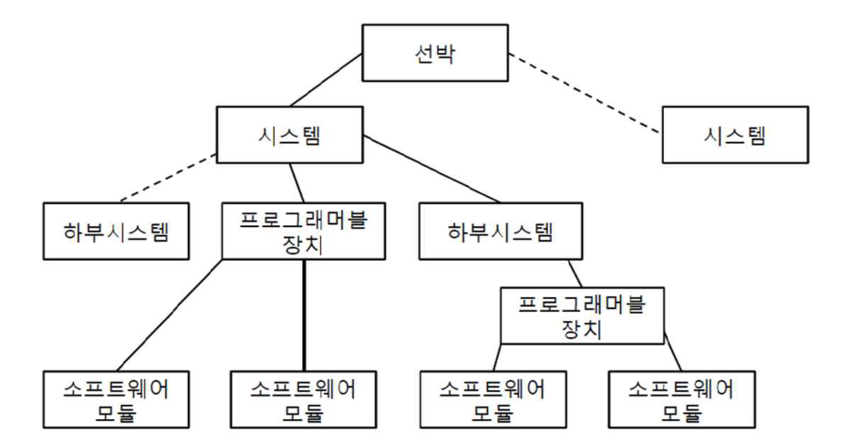
**그림 6.2.1 시스템 체계의 예시**
> 설명: 최상위 '선박' 아래에 '시스템'(실선)과 또 다른 '시스템'(점선)이 연결되고, '시스템'은 '하부시스템'(점선), '프로그래머블 장치', '하부시스템'(실선)으로 분기하는 계층도이다. 왼쪽 '프로그래머블 장치' 아래에 '소프트웨어 모듈' 2개가, 오른쪽 '하부시스템' 아래의 '프로그래머블 장치' 아래에 '소프트웨어 모듈' 2개가 연결되어 있다.

비고: 점선은 도형에서 개발되지 않은 분기를 나타낸다.

#### 402. 시스템 및 구성요소의 승인

**1. 시스템 인증**

(1) 카테고리 II 또는 카테고리 III(아래 403.의 1항에서 정의됨)의 선박 기능을 수행하는 데 필요한 컴퓨터기반시스템은 선박별 선급 증서와 함께 제공되어야 한다. 선박별 시스템 인증의 목적은 시스템의 설계 및 제조가 완료되었으며 시스템이 우리 선급의 해당 규칙을 준수함을 확인하는 것이다.

(2) 선박별 시스템 인증은 두 가지 주요 검증 활동으로 구성된다.

(가) 선박별 문서 평가 (404.의 2항 및 406. 참조)

(나) 선박에 인도될 시스템에 대한 검사 및 시험 (404.의 2항 (7)호 참조).

(3) 우리 선급은 요건이 충족되고 시스템이 선박별 증서와 함께 제공되는 경우 대체인증제도(ACS)를 승인할 수 있다.

**2. 컴퓨터기반시스템의 형식승인**

(1) 일상적으로 제조되고 표준화된 소프트웨어 기능을 포함하는 컴퓨터기반시스템은 우리 선급의 지정된 규칙에 따라 형식승인을 받을 수 있다. 하드웨어는 404.의 2항 (4)호의 요건에 따라 문서화되어야 한다.

(2) 형식승인은 두 가지 주요 검증 활동으로 구성된다.

(가) 형식별 문서 평가

(나) 표준화된 기능에 대한 검사 및 시험

(3) 선박별 기능, 파라미터 구성 및 설치 요소는 선박별 검증이 필요하기 때문에 형식승인은 일반적으로 선박별 시스템 인증을 면제하지 않는다.

#### 403. 시스템 카테고리

**1. 시스템 카테고리 정의**

(1) 이 절에서의 시스템 카테고리는 해당 기능을 제공하는 시스템이 장애를 일으키는 경우 발생할 수 있는 결과의 잠재적 심각성을 기준으로 한다. **표 6.2.2**에는 카테고리의 정의이다.

**표 6.2.2 시스템 카테고리**

<table>
<thead>
<tr><th>카테고리</th><th>고장 영향</th><th>일반적인 시스템의 기능</th></tr>
</thead>
<tbody>
<tr><td>I</td><td>고장이 인명안전, 선박안전 및/또는 환경에 위협이 되는 위험한 상황으로 귀결되지 않는 시스템</td><td>- 감시, 정보제공 및 관리 기능</td></tr>
<tr><td>Ⅱ</td><td>고장이 인명안전, 선박안전 및/또는 환경에 위협이 되는 위험한 상황으로 궁극적으로 귀결될 수 있는 시스템</td><td>- 선박을 정상적인 운항 및 거주 가능한 상태로 유지하는 데 필요한 선박 경보, 감시 및 제어 기능</td></tr>
<tr><td>Ⅲ</td><td>고장이 인명안전, 선박안전 및/또는 환경에 위협이 되는 위험하거나 치명적인 상황으로 즉시 귀결될 수 있는 시스템</td><td>- 선박의 추진 및 조타를 유지하기 위한 제어기능 - 선박의 안전기능</td></tr>
</tbody>
</table>

**2. 선급의 범위**

(1) 카테고리 I 시스템은 일반적으로 이러한 시스템의 고장이 위험한 상황으로 이어지지 않으므로 우리 선급의 검증 대상이 아니다. 다만, 카테고리 I 시스템과 관련된 정보는 올바른 카테고리를 결정하거나 카테고리 II 및 카테고리 III의 시스템 운영에 영향을 미치지 않게 하도록 요청 시 제공되어야 한다.

**3. 시스템 카테고리 예시**

(1) 시스템 카테고리는 항상 해당 특정 선박의 맥락에서 평가되어야 하며, 따라서 시스템 카테고리는 선박마다 다를 수 있다. 이에 따라 아래의 카테고리 예시는 참고용으로만 제공된다. 특정 선박에 대한 시스템 카테고리를 결정하려면 404.의 3항 (3)호를 참조할 것.

(2) 카테고리 I 시스템의 예: 연료 감시 시스템, 유지보수 지원 시스템, 진단 및 문제 해결 시스템, CCTV, 선실보안, 엔터테인먼트 시스템, 물고기 탐지 시스템

(3) 카테고리 II 시스템의 예: 연료유 처리 시스템, 추진 및 보조 기계용 경보 감시 및 안전 시스템, 불활성 가스 시스템, 화물격납시스템용 제어, 감시 및 안전 시스템.

(4) 카테고리 III 시스템의 예: 추진 제어시스템, 조타기 제어시스템, 전력시스템(전력관리시스템 포함), DP 시스템(IMO 등급 2 및 3).

(5) 예시 시스템 목록이 전부는 아니다.

#### 404. 컴퓨터기반시스템의 개발 및 인증에 대한 요건

**1. 일반 요건**

(1) 적절한 표준에 따른 수명주기 접근법

(가) 요건

하드웨어 및 소프트웨어의 설계 및 개발과 전체 시스템 수명 주기에 걸친 하위 시스템, 시스템 및 복합시스템에서의 통합에 대해 전반적인 하향식 접근법을 시행해야 한다. 이 접근법은 여기에 나열된 표준 또는 우리 선급이 인정하는 기타 표준을 기반으로 한다.

(나) 선급의 검증

(2)호에 설명된 품질관리시스템 검증의 일부로서 우리 선급에 의해 검증된다.

(2) 품질관리시스템

(가) 시스템 통합자와 시스템 공급자는 카테고리 II 및 카테고리 III용 컴퓨터기반시스템을 개발할 때 IEC/ISO 90003의 원칙을 포함한 ISO 9001과 같은 공인된 품질 표준을 준수해야 한다.

(나) 품질관리시스템에는 최소한 카테고리 II 및 카테고리 III 시스템 모두에 적용되는 **표 6.2.3**가 포함되어야 한다:

**표 6.2.3 품질관리시스템**

<table>
<thead>
<tr><th colspan="2">영역</th><th colspan="2">역할</th></tr>
<tr><th>#</th><th>항목</th><th>시스템 공급자</th><th>시스템 통합자</th></tr>
</thead>
<tbody>
<tr><td>1</td><td>직원의 책임과 역량</td><td>O</td><td>O</td></tr>
<tr><td>2</td><td>제공된 소프트웨어 및 관련 하드웨어의 전체 수명주기</td><td>O</td><td>O</td></tr>
<tr><td>3</td><td>컴퓨터기반시스템, 구성요소 및 버전의 고유 식별을 위한 구체적인 절차</td><td>O</td><td></td></tr>
<tr><td>4</td><td>선박의 시스템 아키텍처 생성 및 업데이트</td><td></td><td>O</td></tr>
<tr><td>5</td><td>공급자로부터 소프트웨어 및 관련 하드웨어를 획득하기 위한 조직 구성</td><td>O</td><td>O</td></tr>
<tr><td>6</td><td>소프트웨어 코드 작성 및 검증을 위한 조직 구성</td><td>O</td><td></td></tr>
<tr><td>7</td><td>선박에 통합하기 전에 시스템 검증을 위한 조직 구성</td><td>O</td><td></td></tr>
<tr><td>8</td><td>FAT 및 SAT에서 시스템 수행 및 승인을 위한 구체적인 절차</td><td>O</td><td>O</td></tr>
<tr><td>9</td><td>시스템 문서 작성 및 업데이트</td><td>O</td><td></td></tr>
<tr><td>10</td><td>조선소 및 선주와의 상호 작용을 포함한 선내 소프트웨어 수정 및 설치에 대한 구체적인 절차</td><td>O</td><td>O</td></tr>
<tr><td>11</td><td>소프트웨어 코드 검증을 위한 구체적인 절차</td><td>O</td><td></td></tr>
<tr><td>12</td><td>시스템을 다른 시스템과 통합하고 선박용 복합시스템을 시험하는 절차</td><td>O</td><td>O</td></tr>
<tr><td>13</td><td>FAT 이전 소프트웨어 및 구성 변경 관리 절차</td><td>O</td><td></td></tr>
<tr><td>14</td><td>FAT 이후 소프트웨어 및 구성 변경 관리 및 문서화 절차</td><td>O</td><td>O</td></tr>
<tr><td>15</td><td>품질관리시스템 준수에 대한 조직 자체의 후속 조치를 위한 체크포인트</td><td>O</td><td>O</td></tr>
</tbody>
</table>

(다) 선급의 검증

품질관리시스템은 두 가지 다른 방법으로 검증할 수 있다.

(a) 국가 인증 제도에 따라 인증을 받은 기관으로부터 품질관리시스템이 공인 표준을 준수하는 것으로 인증되었음을 우리 선급이 확인함.

(b) 품질관리시스템에 대한 특정 평가를 통해 표준을 준수함을 우리 선급이 확인하며, 문서 요건은 사례별로 정의됨.

**2. 시스템 공급자에 대한 요건**

(1) 품질 계획 정의 및 준수

(가) 요건

(a) 시스템 공급자는 납품할 특정 시스템의 설계, 시공, 납품 및 유지보수를 위해 품질관리시스템이 적용되었음을 문서화해야 한다.

(b) 1항 (2)호(시스템 공급자 역할)에 설명된 모든 해당 항목이 존재하고 준수되고 있음을 입증해야 한다(해당되는 경우).

(나) 선급의 검증

(a) 카테고리 I: 문서화를 요구하지 않음

(b) 카테고리 II 및 III: 품질 계획이 검사 기간 동안 제공되거나(FAT) 요청 시 정보용(FI)으로 제출되어야 한다.

(2) 시스템 및 소프트웨어의 고유 식별

(가) 요건

(a) 시스템, 시스템의 여러 소프트웨어 구성요소 및 동일한 소프트웨어 구성요소의 여러 개정판을 고유하게 식별하는 방법을 적용해야 한다. 이 방법은 시스템과 소프트웨어의 수명주기 내내 적용되어야 한다.

(b) 해당 시스템에 대한 관련 기술 요건은 407.의 1항을 참조할 것. 이 방법에 대한 문서는 일반적으로 품질관리시스템의 일부임(1항 (2)호 참조).

(나) 선급의 검증

(a) 카테고리 I: 요구하지 않음

(b) 카테고리 II 및 III: 식별 시스템의 적용은 FAT(2항 (7)호) 및 SAT(3항 (6)호)의 일부로 검증됨

(3) 시스템 설명서

(가) 요건

(a) 시스템의 사양 및 설계를 결정하여 시스템 설명서에 문서화해야 한다. 시스템 설명서의 목적은 세부 설계 및 구현을 위한 사양의 역할을 하는 것 외에도 전체 시스템 제공이 사양에 따르고 관련 규칙 및 규정을 준수한다는 것을 문서화하는 것이다.

(b) 시스템 설명서에는 다음 정보가 포함되어야 한다.

(ⅰ) 안전 측면을 포함한 목적 및 주요 기능

(ⅱ) 정의된 시스템 카테고리

(ⅲ) 주요 성능 특성

(ⅳ) 기술 요건 및 선급 규칙 준수 여부

(ⅴ) 사용자 인터페이스/미믹(mimics)

(ⅵ) 통신 및 인터페이스 측면

- 다른 선박 시스템에 대한 인터페이스 식별 및 설명

(ⅶ) 하드웨어 배치 관련 측면

- 스위치, 라우터, 게이트웨이, 방화벽 등과 같은 모든 네트워크 구성요소를 포함한 네트워크 아키텍처/토폴로지
- 시스템의 모든 인터페이스 및 하드웨어 노드와 관련한 내부 구조 (예: 운영자 스테이션, 디스플레이, 컴퓨터, 프로그래머블 장치, 센서, 액추에이터, I/O 모듈 등)
- I/O 할당 (채널, 통신 링크, 하드웨어 장치, 로직 기능에 대한 필드 장치 매핑)
- 전원 공급장치 배치
- 고장 모드 설명

(c) 위에 나열된 정보는 이 절에서 통칭하여 시스템 설명서라고 한다. 그러나 이는 여러 문서와 모델로 나누어질 수 있다.

(나) 선급의 검증

(a) 카테고리 I: 요청 시 시스템 설명 문서를 정보용(FI)으로 제출해야 한다.

(b) 카테고리 II 및 III: 시스템 설명 문서를 승인용(AP)으로 제출해야 한다.

(4) 하드웨어 구성요소의 환경 규정 준수

(가) 요건

(a) 시스템 및 하위 시스템에 포함된 하드웨어 요소에 대하여 **제조법 및 형식승인 등에 관한 지침 3장 23절**에 따른 환경시험의 증빙자료를 우리 선급에 제출해야 한다.

(나) 선급의 검증

(a) 카테고리 I: 카테고리 I의 요건은 강제사항이 아니며, 요청 시 형식승인 인증 또는 기타 형식시험 증빙자료를 정보용(FI)으로 제출해야 한다(403.의 2항 참조).

(b) 카테고리 II 및 III: 형식승인 증서 또는 기타 형식시험의 증빙자료를 정보용(FI)으로 제출해야 한다.

(5) 소프트웨어 코드 생성, 매개변수화 및 시험

(가) 요건

(a) 프로젝트 납품을 위해 생성, 변경 또는 구성된 소프트웨어는 품질 계획에 설명된 대로 선택한 표준에 따라 개발되고 품질보증활동을 평가받아야 한다.

(b) 품질보증활동은 소프트웨어 구조의 여러 수준에서 수행될 수 있으며, 사용자 지정 소프트웨어와 구성된 구성요소(예: 소프트웨어 라이브러리)를 적절히 모두 포함해야 한다.

(c) 소프트웨어 검증은 최소한 블랙박스 방식에 따라 다음 측면을 검증해야 한다.

(ⅰ) 소프트웨어 구성요소의 매개변수화 및 구성의 정확성, 완전성 및 일관성

(ⅱ) 의도된 기능

(ⅲ) 의도된 견고성

(d) 카테고리 II 및 III에 해당하는 시스템 구성요소의 경우, 수행된 모든 검토, 분석, 테스트 및 기타 검증 활동의 범위, 목적 및 결과를 시험보고서에 문서화해야 한다.

(e) 이 활동에 사용되는 방법 중 일부는 "소프트웨어 단위 시험" 또는 "개발자 시험"이라고도 하며 코드 검토, 정적 또는 동적 코드 분석과 같은 검증 방법도 포함될 수 있다.

(나) 선급의 검증

(a) 카테고리 I: 문서화를 요구하지 않음

(b) 카테고리 II 및 III: 요청 시 소프트웨어 시험보고서를 정보용(FI)으로 제출해야 한다.

(6) FAT 전 내부 시스템 시험

(가) 요건

(a) 시스템은 가능한 한 FAT 전에 시험되어야 한다. 시스템 시험의 주요 목적은 시스템 공급자가 전체 시스템 납품이 사양, 승인된 문서에 따르고 관련 규칙 및 규정을 준수하는지, 나아가 시스템이 완성되어 FAT를 위한 준비가 되어 있는지 확인하는 것이다.

(b) 시험은 최소한 시스템의 다음 측면을 확인해야 한다.

(ⅰ) 기능

(ⅱ) 결함 및 고장의 영향(진단 기능, 탐지, 경고 대응 포함)

(ⅲ) 성능

(ⅳ) 소프트웨어와 하드웨어 구성요소 간의 통합

(ⅴ) 인간-기계 인터페이스

(ⅵ) 여러 시스템 간의 인터페이스

(c) 결함은 가능한 한 현실적으로 시뮬레이션하여 적절한 시스템 결함 감지 및 시스템 응답을 입증해야 한다.

(d) 일부 시험은 시뮬레이터 및 복제 하드웨어를 활용하여 수행할 수 있다.

(e) 시험 환경에 영향을 미치는 시뮬레이터, 에뮬레이터(emulators), 시험 스터브(test-stubs), 시험 관리 도구 또는 기타 도구에 대한 설명과 그 한계를 포함하여 시험 환경을 문서화해야 한다.

(f) 시험 사례와 시험 결과는 각각 시험 프로그램과 시험보고서에 문서화해야 한다.

(나) 선급의 검증

(a) 카테고리 I: 문서화를 요구하지 않음

(b) 카테고리 II 및 III: 내부 시스템 시험보고서를 FAT 기간 동안 제공하거나 요청 시 제출해야 한다(FI).

(7) 선내 설치 전 공장승인시험(FAT)

(가) 요건

(a) 해당 시스템에 대해 공장승인시험(FAT)을 실시해야 한다. FAT의 주요 목적은 시스템이 완성되고 선급 규칙을 준수한다는 것을 우리 선급에 입증하여 해당 시스템에 대한 선급 증서를 발급하는 것이다.

(b) FAT 시험 프로그램은 정상적인 시스템 기능 및 고장에 대한 대응을 포함하여 내부 시스템 시험((6)호에 설명된)의 시험 항목 중 대표적으로 선택된 항목을 다루어야 한다.

(c) 카테고리 II 및 III 시스템의 경우, 407.의 2항 (1)호의 네트워크 복원력 요건을 확인하기 위한 네트워크 시험을 시행해야 한다. 모든 당사자가 동의하는 경우, 네트워크 시험은 선내에서 시스템 시험의 일부로 시행될 수 있다.

(d) FAT는 원칙적으로 선상에 설치될 실제 하드웨어 구성요소에서 작동하는 프로젝트별 소프트웨어와 기능 및 장애 대응 시뮬레이션에 필요한 수단을 사용하여 수행되어야 하지만, 복제 하드웨어 또는 시뮬레이션 하드웨어(에뮬레이터)와 같은 다른 솔루션은 우리 선급과 합의할 수 있다.

(e) 각 시험 사례에 대해 시험 합격 또는 불합격 여부를 기록하고 시험 결과를 시험보고서에 문서화해야 한다. 시험보고서에는 시험을 시행할 때 시스템에 설치된 소프트웨어(소프트웨어 버전 포함) 목록도 포함되어야 한다.

(f) 복잡한 시스템(complex systems)의 경우 “FAT 전 내부 시스템 시험” 활동과 FAT 사이에 큰 범위의 차이가 있을 수 있으며, 일부 시스템의 경우 범위가 동일할 수도 있다.

(나) 선급의 검증

(a) 카테고리 I: FAT를 요구하지 않음.

(b) 카테고리 II 및 III: FAT 프로그램은 시험 시행 전에 승인(AP)을 받아야 한다.

(ⅰ) FAT 시행은 우리 선급의 검사원 입회하에 이루어져야 한다.

(ⅱ) FAT 보고서를 정보용(FI)으로 제출해야 한다.

(ⅲ) 사용자 매뉴얼 및 내부 시스템 시험보고서를 포함한 추가 FAT 문서는 FAT 중에 제공되거나 요청 시 정보용(FI)으로 제출해야 한다.

(8) 선박에 안전하고 통제된 소프트웨어 설치

(가) 요건

(a) 시스템의 소프트웨어 구성요소의 초기 설치 및 후속 업데이트는 시스템 공급자와 시스템 통합자 간에 합의된 변경 관리 절차에 따라 수행되어야 한다.

(b) 변경 절차 관리는 406.의 요건을 준수해야 한다.

(c) 사이버 보안 조치는 **선박 및 시스템의 사이버복원력 지침**에 따라야 한다.

(나) 선급의 검증

(a) 카테고리 I: 요구되지 않음

(b) 카테고리 II 및 III: 요청 시 변경 절차 관리를 정보용(FI)으로 제출해야 한다.

**3. 시스템 통합자에 대한 요건**

(1) 책임

이 절의 목적상, 조선소가 명시적으로 다른 조직이나 개인을 지정하지 않는 한 조선소는 개발 및 납품 단계에서 시스템 통합자로 간주된다.

(2) 품질 계획 정의 및 준수

(가) 요건

(a) 시스템 통합자는 선상에 설치될 시스템의 설치, 통합, 완료 및 유지보수를 위해 품질관리시스템이 적용되었음을 문서화해야 한다. 1항 (2)호(시스템 통합자 역할에 대한)에 설명된 모든 해당 항목이 존재하고 준수되고 있음을 입증해야 한다(해당되는 경우).

(나) 선급의 검증

(a) 카테고리 I: 문서화를 요구하지 않음

(b) 카테고리 II 및 III: 품질 계획을 검사 동안(SAT/SOST) 제공해야 하며 요청시 정보용(FI)으로 제출해야 한다.

(3) 해당 시스템의 카테고리 결정

(가) 요건

(a) 특정 선박에 시스템을 납품할 때마다 시스템의 고장 영향(403.에 정의된 바와 같이)에 따라 해당 시스템이 어느 카테고리에 속하는지 결정해야 한다. 특정 시스템에 대한 카테고리는 관련 시스템 공급자에 전달되어야 한다. 우리 선급은 적절한 시스템 카테고리를 검증하기 위해 위험도 평가가 필요하다고 결정할 수 있다.

(나) 선급의 검증

(a) 카테고리 I, II 및 III: 요청 시 여러 시스템에 대한 카테고리를 문서화하여 승인용(AP)으로 제출해야 한다.

(4) 시스템의 위험도 평가

(가) 요건

(a) 우리 선급이 요청할 경우, 해당 시스템에 적용 가능한 카테고리를 결정하기 위해 해당 선박과 관련된 특정 시스템에 대한 위험도 평가를 수행하여 문서화해야 한다.

(b) 위험도 평가 방법을 결정하기 위해 IEC/ISO 31010 "Risk management – Risk assessment techniques"를 지침으로 사용할 수 있다.

(나) 선급의 검증

(a) 카테고리 I, II 및 III: 요청 시 위험도 평가 보고서를 승인용(AP)으로 제출해야 한다.

(5) 선박의 시스템 아키텍처 정의

(가) 요건

(a) 복합시스템(SoS)을 지정하고 문서화해야 한다. 이 아키텍처 사양은 개별 시스템에 기능을 할당하고 시스템 간의 주요 인터페이스를 식별하여 다양한 통합시스템의 카테고리 결정 및 개발을 위한 기초를 제공한다. 또한 선박 수준에서 통합시스템을 시험하기 위한 기초로도 사용된다(3항 (7)호 참조).

(b) 선박의 시스템 아키텍처에는 최소한 다음 설명이 포함되어야 한다:

(ⅰ) 전체 시스템 아키텍처의 개요(복합시스템)

(ⅱ) 각 시스템의 목적 및 주요 기능

(ⅲ) 여러 시스템 간의 통신 및 인터페이스 측면

(c) 보안 구역 및 경로에 대한 다이어그램은 **선박 및 시스템의 사이버복원력 지침 1장**을 참조한다.

(나) 선급의 검증

(a) 카테고리 I, II 및 III: 요청 시 선박의 시스템 아키텍처를 정보용(FI)으로 제출해야 한다.

(6) 선상에서 시스템승인시험(SAT) 실시

(가) 요건

(a) 시스템승인시험은 선상에서 실시되어야 한다. 시스템승인시험의 주요 목적은 다른 제어 및 감시 시스템과의 가능한 인터페이스를 포함하여 선상에 있는 해당 기관/전기/프로세스 시스템과 설치 및 통합 후 시스템 기능을 검증하는 것이다.

(b) 각 시험 사례에 대해 시험 합격 또는 불합격 여부를 기록하고 시험 결과를 시험보고서에 문서화해야 한다. 시험보고서에는 시험을 시행할 때 시스템에 설치된 소프트웨어(소프트웨어 버전 포함) 목록도 포함되어야 한다.

(나) 선급의 검증

(a) 카테고리 I: 요구되지 않음

(b) 카테고리 II 및 III: 시험 시행 전 SAT 프로그램을 승인용(AP)으로 제출해야 한다.

(ⅰ) SAT 시행은 우리 선급의 검사원 입회하에 이루어져야 한다.

(ⅱ) SAT 보고서를 정보용(FI)으로 제출해야 한다.

(7) 선박 수준에서의 통합시스템 시험(SOST)

(가) 요건

(a) 통합 시험은 선상 최종 환경에서 여러 시스템을 설치 및 통합한 후 시행되어야 한다. 시험의 목적은 요건 및 사양에 따라 모든 인터페이스 및 상호 의존성을 포함한 전체 설비(복합시스템)의 기능을 검증하는 것이다.

(b) 시험은 최소한 복합시스템의 다음 측면을 검증해야 한다.

(ⅰ) 상호 작용하는 시스템 전체의 전반적인 기능

(ⅱ) 시스템 간의 고장 대응

(ⅲ) 성능

(ⅳ) 인간-기계 인터페이스

(ⅴ) 여러 시스템 간의 인터페이스

(c) 복잡한 시스템(complex systems)의 경우 “선내 시스템승인시험(SAT)” 활동과 SOST 사이에 큰 범위 차이가 있을 수 있으며, 일부 시스템의 경우 범위가 겹치거나 동일할 수도 있다. 시험 범위가 유사한 경우 두 활동을 하나로 통합할 수 있다.

(나) 선급의 검증

(a) 카테고리 I: 요구하지 않음

(b) 카테고리 II 및 III: 시험 시행 전 SOST 프로그램을 승인용(AP)으로 제출해야 한다.

(ⅰ) SOST 시행은 우리 선급의 검사원 입회하에 이루어져야 한다.

(ⅱ) SOST 보고서를 정보용(FI)으로 제출해야 한다.

(8) 변경 관리

(가) 요건

(a) 시스템 통합자는 406.에 설명된 대로 시스템 변경 관리 절차를 따라야 한다.

(나) 선급의 검증

(a) 카테고리 I: 문서화를 요구하지 않음

(b) 카테고리 II 및 III: 요청 시 변경 관리 절차를 정보용(FI)으로 제출해야 한다.

#### 405. 컴퓨터기반시스템의 유지보수에 대한 요건

**1. 선주에 대한 요건**

(1) 책임

(가) 이 절의 목적상, 선주가 다른 조직이나 개인을 명시하지 않는 한, 선주는 운영단계에서 시스템 통합자로 간주된다.

(나) 따라서, 선주는 시스템 공급자와 함께 시스템에 대한 변경사항을 이행할 책임이 있는 지정된 시스템 통합자에 대해 우리 선급에 적시에 통보해야 한다.

**2. 시스템 통합자에 대한 요건**

(1) 변경 관리

(가) 요건

(a) 시스템 통합자는 소프트웨어 및 하드웨어 변경 관리에 필요한 절차가 선내에 존재하고 소프트웨어 수정/업그레이드가 절차에 따라 수행되는지 확인해야 한다. 변경 관리에 대한 자세한 내용은 406.을 참조할 것.

(b) 운영단계의 컴퓨터기반시스템에 대한 변경사항을 기록해야 한다.

(c) 기록에는 관련 소프트웨어 버전에 대한 정보 및 406.의 11항에 설명된 기타 관련 정보가 포함되어야 한다.

(나) 선급의 검증

(a) 카테고리 I: 문서화를 요구하지 않음

(b) 카테고리 II 및 III: 406.의 12항 참조.

**3. 시스템 공급자에 대한 요건**

(1) 변경 관리

(가) 요건

(a) 시스템 공급자는 406.에 설명된 변경 관리 절차를 포함한 시스템 유지보수 절차를 따라야 한다.

(나) 선급의 검증

(a) 카테고리 I: 문서화를 요구하지 않음

(b) 카테고리 II 및 III: 406.의 12항 참조.

(2) 선상 설치 전 변경 사항 시험

(가) 요건

(a) 시스템 공급자는 계획된 시스템 변경이 선내 시스템에 적용되기 전에 관련 내부 시험을 통과했는지 확인해야 한다.

(나) 선급의 검증

(a) 카테고리 I: 문서화를 요구하지 않음

(b) 카테고리 II 및 III: 406.의 12항 참조.

#### 406. 변경 관리

**1. 일반사항**

(1) 이 조는 컴퓨터기반시스템의 수명주기 전반에 걸친 변경 관리에 대한 요건을 제공한다.

(2) 시스템 수명주기의 특정 단계마다 일반적으로 다양한 이해관계자가 관여하기 때문에 변경 관리를 위한 여러 절차가 정의될 수 있다.

(3) 선급의 검증은 12항에 설명되어 있다.

**2. 변경 관리 절차 문서화**

(1) 요건

(가) 조직은 하드웨어와 소프트웨어를 모두 포함하는 해당 컴퓨터기반시스템에 적용 가능한 변경 관리 절차를 정의하고 문서화해야 한다.

(나) FAT 이후 시스템 공급자는 절차에 따라 시스템에 대한 모든 변경사항을 관리해야 한다. 예를 들어 획득한 소프트웨어의 새 버전, 새 하드웨어, 수정된 제어 로직, 구성가능한 매개변수 변경에 대한 인증 등이 있다.

(다) 절차는 최소한 3항부터 11항에 나열된 활동을 설명해야 한다.

(라) 406.의 8항의 영향 분석 결과에 따라 3항부터 12항의 활동을 어느 정도 수행해야 하는지가 결정된다.

(마) 변경 기록(11항에서 설명)을 항상 작성해야 한다.

**3. 관련 이해관계자 간의 합의**

(1) 요건

(가) 변경 관리 프로세스는 컴퓨터기반시스템의 수명주기의 여러 단계에 따라 관련 이해관계자 간에 조율되고 합의되어야 한다.

(나) 일반적으로 변경 관리는 최소 세 가지 단계를 거친다.

(a) FAT 전 개발 및 내부 검증; 시스템 공급자와 하위 공급자가 참여함.

(b) FAT부터 선박을 선주에게 인도할 때까지; 시스템 공급자, 시스템 통합자, 선급 및 선주가 참여함.

(c) 운항 중; 시스템 공급자, 서비스 공급자, 선주 및 선급이 참여함.

**4. 승인된 소프트웨어의 변경 관리**

(1) 요건: 해당 이해관계자(일반적으로 시스템 통합자 및 FAT의 선급)의 승인을 받은 후 시스템에 변경이 필요한 경우, 정의된 변경 관리 절차에 따라 수정해야 한다.

**5. 시스템 및 소프트웨어 버전 고유 식별**

(1) 요건: 시스템 공급자는 각 시스템 및 소프트웨어 버전을 고유하게 식별할 수 있도록 해야 한다(404.의 2항 (2)호 참조).

**6. 소프트웨어 마스터 파일의 취급**

(1) 요건: 소프트웨어 구성요소의 마스터 파일을 구성하는 파일을 처리하기 위한 정의된 메커니즘이 있어야 한다. 마스터 파일의 무결성을 보장하기 위해 사용되는 도구 및 메커니즘과 함께 인사 권한이 명확하게 정의되어야 한다.

**7. 선내 소프트웨어의 백업 및 복원**

(1) 요건: 선박에 탑재된 컴퓨터기반시스템의 소프트웨어 구성요소의 백업 및 복원 수행 방법을 명확하게 정의해야 한다.

**8. 변경 전 영향 분석**

(1) 요건: 시스템을 변경하기 전에 다음을 위해 영향 분석을 수행해야 한다.

(가) 변경의 중요도 결정

(나) 기존 문서에 미치는 영향 결정

(다) 필요한 검증 및 시험 활동 결정

(라) 다른 이해관계자에게 변경 사항을 알릴 필요성 결정

(마) 변경 전 다른 이해관계자(예: 선급 및/또는 선주)의 승인을 받아야 할 필요성 결정

**9. 소프트웨어 변경 실패 시 롤백(Roll-back)**

(1) 요건

(가) 시스템에 새 버전의 소프트웨어를 설치하는 것이 유지보수에 포함된 경우, 시스템을 알려진 안정적인 상태로 되돌리기 위해 소프트웨어를 이전에 설치된 버전으로 롤백할 수 있어야 한다.

(나) 롤백은 근본 원인을 찾아 제거하기 위해 문서화 및 분석되어야 한다.

**10. 시스템 변경 사항의 검증 및 확인**

(1) 요건

(가) 변경 사항은 선내에 설치하기 전에 현실적으로 가능한 최대한의 수준으로 검증되어야 한다.

(나) 설치 후에는 다음 사항이 포함된 문서화된 검증 프로그램에 따라 선내에서 검증해야 한다.

(a) 새로운 기능 및/또는 개선사항이 의도한 효과를 가져왔는지 검증함

(b) 복귀 시험을 통해 수정사항이 영향을 받을 것으로 예상되지 않았던 기능이나 성능에 부정적인 영향을 미치지 않았는지 확인함

**11. 변경 기록**

(1) 시스템 및 소프트웨어에 대한 변경사항을 변경 기록에 문서화하여 가시화하고 변경 사항을 추적할 수 있도록 해야 한다. 변경 기록에는 최소한 다음 항목이 포함되어야 한다.

(가) 변경 목적

(나) 변경 및 수정에 대한 설명

(다) 영향 분석의 주요 결론 (8항 참조)

(라) 새로운 시스템 또는 소프트웨어 버전의 식별 및 버전 (5항 참조)

(마) 시험보고서 또는 시험 요약 (10항 참조)

(2) 소프트웨어 변경에 대한 문서는 예방정비제도(PMS), 소프트웨어 레지스트리 또는 이에 상응하는 문서에 기록될 수 있다.

**12. 선급의 변경 관리 검증**

(1) 운항 중 단계 (현존선)

(가) 운항 중인 선박의 변경 관리와 관련된 우리 선급의 검증은 일반적으로 선박의 연차검사 중에 수행된다. 변경 관리 절차 및 관련 변경 기록(11항 참조)은 검사 시점에 제공되어야 한다.

(나) 우리 선급의 사전 승인이 필요한 변경사항인 경우, 해당 변경에 대한 관련 절차 및 문서는 검사 시 확인될 수 있다.

(2) 건조 중 단계 (신조선)

(가) 건조 증 단계에서의 변경 관리 검증은 품질관리시스템 검증(404.의 1항 (2)호)의 일부로 절차를 검증하고, 프로젝트별 절차 이행은 FAT(404.의 2항 (7)호) 동안 및 FAT 이후((1)호)에 검증되는 두 가지로 나뉜다.

#### 407. 컴퓨터기반시스템에 대한 기술 요건

아래에서 설명하는 컴퓨터기반시스템에 대한 기술 요건의 준수 여부는 설계 문서에 문서화되어야 하며(404.의 2항 (3)호 참조), 이 절에 설명된 검증 활동을 통해 검증되어야 한다.

**1. 시스템 및 소프트웨어 식별 및 버전 기록**

(1) 시스템 식별

(가) 시스템은 이름, 버전, 식별자 및 제조업체를 식별할 수 있는 수단을 제공해야 한다. 시스템이 국제 표준 ISO 24060에 명시된 대로 선박 소프트웨어 로깅 시스템(SSLS)에 소프트웨어의 상태를 자동으로 기록할 수 있도록 하는 것이 권고된다.

**2. 데이터링크**

(1) 카테고리 II 및 III 시스템에 대한 일반 요건

데이터링크의 손실은 위험도 평가 분석/FMEA에서 구체적으로 다루어 져야 한다. 404.의 2항 (3)호를 참조할 것.

(가) 데이터링크의 단일고장으로 인해 카테고리 III의 선박 기능이 손실되지 않아야 한다. 이러한 고장의 영향은 서비스 중인 선박 기능에 대한 페일세이프 원칙을 충족해야 한다.

(나) 카테고리 II 및 III의 선박 기능의 경우, 원격제어시스템의 기능 손실은 기계측/수동 수단으로 보상되어야 한다.

(다) 데이터링크에는 과도한 통신 속도를 방지하거나 대처할 수 있는 수단이 있어야 한다.

(라) 데이터링크는 자체 점검이 가능하여 링크 자체의 고장 또는 성능 문제와 링크에 연결된 노드의 데이터 통신 고장을 감지할 수 있어야 한다.

(마) 고장이 감지되면 경보를 발생해야 한다.

(2) 무선 데이터링크에 대한 특별 요건

(가) 카테고리 III 시스템은 우리 선급이 인정하는 국제표준 또는 국가표준에 따라 수행된 엔지니어링 분석에 근거하여 우리 선급이 특별히 고려하지 않는 한 무선 데이터링크를 사용해서는 아니 된다.

(나) 카테고리 I, II 시스템은 다음 요건을 충족하는 무선 데이터링크를 사용할 수 있다.

(a) 공인된 국제 무선 통신 시스템 프로토콜을 사용해야 하며, 다음 사항을 통합해야 한다.

(ⅰ) 메시지 무결성: 전송된 메시지와 비교했을 때 수신된 메시지가 손상되거나 변경되지 않도록 결함 예방, 탐지, 진단 및 수정.

(ⅱ) 구성 및 장치 인증: 시스템 설계에 포함된 장치만 연결할 수 있도록 허용해야 함.

(ⅲ) 메시지 암호화: 데이터 콘텐츠의 기밀성 및/또는 중요성 보호.

(ⅳ) 보안 관리: 네트워크 자산 보호, 네트워크 자산에 대한 무단 접근 방지.

(b) 선박 내부 무선 시스템은 국제전기통신연합(ITU)의 무선 주파수 및 전력 레벨 요건과 기국 요건을 준수해야 한다.

(c) 주파수 및 전력 레벨 제한으로 인해 무선 데이터 통신 링크의 작동을 금지하는 무선 주파수 전송 사용과 관련된 항만국 및 현지 규정을 고려하여 시스템을 운영해야 한다.

(d) 무선 데이터 통신 장비의 경우, 예상 운영 조건에서 무선 주파수 전송이 장비의 고장을 일으키지 않으며 전자기 간섭으로 인해 자체 고장이 발생하지 않음을 입증하기 위해 정박 중 및 해상시운전 중에 시험을 수행헤야 한다.

**3. 선급의 기술 요건 검증**

(1) 이 조에 제공된 기술 요건의 이행은 위에서 설명한 시스템 설명(404.의 2항 (3)호), FAT(404.의 2항 (7)호) 및 SAT(404.의 3항 (6)호)의 일부로서 우리 선급에 의해 검증된다.

#### 408. 제출 문서 요약

아래 **표 6.2.4**와 **표 6.2.5**에는 우리 선급에 제출해야 할 문서가 요약되어 있다.

**표 6.2.4 시스템 공급자의 제출 문서 요약**

<table>
<thead>
<tr><th colspan="2">항목</th><th colspan="3">시스템 카테고리</th></tr>
<tr><th>단락 참조</th><th>문서</th><th>Cat I</th><th>Cat II</th><th>Cat III</th></tr>
</thead>
<tbody>
<tr><td>404. 2 (1)</td><td>품질 계획</td><td>-</td><td>FI on req.</td><td>FI on req.</td></tr>
<tr><td>404. 2 (3)</td><td>시스템 설명</td><td>FI on req.</td><td>AP</td><td>AP</td></tr>
<tr><td>404. 2 (4)</td><td>환경 규정 준수</td><td>FI on req.</td><td>FI</td><td>FI</td></tr>
<tr><td>404. 2 (5)</td><td>소프트웨어 시험보고서</td><td>-</td><td>FI on req.</td><td>FI on req.</td></tr>
<tr><td>404. 2 (6)</td><td>시스템 시험보고서</td><td>-</td><td>FI on req.</td><td>FI on req.</td></tr>
<tr><td>404. 2 (7)</td><td>FAT 프로그램</td><td>-</td><td>AP</td><td>AP</td></tr>
<tr><td>404. 2 (7)</td><td>FAT 보고서</td><td>-</td><td>FI</td><td>FI</td></tr>
<tr><td>404. 2 (7)</td><td>추가 FAT 문서 (예: 사용자 설명서 등)</td><td>-</td><td>FI on req.</td><td>FI on req.</td></tr>
<tr><td>404. 2 (8)</td><td>변경 관리 절차</td><td>-</td><td>FI on req.</td><td>FI on req.</td></tr>
</tbody>
</table>

(범례)

AP = 승인용, FI = 참고용, “-“ = 요구하지 않음, on req. = 우리 선급이 요청 시

**표 6.2.5 시스템 통합자의 제출 문서 요약**

<table>
<thead>
<tr><th colspan="2">항목</th><th colspan="3">시스템 카테고리</th></tr>
<tr><th>단락 참조</th><th>문서</th><th>Cat I</th><th>Cat II</th><th>Cat III</th></tr>
</thead>
<tbody>
<tr><td>404. 3 (2)</td><td>품질 계획</td><td>-</td><td>FI on req.</td><td>FI on req.</td></tr>
<tr><td>404. 3 (3)</td><td>시스템 카테고리 목록</td><td>AP on req.</td><td>AP on req.</td><td>AP on req.</td></tr>
<tr><td>404. 3 (4)</td><td>위험도 평가 보고서</td><td>AP on req.</td><td>AP on req.</td><td>AP on req.</td></tr>
<tr><td>404. 3 (5)</td><td>선박의 시스템 아키텍처</td><td>-</td><td>FI on req.</td><td>FI on req.</td></tr>
<tr><td>404. 3 (6)</td><td>SAT 프로그램</td><td>-</td><td>AP</td><td>AP</td></tr>
<tr><td>404. 3 (6)</td><td>SAT 보고서</td><td>-</td><td>FI</td><td>FI</td></tr>
<tr><td>404. 3 (7)</td><td>SOST 프로그램</td><td>-</td><td>AP</td><td>AP</td></tr>
<tr><td>404. 3 (7)</td><td>SOST 보고서</td><td>-</td><td>FI</td><td>FI</td></tr>
<tr><td>404. 3 (8)</td><td>소프트웨어 변경 관리 절차</td><td>-</td><td>FI on req.</td><td>FI on req.</td></tr>
</tbody>
</table>

(범례) 
AP = 승인용, FI = 참고용, “-“ = 요구하지 않음, on req. = 우리 선급이 요청 시

#### 409. 시험 입회 및 검사 요약

아래 **표 6.2.6**에는 우리 선급 검사원이 입회하거나 검사해야 하는 활동이 요약되어 있다. 담당 역할은 검사원의 활동을 가능하게 해야 한다.

**표 6.2.6 시험 입회 및 검사 요약**

<table>
<thead>
<tr><th colspan="2">항목</th><th rowspan="2">담당 역할</th><th colspan="3">시스템 카테고리</th></tr>
<tr><th>단락 참조</th><th>활동</th><th>Cat I</th><th>Cat II</th><th>Cat III</th></tr>
</thead>
<tbody>
<tr><td>404. 2 (7)</td><td>FAT 입회</td><td>시스템 공급자</td><td>-</td><td>X</td><td>X</td></tr>
<tr><td>404. 3 (6)</td><td>SAT 입회</td><td>시스템 통합자</td><td>-</td><td>X</td><td>X</td></tr>
<tr><td>404. 3 (7)</td><td>SOST 입회</td><td>시스템 통합자</td><td>-</td><td>X</td><td>X</td></tr>
<tr><td>406. 12</td><td>변경사항 검증</td><td>시스템 통합자</td><td>-</td><td>X</td><td>X</td></tr>
</tbody>
</table>

(범례) 
“X“ = 입회가 요구됨, “-“ = 입회가 요구되지 않음

2026 
선급 및 강선규칙 적용지침

# 제 6 편 전기설비 및 제어시스템

GA-06-K　한 국 선 급

**「적용지침의 적용」**

이 적용지침은 선급 및 강선규칙을 적용함에 있어 규칙 적용상 통일을 기할 필요가 있는 사항 및 규칙에 상세히 규정하지 않은 사항 등에 대하여 정한 것으로서 해당 규정에 추가하여 이 적용지침에서 정하는 바에 따르는 것을 원칙으로 한다. 
다만, 이 적용지침에서 정하는 것과 동등하다고 우리 선급이 인정하는 경우에는 별도로 고려할 수 있다.

**제 6 편 “전기설비 및 제어시스템”의 적용**

1. 이 지침은 별도로 명시하는 것을 제외하고 2026년 7월 1일 이후 건조 계약되는 선박에 적용한다.
2. 2025년판 지침에 대한 개정사항 및 그 적용일자는 아래와 같다.

**적용일자 : 2026년 1월 1일 (건조계약일 기준, 관련 회보번호: 2025-13-E)**

- **제 1 장 전기설비**
  - **제 5 절 케이블**
    - 504.의 1항 (3)호를 개정함.
  - **제 16 절 전기추진설비**
    - 1603.의 1항을 신설함.

**적용일자 : 2026년 7월 1일 (건조계약일 기준)**

- **제 1 장 전기설비**
  - **제 2 절 시스템 설계**
    - 201.의 2항 (3)호를 개정함.
    - 표 6.1.7을 개정함.
    - 203.의 2항 (2)호를 개정함.
  - **제 3 절 회전기계**
    - 309.의 5항 (2)호를 개정함.
  - **제 13 절 축전지**
    - 1306.의 1항을 개정함.

**차 례**

- **제 1 장 전기설비**
  - 제 1 절 일반사항
  - 제 2 절 시스템 설계
  - 제 3 절 회전기계
  - 제 4 절 배전반, 구전반 및 분전반
  - 제 5 절 케이블
  - 제 6 절 동력 및 조명용 변압기
  - 제 7 절 전동기용 제어기 및 전자브레이크
  - 제 8 절 퓨즈, 차단기 및 전자접촉기
  - 제 9 절 방폭형 전기기기
  - 제 10 절 조명기구, 전열기구, 배선기구 및 기타 설비
  - 제 11 절 선내 통신 장치
  - 제 12 절 반도체 전력변환장치
  - 제 13 절 축전지
  - 제 15 절 고전압 전기설비
  - 제 16 절 전기추진설비
  - 제 18 절 예비품 및 일반비품
- **제 2 장 제어설비**
  - 제 1 절 일반사항
  - 제 2 절 시스템 및 제어
  - 제 3 절 시험

## 제 1 장 전기설비

### 제 1 절 일반사항

#### 101. 일반사항

**1. 적용 【규칙 참조】**

(1) **규칙 6편 1장**의 규정은 방폭구조를 필요로 하는 경우를 제외하고는 다음의 전기장치에는 적용하지 아니 한다.

(가) 국제법 또는 선적국의 국내법에 따라 설치되는 무선전신(전화)장치

(나) 국제법 또는 선적국의 국내법에 따라 설치되는 항해장치(「74 SOLAS의 2009년 개정」 제5장 19규칙에서 정하는 것)

(2) 작업용, 하역용 및 화물용 전기기기와 텔레비젼, 라디오 등 전자제품에 대해서는 전기로 인한 감전 및 화재, 기타 재해의 방호(방폭대책을 포함)에 관한 규정을 제외하고 **규칙 6편 1장**을 적용하지 아니한다. 규칙이 적용되지 아니하는 전기기기에 대해서도 가능한 한 KS규격에 적합한 것이어야 한다.

(3) (1)호 및 (2)호에 해당하는 전기장치 또는 전기기기에 접속되는 케이블 및 보호장치(차단기 및 퓨즈)는 **규칙 6편 1장**의 규정에 따라야 한다.

(4) **규칙 101.**의 1항에서 소형선박(500톤 미만), 항로에 제한을 받는 선박은 다음의 어느 것에 해당하는 선박을 말한다.

(가) 총톤수 500톤 미만으로 KRM 0의 기관부호를 갖는 선박 *(2017)*

(나) 총톤수 500톤 미만으로 (가)에 표시된 부호를 갖지 아니하는 선박

(다) 총톤수 500톤 이상으로 (가)에 표시된 부호를 갖는 선박 및 **지침 8편 부록 8-3**의 1항 (1)호 및 (2)호, 3항 (12)호에 적합한 선박

(라) 총톤수 500톤 이상으로 (가)에 표시된 부호를 갖는 선박으로서 **지침 8편 부록 8-3**의 1항 (1)호 및 (2)호, 3항 (12)호에 적합하지 아니 하는 선박

(5) (4)호에 해당하는 선박의 전기설비에 대한 규정의 경감 정도는 (1)호 부터 (3)호에 따르는 이외에 다음에 정하는 바에 따른다.

**(가)부터 (라)에 해당하는 선박의 완화규정** *(2020)*

<table>
<thead>
<tr><th></th><th colspan="2">관련 규정1) (완화 규정)</th><th>(가)</th><th>(나)</th><th>(다)</th><th>(라)</th></tr>
</thead>
<tbody>
<tr><td>(a)</td><td>규칙 201. 6항</td><td>주위조건</td><td>O</td><td></td><td>O</td><td></td></tr>
<tr><td rowspan="2">(b)</td><td>규칙 402. 1항 (1)호</td><td>주배전반의 구조</td><td>O</td><td>O</td><td>O</td><td></td></tr>
<tr><td>규칙 402. 1항 (2)호</td><td>발전기반의 구조</td><td>O</td><td>O</td><td>O</td><td></td></tr>
<tr><td>(c)</td><td>규칙 404. 1항</td><td>선박용 직류발전기의 배전반</td><td>O</td><td></td><td>O</td><td></td></tr>
<tr><td>(d)</td><td>규칙 404. 2항</td><td>선박용 교류발전기의 배전반</td><td>O</td><td></td><td>O</td><td></td></tr>
<tr><td>(e)</td><td>규칙 701. 2항</td><td>집합제어기반</td><td>O</td><td>O</td><td></td><td></td></tr>
<tr><td>(f)</td><td>규칙 504. 3항 (2)호</td><td>케이블의 방화에 대한 고려</td><td>O</td><td>O</td><td>O</td><td></td></tr>
<tr><td>(g)</td><td>규칙 1203.</td><td>보호장치 등</td><td>O</td><td>O</td><td>O</td><td></td></tr>
<tr><td>(h)</td><td>규칙 202. 및 1601. 3항</td><td>주전원</td><td>O</td><td>O2)</td><td>O</td><td></td></tr>
<tr><td>(i)</td><td>규칙 601.</td><td>변압기의 일반사항</td><td>O</td><td></td><td>O</td><td></td></tr>
<tr><td>(j)</td><td>규칙 203.</td><td>비상전원</td><td>O</td><td>O</td><td>O</td><td></td></tr>
<tr><td>(k)</td><td>규칙 204. 6항 (3)호</td><td>항해등 표시기로의 급전회로</td><td>O</td><td>O</td><td>O3)</td><td></td></tr>
<tr><td>(l)</td><td>규칙 1801.</td><td>예비품</td><td>O</td><td></td><td>O</td><td>O</td></tr>
<tr><td>(m)</td><td>규칙 204. 1항 (3)호</td><td>절연감시장치</td><td>O</td><td></td><td></td><td></td></tr>
<tr><td>(n)</td><td>규칙205. [3항 (2)호]</td><td>보호장치 [차단기 및 퓨즈]</td><td>O</td><td></td><td>O4)</td><td></td></tr>
<tr><td>(o)</td><td>규칙 202. 5항</td><td>선박의 추진 및 조타를 위하여 주전원을 필요로 하는 경우</td><td>O</td><td>O</td><td>O</td><td>O</td></tr>
<tr><td>(p)</td><td>규칙 1106.</td><td>선내방송장치</td><td>O</td><td>O</td><td>O</td><td>O</td></tr>
<tr><td>(q)</td><td>규칙 401. 1항 (2)호</td><td>주배전반의 설치장소</td><td>O</td><td></td><td>O</td><td>O</td></tr>
</tbody>
</table>

비고) 
1) : 상세 내용은 (가)에 따른다. 
2) : 상세 내용은 (나)의 (b)에 따른다. 
3) : 상세 내용은 (다)의 (c)에 따른다. 
4) : 상세 내용은 (다)의 (b)에 따른다.

(가) (4)호의 (가)에 해당하는 선박

(a) **규칙 201.**의 6항의 공기온도 45℃를 40℃로, 해수온도 32℃를 27℃로 할 수 있다. 다만, 열대권을 항해할 때에는 표를 그대로 적용하여야 한다.(**규칙 5편 표 5.1.3** 참조)

(b) **규칙 402.**의 1항 (1)호 및 (2)호의 규정은 적용하지 아니한다.

(c) **규칙 404.**의 1항에 있어서, 단독운전만을 행하는 직류발전기가 2대 이상인 경우는, 전류계 및 전압계를 1개씩 설치하고 각 발전기에 공용하는 것으로 한다. 다만 계기의 수를 감할 경우는, **규칙 1802.**에 규정하는 휴대용 전류계 및 전압계를 비치하여야 한다.

(d) **규칙 404.**의 2항의 규정에 있어서 단독운전만을 행하는 교류발전기가 2대 이상인 경우는 전류계, 전압계 및 전력계를 1대씩 비치하고 각 발전기에 공용하는 것으로 한다. 다만, 계기의 수를 감하고자 하는 경우는 **규칙 1802.**에 규정하는 휴대용 전류계 및 전압계를 비치하여야 한다.

(e) **규칙 701.**의 2항의 규정은 적용하지 아니한다.

(f) **규칙 504.**의 3항 (2)호의 규정은 적용하지 아니한다.

(g) **규칙 1203.**의 규정은 적용하지 아니한다.

(h) **규칙 202.**의 규정 및 **규칙 1601.**의 3항의 규정을 적용함에 있어서 발전장치, 변압기 및 전력변환장치는 1조만으로 할 수 있다. 다만, 선급부호에 UMA를 부가하는 선박 및 연해 이상의 구역을 항해하는 여객선은 그러하지 아니한다. *(2024)*

(i) **규칙 601.**의 규정에 있어서 비상전원 또는 예비전원(축전지)을 비치하여, 안전확보에 필요한 조명장치, 신호장치, 통신장치 등에 급전하는데 충분한 경우, 예비변압기를 생략할 수 있다.

(j) **규칙 203.**의 규정은 적용하지 아니한다. 다만, 다음의 부하에 최소한 6시간(아래 (iv), (v)의 설비에 있어서는 연속 사용으로 30분간) 급전할 수 있는 비상전원을 설비하여야 한다. *(2024)*

(i) 비상시 필요한 통신장치

(ii) 항해등 및 신호등 (홍등, 정박등)

(iii) 다음의 장소에 설치되는 비상조명장치

① 구명정, 구명뗏목 등의 진수장소 및 그 현외 부근

② 모든 통로, 계단 및 출구

③ 기관구역 및 비상전원 설치구역

④ 주기관 제어장소

(iv) 단속적으로 사용하는 주간신호등, 기적 및 비상시에 요구되는 모든 선내신호장치

(v) 화재탐지장치 및 수동화재경보장치

(k) **규칙 204.**의 6항 (3)호에 대하여 항해등 표시기로의 급전은 비상전원으로부터 1개의 급전선으로부터 급전될 수 있다. 다만, 다음에 정하는 전원을 비상전원으로 볼 수 있다.

(i) 발전기로 공급하는 경우에는 상용전원이 고장난 경우에 즉시 전환하여 구동될 수 있는 2대의 발전기 중 1대

(ii) 축전지로 공급하는 경우에는 충전장치

(l) **규칙 1801.**의 규정은 유효한 수동의 보조조타장치를 설비하는 경우는 적용하지 아니한다.

(m) **규칙 204.**의 1항 (3)호의 규정에 대하여 절연감시장치 대신에 지락표시기로 할 수 있다. 이 지락표시기는 등(燈)식일 경우 2등식 또는 3등식으로 30 W 이하의 금속 필라멘트를 갖는 전구를 사용하고 전구 사이의 거리는 150 mm 미만으로 하여야 한다.

(n) **규칙 205.**의 3항 (2)호의 규정은 적용하지 아니한다. 다만, 여객선, 유조선 및 위험화학품 산적운박선 등에 대하여는 주배전반 및 집합기동기반용 차단기에 한하여 plug-in type을 적용하여야 한다.

(o) **규칙 202.**의 1항 (3)호의 규정은 적용하지 아니한다. 다만, 선급부호에 UMA를 부기하는 선박 및 국제항해에 종사하는 여객선은 그러하지 아니한다.

(p) **규칙 1106.**의 규정은 적용하지 아니한다.

(q) **규칙 401.**의 1.항 (2)호의 규정은 적용하지 아니한다. *(2019)*

(나) (4)호의 (나)에 해당하는 선박

(a) (가)의 (b), (e), (f), (g), (j), (k), (o) 및 (p)를 적용한다.

(b) **규칙 202.**의 1항 (2)호를 적용함에 있어서 발전장치의 용량은, 각각 1조의 발전장치가 정지하였을 경우에도 정상가동에 관계되는 추진 및 안전을 유지하기 위해 필요한 전기설비에 급전되는 것이어야 한다. 또한, **규칙 202.**의 1항 (3)호 및 (5)호의 규정은 적용하지 아니 한다. *(2025)*

(다) (4)호의 (다)에 해당하는 선박

(a) (가)의 (a), (b), (c), (d), (f), (g), (i), (j), (l), (o), (p) 및 (q)를 적용한다. *(2020)*

(b) **규칙 202.**의 1항 (2)호를 적용함에 있어서 발전장치의 용량은, 각각 1조의 발전장치가 정지하였을 경우에도 정상가동에 관계되는 추진 및 안전을 유지하기 위해 필요한 전기설비에 급전되는 것이어야 한다. 또한, **규칙 202.**의 1항 (3)호 및 (5)호의 규정은 적용하지 아니 한다. *(2025)*

(c) **규칙 204.**의 6항 (3)호의 규정에서, 항해등 표시기에의 급전은 주배전반 및 예비전원 또는 선교에 설치된 조명용 분전반으로부터 할 수 있다.

(d) **규칙 202.**의 규정 및 **규칙 1601.**의 3항의 규정을 적용함에 있어서 독립적인 보조엔진으로 구동되는 발전장치는 1조 만으로 할 수 있다. 다만, 선급부호에 UMA를 부가하는 선박 및 연해 이상의 구역을 항해하는 여객선은 그러하지 아니한다. *(2019)*

(라) (4)호의 (라)에 해당하는 선박

(a) (가)의 (l), (o), (p) 및 (q)를 적용한다. *(2020)*

(6) (4)호 및 (5)호에 의해 전기설비에 대한 규정의 경감을 하고 있는 선박이 항로, 용도 등을 변경하고자 하는 경우에는 규정대로 설비를 갖추어야 한다.

(7) 국내항해에 종사하는 여객선의 비상전원은 다음에 따른다.

(가) 국내 항해에 종사하는 여객선에는 다음 (a)의 요건에 적합한 독립된 비상전원을 설치하여야 한다. 다만, 주전원용으로 축전지가 설치된 평수구역이하를 항해구역으로 하는 여객선은 주전원용 축전지가 다음 (a)의 요건으로 (7)호를 만족하는 경우는 예외로 한다.

(a) 항상 필요한 전력이 충전되어 있는 축전지(방전지시기가 설치되어 있는 것)로서 과도하게 전압이 강하되는 일이 없이 급전할 수 있는 것

(b) 독립된 급유장치 및 우리 선급이 적당하다고 인정하는 기동장치를 가지는 유효한 원동기(인화점이 섭씨 43도 이상의 연료유를 사용하고 있는 것에 한한다)에 의하여 구동되는 발전의 경우 비상배전반은 비상전원에 가능한 한 근접한 장소에 설치하여야 한다.

(나) 상기 (가)의 규정에 의한 비상전원은 주전원이 고장 등으로 상실될 경우 자동적으로 급전할 수 있는 것이어야 한다.

(다) 상기 (가)의 규정에 의하여 설치되는 비상전원은 다음 각 설비에 대하여 적어도 12시간 이상 급전할 수 있는 것이어야 한다. 다만, 항해 예정시간이 6시간 미만인 선박에 대하여는 6시간동안 급전할 수 있어야 한다.

(a) 항해등

(b) 주전원으로부터 급전되는 신호등

(c) 다음의 장소에 설치되는 비상조명장치

(i) 복도, 계단, 사다리 및 출입구

(ii) 주기관실, 주발전장치실 및 기관제어실

(iii) 항해선교, 해도실 및 무전실

(iv) 구명정, 구명뗏목 또는 구명부기의 적재장소 및 승정장소

(v) 기타 우리 선급이 필요하다고 인정하는 장소

(d) 전기식 경보장치 및 지시기

(e) 화재탐지장치 및 수동화재경보장치

(f) 기타 통신장비 등

(라) 상기 (가)의 규정에 의하여 설치되는 비상전원은 다음의 요건에 적합하게 설치되어야 한다.

(a) 최상층 전통갑판의 상방에 있을 것

(b) 기관구역 둘레벽의 외부에 있을 것

(c) 선수격벽의 후방에 있을 것

(d) 기관실 구역의 화재, 기타 재해에 의하여 비상급전에 영향을 받지 아니할 것

(e) 화재나 전기스파크로부터 격리되고 환풍이 잘 될 것

(8) 규칙 402.의 1항 (2)호를 적용함에 있어서, 주배전반의 모선 분리는 어선에 대하여는 적용하지 아니한다.

(9) 어선의 비상전원은 다음에 따른다.

(가) 기관구역외부의 장소에 자기기전식비상전원이 설치되어야 하며 또한, 주전원설비에 화재 또는 기타 사고가 발생한 경우에도 그 기능이 확보될 수 있도록 배치되어야 한다.

(나) 어선에는 다음 각 호의 어느 하나에 해당하는 독립된 비상전원이 설치되어야 한다.

(a) 항상 필요한 전력이 충전되어 있고 부하에 충분히 급전할 수 있는 축전지

(b) 인화점이 43℃ 이상인 연료의 독립공급장치를 갖춘 적절한 원동기에 의하여 구동되는 발전기

(i) 비상발전기는 0°C까지의 저온에서도 용이하게 시동할 수 있어야 한다. 다만, 이것이 어려울 경우 또는 보다 저온을 고려할 필요가 있을 경우에는 가열설비를 장비하는 등의 조치를 강구하여 언제라도 확실히 시동할 수 있도록 하여야 한다.

(ii) 자동시동방식인 비상발전기에는 적어도 3회의 연속 시동이 가능한 에너지원을 가진 승인된 시동장치를 비치하여야 한다. 또한, 수동에 의한 시동의 유효성이 실증되지 아니한 경우에는 30분 이내에 추가로 3회 시동할 수 있도록 2차 에너지원을 비치하여야 한다.

(iii) 전기식 또는 전기유압식 시동장치는 비상배전반으로부터 급전되어야 한다.

(c) 전기식 또는 전기유압식 시동장치는 비상배전반으로부터 급전되어야 한다.

(d) 압축공기식 시동장치의 압축공기는 적절한 체크밸브를 통하여 주 또는 보조 공기탱크로부터 공급받거나 또는 비상배전반으로부터 급전되는 비상공기 압축기에 의하여 공급받을 수 있다.

(e) 시동장치, 충전 또는 충기장치 및 에너지 축적장치는 모두 비상발전기구역에 비치하여야 한다. 이들 장치는 비상발전기의 작동이외의 목적에 사용하여서는 아니 된다. 다만, 이들은 주 또는 보조압축공기장치로부터 비상발전기구역에 설치된 체크밸브를 통하여 비상발전기 공기탱크에 급기할 수 있다.

(다) 상기 (가)에 따라 설치되는 비상전원은 다음의 설비에 3시간((a)부터 (c)까지의 설비는 6시간) 이상 동시에 급전할 수 있는 것이어야 한다. *(2020)*

(a) 무선통신장치

(b) 비상시 요구되는 모든 선내 통신장치 및 신호장치, 화재탐지장치 및 화재경보장치

(c) 항해등

(d) 주전원으로부터 급전되는 신호등

(e) 다음의 장소에 설치되는 비상조명장치

(i) 구명정, 구명뗏목 등의 진수장소 및 그 현외 부근

(ii) 모든 통로, 계단 및 출구

(iii) 기관구역 및 비상전원 설치구역

(iv) 주기관 제어장소

(v) 어획물처리 및 가공장소

(vi) 비상소화펌프, 스프링클러 펌프, 비상빌지펌프의 각 설치장소 및 이들 전동기의 기동조작 장소

(라) 어선에 비상전원을 공급하는 비상배전반은 다음에 적합하여야 한다.

(a) 비상배전반은 가능한 한 비상전원장치에 근접하여 설치하여야 한다.

(b) 비상전원이 발전기인 경우, 비상배전반은 조작에 지장이 없는 한 비상발전기와 동일장소에 설치하여야 한다.

(c) 주 전원이 상실된 경우에는 자동적으로 비상배전반에 접속되어야 한다.

(d) 비상전원이 축전지인 경우, 축전지가 방전되고 있음을 나타내는 지시기가 설치되어야 한다.

(e) 비상배전반은 정상적으로 작동시에 과부하 및 단락에 대하여 주 배전반측에서 적절히 보호되고, 또한 주전원의 고장시 비상배전반에서 자동적으로 차단할 수 있는 상호결합용 급전선에 의하여 주배전반으로부터 급전되어야 하며, 비상배전반으로부터 주배전반으로 역급전하도록 구성되어 있는 경우에는 비상배전반에 있어서도 최소한 단락에 대하여 보호되어야 한다.

(10) **규칙 202.**의 1항 (3)호의 적용함에 있어서, 어선에 대하여는 선급부호에 UMA를 부여하는 경우에 적용한다.

2. **규칙 101.의 2항**을 적용함에 있어서 “우리 선급이 적절하다고 인정하는 바”라 함은 **규칙 1편 1장 104.**에 따라 인정하는 것을 말한다. *(2020)* **【규칙 참조】**

3. **규칙 101.의 4항**을 적용함에 있어서 가스 폭발 분위기라 함은 대기상태에서 발화, 소비되지 않아 연소가 계속될 수 있는 가스와 증기 상태의 가연성 물질이 혼합되어 있는 상태를 말한다. 혼합물의 농도가 폭발 상한을 넘을 경우에는 가스 폭발 분위기는 아니지만 폭발 위험 장소가 되기 쉬우므로 가스 폭발 분위기로 간주한다. **【규칙 참조】**

#### 102. 승인도면 및 자료 【규칙 참조】

1. **규칙 102.의 1항 (14)호**를 적용함에 있어서 “우리 선급이 필요하다고 인정하는 도면 및 자료”라 함은 **규칙 1편 1장** 104.에 따라 인정하는 도면 및 자료를 말한다. *(2020)*

#### 103. 시험 및 검사

1. **규칙 9편**에서 규정하고 있는 냉장설비 및 하역장치를 위하여 사용되는 발전기, 배전반 및 변압기는 **규칙 103.**의 요건에 따라 시험 및 검사를 받아야 한다.

2. **규칙 103.**의 1항 (2)호에 규정된 형식시험을 필요로 하는 케이블은 다음에 따른다. **【규칙 참조】**

(1) 동력, 조명 및 선내통신장치의 급전 및 배전회로에 사용되는 케이블

(2) 동력장치의 급전 및 배전회로에 사용되는 캡타이어 코드

(3) 150 V 전자기기용 다심 비닐 절연케이블

(4) 제어용 케이블(배전반용 및 제어기기용 절연전선)

(5) 광케이블, 동축케이블 등 통신용 케이블

3. 전항에 표시된 케이블 이외의 캡타이어 코드, 비닐시스 코드 등에 대해서도 제조자의 요구가 있으면 형식시험을 행한다.

4. **형식승인된 제품에 대한 시험 및 검사** **규칙 103.**의 6항의 적용은 다음에 따른다. **【규칙 참조】**

(1) 형식승인을 받은 전기기기중 다음의 것은 개개 제품에 대한 우리 선급 검사원의 입회검사를 전부 생략할 수 있다.

(가) 퓨즈

(나) 차단기

(다) 전자 접촉기

(라) 플라스틱재료로 만들어진 케이블트레이/보호케이싱

(마) 보호계전기(protection relay)

(2) 형식승인을 받은 다음의 전기기기는 사용전 개개 제품에 대하여 우리 선급 검사원 입회하에 다음의 시험을 하여야 한다. *(2025)*

(가) 방폭형 전기기기(회전기기에 한함)

방폭형 회전기기의 시험 및 검사는 **규칙 309.**에 따른다. *(2018)*

5. **규칙 103.**의 1항 **표 6.1.1**의 비고 (5) 및 비고 (8)에 규정된 우리 선급이 적절하다고 인정하는 경우라 함은 QA승인을 받은 경우 등을 말한다. **【규칙 참조】**

6. **규칙 103.**의 4항을 적용함에 있어서 “우리 선급이 특히 필요하다고 인정하는 경우”라 함은 **규칙 1편 1장 104.**에 따라 인정하는 것을 말한다. *(2020)* **【규칙 참조】**

7. **규칙 103.**의 1항 **표 6.1.1**의 항목 13을 적용함에 있어서, IECEx, ATEX, KC 또는 이와 동등하다고 인정되는 방폭증서가 있는 경우 형식승인을 면제할 수 있다. *(2023)* **【규칙 참조】**

### 제 2 절 시스템 설계

#### 201. 일반사항

**1. 구조 및 거치**

(1) **보호장치** **규칙 201.**의 2항 (3)호를 적용함에 있어서 전기기기의 전원스위치는 “오프” 위치에 있을 때 전기기기가 제어회로나 표시등 회로를 통하여 충전되지 아니하도록 부착하여야 한다. **【규칙 참조】**

(2) **전기기기의 설치장소와 보호외피 【규칙 참조】**

(가) 전기기기의 보호외피에 있어서 IEC 60529에 따라 외피구조의 보호형식을 나타내는 표시기호 IP를 갖는 것을 사용하는 경우는 다음에 따른다.

(a) 보호외피의 종류 및 표시

보호외피의 종류는 **지침 표 6.1.1**에 따른다. 보호외피는 기호 IP와 위험한 부분으로의 접근 및 외래고형물에 대한 보호등급을 표시하는 제1특성숫자, 물에 대한 보호등급을 표시하는 제2특성숫자, 위험한 부분으로의 접근에 대한 보호등급을 표시하는 부가특성문자 및 보조적인 정보를 표시하는 보조문자기호의 조합으로 표시하며 제품 외관에 각인하거나 다른 적절한 방법으로 표시하여야 한다.

(b) 보호외피의 구조 및 시험방법

보호외피의 구조 및 시험방법은 **지침 표 6.1.2**, **지침 표 6.1.3**, **지침 표 6.1.4** 및 **지침 표 6.1.5**에 따른다. 제조자는 최초의 제품에 대하여 적어도 그에 해당되는 시험을 행하여, 제품에 표시한 보호형식의 유효성을 확인하여야 한다. 또한, 우리 선급 검사원이 필요하다고 인정하는 경우에도 제품의 시험을 행할 수 있다.

(c) 보호형식의 적용

설치장소의 상황을 근거로 전기기기를 선정하는 경우는 적용기준으로 **지침 표 6.1.6**을 고려할 수 있다.

(나) 도료창고, 축전지실, 아세틸렌 창고 및 관련 통풍 덕트는 구역 “1”(zone 1)로 분류하며, 방폭 등급은 IEC 60079의 규정에 따라 아래와 같은 등급 이상이어야 한다.

(a) 도료창고 : 가스증기 그룹 IIB, 온도 등급 T3

(b) 축전지실 : 가스증기 그룹 IIC, 온도 등급 T1

(c) 아세틸렌 창고 : 가스증기 그룹 IIC, 온도 등급 T2

(다) 도료창고, 축전지실, 아세틸렌 창고의 통풍구로 부터 1 m 이내 또는 기계식 통풍장치의 출구측으로 부터 3 m 이내의 개방갑판 구역은 구역 “2”(zone 2)로 분류한다.

(라) 도료창고, 축전지실, 아세틸렌 창고 및 그 장소로 통하는 폐위된 장소에 설치되는 전기기기는 다음의 요건에 따른다.

(a) 도료창고, 축전지실, 아세틸렌 창고 및 그 장소의 통풍용 덕트에 설치하는 전기기기는 방폭형구조이어야 하며, 케이블은 외장을 갖는 케이블을 사용하거나 또는 금속제 관내에 포설하여야 한다.

(b) 통풍구로부터 1 m 이내 또는 기계식 통풍장치의 출구측으로부터 3 m 이내의 개방갑판 구역에 설치하는 전기기기는 다음중 어느 하나에 적합하여야 한다.

(i) 해당 폐위구역(zone 1)에 허용되는 것과 동일한 방폭구조의 전기기기

(ii) 방폭등급이 Exn인 전기기기

(iii) 사용중 불꽃이 발생하지 않고, 표면온도가 허용한도를 넘지 아니하는 전기기기

(iv) 표면온도가 허용한도를 넘지 아니하는 단순압축 외피(simplified pressurised enclosures) 또는 내증기외피구조(vapour-proof enclosures)(보호등급이 IP55 이상인 것)로 되어 있는 전기기기. *(2021)*

(c) 도료창고, 축전지실, 아세틸렌 창고로 통하는 폐위구역은 다음의 조건을 모두 만족하는 경우 비위험구역으로 간주하여 방폭형 전기기기의 설치를 생략할 수 있다. *(2022)*

(i) 도료창고, 축전지실, 아세틸렌 창고의 문은 기밀 또는 수밀 구조의 개방 고정용 장치가 없는 자동폐쇄형 문으로 설치

(ii) 도료창고, 축전지실, 아세틸렌 창고에는 안전구역으로 부터 유도되는 독립된 자연 통풍장치를 설치

(iii) 도료창고, 축전지실, 아세틸렌 창고 내에 가연성 액체가 저장되어 있음을 표시하는 경고판을 창고 입구측에 부착

(d) 도료창고, 축전지실, 아세틸렌 창고 내에 설치되는 전기기기의 스위치, 보호장치 및 전동기 제어기는 모든 극 또는 상을 차단하여야 하며, 위험장소 이외의 장소에 설치하여야 한다.

(3) **자기콤파스에 대한 고려** **규칙 201.**의 2항 (9)호에서 전기기기 및 케이블에 정격치 이하의 전기가 흐를 때, 자기콤파스 지침의 변화가 ±0.5° 이하이면 악영향을 미치지 않는 것으로 본다. 또한 항상 빈번히 개폐되는 회로인 경우를 제외하고, 회로개폐의 순간에만 발생하는 과도적인 영향은 고려하지 아니할 수 있다. **【규칙 참조】**

**2. 전기기기의 접지 【규칙 참조】**

(1) **규칙 201.**의 3항 (2)호를 적용함에 있어서 다음의 노출 금속부는 특별히 접지할 필요는 없다.

(가) 전기기기의 비도전 금속부로서 사용중에 인체에 접촉할 염려가 없는 경우

(나) 램프 캡

(다) 절연재료로 만들어지든가 또는 피복된 램프홀더 또는 조명기구에 부착된 셰이드, 반사판 및 가드

(라) 통전부 또는 접지된 비도전부로부터 절연물에 의해 분리된 금속부 또는 나사로서 통상의 사용상태에서 충전되거나 접지되지 않는 경우

(마) 순환전류를 방지하기 위하여 절연된 축베어링 하우징

(바) 형광 방전관의 클립(Clip)

(사) 안전 전압으로 급전되는 기기

(아) 케이블 클립

(2) 접지공사는 다음과 같이 할 수 있다.

(가) 모든 접지접속은 동 또는 다른 내식재료의 접지용 도체를 사용하여 선체구조물에 확실히 접속하여야 한다. 또 접지용 도체에는 필요에 따라서 외상 및 전기부식에 대하여 보호조치를 하여야 한다.

(나) 기기의 금속테 또는 외피가 선체구조물에 직접 부착되고, 부착부분의 접촉면이 청결하고, 녹, 스케일, 페인트를 충분히 제거하여 견고하게 볼트로 조여진 경우는 접지용 도체를 사용하지 않아도 좋다.

(다) 어떠한 상황에서도 케이블의 연피를 유일한 접지수단으로 사용할 수 없다.

(라) 모든 동제 접지접속도체의 공칭 단면적은 **지침 표 6.1.7**에 따른다. 동 이외의 접지도체를 사용할 경우는 **지침 표 6.1.7**에 표시한 동제 접지접속도체보다 큰 콘덕턴스를 갖는 것으로 하여야 한다.

(마) 접지접속도체와 선체구조물과의 접속은 부착하기 쉬운 장소에 직경 4 mm 이상의 황동 또는 내식성 재료인 접지전용의 나사를 사용하여 행한다. 어떠한 경우에도 나사 조임시 접촉면은 광택이 나는 금속면으로 하여야 한다.

(3) 계통의 한 극이 접지된 접지 배전방식에 있어서 통상 접지극에 전류가 흐르지 않는 경우는 접지 접속은 (2)호에 따른다. 다만, **지침 표 6.1.7**의 접지접속도체 단면적의 상한치 70 mm²는 적용하지 아니한다. *(2026)*

(4) **규칙 201.**의 3항 (3)호를 대해서는 다음에 따른다.

(가) 이동용 전기기기의 비도전 금속부는 이동용 케이블 또는 이동용 코드내의 접지용 도체를 이용하여 플러그 및 리셉터클 등을 통하여 접지하여야 한다.

(나) 2중 절연된 이동용 전기기기는 접지하지 않아도 좋다.

(5) **알루미늄재 선루** 강재로 된 선체에 알루미늄재 선루를 고착시킬 경우 재질간의 전기분해로 인한 부식을 방지하기 위한 절연재를 삽입할 수 있다. 이 경우 선루와 선체간에는 전기분해로 인한 부식을 방지하고 접속점을 손쉽게 검사할 수 있도록 별도로 본딩되어야 한다. *(2023)*

**표 6.1.1 보호외피의 종류 및 표시**

<table>
<thead>
<tr><th rowspan="2">보호형식의 기호</th><th>제1특성숫자</th><th>제2특성숫자</th><th>부가특성문자 (선택사항)</th><th>보조문자(선택사항)</th></tr>
<tr><th>위험한 부분으로의 접근 및 외래고형물에 대한 보호등급</th><th>물에 대한 보호등급</th><th>위험한 부분으로의 접근에 대한 보호등급</th><th>보조적인 정보</th></tr>
</thead>
<tbody>
<tr><td>IP</td><td>0 1 2 3 4 5 6</td><td>0 1 2 3 4 5 6 7 8</td><td>A B C D</td><td>H M S W</td></tr>
</tbody>
</table>

(비고) 
표시중 제1특성숫자 또는 제2특성숫자의 어느 한쪽만 표시할 경우에는 불필요한 보호등급은 X로 표시한다. 
예) IPX8 - 물만에 대한 보호형식 
IP5X - 위험한 부분으로의 접근 및 외래고형물만에 대한 보호등급

**표 6.1.2 제1특성숫자에 표시된 위험한 부분으로의 접근 및 외래고형물에 대한 보호등급**

<table>
<thead>
<tr><th>제1특성숫자</th><th>외피의 구조</th><th>시험방법 및 판정기준</th></tr>
</thead>
<tbody>
<tr><td>0</td><td>무보호</td><td>-</td></tr>
<tr><td>1</td><td>손등이 위험한 부분으로 접근하지 않도록 보호되어 있고 또한 지름 50 mm 이상의 외래고형물에 대해 보호되는 것</td><td>외피의 개구부에 지름 50(+0.05, -0) mm의 강구로 50 N±10 %의 누르는 압력을 가하였을 때, 강구가 침입하지 않고, 또한, 충전부, 가동부등의 위험부분과의 사이에 적정 공간거리가 확보되어 있어야 한다.</td></tr>
<tr><td>2</td><td>손가락이 위험한 부분으로의 접근에 대해 보호되고 지름 12.5 mm 이상의 외래고형물에 대해 보호되는 것</td><td>외피의 개구부에 지름 12 mm, 길이 80 mm의 관절부 시험손가락으로 10N±10 %의 힘을 가하였을 때, 시험손가락의 선단 80 mm까지의 침입은 지장이 없지만 시험손가락이 충전부, 가동부 등의 위험부분과의 사이에 적정 공간거리가 확보된 것. 또한, 외피의 개구부에 지름 12.5(+0.05, -0) mm의 강구로 30 N±10 %의 누르는 압력을 가하였을 때, 강구 전체가 통과하지 않아야 한다.</td></tr>
<tr><td>3</td><td>공구가 위험한 부분으로의 접근에 대해 보호되고 지름 2.5 mm 이상의 외래고형물에 대해 보호되는 것</td><td>외피의 개구부에 지름 2.5(+0.05, -0) mm의 강봉으로 3 N±10 %의 힘을 가하였을 때, 강봉이 통과하지 않아야 한다.</td></tr>
<tr><td>4</td><td>철사등이 위험한 부분으로의 접근에 대해 보호되고 지름 1.0 mm 이상의 외래고형물에 대해 보호되는 것</td><td>외피의 개구부에 지름 1.0(+0.05, -0) mm의 강선으로 1 N±10 %의 힘을 가하였을 때, 강선이 통과하지 않아야 한다.</td></tr>
<tr><td>5</td><td>철사등이 위험한 부분의 접근에 대해 보호되고 분진 등의 외래물 침입에 의하여 유해한 영향이 없는 것</td><td>(1) 제1특성숫자 4에 대한 시험방법 및 판정기준을 따라야 한다. (2) 열싸이클 효과 등에 의해서, 외피내부가 외기에 대하여 부압이 되는 것(Category 1의 기기)에 있어서는 (a) 및 (b)의 시험을 한다. 시험 종료후에 기기의 소정 동작 및 안전성을 저해할 정도의 분말이 침입하여서는 아니 된다. (a) 대분(對粉)시험장치를 이용하여 시험장치내부 용적 1 m³당 2 kg의 활석가루를 사용하여, 이것을 순환펌프에 의하여 시험장치내부를 계속하여 순환하는 공기중에 균등하게 부유시킨다. 활석가루의 크기는 지름 50 μm 선간 75 mm의 사각 메쉬의 금속망을 통과하는 것으로서, 20회 이상 사용하여서는 아니된다. 또한, 피시험체는 시험장치내부에 정규의 부착상태와 같은 모양으로 부착하든가 또는 비슷한 모양으로 매달고 피시험체내부는 진공펌프로 대기압이하로 한다. 이 경우, 흡인율이 2 kPa이하이어서는 아니 된다. (b) 시간당 40~60용적의 흡인율을 얻을 수 있는 경우, 시험시간을 2시간으로 한다. 최대 2 kPa의 감압하에서 흡인율이 시간당 40용적으로 차지 않는 경우, 시험은 80용적을 흡인할 때까지 또는 8시간 경과할 때까지 계속한다. (3) 외기에 대하여 기압차가 없도록 할 수 있는 것(Category 2의 기기)에 있어서는 피시험체를 통상의 사용상태와 같게 설치한다. 또한, 진공펌프에 접속하지 않고서 (2)의 시험을 한다. 시험은 8시간을 경과할 때까지 계속한다. 시험의 종료후에, 기기의 소정 동작 및 안전성을 저해할 정도의 분진이 침입하여서는 아니된다.</td></tr>
<tr><td>6</td><td>철사에 의한 위험한 부분의 접근에 대해 보호되고 분진 등의 외래물 침입이 없는 것</td><td>(1) 제1특성숫자 4에 대한 시험방법 및 판정기준을 만족하여야 한다. (2) 제1특성숫자 5에 대한 (2)의 시험을 하여, 외피내부에 분말이 관찰되지 않아야 한다.</td></tr>
</tbody>
</table>

(비고) 
시험방법 및 판정기준의 상세한 사항은 IEC 60529에 따른다.

**표 6.1.3 제2특성숫자에 표시된 물에 대한 보호등급**

<table>
<thead>
<tr><th>제2특성숫자</th><th>외피의 구조(보호성능)</th><th>시험방법 및 판정기준</th></tr>
</thead>
<tbody>
<tr><td>0</td><td>무보호</td><td>-</td></tr>
<tr><td>1</td><td>수직으로 떨어지는 물에 대해 보호되는 것</td><td>기기를 정규의 부착상태와 같은 모양으로 장치하고 그 위쪽 200 mm의 높이에서 1(+0.5, -0) mm/min의 강수량으로 10분간 물을 떨어뜨린다. 시험결과, 기기의 정상적인 동작을 저해할 정도로 침수되어서는 아니 된다.</td></tr>
<tr><td>2</td><td>15° 이내의 범위로 경사하여도 연직으로 떨어지는 물에 대해 보호되는 것</td><td>기기를 정규의 부착상태와 같은 모양으로 장치하고 4방향(전후좌우)에 연직으로 15°기울여, 그 위쪽 200 mm 이상의 높이에서 3(+0.5, -0) mm/min의 강수량으로 물을 떨어뜨린다. 시험시간은 각 방향에 대하여 2.5분간, 합계 10분간으로 한다. 시험결과, 떨어뜨린 물이 유해한 영향을 미쳐서는 아니 된다.</td></tr>
<tr><td>3</td><td>살수(撒水 : spraying water)에 대해 보호되는 것</td><td>기기를 정규의 부착상태와 같은 모양으로 장치한다. 그 위쪽 300 mm~500 mm의 높이에서, 연직으로 양측 60°까지의 전범위에 걸쳐 살수장치를 사용하여 살수한다. 살수량은 10(+0.5, -0.5)l/min, 수압은 50~150 kPa, 시험시간은 기기의 외곽표면적(부착부의 면적은 제외한다.) 1 min/m²으로 최저 5분 이상으로 한다. 시험결과, 기기의 정상적인 동작을 저해할 정도로 침수되어서는 아니 된다.</td></tr>
<tr><td>4</td><td>물의 비말(飛沫 : splashing water)에 대해 보호되는 것</td><td>기기를 정규의 부착상태와 같은 모양으로 장치한다. 그 위쪽 300 mm~500 mm의 높이에서 연직으로 양측 180°까지의 전범위에 걸쳐 살수장치를 사용하여 살수한다. 살수량은 10(+0.5, -0.5) l/min, 수압은 50~150 kPa, 시험시간은 기기의 외곽표면적(부착부의 면적은 제외한다.) 1 min/m²으로 최저 5분 이상으로 한다. 시험결과, 기기의 정상적인 동작을 저해할 정도로 침수되어서는 아니 된다.</td></tr>
<tr><td>5</td><td>분류(噴流 : water jet)에 대해 보호되는 것</td><td>기기를 정규의 부착상태와 같은 모양으로 장치한다. 안지름 6.3 mm의 노즐을 사용하여 모든 방향에서 주수한다. 노즐과 기기 사이의 거리는 2.5~3 m, 분수량은 12.5 ℓ ±0.5%/min, 수류의 크기는 노즐의 첨단 2.5 m의 위치에서 약 40 mm의 원형이며, 시험시간은 기기의 외곽표면적 1 min/m²으로 최저 3분 이상으로 한다. 시험결과, 기기의 정상적인 동작을 저해할 정도로 침수되어서는 아니 된다.</td></tr>
<tr><td>6</td><td>강한 분류(powerful jet)에 대해 보호되는 것</td><td>기기를 정규의 부착상태와 같은 모양으로 장치한다. 안지름 12.5 mm의 노즐을 사용하여 모든 방향에서 주수한다. 노즐과 기기 사이의 거리는 2.5~3 m, 분수량은 100 ℓ ± 0.5%/min, 수류의 크기는 노즐의 첨단 2.5 m의 위치에서 약 120 mm의 원형이며, 시험시간은 기기의 외곽표면적 1 min/m²으로 최저 3분 이상으로 한다. 시험결과 기기의 내부에 침수의 흔적이 없어야 한다.</td></tr>
<tr><td>7</td><td>물이 침입하여도 유해한 영향이 없게 보호되는 것</td><td>기기의 최상부가 수면하 150 mm 보다 깊고, 최하부가 수면하 1m 보다 깊은 위치가 되도록 하여 30분간 수중에 방치한다. 이 경우, 수온과 기기의 온도차는 5℃ 이하로 한다. 단지, 충전상태 또는 동작상태로 시험하는 경우는 보류할 수 있다. 시험결과 기기의 내부에 침수의 흔적이 없어야 한다.</td></tr>
<tr><td>8</td><td>잠수상태로의 사용에 대해 보호되는 것</td><td>시험방법은 사용자와 제조자사이의 협정에 의한다. 단지, 시험조건은 제2특성숫자 7의 조건보다 엄한 것이어야 하고 또한, 외피가 계속해서 잠수상태로 사용되는 것을 고려하여야 한다. 시험결과, 기기의 내부에 침수의 흔적이 없어야 한다.</td></tr>
</tbody>
</table>

(비고) 
시험방법 및 판정기준의 상세한 사항은 IEC 60529에 따른다.

**표 6.1.4 부가특성문자에 표시된 위험한 부분으로의 접근에 대한 보호등급**

| 부가특성문자 | 외피의 구조 | 시험방법 및 판정기준 |
|:---:|---|---|
| A | 손등이 위험한 부분에 접근하지 않도록 보호된 것. | 지름 50 mm의 접근도 검사용 탐촉자로 시험했을때 위험부분과의 사이에 적정 공간거리가 확보되어 있어야 한다. |
| B | 손가락이 위험한 부분으로의 접근에 대하여 보호된 것 | 지름 12 mm, 길이 80 mm의 관절부 시험손가락으로 시험했을 때 위험부분과의 사이에 적정 공간거리가 확보되어 있어야 한다. |
| C | 공구가 위험한 부분으로의 접근에 대하여 보호된 것 | 지름 2.5 mm, 길이 100 mm의 접근도 검사용 탐촉자로 시험했을 때 위험부분과의 사이에 적정 공간거리가 확보되어 있어야 한다. |
| D | 철사등이 위험한 부분으로의 접근에 대하여 보호된 것 | 지름 1.0 mm, 길이 100 mm의 접근도 검사용 탐촉자로 시험했을 때 위험부분과의 사이에 적정 공간거리가 확보되어 있어야 한다. |

(비고) 
시험방법 및 판정기준의 상세한 사항은 IEC 60529에 따른다.

**표 6.1.5 보조문자 기호로 표시된 보조적인 정보**

| 보조문자기호 | 적용 |
|:---:|---|
| H | 고전압용 기기 |
| M | 회전기계의 로터 등과 같은 기구를 동작시킨 상태에서 물의 침입에 의한 유해한 영향에 관하여 시험한 것. |
| S | 회전기계의 로터 등과 같은 기구를 정지시킨 상태에서 물의 침입에 의한 유해한 영향에 관하여 시험한 것. |
| W | 소정의 기상조건하에서 사용이 가능하고, 부가적인 보호구조 또는 처리가 갖추어진 것 |

**표 6.1.6 보호등급의 적용** *(2024)*

<table>
<thead>
<tr><th>설치장소의 구체적 예</th><th>설치장소의 상황</th><th>배전반 및 기타(1)</th><th>발전기</th><th>전동기</th><th>변압기(7), 컨버터</th><th>조명 기구</th><th>전열 기구</th><th>부속품(2)</th></tr>
</thead>
<tbody>
<tr><td>건조한 거주구역</td><td rowspan="2">충전부분과의 접촉위험</td><td>IP 20</td><td>-</td><td>IP 20</td><td>IP 20</td><td>IP 20</td><td>IP 20</td><td>IP 20</td></tr>
<tr><td>건조한 제어실(4)</td><td>IP 20</td><td>-</td><td>IP 20</td><td>IP 20</td><td>IP 20</td><td>IP 20</td><td>IP 20</td></tr>
<tr><td>제어실</td><td rowspan="8">떨어지는 물방울의 위험 및(또는) 보통의 기계적 손상의 위험</td><td>IP 22</td><td>-</td><td>IP 22</td><td>IP 22</td><td>IP 22</td><td>IP 22</td><td>IP 22</td></tr>
<tr><td>기관실 및 보일러실의 바닥판 상부(5)</td><td>IP 22</td><td>IP 22</td><td>IP 22</td><td>IP 22</td><td>IP 22</td><td>IP 22</td><td>IP 44</td></tr>
<tr><td>조타기실</td><td>IP 22</td><td>IP 22</td><td>IP 22</td><td>IP 22</td><td>IP 22</td><td>IP 22</td><td>IP 44</td></tr>
<tr><td>냉동기계실</td><td>IP 22</td><td>-</td><td>IP 22</td><td>IP 22</td><td>IP 22</td><td>IP 22</td><td>IP 44</td></tr>
<tr><td>비상용 기계실</td><td>IP 22</td><td>IP 22</td><td>IP 22</td><td>IP 22</td><td>IP 22</td><td>IP 22</td><td>IP 44</td></tr>
<tr><td>일반창고</td><td>IP 22</td><td>-</td><td>IP 22</td><td>IP 22</td><td>IP 22</td><td>IP 22</td><td>IP 22</td></tr>
<tr><td>조리기구실</td><td>IP 22</td><td>-</td><td>IP 22</td><td>IP 22</td><td>IP 22</td><td>IP 22</td><td>IP 44</td></tr>
<tr><td>양식고</td><td>IP 22</td><td>-</td><td>IP 22</td><td>IP 22</td><td>IP 22</td><td>IP 22</td><td>IP 22</td></tr>
<tr><td>욕실 및 샤워실</td><td rowspan="6">분무수의 위험 및 (또는) 기계적 손상의 증대된 위험</td><td>-</td><td>-</td><td>-</td><td>-</td><td>IP 34</td><td>IP 44</td><td>IP 55</td></tr>
<tr><td>기관실 및 보일러실의 바닥판 하부</td><td>-</td><td>-</td><td>IP 44</td><td>-</td><td>IP 34</td><td>IP 44</td><td>IP 55(3)</td></tr>
<tr><td>폐쇄된 연료유 또는 윤활유 분리기실</td><td>IP 44</td><td>-</td><td>IP 44</td><td>-</td><td>IP 34</td><td>IP 44</td><td>IP 55(3)</td></tr>
<tr><td>평형수 펌프실, 선수스러스터실 및 만재흘수선 하방의 유사한 장소</td><td>IP 44</td><td>-</td><td>IP 44(6)</td><td>IP 44</td><td>IP 34</td><td>IP 44</td><td>IP 55</td></tr>
<tr><td>냉동실</td><td>-</td><td>-</td><td>IP 44</td><td>-</td><td>IP 34</td><td>IP 44</td><td>IP 55</td></tr>
<tr><td>조리실 및 세탁실</td><td>IP 44</td><td>-</td><td>IP 44</td><td>IP 44</td><td>IP 34</td><td>IP 44</td><td>IP 44</td></tr>
<tr><td>이중저의 샤프트 또는 파이프터널</td><td rowspan="2">방사수(噴流)의 위험, 중대한 기계적 손상의 위험, 화물 먼지 존재의 위험, 자극성 연무의 위험</td><td>IP 55</td><td>-</td><td>IP 55</td><td>IP 55</td><td>IP 55</td><td>IP 55</td><td>IP 56</td></tr>
<tr><td>일반화물창</td><td>-</td><td>-</td><td>-</td><td>-</td><td>IP 55</td><td>-</td><td>IP 55</td></tr>
<tr><td>개방갑판</td><td>파랑에 노출됨</td><td>IP 56</td><td>-</td><td>IP 56</td><td>-</td><td>IP 56</td><td>IP 56</td><td>IP 56</td></tr>
<tr><td>빌지웰</td><td>수중(잠수) 상태에 노출됨</td><td>-</td><td>-</td><td>-</td><td>-</td><td>IP X8</td><td>-</td><td>IP X8</td></tr>
</tbody>
</table>

(비고) 
(1) 분전반, 전동기 제어장치를 포함한다. 
(2) 부속품은 스위치, 감지기, 접속함 등을 포함한다. 
(3) 콘센트는 기관실, 보일러실의 바닥판 하부, 폐쇄된 연료유/윤활유 분리기실 또는 공인된 안전장비를 요구하는 구역에 설치되지 않아야 한다. 
(4) 항해선교는 건조한 제어실로 분류될 수 있다. 따라서 IP 20 장치는 만약 그 장치를 증기 또는 파이프 플랜지, 밸브, 통풍덕트 등에서 방출되는 떨어지는 물방울/분무수에 노출 및 그 주위에 설치되지 않도록 배치하고 해수 또는 빗물에 노출될 가능성을 배제하도록 배치한다면 항해선교에 설치할 수 있다. 
(5) 장치가 고정식 국부 가압수분무소화장치 또는 미분무수소화장치에 의해 보호되는 지역 및 그 인접지역에 설치되는 경우, **지침 8편 8장 406.**의 3항에 따른다. 
(6) 선수스러스터용 전동기 및 시동용 변압기는 발열체(스페이스 히터 등)를 내장하여야 한다. 만약 그 구역이 평형수, 연료유 등의 펌프실로 사용되지 않을 경우, 선수스러스터 전동기는 IP 22를 인정할 수 있다. 
(7) 전기추진설비에 적용되는 경우, **규칙 1장 1605.**에 따른다. 
\* “-” 표시는 전기장치의 설치가 해당 장소에 추천되지 않는 것을 의미하며, 방폭구조의 선정은 **규칙 6편 1장**의 관련규정에 따른다.

**표 6.1.7 접지접속 도체의 크기** *(2026)*

<table>
<thead>
<tr><th colspan="2">접지접속도체의 종류</th><th>도전부 도체단면적</th><th>동제 접지접속도체의 최소단면적</th></tr>
</thead>
<tbody>
<tr><td colspan="2" rowspan="2">1. 이동용 케이블 및 이동용 코드내의 접지용 도체</td><td>16 mm² 이하</td><td>도전부 도체 단면적의 100 %</td></tr>
<tr><td>16 mm² 초과</td><td>도전부 도체 단면적의 50 % (다만, 최소 16 mm²)</td></tr>
<tr><td rowspan="4">2. 고정 포설된 케이블 내의 접지용 도체</td><td rowspan="2">절연된 접지용 도체</td><td>16 mm² 이하</td><td>도전부 도체 단면적의 100 % (다만, 최소 1.5 mm²)</td></tr>
<tr><td>16 mm² 초과</td><td>도전부 도체 단면적의 50 % (다만, 최소 16 mm²)</td></tr>
<tr><td rowspan="2">납피복에 직접 접속하는 나(bare)접지도체</td><td>2.5 mm² 이하</td><td>1 mm²</td></tr>
<tr><td>2.5 mm² 초과 6 mm² 이하</td><td>1.5 mm²</td></tr>
<tr><td colspan="2" rowspan="3">3. 단독 접지선</td><td>(a) 2.5 mm² 이하</td><td>도전부 도체단면적의 100%. (다만, 최소치는 연선일 경우 1.5 mm², 기타선은 2.5 mm²)</td></tr>
<tr><td>(b) 2.5 mm² 초과 120 mm² 이하</td><td>도전부 도체단면적의 50 % (다만, 최소 4 mm²)</td></tr>
<tr><td>(c) 120 mm² 초과</td><td>70 mm²</td></tr>
</tbody>
</table>

**3. 주위조건 【규칙 참조】**

(1) **규칙 201.**의 6항 (1)호를 적용함에 있어서 “온도가 제어되는 구역 내에 설치되는 전기기기의 주위온도”에 대하여는 다음에 따른다.

(가) 온도가 제어되는 구역 내에 전기기기를 설치하는 경우, 전기기기의 주위온도는 35℃ 이상, 45℃ 미만의 온도로 할 수 있다. 다만, 다음 조건에 만족하여야 한다.

(a) 비상용으로 사용하지 아니하는 전기기기일 것

(b) 최소한 두 대의 냉각장치를 이용하여 온도를 제어하고 어떤 이유로 한대의 냉각장치가 고장인 경우에도 나머지 냉각장치로 설계온도를 만족스럽게 유지할 수 있을 것

(c) 전기기기의 온도가 주위온도보다 낮은 온도에 도달할 때까지는 45℃ 이내의 주위온도에서 전기기기를 안전하게 작동할 수 있도록 전기기기를 초기에 설정할 수 있을 것. 다만, 냉각설비는 주위온도 45℃에서 정상적으로 작동할 수 있는 정격의 것이어야 한다.

(d) 냉각장치의 모든 이상상태를 표시하기 위하여 계속적으로 인원이 배치되는 제어장소에 가시가청의 경보를 갖추고 있을 것

(나) 45℃보다 낮은 주위온도를 인정하는 경우, 전기케이블은 전 길이에 걸쳐 노출되는 최대주위온도에 적절한 정격이라는 것을 보장하여야 한다.

(다) 냉각 및 주위온도보다 낮은 온도를 유지하기 위하여 사용되는 장치는 이차필수용도로 간주한다.

**4. 절연거리 【규칙 참조】**

(1) 절연거리의 결정방법은 **지침 706.**의 2항에 따른다.

#### 202. 주전원 *(2019)*

**1. 발전장치의 용량 및 배치**

(1) **규칙 202.**의 1항을 적용함에 있어서, 발전기 용량은 부등률을 고려하여 산정할 수 있다.

(2) **규칙 202.**의 1항 (4)호를 적용함에 있어서 추진장치에 의하여 구동되는 발전기는 다음에 따른다. **【규칙 참조】**

(가) 주전원의 일부를 형성하는 경우

(a) 항해 또는 조선(操船) 중의 모든 기상상태 하에서 뿐만 아니라 선박이 정지한 경우에도 **규칙 305.**의 4항 및 **규칙 306.**의 2항에서 규정하고 있는 전압변동 범위와 **규칙 201.**의 5항 (3)호 **표 6.1.2**에서 규정하고 있는 주파수변동 범위 내에서 추진장치에 의하여 구동되는 발전기를 운전할 수 있어야 한다.

(b) (a)에서 규정하고 있는 모든 운전상태에서 정격용량을 확보할 수 있어야 하며 어느 하나의 발전기가 고장인 경우에도 필수용도 및 거주편의용도에 급전할 수 있어야 한다.

(c) 배전계통에 사용되는 보호장치의 선택을 고려하여 발전기/발전기 계통의 단락전류는 발전기/발전기 계통의 차단기를 트립시키기에 충분하여야 한다. 주모선에서 단락이 발생한 경우에도 발전기/발전기 계통을 보호할 수 있도록 보호장치를 배치하여야 한다.

(d) 스탠바이 발전기는 자동으로 시동되어야 한다.

(나) 주전원의 일부를 형성하지 않는 경우

다음 조건을 만족하는 경우, 선박이 해상에 있는 동안에 정상적인 운항 및 거주상태를 확보하기 위하여 요구되는 전기의 용도에 전력을 공급하기 위하여 주전원을 일부를 형성하지 아니하는 것으로서 추진장치에 의하여 구동되는 발전기를 사용할 수 있다.

(a) **규칙 202.**의 1항 (1)호, (2)호 및 (3)호의 요건에 적합한 주전원을 구성하는 것으로서 충분한 용량 및 적절한 정격의 발전기를 별도로 설치하여야 한다. *(2025)*

(b) **규칙 202**의 1항 (1)호, (2)호 및 (3)호의 요건에 적합한 주전원을 구성하는 하나 또는 그 이상의 발전기를 자동으로 시동할 수 있는 장치를 설치해야 하며, 아래 (c)에서 명시된 제한범위의 ±10%를 초과하는 주파수 변동 시에도 적용한다. *(2025)*

(c) 발전기/발전기 계통은 **규칙 305.**의 4항 및 **규칙 306.**의 2항에서 규정하고 있는 전압변동 범위와 **규칙 201.**의 5항 (3)호 **표 6.1.2**에서 규정하고 있는 주파수변동 범위 내에 있어야 한다.

(d) 배전계통에 사용되는 보호장치의 선택을 고려하여 발전기/발전기 계통의 단락전류는 발전기/발전기 계통의 차단기를 트립시키기에 충분하여야 한다.

(e) 적절하다고 인정되는 경우, 부하차단장치를 설치하여야 한다.

(f) 항해선교에서 추진장치를 원격제어할 수 있는 선박의 경우, 조선(操船) 중에 블랙아웃이 발생하는 것을 방지하기 위하여 필수용도에 급전이 유지된다는 것을 보장할 수 있는 수단을 갖추거나 적절한 절차를 마련하여야 한다.

(3) **규칙 202.**의 1항 (3)호에 규정된 추진 및 조타에 필요한 기기에 급전을 유지하거나 긴급히 전원을 복구하기 위한 설비는 다음에 따른다. **【규칙 참조】**

(가) 통상 2대 이상의 발전기를 병렬운전하여 전력을 공급하는 선박에 있어서는 그 발전기 중 1대의 발전기의 전력이 손실된 경우, 선박의 추진 및 조타, 안전을 확보하기 위하여 나머지 발전기가 계속적으로 운전할 수 있도록 보호 장치(필수용도가 아닌 부하를 충분히 차단하고, 필요한 경우, 2차 필수용도에 사용되는 부하 및 거주편의용도에 사용되는 부하를 자동 제거하는 장치 포함)를 설치할 것.

(나) 통상 1대의 발전기에 의해 전력을 공급하는 선박에 있어서는 다음에 따른다.

(a) 운전중인 발전기의 전력이 손실된 경우, 중요보기를 자동 시동(필요한 경우, 순차 시동 포함)하기에 충분한 용량의 예비 발전기를 자동적으로 시동하고 주배전반에 자동으로 접속하도록 하는 장치를 설치할 것.

(b) (a)에 있어 대기 중인 발전기가 자동적으로 재시동하여 주배전반에 자동으로 접속하기까지 요구되는 시간은 전력손실 후 30초 이내이어야 한다. 다만, 실행불가능한 경우, 45초 이내로 할 수 있다.

(4) **규칙 202.**의 1항 (3)호를 적용함에 있어서, 우선차단은 2단 이상으로 구성할 수 있으며 다음의 용도에 대해서는 우선차단을 적용하지 않는다.

(가) **규칙 203.**에 따른 비상용도

(나) 일차중요용도

(다) 다음의 이차중요용도

(a) 차단될 경우 선박의 안전 및 운항에 즉각적인 영향을 미치는 용도

- 항해등, 항해용구 및 항해신호, 선내 통신장치 및 조명장치 등

(b) 우선 차단 후 전원공급이 정상 작동 상태로 복원될 때, 안전을 위해 즉시 이용 가능하여야 하는 용도

- 소화펌프 및 기타 고정식소화제용 펌프, 빌지펌프, 기관실 및 보일러실 통풍팬 등

**2. 변압기 및 전력변환장치**

(1) 변압기의 용량과 수 **【규칙 참조】**

(가) **규칙 202.**의 2항 (1)호를 적용함에 있어서 단상 변압기 3대를 1차측, 2차측에 각각 *D*결선으로 하여 사용할 경우는 그 중 어느 1대가 고장으로 V결선으로 사용하여도 필수용도에 충분한 급전의 용량이 되면 특별히 예비변압기를 설치할 필요는 없다. 그러나 Y-*D*결선의 3상 변압기를 사용하는 경우에는 별도로 1개의 3상 변압기를 설치하여야 한다.

(나) 변압기는 다음과 같이 구성되어야 한다. (**지침 그림 6.1.1** 참조)

(a) 각 변압기는 각각 독립외함 내에 보관되거나 동등의 조치를 할 것

(b) 각 변압기는 각각 독립회로에 의해 1차측 및 2차측으로 배선할 것

(c) 각 변압기의 1차측에는 각 상에 개폐장치 및 보호 장치를 설치할 것

(d) 각 변압기의 2차측에는 각각의 다극 구분개폐기를 구비할 것

(e) Bow thruster용 변압기에 대해서는 적용하지 아니한다.

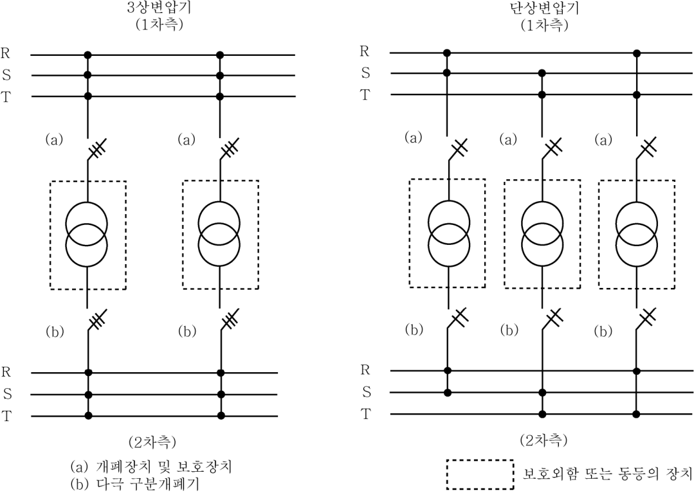
**그림 6.1.1 변압기의 구성**
> 설명: 3상변압기와 단상변압기를 1차측 모선(R, S, T)과 2차측 모선(R, S, T) 사이에 연결한 구성도로, 각 변압기의 1차측에는 (a) 개폐장치 및 보호장치, 2차측에는 (b) 다극 구분개폐기가 설치된다. 각 변압기는 점선으로 표시한 보호외함 또는 동등의 장치 안에 독립적으로 들어 있다.

#### 203. 비상전원

**1. 적용 【규칙 참조】**

(1) **규칙 203**.의 1항 (4)호에서 “예외적으로”라 함은 선박이 해상에 있는 동안 다음의 경우를 말한다.

(가) 블랙아웃 상태

(나) 데드쉽(dead-ship) 상태

(다) 시험을 위한 일상적인 사용

(라) 부하이송을 위한 짧은 시간 주전원과의 병렬운전

(2) 비상발전기는 정박기간 중에 (가) 및 (나)의 요건을 만족하면 선박의 주전원 공급용으로 사용할 수 있다.

(가) 요건

(a) 발전기와 원동기는 항내에서 사용할 때 과부하가 발생하지 않도록 연속적인 안전동작을 확보하기 위한 비상용 이외의 부하를 충분히 탈락시킬 수 있는 설비를 갖추어야 한다.

(b) 원동기는 주전원 발생장치용 원동기 및 무인작동용 원동기에 필수적인 연료 및 윤활유여과기, 감시장치 및 보호장치를 갖추어야 한다.

(c) 원동기의 연료공급탱크는 저위경보장치가 제공되어야 하고 SOLAS협약에서 요구하는 기간동안의 비상작동을 위해 충분한 용량의 연료유를 확보할 수 있는 연료레벨이 되도록 배치하여야 한다.

(d) 원동기는 연속적으로 작동할 수 있도록 설계되고 제작되어야 한다. 또한 해상에서의 비상사태시 그 역할을 이행할 수 있고 항시 사용가능토록 예방정비계획을 수립하여야 한다.

(e) 비상발전기와 비상배전반이 설치된 위치에 화재탐지장치를 설치하여야 한다.

(f) 비상작동으로의 변경이 쉽도록 하기 위한 수단이 제공되어야 한다.

(g) 항내에서 비상발전기를 사용하기 위하여 제어, 감시 및 급전회로는 어떠한 전기적인 결함이 주 및 비상급전에 영향이 없도록 보호되고 배치되어야 한다. 안전작동을 위해 필요한 경우, 비상배전반은 회로를 격리하기 위하여 스위치를 부착하여야 한다.

(나) 선박이 항해중일 때, 모든 제어장치(밸브, 스위치)는 비상발전기 및 비상배전반의 독립된 비상작동을 위해 정확한 위치에 있는 것을 확보하기 위하여 지침이 선내에 제공되어야 한다. 또한 이 지침은 필요한 연료유탱크레벨, 항내/해상 모드 스위치 위치, 통풍개구 등을 포함하여야 한다.

**2. 비상전원 장치의 용량 및 급전시간 【규칙 참조】**

(1) **규칙 203**.의 2항 (2)호 (다)에 규정한 등화 항해등(마스트등, 현등 및 선미등)으로 급전시간은 선적국의 국내법에 의해 허용된 경우에 한하여 3시간까지 감소할 수 있다.

(2) **규칙 203**.의 2항 (2)호 (마) (a)의 “선내 통신장치”라 함은, 일반적으로 다음의 것을 말한다. *(2026)*

(가) 여객선 및 화물선 모두에 공동적으로 요구되는 사항

(a) 항해선교와 조타기 구획 사이에 제공되는 통신 수단

(b) 항해선교와 기관구역 그리고 항해선교와 주기관이 통상적으로 조종되는 제어실 내의 위치 사이에 제공되는 통신 수단(엔진 텔레그래프 포함)

(c) 선교와 선교 외부에 별도로 설치되어 있는 무선전신 또는 무선전화 스테이션 사이에 제공되는 통신 수단

(d) SOLAS III/6.4.2에 따라 요구되는 총비상경보장치

(e) 화물선의 경우 SOLAS III/6.4.2에 따라 요구되는 선내 방송장치, 여객선의 경우 SOLAS III/6.5.4에 따라 요구되는 선내 방송장치

(나) 여객선에 한하여 추가로 요구되는 사항

(a) 당직사관과 SOLAS II-2/3.9에 정의된 중앙제어장소에서 닫을 수 없는 수밀문을 닫는 책임자 사이에 제공되는 통신 수단

(b) 항해선교와 화재제어장소 사이에 제공되는 통신 수단

(c) SOLAS II-2/23.5에 따라 안전센터, 중앙제어장소, 항해선교, 기관제어실, 소화장치 보관실 및 소방설비 창고 사이에 제공되는 통신 수단

(d) SOLAS II-2/22.3.1.2에 따라 여객 및 승무원에게의 알림 및 대피에 필요한 소화 지원용 내부 통신

(3) **규칙 203**.의 2항 (2)호 (마) (b)의 규정에 있어서, 선적국의 국내법에 의해 허용된 경우에 한하여 다음과 같이 취급할 수 있다.

(가) 총톤수 5,000톤 이상의 선박에 있어서 타각지시기에의 급전시간은 **규칙 5편 7장 206**.의 (2)호에 규정하는 시간까지 저감한다.

(나) 총톤수 5,000톤 미만의 선박에 있어서는 다음에 따른다.

(a) 다음의 항해장치에의 급전을 요하지 않는다.

(i) 자이로 콤파스

(ii) 음향 측심기

(iii) 선속 거리계

(iv) 타각지시기, 프로펠러 회전계와 CPP 및 스러스트 프로펠러의 피치각과 추력방향표시기

(b) 항해용 레이더에 대한 급전시간은 선적국의 국내법에 따라 지정된 시간(한국 국적을 갖는 선박은 3시간)까지 저감한다.

(4) **규칙 203**.의 2항 (2)호 (마) (c)의 화재경보장치 및 (d)에 표시된 부하에의 급전시간은 선적국의 국내법에 따라 허용되는 경우에 한하여, 연속사용 30분간에 용량계산을 하여도 지장 없다.

**3. 비상전원장치의 종류 및 성능**

(1) **규칙 203**.의 3항 (2)호 (가)를 적용함에 있어 축전지의 출력측 회로에 인버터 또는 컨버터를 설치하여 전력변환하는 경우에는, 축전지의 전압강하에 관계없이 해당회로의 출력측 전압허용변동률을 **규칙 201**.의 5항의 **표 6.1.2** (a) 또는 (b)에 만족하여야 한다. **【규칙 참조】**

(2) 데드쉽상태로부터의 시동 **【규칙 참조】**

**규칙 203**.의 3항 (4)호를 적용함에 있어서는 다음에 따른다.

(가) 추진력을 회복하는데 필요한 비상발전기 및 기타 수단은 데드쉽상태로부터 30분 이내에 추진장치를 시동하는데 필요한 에너지를 이용할 수 있는 용량의 것이어야 한다. 추진장치, 주전원 및/또는 기타 중요보기(비상발전기는 제외)를 시동하기 위하여 비상발전기용 시동에너지를 직접적으로 사용하여서는 아니 된다.

(나) 증기추진 선박의 경우, 30분의 시간제한은 블랙아웃/데드쉽상태로부터 보일러에 처음으로 점화할 때까지의 시간을 말한다.

**4. 임시 비상전원장치 【규칙 참조】**

**규칙 203**.의 4항 (1)호를 적용함에 있어서. 축전지의 출력측 회로에 인버터 또는 컨버터를 설치하여 전력변환하는 경우에는 **지침 203**.의 3항 (1)호를 적용할 수 있다.

**5. 비상전원용 원동기의 시동 【규칙 참조】**

(1) **규칙 203**.의 6항 (2)호의 시동장치는 다음에 따른다.

(가) 시동원은 원동기를 적어도 6회 시동할 수 있는 용량의 것이어야 한다.

(나) 자동 시동장치가 연속 재시동 방식일 경우에는 시동회수를 3회 이하로 하여야 한다.

(다) 자동 시동장치에는, 최초의 연속 재시동 후에 원동기를 거듭 3회 시동할 수 있는 시동원의 잔량을 확보할 수 있도록 하는 수단을 강구하여야 한다.

(2) **규칙 203**.의 6항 (3)호의 충전 장치가 전기방식을 이용하는 경우에는 다음에 따른다. *(2025)*

(가) 과도한 가스 발생을 방지하기 위해 제조자의 설계 허용치를 초과하지 않도록 충전장치는 과전압 보호와 같은 독립적인 수단을 포함해야 한다. 필요하다면, 제조자의 권장 사항에 따라 온도 보상형 충장치를 제공해야 한다.

(나) 제조사의 권장 사항에 따라 적절한 공기 흐름을 위한 간격을 제공해야 하며, 이러한 권장 사항이 없을 경우 배터리 사이에 적절한 공기 흐름을 위한 충분한 간격을 제공해야 한다.

(다) VRLA 유형의 축전지를 사용하는 시동 축전지의 부동 충전의 경우 충전장치 전압은 제조사의 권장 사항을 바탕으로 축전지 보수 기록서에 명시해야 한다.

(라) 급속 충전 장치(제공하는 경우)는 축전지 외함 또는 각 축전지의 온도가 제조업체 권장 사항을 초과할 때 자동으로 분리되도록 설치해야 한다. 자동분리 해제를 알리는 가시가청경보는 항해 선교와 기관 제어실 등에 제공해야 한다. 자동분리 시 부동충전으로 돌아가는 것을 허용하지 않는다.

(마) 부동 충전과 급속 충전 전류의 권장 값은 IEC 62485-2:2010 표1을 참조할 수 있다.

#### 204. 배전

**1. 배전계통**

(1) **절연감시장치 【규칙 참조】**

(가) 배전계통이란 일반적으로 다음의 회로를 말한다.

(a) 발전기 회로와 직접 접속되는 1차 배전회로

(b) (a)의 1차 배전회로에 절연변압기를 거쳐 접속되는 2차 배전회로. 다만, 별도로 규정하지 아니하는 한 특정기기전용(예를 들면 수웨즈 탐조등, 특정 크레인용에 장비되는 전열기 및 조명회로 등)의 2차회로는 제외한다.

(c) 축전지를 전원으로 하는 조명회로 또는 그 회로가 접속되는 급전반의 모선.

(나) 절연감시장치의 경보설정치는 우리 선급이 인정하는 국제표준(예: IEC 61439-1)을 적용할 수 있다. *(2025)*

(다) 절연감시장치를 지락등과 같이 사용할 경우는 상호간에 인터록을 설치하여야 한다.

(2) **선체귀선방식 【규칙 참조】**

(가) **규칙 204**.의 1항 (4)호 (가)의 (d)에서 “우리 선급이 인정하는 회로”라 함은 본질안전회로를 말한다.

(나) **규칙 204**.의 1항 (4)호 (나)에서 “우리 선급이 인정하는 특별한 예방조치”라 함은 다음의 것을 말한다.

(a) 모든 지회로의 분배반에서 급전되는 모선은 2개의 절연된 선으로 구성하되 이들 중 1개의 모선은 선체에 직접 연결하여 선체로 귀선되도록 구성하여야 한다.

(b) 접지선은 검사 및 접지시험을 위해 접근이 용이한 장소에 설치하여야 한다.

**2. 선외수전 회로 【규칙 참조】**

(1) **접속상자의 보호장치** **규칙 204**.의 3항 (2)호를 적용함에 있어서 휴대식 상회전 방향지시장치 또는 극성검지장치가 선박에 비치된 경우는 선외급전장치에 설치할 상회전 방향지시장치 또는 극성검지장치를 생략할 수 있다.

**3. 항해등 회로 【규칙 참조】**

(1) **항해등 표시기의 설치장소** **규칙 204**.의 6항 (5)호를 적용함에 있어서 항해등 표시기는 항해선교상의 보기 쉬운 장소 및 조작자로 하여금 접근하기 쉬운 장소에 설치하고, 항해등에 급전중단 및 단락 등으로 항해등이 소등되었을 때 이를 알리는 경보장치를 설치하여야 한다.

**4. 통신 및 신호계통장치, 기타 등화의 급전회로 【규칙 참조】**

(1) 주간신호등

**규칙 204**.의 8항 (3)호를 적용함에 있어서 주간신호등의 급전은 다음에 따른다.

(가) 주간신호등은 선박의 주전원 및 비상전원에 전적으로 의존하여서는 아니 된다.

(나) 주간신호등은 내장형 축전지를 갖추어야 하며 축전지를 포함한 주간신호등의 무게는 7.5 kg 이하이어야 한다. *(2022)*

(다) 내장형 축전지는 주간신호등을 2시간 이상 작동시킬 수 있는 충분한 용량의 것이어야 한다.

(라) 내장형 축전지는 선박의 주전원 및 비상전원에 의하여 충전되어야 한다.

#### 205. 보호장치

**1. 단락보호 【규칙 참조】**

(1) **규칙 205**.의 5항을 적용함에 있어서 우리 선급이 인정한 차단기는 **규칙 205**.의 5항 (3)호의 경우를 제외하고, 다음의 정격투입 전류를 갖는 것으로 간주한다.

(가) 직류차단기 : 정격차단전류와 같은 값

(나) 교류차단기 : **지침 표 6.1.8**에 표시한 값

**표 6.1.8 교류차단기의 정격투입전류**

<table>
<thead>
<tr><th>종류</th><th>정격대칭 차단전류 $I_{sy}$ ($A$)</th><th>정격투입 전류 $I_{making}$ ($A$)</th><th>$n$ ($I_{making}$ / $I_{sy}$)</th><th>단락시험 회로의 역률 $\cos\phi$</th></tr>
</thead>
<tbody>
<tr><td rowspan="15">배선용차단기</td><td>2,500</td><td>4,250</td><td rowspan="6">1.7</td><td rowspan="6">0.5</td></tr>
<tr><td>5,000</td><td>8,500</td></tr>
<tr><td>7,500</td><td>12,750</td></tr>
<tr><td>10,000</td><td>17,000</td></tr>
<tr><td>14,000</td><td>23,800</td></tr>
<tr><td>18,000</td><td>30,600</td></tr>
<tr><td>22,000</td><td>48,400</td><td rowspan="9">2.2</td><td rowspan="9">0.2</td></tr>
<tr><td>25,000</td><td>55,000</td></tr>
<tr><td>30,000</td><td>66,000</td></tr>
<tr><td>35,000</td><td>77,000</td></tr>
<tr><td>42,000</td><td>92,400</td></tr>
<tr><td>50,000</td><td>110,000</td></tr>
<tr><td>65,000</td><td>143,000</td></tr>
<tr><td>85,000</td><td>187,000</td></tr>
<tr><td>100,000</td><td>220,000</td></tr>
<tr><td rowspan="5">기중차단기</td><td>10,000</td><td>20,000</td><td>2.0</td><td>0.3</td></tr>
<tr><td>20,000</td><td>44,000</td><td>2.2</td><td>0.2</td></tr>
<tr><td>40,000</td><td>92,000</td><td>2.3</td><td>0.15</td></tr>
<tr><td>70,000</td><td>161,000</td><td>2.3</td><td>0.15</td></tr>
<tr><td>90,000</td><td>207,000</td><td>2.3</td><td>0.15</td></tr>
</tbody>
</table>

(2) 교류차단기에 있어서 단락시험을 **지침 표 6.1.8**에 표시한 값과 다른 역률의 시험회로에서 행하고, 그에 합격한 차단기의 정격투입전류는, 신청에 따라 다음 식으로 계산한 값을 표준으로 한다.

$$I_{making} = I_{sy}\times n\,(A), \qquad n = \sqrt{2}\left\{1+\sin\phi\times e^{-\frac{\frac{\pi}{2}+\phi}{\tan\phi}}\right\}$$

- $I_{making}$ : 정격투입전류
- $I_{sy}$ : 정격차단전류(단락발생후 1/2 *cycle*에 대한 대칭 차단전류의 실효치)

(3) **규칙 205**.의 5항 (2)호의 단락보호방식을 채용할 경우에 필요한 배선용 차단기에 있어서 케스케이드 차단용량을 결정할 경우의 시험방법 및 판정기준은 다음에 따른다.

(가) 시험방법 : 뒷받침 차단기 또는 퓨즈와 부하측 차단기를 직렬로 접속하고, 부하측 차단기 1대에 대해, O - 2분\*- CO 1회의 동작책무에 따른 단락시험을 행한다.

(주) 열동트립시의 복귀시간 및 퓨즈의 교환시간이 2분을 초과할 경우에는, \*표 시간은 우리 선급이 적절하다고 인정하는 것으로 한다.

(나) 시험후의 판정기준

부하측 차단기는 다음 사항을 만족하여야 한다.

(a) 전원에 접속되어 있는 상태로 뒷받침 차단기를 재투입하여도 단락을 발생치 않고, 또한 부하측 차단기의 부하단자에는 전압이 걸리지 않아야 한다.

(b) 차단기는 안전하고 쉽게 예비품과 교환할 수 있어야 한다.

(c) 케이스본체 및 커버에 파손이 생기지 않을 것.

(d) 회로의 개폐가 가능하여야 한다.

(e) 정격전압의 2배의 전압으로 내전압시험을 행하고 그에 견디어야 한다.

(f) 절연저항치는 0.5 MΩ 이상이어야 한다.

**2. 발전기의 보호** **규칙 205**.의 6항을 적용함에 있어서는 다음에 따른다. **【규칙 참조】**

(1) 발전기의 한시과전류 트립장치의 트립전류 눈금 조정값은 발전기 열용량 및 한시과전류 트립장치의 트립특성에 따라서 발전기를 안전한 과전류에서 보호할 수 있는 값을 선정하여야 한다. 또한 단락보호장치의 한시(장한시 및 단한시) 과전류 트립장치의 종류 및 조정치의 선정에 있어서는 보호장치간의 협조를 고려하여야 한다.

(2) 2대 이상의 발전기를 병렬운전할 때 발전기회로에 선택차단장치를 설치할 경우는 우선 차단장치가 동작할 때 발전기의 과전류 트립장치가 동시에 동작하지 아니하도록 그 조정값 및 한시특성을 선정하여야 한다. 또한, 필수용도에 사용되는 전동기가 기동시 선택차단장치가 동작하는 위험이 있을 경우는 그 장치를 전동기의 기동기간중 동작하지 아니하도록 인터록해도 좋다.

(3) 역전력 보호장치의 조정값은 다음의 값을 표준으로 한다.

(가) 터빈 구동발전기 : 2 ~ 6 %

(나) 디젤 구동발전기 : 6 ~ 15 %

**3. 급전회로의 보호** **규칙 205**.의 9항을 적용함에 있어서 조타전동기회로 및 정격전류가 6 A 이하인 소형전동기를 제외하고, 단일전동기 회로에 사용하는 보호장치의 정격전류 또는 트립전류치는 가능한 한 **지침 표 6.1.9**에 정하는 값 이하이어야 한다. **【규칙 참조】**

**표 6.1.9 급전회로의 보호**

<table>
<thead>
<tr><th colspan="2">전동기 종류 (기동방식)</th><th>퓨즈 또는 배선용 차단기의 정격전류 [전동기의 전부하 전류에 대한 백분율(%)]</th></tr>
</thead>
<tbody>
<tr><td colspan="2">직류전동기</td><td rowspan="2">150</td></tr>
<tr><td colspan="2">권선형 유도전동기</td></tr>
<tr><td colspan="2">단상, 보통농형 및 동기전동기(전전압, 리액터 및 저항기동)</td><td>300</td></tr>
<tr><td rowspan="2">보통농형 및 동기전동기(단권변압기 기동) 특수농형 전동기</td><td>30 A 미만</td><td>250</td></tr>
<tr><td>30 A 이상</td><td>200</td></tr>
</tbody>
</table>

**4. 회로의 보호 【규칙 참조】**

(1) **규칙 205**.의 2항 (2)호를 적용함에 있어 “우리 선급이 예외적으로 허용하는 경우”라 함은 다음의 경우를 말한다.

(가) 기관 시동용 축전지회로와 같이 과부하 보호장치의 설치가 불가능한 경우

(나) 스러스터용 전동기 및 이중으로 설치된 중요용도의 전동기에서 과부하보호회로를 과부하경보장치로 대체한 경우

(다) **규칙 5편 7장 207**.의 5항 및 **301**.의 2항 (5)호에서 인정하는 경우

### 제 3 절 회전기계

#### 302. 발전기용 원동기 *(2020)* 【규칙 참조】

**규칙 302**.의 2항 (2)호를 적용함에 있어서, 선박의 주전원 조건이 3단계 이상의 투입방식에서만 부하를 투입할 수 있는 원동기의 사용을 허용하고 이것이 설계 단계에서 이미 허용되었다면 3단계 이상의 투입방식에서 전기부하의 투입이 허용될 수 있다.

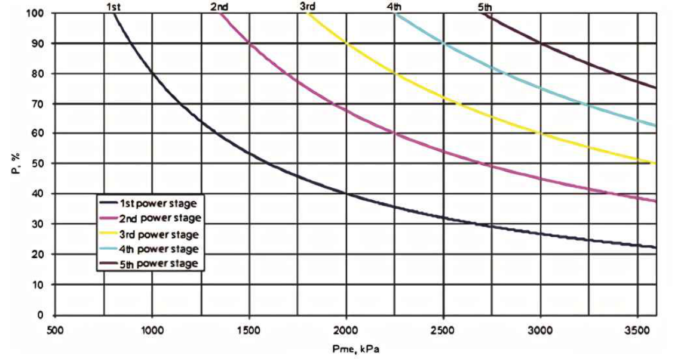
**그림 6.1.2 선언된 출력에서 정미평균유효압력(Pme)의 함수로서 적절한 급격한 출력 증가에 대한 기준 값 (4행정 디젤기관)**
> 설명: 가로축은 Pme(kPa, 500~3600), 세로축은 P(%, 0~100)이며, 1st~5th power stage의 5개 곡선으로 각 투입단계에서 허용되는 급격한 출력 증가를 나타낸다. 각 곡선은 Pme가 커질수록 감소하며(예: 1st power stage는 약 800 kPa에서 100 %, 2000 kPa에서 40 %), 단계가 높을수록 곡선이 오른쪽에 위치한다.

여기서,

- $Pme$ : 선언된 출력에서의 평균유효압력
- $P$ : 현장 조건에서 선언된 출력을 기준으로 한 출력 증가

다만, 상기의 해당 투입방식을 희망하는 경우에는, (1)호부터 (4)호에 나타낸 상태에서의 투입부하의 값 및 그 시점에서의 기본부하(base load) 값이 어떠한 경우에도 상기 식의 투입값 보다도 작도록 한 투입전력 계산서를 제출하고 우리 선급의 승인을 받아야 한다.

(1) 블랙아웃 후의 전원 복구시

(2) 순차 시동시

(3) 대용량 부하의 시동시

(4) 1조의 발전기 고장에 의한 순시 부하이동시(병렬운전시)

#### 303. 회전기계축

**1. 회전기계축 【규칙 참조】**

(1) **규칙 303**.의 1항을 적용함에 있어서 응력집중을 방지하기위한 조치로 단면변화부의 필릿 반지름은 축 실제지름의 0.08배 이상이어야 하며 이보다 작은 필릿 반지름을 갖는 경우에는 응력집중계수에 따라 비례적으로 축지름을 증가시켜야 한다.

(2) 통상 토크보다 현저하게 큰 토크가 발생할 우려가 있는 경우라 함은 자동동기투입장치(auto synchronizing device) 설비가 없는 경우 등을 말하며 이 경우 F값은 **규칙 표 6.1.4**에 표시된 값의 120 %로 한다.

#### 304. 온도상승 【규칙 참조】

**1. 규칙 304**.의 1항을 적용함에 있어서 베어링의 온도상승은 다음에 따른다.

(1) 베어링(자냉식)의 온도상승한도는 표면에서 측정할 때 35℃, 메탈에 온도소자를 매입하여 측정할 때는 40℃로 한다. 다만, 내열윤활재(예를 들면, 리치움비누를 주로 한 윤활그리스)를 사용할 경우에는 표면에서 측정하여 50℃로 한다.

(2) F종 이상의 내열절연재료를 사용하는 회전기계에서 (1)호에 따르기가 곤란한 경우에는 채용하려고 하는 온도상승한도에 대해 축베어링 및 윤활제의 내열성에 관한 자료를 첨부하여 우리 선급의 승인을 받아야 한다.

**2.** 공기냉각기를 설치하여 강제 냉각하는 회전기계 권선의 온도계측방법은 매입온도계법이나 저항법에 의한다.

**3.** 공기냉각기를 설치하여 강제 냉각하는 회전기계의 냉각수온이 32℃를 넘는 경우의 온도상승한도는 별도로 정한다.

#### 308. 용접 【규칙 참조】

**1.** 발전기축의 축커플링에 플랜지를 용접하는 방법을 처음으로 채용하려고 하는 경우에는, 용접시공기준에 관한 자료 및 용접법 승인시험방안을 제출하여 우리 선급의 승인을 받아야 한다. 또한 용접법 승인시험 항목에는 피로강도에 관한 시험을 포함하는 것으로 한다.

**2.** 발전기축에 리브(Rib) 등을 용접하고자 할 경우에는, 용접방법에 대하여 미리 다음의 자료를 제출하여 우리 선급의 승인을 받아야 한다.

(1) 축에 용접하여 부착한 리브 등 토크 전달부분의 기준설계응력 및 강도계산서

(2) 용접시공기준 및 관리기준의 상세

(3) 용접법 시험성적서. 이 성적서에는 (2)호의 용접시공기준을 근거로 제작한 공시품에 대하여 행해진 시험성적을 기입하고 시험의 종류는 용접부의 매크로검사, 마이크로검사 및 경도분포측정으로 한다.

**3.** 스파이더(로터 중심) 등, 주 토크 전달부분을 용접구조로 할 경우에는 2항에 따른다.

**4.** 전동기축의 용접은 다음과 같이 한다.

(1) 중요보기를 구동하는 100 kW 이상의 전동기축을 용접하는 경우에는 1항 및 2항에 따른다.

(2) 100 kW 미만의 전동기축에 용접을 하는 경우의 취급은 다음에 따른다.

(가) 축커플링 플랜지를 용접하는 경우는 전호에 준한다.

(나) 리브 기타를 용접할 경우에는 용접시공기준만 제출할 수 있다.

#### 309. 시험 및 검사

**1. 온도시험** **규칙 309**.의 3항을 적용함에 있어 회전기계의 온도시험을 위한 부하적용방법은 실부하법을 원칙으로 한다. 그러나 부득이한 경우는 다음에 제시한 바와 같이 동기기에서는 영역률법 또는 온도추정법으로, 유도기에서는 등가부하법을 사용하여 이것에 대신할 수 있다. **【규칙 참조】**

(1) 동기기

(가) 영역률법

회전기계를 무부하로 발전기 또는 전동기로서 과여자하고, 정격전압, 정격주파수에서 대략 영역률의 정격전류를 통해 시험을 행한다. 이 영역률법은 동기 진상기에 대해서는 그대로 적용 가능하지만, 동기발전기 또는 동기전동기에 적용할 경우에는 계자전류의 부족에 의해서 정격출력에 대한 kVA를 얻기 어려운 경우가 있으므로 이 때에는 가능한 한 정격출력에 대한 kVA에 가까운 값을 얻기 위해 충분히 큰 계자전류를 통해 시험하고 그 결과는 다음에 따라 수정한다.

(a) 각 정격전압, 무부하(전기자 개로)에 대하여 온도시험을 행하고, 전기자 권선의 온도상승 $t_0$ 및 전기자 철심의 온도상승 $t_{c0}$를 구한다.

(b) 영역률 시험에 있어서

$t'$ = 전압 $V'$, 전류 $I'$일 때 권선온도상승

$t'_c$ = 전압 $V'$, 전류 $I'$일 때 철심온도상승

$t'_f$ = 계자전류 $I'_f$일 때 계자권선 온도상승으로 한다.

(c) 정격전압을 $V$, 정격전류를 $I$, 정격계자전류를 $I_f$라 하면, 정격시에 수정한 온도상승은 다음 식에서 구할 수 있다.

전기자 권선 :

$$T = t_0 + (t' - t_0)\times\left(\frac{I}{T}\right)^2$$

전기자 철심 :

$$T_c = t_{c0} + (t_c' - t_{c0})\times\left(\frac{I}{T}\right)^2$$

계자 권선 :

$$I_f = t'_f\times\left(\frac{I_f}{T_f}\right)^2$$

시험전압 $V'$는 가능한 한 정격전압에 가깝게 하고 최소한 90 % 이하로 내려가지 않도록 할 것.

(나) 온도추정법

다음의 어느 것이든 가능하다.

(a) 정격전압의 110 %에 상당하는 단자전압에서 무부하 운전하여 얻은 철심온도상승을 정격출력에서의 철심 온도상승으로 하고 또한 정격출력의 125 %에 상당하는 전기자 전류에서 모든 단자를 단락하여 운전하고 얻은 전기자권선 온도상승을 정격출력에서 전기자 권선 온도상승으로 한다.

(b) 정격전압에서 무부하 운전한 경우 및 정격전류를 통한 모든 단자를 단락하여 운전한 경우의 철심 및 전기자 권선의 최종온도상승을 측정하여, 각각의 경우에 있어서 철심의 온도상승합계 및 전기자 권선의 온도상승합계를 정격출력에 대한 각각의 온도상승으로 한다.

(c) 전기자 권선을 환상 결선(3각결선)으로 하고 그 한편(쪽)을 열어 직류 또는 단상전원에서 이것에 정격전류와 같은 순환전류를 통하고 정격전압과 같은 단자전압을 발생시키도록 여자하여 정격속도로 운전하면 전기자철심 및 권선의 온도상승은 거의 정격출력에서와 같다. 계자전류에 대해서는 영역률법에 의해서 수정을 한다.

(2) 유도기

(가) 1차 중첩등가 부하법

**지침 그림 6.1.3**과 같이 접속하고 피시험 유도기를 무부하로 운전할 때 주전원 전압에 이것과 주파수가 다른 저전압을 중첩한 후 그 전압의 크기 및 주파수를 가감하여 행하는 시험방법으로 일반적으로 일차전류를 전부하 전류에 합하는 방법(전류기준법)을 이용한다.

특수농형, 2극기 및 대출력의 유도기에 대해서는 입력을 원선도법으로부터 산출한 정격부하에서 손실과 같게 하는 방법(손실기준법)을 이용한다.

(나) 2차 중첩 부하법

**지침 그림 6.1.4**와 같이 접속하고 피시험 유도기를 무부하로 운전하여 그 2차에 저주파 전압을 중첩하고 그 전압의 크기 및 주파수를 가감하여 1차측에 전부하 전류에 가까운 전류를 통하여 행하는 온도시험법을 말한다.

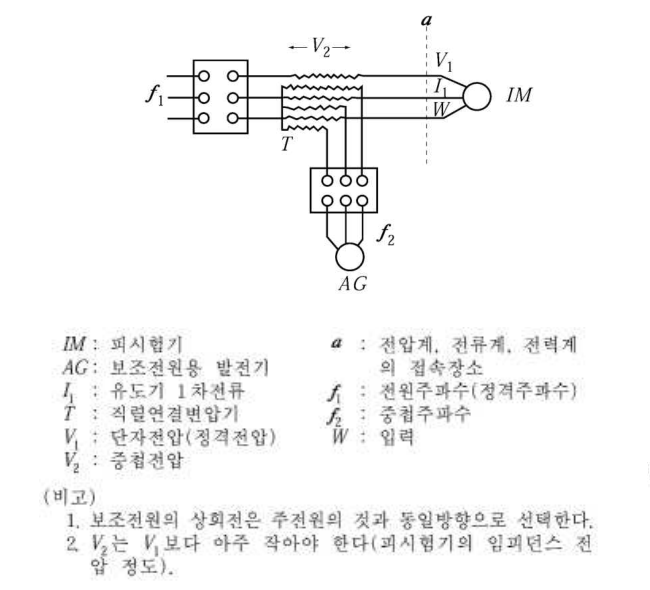
**그림 6.1.3 1차 중첩 등가부하법**
> 설명: 주전원(전원주파수 $f_1$)과 피시험기 $IM$ 사이에 직렬연결변압기 $T$를 넣고, 보조전원용 발전기 $AG$(중첩주파수 $f_2$)의 중첩전압 $V_2$를 중첩하는 결선도이다. $a$는 전압계·전류계·전력계 접속장소($V_1$ 단자전압, $I_1$ 유도기 1차전류, $W$ 입력)이며, 비고에 보조전원의 상회전은 주전원과 동일방향으로 하고 $V_2$는 $V_1$보다 아주 작아야 한다(피시험기의 임피던스 전압 정도)고 적혀 있다.

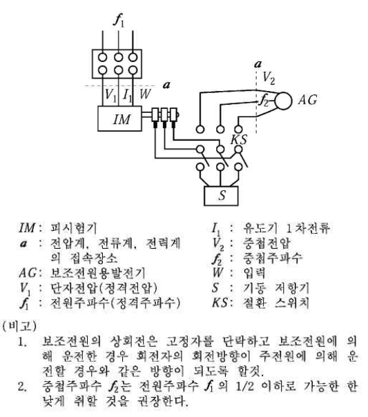
**그림 6.1.4 2차 중첩 부하법**
> 설명: 전원주파수 $f_1$로 운전하는 피시험기 $IM$의 2차측에 보조전원용 발전기 $AG$의 중첩전압 $V_2$(중첩주파수 $f_2$)를 절환 스위치 $KS$를 거쳐 가하고, 기동 저항기 $S$를 함께 두는 결선도이다. 비고에 보조전원의 상회전은 회전자의 회전방향이 주전원에 의한 경우와 같도록 하고, 중첩주파수 $f_2$는 전원주파수 $f_1$의 1/2 이하로 가능한 한 낮게 취할 것을 권장한다고 적혀 있다.

**2. 과전류 또는 초과 회전력 시험** **규칙 309**.의 4항을 적용함에 있어서 특수전동기의 초과 회전력 시험은 특별히 지정한 경우 외에는 다음과 같이 할 수 있다. **【규칙 참조】**

단상전동기 ----------- 33 % 초과 회전력 15초간

갑판 기계용 전동기 ---- 50 % 초과 회전력 15초간

유도동기 전동기 ------ 35 % 초과 회전력 15초간

**3. 과속도 시험** **규칙 309**.의 5항에서 500 kW 이상의 2극 유도전동기의 과속도 시험은 동기속도의 120 %로 한다. **【규칙 참조】**

**4. 내전압 시험** **규칙 309**.의 7항을 적용함에 있어서 **표 6.1.9**의 비고 3에서 “우리 선급이 적절하다고 인정하는 바”라 함은 제조자와 구매자간에 합의한 경우를 말한다. **【규칙 참조】**

**5. 전압변동특성시험 【규칙 참조】**

(1) **규칙 309**.의 8항에서 발전기의 전압변동특성시험은 원동기와 직결하여 하는 것을 원칙으로 한다. 부득이 발전기만으로 시험을 할 경우는, 원동기의 속도변화를 모를 경우는 3.5 %로 가정하고 무부하와 전부하간의 속도변화는 직선적으로 변화하는 것으로 한다.

(2) **규칙 309**.의 8항 (2)호를 적용함에 있어서, 돌발부하의 최대값에 대한 정확한 정보가 없는 경우, 무부하로 운전하는 발전기에 정격전류(뒤짐역률 0 부터 0.4일 것)의 60 %를 갑작스럽게 가하고 안정상태가 된 후에 이 부하를 제거한다. 우리 선급의 승인을 조건으로, 이러한 과도상태의 전압변동률은 이전의 시험기록을 근거로 하여 계산할 수 있으며 발전기의 공장시험 동안 시험하지 않아도 된다. *(2026)*

**6. 정류시험 【규칙 참조】**

(1) **규칙 309**.의 10항을 적용함에 있어서 직류기의 정류자편과 브러시간에 발생하는 불꽃의 정도는 **지침 그림 6.1.5**에 표기하는 8종류로 분류하고, 이중 제5호부터 8호의 불꽃은 유해한 불꽃으로 간주한다.

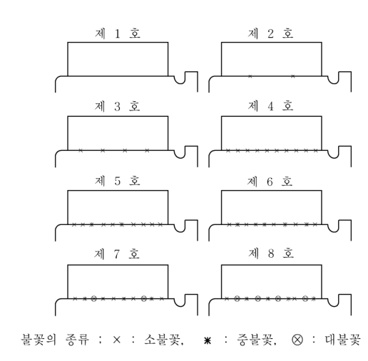
**그림 6.1.5 정류자 표면의 불꽃 발생**
> 설명: 정류자편과 브러시 사이에 발생하는 불꽃의 정도를 제 1 호부터 제 8 호까지 8종류로 나타낸 그림으로, 제 1 호는 불꽃이 없고 호수가 커질수록 불꽃의 수와 크기가 늘어난다. 불꽃의 종류는 × : 소불꽃, ✱ : 중불꽃, ⊗ : 대불꽃으로 표시한다.

(2) (1)호에 관계없이 온도시험 및 과부하시험후 불꽃에 따라 정류자 표면이 검게 되거나 손상이 발생할 경우 또는 브러시 마모 및 파손이 생길 경우 그 불꽃은 유해한 불꽃으로 간주한다.

(3) 정격출력 이하의 부하에 있어서 불꽃 정도는 제2호 이내에 있을 것을 권장한다.

**7. 규칙 309**.의 11항을 적용함에 있어서, 발전기가 사용되는 배전시스템의 선택차단 설정값(discrimination settings)을 결정할 책임이 있는 주체에게 충분한 정보를 제공하기 위하여, 발전기 제조자는 여자가 된 상태에서 공칭속도로 운전할 때 발생하는 갑작스런 단락시의 과도 단락전류 특성을 나타내는 문서를 제공하여야 한다. 자동전압조정기의 영향이 고려되어야 하며, 전압조정기의 설정변수가 감쇠곡선(decrement curve)에 함께 나타나야 한다. 배전시스템의 단락보호 설정치가 계산될 경우에 이러한 감쇠곡선을 이용할 수 있어야 한다. 감쇠곡선은 실제 시험을 근거로 할 필요는 없다. 동일 모델에 대한 이전 시험으로 검증된 경우, 발전기 및 전압조정기에 대한 제조자의 시뮬레이션 모델이 사용될 수 있다. *(2017)* **【규칙 참조】**

**8. 규칙 309**.의 16항을 적용함에 있어서, **규칙 표 6.1.10**의 비고 (9)에서 “우리 선급이 적합하다고 인정하는 경우”라 함은 형식승인, 시험 성적서 확인 등을 말한다. **【규칙 참조】**

**9. 규칙 309**.의 16항을 적용함에 있어서, **규칙 표 6.1.10**의 비고 (10)에서 “우리 선급이 적합하다고 인정하는 경우”라 함은 형식승인, 설계승인 등을 받은 경우를 말한다. **【규칙 참조】**

### 제 4 절 배전반, 구전반 및 분전반

#### 401. 일반사항 【규칙 참조】

**1. 설치장소** **규칙 401**.의 1항 (1)호를 적용함에 있어서 배전반 부근에 증기관, 수관, 유관을 부득이 부착할 때는 이들 관의 이음은 용접으로 하든가 또는 누설하여도 배전반에 영향이 없도록 보호하여야 한다.

**2. 규칙 401**.의 1항 (2)호를 적용함에 있어서는 다음에 따른다.

(1) 주발전기는 기관구역내에 위치하여야 한다. 즉 주횡수밀격벽내에 위치하여야 한다.

(2) 주횡수밀격벽 사이에 있는 어떠한 격벽도 구역사이를 접근할 수 있는 주발전장소에 있는 장비를 분리하는 것으로 간주하지 않는다.

(3) 주배전반은 가능한 한 주발전장소 가까이, 동일 기관구역이내 및 A-60의 동일한 수평/수직구역내에 위치하여야 한다.

(4) 일차필수용도의 기기가 구전반에서 급전되는 경우, 구전반, 변압기, 컨버터 및 전기공급장치의 중요부분을 구성하는 유사한 기기들은 상기의 사항을 만족하여야 한다.

**3. 조작 및 보수를 위한 공간** **규칙 401**.의 2항을 적용함에 있어서 전면에서 필요한 조작 및 보수를 할 수 있는 구조일 때는 후방통로를 생략할 수 있다. *(2018)*

**4. 조작자의 안전** **규칙 401**.의 3항을 적용함에 있어서 절연성의 발판은 IEC 61111 또는 동등 이상의 표준에 따른 절연내력시험을 만족하는 것이어야 한다. *(2019)*

#### 402. 구조 【규칙 참조】

**1.** 절연재료의 난연성능을 판정하기 위한 난연성시험은 무풍상태의 상온에서 하며 시험편은 최소길이 120 mm, 폭 10 mm, 두께 3 mm의 봉이나 엷은 판을 표준으로 한다. 시험편은 가는 금속선에 가로를 약 45° 경사지게, 세로를 수평으로 묶어서 부착한다.

시험은 도시가스를 사용하며 버너로서 불꽃이 정지한 공기중에서 수직으로 한 후 그 높이를 약 125 mm로 하여 불꽃의 청색부분이 약 35 mm가 되도록 한다. 불꽃의 축을 수직으로 하여 청색불꽃 선단이 시험편 하부에 닿도록 하여 15초 간격으로 15초씩 불꽃을 5회 가한다. 최종시험 후에는 시험편이 타버려도 좋다. 시험편이 타서(연소) 손상을 받은 부분의 길이가 60 mm 이하이면 난연성 재료로 본다.

**2.** 전 항의 난연성 시험방법은 방화구조벽에 대한 전선관통부의 실링 콤파운드의 난연성에도 준용한다. 시험편이 타서 손상을 받은 부분의 길이가 60 mm 이하이면 난연성 콤파운드(불연성 재료를 원료로 한 콤파운드와 동등재료)로 본다.

**3. 규칙 402**.의 1항 (2)호에 규정한 “기타의 승인된 수단”이라 함은 모선을 쉽고 안전하게 분리할 수 있는 다음과 같은 장치를 말한다. 다만, 볼트로 연결된 링크(예: 볼트로 연결된 모선부)는 인정되지 않는다. *(2018)*

(1) 트립장치가 없는 회로차단기

(2) 떼어낼 수 있는 링크 *(2018)*

(3) 스위치 *(2018)*

#### 403. 모선 및 균압선 【규칙 참조】

**1.** 모선 및 모선과 접속용 도체와의 접촉면은, 은도금 또는 납땜을 하여 부식이나 산화를 방지하도록 한다.

**2.** 모선의 정격전류는 일반적으로 **지침 표 6.1.10**과 같이 결정한다.

**표 6.1.10 모선의 정격전류**

<table>
<thead>
<tr><th colspan="3">종류</th><th>정격전류</th></tr>
</thead>
<tbody>
<tr><td rowspan="3">발전기용</td><td colspan="2">1대의 발전기로서 모선에 급전할 경우</td><td>발전기 정격전류의 100 % 이상</td></tr>
<tr><td rowspan="2">2대 이상의 발전기가 그 전체의 용량을 모선에 급전할 경우</td><td>분리된 모선배치 (다수의 모선으로 구성된 배전계통)</td><td>각 모선(예비회로 포함)에 대하여, [(대용량의 정격전류 (예: 선수 스러스터)의 100 %) + (잔여 급전회로의 정격전류 합계의 75 %)] 이상</td></tr>
<tr><td>단일 모선배치 (단일 모선으로 구성된 배전계통)</td><td>[(최대용량의 발전기 1대의 정격전류의 100 %) + (잔여발전기 정격전류 합계의 80 %)] 이상</td></tr>
<tr><td rowspan="2">급전용</td><td colspan="2">일반 급전회로일 경우</td><td>급전회로(예비회로 포함)의 정격전류 합계의 75 % 이상. 다만, 발전기 모선의 용량을 초과할 필요는 없다.</td></tr>
<tr><td colspan="2">급전회로가 단일부하 1회로일 경우 또는 연속 사용하는 1개군에 급전할 경우</td><td>전부하 전류 이상</td></tr>
</tbody>
</table>

#### 404. 배전반용 계기 【규칙 참조】

**1. 계기의 눈금** **규칙 404**.의 3항을 적용함에 있어서 계기의 눈금은 유효측정범위를 말한다. 또한 전동기용 전류계에서 기동전류에 대하여 눈금을 연장할 필요가 있을 때 그 연장부분에 대하여는 이 항을 적용할 필요는 없다.

#### 406. 시험 및 검사

**1.** 동일형식의 배전반이라 함은 동일공장에서 동일한 방법에 의하여 제조된 것으로서 다음 조건에 적합한 것을 말한다. **【규칙 참조】**

(1) 동기검정반을 갖는 발전기반의 외형치수, 내용적 및 통풍방법이 거의 같아야 한다.

(2) 발전기용 차단기, 단로기의 형식 및 정격이 같고, 또 모선 및 접속도체의 치수, 배치 및 접속부의 구조가 거의 같아야 한다.

(3) 모선 및 접속도체의 부하전류가 거의 같거나 그 이하이어야 한다.

(4) 변성기, 계전기, 퓨즈, 저항기 등 발열원과 접해있는 각종 반내 부착기구의 배치가 거의 같고 그것들의 소비전력 합계가 거의 같거나 그 이하이어야 한다.

(5) 조작회로, 계기회로 등을 제외한 단자구조 및 배치가 거의 같아야 한다.

**2. 온도시험** **규칙 406**.의 2항을 적용함에 있어서 F종 또는 H종 절연이 코일에 사용되어 있는 경우 코일의 온도상승한도는 **지침 표 6.1.11**에 따른다. **【규칙 참조】**

**표 6.1.11 코일의 온도상승한도(℃)** **(기준주위온도 45℃)**

| 절연종류 \ 시험법 | 온도계법 | 저항법 |
|---|---|---|
| F종 절연 | 95 | 115 |
| H종 절연 | 120 | 140 |

**3. 내전압시험 【규칙 참조】**

(1) **규칙 406**.의 4항에서 보조기구로는 이극간 또는 각 상간에 접속된 표시등, 소형변압기, 계전기 등을 말한다.

(2) **규칙 406**.의 4항에 따라서 배전반의 내전압시험을 할 경우는 계기 및 보조기구를 제거하여야 한다. 다만, 이런 기구는 각각 단체로서 내전압시험을 하여 **규칙 406**.의 4항에 적합하여야 한다.

(3) 배전반에 조립된 전자기기 또는 장치로서 배전반 주요회로 및 선내급배전 주회로에 직접 접속되어 있지 않은 것은 별도로 정해진 경우를 제외하고 규칙에 적용하지 아니한다.

### 제 5 절 케이블 *(2025)*

#### 501. 일반사항 【규칙 참조】

**1. 규칙 501**.에서 “적절하다고 인정하는 바”라 함은 아래의 IEC 60092시리즈 및 그와 동등하다고 인정되는 것을 말한다. *(2022)*

(1) IEC 60092-350:2020

(2) IEC 60092-352:2005

(3) IEC 60092-353:2016

(4) IEC 60092-354:2020

(5) IEC 60092-360:2014

(6) IEC 60092-370:2019

(7) IEC 60092-376:2017

**2. 규칙 501**. 및 전 1항에 명시된 것 이외의 표준에 따라 제작 및 시험된 케이블이 관련 국제표준이나 국가표준에 따르고 전 1항에 명시된 것 이상의 안전도를 갖는 경우 인정될 수 있다. 다만, 가요성케이블, 광케이블 등과 같이 특수 목적으로 사용되는 케이블은 우리 선급이 인정하는 관련 표준에 따라 제작되고 시험될 경우 인정될 수 있다. *(2017)*

#### 502. 케이블의 적용

**1. 규칙 502**.의 2항 (2)호를 적용함에 있어서 “기계적인 손상에 대해 특별히 우리 선급의 승인을 받은 경우에는 그러하지 아니한다” 라 함은 다음과 같은 시험에 만족할 경우 외장이 없는 케이블을 사용할 수 있음을 말한다. **【규칙 참조】**

(1) **인장시험**은 다음 중 하나에 만족하여야 한다.

(가) 인장강도가 내피복은 20 N/mm² 이상, 외피복은 13 N/mm² 이상이고 내ㆍ외피복의 파단신장률이 250 %이상일 것

(나) 내ㆍ외피복의 인장강도가 17 N/mm² 이상이고 내ㆍ외피복의 파단신장률이 400 % 이상일 것

(2) **충격시험 및 내마모성시험**

시험방안 및 내용을 우리 선급에 제출하고 승인 받은 것이어야 한다.

(3) **압축시험**

1 ton의 힘을 가해서 절연성이 파괴되지 않는 것이어야 한다.

**2. 규칙 502**.의 3항의 난연성과 내연성 케이블은 다음의 규정을 만족하는 케이블을 의미한다. **【규칙 참조】**

(1) 난연성 케이블 : IEC 60332 시리즈

(2) 내연성 케이블 : IEC 60331 시리즈

#### 503. 케이블의 허용전류 【규칙 참조】

**1. 전압강하** **규칙 503**.의 2항을 적용함에 있어서 전압강하의 계산은 다음의 식에 따르는 것을 표준으로 한다.

(1) 직류회로의 경우 :

$$\text{전압강하} = \frac{R_{20}\times K\times 2L\times I\times 100}{V}$$

(2) 교류회로의 경우

·단상교류회로 :

$$\text{전압강하} = \left(\frac{R_{20}\times K\times 2L\times I\times 100}{V}\right)\times\delta\,(\%)$$

·삼상교류회로 :

$$\text{전압강하} = \left(\frac{R_{20}\times K\times 2L\times I\times 100}{V}\right)\times\frac{1.73}{2}\times\delta\,(\%)$$

- $L$ : 편도의 케이블 길이(m).
- $I$ : 최대부하전류(A).
- $V$ : 회로전압(V).
- $R_{20}$ : 20°C에 있어서 직류저항(Ω/m).
- $K$ : 도체 최고허용온도에서의 온도계수. (60℃ : 1.16, 75℃ : 1.22, 80℃ : 1.24, 85℃ : 1.26)
- $\delta$ : 전압강하계수(**지침 표 6.1.12** 및 **6.1.13** 참조)

**표 6.1.12 고무절연 케이블의 전압강하계수 ($\delta$)**

<table>
<thead>
<tr><th rowspan="2">도체단면적 (mm²)</th><th colspan="7">역률 (%)</th><th colspan="2">인덕턴스(mH/km)</th></tr>
<tr><th>100</th><th>95</th><th>90</th><th>85</th><th>80</th><th>75</th><th>70</th><th>660 $V$</th><th>250 $V$</th></tr>
</thead>
<tbody>
<tr><td>325</td><td>1.15</td><td>1.51</td><td>1.61</td><td>1.68</td><td>1.72</td><td>1.74</td><td>1.75</td><td>0.244</td><td></td></tr>
<tr><td>250</td><td>1.10</td><td>1.37</td><td>1.45</td><td>1.49</td><td>1.51</td><td>1.52</td><td>1.52</td><td>0.246</td><td></td></tr>
<tr><td>200</td><td>1.06</td><td>1.26</td><td>1.31</td><td>1.34</td><td>1.34</td><td>1.34</td><td>1.33</td><td>0.248</td><td></td></tr>
<tr><td>150</td><td>1.04</td><td>1.19</td><td>1.22</td><td>1.22</td><td>1.22</td><td>1.21</td><td>1.18</td><td>0.249</td><td></td></tr>
<tr><td>125</td><td>1.03</td><td>1.13</td><td>1.14</td><td>1.14</td><td>1.12</td><td>1.10</td><td>1.07</td><td>0.254</td><td></td></tr>
<tr><td>100</td><td>1.02</td><td>1.10</td><td>1.09</td><td>1.08</td><td>1.06</td><td>1.03</td><td>1.00</td><td>0.254</td><td></td></tr>
<tr><td>80</td><td>1.01</td><td>1.06</td><td>1.05</td><td>1.03</td><td>1.00</td><td>0.99</td><td>0.94</td><td>0.258</td><td></td></tr>
<tr><td>60</td><td>1.01</td><td>1.04</td><td>1.02</td><td>1.00</td><td>0.97</td><td>0.93</td><td>0.90</td><td>0.262</td><td></td></tr>
<tr><td>50</td><td>1.00</td><td>1.02</td><td>1.00</td><td>0.96</td><td>0.93</td><td>0.89</td><td>0.86</td><td>0.268</td><td></td></tr>
<tr><td>38</td><td>1.00</td><td>1.00</td><td>0.98</td><td>0.94</td><td>0.90</td><td>0.87</td><td>0.82</td><td>0.272</td><td>0.217</td></tr>
<tr><td>30</td><td>1.00</td><td>0.99</td><td>0.96</td><td>0.92</td><td>0.88</td><td>0.84</td><td>0.80</td><td>0.276</td><td>0.221</td></tr>
<tr><td>22</td><td>1.00</td><td>0.98</td><td>0.94</td><td>0.90</td><td>0.86</td><td>0.82</td><td>0.77</td><td>0.280</td><td>0.227</td></tr>
<tr><td>14</td><td>1.00</td><td>0.97</td><td>0.93</td><td>0.89</td><td>0.84</td><td>0.80</td><td>0.75</td><td>0.294</td><td>0.239</td></tr>
<tr><td>8</td><td>1.00</td><td>0.96</td><td>0.92</td><td>0.87</td><td>0.83</td><td>0.78</td><td>0.73</td><td>0.312</td><td>0.255</td></tr>
<tr><td>5.5</td><td>1.00</td><td>0.96</td><td>0.91</td><td>0.87</td><td>0.82</td><td>0.77</td><td>0.72</td><td>0.330</td><td>0.265</td></tr>
<tr><td>3.5</td><td>1.00</td><td>0.96</td><td>0.91</td><td>0.86</td><td>0.81</td><td>0.76</td><td>0.72</td><td>0.354</td><td>0.279</td></tr>
<tr><td>2.0</td><td>1.00</td><td>0.95</td><td>0.91</td><td>0.86</td><td>0.81</td><td>0.76</td><td>0.71</td><td>0.388</td><td>0.309</td></tr>
<tr><td>1.25</td><td>1.00</td><td>0.95</td><td>0.90</td><td>0.85</td><td>0.81</td><td>0.76</td><td>0.71</td><td>0.428</td><td>0.343</td></tr>
</tbody>
</table>

**표 6.1.13 무기절연 케이블의 전압강하계수 ($\delta$)**

<table>
<thead>
<tr><th rowspan="2">도체단면적 (mm²)</th><th colspan="7">역률 (%)</th><th rowspan="2">인덕턴스(mH/km)</th></tr>
<tr><th>100</th><th>95</th><th>90</th><th>85</th><th>80</th><th>75</th><th>70</th></tr>
</thead>
<tbody>
<tr><td>1.0</td><td>1.000</td><td>0.953</td><td>0.904</td><td>0.855</td><td>0.805</td><td>0.756</td><td>0.706</td><td>0.428</td></tr>
<tr><td>1.5</td><td>1.000</td><td>0.954</td><td>0.905</td><td>0.857</td><td>0.807</td><td>0.758</td><td>0.709</td><td>0.401</td></tr>
<tr><td>2.5</td><td>1.000</td><td>0.956</td><td>0.908</td><td>0.860</td><td>0.811</td><td>0.763</td><td>0.714</td><td>0.368</td></tr>
<tr><td>4</td><td>1.000</td><td>0.959</td><td>0.912</td><td>0.865</td><td>0.817</td><td>0.769</td><td>0.720</td><td>0.344</td></tr>
<tr><td>6</td><td>1.000</td><td>0.962</td><td>0.917</td><td>0.871</td><td>0.821</td><td>0.776</td><td>0.728</td><td>0.321</td></tr>
<tr><td>10</td><td>1.001</td><td>0.969</td><td>0.927</td><td>0.882</td><td>0.837</td><td>0.791</td><td>0.744</td><td>0.298</td></tr>
<tr><td>16</td><td>1.001</td><td>0.980</td><td>0.941</td><td>0.899</td><td>0.856</td><td>0.811</td><td>0.766</td><td>0.279</td></tr>
<tr><td>25</td><td>1.002</td><td>0.994</td><td>0.961</td><td>0.923</td><td>0.883</td><td>0.841</td><td>0.799</td><td>0.265</td></tr>
<tr><td>35</td><td>1.005</td><td>1.011</td><td>0.983</td><td>0.950</td><td>0.913</td><td>0.874</td><td>0.834</td><td>0.254</td></tr>
<tr><td>50</td><td>1.009</td><td>1.034</td><td>1.016</td><td>0.988</td><td>0.956</td><td>0.922</td><td>0.885</td><td>0.245</td></tr>
<tr><td>70</td><td>1.016</td><td>1.071</td><td>1.059</td><td>1.040</td><td>1.014</td><td>0.984</td><td>0.952</td><td>0.237</td></tr>
<tr><td>95</td><td>1.026</td><td>1.106</td><td>1.110</td><td>1.101</td><td>1.088</td><td>1.060</td><td>1.033</td><td>0.231</td></tr>
<tr><td>120</td><td>1.040</td><td>1.150</td><td>1.168</td><td>1.168</td><td>1.157</td><td>1.140</td><td>1.119</td><td>0.226</td></tr>
<tr><td>150</td><td>1.046</td><td>1.204</td><td>1.237</td><td>1.248</td><td>1.246</td><td>1.150</td><td>1.221</td><td>0.223</td></tr>
</tbody>
</table>

**2.** 전동기군(群)회로에 대해서는 최대용량 전동기의 기동전류를 고려하여 전압강하를 산정하여야 한다. 또, 발전기회로는 정격전류의 약 115 %를 최대부하로 보고 가능한 한 전압강하를 1 % 이하로 할 것을 권장한다. 또한, 축전지 회로, 선외급전회로 등의 전원회로 전압강하는 가능한 한 2 % 이하로 하여야 한다.

#### 504. 케이블 공사 【규칙 참조】

**1. 방화에 대한 고려**

(1) **규칙 504**.의 3항 (1)호를 적용함에 있어서 “케이블 공사에 특별한 주의”라 함은 선내의 폐위장소 및 반폐위장소의 케이블공사가 다음 중 어느 하나인 것을 말한다. 다만, (나)의 (c)에 대해서는 **제조법 및 형식승인 등에 관한 지침 3장 22절**의 규정에 따라 우리 선급의 승인을 득한 것이어야 한다.

(가) 1조의 케이블 단독으로 포설한다. 또한 1조의 케이블 상호간의 간격은 큰쪽 지름의 5배 이상, 1조의 케이블과 묶여진 케이블의 상호간격은 해당 케이블 중 최대케이블 지름의 5배 이상(최소치 : 묶여진 케이블의 폭 이상) 떨어지게 포설한 경우 또는 1조의 케이블과 다른 케이블간에 적절한 칸막이가 설치되어 있는 경우에는 단독으로 포설된 것으로 간주한다.

(나) 다수의 케이블을 묶어서 포설하는 경우에는 다음중의 어느 하나이어야 한다.

(a) **제조법 및 형식승인 등에 관한 지침 3장 21절 2108**.에 따라서, IEC 60332-3-22:2018 Category A의 시험에 합격한 난연성 케이블을 사용한다. *(2022)*

(b) (a)에 규정한 케이블 이외의 것을 사용할 경우, 다음의 조치를 강구하여야 한다. (**지침 그림 6.1.6** 참조)

(i) 다음과 같은 장소에는 최소한 B-0급의 전선관통부를 가지는 화염저지판(fire stop)을 설치할 것

- 주배전반 및 비상배전반의 케이블 출입구
- 케이블이 기관제어실로 들어가는 장소
- 추진장치 및 중요보기용 집중제어반의 케이블 출입구
- 완전히 폐위된 케이블 트렁크의 양 끝단(완전히 폐위된 케이블 트렁크 내부에는 추가적인 화염저지판을 설치할 필요가 없다.)

(ii) 완전 폐위되지 않은 트렁크내의 배선 및 개방된 구역의 배선은 다음에 따른다.

- 수평포설의 경우에는 14 m마다 최소한 1 m, 수직포설의 경우에는 케이블의 전 길이에 걸쳐 방화코팅을 할 것
- 수직포설의 경우에는 2개의 갑판마다 또는 대략 6 m 간격으로, 수평포설의 경우에는 14 m 간격으로 최소한 B-0급의 전선관통부를 가지는 화염저지판을 설치할 것

(iii) 전선관통부는 두께가 3 mm의 강판에 설치하여야 한다. 강판의 크기는 **지침 그림 6.1.6**의 (3)호에 따른다. 다만, 강판을 천장, 갑판, 격벽 또는 트렁크의 견고한 면에까지 연장할 필요는 없다. 화물지역 내에서는 구역의 경계면에만 화염저지판을 설치하면 된다.

(c) 케이블의 화염전파를 방지하는 방법이 (b)에 규정한 방법과 동등 이상의 효력을 갖는다고 인정되는 경우에는 그 화염전파 방지공법에 따를 수 있다.

(2) 전호에 있어서 케이블에 대한 추가의 조치를 강구한 경우, 그 추가의 조치는 케이블에 악영향을 주지 않는 것으로, 또한 케이블과 동등 이상의 내열성을 갖는 것이어야 한다.

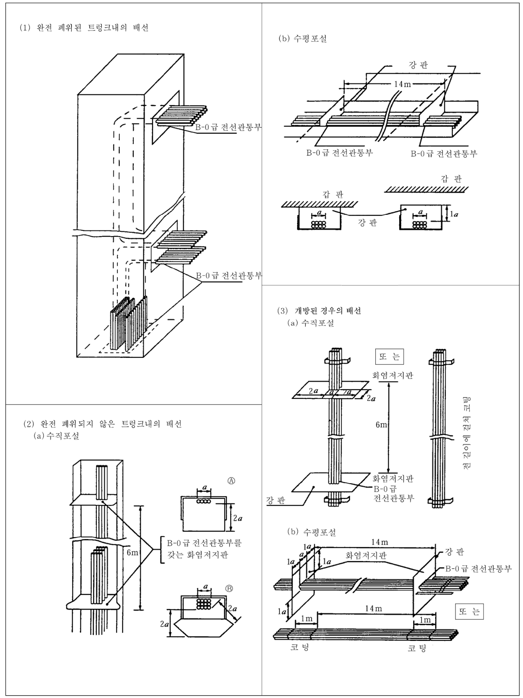
**그림 6.1.6 화염전파 방지조치**
> 설명: (1) 완전 폐위된 트렁크내의 배선은 트렁크 양 끝단에 B-0급 전선관통부를 두고, (2) 완전 폐위되지 않은 트렁크내의 배선은 (a) 수직포설 시 6 m마다 B-0급 전선관통부를 갖는 화염저지판(Ⓐ, Ⓑ 형태, 치수 $a$, $2a$), (b) 수평포설 시 14 m 간격의 강판(갑판에서 $1a$)과 B-0급 전선관통부를 둔다. (3) 개방된 경우의 배선은 (a) 수직포설 시 6 m 간격의 화염저지판(강판 치수 $2a$, $a$) 또는 전 길이에 걸친 코팅, (b) 수평포설 시 14 m 간격의 화염저지판(치수 $1a$) 또는 14 m마다 1 m 코팅을 나타낸다.

(3) **규칙 504**.의 3항 (3)호를 적용함에 있어서는 다음에 따른다. *(2026)*

(가) 화재상황에서도 작동되어야 하는 전기의 용도는 다음과 같다.

(a) 동력구동의 방화문 및 모든 방화문의 상태표시기에 대한 제어 및 급전장치

(b) 동력구동의 수밀문 및 이들 수밀문의 상태표시기에 대한 제어 및 급전장치

(c) 비상소화펌프

(d) 비상조명장치

(e) 화재 및 일반경보(general alarm)장치

(f) 화재탐지장치

(g) 소화장치 및 소화제 방출 경보장치

(h) 탈출유도표시장치(low-location lighting)

(i) 선내방송장치

(j) 화재 및/또는 폭발을 확산시킬 수 있는 장치의 원격 비상정지/긴급정지 장치

(나) (가)의 용도에 사용되는 케이블 및 케이블포설 요건에 대한 만족은 다음을 통해 달성할 수 있다.

(a) 전체 지름이 20 mm를 초과하는 케이블에는 IEC 60331-1:2018, 전체 지름이 20 mm 이하인 케이블에는 IEC 60331-2:2018을 만족하는 내연성 케이블을 사용하여, 화재위험성이 높은 구역 내에서 내화성을 유지할 수 있도록 연속적으로 포설 및 배선되어야 한다. (**지침 그림 6.1.7** 참조)

(b) 적어도 2개의 회로/방사상의 배전을 가능한 한 멀리 떨어지도록 설치하여 화재에 의한 손상을 받더라도 적어도 1개의 회로/방사상의 배전은 운전되어야 한다.

(c) 자기 감시기능을 갖는 장치, 페일세이프 장치 또는 가능한 한 멀리 떨어지도록 케이블을 이중으로 포설한 장치는 예외로 한다.

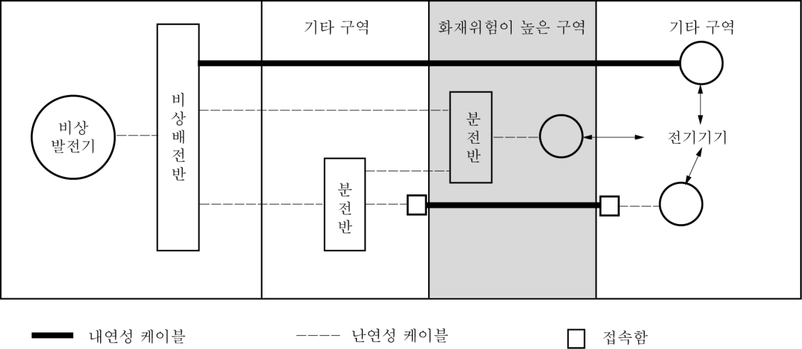
**그림 6.1.7 내연성 케이블의 적용범위 예**
> 설명: 비상발전기에서 비상배전반을 거쳐 기타 구역, 화재위험이 높은 구역(음영), 기타 구역에 있는 전기기기로 급전하는 배선 예로, 화재위험이 높은 구역을 통과하여 다른 구역의 기기로 가는 구간은 내연성 케이블(굵은 실선)로 하며, 한 경로는 구역 양쪽 경계의 접속함(□)에서 난연성 케이블과 이어진다. 그 밖의 구간과 화재위험이 높은 구역 안의 분전반에서 같은 구역 기기로 가는 배선은 난연성 케이블(점선)이다.

(다) 비상소화펌프용 케이블은 주소화펌프와 그 동력원 및 원동기가 있는 기관구역을 통과하지 아니하여야 한다. 기타 화재위험성이 높은 구역을 통과하는 케이블은 (나)의 (a)에 따른 내연성이어야 한다.

(라) 다음 구역은 적어도 “화재위험성이 높은 구역”으로 간주되어야 한다.

(a) **규칙 8편 1장 103**.의 30항에서 규정하고 있는 기관구역. 다만, **규칙 8편 7장 102**.의 3항 (2)호 (나) ⑩에서 규정하고 있는 구역은 적용하지 아니한다. (MSC/Circ.1120에 수록된 표 9.3~표 9.8에 대한 해석이 포함되며, 이는 MSC.1/Circ.1436 및 MSC.1/Circ.1510에 의해 개정된 내용을 반영한 것임)

(b) 연료처리장치 및 기타 인화성이 높은 물질을 포함하는 구역

(c) 조리실 및 조리설비를 갖춘 배식실

(d) 건조설비를 갖춘 세탁실

(e) 인화점이 60 °C를 넘는 액체 화물용 화물 탱크를 제외한 화물 구역 및 SOLAS II-2/10.7.1.2 또는 II-2/10.7.1.4에 따라 면제된 화물 구역을 제외한 화물 구역

(f) 차량구역, 로로구역 및 특수분류구역

(마) **규칙 504**.의 3항 (2)호를 적용함에 있어서, 다음 구역은 적어도 “기타 화재위험성이 높은 구역”으로 간주되어야 한다.

(a) 인화점이 60 °C를 넘는 액체 화물용 화물 탱크를 제외한 화물 구역 및 SOLAS II-2/10.7.1.2 또는 II-2/10.7.1.4에 따라 면제된 화물 구역을 제외한 화물 구역

(b) 차량구역, 로로구역 및 특수분류구역

(c) 인화성 액체를 포함하는 구역

(d) 조리설비를 갖춘 배식실

(바) 내연성 케이블은 쉽게 식별할 수 있어야 한다.

(사) 특수케이블의 경우, 다음 규격의 요건을 사용할 수 있다.

(a) 전기데이터 케이블 : IEC 60331-23:1999 *(2022)*

(b) 광섬유 케이블 : IEC 60331-25:1999 *(2022)*

(4) 발전기와 주배전반을 접속하는 케이블은 (가) 부터 (다)의 경우를 제외하고 다른 발전기용 원동기 및 연료유 청정기의 윗쪽 및 연료유청정기실을 통과하여서는 아니 된다.

(가) 복수의 발전기와 주배전반을 접속하는 케이블을 적어도 2계통으로 분리하여 부설하는 경우

(나) IEC 60331의 시험에 합격한 내연성 케이블을 사용한 경우

(다) 우리 선급이 적절하다고 인정하는 방화조치를 한 경우

**2. 규칙 504**.의 3항 (2)호의 규정중 “인접구역의 화재”란, 일반적으로「SOLAS협약 II-2장 3규칙 47항」에 정의된 표준화재시험에서 표준시간-온도곡선이 얻어진 화재를 말한다.

**3. 냉장창내의 배선** **규칙 504**.의 7항을 적용함에 있어서 냉장창내에 포설하는 케이블에 비닐, 클로로플랜 등의 비금속 피복을 사용하는 경우는 냉장창의 최저창내온도에서 변화되지 않는 것을 선정하고, 기계적인 외력을 받을 염려가 없도록 포설하여야 한다.

**4. 규칙 504**.의 3항에 규정한 구역에 **지침 501**.의 1항에 언급한 장치의 케이블을 부득이 포설하는 경우 IEC 60331의 시험에 합격한 내연성 케이블을 사용하거나 또는 이 케이블은 A-60 상당 이상의 방열을 시공한 강관 또는 강제 덕트내에 포설하여야 한다.

**5. 위험구역내의 케이블**

위험구역내에 포설되는 케이블이 그 장소에서의 전기적 사고로 인해 화재 또는 폭발을 일으킬 우려가 있는 경우에는 적절히 방호하여야 한다.

(1) 여기에서 언급하는 위험구역은 일반적으로 다음의 장소를 말한다.

(가) **규칙 7편 1장 11절**, 액화가스 산적운반선 규칙(**규칙 7편 5장**) 및 위험화학품 산적운반선 규칙(**규칙 7편 6장**)에 규정하는 위험구역

(나) **규칙 7편 3장 9절**에 규정한 화물창

(다) 축전지실, 도료실, 아세틸렌 격납고 등의 인화성 가스용기의 저장실

(2) (1)호에 표시한 위험구역내에 포설하는 케이블에 대한 방호는 다음에 따른다.

(가) (1)호 (가)의 위험구역내에 포설하는 케이블은 **규칙 7편 1장 11절**, 액화가스 산적운반선 규칙(**규칙 7편 5장**) 및 위험화학품 산적운반선 규칙(**규칙 7편 6장**)의 해당 규정에 따르면 이 규정에 의한 방호로 간주한다.

(나) (1)호 (나)의 화물창내에 포설하는 케이블은 각각 **규칙 7편 3장 9절**의 해당 규정에 따르면 이 규정에 의한 방호로 간주한다.

(다) (1)호 (다)에 표시한 각 구획내에 포설하는 케이블에 대한 방호는 다음에 따른다.

(i) 케이블은 원칙적으로 금속외장의 것으로 한다.

(ii) 필요에 따라 기계적 손상을 받지 않도록 보호한다.

#### 506. 접지

**1. 금속피복의 접지** **규칙 506**.의 1항을 적용함에 있어서 케이블의 금속피복 접지는 다음에 의한다. **【규칙 참조】**

(1) 케이블의 피복과 외장을 유효하게 접지하기 위하여 설계된 접지용 글랜드로 접지할 수가 있다. 글랜드는 접지할 금속구조물에 확실히 또한 전기적으로 양호한 접촉을 갖도록 부착하여야 한다.

(2) 접촉면이 깨끗하게 되도록 녹, 페인트를 잘 제거하고 또한 금속외피가 확실히 접지된 경우 콘센트는 금속외피에 나사로 조립하든지 외피 양측에 볼트로 조여서 접지할 수 있다. 금속외피와 콘센트의 접속부분은 부식을 방지하기 위해 접속후에 즉시 페인트로 도장하여야 한다.

(3) 케이블의 피복, 외장 및 도관은 (1)호 및 (2)호에 표시한 방법 대신에 내식재료의 클램프 또는 클립으로 피복 또는 외장과 접지된 금속과 유효하게 접촉시켜 접지할 수가 있다.

(4) 접지연속용에 사용되는 금속도관, 덕트 및 금속피복의 모든 접속점은 견고한 것으로서 필요한 경우는 방식처리를 하여야 한다.

#### 507. 케이블의 지지 【규칙 참조】

**1. 밴드, 지지물 및 부속품**

(1) **규칙 507**.의 3항을 적용함에 있어서 비금속재의 밴드 및 지지물을 사용할 경우는 재료의 명칭, 치수, 특성, 사용방법 등에 대한 자료를 우리 선급에 제출하여 승인을 받아야 한다. 다만, 배전반 등의 내부에 사용하는 것은 제외한다.

(2) **규칙 507**.의 3항 (4)호의 케이블의 느슨함에 대한 고려로서는 금속재 밴드에 의한 보강을 말하며 보강용 금속재 밴드는 케이블 외경을 고려하여 1~2 m마다 설치하여야 한다.

#### 508. 격벽 및 갑판의 관통

**1. 수밀 및 기밀유지** **규칙 508**.의 1항을 적용함에 있어서 케이블 관통부의 수밀성 및 기밀성을 확인할 때에는 사용된 케이블의 구조 및 사용재료의 성질을 고려하여야 한다. **【규칙 참조】**

**2. 방화벽의 관통** **규칙 508**.의 2항을 적용함에 있어서는 다음 각호의 규정에 따른다. **【규칙 참조】**

(1) A급 방화벽 또 갑판의 케이블 관통부는, 콤파운드를 충진시킨 상자, 코밍 등으로 구성하고, 또한 **「제조법 및 형식 승인 등에 관한 지침」 3장**의 규정에 따라 우리 선급의 승인을 받은 것이어야 한다.

(2) A급 방화벽 또는 갑판의 케이블 관통부에 케이블 글랜드(cable gland)를 사용할 경우에 관통부는 전호에 불구하고 케이블 글랜드에 적어도 25 mm 이상의 두께로 우리 선급이 승인한 불연성 콤파운드로 충전하여야 한다. 이 경우 A-0급의 경우를 제외한 케이블관통부에는 각각의 방화등급에 해당하는 방열재를 시공하여야 한다.

(3) B급 방화벽 또는 갑판 및 천정의 케이블 관통부에 사용하는 콤파운드는 우리 선급의 승인된 불연성 콤파운드이어야 한다. 이 콤파운드를 충전상자 또는 코밍에 충전하는 경우, 충전부의 길이는 적어도 50 mm 이상이어야 한다.

(4) (1)호에 따라 A급 방화벽 또는 갑판의 케이블 관통부에 사용하는 승인된 콤파운드는 (2)호 및 (3)호의 규정에 적합한 불연성 콤파운드로 볼 수 있다.

#### 510. 교류회로용 케이블

**1. 규칙 510**.의 (5)호를 적용함에 있어서 케이블과 강재격벽과의 간격은 가능한 한 50 mm 이상이어야 한다. **【규칙 참조】**

**2. 규칙 510**.의 (6)호중 “큰 단면적”이라 함은 도체 단면적 185 mm² 이상을 의미한다. **【규칙 참조】**

#### 511. 케이블의 접속 및 분기 【규칙 참조】

**1. 규칙 511**.의 2항의 추진용 케이블이라 함은 전기 추진 선박에 있어서, 발전기에서 전기 추진용 전동기에 이르는 전 길이의 케이블을 의미한다.

### 제 6 절 동력 및 조명용 변압기

#### 602. 구조

**1. 거주구획의 변압기** **규칙 602**.의 1항을 적용함에 있어서 적절한 외피구조의 배전반, 제어반내에 설치된 변압기를 제외하고 건식 변압기의 상자 및 덮개는 철재로 하여 적어도 방적(防滴)구조의 것으로 하여야 한다. 또한 개구는 직경 12 mm를 넘는 환봉이 들어가지 못하도록 금망(金網) 또는 12 mm 이하의 틈새로 하여, 쥐 등이 침입하지 못하는 구조로 하여야 한다. **【규칙 참조】**

#### 605. 시험 및 검사

**1. 일반사항** **규칙 605**.의 1항에 규정하는 “동일형식”이라 함은 용량, 전압, 전류, 주요치수, 냉각방법 및 절연종별이 동일하고, 동일한 제조공장에서 동일한 방법에 의해 제조된 것을 말한다. **【규칙 참조】**

**2. 전압변동률 시험** **규칙 605**.의 3항을 적용함에 있어서 계산식에 의한 전압변동률 산정을 다음 식에 따른다. **【규칙 참조】**

$$\text{전압변동률} = q_r + \frac{q_x^{2}}{200}\,(\%)$$

- $q_r$ : 저항에 의한 전압강하(%).

·단상인 경우

$$q_r = \frac{P_{75}}{EI}\times 100 \quad \text{또는} \quad q_r = \frac{P_{115}}{EI}\times 100$$

·3상인 경우

$$q_r = \frac{P_{75}}{\sqrt{3}\,EI}\times 100 \quad \text{또는} \quad q_r = \frac{P_{115}}{\sqrt{3}\,EI}\times 100$$

- $q_x$ : 리액턴스에 의한 전압강하 $= \dfrac{E_x}{E}\times 100\,(\%)$
- $P_t$ : $t$ ℃일 때 정격용량에 대한 부하손(W)
- $P_{75}$ : 75 ℃로 환산한 정격용량에 대한 부하손(W)
- $P_{115}$ : 115 ℃로 환산한 정격용량에 대한 부하손(W)
- $E_z$ : 임피던스 전압(V) 즉 $P_t$를 측정할 때의 1차 단자간 전압
- $E_x$ : 리액턴스 전압(V)

·단상인 경우

$$E_x = \sqrt{E_z^2 - \left(\frac{P_t}{I}\right)^2}$$

·3상인 경우

$$E_x = \sqrt{E_z^2 - \left(\frac{P_t}{\sqrt{3}\,I}\right)^2}$$

- $E$ : 정격 1차전압(V).
- $I$ : 정격 1차전류(A).

또한 상기 식에 있어서 $P_{75}$는 $A$, $E$ 및 $B$종 절연에 적용하며 $P_{115}$는 $F$ 및 $H$종 절연에 적용한다.

### 제 7 절 전동기용 제어기 및 전자브레이크

#### 701. 구조

**1. 전자접촉기 및 전동기용 과전류 계전기** **규칙 701**.의 5항을 적용함에 있어서 전동기용 열동형 또는 전자형 과전류 계전기는 주위온도 45℃에서 다음 각 호의 특성을 갖는 것을 표준으로 한다. **【규칙 참조】**

(1) 전부하전류 600 %를 통하여 2~30초 이내에 동작하여야 한다.

(2) 전동기의 전부하 전류를 통하여 온도가 일정하게 된 후 그 전류값의 200 %를 통하여 4분 이내에 동작하여야 한다.

(3) 전동기 전부하 전류의 100 %를 통해도 동작하지 않고 온도가 일정하게 된 후 그 전류값의 125 %를 통했을 때 2시간 이내에 동작하여야 한다.

#### 703. 비상정지장치 【규칙 참조】

**규칙 703**.을 적용함에 있어서 기관구역에 설치되는 기기의 비상정지장치는 기관구역 외부에 설치되어야 한다.

#### 706. 제어기기의 절연거리 【규칙 참조】

**1.** 정격 절연전압이라 함은 제어기기의 절연설계 기준이 되는 전압으로서 실용상 지장없이 사용할 수 있도록 고려한 전압을 말하며, 정격 사용전압 이상의 값으로 한다.

**2. 규칙 706**.의 (2)호에서 절연거리의 최소치는 **지침 표 6.1.14**의 급별에 따라 정한 **지침 표 6.1.15** 및 **6.1.16**에 따른다.

**3.** 제어기기의 절연거리는 다음에 따라 결정한다(**지침 표 6.1.17** 참조). 다음에서 C급은 **규칙 706**.의 (1)호에 나타낸 보호상태 및 주위조건을 의미한다.

**표 6.1.14 보호상태 및 주위조건에 따른 급별**

<table>
<thead>
<tr><th>급별</th><th>최소치</th><th>보호상태</th><th>주위조건</th></tr>
</thead>
<tbody>
<tr><td>A</td><td><strong>표 6.1.15</strong></td><td>습기와 먼지 등의 주위조건에 따라 기능을 해칠 영향을 거의 고려할 필요가 없을 정도로 보호된 제어기기의 내부. <strong>보기</strong> : 방진 구조의 계전기의 내부, 도금된 인쇄 배선판 등.</td><td>매우 양호하고, 거의 오손될 염려가 없는 환경에서 사용되는 제어기기. <strong>보기</strong> : 공기 조화된 맑은 실내.</td></tr>
<tr><td>B</td><td><strong>표 6.1.16</strong></td><td>습기와 먼지 등의 영향을 별로 받지 않는 정도로 보호된 제어기기. <strong>보기</strong> : 제어용 소형 전자 계전기, 전용 소켓, 도금하지 않은 인쇄 배선판 등.</td><td>양호한 환경에서 사용되는 제어기기. <strong>보기</strong> : 청결한 전기실.</td></tr>
</tbody>
</table>

**표 6.1.15 A급 제어기기의 최소 절연거리**

<table>
<thead>
<tr><th rowspan="2">정격 절연전압 V</th><th colspan="4">A급</th></tr>
<tr><th colspan="2">공간 거리 mm</th><th colspan="2">연면 거리(3)(4) mm</th></tr>
<tr><th>(직류·교류)</th><th>$L-L^{(1)}$</th><th>$L-A^{(2)}$</th><th>$a$</th><th>$b$</th></tr>
</thead>
<tbody>
<tr><td>12이하</td><td>0.2</td><td>0.2</td><td>0.2</td><td>0.2</td></tr>
<tr><td>12초과 30이하</td><td>0.4</td><td>0.4</td><td>0.4</td><td>0.4</td></tr>
<tr><td>30초과 60이하</td><td>0.5</td><td>0.5</td><td>0.5</td><td>0.5</td></tr>
<tr><td>60초과 125이하</td><td>0.5</td><td>0.5</td><td>0.5</td><td>1</td></tr>
<tr><td>125초과 250이하</td><td>1</td><td>1</td><td>1</td><td>1.5</td></tr>
<tr><td>250초과 380이하</td><td>1.5</td><td>1.5</td><td>1.5</td><td>2</td></tr>
<tr><td>380초과 500이하</td><td>2</td><td>2</td><td>2</td><td>3</td></tr>
</tbody>
</table>

**표 6.1.16 B급 제어기기의 최소 절연거리**

<table>
<tr><th rowspan="2">정격 절연전압 V</th><th colspan="4">B급</th></tr>
<tr><th colspan="2">공간 거리 mm</th><th colspan="2">연면 거리(3)(4) mm</th></tr>
<tr><th>(직류·교류)</th><th>$L-L$(1)</th><th>$L-A$(2)</th><th>$a$</th><th>$b$</th></tr>
<tr><td>12이하</td><td>0.4</td><td>0.4</td><td>0.4</td><td>0.4</td></tr>
<tr><td>12초과 30이하</td><td>1</td><td>1</td><td>1</td><td>1.5</td></tr>
<tr><td>30초과 60이하</td><td>1</td><td>1</td><td>1</td><td>2</td></tr>
<tr><td>60초과 125이하</td><td>1.5</td><td>1.5</td><td>1.5</td><td>2.5</td></tr>
<tr><td>125초과 250이하</td><td>2</td><td>3</td><td>2</td><td>3</td></tr>
<tr><td>250초과 380이하</td><td>3</td><td>3</td><td>3</td><td>4</td></tr>
<tr><td>380초과 500이하</td><td>4</td><td>4</td><td>4</td><td>6</td></tr>
</table>

(비고)

(1) 공간거리 $L$-$L$은 나충전부 사이 및 충전부와 접지 접속체와의 사이에 적용한다.

(2) 공간거리 $L$-$A$는 충전부와 우발적으로 위험하게 되는 금속체와의 사이에 적용한다.

(3) 연면 거리는 절연물의 종별과 형상에 따라서 결정한다.

"$a$"는 세라믹(스테아타이트(steatite)와 자기) 및 기타 절연 재료에도, 특히 누설 전류에 대하여 안전한 리브 또는 수직면을 가진 절연물로서 실험적으로 세라믹을 사용한 것과 같은 것으로 인정되는 트래킹 지수 140 이상의 재료(예를 들면 페놀수지 성형품 등)에 적용한다.

"$b$"는 기타의 절연 재료의 경우에 적용한다.

(4) 공간거리 $L$-$A$가 그것에 대응한 연면 거리 "$a$" 또는 "$b$"보다 큰 경우에는, 조작자가 나충전부에 쉽게 닿을 수가 있고, 각 절연이 열화되어 충전부가 되는 절연 금속체와의 사이의 연면 거리는 $L$-$A$ 이상이어야 한다.

(5) 전류치는 정격 통전 전류의 값으로 나타낸다.

**표 6.1.17 절연거리의 결정방법**

<table>
<tr><th>번호</th><th>그림</th><th>조건</th><th>절연간격($G$)</th><th>연면거리($L$)</th></tr>
<tr><td>1</td><td>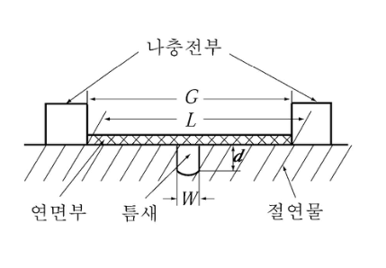</td><td>$W$ 또는 $d \lt 1\,\mathrm{mm}$의 경우 B급 : 125 V 초과시 C급 : 250 V 이하시 $W$ 또는 $d \lt 2\,\mathrm{mm}$의 경우 C급 : 250 V 초과시</td><td>$G$</td><td>$L$</td></tr>
<tr><td>2</td><td>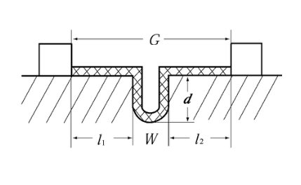</td><td>$W$ 및 $d \ge 1\,\mathrm{mm}$의 경우 B급 : 125 V 초과시 C급 : 250 V 이하시 $W$ 및 $d \ge 2\,\mathrm{mm}$의 경우 C급 : 250 V 초과시</td><td>$G$</td><td>$L = l_1 + l_2 + W + 2d$</td></tr>
<tr><td>3</td><td>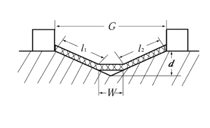</td><td>$W = 1\,\mathrm{mm},\ d \ge 1\,\mathrm{mm}$의 경우 B급 : 125 V 초과시 C급 : 250 V 이하시 $W = 2\,\mathrm{mm},\ d \ge 2\,\mathrm{mm}$의 경우 C급 : 250 V 초과시</td><td>$G$</td><td>$L = l_1 + l_2 + W$</td></tr>
<tr><td>4</td><td>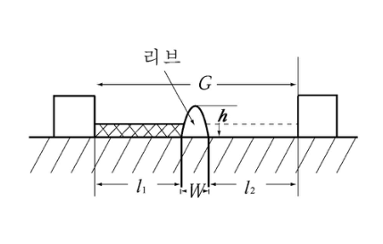</td><td>$h \lt 1\,\mathrm{mm}$의 경우 B급 : 125 V 초과시 C급 : 250 V 이하시 $h \lt 2\,\mathrm{mm}$의 경우 C급 : 250 V 초과시</td><td>$G$</td><td>$L = l_1 + l_2 + W$</td></tr>
<tr><td>5</td><td>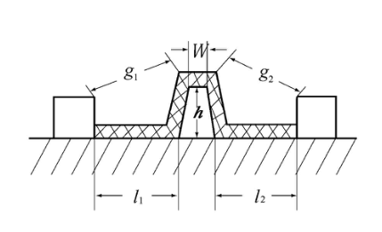</td><td>$h \ge 1\,\mathrm{mm}$의 경우 B급 : 125 V 초과시 C급 : 250 V 이하시 $h \ge 2\,\mathrm{mm}$의 경우 C급 : 250 V 초과시</td><td>$G = g_1 + g_2 + W$</td><td>$L = l_1 + l_2 + W + 2h$</td></tr>
<tr><td>6</td><td>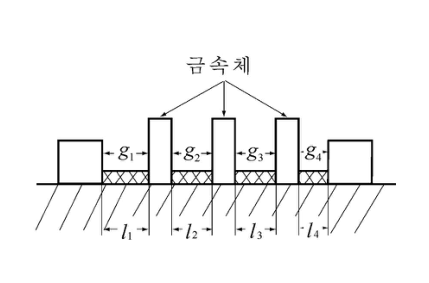</td><td>충전부 사이에 금속체가 있는 경우 보기 : $g_1 \gt g_2 \gt g_3 \gt g_4$ $l_1 \gt l_2 \gt l_3 \gt l_4$ $g_2$ 및 $l_2 \ge 1\,\mathrm{mm}$의 경우 B급 : 125 V 초과시 C급 : 250 V 이하시 $g_2$ 및 $l_2 \ge 1\,\mathrm{mm}$의 경우 C급 : 250 V 초과시</td><td>$g_1 \ge$ 규정치 또는 $g_1 + g_2 \ge$ 규정치 $\times 1.25$</td><td>$l_1 \ge$ 규정치 또는 $l_1 + l_2 \ge$ 규정치 $\times 1.25$</td></tr>
<tr><td>7</td><td>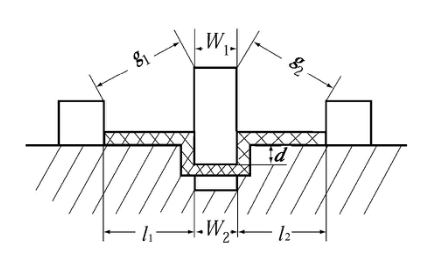</td><td>절연물 틈의 깊이가 끼워 넣는 부분보다 깊은 경우</td><td>$G = g_1 + g_2 + W_1$</td><td>$L = l_1 + l_2 + W_2 + 2d$</td></tr>
<tr><td>8</td><td>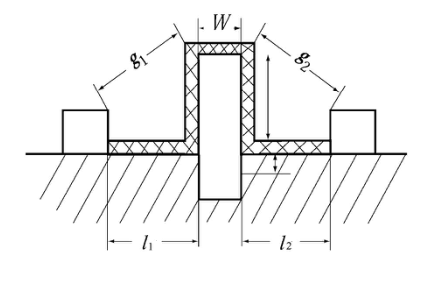</td><td>절연물과 리브를 일체로 보이도록 끼워 넣는 경우</td><td>$G = g_1 + g_2 + W$</td><td>$L = l_1 + l_2 + W + 2$</td></tr>
<tr><td>9</td><td>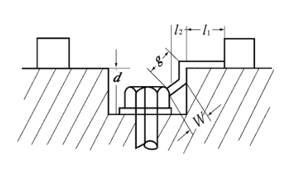</td><td>$W = 1\,\mathrm{mm},\ l_2 \lt 1\,\mathrm{mm}$의 경우 B급 : 125 V 초과시 C급 : 250 V 이하시 $W = 2\,\mathrm{mm},\ l_2 \ge 2\,\mathrm{mm}$의 경우 C급 : 250 V 초과시</td><td>$G = g + l_1$</td><td>$L = l_1 + d$</td></tr>
<tr><td>10</td><td>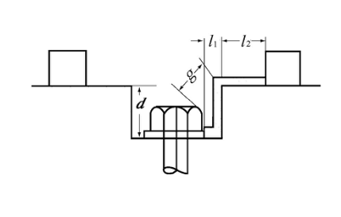</td><td>$l_2 \ge 1\,\mathrm{mm}$의 경우 B급 : 125 V 초과시 C급 : 250 V 이하시 $l_2 \ge 2\,\mathrm{mm}$의 경우 C급 : 250 V 초과시</td><td>$G = g + l_1$</td><td>$L = l_1 + l_2 + d$</td></tr>
<tr><td>11</td><td>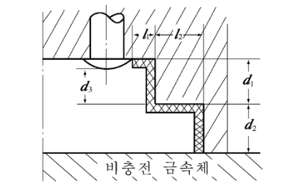</td><td>$l_2 \ge 1\,\mathrm{mm}$의 경우 B급 : 125 V 초과시 C급 : 250 V 이하시 $l_2 \ge 2\,\mathrm{mm}$의 경우 C급 : 250 V 초과시</td><td>$G = d_2 + d_3$</td><td>$L = l_1 + l_2 + d_1 + d_2$</td></tr>
<tr><td>12</td><td>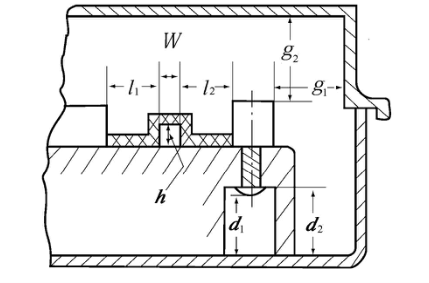</td><td>금속체 용기에 들어있는 경우</td><td>$G_1 = l_1 + l_2 + W$ (나충전부 사이) $G_2 = g_1\ (g_1 \lt g_2 \lt d_1)$ (대지 사이)</td><td>$L_1 = l_1 + l_2 + W + 2h$ (나충전부 사이) $L_2 = d_2$ (대지 사이)</td></tr>
</table>
<!-- 원본: images/7eda40d87940.png -->
<!-- 원본: images/22dea592aff9.png -->

(1) 공간거리는 나충전부 사이의 최단 거리로 결정하고, C급은 **규칙 표 6.1.22**, A급 및 B급은 각각 **지침 표 6.1.15** 및 **6.1.16**에 규정한 값을 최소로 한다.

(2) 연면거리는 나충전부 사이에 있는 절연물의 표면에 연한 최단거리로 결정하여, C급은 **규칙 표 6.1.22**, A급 및 B급은 각각 **지침 표 6.1.15** 및 **6.1.16**에 규정한 값을 최소로 한다. 그러나 절연물의 표면에 다음과 같이 틈이 있는 것은 그 틈이 없는 것으로 결정한다.

(가) B급 정격 절연전압 125 V 초과 및 C급 정격 절연전압 250 V 이하에서, 틈의 너비 또는 깊이가 1 mm 미만인 경우.

(나) C급 정격 절연전압 250 V 초과에서, 틈의 너비 또는 깊이가 2 mm 미만인 경우.

(3) (1)호 및 (2)호에 있어서 나충전부 사이에 금속체가 있어 절연물이 분할되는 경우에는, 다음 중 어느 한 가지에 의하여야 한다.

(가) 분할된 절연물 중에서 최대의 것이 C급은 **규칙 표 6.1.22**, A급 및 B급은 각각 **지침 표 6.1.15** 및 **6.1.16**에 규정한 값 이상으로 하여야 한다.

(나) 분할된 절연물 중에서 큰 것 두 개를 합한 것이 C급은 **규칙 표 6.1.22**, A급 및 B급은 각각 **지침 표 6.1.15** 및 **6.1.16**에 규정한 값의 1.25배 이상이어야 한다. 그러나, 분할된 절연물이 B급 정격 절연전압 125 V 초과 및 C급 정격 절연전압 250 V 이하에서 1 mm 미만의 것, 또한 C급 정격 절연전압 250 V 초과에서 2 mm 미만의 것은 제외한다.

(4) (1)호 및 (2)호에 있어서 나충전부 사이의 절연물의 면에 리브가 있는 경우, 그 높이가 다음 관계에 있으면 그 연면 거리 및 공간 거리는 이를 제외하고 결정한다.

(가) B급 정격 절연전압 125 V 초과 및 C급 정격 절연전압 250 V 이하에서 리브의 높이가 1 mm 미만인 경우.

(나) C급 정격 절연전압 250 V 이하에서 리브의 높이가 1 mm 미만인 경우.

(5) (1)호 및 (2)호에 있어서 충전부 사이에 있는 절연물에 다른 리브를 삽입하는 경우, 그 삽입부분의 길이가 절연물의 틈의 깊이보다 작으면, 리브의 삽입 부분을 따라 최단 거리로 연면 거리를 결정한다.

(6) (5)호에서 리브를 같은 절연물로 보이도록 삽입한 경우에는, 리브의 표면을 따라 최단거리로서 연면거리 및 공간거리를 결정한다.

(7) 대지 공간 거리 및 대지 연면거리는 각각 (1)호와 (2)호에 따라서 최단거리로 결정한다.

(8) 절연이 열화됨으로서 충전부가 되는 절연 금속체를 가진 것의 절연거리는 (3)호에 따라 결정한다.

#### 707. 시험 및 검사

1. **일반사항** **규칙 707.**의 1항을 적용함에 있어서 “우리 선급이 지장이 없다고 인정하는 경우”라 함은 형식승인, 시험 성적서 확인 등을 말하며, “동일형식의 제어용기기”라 함은 동일 제조공장에서 동일한 방법으로 제조된 것으로 다음의 조건에 적합한 것을 말한다. **【규칙 참조】**

(1) 반, 상 등의 외형치수, 내용적 및 통풍방법이 거의 같아야 한다.

(2) 주회로의 차단기, 단로기, 전자접촉기의 형식 및 정격이 같고, 또 주회로 도체의 치수, 배치 및 접속부에 따른 단자의 구조가 거의 같아야 한다.

(3) 주회로의 부하전류가 거의 같거나 또는 그 이하이어야 한다.

(4) 변성기, 계전기, 퓨즈, 저항기 등의 발열원과 접해 있는 각종 반내 부착기구의 배치가 거의 같고 그들 소비전력의 합계가 거의 같거나 혹은 그 이하이어야 한다.

2. **내전압시험** **규칙 707.**의 4항에서 내전압시험은 **규칙 406.**의 4항에 의한다. **【규칙 참조】**

### 제 8 절 퓨즈, 차단기 및 전자접촉기

#### 801. 일반사항 【규칙 참조】

1. 한국산업규격 및 우리 선급이 동등하다고 인정하는 규격에는 다음의 것이 있다. 또한 한국 이외의 국적을 가진 제조자의 제품은 그 나라에서 정한 표준규격으로서 우리 선급이 적절하다고 인정하면 그 규격에 따를 수 있다. 다만 이 규격은 최신판에 의한 것으로 한다. 또한 이들 규격은 선박용으로 규정되어 있지 않은 것은 선박의 환경조건(**규칙 6편 1장 2절**에 적합할 것)을 고려할 필요가 있다.

(1) 퓨즈 : IEC 60269

(2) 차단기 : IEC 60947-2

(3) 전자접촉기 : IEC 60947-4-1

### 제 9 절 방폭형 전기기기

#### 901. 일반사항

1. **재료** **규칙 901.**의 5항 (2)호 “마찰에 의한 불꽃 발생의 염려가 적은 재료”로는 강재간에 마찰 또는 충격이 있을 시 발생하는 불꽃이 폭발성가스에 점화 폭발을 일으키지 않는 재료를 말하며 KS E 3903에 정해진 낙하시험장치를 이용하여 시험하고 비착화성이 확인된 재료를 말한다. **【규칙 참조】**

2. **구조** 내압방폭 및 본질안전 방폭구조의 전기기기는 **규칙 901.**의 6항 (5)호에 규정한 표시이외에 다음 사항을 기기의 볼 수 있는 위치에 표시해야 한다. **【규칙 참조】**

(1) 내압 방폭구조의 전기기기

통풍식 및 봉입식일 경우 다음을 표시한다.

(가) 기기의 내용적

(나) 기기의 보호기체 주입구에서 소요풍압 및 소요풍량

(다) 기기의 보호기체 배기구에서 소요풍압(통풍식만)

(라) 용기의 허용최고풍압

(2) 본질 안전 방폭구조의 전기기기

(가) 다음 각 사항을 표시한다. 다만, 검출기등의 각 기기에는 (a) 부터 (c)는 생략할 수 있다.

(a) 본질안전회로의 정격치

(b) 비본질안전회로의 정격치

(c) 사용조건이 있는 경우는 그 요점

(나) 조합된 기기에 있어 비본질안전회로 부분이 방폭구조가 아닌 때는 위 표시 이외에 다음 각 사항을 명시한다.

(a) 위험구역에는 설치를 금지하는 주의사항

(b) 기기의 구성부품, 배선등의 변경, 개조등을 금지하는 주의사항

(다) 조합된 기기의 본질 안전회로 접속단자에는 그 취지를 명확히 표시할 것.

기기의 뚜껑 내면에는 기기의 회로도를 부착하여 볼 수 있도록 할 것.

3. **단순기기(simple apparatus)** **규칙 901.**의 7항을 적용함에 있어서 단순기기는 다음에 해당하는 기기를 말한다. **【규칙 참조】**

(1) 스위치, 접속함, 저항기 및 단순 반도체 장치 등의 수동 부품

(2) 1.5 V, 100 mA 및 25 mW 이상을 발생시키지 않는 에너지원

#### 902. 개별요건 【규칙 참조】

**규칙 902.**에서 “우리 선급이 적절하다고 인정하는 바”라 함은 다음을 말한다.

1. **내압방폭형 전기기기**

(1) 격벽을 관통해서 부착하는 내압방폭형 전등기구는 격벽의 완전성을 해칠 염려가 없는 것이어야 한다.

(2) 방폭구조인 외피에 드레인 배출장치를 설치할 경우에는 이것이 열려도 방폭성능을 해칠 염려가 없어야 한다.

(3) 내압방폭구조의 기기에 방수성을 갖도록 패킹을 사용할 때는 방폭성능을 유지하기 위하여 지정된 틈새 깊이에 물의 영향이 없도록 하여야 한다.

(4) 내압방폭구조의 단자함에 전선관 결합방식을 이용하여 케이블을 내부로 넣을 경우에는 단자함에 근접하여 실링피팅을 설치하여야 한다.

(5) 기기를 설치할 경우, 기기의 내압접합면은 격벽이나 고형물 등에 대하여 **지침 표 6.1.18**에 명시된 거리 이내로 설치되어서는 아니 된다.

**표 6.1.18 내압방폭형 전기기기의 최소 설치 거리**

| 가스그룹 | 최소 거리 mm |
|---|---|
| IIA | 10 |
| IIB | 30 |
| IIC | 40 |

(6) 내압접합면은 적합한 비응고 그리스를 사용하여 부식으로부터 보호되어야 한다.

2. **본질안전방폭형 전기기기**

(1) 본질안전 방폭형 전기기기는 일반 전기기기로부터 독립하여 설치하여야 한다. 부득이 일반기기와 조합해서 설치할 경우에는 이들 사이에 금속성의 격리판을 설치하여 접지하여야 한다.

(2) 본질안전회로의 배선은 기타회로의 배선과는 쉽게 식별할 수 있는 조치가 강구되어야 하며 외부 전기장이나 자기장에 의한 악영향을 받지 않도록 차폐케이블을 사용하거나 기타회로에서 50 mm이상 이격되어야 한다. *(2018)*

(3) 조합된 기기에 있어서 비본질 안전회로와 본질 안전회로의 접속단자는 다음 중 어느 것에 적합하여야 한다.

(가) 양회로의 접속단자는 상호간 50 mm 이상의 이격거리를 갖는 별개 단자판으로 할 것.

(나) 양회로의 접속단자간에 충분한 기계적 강도와 절연성을 갖는 격벽 또는 접지된 금속제 격벽을 설치하여 양회로가 서로 접촉하지 않는 구조로 할 것.

(4) 본질안전방폭형 전기기기의 급전회로는 그이외의 전기회로 고장으로 인하여 안전유지기의 성능이 손상되어서는 아니 된다.

(5) 안전유지기는 안전장소에 설치하여야 한다.

(6) 안전유지기의 구성부품은 다음 중 어느 부품이 사용되지 않는다면 동일부품을 2개 이상 사용하여야 한다. 이런 부품중의 1개가 고장이 나도 방폭성능은 유지되어야 한다.

(가) 전원변압기

동제의 접지된 절연격리판에 의해 일차권선과 이차권선 사이의 절연이 확실하게 이루어지고 각각의 권선은 충분한 절연성능을 갖출 것.

(나) 전류제한 저항기

합성수지 등에 의하여 표면이 피복되어 있든지 또는 성형수지안에 매입되어 있을 것.

(다) 블로킹 콘덴서

고신뢰성의 고체 유전형의 것을 2개 직렬로 접속한 집성체일 것. 전해식 또는 탄탈(tantalum)식 콘덴서는 사용하지 말 것.

(7) 다심케이블의 사용하지 않는 전선은 적합한 단자를 사용하여 양쪽 끝단을 접지로부터 절연시키고 또한 서로 적절히 절연시켜야 한다.

3. **안전증가방폭형 전기기기**

(1) 안전증가 방폭형 전등기구의 보호외피는 비흡습성인 난연성 또는 불연성 재료를 사용한 튼튼한 구조인 것으로 방수형 또는 이것과 동등 이상인 것이어야 한다.

(2) 안전증가 방폭구조의 전동기, 변압기 등을 사용할 경우에는 과부하 또는 과열에 대하여 충분히 보호하여야 한다. 또한 농형유도 전동기일 경우에는 미리 허용구속시간을 초과하여 사용하는 일이 없도록 보호하여야 하고 구속상태에서도 해당기기의 이상온도 상승이 발생하여서는 아니 된다.

(3) 방폭성능을 유지하기 위하여 기기에 사용조건이 있는 경우, 해당기기의 사용에 대한 우리 선급의 승인을 받아야 한다.

(4) 단자내의 인접도체간에 단락사고의 위험을 방지하기 위하여, 각 도체의 절연은 단자의 금속부까지 유지하여야 한다.

4. **압력방폭형 전기기기**

(1) 가압매체로 공기를 사용할 때에는 흡기구와 배기구를 충분히 분리하여야 하며 그 입구를 안전장소에 설치하여야 한다.

(2) 가압매체로서 공기 또는 불활성 가스를 사용할 경우는 기기내의 공기를 10회 이상 교환하고 필요한 압력을 얻은 후가 아니면 전류가 흐르지 않도록 인터록 장치를 하여야 한다.

(3) 압력방폭형 전기기기는 내압이 상실될 때 자동적으로 전원을 차단하여야 한다. 다만, 그 기기의 정지가 선박의 위험을 가져올 염려가 있는 경우는 경보를 울리는 것만으로도 가능하다.

5. **충전방폭형 전기기기**

(1) 용기의 보호외피는 IP54이상이어야 한다. 만일, IP55이상으로 할 경우에는 통기구를 설치하여야 한다.

(2) 내부에 충전하는 분말재료는 석영 또는 유리편이어야 하며 충분한 절연성능을 갖추어야 한다.

(3) 에너지를 저장하는 부품의 총에너지양은 20 J을 초과하여서는 아니 된다.

(4) 방폭성능을 유지하기 위하여 기기에 사용조건이 있는 경우, 해당기기의 사용에 대한 우리 선급의 승인을 받아야 한다.

6. **유입방폭형 전기기기**

(1) 운전중에 유위를 쉽게 점검할 수 있도록 유면계를 구비하여야 한다.

(2) 운전중에 전기불꽃을 발생하는 부분은 25 mm이상 깊이의 절연유속에 담가야 한다.

(3) 용기에 연결된 전선이 기름에 접촉하는 경우, 전선은 내유성의 것이어야 한다.

(4) 방폭성능을 유지하기 위하여 기기에 사용조건이 있는 경우, 해당기기의 사용에 대한 우리 선급의 승인을 받아야 한다.

7. **몰드방폭형 전기기기**

(1) 온도상승을 제한하기 위하여 보호부품을 설치하는 경우, 설정치는 변경되어서는 아니 된다.

(2) 방폭성능을 유지하기 위하여 기기에 사용조건이 있는 경우, 해당기기의 사용에 대한 우리 선급의 승인을 받아야 한다.

8. **비점화방폭형 전기기기**

(1) 전기기기의 정상 작동 및 어느 규정된 비정상 조건에서 주위 폭발성 가스 분위기를 점화시킬 수 없는 방폭 구조이다.

(2) 별도로 아크나 스파크가 주위의 폭발성 분위기를 점화시키지 않도록 보호된 경우를 제외하고, 작동 중에 아크나 스파크를 일으키지 않아야 한다.

(3) 용기의 보호 등급은 다음 중 어느 하나의 등급 이상을 가져야 한다.

(가) 노출 충전부가 있는 장소는 IP54 또는 절연 충전부가 있는 장소는 IP44

(나) 장치를 다른 고형 물체나 안전을 손상시킬 수 있는 물의 침입으로부터 적절히 보호되는 장소에서만 설치되는 경우, 노출 충전부가 있는 장소는 IP4X, 절연 충전부가 있는 장소는 IP2X

### 제 10 절 조명기구, 전열기구, 배선기구 및 기타 설비 *(2019)*

#### 1001. 일반사항 【규칙 참조】

조명기구, 전열기구 및 배선기구는 한국산업표준에 적합한 것 또는 이것과 동등 이상의 것이어야 하며 이 절의 규정에도 적합하여야 한다.

#### 1002. 조명기구

1. **구조 및 거치** **규칙 1002.**의 1항 (3)호에서 유리제품 이외의 그로브를 사용한 전등기구에 있어 우리 선급이 적절하다고 인정하는 경우는 가드를 생략할 수 있다. **【규칙 참조】**

2.**규칙 1002.**의 2항 (4)호 및 3항을 적용함에 있어서 다음에 따라야 한다. 다만, 우리 선급이 적합하다고 인정하는 경우에는 형식 승인을 받지 아니할 수 있으나 한국산업표준에 적합한 것 또는 이것과 동등 이상의 것이어야 한다. **【규칙 참조】**

(1) 적용 표준

(가) IEC 60092-306

(나) KS C 8100

(다) 선박용 LED 조명의 안전 및 성능 요구사항에 대한 한국산업표준 또는 이와 동등한 표준

(라) (가)∼(나)를 적용함에 있어서, 동일한 요건에 대해서 상이한 내용이 있을 경우에는 IEC 60092-306을 따라야 한다.

(마) 기타 동등한 한국산업표준 또는 IEC 표준

(2) 시험 *(2019)*

**제조법 및 형식승인 등에 관한 지침 3장 31절**을 따라야 한다. 단, 우리 선급이 적합하다고 인정하는 경우에는 시험의 일부를 생략할 수 있다.

#### 1003. 전열기구 【규칙 참조】

1. 전열소자의 보호가드는 튼튼하게 고정된 구조로서, 통전부에 접촉하지 아니하도록 장비하여야 하고, 보호 가드의 개구부는 표준시험장치(standard test finger)가 전열소자에 접촉하지 아니하도록 충분히 작아야 한다.

2. 조리기용 전열기의 충전부는 조리용 기구에 접촉하지 않도록 보호하여야 한다.

3. 액중에 잠기는 전열소자는 내식성의 금속 피복으로 보호한 것이어야 한다.

4. 욕조용에 전열기를 사용할 경우에는 입욕중에 감전의 우려가 없도록 절연소자를 배치하여야 하며, 또한 조작 스위치는 다극 연결식으로서 표시등 및 주의명판을 설치하여야 한다.

5. 운반 가능한 조리기용 전열기는 옆으로 넘어지지 아니하는 구조의 것이어야 한다.

### 제 11 절 선내 통신 장치

#### 1102. 중요한 선내 통신 장치 【규칙 참조】

1. 중요한 선내 통신 및 신호장치는 다음의 것을 포함한다.

(1) 국제협약에서 요구하는 항해등, 신호등 및 신호장치

(2) 선내 통신장치

(가) 다음 장소 사이의 통신장치

(a) 선교와 주기관제어장소 사이

(b) 선교와 조타기실 사이

(c) 기관사 호출장치

(d) 선교, 집중제어실, 기관제어장소, 기관사 거주구역간의 주전원 상실시에도 사용 가능한 통화장치

(3) 선내 신호장치

(가) 총비상 경보장치

(나) 화재 경보장치

(다) $\mathrm{CO_2}$ 방출 경보장치

(4) 조타장치용 제어장치 및 타각지시기

(5) 국제협약에서 요구하는 항해장치

(6) 기타 우리 선급이 필요하다고 인정하는 선내통신, 신호 및 항해장치

#### 1105. 총비상 경보장치용 회로 【규칙 참조】

총비상 경보장치용 급전회로를 과전류로부터 보호하기 위해 차단기를 설치할 경우에는 “항상 ‘ON’ 상태를 유지하여야 한다”는 내용의 안내문을 부착하여야 한다. 다만, 퓨즈로 보호되는 경우에는 안내문을 부착할 필요가 없다.

#### 1106. 선내 방송장치 【규칙 참조】

1. 갑판하부통로, 선수창고(bosun's locker), 병원 및 펌프실과 같은 구역에서 선내 방송장치는 요구되지 않는다.

2. 개별 확성기가 국부 묵음(local silencing)을 위한 장치를 가지는 경우, 선교를 포함하는 제어실로부터의 오버라이드 장치가 준비되어 있어야 한다.

3. **규칙 1106.**의 6항 (1)호를 적용함에 있어서, 선실/거실의 음압 레벨은 요구 수준에 도달하는지를 해상 시운전시 확인하여야 한다.

4. **규칙 1106.**의 7항을 적용함에 있어서, 단일 고장의 영향을 최소화하는 방법은 다음의 경우와 같다.

(1) 복수의 증폭기를 사용할 것.

(2) 공용실, 통로, 계단 및 제어실에는 각각의 증폭기로부터 분리된 케이블 루트를 가질 것

(3) 전자음 신호를 발생시키기 위해 2개 이상의 장치를 사용할 것.

(4) 개별 확성기를 단락에 대해 전기적으로 보호할 것.

### 제 12 절 반도체 전력변환장치 *(2021)*

#### 1204. 정류기

1. **일반사항** **규칙 1204.**의 7항 (1)호를 적용함에 있어서 “우리 선급이 인정할 경우”라 함은 형식승인, 시험 성적서 확인 등을 말한다. **【규칙 참조】**

2. **온도시험** **규칙 1204.**의 7항 (2)호에 규정하는 정류기의 온도시험에 있어서 **규칙 1204.**의 4항에 적합 여부의 확인은 정류소자의 냉각핀, 케이스, 냉매 등의 온도 상승계측에 의해도 좋다. 다만, 냉각핀, 케이스, 냉매 등의 온도상승한도가 그 한도 이내에 있다면 접합부의 온도가 최고허용온도를 초과할 염려가 없는 것으로서 미리 지정된 것으로 한다. **【규칙 참조】**

3. **동작시험** **규칙 1204.**의 7항 (3)호를 적용함에 있어서 보호장치의 동작시험으로는 냉각 송풍기와 전원스위치 간에 인터록의 확인시험 등을 말하고, 정류소자의 보호퓨즈시험 등 파괴시험에 관한 것은 생략할 수 있다. **【규칙 참조】**

### 제 13 절 축전지

#### 1301. 일반사항 【규칙 참조】

1. 외국의 제조자가 제조한 축전지의 경우에는 그 나라에서 정하는 표준에 적합하고 선박용으로도 적합하다고 인정되는 것을 사용하여야 한다.

2. 축전지는 사용 용도별로 적절한 방전 시간률을 갖는 것이어야 한다.

3. 알카리 축전지를 사용할 경우는 그때마다 구조, 성능, 설치방법 등에 대한 자료를 제출하여 우리 선급의 승인을 얻어야 한다.

#### 1303. 설치장소 【규칙 참조】

1. **규칙 1303.**의 4항을 적용함에 있어서는 다음에 따른다.

(1) “용량이 큰 축전지”라 함은, 2 kW 이상의 출력을 갖는 충전설비에 접속하는 축전지를 말한다. 또한 충전설비의 출력이라 함은 정류기의 정격전류와 축전지군의 공칭 전압을 곱한 것으로 한다.

(2) 0.2 kW에서 2 kW까지의 출력을 갖는 충전설비와 접속하는 축전지는 축전지실 또는 상갑판 이상의 장소에 설치된 상자에 설치할 수 있다. 이러한 장소에 축전지를 설치할 수 없는 경우에는 다음의 요건 중 어느 하나에 적합하여야 한다.

(가) 적절한 장소에 설치한 격납상자 또는 로커에 설치하여야 한다.

(나) 기계실내에 개방한 그대로 설치하여야 한다.

(다) 통풍이 잘 되는 일정구역에 설치하여야 한다.

(3) 0.2 kW 이하의 출력을 갖는 충전설비와 접속하는 축전지는 적절한 장소에 개방한 그대로 설치하거나 축전지 상자에 설치할 수 있다.

(4) 여기서 충전설비의 출력은 다음 식에 의한 것 이상이어야 한다. *(2019)*

$$P = U \times I \quad (\mathrm{W})$$

- $P\ (\mathrm{W})$ : 충전설비 출력
- $U\ (\mathrm{V})$ : 축전지 정격전압
- $I\ (\mathrm{A})$ : 충전전류

2. **규칙 1303.**의 4항을 적용함에 있어서 밸브조절형 밀폐식 축전지는 다음과 같은 조건을 만족한다면 일반용 전기기기와 함께 설치할 수 있다.

(1) 정상 운전상태에서 아크, 스파크 또는 고온을 발생시킬 수 있는 장치는 축전지의 벤트 또는 압력도출밸브 출구에 근접하여 설치하면 아니 된다.

(2) 충전설비는 과도한 가스(제조자의 설계치 초과)의 방출을 방지하기 위하여 과전압 보호와 같은 독립적인 수단을 갖추어야 한다.

(3) 급속 충전 설비가 설치된 경우, 축전지가 설치된 구획의 환기 장치가 고장이 날 때 자동적으로 충전을 차단할 수 있어야 한다.

#### 1304. 축전지실의 전기장치 【규칙 참조】

납축전지 및 알칼리축전지용 축전지실에 설치되는 방폭형 전기기기의 방폭 등급은 **지침 201.**의 1항 (2)호 (나) (b)에서 명시하는 등급 이상이어야 한다.

#### 1305. 방식보호 【규칙 참조】

**규칙 1305.**의 (3)호를 적용함에 있어서 축전지실 바닥 전면과 주위벽 최소 150 mm 높이까지 납판을 깔고 수밀을 유지할 경우에는 예외로 할 수 있다.

#### 1306. 환기 【규칙 참조】

1. 충전 전력이 2 kW를 초과하는 축전지를 설치할 경우, 해당 환기 설비는 배출되는 공기의 양이 최소한 다음 기준을 충족하도록 설계되어야 한다. *(2026)*

(1) 벤트형 축전지

$$Q = 110 \times I \times n \quad (\mathrm{l/h})$$

- $Q$ : 배기량
- $I\ (\mathrm{A})$ : 가스가 발생될 때의 최대 충전전류 (단, 전체 충전기간 동안 발생되는 최대 충전 전류의 25 %이상이어야 한다.)
- $n$ : 직렬 연결된 셀의 수

(2) 밸브조절형 밀폐식 축전지

밸브조절형 밀폐식 축전지가 설치된 구획의 환기율은 (1)호에 의해 정의된 배기량의 25%까지 감소시킬 수 있다.

(3) (1)호의 대안으로 환기량 산정을 위해 다른 산업 표준을 적절히 활용할 수 있으며, 예를 들어, IEC 62485-2:2010의 7.2 및 7.3 또는 IEC 62040-1:2017의 부속서 CC의 CC.2 등이 있다.

2. 통풍 덕트의 최소 단면적은 다음 식에 의한 것 이상이어야 한다. *(2019)*

$$A = 5.6/1000 \times Q \quad (\mathrm{Cm^2})$$

*공기속도* : 0.5(m/s)로 가정

3. 2 kW 이상의 출력을 갖춘 충전설비에 접속하는 축전지를 설치하는 구역의 배기장치는 기계식으로 할 것을 권장한다.

### 제 15 절 고전압 전기설비

#### 1501. 일반사항 【규칙 참조】

1. 고전압 전기설비의 공급전압 및 주파수는 **지침 표 6.1.19** 표준으로 한다.

**표 6.1.19 고전압 전기설비의 공급전압 및 주파수**

| 공칭전압(kV) | 상용주파수(Hz) |
|---|---|
| 3(3.3) | 50 또는 60 |
| 6(6.6) | 50 또는 60 |
| 10(11) | 50 또는 60 |
| 15 | 50 또는 60 |

#### 1502. 시스템 설계 【규칙 참조】

1. **고전압 전기설비의 적용규격** 다음의 고전압 전기설비는 관련 국제전기표준규격(IEC) 또는 이와 동등 이상의 규격에 적합한 것이어야 한다.

(가) 차단기 : IEC 62271-100

(나) 스위치 : IEC 60265

(다) 퓨즈 : IEC 60282

(라) 접촉기 : IEC 60470

(마) 계기용 변류기 : IEC 60044

(바) 계기용 변압기 : IEC 60044

(사) 계전기 : IEC 60255

(아) 회전기계 : IEC 60529 및 IEC 60034-5

2. **규칙 1502.**의 2항 (2)호 및 (3)호를 적용함에 있어서 기관구역에 설치된 설비는 취급자격이 있는 인원만 접근할 수 있는 것으로 간주하며 기관구역 이외에 설치된 설비의 경우 책임사관이 통상 잠금장치를 이용하여 관리하면 취급자격이 있는 인원만 접근할 수 있는 것으로 간주한다.

3. **규칙 1502.**의 3항 (1)호를 적용함에 있어서 “우리 선급이 적절하다고 인정하는 경우”라 함은 IEC 62271-1의 4.2항에 따라 충분한 절연 성능이 확인된 경우를 말한다.

#### 1505. 케이블 【규칙 참조】

1. **적용** **규칙 1505.**를 적용함에 있어 IEC 60183을 참조할 수 있다.

#### 1506. 개폐장치 및 제어장치 【규칙 참조】

1. **규칙 1506.**의 4항을 적용함에 있어, 내전압 시험방법은 IEC 62271-200:2011 또는 이와 동등 이상의 규격에 따라야 하며, 개폐장치 및 제어장치가 온도상승(예를 들면, IEC 62271-200:2011의 6.5에 적합한 시험) 및 내부아크를 견딜 수 있음을 증명하는 자료(예를 들면, IEC 62271-200:2011의 부록 AA에 적합한 시험)를 정보 제공용으로 우리 선급에 제출하여야 한다. *(2024)*

#### 1507. 설치 【규칙 참조】

**규칙 1507.**의 1항 (3)호의 안전하고 유효하게 배출할 수 있는 설비라 함은 다음의 것을 말한다.

(1) Pressure Release Flap을 설치할 것.

(2) 아크가스를 배출하기에 충분한 단면적을 갖는 덕트를 설치할 것.

(3) 아크가스 배출구 주위에는 가연성 물질이나 다른 전기기기가 없을 것.

### 제 16 절 전기추진설비

#### 1603. 회전기계 *(2026)*

1. **규칙 1603.**의 7항을 적용함에 있어서, 회전기계의 허용 가능한 배치에 대한 예시가 **그림 6.1.8**부터 **그림 6.1.10**에 나와 있다.

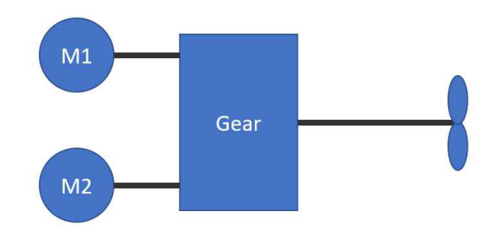
**그림 6.1.8 비동기 회전기계 또는 탈여자가 가능한 회전기계**
> 설명: 두 대의 회전기계 M1, M2가 각각 축으로 감속기(Gear)에 직결되고, 감속기 출력축이 프로펠러를 구동하는 배치를 보여준다.

**그림 6.1.9 클러치 붙이 영구자석 회전기계**
> 설명: 두 대의 회전기계 M1, M2가 각각 클러치를 거쳐 감속기(Gear)에 연결되고, 감속기 출력축이 프로펠러를 구동하는 배치를 보여준다.

**그림 6.1.10 비동기 회전기계 또는 탈여자가 가능한 회전기계**
> 설명: 회전기계 M1과 M2가 한 축 위에 직렬(탠덤)로 배치되어 감속기 없이 프로펠러를 직접 구동하는 배치를 보여준다.

#### 1604. 제어장치 【규칙 참조】

1. **규칙 1604.**의 4항 (7)호를 적용함에 있어서 “기기”라 함은 전기추진용 설비에 직접 사용되는 변압기를 말한다.

2. **전기추진선박의 원격제어장치**

(1) 추진용 전동기의 원격제어장소에는 **지침 2장 202.**의 2항 (1)호에 나타낸 경보장치에 추가하여 다음의 경우에 작동하는 경보장치를 설치하여야 한다.

(가) 급전회로의 절연저항 저하

(나) 반도체 전력변환장치의 냉각통풍기 이상정지

(다) 반도체 전력변환장치의 냉각수 압력저하(온도상승 혹은 냉각수 펌프의 정지)

(라) 반도체 전력변환장치의 반도체 보호장치의 작동

(2) (1)호의 가시경보는 이상상태의 종별, 대상기기의 식별이 가능할 것. 다만, 선교 및 선교 이외의 장소에서 원격제어를 행하는 선박에 있어서 선교에 설치된 가시경보에 대해서는 이에 따르지 않는다. 또한 기관실에서 다른 계기류에 의해 용이하게 식별할 수 있는 경우에는 이에 따르지 않는다.

### 제 18 절 예비품 및 일반비품

#### 1801. 예비품 【규칙 참조】

1. 예비품의 종류 및 수량과 관련하여, 이 절의 요건은 일반적인 지침을 제공하기 위한 것이며 선급등록을 위한 강제사항은 아니다. 설계, 제조자의 권고사항, 선주와의 협의사항, 사용실적 및 보수정비의 방법 등을 참작하여 이절에 규정된 예비품의 종류 및 수량을 증감할 수 있다. *(2017)*

2. 2대 이상의 조타용 전동기 또는 전동발전기를 비치하는 전동 또는 전동유압 조타장치에는 **규칙 1801.**의 1항 (4)호에 규정하는 예비의 전기자 또는 고정자를 생략할 수 있다.

3. **규칙 1801.**의 1항 (4)호의 규정은 원격조타 제어용 전동기에는 적용하지 아니한다.

## 제 2 장 제어설비

### 제 1 절 일반사항

#### 101. 일반사항

1. **적용** **【규칙 참조】**

(1) **규칙 101.**의 1항 (1)호를 적용함에 있어서, 전기추진선박의 추진용 발전장치(원동기 포함)에 대한 제어설비는 **규칙 204. 발전장치의 제어설비**의 규정을 적용한다.

### 제 2 절 시스템 및 제어

#### 201. 시스템 설계

1. **규칙 201.**의 4항 (7)호를 적용함에 있어서 “우리 선급이 적당하다고 인정하는 다른 방법"이라 함은 **규칙 1편 1장 104.**에 따라 인정하는 것을 말한다. *(2020)* **【규칙 참조】**

#### 202. 주기관 또는 가변피치프로펠러의 자동제어 및 원격제어 *(2025)* 【규칙 참조】

1. **일반사항**

주추진기의 기계측 제어장치의 제어핸들을 주제어장소에 이동 설치한 것은 다음의 경우를 제외하고 **규칙 202.**의 규정을 적용하지 아니한다.

(1) 주제어장소가 주추진기가 설치된 구역 외에 설치되어 있는 경우

(2) 주제어장소가 주추진기가 설치된 구역 내에 있으나 주위가 폐위되어 있는 경우

2. **주기관 또는 가변피치프로펠러의 원격제어장치**

(1) 주추진기의 원격제어 장소에는 다음의 경우에 작동하는 경보장치를 설치하여야 한다.

(가) 윤활유 압력의 저하

(나) 냉각수 압력의 저하(혹은 온도상승, 냉각펌프의 정지 등)

(다) 원격제어용 유압 혹은 공기압의 저하 또는 전원의 상실

(라) 비상정지장치의 시동

(2) (1)호의 가시경보는 이상 상태의 종별, 대상기기의 식별이 가능할 것. 다만, 선교 및 선교 이외의 장소에서 원격제어를 행하는 선박에 있어서 선교에 설치된 가시경보에 대해서는 이에 따르지 않는다. 또한 기관실에서 다른 계기류에 의해 용이하게 식별할 수 있는 경우에는 이에 따르지 않는다.

(3) 증기터빈 주기관의 원격제어장치는 후진조작시 후진 중간밸브를 자동적으로 열수 있는 장치를 설치하여야 한다.

(4) 1항 (2)호에 해당하는 제어장치가 설치되어 있는 경우에는 주기관의 기계측 제어장치를 생략할 수 있다. 다만, 이 제어장치가 주제어장소에 설치되어 있는 경우는 별도로 비상용의 기계측 제어장치를 설치할 것을 권장한다.

(5) 주기관의 원격제어장치의 고장으로 원격제어장치의 동력원(전원, 공기압 및 유압)이 상실된 경우를 가정하여 고장시의 대책을 강구하여야 한다.

(6) 주추진기의 원격제어장치에 의한 주기관의 시동과 시동용 공기압력저하 경보와의 관계는 다음에 따른다.

(가) **규칙 5편 6장 1101.**의 1항에 표시한 시동회수를 만족한 이후에 압력저하경보가 작동한 경우는, 이 이후의 시동은 주제어장소에서 할 수 있으면 된다.

(나) **규칙 5편 6장 1101.**의 1항에 표시한 시동회수를 만족하기 이전에 압력저하경보가 작동하는 경우는, 이 이후의 시동은 계속적으로 원격제어 장소로부터 가능하여야 하며 소정의 회수를 만족하여야 한다.

3. **선교제어장치**

(1) 선교제어장치의 조작핸들(또는 버튼)은 엔진텔레그라프와 연동하는 것을 권장한다.

(2) **규칙 202.**의 3항 (3)호를 적용함에 있어 단시간에 기관 및/또는 추진장치 전체의 고장을 초래할 수 있는 경우는 다음과 같다.

(가) 모든 디젤기관

(a) 과속도

(b) 윤활계통의 고장

(c) 크랭크실의 폭발 조건

(나) 모든 증기터빈

(a) 윤활계통의 고장

(b) 과속도

(c) 보조터빈의 역압

(다) 모든 보일러

(a) 화염소실

(b) 화염스캐너의 고장

(c) 저수위

(d) 강제통풍압력 상실

(e) 제어동력 상실

(라) 모든 감속기어

감속기어 윤활유계통에 고장이 발생한 경우, 원동기의 긴급정지

(마) 발전기

발전기윤활유계통에 고장이 발생한 경우 원동기의 긴급정지. 다만, 강제윤활방식이 채용된 발전기에 적용한다.

(바) 전기추진설비

(a) 전기추진장치의 단락

(b) 전기추진 d.c 전동기의 과속도

#### 203. 보일러의 자동제어 및 원격제어

1. **일반사항** **규칙 203.**의 1항 (3)호를 적용함에 있어서, “우리 선급이 적당하다고 인정하는 바"라 함은 **규칙 1편 1장 104.**에 따라 인정하는 것을 말한다. *(2020)* **【규칙 참조】**

2. **자동연소제어장치**

(1) **규칙 203.**의 2항 (2)호 (바)를 적용함에 있어서, “우리 선급이 적당하다고 인정하는 것"이라 함은 **규칙 1편 1장 104.**에 따라 인정하는 것을 말한다. *(2020)* **【규칙 참조】**

(2) **규칙 203.**의 2항 (4)호를 적용함에 있어서, “우리 선급이 적절하다고 인정하는 바"라 함은 **규칙 1편 1장 104.**에 따라 인정하는 것을 말한다. *(2020)* **【규칙 참조】**

### 제 3 절 시험 *(2017)*

#### 301. 공장시험 【규칙 참조】

1. **형식승인**

(1) **규칙 301.**의 1항에서 형식승인을 받아야 하는 자동화기기는 **규칙 6편 1장 101.**의 4항 (13)호에 정의한 중요용도에 사용되며, 다음과 같은 기기에 적용한다. *(2023)*

(가) 경보 및 감시장치(alarm and monitoring systems)

(나) 주기관, 발전기, 보일러 및 중요보기 등의 제어장치(control systems)

(다) 컴퓨터기반시스템(computer based systems)

(라) 화재탐지장치(fire detection systems)

(마) 가스탐지장치(gas detection systems)

(바) 전자식 조속기(electronic governor systems)

(사) 속도 및 축마력 감지기(speed and shaft horsepower sensing equipment)

(아) 조절기(controller)

(자) 센서류(including Transmitters or Switches for flow, level, limit, pressure, temperature detection)

(차) 오일미스트 디텍터(oil mist detectors)

(카) 전기, 전자식 표시기(indicators)

(타) 상기 (가) ∼ (카)에 적용되는 광 센서 및 광 응용장치

(파) 기타 우리 선급이 필요하다고 인정하는 것

(2) **규칙 301.**의 1항에서 “우리 선급이 별도로 정하는 규정”이라 함은 **「제조법 및 형식승인 등에 관한 지침」 3장 23절**의 규정을 말한다.

2. **자동화시스템의 완성시험**

(1) **규칙 301.**의 2항 (1)호 (다)를 적용함에 있어서, 시험전압을 가하는 것이 바람직하지 않은 회로(전자부품 혹은 PCB card 등)를 포함하는 시험품에 대해서는 해당 회로를 분리한 다음 시험을 행할 수 있다. 다만, 해당 회로를 분리하기 힘든 구조인 경우에는 형식승인 시험시의 성적서를 인정하여 절연저항 시험 및 내전압시험을 생략할 수 있다.

(2) **규칙 301.**의 2항을 적용함에 있어서, 형식승인 시 제어 논리(logic)가 간단하고 고장 메카니즘(mechanism)이 쉽게 이해된다고 우리 선급이 인정하는 경우 자동화시스템의 완성시험을 면제할 수 있다.

(3) **규칙 301.**의 2항 (1)호 (마)를 적용함에 있어서, “기타 우리 선급이 필요하다고 인정하는 시험”이라 함은 **규칙 1편 1장 104.**에 따라 인정하는 것을 말한다. *(2020)*

#### 302. 선내시험 【규칙 참조】

(1) **규칙 302.**에서 “우리 선급이 필요하다고 인정하는” 제어장치가 고장 난 경우의 확인 중에는 원칙적으로 다음의 확인을 포함한다.

(가) **규칙 202.**의 2항에서 규정하는 주기관 또는 가변피치프로펠러의 원격제어장치가 고장 난 경우, 회전수 및 추력방향이 고장 전의 상태로 유지됨을 확인한다.

(나) **규칙 203.**에서 규정하는 보일러의 자동제어설비가 고장 난 경우, 연소가 정지되는 것을 확인한다.

(다) **규칙 205.**의 3항에서 규정하는 열매체유설비의 자동제어장치가 고장 난 경우, 연소가 정지되는 것을 확인한다.

(2) 제어장치의 고장상태라 함은 적어도 다음의 상태를 말한다.

(가) 제어장치 동력원의 정지

(나) 제어용 컴퓨터의 고장

#### 303. 해상시험 【규칙 참조】

1. **주추진기 및 가변피치프로펠러** *(2025)*

(1) **규칙 303.**의 1항 및 2항에서 규정하는 시험에 있어서, 주기관 또는 가변피치프로펠러에 대하여는 선교제어장치에 의해 **규칙 9편 3장 206.**에 따라 시험을 행하는 것을 표준으로 한다.

(2) **규칙 303.**의 1항 (3)을 적용함에 있어서, “우리 선급이 적절하다고 인정하는 경우”라 함은 **규칙 202.**의 2항 (3)호에 해당되는 경우를 말한다.

선급 및 강선규칙 
선급 및 강선규칙 적용지침

인 쇄 2026년 4월 13일 
발 행 2026년 4월 17일

**제6편 전기설비 및 제어시스템**

발행인 이 영 석 
발행처 한 국 선 급 
부산광역시 강서구 명지오션시티 9로 36 
전화 : 070-8799-7114 
FAX : 070-8799-8999 
Website : http://www.krs.co.kr

신고번호 : 제 2014-000001호 (93. 12. 01)

CopyrightⒸ 2026, KR

이 규칙 및 적용지침의 일부 또는 전부를 무단전재 및 재배포시 법적제재를 받을 수 있습니다.
