**2026 Rules for the Classification of Steel Ships**

**Part 6 Electrical Equipment and Control Systems**

**2026 Guidance Relating to the Rules for the Classification of Steel ships**

**Part 6 Electrical Equipment and Control Systems**

2026

Rules for the Classification of Steel Ships

# Part 6 Electrical Equipment and Control Systems

RA-06-E

## APPLICATION OF PART 6 "ELECTRICAL EQUIPMENT AND CONTROL SYSTEMS"

1. Unless expressly specified otherwise, the requirements in the Rules apply to ships for which contracts for construction are signed on or after 1 July 2026.
2. The amendments to the Rules for 2025 edition and their effective date are as follows;

Effective Date : 1 January 2026 (based on the contract date for ship construction, Related Circular No.: 2025-13-E)

**CHAPTER 1 ELECTRICAL EQUIPMENT**

**Section 5 Cables**

\- 1603. 7. has been newly added.

Effective Date : 1 July 2026

**CHAPTER 1 ELECTRICAL EQUIPMENT**

**Section 1 General**

\- 101. 4. (16) has been newly added.

**Section 2 System Design**

\- 202. 2. (1) has been amended.

**Section 11 Internal Communications**

\- 1106. has been amended.

**Section 13 Accumulator Batteries**

\- 1306. 7. has been newly added.

\- 1308. (3) has been deleted.

**Section 15 High Voltage Electrical installations**

\- Table 6.1.32 has been amended.

## CONTENTS

- **CHAPTER 1 ELECTRICAL EQUIPMENT**
  - Section 1 General
  - Section 2 System Design
  - Section 3 Rotating Machinery
  - Section 4 Switchboards, Section Boards and Distribution Boards
  - Section 5 Cables
  - Section 6 Transformers for Power and Lighting
  - Section 7 Controlgears for Motors and Magnetic Brakes
  - Section 8 Fuses, Circuit-breakers and Electromagnetic Contactors
  - Section 9 Explosion-protected Electrical Equipment
  - Section 10 Lighting Fittings, Heating Appliances, Wiring Accessories and Miscellaneous Equipment
  - Section 11 Internal Communications
  - Section 12 Semi-Conductor Converters
  - Section 13 Accumulator Batteries
  - Section 14 Lightning Conductors
  - Section 15 High Voltage Electrical Installations
  - Section 16 Electric Propulsion Unit
  - Section 17 Tests after Installation on Board
  - Section 18 Spare Parts, Tools and Instruments
- **CHAPTER 2 CONTROL SYSTEMS**
  - Section 1 General
  - Section 2 System and Control
  - Section 3 Tests
  - Section 4 Computer Based Systems

## CHAPTER 1 ELECTRICAL EQUIPMENT

### Section 1 General

#### 101. General

**1. Application** **【See Guidance】**

(1) The requirements of this Chapter apply to the electrical equipment and electric propulsion machinery intended for ships without special limitations for their service or purpose. For electrical equipment and electric propulsion machinery intended for ships with special limitations for their service or purpose and intended for small ships of less than 500 ton gross tonnage, the requirements in this Chapter may be modified within an extent considered appropriate by this Society.

(2) Except where a specific statement is made to the contrary, all requirements specified in this chapter are equally applicable to *a.c.* and *d.c.* installations.

(3) When the Society considers necessary, requirements specified in international electrical standards may apply.

**2. Special electrical equipment** **【See Guidance】**

Electrical equipment and electric propulsion machinery not specified in this Chapter are to be as deemed appropriate by the Society.

**3. Passenger ships**

The electrical equipment of passenger ships engaged on international voyages is to comply with the requirements in this Part and in addition, attention is to be paid to compliance with the requirements of passenger ships specified in the International Convention for the Safety of Life at Sea (hereinafter referred to as the "SOLAS Convention").

**4. Terminology**

Terms used in this Chapter are as follows:

(1) **Dangerous spaces** are the following areas or spaces where flammable or explosive substances are placed and where it is likely to arise flammable or explosive gases or vapours from these substances and they are classified according to generation frequency and period of life for explosive gas atmosphere. **【See Guidance】**

(A) Zone 0 : area in which an explosive gas atmosphere is present continuously or is present for long periods.

(B) Zone 1 : area in which an explosive gas atmosphere is sometimes likely to occur in normal operation..

(C) Zone 2 : area in which an explosive gas atmosphere is not likely to occur in normal operation and, if it does occur, is likely to do so only infrequently and will exist for a short period only.

(2) **Selective tripping** is such an arrangement that only the protective device nearest to a fault point is opened automatically in order to maintain the power supply to the rests of sound circuits, in the event of a fault in the circuit having protective devices connected in series.

(3) **Preference tripping** is such an arrangement that the protective devices for unimportant circuits are opened automatically in order to ensure the power supply for vital services, when any one generator becomes overloaded or likely.

(4) **Normal operational and habitable condition** is a condition under which the ship as a whole, the machinery, services, means and aids ensuring propulsion, ability to steer, safe navigation, fire and flooding safety, internal and external communication and signals, means of escape, and emergency boat winches, as well as the designed comfortable conditions of habitability are in working order and functioning normally. All electrical services necessary for maintaining the ship in normal operational and habitable conditions are essential services and services for habitability.

(5) **Emergency condition** is a condition under which any services needed for normal operational and habitable conditions are not in working order due to failure of the main source of electrical power.

(6) **Main source of electrical power** is a source intended to supply electrical power to the main switchboard for distribution to all services necessary for maintaining the ship in normal operational and habitable conditions.

(7) **Main generator** is a generator for generating the main source of electrical power.

(8) **Main generating station** is the space in which the main source of electrical power is situated.

(9) **Main switchboard** is a switchboard which is directly supplied by the main source of electrical power and is intended to distribute electrical energy to the ship′s services.

(10) **Emergency source of electrical power** is a source of electrical power, intended to supply the emergency switchboard in the event of failure of the supply from the main source of electrical power.

(11) **Emergency switchboard** is a switchboard which in the event of failure of the main electrical power supply system is directly supplied by the emergency source of electrical power or the transitional source of emergency power and is intended to distribute electrical energy to the emergency services.

(12) **Electrical services** are classified into essential services and services for habitability.

(13) **Essential services** are those services essential for propulsion and steering, and safety of the ship, which are made up of "primary essential services" and "secondary essential services". Definitions and examples of such services are given in (A) and (B) below.

(A) Primary essential services are those services which need to be in continuous operation to maintain propulsion and steering. Examples of equipment for primary essential services are as follows:

(a) Steering gears

(b) Pumps for controllable pitch propellers

(c) Scavenging air blower, fuel oil supply pumps, fuel valve cooling pumps, lubricating oil pumps and cooling water pumps for main and auxiliary engines and turbines necessary for propulsion

(d) Forced draught fans, feed water pumps, water circulating pumps, vacuum pumps and condensate pumps for steam plants on steam turbine ships, and also for auxiliary boilers on ships where steam is used for equipment supplying primary essential services

(e) Oil burning installations for steam plants on steam turbine ships and for auxiliary boilers where steam is used for equipment supplying primary essential services

(f) Azimuth thrusters which are the sole means for propulsion/steering with lubricating oil pumps, cooling water pumps

(g) Electrical equipment for electric propulsion plant with lubricating oil pumps and cooling water pumps

(h) Electric generators and associated power sources supplying the primary essential service equipment

(i) Hydraulic pumps supplying the primary essential service equipment

(j) Viscosity control equipment for heavy fuel oil

(k) Low duty gas compressor and other boil-off gas treatment facilities supporting boil-off gas usage as fuel to main propulsion or electric power generation machinery

(l) Control, monitoring and safety devices/systems for equipment to primary essential services

(B) Secondary essential services are those services which need not necessarily be in continuous operation to maintain propulsion and steering but which are necessary for maintaining the vessel's safety. Examples of equipment for secondary essential services are as follows:

(a) Windlass

(b) Fuel oil transfer pumps and fuel oil treatment equipment

(c) Lubrication oil transfer pumps and lubrication oil treatment equipment

(d) Pre-heaters for heavy fuel oil

(e) Starting air and control air compressors

(f) Bilge, ballast and heeling pumps

(g) Fire pumps and other fire extinguishing medium pumps

(h) Ventilating fans for engine and boiler rooms

(i) Services considered necessary to maintain dangerous spaces in a safe condition

(j) Navigation lights, aids and signals

(k) Internal safety communication equipment

(l) Fire detection and alarm system

(m) Lighting system

(n) Electrical Equipment for watertight closing appliances

(o) Electric generators and associated power sources supplying the secondary essential service equipment

(p) Hydraulic pumps supplying the secondary essential service equipment

(q) Re-liquefaction plant on liquefied gas carriers

(r) Ventilation fans for hazardous areas

(s) Auxiliary and main engine starting installations

(t) Inert gas fans and scrubber and deck seal pumps

(u) Watertight doors, shell doors and other electrical operated closing appliances

(v) Jacking motors

(w) Water ingress detection and alarm system

(x) Thrusters not part of steering or propulsion

(y) Control, monitoring and safety systems for cargo containment systems

(z) Control, monitoring and safety devices/systems for equipment to secondary essential services

(14) **Services for habitability** are those services which need to be in operation for maintaining the vessel's minimum comfort conditions for the crew and passengers. Examples of equipment for maintaining conditions of habitability are as follows:

(A) Cooking

(B) Heating

(C) Domestic refrigeration

(D) Mechanical ventilation

(E) Sanitary and fresh water

(F) Electric generators and associated power sources supplying the above equipment

(15) **Dead ship condition** means a condition under which:

(A) the main propulsion plant, boilers and auxiliary machinery are not in operation due to the loss of the main source of electrical power, and

(B) in restoring propulsion, the stored energy for starting the propulsion plant, the main source of electrical power and other essential auxiliary machinery is assumed to be not available. It is assumed that means are available to start the emergency generator at all times.

(16) **Blackout situation** means that the main and auxiliary machinery installations, including the main power supply, are out of operation but the services for bringing them into operation (e.g. compressed air, starting current from batteries etc.) are available. *(2026)*

(17) **Section board** is an assembly of switchgear, control gear, etc for controlling the supply of electrical power from a switchboard and distributing it to other section boards, distribution boards or final sub-circuits.

(18) **Distribution board** is an assembly of one or more protective devices arranged for the distribution of electrical power to final sub-circuits.

(19) **Diversity factor** is the ratio of the estimated total load of a group of consumers under their normal working conditions to the sum of their nominal ratings. *(2019)*

#### 102. Drawings and data

The drawings and data to be submitted for approval before the commencement of work are generally as follows:

**1. Drawings and data to be submitted by the shipyard**

(1) Investigation table of electrical load analysis (main and emergency sources including batteries)

(2) Wiring diagram for power systems (including emergency source)

(3) Wiring diagram for lighting systems (including emergency lightings)

(4) Wiring diagram for control systems

(5) Wiring diagram for navigation and communication systems

(6) Wiring diagram for radio systems

(7) Wiring diagram for fire detection and alarm systems

(8) General arrangement for electrical systems (bridge, radio room, accommodation space, engine room, all decks, etc.)

(9) Arrangement for navigation and signal lights

(10) Drawings indicating dangerous spaces (if necessary)

(11) Drawings of measuring equipment for cargo tanks (if necessary)

(12) List of particulars of high voltage electrical equipment(if necessary)

(13) Calculation sheets of short-circuit current in the circuits(if the sum of rated power is 500 kVA (kW) and over)

(14) Drawings and data as deemed necessary by the Society (in case of special construction ships) **【See Guidance】**

**2. Drawings and data to be submitted by the manufacturers of electrical equipment**

Drawings and data are to be submitted and approved by manufacturers of electrical equipment in accordance with **103. 1. Table 6.1.1.**

#### 103. Testing and inspection

**1. General**

(1) The electrical equipment and cables in **Table 6.1.1** are to be approved(drawing approval, type approval) by the Society or to be tested in accordance with relevant requirements of this Chapter at the manufacturer's works or at other works having the adequate apparatus for testing and inspections.

(2) The electrical equipment and cables specified in the **Table 6.1.1** are to be type approved in accordance with the「**Guidance for Approval of Manufacturing Process and Type Approval, etc.**」before being taken into use. **【See Guidance】**

**2. Inspections based on Quality Assurance Scheme**

Where the electrical equipment is manufactured by Quality Assurance Scheme specified in「Guidance for Approval of Manufacturing Process and Type Approval, etc.」, a part or all of the tests and inspections in the presence of the Society's Surveyor may be omitted.

**3. Tests after installation on board**

Electrical equipment and cables, after installation on board the ship, are to be tested and inspected in accordance with the requirements in **Sec 17.**

**4. Additional tests and inspections** **【See Guidance】**

The Society may require, when it deems necessary, other tests and inspections than those specified in this Chapter.

**5. Exemption from tests and inspections**

Electrical equipment having the certificate considered acceptable by the Society may be exempted partially or wholly from the tests and inspections.

**6. Tests and inspections on type approved products** **【See Guidance】**

Tests and inspections on type approved products are to be in accordance with the requirements which the Society considers appropriate.

**Table 6.1.1 Electrical equipment and cables subject to the approval and test** *(2025)*

| No. | Electrical equipment and cables | Drawing approval | Test and inspection | Type approval |
|:-:|---|:-:|:-:|:-:|
| 1 | Generators(1) | X(2) | X | |
| 2 | Motors(3)(4)(5) | X(6) | X | |
| 3 | Control gears for Motors(3)(4)(5) | X(6) | X | |
| 4 | Main switchboards and emergency switchboards | X | X | |
| 5 | Battery charging and discharging board for emergency sources of electrical power | X | X | |
| 6 | Power converters | X(17) | X(16) | X(16) |
| 7 | Control gears for electric propulsion unit | X | X | X |
| 8 | Transformers(7)(8) | X(9) | X | |
| 9 | Power semi-conductor rectifiers(10) | | X | |
| 10 | Uninterrupted power supplies(11) | | X | X |
| 11 | Cables(18) | | | X |
| 12 | Fuses, Circuit-breakers, Protection relay, Electro-magnetic contactors | | | X |
| 13 | Explosion-protected electrical equipment **【See Guidance】** | | X(12) | X |
| 14 | Cable splices | | | X |
| 15 | Navigation light control panel | | X | |
| 16 | Shore connection box(9) | X | X | |
| 17 | Electric fuel oil heating systems(13) | X | X | |
| 18 | LED lighting(14) | | | X |
| 19 | Cable trays/protective casings made of plastic materials | | | X |
| 20 | Busbar trunking systems(15) | | X | X |

(Notes)

(1) Only applicable for main and emergency generators, except harbor generators.

(2) Only applicable for generators of 100 kVA and above.

(3) Only applicable for Control gears for the motors, and motors which drive essential auxiliaries specified in **Pt 5, Ch 1, 102.** of the Guidance and exceed the output 7.5 kW.

(4) Only applicable for motors for electric propulsion.

(5) For the output of not more than 50 kW, if there are manufacturer's own test reports, a part or all of tests and inspections in the presence of the Society's Surveyor may be replaced subject to the Society's permission. *(2018)* **【See Guidance】**

(6) To be complied with note (10) in **Table 6.1.10.** *(2018)*

(7) Only applicable for transformers for power and lighting of single phase 1 kVA and above or 3 phase 5 kVA and above.

(8) For the transformer with running capacity of less than 100 kVA, if there are manufacturer's own test reports, a part or all of tests and inspections in the presence of the Society's Surveyor may be replaced subject to the Society's permission. *(2018)* **【See Guidance】**

(9) Only applicable for high voltage electrical installations(1 kV and above).

(10) Only applicable for Power semi-conductor rectifiers of 5 kW or more.

(11) Uninterrupted power supplies for essential services 5 kVA or more and emergency source of electrical power of 50 kVA or more are to satisfy the requirements of the type approval test specification in accordance with **Ch 3, Sec 39** of the「**Guidance for Approval of Manufacturing Process and Type Approval, etc.**」. Test and inspection apply for Uninterrupted power supplies of 50 kVA or more are to satisfy the requirements of the test and inspection in accordance with **1203. 6.** *(2023)*

(12) Only applicable for rotating machines. And note (5) can be applied. *(2018)*

(13) To be carried out test and inspection in accordance with **Table 6.1.24**. *(2019)*

(14) Only applicable for LED lighting installed in navigation bridge.

(15) To be carried out test and inspection in accordance with **Table 6.1.25** and to be carried out type approval in accordance with **Ch 3, Sec 37** of the「**Guidance for Approval of Manufacturing Process and Type Approval, etc.**」 *(2019)*

(16) The following power converters are to meet the requirements of the type approval test specification in accordance with **Ch 3, Sec 39** of the「**Guidance for Approval of Manufacturing Process and Type Approval, etc.**」. For power and control modules certified type approval such as IGBT are installed in enclosures, test and inspection may be accepted. *(2023)*

- For power supply of 50 kVA or more
- For essential motors of 100 kW or more
- For electric propulsion

(17) The requirements apply to the following power converters. *(2023)*

- For essential motors of 100 kW or more
- For electric propulsion

(18) Cable manufacturers are to be carried out manufacturer approval in accordance with **Ch 6** of the **Guidance for Approval Manufacturing Process and Type Approval, etc.** *(2025)*

### Section 2 System Design

#### 201. General

**1. Requirements of electrical installation**

(1) All electrical auxiliary services necessary for maintaining the ship in normal operational and habitable conditions will be ensured without recourse to the emergency source of electrical power.

(2) Electrical services essential for safety will be ensured under various emergency conditions.

(3) The safety of crew and ship from electrical hazards will be ensured.

**2. Construction and installation**

(1) **Construction**

Electrical equipment is to be so constructed as to provide easy accessibility to all parts requiring inspection, overhaul and repair.

(2) **Protection against corrosion**

(A) Bolts, nuts, pins, screws, terminals, studs, springs and such other small parts are to be made of corrosion resistant materials or those suitably protected against corrosion.

(B) If electrical fittings, not of aluminium, are attached to aluminium, suitable means are to be taken to prevent corrosion.

(3) **Protection against electrical shock** **【See Guidance】**

(A) Where the operators are liable to inadvertently touch the live part of electrical apparatus due to ship′s inclination and vibration, such parts are to be protected with suitable means to prevent electrical shock.

(B) The moving parts, reciprocating parts, high temperature parts or charged parts of electrical equipment are to be provided with suitable protections for one who watches, operates or approaches the equipment to avoid injury.

(C) To minimize shock from high-frequency voltage induced by the radio transmitter, handles, handrails, etc. of metal on the bridge or upper decks are to be in good electrical connection with the hull or superstructure.

(4) **Installation of propulsion machines**

Means are to be provided to prevent the accumulation of bilge under propulsion machines (generators, motor-generators, motors, electro-magnetic slip couplings).

(5) **Installation and protective enclosure** **【See Guidance】**

Electrical equipment is to be accessibly placed in well ventilated and adequately lighted spaces in which inflammable gases cannot accumulate and where it is not exposed to the risk of mechanical injuries or damage from water, steam or oil, and is to be so installed that space is available for maintenance. Where, however, electrical equipment are unavoidably installed in spaces not fulfilled the above conditions, they are to be of the following construction.

(A) Drip-proof construction where water drip and oil are liable to drop.

(B) Water-proof construction where installed on exposed decks liable to get wet by sea water, rain or bilge water.

(C) Submersible construction where employed in water.

(D) Explosion-proof construction where explosive or inflammable materials are stored or liable to accumulate.

(6) **Insulating materials and insulated windings**

Insulating materials and insulated windings are to be of resisting quality against moisture, sea air and oil vapour.

(7) **Power source control switches**

Electrical equipment is not to remain alive through the control circuits or pilot lamps when switched off by the control switch.

(8) **Mechanical lock**

All nuts and screws used in connection with current carrying parts and working parts are to be effectively locked.

(9) **Consideration of magnetic compass** **【See Guidance】**

Electrical equipment and cables are to be placed at such a distance from the magnetic compasses that the interfering external magnetic field is negligible, even when circuits are switched on and off.

(10) **Electromagnetic compatibility**

Electrical and electronic equipment on the bridge are to be so installed that electromagnetic interference does not affect the proper function of navigational systems and equipment.

**3. Earthing of electrical equipment** **【See Guidance】**

(1) **Fixed electrical equipment**

All accessible non-current-carrying metal parts of fixed electrical equipment are to be effectively earthed. Where earthing connections are necessary, the sectional area of the earthing conductor is to be as deemed appropriate by the Society. (refer to the Guidance)

(2) Exposed metal parts of electrical machines or equipment which are not intended to be live but which are liable under fault conditions to become live are to be earthed unless the machines or equipment are:

(A) supplied at a voltage not exceeding 50 V *d.c.* or 50 V *a.c.*, root mean square between conductors; auto-transformers are not to be used for the purpose of achieving this voltage; or

(B) supplied at a voltage not exceeding 250 V by safety isolating transformers supplying only one consuming device; or

(C) constructed in accordance with the principle of double insulation.

(3) Additional safety means are to be provided for portable electrical apparatus for use in confined or exceptionally damp spaces where particular risks due to conductivity exist.

**4. System of supply**

The following systems of supply are considered as standard:

(1) Two-wire for direct current.

(2) Three-wire for direct current (three-wire insulated system or three-wire mid-wire earthed system).

(3) Single phase two-wire for alternating current.

(4) Three phase three-wire for alternating current.

(5) Three phase four-wire for alternating current.

**5. Voltage and frequency** *(2017)*

(1) **Supply voltage**

Supply voltage is not to exceed:

(A) 500V for cooking and heating equipment permanently connected to fixed wiring.

(B) 15,000 V *a.c.* or 3,000 V *d.c.* for electric propulsion equipment.

(C) 15,000 V *a.c.* or 500 V *d.c.* for generators and power equipment.

(D) 250 V for lighting, heaters in cabins and public rooms and other applications not mentioned (A), (B) and (C) above.

(2) **Standard frequency**

Frequency of 50 Hz or 60 Hz is recognized as a standard.

(3) **Voltage and frequency variations**

(A) All electrical appliances supplied from the main or emergency systems are to be so designed and manufactured that they are capable of operating satisfactorily under the normally occurring variations in voltage and frequency.

(B) Unless otherwise stated in the national or international standards, all equipment are to operate satisfactorily with the variations from its rated value shown in the **Tables 6.1.2** on the following conditions.

(a) For alternative current components, voltage and frequency variations shown in the **Table 6.1.2** (a) are to be assumed.

(b) For direct current components supplied by *d.c.* generators or converted by rectifiers, voltage variations shown in the **Table 6.1.2** (b) are to be assumed.

(c) For direct current components supplied by electrical batteries, voltage variations shown in the **Table 6.1.2** (c) are to be assumed.

(C) Any special systems, e.g. electronic circuits, whose function cannot operate satisfactorily within the limits shown in **Table 6.1.2** is not to be supplied directly from the system but by alternative means, e.g. through stabilized supply.

**Table 6.1.2 Voltage and frequency variations**

**(a) Voltage and frequency variations for *a.c.* distribution systems**

<table>
<tr><th rowspan="2">Type of variations</th><th colspan="2">Variations</th></tr>
<tr><th>Permanent</th><th>Transient</th></tr>
<tr><td>Frequency</td><td>± 5 %</td><td>± 10 % (5 sec)</td></tr>
<tr><td>Voltage</td><td>+ 6 %, -10 %</td><td>± 20 % (1.5 sec)</td></tr>
</table>

**(b) Voltage variations for *d.c* distribution systems**

| Parameters | Variations |
|:-:|:-:|
| Voltage tolerance (continuous) | ± 10 % |
| Voltage cyclic variation deviation | 5 % |
| Voltage ripple(*a.c.* r.m.s. over steady *d.c.* voltage) | 10 % |

**(c) Voltage variations for battery systems**

| Systems | Variations |
|:-:|:-:|
| Components connected to the battery during charging (see Note) | +30 %, -25 % |
| Components not connected to the battery during charging | +20 %, -25 % |

(Note) Different voltage variations as determined by the charging/discharging characteristics, including ripple voltage from the charging device, may be considered.

**6. Ambient conditions**

(1) The ambient conditions given in **Table 5.1.2** and **Table 5.1.3** in **Pt 5, Ch 1** are to be applied unless otherwise specified, to the design, selection and arrangement of electrical installations as to ensure proper operation. However, ambient temperatures for electrical equipment installed in environmentally controlled spaces are to be in accordance with the requirements which the Society considers appropriate. **【See Guidance】**

(2) The operation of all electrical equipment is to be sufficient under such conditions of vibration as to arise in normal practice.

**7. Clearance and creepage** **【See Guidance】**

(1) The clearances and creepages between live parts and between live part and earthed metal (hereinafter to be called the “clearance and creepage”) are to be adequate for the working voltage having regard to the nature and service condition of the insulating material.

(2) The clearance and creepage for the inside terminal box of rotating machinery, the switchboard busbar and the controlling equipment, etc. are to conform to the values as required in each relevant Section in this Chapter.

**8. Harmonic distortion** *(2020)*

(1) **General**

(A) The total harmonic distortion (THD) in the voltage waveform of electrical distribution systems is not to exceed 8% and any single order harmonics not to exceed 5%. *(2023)*

(B) This limit may be exceeded where all installed equipment and systems have been designed for a higher specified limit and this relaxation on limits is documented (harmonic distortion calculation report) and made available on board as a reference for the surveyor at each periodical survey.

(2) **Harmonic distortion for ship electrical distribution system including harmonic filters**

(A) Application

The these requirements apply to ships where harmonic filters are installed on main busbars of electrical distribution system, other than those installed for single application frequency drives such as pump motors.

(B) Monitoring of harmonic distortion levels for a ship where harmonic filters are installed

(a) The ships are to be fitted with facilities to continuously monitor the levels of harmonic distortion experienced on the main busbar as well as alerting the crew should the level of harmonic distortion exceed the acceptable limits. Where the engine room is provided with automation systems, this reading is to be logged electronically, otherwise it is to be recorded in the engine log book for future inspection by the surveyor.

(C) Mitigation of the effects of harmonic filter failure on a ship's operation

(a) Where the electrical distribution system on board a ship includes harmonic filters the system integrator of the distribution system is to show, by calculation, the effect of a failure of a harmonic filter on the level of harmonic distortion experienced.

(b) The system integrator of the distribution system is to provide the ship owner with guidance documenting permitted modes of operation of the electrical distribution system while maintaining harmonic distortion levels within acceptable limits during normal operation as well as following the failure of any combination of harmonic filters.

(c) The calculation results and validity of the guidance provided are to be verified by the surveyor during sea trials.

(D) Protection arrangements for harmonic filters

(a) Arrangements are to be provided to alert the crew in the event of activation of the protection of a harmonic filter circuit.

(b) A harmonic filter is to be arranged as a three phase unit with individual protection of each phase. The activation of the protection arrangement in a single phase is to result in automatic disconnection of the complete filter. Additionally, there is to be installed a current unbalance detection system independent of the overcurrent protection alerting the crew in case of current unbalance.

(c) Consideration is to be given to additional protection for the individual capacitor element as e.g. relief valve or overpressure disconnector in order to protect against damage from rupturing. This consideration should take into account the type of capacitors used.

#### 202. Main source of electrical power *(2019)*

**1. Capacity and arrangement of generating sets**

(1) A main source of electrical power of sufficient capacity to supply essential services and services for habitability is to be provided. This main source of electrical power is to consist of at least two generating sets.

(2) The capacity of these generating sets is to be such that in the event of any one generating set being stopped it will still be possible to supply essential services and services for habitability necessary to provide normal operational conditions of propulsion and safety. Minimum comfortable conditions of habitability shall also be ensured which include at least adequate services for cooking, heating, domestic refrigeration, mechanical ventilation, sanitary and fresh water.

(3) Where the main source of electrical power is necessary for propulsion and steering of the ship, the system is to be so arranged that the electrical supply to equipment necessary for propulsion and steering and to ensure safety of the ship will be maintained or immediately restored in the case of loss of any one of the generators in service. Preference tripping or other equivalent arrangements are to be provided to protect the generators against sustained overload. **【See Guidance】**

(4) The arrangements of the ship's main source of electrical power is to be such that the essential services and services for habitability can be maintained regardless of the speed and direction of rotation of the propulsion machinery or shafting. **【See Guidance】**

(5) The generating sets are to be such as to ensure that with any one generator or its primary source of power out of operation, the remaining generating sets are to be capable of providing the electrical services necessary to start the main propulsion plant from a dead ship condition. The emergency source of electrical power may be used for the purpose of starting from a dead ship condition if its capability either alone or combined with that of any other source of electrical power is sufficient to provide at the same time those services required to be supplied by **203. 2.** (2) (A) to (E).

**2. Transformers and Converters**

(1) Capacity and number of transformer and converters *(2026)* **【See Guidance】**

Where essential services are supplied, the number and ratings of transformers and/or converters are to be sufficient to ensure the operation of essential services even when one of the transformers or converters is out of service.

(2) Transformers and converters for battery charger

(A) Where batteries connected to a single battery charger are the sole means of supplying DC power to equipment for essential services, failure of the single battery charger under normal operating conditions are not to result in total loss of these services once the batteries are depleted. In order to ensure continuity of the power supply to such equipment, one of the following arrangements is to be provided:

(a) Duplicate battery chargers

(b) A single battery charger and a transformer/rectifier (or switching converter) which is independent of the battery charger, provided with a changeover switch

(c) Duplicate transformer/rectifier (or switching converter) units within a single battery charger, provided with a changeover switch

(B) The above requirements are not applicable for equipment for essential services, which contains a single transformer/rectifier with a single AC power supply feeder to such equipment.

#### 203. Emergency source of electrical power

**1. Application**

(1) A self-contained emergency source of electrical power is to be provided.

(2) The emergency source of electrical power, associated transforming equipment, if any, transitional source of emergency power, emergency switchboard and emergency lighting switchboard are to be located above the uppermost continuous deck and are to be readily accessible from the open deck. They are not to be located forward of the collision bulkhead, except where permitted by the Society in exceptional circumstances.

(3) The location of the emergency source of electrical power, associated transforming equipment, if any, the transitional source of emergency power, the emergency switchboard and the emergency lighting switchboard in relation to the main source of electrical power, associated transforming equipment, if any, and the main switchboard are to be such as to ensure to the satisfaction of the Society that a fire or other casualty in spaces containing the main source of electrical power, associated transforming equipment, if any, and the main switchboard, or in any machinery space of category A will not interfere with the supply, control and distribution of emergency electrical power. As far as practicable, the space containing the emergency source of electrical power, associated transforming equipment, if any, the transitional source of emergency electrical power and the emergency switchboard are not to be contiguous to the boundaries of machinery spaces of category A or those spaces containing the main source of electrical power, associated transforming equipment, if any, or the main switchboard.

(4) Provided that suitable measures are taken for safeguarding independent emergency operation under all circumstances, the emergency generator may be used exceptionally, and for short periods, to supply non-emergency circuits. **【See Guidance】**

**2. Capacity of emergency source of power**

(1) The electrical power available is to be sufficient to supply all those services that are essential for safety in an emergency, due regard being paid to such services as may have to be operated simultaneously.

(2) The emergency source of electrical power is to be capable, having regard to starting currents and the transitory nature of certain loads, of supplying simultaneously at least the following services for the periods specified hereinafter, if they depend upon an electrical source for their operation: **【See Guidance】**

(A) For a period of 3 hours, emergency lighting at every muster and embarkation station and over the sides as required by regulations III/11.4 and III/16.7, Amendments to SOLAS 1974.

(B) For a period of 18 hours, following emergency lighting.

(a) In all service and accommodation alleyways, stairways and exits, personnel lift cars and personnel lift trunks ;

(b) In the machinery spaces and main generating stations including their control positions ;

(c) In all control stations, machinery control rooms, and at each main and emergency switchboard ;

(d) At all stowage positions for firemen's outfits ;

(e) At the steering gear ; and.

(f) At the fire pump referred to in (F) at the sprinkler pump, if any, and at the emergency bilge pump, if any, and at the starting positions of their motors.

(g) In all cargo pump rooms of tankers

(C) For a period of 18 hours, the navigation lights and other lights required by the International Regulations for Preventing Collisions at Sea in force.

(D) For a period of 18 hours ;

VHF radio installation required by regulations IV/7.1.1 and IV/7.1.2, MF radio installation required by regulations IV/9.1.1, IV/9.1.2, IV/10.1.2 and IV/10.1.3, INMARSAT Ship Earth Stations required by regulation IV/10.1.1 and MF/HF radio installation as required by regulations IV/10.2.1, IV/10.2.2 and IV/11.1 of SOLAS Convention.

(E) For a period of 18 hours, except those services have an independent supply for the period of 18 hours from an accumulator battery suitably located for use in an emergency.

(a) All internal communication equipment as required in an emergency.

(b) The navigational equipment as required by regulation V/19 of SOLAS Convention where such provision is unreasonable or impracticable the Society may waive this requirement for ships of less than 5,000 gross tonnage.

(c) The fire detection and fire alarm system.

(d) Intermittent operation of the daylight signalling lamp, the ship's whistle, the manual fire alarms and all internal signals that are required in an emergency.

(F) For a period of 18 hours, one of the fire pumps required by regulation II-2 / 10 of SOLAS Convention if dependent upon the emergency generator for its source of power.

(G) For the period of time required by **Pt 5, Ch 7** the steering gear where it is required to be so supplied by that requirement.

(H) In a ship engaged regularly in voyages of short duration, the Society if satisfied that an adequate standard of safety would be attained may accept a lesser period than the 18 hours period specified in (B) to (F) but not less than 12 hours.

**3. Kind and performance of emergency source of electrical power**

The emergency source of electrical power is to be a generator, an accumulator battery or an uninterruptible power system(UPS), which is to comply with the following ;

(1) Where the emergency source of electrical power is a generator, it is to comply with the following :

(A) The emergency generator is to be driven by a suitable prime mover with an independent supply of fuel, having a flashpoint (closed cup test) of not less than 43°C ;

(B) The emergency generator is to be started automatically upon failure of the main source of electrical power supply unless a transitional source of emergency electrical power in accordance with (C) is provided; where the emergency generator is automatically started, it is to be automatically connected to the emergency switchboard; those services referred to the requirements in **4.** are then to be connected automatically to the emergency generator ;

(C) A transitional source of emergency electrical power as specified in **4.** is to be provided unless an emergency generator is provided capable both of supplying the services mentioned in that paragraph and of being automatically started and supplying the required load as quickly as is safe and practicable subject to a maximum of 45 seconds.

(2) Where the emergency source of electrical power is an accumulator battery, it is to be capable of :

(A) carrying the emergency electrical load without recharging while maintaining the voltage of the battery throughout the discharge period within 12 % above or below its nominal voltage ; **【See Guidance】**

(B) automatically connecting to the emergency switchboard in the event of failure of the main source of electrical power ; and

(C) immediately supplying at least those services specified in **4.**

(3) Where the emergency source of electrical power is an uninterruptible power system(UPS), it is to comply with **1203.** *(2021)*

(4) Where electrical power is necessary to restore propulsion, the capacity is to be sufficient to restore propulsion to the ship in conjunction with other machinery, as appropriate, from a dead ship condition within 30 minutes. **【See Guidance】**

**4. Transitional source of emergency electrical power**

The transitional source of emergency electrical power where required by **3.** is to consist of an accumulator battery suitably located for use in an emergency which is to :

(1) operate without recharging while maintaining the voltage of the battery throughout the discharge period within 12 % above or below its nominal voltage ; and **【See Guidance】**

(2) be of sufficient capacity and be so arranged as to supply automatically in the event of failure of either the main or the emergency source of electrical power for half an hour at least the following services if they depend upon an electrical source for their operation :

(A) The lighting required by **2.** (2) (A) to (C). For this transitional phase, the required emergency electric lighting, in respect of the machinery space and accommodation and service spaces may be provided by permanently fixed, individual, automatically charged, relay operated accumulator lamps ; and

(B) All services required by **2.** (2) (E) (a), (c) and (d) unless such services have an independent supply for the period specified from an accumulator battery suitably located for use in an emergency.

**5. Location, etc. of emergency source of electrical power**

(1) The emergency switchboard is to be installed as near as is practicable to the emergency source of electrical power.

(2) Where the emergency source of electrical power is a generator, the emergency switchboard is to be located in the same space unless the operation of the emergency switchboard would thereby be impaired. No accumulator battery fitted in accordance with this regulation is to be installed in the same space as the emergency switchboard.

(3) An indicator is to be mounted in a suitable place on the main switchboard or in the machinery control room to indicate when the batteries constituting either the emergency source of electrical power or the transitional source of electrical power are being discharged.

(4) The emergency switchboard is to be supplied during normal operation from the main switchboard by an interconnector feeder which is to be adequately protected at the main switchboard against overload and short circuit and which is to be disconnected automatically at the emergency switchboard upon failure of the main source of electrical power. Where the system is arranged for feedback operation the interconnector feeder is also to be protected at the emergency switch board at least against short circuit.

(5) In order to ensure ready availability of the emergency source of electrical power, arrangements are to be made where necessary to disconnect automatically non-emergency circuits from the emergency switchboard to ensure that electrical power is to be available automatically to the emergency circuits.

(6) Emergency electrical system is to be provided with measures for periodic testing. The periodic testing is to include the testing of automatic starting arrangements.

**6. Starting arrangements for emergency generating sets**

(1) Emergency generating sets are to be capable of being readily started in their cold condition at a temperature of 0℃. If this is impracticable, or if lower temperatures are likely to be encountered, provision acceptable to the Society is to be made for maintenance of heating arrangements, to ensure ready starting of the generating sets.

(2) Each emergency generating set arranged to be automatically started is to be equipped with approved starting devices approved by the Society with a storage energy capability of at least three consecutive starts. The source of stored energy is to be protected to preclude critical depletion by the automatic starting system, unless a second independent means of starting is provided. In addition, a second source of energy is to be provided for an additional three starts within 30 minutes unless manual starting can be demonstrated to be effective. **【See Guidance】**

(3) The stored energy is to be maintained at all times, as follows :

(A) Electrical and hydraulic starting systems are to be maintained from the emergency switchboard.

(B) Compressed air starting systems may be maintained by the main or auxiliary compressed air receivers through a suitable non-return valve or by an emergency air compressor which, if electrically driven, is supplied from the emergency switchboard.

(C) All of these starting, charging and energy storing devices are to be located in the emergency generator space. These devices are not to be used for any purpose other than the operation of the emergency generating set. This does not preclude the supply to the air receiver of the emergency generating set from the main or auxiliary compressed air system through the non-return valve fitted in the emergency generator space. *(2021)*

(4) Where automatic starting is not required, manual starting is permissible, such as manual cranking inertia starters, manually charged hydraulic accumulators, or power charge cartridges, where they can be demonstrated as being effective.

(5) When manual starting is not practicable, the requirements of (2) and (3) are to be complied with except that starting may be manually initiated.

#### 204. Distribution

**1. Methods of distribution**

(1) **General**

Every current-consuming appliance is to be supplied by either a switchboard or a section board or a distribution board.

(2) **Power and lighting circuits**

Lighting circuits and power circuits are to be supplied from a switchboard independently.

(3) **Insulation monitoring system** **【See Guidance】**

(A) When a distribution system, whether primary or secondary, for power, heating or lighting, with no connection to earth is used, a device capable of continuously monitoring the insulation level to earth and of giving an audible or visual indication of abnormally low insulation values is to be provided.

(B) Earthing current flowing through the insulation monitoring system specified in (A) is not to exceed 30 mA under any circumstances.

(4) **Hull return distribution**

(A) The hull return system of distribution is not to be used for power, heating, or lighting in a tanker or in a ship of 1,600 tons gross tonnage and upwards.

(a) Impressed current cathodic protection system for outer hull protection only.

(b) Earth indication devices or other alternative means, however, in no case the circulation current to exceed 30 mA.

(c) Limited and locally earthed systems, such as starting and ignition systems of internal combustion engines.

(d) Electrical circuits having no fear of causing hull current in the dangerous spaces, subjected to the approval of the Society.

(B) Where the hull return system is used, all final subcircuits, i.e. all circuits fitted after the last protective device, are to be two-wire and special precautions are to be taken to the satisfaction of the Society. **【See Guidance】**

**2. Unbalance of circuits**

(1) **Three-wire *d.c.* systems**

Unbalance of loads between an outer conductor and the middle wire at the switchboards, section boards and distribution boards is not to exceed 15 % of the full load current as far as possible.

(2) **Three-wire *a.c.* systems**

Unbalance of loads on each phase at the switchboards, section boards and distribution boards is not to exceed 15 % of the full load current as far as possible.

**3. Shore connections**

(1) **Installation of connection boxes**

Where arrangements are made for the supply of electricity from a source on shore, a connection box is to be installed in a suitable position. And also high voltage shore connections(above 1 kV), are to comply with requirements in **Sec 15**.

(2) **Connection boxes** **【See Guidance】**

The connection box is to contain terminals to facilitate a satisfactory connection and a circuit-breaker or an isolating switch with fuses. Means are to be provided for checking the phase sequence (for three-phase alternating current) or the polarity (for direct current).

(3) **Cables between connection box and main switchboard**

Cables between the connection box and the main switchboard are to be permanently fixed and a pilot lamp for source and a switch or a circuit-breaker are to be provided on the main switchboard.

(4) **Interlock arrangements**

An interlocking arrangement is to be provided between all generators, including the emergency generator, and the shore power supply to prevent the shore power from being inadvertently paralleled with the shipboard power. Short-term parallel operation of the ship's mains and the shore mains for load transfer is permissible.

**4. Power feeders**

(1) **Essential power circuits**

The circuits supplying electrical equipment which is disconnected at sea are, as a rule, not to be connected to the power circuits supplying electrical equipment required for essential services.

(2) **Independently supplied circuits**

The feeders of the auxiliaries in main engine room and boiler room, cargo gear motors, radio equipment, searchlights, ventilating sets, etc. are to be independently supplied from switchboards or distribution boards.

(3) **Circuits for ventilation fans**

Fans for cargo hold ventilation and for accommodation ventilation are not to be supplied from the same feeder.

**5. Steering gear circuits**

Steering gear power unit circuits are to comply with the relevant requirements in **Pt 5, Ch 7.**

**6. Navigation light circuits**

(1) **Final sub-circuits of navigation lights**

Navigation lights are to be connected separately to the navigation light indicator.

(2) **Control and protection**

Each navigation light is to be controlled and protected in each insulated pole by a switch with fuses and a circuit-breaker fitted on the navigation light indicator.

(3) **Feeder circuits of navigation lights**

The navigation light indicator is to be supplied by two alternative circuits, one from the main source of power and one from the emergency source of power.

(4) **Prohibition of switches and fuses**

Switch and fuse are not to be provided on the feeder circuits of navigation lights, except the switchboard and indicator.

(5) **Installation of navigation light indicator** **【See Guidance】**

The navigation light indicator is to be placed in an accessible position on the navigation bridge.

**7. Lighting circuits**

(1) **Lighting in engine room, accommodation spaces, etc.**

In main engine room, boiler room, large machinery spaces, large galleys, corridors, stairways leading to boat-decks and public spaces, lighting is to be supplied from at least two circuits and to be so arranged that failure of any one circuit will not leave these spaces in darkness. One of the circuits may be emergency lighting circuit.

(2) The arrangement of the main electric lighting system is to be such that a fire or other casualty in spaces containing the main source of electrical power, associated transforming equipment, if any, the main switchboard and the main lighting switchboard, will not render the emergency electric lighting system required by **203. 2.** (2) (A) to (C) inoperative.

(3) The arrangement of the emergency electric lighting system is to be such that a fire or other casualty in spaces containing the emergency source of electrical power, associated transforming equipment, if any, the emergency switchboard and the emergency lighting switchboard will not render the main electric lighting system required by **Par 1** inoperative.

(4) **Fixed lighting fittings of cargo holds and coal stores**

Fixed lighting fittings of cargo holds and coal stores are to be controlled by multipole linked switches situated outside these areas. Provision is to be made to lock in the switches or switch boxes except where installed in cargo holds carrying cargoes with no danger of ignition.

(5) A main electric lighting system which shall provide illumination throughout those parts of the ship normally accessible to and used by passengers or crew shall be supplied from the main source of electrical power.

**8. Feeder circuits for communication and signalling system, other lights**

(1) **Radio installation**

Feeder circuits for radio installation are to be in compliance with the requirements of the relevant regulations.

(2) **Internal communications**

Feeder circuits for internal communications are to comply with the requirements in **Sec 11.**

(3) **Daylight signalling lamp** **【See Guidance】**

The daylight signalling lamp is not to be solely dependent upon the ship's energy source of

electrical power. When emergency source of electrical power is used for the lamp, it is to be in accordance with the requirements in **203. 2.** (2)

(4) **General emergency alarm systems**

General emergency alarm systems specified in 7.2.1 of International Life-Saving Appliance Code (LSA Code) and public address system or other suitable means of communication specified in Regulation III / 6.4.2 of SOLAS Convention are to be supplied from both main source of electrical power and emergency source of electrical power.

(5) **Not under command lights and anchor lights**

Not under command lights and anchor lights are to be supplied from both main source of electrical power and emergency source of electrical power.

**9. Final sub-circuits**

(1) **Motor circuits**

In general, a separate final sub-circuit is to be provided for every motor of essential service and every motor of 1 kW or more in rating.

(2) **Lighting circuits**

(A) Lighting fittings are not to be supplied from final sub-circuits for heaters and motors.

(B) The number of lighting points supplied from a final sub-circuit of 16 A or less in rating is not to exceed the followings, except the case where the number of lighting points and total load current are invariable, the number of lighting points may be increased, provided the aggregate load current does not exceed 80 % of the rating of protective device in the circuit. *(2019)*

For circuits of 50 V and below 10 ea. 
For circuits of 51 V - 130 V 14 ea. 
For circuits of 131 V - 250 V 24 ea.

(C) In a final sub-circuits for panel lighting and electric signs, where lamp holders are closely grouped, the number of points supplied is unrestricted, provided the maximum operating current in the sub-circuit does not exceed 10 A.

(3) **Heating circuits** *(2019)*

A separate final sub-circuit is to be provided for each heater, except the small heaters up to 10 of aggregate current rating not exceeding 16 A may be supplied from a single final sub-circuit.

(4) **Final sub-circuits of rating exceeding 16 A** *(2019)*

A final sub-circuit of rating exceeding 16 A is not to supply more than one point as a rule.

(5) **Protection of final sub-circuits**

Each insulated pole of final sub-circuits is to be protected by a fuse or a circuit breaker.

**10. Indication of circuits**

The current-carrying capacity of each circuit is to be permanently indicated together with the rating or appropriate setting of the overload protective device.

#### 205. Protective devices

**1. General**

Electrical installations of ships are to be protected against accidental over-currents including short-circuit. The protective devices are to be capable of breaking the fault circuit and continuously serve other circuits as far as possible and at the same time eliminate the danger of damage to the system and fire hazard.

**2. Protection of circuits**

(1) Short-circuit protection is to be provided in each pole and phase of all insulated circuits except neutral and equalizer circuits.

(2) Overload protections are to be provided for all circuits liable to be overloaded as follows, except as permitted where the Society may exceptionally permit, and the rating or appropriate setting of the overload protective device for each circuit is to be permanently indicated at the location of the protective device. **【See Guidance】**

(A) Two-wire *d.c.* or single-phase *a.c.* system: at least one line or phase.

(B) Three-wire *d.c.* system: both outer lines.

(C) Three-phase, three-wire *a.c.* system: at least two phases.

(D) Three-phase, four-wire *a.c.* system: at each phase.

(3) Fuse, non-linked circuit breaker or non-linked switch is not to be inserted in an earthed conductor and a neutral line.

**3. Circuit breakers and fuses**

(1) Circuit breakers and fuses are to comply with the requirements in **Sec 8.**

(2) Circuit breakers are to be such that repairs and replacement can be done without disconnecting from the busbar connections and switching off the power source. Where isolation switch is provided additionally, the requirement may be exempted.

(3) Overcurrent relays of circuit breakers for generators and overload protection except moulded-case circuit breakers are to be capable of adjusting their current setting or time-delay characteristics.

**4. Protection against overload**

(1) The overcurrent tripping characteristics of circuit breakers and the fusing characteristics of fuses are to be chosen suitably taking into consideration of the thermal capacity of electrical equipment and cables to be protected thereby.

(2) Fuses of the rated current exceeding 200A are not to be used for overload protection.

**5. Protection against short-circuit** **【See Guidance】**

(1) The rated breaking capacity of every protective device is not to be less than the maximum value of the short-circuit current which can flow at the point of installation at the instant of contact separation.

(2) Where the rated breaking capacity of the shortcircuit protection is not in compliance with the requirement in (1) above, fuses or circuit breakers having the rated breaking capacity not less than the prospective short-circuit current are to be provided at the power source side of the foregoing short-circuit protection. The generator breaker is not to be used for this purpose. The circuit breakers connected to the load side, are to be capable of being continuously in service without excessive damage in the following cases:

(a) When the short-circuit current is broken by the back-up circuit breaker or fuse.

(b) When the circuit breaker at the load side is closed on the short-circuit current, while the backup circuit breaker or fuse is broken.

(3) The making capacity of every circuit-breaker or switch intended to be capable of being closed, if necessary, on short-circuit, is not to be less than the maximum value of the short-circuit current at the point of installation.

(4) In the absence of precise data of rotating machines, the following tripping short-circuit currents are to be assumed. Where the motor is considered as load, the short-circuit current of the motor is to be added to that of generator.

(A) *d.c.* system

10 times the rated current for generators normally connected (including spare). 
6 times the rated current for motors simultaneously in service.

(B) *a.c.* system

10 times the rated current for generators normally connected (including spare). 
3 times the rated current for motors simultaneously in service.

**6. Protection of generators** **【See Guidance】**

(1) Protection against short-circuit and overload

Generators are to be protected against short-circuit and overcurrent by a multipole circuit-breaker arranged to open simultaneously all insulated poles. For generators with capacity of less than 65 kVA, however, a multipole-linked switch with a fuse in each insulated pole may be used for protection. The overload protection is to be adequate to the thermal capacity of generators.

(2) Reverse-power protection

(A) For *d.c.* generators arranged to operate in parallel, in addition to the requirement of (1), an instantaneous reverse-current protection, operating at a fixed value of reverse-current within the limits of 2 % to 15 % of the rated current of generators, is to be provided. This requirement, however, does not apply to the reverse-current generated from load side, e.g. cargo winch motors, etc.

(B) For *a.c.* generators arranged to operate in parallel, in addition to the requirement in (1), a reverse-power protection, with time delay, selected and set within the limits of 2 % to 15 % of full load to a value fixed in accordance with the characteristics of the prime mover, is to be provided.

(3) Undervoltage protection

For generators arranged for parallel operation with one another or with shore power feeder, measures are to be taken to prevent the generator breaker from closing if the generator is not generating and to prevent the generator remaining connected to the busbars if voltage collapses. In the case of an undervoltage release provided for this purpose, the operation is to be instantaneous when preventing closure of the braker, but is to be delayed for discrimination purposes when tripping a breaker.

**7. Protection of power and lighting transformers**

(1) The primary circuits of power and lighting transformers are to be protected against short-circuit and overload by circuit-breakers or fuses.

(2) When transformers are arranged to operate in parallel, means of isolation are to be provided on the secondary circuits. Switches and circuit-breakers are to be capable of withstanding surge currents.

**8. Protection of motors**

(1) Motors of rating exceeding 0.5 kW and all motors for essential services are to be protected individually against overload, except steering gear motors complying with the requirements in **Pt 5, Ch 7, 207.**

(2) The protective device is to have a delay characteristics to enable the motor to start.

(3) For motors of intermittent service, the protective device is to be chosen in relation to the service condition.

**9. Protection of feeder circuits** **【See Guidance】**

(1) Feeder circuits to section boards, distribution boards, group starters and the similar are to be protected against overload and short-circuit by multi-pole circuit breakers or fuses. Where fuses are used for this purpose, the switches complying with the requirements in **1004. 3** are to be provided at the power source side of the fuses as a rule.

(2) Circuits which supply motors fitted with overload protection may be provided with short-circuit protection only.

(3) When fuses are used to protect three-phase *a.c.* motor circuits, consideration is to be given for protection against single phasing.

**10. Protection of batteries**

(1) Storage batteries other than engine starting batteries, are to be protected against overload and short-circuit with devices placed as near as practicable to the batteries. Emergency batteries supplying essential services may have short-circuit protection only.

(2) Batteries and their charger are to be connected with protection against short circuits, and one of following methods may be used. *(2025)*

(A) single core cables (i.e. conductors with both insulation and overall jacket)

(B) double insulated wires or conductors.

**11. Protection of meters, pilot lamps and control circuits**

(1) Protection is to be provided for voltmeters, voltage coils of measuring instruments, earth indicating devices and pilot lamps with their connecting leads by means of fuses fitted to each insulating pole. A pilot lamp installed as an integral part of another item of equipment need not be individually protected, provided that any damage of pilot lamp circuit does not cause failures on the supply to essential equipment. Consideration is to be given to the omission of fuses in circuits such as those of automatic voltage regulators where loss of voltage might have serious consequences.

(2) Insulated wires for control and instrument circuits directly led from busbars and generator mains are to be protected by fuses at the nearest location to the connecting points. Insulated wires from the connecting points to the fuses are not to be bunched together with the wires for other circuits.

### Section 3 Rotating Machinery

#### 301. General

**1. Fault current**

Ship′s service generators are to be capable of withstanding the mechanical and thermal effects of fault current for the duration of any time delay which may be fitted in a tripping device for discrimination purposes.

**2. Clearance and creepage inside terminal box**

The clearance and creepage for the inside terminal box of rotating machine are not to be less than as required **Table 6.1.3.** However, the requirements in the above are not applied to small motors such as controlling motors, self synchronous motors, etc. and also not applied when an insulating barrier is used.

**Table 6.1.3 Minimum Clearance and Creepage inside the Terminal Box of Rotating Machine**

| Rated voltage (V) | Clearance (mm) | Creepage (mm) |
|:---:|:---:|:---:|
| 61 ~ 250 | 5 | 8 |
| 251 ~ 380 | 6 | 10 |
| 381 ~ 500 | 8 | 12 |

**3. Air coolers and means of prevention of moisture condensation**

(1) Where air coolers are provided for rotating machines they are so arranged as to prevent the possibility of water into the machines by leakage or condensation in the air coolers.

(2) Where there is fear of deterioration of insulations by moisture condensation within rotating machines, it is to be provided with means, such as space heater, etc., to prevent it and rotating machines and space heaters to prevent work at the same time are to be interlocked.

#### 302. Prime movers for generators

**1. Application**

Prime movers are to be constructed in accordance with the following requirements in addition to the requirements of the applicable Chapters of the Rules.

**2. Governors**

Governors on prime movers driving main or emergency electric generators are to be capable of automatically maintaining the speed within the following limits:

(1) Prime movers for driving generators of the main and emergency sources of electrical power are to be fitted with a speed governor which will prevent transient frequency variations in the electrical network in excess of ±10% of the rated frequency with a recovery time to steady state conditions not exceeding 5 seconds, when the maximum electrical step load is switched on or off. In the case when a step load equivalent to the rated output of a generator is switched off, a transient speed variation in excess of 10% of the rated speed may be acceptable, provided this does not cause the intervention of the overspeed device specified in (5).

(2) Application of electrical load is to be possible with 2 load steps and must be such that prime movers - running at no load - can suddenly be loaded to 50% of the rated power of the generator followed by the remaining 50% after an interval sufficient to restore the speed to steady state. Steady state conditions are to be achieved in not more than 5 seconds. Steady state conditions are those at which the envelope of speed variation does not exceed +1% of the declared speed at the new power. **【See Guidance】**

(3) At all loads between no load and rated power the permanent speed variation should not be more than ±5% of the rated speed.

(4) Emergency generator sets must satisfy the governor conditions as per items (1) and (3) even when:

(A) their total consumer load is applied suddenly, or

(B) their total consumer load is applied in steps, subject to:

- the total load is supplied within 45 seconds since power failure on the main switchboard.
- the maximum step load is declared and demonstrated.
- the power distribution system is designed such that the declared maximum step loading is not exceeded.
- the compliance of time delays and loading sequence with the above is to be demonstrated at ship's trials.

(5) In addition to the speed governor, each prime mover driving an electric generator and having a rated power of 220 kW and above must be fitted with a separate overspeed protective device so adjusted that the speed cannot exceed the rated speed by more than 15%.

**3. Governors on prime movers operating in parallel**

For *a.c.* generating sets operating in parallel, the governors or prime movers are to have such characteristics that load sharing stipulated in **306. 4** is ensured, and are to be of those easily conducting the load adjustment, at normal frequency, within 5 % of the rated load.

**4. Turbine-driven *d.c.* generators operating in parallel**

Turbine-driven *d.c.* generators arranged to run in parallel are to be fitted with switching device to open the generator circuit-breakers when the emergency governor comes into function.

#### 303. Rotating machinery shaft

**1. Rotating machinery shaft** **【See Guidance】**

The diameter of rotating machinery shaft in the length from the section where rotor is fixed to the shaft end of prime mover side or load side is not to be less than value obtained from the formula specified in **Pt 5, Ch 3, 203.** of the Rules. $P$, $n$ and $F$ in the formula mean as follows:

- $P$ = Output of rotating machinery $(\mathrm{kW})$.
- $n$ = Number of revolutions of rotating machinery $(\mathrm{rpm})$.
- $F$ = Values given in **Table 6.1.4.**

In case where the stress concentration remains on the part of minimum shaft diameter or where it is apprehended that the transient torque is remarkably greater than the normal torque in operation, $F$ is to be increased by the value recognized by the Society.

**2. Shaft coupling**

Where bearings are fitted at both ends of rotating machinery shaft, the diameter of the shaft near the coupling part of the driving side and the shaft of bearing contacting parts may be taken as 93% of the values obtained from the formula in **Par 1** provided that there is no sudden change in the shape of the shaft.

**3. Torsional vibration**

Generator shafting is to be so designed to prevent any excessive vibration within the operating range. The torsional vibration of generator shafting driven by diesel engine is to conform to the requirements equivalent to those given in **Pt 5, Ch 4, 203.**

**Table 6.1.4 Values of Constant $F$**

| Bearing arrangement of a rotating machinery shaft | In case of generator driven by steam or gas turbine, generator driven by diesel engine through slip type coupling(1), or electrical motor | In case of generator driven by diesel engine other than those mentioned in the left-hand column |
|:---|:---:|:---:|
| Where bearings are arranged at both sides of a rotating machinery shaft | 110 | 115 |
| Where no bearing is arranged at prime mover side or load side of a rotating machinery shaft | 120 | 125 |

(NOTE) 
(1) Slip type coupling signifies hydraulic coupling, electro-magnetic coupling or the equivalent

#### 304. Temperature rise

**1.** The temperature rise of rotating machines is not to exceed the values in **Table 6.1.5** when continuously operated at the rated load or intermittently operated according to their duties. **【See Guidance】**

**2.** The temperature rise of static exciters is to comply with the requirements in **406. 2.**

**3.** The temperature rise of rotating machines equipped with air cooler may be increased by 13℃ from the values in the **Table 6.1.5**, provided that the temperature of cooling water at the inlet of air cooler does not exceed 32℃.

**4.** Where the ambient temperature exceeds 45℃, limits of temperature rise are to be decreased by the difference from the values given in **Table 6.1.5.**

**5.** Where the ambient temperature does not exceed 45℃, the limits of temperature rise may be increased by the difference from the values in the **Table 6.1.5.** In this case, the ambient temperature is not to be set below 40℃.

**Table 6.1.5 Temperature Rise of Rotating Machines (°C) (Based on 45℃ ambient temperature)**

<table>
<thead>
<tr><th colspan="2" rowspan="2">Item</th><th rowspan="2">Part of machine</th><th colspan="3">Class A insulation</th><th colspan="3">Class E insulation</th><th colspan="3">Class B insulation</th><th colspan="3">Class F insulation</th><th colspan="3">Class H insulation</th></tr>
<tr><th>T</th><th>R</th><th>E.T.D.</th><th>T</th><th>R</th><th>E.T.D.</th><th>T</th><th>R</th><th>E.T.D.</th><th>T</th><th>R</th><th>E.T.D.</th><th>T</th><th>R</th><th>E.T.D.</th></tr>
</thead>
<tbody>
<tr><td rowspan="5">1</td><td>a)</td><td><i>a.c.</i> windings of machines having outputs of 5,000 kW (or kVA) or more</td><td>-</td><td>55</td><td>60</td><td>-</td><td>-</td><td>-</td><td>-</td><td>75</td><td>80</td><td>-</td><td>95</td><td>100</td><td>-</td><td>120</td><td>125</td></tr>
<tr><td>b)</td><td><i>a.c.</i> windings of machines having outputs above 200 kW (or kVA) but less than 5,000 kW (or kVA)</td><td>-</td><td>55</td><td>60</td><td>-</td><td>70</td><td>-</td><td>-</td><td>75</td><td>85</td><td>-</td><td>100</td><td>105</td><td>-</td><td>120</td><td>125</td></tr>
<tr><td>c)</td><td><i>a.c.</i> windings of machines having outputs of 200 kW (or kVA) or less, other than those in items 1d) or 1e) *1</td><td>-</td><td>55</td><td>-</td><td>-</td><td>70</td><td>-</td><td>-</td><td>75</td><td>-</td><td>-</td><td>100</td><td>-</td><td>-</td><td>120</td><td>-</td></tr>
<tr><td>d)</td><td><i>a.c.</i> windings of machines having rated outputs of less than 600 W (or VA) *1</td><td>-</td><td>60</td><td>-</td><td>-</td><td>70</td><td>-</td><td>-</td><td>80</td><td>-</td><td>-</td><td>105</td><td>-</td><td>-</td><td>125</td><td>-</td></tr>
<tr><td>e)</td><td><i>a.c.</i> windings of machines which are self-cooled without fan and/or with encapsulated windings *1</td><td>-</td><td>60</td><td>-</td><td>-</td><td>70</td><td>-</td><td>-</td><td>80</td><td>-</td><td>-</td><td>105</td><td>-</td><td>-</td><td>125</td><td>-</td></tr>
<tr><td colspan="2">2</td><td>Windings of armatures having commutators</td><td>45</td><td>55</td><td>-</td><td>60</td><td>70</td><td>-</td><td>65</td><td>75</td><td>-</td><td>80</td><td>100</td><td>-</td><td>100</td><td>120</td><td>-</td></tr>
<tr><td colspan="2">3</td><td>Field winding of <i>a.c.</i> and <i>d.c.</i> machines having <i>d.c.</i> excitation other than those in item 4</td><td>45</td><td>55</td><td>-</td><td>60</td><td>70</td><td>-</td><td>65</td><td>75</td><td>-</td><td>80</td><td>100</td><td>-</td><td>100</td><td>120</td><td>-</td></tr>
<tr><td rowspan="4">4</td><td>a)</td><td>Field windings of synchronous machines with cylindrical rotors having <i>d.c.</i> excitation winding embedded in slots except synchronous induction motors</td><td>-</td><td>-</td><td>-</td><td>-</td><td>-</td><td>-</td><td>-</td><td>85</td><td>-</td><td>-</td><td>105</td><td>-</td><td>-</td><td>130</td><td>-</td></tr>
<tr><td>b)</td><td>Stationary field windings, of <i>d.c.</i> machines, having more than one layer</td><td>45</td><td>55</td><td>-</td><td>60</td><td>70</td><td>-</td><td>65</td><td>75</td><td>85</td><td>80</td><td>100</td><td>105</td><td>100</td><td>120</td><td>130</td></tr>
<tr><td>c)</td><td>Low resistance field winding of <i>a.c.</i> and <i>d.c.</i> machines and compensating windings of <i>d.c.</i> machines having more than one layer</td><td>55</td><td>55</td><td>-</td><td>70</td><td>70</td><td>-</td><td>75</td><td>75</td><td>-</td><td>95</td><td>95</td><td>-</td><td>120</td><td>120</td><td>-</td></tr>
<tr><td>d)</td><td>Single-layer windings of <i>a.c.</i> and <i>d.c.</i> machines with exposed bare or varnished metal surfaces and single-layer compensating windings of <i>d.c.</i> machines *2</td><td>60</td><td>60</td><td>-</td><td>75</td><td>75</td><td>-</td><td>85</td><td>85</td><td>-</td><td>105</td><td>105</td><td>-</td><td>130</td><td>130</td><td>-</td></tr>
<tr><td colspan="2">5</td><td>Permanently short-circuited windings</td><td colspan="15" rowspan="2">The temperature rise is in no case to reach such a value that there is a risk of injury to any insulating material on adjacent parts.</td></tr>
<tr><td colspan="2">6</td><td>Magnetic cores and all structural components, whether or not in direct contact with insulation (excluding bearings)</td></tr>
<tr><td colspan="2">7</td><td>Commutators and slip-rings and their brushes and brush gear</td><td colspan="15">The temperature rise is in no case to reach such a value that there is a risk of injury to any insulating material on adjacent parts. Additionally, the temperature is not to exceed that at which the combination of brush grade and commutator/slip-ring materials can handle the current over the complete operating range.</td></tr>
</tbody>
</table>

T = Thermometer method, R = Resistance method, E.T.D. = Embedded temperature detector

(NOTES) 
1. With application of the super position method to windings of machines rated 200 kW (or kVA) or less with insulation classes A, E, B and F, marked with *1, the limits of temperature rise given for the resistance method may be exceeded by 5℃ 
2. Also includes multiple layer windings provided that the under layers are each in contact with the circulating primary coolant.

#### 305. Ship's service *d.c.* generator

**1. d.c. generators**

*d.c.* generators other than those referred to in **Par 2** are to be either of the following types:

(1) Compound-wound generator

(2) Shunt-wound generator with an automatic voltage regulator

**2. d.c. generators used for charging batteries**

*d.c.* generators used for charging batteries without series of regulating resistor are to be either of the following types:

(1) Shunt-wound generator

(2) Compound-wound generator with switches arranged so that the series winding can be made inoperative at the time of charging

**3. Field regulator for *d.c.* generators**

Field regulator for *d.c.* generator is to be capable of adjusting the voltage of the generator to within 0.5 % of the rated voltage for machines above 100 kW and 1 % of the rated voltage for smaller machines respectively at all loads between no load and full load at the operating temperature.

**4. Overall voltage regulation of *d.c.* generators**

The overall voltage regulation of *d.c.* generators is to conform to the following requirements. The rotating speed is to be adjusted with the rated speed at full load.

(1) Shunt-wound generator : After the temperature test, when the voltage sets at full load, the steady voltage at no load is not to exceed 115 % of the full load value, and the voltage obtained at any value of load is not to exceed the no load value.

(2) Compound-wound generator : After the temperature test, when the voltage at 20 % load is adjusted within ±1 % of rated voltage, the voltage at full load is to be within ±1.5 % of the rated voltage and the average of the ascending and descending load / voltage curves between 20 % load and full load is not to vary by more than 3 % from the rated voltage. However, for the compound-wound generators operating in parallel, the drop in voltage may be acceptable up to 4 % of the rated voltage when the load is gradually increased from 20 % load to 100 % load.

(3) Three-wire generator : In addition to conforming to (1) and (2) above, when the generator is operating at the rated current on either positive or negative leads and a current of 25 % of the rated current in the neutral wire, the resulting difference in voltage between the positive and neutral leads or the negative and neutral leads is not to exceed 2 % of the rated voltage between the positive and negative leads.

**5. Load sharing of *d.c.* generators**

When *d.c.* generators are run in parallel, the load on any generator is not to differ by more than ±10 % of the rated output of the largest generator from its proportionate share, based on the generator ratings, of the combined load, for any steady-state condition in the combined load between 20 % and 100 % of the sum of the rated outputs of all the generators. The starting point for the test is to be at 75 % load with each generator carrying its proportionate share.

**6. Series winding of compound-wound generator**

The series winding of each two-wire compound-wound generator is to be connected to the negative terminal.

**7. Equalizer connection**

Equalizer connections of *d.c.* generator are to have a cross-sectional area not less than 50 % of that of the negative connection from the generator to the switchboard.

#### 306. Ship's service *a.c.* generator

**1. Automatic voltage regulators**

Each *a.c.* generator, unless of the self-excited type, is to be provided with an automatic voltage regulator.

**2. Overall voltage regulation of *a.c.* generators** *(2017)*

The overall voltage regulation of *a.c.* generators shall, at all loads from no-load running to full load, be able to keep rated voltage at the rated power factor under steady conditions within ±2.5 %, except that for emergency generators the limits may be increased to ± 3.5 %.

**3. Exciters of *a.c.* generators**

Exciters of *a.c.* generators are to be capable of maintaining the current of at least three times its rated current for a duration up to 2 seconds, unless protection selectivity requirements which allow different characteristics exist.

**4. Load sharing of *a.c.* generators**

(1) For a.c. generating sets operating in parallel, generators shall be such that within the limits of 20% and 100% total load, the load on any generating set will not normally differ from its proportionate share of the total load by more than (A) or (B), whichever is the less. The starting point for the test is to be at 75 % load with each generator carrying its proportionate share. *(2024)*

(A) 15% of the rated power of the largest machine

(B) 25% of the rated power of the individual machine in question

(2) In cases where a.c. generators are operated in parallel, reactive loads of individual generators are not to differ from their proportionate share of total reactive loads by more than (A) or (B), whichever is the less.

(A) 10% of the rated reactive output of the largest generator,

(B) 25% of the rated reactive output of the smallest generator.

#### 307. Shaft currents

Suitable measures are to be taken to prevent the ill effects of flow of currents circulating between the shaft and bearings.

#### 308. Welding **【See Guidance】**

When welding is applied to the shaft and other torque members of rotating machines, this is subject to the approval of the Society.

#### 309. Testing and inspection

**1. General**

Rotating machines of essential use are to meet the requirements of this Section in their construction and are to be tested in accordance with the requirements of the following articles. However, the tests in the presence of the Surveyor may be omitted subject to the Society's permission for rotating machines of small capacity.

**2. Material test of shaft**

(1) The shaft materials for rotating machines (except emergency generator) of 100 kW(kVA) and above are to be tested in accordance with the requirements in **Pt 2, Ch 1.**

(2) The shaft materials for rotating machines of less than 100 kW(kVA) or emergency generator are to comply with the relevant Korean Industrial Standards (KS) or the equivalents.

**3. Temperature test** **【See Guidance】**

After the rotating machine has run continuously under full rated load until a final steady temperature, the temperature rises in the machine are not to exceed the values in **304.**

**4. Overcurrent or excess torque test** **【See Guidance】**

After the temperature test, rotating machines, except special type, are to withstand the following overcurrent or excess torque test while maintaining the voltage, revolving speed and frequency as near their rated values as possible. In the above, special types involve deck machinery motors (winch, windlass, capstan, etc.) and single phase *a.c.* motors. *(2017)*

**Table 6.1.6 Overcurrent or Excess Torque Test of Rotating Machines**

<table>
<thead>
<tr><th>Kinds</th><th>Overcurrent or excess torque</th><th>Seconds</th></tr>
</thead>
<tbody>
<tr><td><i>d.c.</i> generators</td><td>50 % overcurrent</td><td>15</td></tr>
<tr><td><i>a.c.</i> generators</td><td>50 % overcurrent</td><td>120</td></tr>
<tr><td rowspan="2"><i>d.c.</i> motors</td><td>50 % excess torque</td><td>15</td></tr>
<tr><td>or 50 % overcurrent</td><td>120</td></tr>
<tr><td rowspan="2">Synchronous motors</td><td>50 % excess torque</td><td>15</td></tr>
<tr><td>or 50 % overcurrent</td><td>120</td></tr>
<tr><td rowspan="2">Induction motors</td><td>60 % excess torque</td><td>15</td></tr>
<tr><td>or 50 % overcurrent</td><td>120</td></tr>
</tbody>
</table>

**5. Overspeed test** **【See Guidance】**

Rotating machines are to withstand the overspeed test specified in **Table 6.1.7** for 2 minutes.

**Table 6.1.7 Overspeed Test of Rotating Machines**

<table>
<thead>
<tr><th colspan="2">Kinds</th><th>Testing speed</th></tr>
</thead>
<tbody>
<tr><td rowspan="3">Generators</td><td>Turbine driven</td><td>115 % of rated speed</td></tr>
<tr><td>Internal combustion engine driven</td><td>120 % of rated speed</td></tr>
<tr><td>All others</td><td>125 % of rated speed</td></tr>
<tr><td rowspan="5">Motors</td><td>Shunt-wound motors</td><td>125 % of rated speed</td></tr>
<tr><td>Series-wound motors</td><td>200 % of rated speed</td></tr>
<tr><td>Compound-wound motors</td><td>125 % of no load speed</td></tr>
<tr><td>Synchronous motors</td><td>125 % of synchronous speed</td></tr>
<tr><td>Induction motors</td><td>125 % of synchronous speed</td></tr>
</tbody>
</table>

**6. Insulation resistance test**

(1) Immediately after the temperature test and the high voltage test, the insulation resistance of the rotating machine are to be measure using a direct current insulation tester between:

(A) All current carrying parts connected together and earth.

(B) All current carrying parts of different polarity or phase, where both ends of each polarity or phase are individually accessible.

(2) The minimum values of test voltages and insulation resistances are given in **Table 6.1.8**. *(2017)*

**Table 6.1.8 Insulation Resistance Test of Rotating Machines**

<table>
<thead>
<tr><th>Rated voltage $Un$(V)</th><th>Minimum test voltage(V)</th><th>Test minimum insulation resistance(MΩ)</th></tr>
</thead>
<tbody>
<tr><td>$Un \le 250$</td><td>$2 \times Un$</td><td rowspan="2">1</td></tr>
<tr><td>$250 < Un \le 1,000$</td><td>500</td></tr>
<tr><td>$1,000 < Un \le 7,200$</td><td>1,000</td><td rowspan="2">$1+\dfrac{U_n}{1,000}$</td></tr>
<tr><td>$7,200 < Un \le 15,000$</td><td>5,000</td></tr>
</tbody>
</table>

**7. High voltage test**

Rotating machines are to withstand for 1 minute the high voltage test between live parts and between live parts and earth with *a.c.* voltage in commercial frequency as given in **Table 6.1.9.**

**Table 6.1.9 High Voltage Test of Rotating Machines**

<table>
<thead>
<tr><th>Item</th><th colspan="2">Machine or part</th><th>Testing voltage (r.m.s.) (V)</th></tr>
</thead>
<tbody>
<tr><td>1</td><td colspan="2">Insulated windings of rotating machines of size less than 1 kW (or kVA), and of rated voltage less than 100V with exception of those in items 3 to 6</td><td>$2E + 500$</td></tr>
<tr><td>2</td><td colspan="2">Insulated windings of rotating machines with exception of those in item 1 and items 3 to 6</td><td>$2E + 1,000$ (Minimum 1,500V)</td></tr>
<tr><td>3</td><td colspan="2">Separately-excited field windings of <i>d.c.</i> machines</td><td>$2E_f + 1,000$ (Minimum 1,500V)</td></tr>
<tr><td rowspan="3">4</td><td rowspan="3">Field windings of synchronous generators, synchronous motors and synchronous condensers</td><td>$E_x \leqq 500$ V $E_x$ 〉 500 V</td><td>$10E_x$ (Minimum 1,500V) $2E_x + 4,000$</td></tr>
<tr><td>When intended to be started with the field winding short-circuited or connected across a resistance of value less than ten times the resistance of the winding</td><td>$10E_x$ (Minimum 1,500V, Maximum 3,500V)</td></tr>
<tr><td>When intended to be started with the field winding on open circuit or connected across a resistance of value equal to, or more than, ten times the resistance ofthe winding</td><td>$2E_y + 1,000$ (Minimum 1,500V)</td></tr>
<tr><td rowspan="2">5</td><td rowspan="2">Secondary (usually rotor) windings of induction motors or synchronous induction motors if not permanently short- circuited (e.g. if intended for the rheostatic starting)</td><td>For non-reversing motors or motors reversible from standstill only</td><td>$2E_s + 1,000$</td></tr>
<tr><td>For motors to be reversed or braked by reversing the primary supply while the motor is running</td><td>$4E_s + 1,000$</td></tr>
<tr><td>6</td><td colspan="2">Exciters with the exception of : Exciters of synchronous motors (including synchronous induction motors) if connected to earth or disconnected from the field windings during starting; and Separately excited field windings of exciters</td><td>$2E_i + 1,000$ (Minimum 1,500V)</td></tr>
</tbody>
</table>

(NOTES)

1. $E$ = Rated voltage $E_f$ = Maximum rated voltage in field circuit $E_x$ = Rated field voltage $E_y$ = Induced terminal voltage between the terminals of field windings and starting rotor windings when applied the starting voltage to armature winding during the rotor's standstill and terminal voltage in such condition that the field windings or starting windings are started by connecting with the resistance $E_s$ = Induced voltage between the terminals of secondary windings when the machine is at a standstill $E_i$ = Rated exciter voltage
2. For two-phase windings having one terminal in common, the voltage in the formula is to be the highest r.m.s. voltage arising between any two terminals during operation.
3. High voltage tests on machines having graded insulation may be as deemed appropriate by the Society. **【See Guidance】**
4. For the semi-conductor rectifier of exciters, the requirements for semi-conductor rectifiers for power in **Sec 12** are to be applied.

**8. Voltage regulation test** **【See Guidance】**

Generators are to be subjected to voltage regulation test specified in the following and are to pass the requirements.

(1) Test for the requirements specified in **305. 4** or **306. 2** of the Rules

(2) When the generator is driven at rated speed, giving its rated voltage, and is subjected to a sudden change of symmetrical load within the limits of specified current and power factor, the voltage is not to fall below 85 % nor exceed 120 % of the rated voltage. The voltage of the generator is then to be restored to within plus or minus 3 % of the rated voltage for the main generator sets in not more than 1.5 seconds. For emergency sets, these values may be increased to plus or minus 4 % in not more than 5 seconds, respectively.

**9. Winding resistance measurement**

The resistances of the machine windings are to be measured using an appropriate bridge method, or voltage and current method.

**10. Commutation test** **【See Guidance】**

Rotating machines with commutators are to work with fixed brushes setting from no load to 50 % overload without injurious sparking.

**11. Verification of steady short-circuit condition** *(2017)* **【See Guidance】**

It is to be verified that under steady-state short-circuit conditions, the generator with its voltage regulating system is capable of maintaining, without sustaining any damage, a current of at least three times the rated current for a duration of 2 seconds or, where precise data is available, for a duration of any time delay which will be fitted in the tripping device for discrimination purposes.

**12. No load test**

Machines are to be operated at no load and rated speed whilst being supplied at rated voltage and frequency as a motor or if a generator it is to be driven by a suitable means and excited to give rated terminal voltage. During the running test, the vibration of the machine and operation of the bearing lubrication system, if appropriate, are to be checked.

**13. Parallel operation test**

Generators to run in parallel operation are to be subjected to parallel operation test and are to pass the requirements in **305. 5** or **306. 4.**

**14. Verification of bearings**

Upon completion of the above tests, machines which have plane bearings are to be opened upon request for examination by the Surveyor, to establish that the shaft is correctly seated in the bearing shells.

**15. Verification of degree of protection**

Degree of protection is to be verified in accordance with **Table 6.1.1** to **Table 6.1.6** of the Guidance or IEC 60034-5:2000+AMD1:2006. *(2022)*

**16. Tests**

The tests of rotating machinery are given in **Table 6.1.10** according to its kinds.

**Table 6.1.10 Test of Rotating Machines** *(2025)*

<table>
<thead>
<tr><th rowspan="2">No.</th><th rowspan="2">Tests</th><th colspan="2"><i>a.c.</i> Generator</th><th colspan="2"><i>a.c.</i> Motors</th><th colspan="2"><i>d.c.</i> Machines</th></tr>
<tr><th>Type test(1)</th><th>Routine test(2)</th><th>Type test(1)</th><th>Routine test(2)</th><th>Type test(1)</th><th>Routine test(2)</th></tr>
</thead>
<tbody>
<tr><td>1</td><td>Drawing approval(10)</td><td>X</td><td>X</td><td>X</td><td>X</td><td>X</td><td>X</td></tr>
<tr><td>2</td><td>Visual inspection</td><td>X</td><td>X</td><td>X</td><td>X</td><td>X</td><td>X</td></tr>
<tr><td>3</td><td>Material test of shaft</td><td>X(3)</td><td>X(3)</td><td>X(3)</td><td>X(3)</td><td>X(3)</td><td>X(3)</td></tr>
<tr><td>4</td><td>Temperature test</td><td>X</td><td>X(9)</td><td>X</td><td>X(9)</td><td>X</td><td>X(9)</td></tr>
<tr><td>5</td><td>Overcurrent or excess torque test</td><td>X</td><td>X(4)</td><td>X</td><td>X(4)</td><td>X</td><td>X(4)</td></tr>
<tr><td>6</td><td>Overspeed test</td><td>X</td><td>X</td><td>X(5)</td><td>X(5)</td><td>X(5)</td><td>X(5)</td></tr>
<tr><td>7</td><td>Insulation resistance test</td><td>X</td><td>X</td><td>X</td><td>X</td><td>X</td><td>X</td></tr>
<tr><td>8</td><td>High voltage test</td><td>X</td><td>X</td><td>X</td><td>X</td><td>X</td><td>X</td></tr>
<tr><td>9</td><td>Voltage regulation test</td><td>X(11)</td><td>X(6)(11)</td><td></td><td></td><td></td><td></td></tr>
<tr><td>10</td><td>Winding resistance measurement</td><td>X</td><td>X</td><td>X</td><td>X</td><td>X</td><td>X</td></tr>
<tr><td>11</td><td>Commutation test</td><td></td><td></td><td></td><td></td><td>X(7)</td><td></td></tr>
<tr><td>12</td><td>Verification of steady short-circuit condition(8)</td><td>X</td><td>X(9)</td><td></td><td></td><td></td><td></td></tr>
<tr><td>13</td><td>No load test</td><td>X</td><td>X</td><td>X</td><td>X</td><td>X</td><td>X</td></tr>
<tr><td>14</td><td>Verification of bearings</td><td>X</td><td>X</td><td>X</td><td>X</td><td>X</td><td>X</td></tr>
<tr><td>15</td><td>Verification of degree of protection</td><td>X(9)</td><td>X(9)</td><td>X(9)</td><td>X(9)</td><td>X(9)</td><td>X(9)</td></tr>
</tbody>
</table>

(Notes) 
(1) Type tests on prototype machine or tests on at least the first batch of machines. 
(2) Test report of machines routine tested is to contain the manufacturer's serial number of the machine which has been type tested and the test result. 
(3) Only applicable for rotating machines of 100 kW(100 kVA for Generator) and more (except emergency generators). 
(4) Only applicable for rotating machines of essential services rated 100 kW(100 kVA for Generator) and more. 
(5) Not applicable for squirrel cage motors. 
(6) Only functional test of voltage regular system. 
(7) Only applicable for rotating machines with commutators. 
(8) Only applicable for synchronous generators. 
(9) Where accepted by the Society, test may be omitted. *(2020)* **【See Guidance】** 
(10) Only applicable for rotating machines of 100 kW(100 kVA for Generator) and more. And where accepted by the Society, drawing approval may be omitted. **【See Guidance】** 
(11) In exceptional cases, the test for shaft generators, including power converters, transformers, etc., may be carried out onboard. *(2025)*

### Section 4 Switchboards, Section Boards and Distribution Boards

#### 401. General **【See Guidance】**

**1. Installation**

(1) Switchboards are to be installed in dry places away from the vicinity of steam, water and oil pipes.

(2) The main switchboard is to be so placed relative to one main generating station that, as far as is practicable, the integrity of the normal electrical supply may be affected only by a fire or other casualty in one space. An environmental enclosure for the main switchboard, such as may be provided by a machinery control room situated within the main boundaries of the space, is not to be considered as separating the switchboards from the generators.

**2. Space for operation and maintenance**

0.9 m or more space for operation is to be provided in front of switchboards. Where necessary, space at the rear of switchboards is to be ample to permit operation and maintenance of disconnecting switches, switches, fuses and other parts. The space is not to be less than 0.5 m in width.

**3. Safety precautions to operators**

Where the live parts of switchboards face a passageway, the following means are to be provided.

(1) Insulated handrails are to be provided.

(2) Insulating matting is to be provided on the floor of passageway.

#### 402. Construction **【See Guidance】**

**1. Construction**

(1) Busbars, circuit-breakers and other electrical appliances of the main switchboards are to be so arranged that the electrical equipment of essential services installed in duplicate will not become out of action simultaneously by a single fault.

(2) The generator switchboard is to be provided for each generator, and the switchboards adjoining each other are to be partitioned by the walls of steel or flame-retardant material. The main busbars are to be subdivided into at least two parts which are to be normally connected by the circuit breaker or other approved means. So far as is practicable, the connection of generating sets and other duplicated equipment of essential services are to be equally divided between the parts.

(3) Cable entries of switchboard are to be so constructed that no ingress of water be permitted into the switchboard along the cables.

**2. Dead-front type switchboards**

For voltage between poles, or to earth, exceeding 55V *d.c.* or 55V *a.c.* switchboards are to be of dead-front type.

**3. Materials of insulation and wiring for switchboards**

(1) Insulating materials used in the construction of switchboards are to be mechanically strong, flame-retardant and moisture-resistant.

(2) Insulated wires for switchboard are to be those of flame-retardant and moisture-resistant, having the maximum permissible conductor temperature not less than 75℃.

(3) Ducts and straps for wiring are to be of flame-retardant materials.

(4) Insulated wires for control and instrument circuits are not to be bunched together with wires for main circuits, unless the rated voltage and maximum permissible conductor temperature of both wires are the same.

#### 403. Busbars and equalizer connections **【See Guidance】**

**1. Busbars**

(1) Busbars are to be of copper having the conductivity of 97 % or more.

(2) Busbar connections are to be so made as to inhibit corrosion and oxidization.

(3) Busbars and their connections are to be so supported as to withstand the electromagnetic force resulted from short-circuiting.

(4) Temperature rises of busbars, connecting conductors and their connections are not to exceed 45℃ at the limit ambient temperature of 45℃ when carrying full load current.

(5) The clearances and creepages of busbars are not to be less than the values in **Table 6.1.11.**

**Table 6.1.11 Clearances and Creepages of Busbars**

| Rated voltage(V) | Clearance (mm) | Creepage (mm) |
|:---|:---:|:---:|
| 250 or less | 15 | 20 |
| 251 ~ 660 | 20 | 30 |
| Exceeding 660 | 25 | 35 |

**2. Equalizer for *d.c.* generator**

(1) The current rating of equalizer connections and equalizer switches is not to be less than 50 % the rated full-load current of the generator.

(2) The current rating of equalizer busbars is not to be less than 50% the rated full-load current of the largest generator in the group of parallel operation.

#### 404. Measuring instruments for switchboards

**1. *d.c.* ship's service generator panels**

*d.c.* ship's service generator panels are at least to be provided with the instruments given in **Table 6.1.12.**

**Table 6.1.12 Instruments for *d.c.* Generator Panel**

<table>
<thead>
<tr><th rowspan="2">Operation</th><th rowspan="2">Type of instrument</th><th colspan="2">Quantity</th></tr>
<tr><th>2-wire system</th><th>3-wire system</th></tr>
</thead>
<tbody>
<tr><td rowspan="2">Not parallel</td><td>Ammeter</td><td>1 for each generator (positive pole)</td><td>* 2 for each generator (positive and negative poles)</td></tr>
<tr><td>Voltmeter</td><td>1 for each generator</td><td>1 for each generator (voltage measurement between positive and negative poles or between positive or negative pole and neutral pole)</td></tr>
<tr><td rowspan="2">Parallel</td><td>Ammeter</td><td>1 for each generator (positive pole)</td><td>* 2 for each generator (in case of compound winding, between equalizer and armature, and in case of shunt winding, for positive and negative poles)</td></tr>
<tr><td>Voltmeter</td><td>2 (busbar and each generator)</td><td>2 (voltage measurement between busbar and positive and negative poles of each generator, or between positive or negative pole and neutral pole)</td></tr>
</tbody>
</table>

(NOTES)

1. For * in the Table, a zero center ammeter is to be added to earth line when employed neutral line earthed system.
2. One voltmeter is to be capable of measuring shore supply voltage.
3. Where a control panel is provided for automatic control of generators, the instruments in the above table may be installed on the control panel, except that, if the control panel is installed outside engine rooms, the minimum number of instruments required to carry out single or parallel operation of generators are to be mounted on switchboards.

**2. *a.c.* ship's service generator panels**

*a.c.* ship's service generator panels are at least to be provided with the instruments given in **Table 6.1.13.**

**Table 6.1.13 Instruments for *a.c.* Generator Panel**

<table>
<thead>
<tr><th>Operation</th><th>Type of instrument</th><th>Quantity</th></tr>
</thead>
<tbody>
<tr><td rowspan="5">Not parallel</td><td>Ammeter</td><td>1 for each generator (current measurement of each phase)</td></tr>
<tr><td>Voltmeter</td><td>1 for each generator (voltage measurement between each phase)</td></tr>
<tr><td>Wattmeter</td><td>1 for each generator (It may be omitted for 50 kVA or less)</td></tr>
<tr><td>Frequency meter</td><td>1 (frequency measurement of each generator)</td></tr>
<tr><td>* Ammeter</td><td>1 for exciting circuit of each generator</td></tr>
<tr><td rowspan="6">Parallel</td><td>Ammeter</td><td>1 for each generator (current measurement of each phase)</td></tr>
<tr><td>Voltmeter</td><td>2 (voltage measurement between each phase of generators and busbar)</td></tr>
<tr><td>Wattmeter</td><td>1 for each generator</td></tr>
<tr><td>Frequency meter</td><td>2 (frequency measurement of each generator and busbar)</td></tr>
<tr><td>Synchroscope</td><td>1 set</td></tr>
<tr><td>* Ammeter</td><td>1 for exciting citcuit of each generator</td></tr>
</tbody>
</table>

(NOTES)

1. For * in the Table, the ammeters are to be provided only if necessary.
2. One of the voltmeters is to be capable of measuring shore supply voltage.
3. Where a control panel is provided for automatic control of generators, the instruments in the above table may be installed on the control panel, except that, if the control panel is installed outside engine rooms, the minimum number of instruments required to carry out single or parallel operation of generators are to be mounted on switchboards.

**3. Instrument scales** **【See Guidance】**

(1) The upper limit of the scale of every ammeter is to be approximately 130 % of the normal rating of the circuit.

(2) The upper limit of the scale of every voltmeter is to be approximately 120 % of the normal voltage of the circuit.

(3) Ammeters for *d.c.* generators or wattmeters for *a.c.* generators which may operate in parallel are to be capable of indicating reverse current or reverse power up to 15 % respectively.

#### 405. Section boards and distribution boards

**1. General**

Insulations, busbars, wiring materials and electrical protective devices for section boards and distribution boards are to be those of being in compliance with the requirements of this Section.

**2. Protective enclosures**

Section boards and distribution boards are to be protected by suitable enclosures depending on their locations. The enclosures are to be made of incombustible and moisture resistant materials.

**3. Arrangement of appliances**

Where the same section board or distribution boards is used for the supply circuits having different voltages, all appliances are to be so arranged that the wires of different rated voltages can be laid without contacting each other within the boards. The section boards and distribution boards for emergency distribution circuits are in principle to be provided independently.

#### 406. Testing and inspection

**1. General** **【See Guidance】**

Switchboards are to meet the requirements of this Section in their construction and are to be tested in accordance with the requirements of the following articles. However, the test required by **Par 2** may be omitted subject to the Society's permission for each switchboard which is produced in series having identical type with its first unit tested in the presence of the Surveyor.

**2. Temperature test** *(2024)* **【See Guidance】**

(1) The temperature rises of switchboards are not to exceed the values given in **Table 6.1.14** under the specified current and/or rated voltage, except these provided in the relevant Sections of this Chapter.

(2) The temperature rises of high voltage switchboards are to comply with **1506. 4.**

**Table 6.1.14 Limits of Temperature Rise of Electrical Appliances for Switchboard** (Based on ambient temperature 45℃)

<table>
<thead>
<tr><th colspan="3" rowspan="2">Item and part</th><th colspan="2">Limit of temperature rise (℃)</th></tr>
<tr><th>Thermometer method</th><th>Resistance method</th></tr>
</thead>
<tbody>
<tr><td rowspan="4">Coil</td><td colspan="2">Class A insulation</td><td>45</td><td>65</td></tr>
<tr><td colspan="2">Class E insulation</td><td>60</td><td>80</td></tr>
<tr><td colspan="2">Class B insulation</td><td>75</td><td>95</td></tr>
<tr><td colspan="2">Bare windings of single layer</td><td>75</td><td>-</td></tr>
<tr><td rowspan="4">Contact pieces</td><td rowspan="2">Mass form</td><td>Copper or copper alloy</td><td>40</td><td>-</td></tr>
<tr><td>Silver or silver alloy</td><td>70</td><td>-</td></tr>
<tr><td>Multilayer form</td><td>Copper or copper alloy</td><td>25</td><td>-</td></tr>
<tr><td>Knife form</td><td>Copper or copper alloy</td><td>25</td><td>-</td></tr>
<tr><td colspan="3">Terminals for external cables</td><td>45</td><td>-</td></tr>
<tr><td rowspan="4">Metallic resistors</td><td colspan="2">Moulded-case type</td><td>245</td><td>-</td></tr>
<tr><td rowspan="2">Those other than moulded-case type</td><td>For continuous service</td><td>295</td><td>-</td></tr>
<tr><td>For intermittint service</td><td>345</td><td>-</td></tr>
<tr><td colspan="2">Exhaust (approx. 25 mm above the exhaust port)</td><td>170</td><td>-</td></tr>
</tbody>
</table>

(NOTE) 
The temperature rise for the exciters incorporated in generators to which 50℃ is applied as a limit ambient temperature, is to take the value reduced by 5℃ as limit from the above Table.

**3. Operation test**

Operations of instruments, circuit-breakers, switching gears, etc. on switchboards are to be confirmed.

**4. High voltage test** *(2024)* **【See Guidance】**

(1) Switchboards with all components are to withstand the high voltage by applying the following voltage at commercial frequency for 1 minute between all current-carrying parts connected together and earth and between current-carrying parts of opposite polarity of phase. Instruments and auxiliary apparatus may be disconnected during the highvoltage test:

Rated voltage up to 60 V : 500 V

Rated voltage exceeding 60 V : 1,000 V + twice the rated voltage (min. 1,500 V) **【See Guidance】**

(2) The high voltage tests of high voltage switchboards are to comply with **1506. 4**.

**5. Insulation resistance test**

Immediately after high voltage test, the insulation resistance between all current-carrying parts connected and earth and between current-carrying parts of opposite polarity or phase is not to be less than 1 MΩ when tested with a direct current voltage of at least 500 volts.

### Section 5 Cables *(2025)*

#### 501. General **【See Guidance】**

The application of cables used for electrical equipment in ships are to comply with the requirements of this Section. Where it is desired to use other cables than those stipulated in this Section, they are subject to the consideration of the Society.

#### 502. Application of cables

**1. Insulating materials**

Insulating materials are to be as given in **Table 6.1.15.**

**Table 6.1.15 Permissible Temperature of Insulating Materials** *(2020)*

<table>
<thead>
<tr><th rowspan="2">Insulating material</th><th rowspan="2">Abbreviated designation</th><th colspan="2">Maximum rated conductor temp.(℃)</th></tr>
<tr><th>Normal operation</th><th>Short-circuit</th></tr>
</thead>
<tbody>
<tr><td>Ethylene propylene rubber</td><td>EPR</td><td>90</td><td>250</td></tr>
<tr><td>High modulus or hard grade ethylene propylene rubber</td><td>HEPR</td><td>90</td><td>250</td></tr>
<tr><td>Cross-linked polyethylene</td><td>XLPE</td><td>90</td><td>250</td></tr>
<tr><td>Halogen free ethylene propylene rubber</td><td>HF EPR</td><td>90</td><td>250</td></tr>
<tr><td>High modulus or hard grade Halogen-free ethylene propylene rubber</td><td>HF HEPR</td><td>90</td><td>250</td></tr>
<tr><td>Halogen-free cross-linked polyethylene</td><td>HF XLPE</td><td>90</td><td>250</td></tr>
<tr><td>Cross-linked polyolefin for halogen-free cables</td><td>HF 90</td><td>90</td><td>250</td></tr>
<tr><td>Silicon rubber</td><td>S 95</td><td>95</td><td>350*</td></tr>
<tr><td>Halogen-free silicone rubber</td><td>HF S 95</td><td>95</td><td>350*</td></tr>
</tbody>
</table>

\* : This temperature is applicable only to power cables and not appropriate for tinned copper conductors.

**2. Sheath and armour**

Cables are to be protected by sheath or armour in accordance with the following requirements.

(1) Cables fitted on weather decks, and in bath rooms, cargo holds, in any other location where water, oil or explosive gases may be present, are to have an impervious sheath.

(2) Cables fitted where they are likely to suffer from mechanical damages are to be metal armoured except where effective metallic casings or non-metallic casings are provided or except where approved by this Society. **【See Guidance】**

**3. Fire safety** **【See Guidance】**

Except special types of cables such as radio frequency cables, cables are to be satisfied with the required characteristic of flame retardant or fire resisting type.

#### 503. Current rating of cable

**1. Maximum continuous load**

The highest continuous load carried by a cable is not to exceed its current rating specified in **Par 5.** The diversity factor of the individual load may be allowed for in estimating the maximum continuous load.

**2. Voltage drop** **【See Guidance】**

The voltage drop from the main or emergency switch board busbars to any electrical installation, except for navigation lights, is not to exceed 6 % of the rated voltage of the installation, when the cables are carrying maximum load current under normal condition of service. For supplies from batteries of voltage not exceeding 24 volts, the voltage drop may be increased to 10 %.

**3. Estimation of lighting load**

In assessing the current rating of lighting circuits every lamp holder is to be assessed at the maximum load likely to be connected to it, with a minimum of 60 watts, unless the fitting is so constructed as to take only a lamp rated at less than 60 watts.

**4. Short-time load**

Where the motors used for cargo winches, windlasses and capstans are short time duty the current rating of the cables may be allowed to be increased according to their duty.

**5. Current rating of cables**

The current rating of cables is to comply with the following (1) to (5).

(1) Current rating of cables for continuous services

The current rating of cables for continuous services is not to exceed the values given in **Table 6.1.16.**

(2) Correction factor of ambient temperature

Where the ambient temperature is different from that specified in (1) above, the current rating of cables is to be calculated by multiplying the correction factor given in **Table 6.1.17.**

(3) Current rating of cables for short-time services

The current rating of cables for short-time services (30 minutes or 60 minutes) is to be calculated by multiplying the value given in **Table 6.1.16** by the following correction factor.

$$
\text{correction factor} : \sqrt{\frac{1.12}{1-\exp\left(\dfrac{-t_s}{0.245 \cdot d^{1.35}}\right)}}
$$

where,

- $t_s$ : 30 or 60 $(\mathrm{minute})$
- $d$ : overall diameter of the finished cable $(\mathrm{mm})$

(4) Current rating of cables for intermittent services

The current rating of cables for intermittent services (for periods of 10 minutes, of which 4 minutes are with a constant load and 6 minutes without load) is to be calculated by multiplying the value given in **Table 6.1.16** by the following correction factor.

$$
\text{correction factor} : \sqrt{\frac{1-\exp\left(-\dfrac{10}{0.245 \cdot d^{1.35}}\right)}{1-\exp\left(-\dfrac{4}{0.245 \cdot d^{1.35}}\right)}}
$$

where,

- $d$ : overall diameter of the finished cable $(\mathrm{mm})$

(5) Where more than 6 cables belonging to the same circuit are bunched together, a correction factor of 0.85 is to be applied.

**Table 6.1.16 Current Rating of Cables (for continuous services)** *(2020)* **(Based on ambient temperature 45℃)**

<table>
<thead>
<tr><th rowspan="3">Nominal sectional area of conductor (mm2)</th><th colspan="6">Current rating ($A$)</th></tr>
<tr><th colspan="3">Ethylene propylene rubber, High modulus or hard grade ethylene propylene rubber, Cross-linked polyethylene, Halogen free ethylene propylene rubber, High modulus or hard grade Halogen-free ethylene propylene rubber, Halogen-free cross-linked polyethylene, Cross-linked polyolefin for halogen-free cables insulation (90℃)</th><th colspan="3">Silicon rubber, Halogen-free silicone rubber insulation (95℃)</th></tr>
<tr><th>1 core</th><th>2 core</th><th>3 core</th><th>1 core</th><th>2 core</th><th>3 core</th></tr>
</thead>
<tbody>
<tr><td>1</td><td>18</td><td>15</td><td>13</td><td>20</td><td>17</td><td>14</td></tr>
<tr><td>1.5</td><td>23</td><td>20</td><td>16</td><td>24</td><td>20</td><td>17</td></tr>
<tr><td>2.5</td><td>30</td><td>26</td><td>21</td><td>32</td><td>27</td><td>22</td></tr>
<tr><td>4</td><td>40</td><td>34</td><td>28</td><td>42</td><td>36</td><td>29</td></tr>
<tr><td>6</td><td>52</td><td>44</td><td>36</td><td>55</td><td>47</td><td>39</td></tr>
<tr><td>10</td><td>72</td><td>61</td><td>50</td><td>75</td><td>64</td><td>53</td></tr>
<tr><td>16</td><td>96</td><td>82</td><td>67</td><td>100</td><td>85</td><td>70</td></tr>
<tr><td>25</td><td>127</td><td>108</td><td>89</td><td>135</td><td>115</td><td>95</td></tr>
<tr><td>35</td><td>157</td><td>133</td><td>110</td><td>165</td><td>140</td><td>116</td></tr>
<tr><td>50</td><td>196</td><td>167</td><td>137</td><td>200</td><td>170</td><td>140</td></tr>
<tr><td>70</td><td>242</td><td>206</td><td>169</td><td>255</td><td>217</td><td>179</td></tr>
<tr><td>95</td><td>293</td><td>249</td><td>205</td><td>310</td><td>264</td><td>217</td></tr>
<tr><td>120</td><td>339</td><td>288</td><td>237</td><td>360</td><td>306</td><td>252</td></tr>
<tr><td>150</td><td>389</td><td>331</td><td>272</td><td>410</td><td>349</td><td>287</td></tr>
<tr><td>185</td><td>444</td><td>377</td><td>311</td><td>470</td><td>400</td><td>329</td></tr>
<tr><td>240</td><td>-</td><td>-</td><td>-</td><td>-</td><td>-</td><td>-</td></tr>
<tr><td>300</td><td>-</td><td>-</td><td>-</td><td>-</td><td>-</td><td>-</td></tr>
</tbody>
</table>

**Table 6.1.17 Correction Factor for Various Ambient Temperature**

<table>
<thead>
<tr><th rowspan="2">Maximum rated conductor temperature of insulation</th><th colspan="11">Ambient temperature</th></tr>
<tr><th>35℃</th><th>40℃</th><th>45℃</th><th>50℃</th><th>55℃</th><th>60℃</th><th>65℃</th><th>70℃</th><th>75℃</th><th>80℃</th><th>85℃</th></tr>
</thead>
<tbody>
<tr><td>60℃</td><td>1.29</td><td>1.15</td><td>1.00</td><td>0.82</td><td>-</td><td>-</td><td>-</td><td>-</td><td>-</td><td>-</td><td>-</td></tr>
<tr><td>65℃</td><td>1.22</td><td>1.12</td><td>1.00</td><td>0.87</td><td>0.71</td><td>-</td><td>-</td><td>-</td><td>-</td><td>-</td><td>-</td></tr>
<tr><td>70℃</td><td>1.18</td><td>1.10</td><td>1.00</td><td>0.89</td><td>0.77</td><td>0.63</td><td>-</td><td>-</td><td>-</td><td>-</td><td>-</td></tr>
<tr><td>75℃</td><td>1.15</td><td>1.08</td><td>1.00</td><td>0.91</td><td>0.82</td><td>0.71</td><td>0.58</td><td>-</td><td>-</td><td>-</td><td>-</td></tr>
<tr><td>80℃</td><td>1.13</td><td>1.07</td><td>1.00</td><td>0.93</td><td>0.85</td><td>0.76</td><td>0.65</td><td>0.53</td><td>-</td><td>-</td><td>-</td></tr>
<tr><td>85℃</td><td>1.12</td><td>1.06</td><td>1.00</td><td>0.94</td><td>0.87</td><td>0.79</td><td>0.71</td><td>0.61</td><td>0.50</td><td>-</td><td>-</td></tr>
<tr><td>90℃</td><td>1.10</td><td>1.05</td><td>1.00</td><td>0.94</td><td>0.88</td><td>0.82</td><td>0.74</td><td>0.67</td><td>0.58</td><td>0.47</td><td>-</td></tr>
<tr><td>95℃</td><td>1.10</td><td>1.05</td><td>1.00</td><td>0.95</td><td>0.89</td><td>0.84</td><td>0.77</td><td>0.71</td><td>0.63</td><td>0.55</td><td>0.45</td></tr>
</tbody>
</table>

#### 504. Installation of cables 【See Guidance】

**1. General**

Cable runs are to be, as far as possible, straight and accessible.

**2. Expansion joints**

The installation of cables across expanding parts in the ship′s structure is, as far as possible to be avoided. Where this is not practicable a loop of cable of length proportional to the expansion of the part is to be provided. The internal radius of the loop is to be at least 12 times the external diameter of the cable.

**3. Precaution against fire protection**

(1) Where cables are installed in bunches and the risk of fire propagation is considered high, special precautions are to be taken in cable installation to prevent fire propagation.

(2) Cables and wiring serving essential or emergency power, lighting, internal communications or signals are to be so far as practicable routed clear of galleys, laundries, machinery spaces of category A and their casings and other high fire risk areas. Cables connecting fire pumps to the emergency switchboard are to be of a fire resistant type where they pass through high fire risk areas. Where practicable all such cables are to be run in such a manner as to preclude their being rendered unserviceable by heating of the bulkheads that may be caused by a fire in an adjacent space.

(3) Where cables for services required to be operable under fire conditions including their power supplies pass through high fire risk areas, and in addition for passenger ships, main vertical fire zones, other than those which they serve, they are to be so arranged that a fire in any of these areas or zones does not affect the operation of the service in any other area or zone.

**4. Bunching**

Cables having insulating materials with different maximum rated conductor temperature are not to be bunched together, or, where this is not practicable, the cables are to be operated so that no cable reaches a temperature higher than that permitted for the lowest temperature-rated cable in the group.

**5. Protection covering**

Cables having a protective covering which may damage the covering of other cables are not to be bunched with those other cables.

**6. Maximum internal radius of bend**

When cables are to be installed bent, the minimum internal radius of bend is to be not less than the following values:

(1) 6 *d* for rubber and PVC insulated cables with metal covering.

(2) 4 *d* for rubber and PVC insulated cables without metal covering.

(3) 4 *d* for mineral insulated cables.

(*d* = overall diameter of cable)

**7. Cables in refrigerated spaces**

Cables are not to be installed in refrigerated spaces, as far as possible. Where cables are unavoidably installed in the spaces, however, the following requirements are to be observed.

(1) PVC insulated cables are not to be used.

(2) Cables are to have a lead sheath or cold-resisting impervious sheath.

(3) Cables are not to be, as a rule, embedded in structural heat insulation.

(4) Where cables must pass through structural heat insulation, they are to be installed at a right angle to such insulation and are to be protected by a pipe, preferably fitted with a watertight stuffing tube at each end.

(5) Cables are to be installed with ample space from ceilings, side walls or the face of air duct casings and are to be supported by plating, hangers or cleats.

(6) Supporting strips, plating or hangers used for securing the cable are to be galvanized or otherwise protected against corrosion.

#### 505. Mechanical protection of cables

**1. Cables in cargo holds**

Cables in cargo holds and other space where there is exceptional risk of mechanical damage are to be suitably protected even if they are armoured, except where approved by this Society.

**2. Mechanical protection of cables**

Metal casings for mechanical protection of cables are to be efficiently protected against corrosion.

**3. Non-metallic ducts or conduits**

Non-metallic duct or conduit is to be of flame-retardant material. PVC conduit is not to be used in refrigerated spaces or on open decks.

#### 506. Earthing

**1. Earthing of metallic coverings of cables** 【See Guidance】

Metal coverings of cables are to be effectively earthed at both ends, provided that in final sub-circuits earthing may be at the supply end only.

**2. Electrical continuity of metallic coverings of cables**

Effective means are to be taken to ensure that all metallic coverings of cables are made electrically continuous throughout their length.

**3. Lead sheath**

The lead sheath of lead-sheated cables is not to be used as the sole means of earthing the non-current carrying metal parts of items of equipment.

#### 507. Securing of cables

**1. General**

Cables are to be effectively secured, except cables for portable appliances and those installed in pipes, conduits or special casings.

**2. Supporting and fixing distance for cables**

Supporting and fixing distance for cables are not to be more than the values given in **Table 6.1.18.**

**Table 6.1.18 Supporting and Fixing Distance for Cables** *(2018)*

<table>
<tr><th>Cable run</th><th>Cable run space</th><th>Supporting distance (cm)</th><th>Fixing distance (cm)</th></tr>
<tr><td>Vertical run</td><td>All space</td><td>40</td><td>40</td></tr>
<tr><td rowspan="2">Horizontal run</td><td>Cable run in exposed space</td><td>40</td><td>40</td></tr>
<tr><td>Cable run in space except exposed space</td><td>40</td><td>*90</td></tr>
</table>

(NOTE) 
\* In case where the cables are not laid on a hanger, etc., the Fixing distance is not to be more than 40 cm

**3. Clips, supports and accessories** 【See Guidance】

(1) Clips are to be robust and are to be those by which cables are effectively secured without any damage on coverings of the cables.

(2) Clips, supports and accessories are to be of corrosion-resistant material or to be suitably treated to prevent corrosion.

(3) Clips and supports of non-metallic materials are to be flame-retardant.

(4) When cables secured by clips of non-metallic materials are not laid on top of horizontal cable
trays or supports, special considerations are to be given to prevent the release of cables during a fire.

**4. Cable trays/protective casings made of plastic materials**

(1) Installation requirements

Cable trays/protective casings made of plastic materials are to be supplemented by metallic fixing and straps such that in the event of a fire they, and the cables affixed, are prevented from falling and causing an injury to personnel and/or an obstruction to any escape route. When plastic cable trays/protective casings are used on open deck, they are additionally to be protected against UV light. "Plastic" means both thermoplastic and thermosetting plastic materials with or without reinforcement, such as PVC and fibre reinforced plastics - FRP. "Protective casing" means a closed cover in the form of a pipe or other closed ducts of non-circular shape.

(2) Safety working load

The load on the cable trays/protective casings is to be within the safe working load (SWL). The support spacing is not to exceed the spacing at the SWL test. In general the spacing is not to exceed 2 meters. The selection and spacing of cable tray/protective casing supports are to take into account:

(A) Cable trays/protective casings' dimensions

(B) Mechanical and physical properties of their material

(C) Mass of cable trays/protective casings

(D) Loads due weight of cables, external forces, thrust forces and vibrations

(E) Maximum accelerations to which the system may be subjected

(F) Combination of loads

(3) Cable occupation ratio in protective casing

The sum of the cables' total cross-sectional area, based on the cables' external diameter, is not to exceed 40% of the protective casing's internal cross-sectional area. This does not apply to a single cable in a protective casing.

#### 508. Penetration of bulkheads and decks

**1. Penetration through bulkheads and decks** 【See Guidance】

Where cables pass through bulkheads and decks which are required to have some degree of tightness, they are to be so constructed as to ensure that the strength and tightness are not impaired.

**2. Penetration through fireproof bulkheads and decks** 【See Guidance】

Where cables pass through bulkheads and decks which are required to have some degree of fire integrity, they are to be so constructed as to ensure that the fire integrity is not impaired.

**3. Bushing**

Where cables pass through non-watertight bulkheads or steel structures, the holes are to be bushed with lead or other suitable materials in order to avoid damage to cables. If the thickness of the steel is sufficient, adequately round edges may be accepted as the equivalent of bushing.

#### 509. Metallic pipes and conduits

**1. General**

Metallic pipe or conduits are to be effectively earthed and are to be mechanically and electrically continuous across joints.

**2. Internal radius of bend**

The internal radius of bend of pipes and conduits is to be in accordance with the requirement in **504. 6.** Where, however, pipes exceed 64mm in outside diameter, the internal radius of bend is not to be less than twice the outside diameter of the pipe.

**3. Cable occupation ratio in pipe**

The sum of the cables' total cross-sectional area, based on the cables' external diameter, is not to exceed 40% of the pipe's internal cross-sectional area. This does not apply to a single cable in a pipe.

**4. Drainage**

Horizontal pipes or conduits are to have suitable drainage.

**5. Expansion joints** *(2022)*

When expansion joints are installed, the expansion and compression possibility of pipes for cables shall be at least ±10mm for every 10m section length from the fixing point.

**6. Cable protection in metallic pipes and conduits** *(2018)*

When metallic pipes and conduits for cable are installed vertically, cable inside of the metallic pipes and conduits is to be suitably supported in order to prevent cable damage due to the cable weight within the metallic pipes and conduits (e.g. sand filling). Alternatively, the cable inside of the vertical metallic pipes and conduits may be accepted without provided support if the mechanical strength of the cable is sufficient to prevent cable damage due to the cable weight within the metallic pipes and conduits.

**7. Cable protection in tanks** *(2018)*

Where cables are installed in liquid tanks, cables are to be installed in metallic pipes and conduits with all joints welded and with effective corrosion protection.

#### 510. Cables for alternating current

Where it is necessary to use single-core cables for alternating current circuits rated in excess of 20A, the following requirements are to be complied with:

(1) Cables are to be either non-armoured or armoured with non-magnetic material.

(2) Where installed in pipe or conduit, cables belong to the same circuit are to be installed in the same pipe or conduit.

(3) Cable clips are to include cables of all phases of a circuit unless the clips are of non-magnetic material.

(4) Where two or three single-core cables forming respectively single-phase circuits or three-phase circuits are installed, the cables are to be in contact with one another as far as possible. In any event, the distance between adjacent cables is not to be greater than the diameter of the cable.

(5) If single-core cables of current rating greater than 250A are to run along steel bulkheads, wherever practicable, the cables should be spaced as far away from the steel bulkheads as possible. 【See Guidance】

(6) Where single-core cables of large cross section and exceeding 30 m in length are used, the phase are to be transposed at regular intervals of approximately 15 m in order to balance the impedances of circuits. 【See Guidance】

(7) In case of circuits involving two or more single-core cables in parallel per phase, all cables are to have the same length and the same cross-section.

(8) Magnetic material is not to be placed between single-core cables of a group. Where cables pass through steel plates, all cables of the same circuit are to pass through a plate or gland of non-magnetic material and the space between the cables and the magnetic material is not to be less than 75 mm wherever practicable.

#### 511. Joints and branch circuits

**1. Cable splices**

Cable splice is to be made of fire resistant replacement insulation equivalent in electrical and thermal properties to the original insulation. The replacement jacket is to be at least equivalent to the original impervious sheath and is to assure a watertight splice. Splices are to be made using the splice kit, which is to contain the following:

(1) Connector of correct size and number

(2) Replacement insulation

(3) Replacement jacket

(4) Instructions for use

All cable splices are to be type approved before use.

**2. Installation of cable splices** 【See Guidance】

No splice is permitted in hazardous areas, except for cables of intrinsically safe circuits. Neither is splice permitted in propulsion cables. Where permitted, the following installation details are to be complied with:

(1) All splices are to be made after the cables are in place and are to be in locations accessible for inspection.

(2) The conductor splice is to be made using a pressure type butt connector.

(3) Armored cables having splices are not required to have the armor replaced, provided that the armor is made electrically continuous.

(4) Splices are to be so arranged that mechanical stresses are not carried by the splice.

**3. Cable junction boxes**

Live parts within the junction box are to be provided with suitable clearances and creepage distances, or with shielding by flame retarding insulation material. Junction boxes having compartments for different voltage levels are to have each compartment appropriately identified as to its rated voltage. Cables within the junction boxes are to be well supported so as not to put stress on the cable contacts.

**4. Installation of cable junction boxes**

Junction boxes are not to be used in propulsion cables, however. Where permitted, the following installation details are to be complied with:

(1) Junction boxes are to be in locations accessible for inspection.

(2) For low voltage systems(up to 1 kV AC), each voltage level is to be provided with its own junction box or separated by physical barriers within the same junction box. For high voltage systems (> 1 kV), a separate junction box is to be used for each of the voltage levels.

(3) Emergency circuits and normal circuits are not to share the same junction box.

(4) Armored cables are to have their armoring made electrically continuous.

(5) Cables arranged for connection at a junction box are to be well-supported and fastened so that conductor contacts are not subjected to undue stress.

**5. Cable termination** *(2024)*

Cables stripped of moisture-resistant insulation are to be sealed against the admission of moisture by methods such as taping, insulating compound, sealing devices or other things. Cable conductors for connection to terminals are to be fitted with crimp lugs of corresponding current rating, or equivalent. Soldered lugs are permitted for conductors up to 2.5 mm² only. Cables are to be secured to the terminal box or other sturdy structure in such a manner that stresses are not transmitted to the terminal. Where applicable, other properties of the cable, e.g., flame retarding, fire resistant, etc. are to be retained through to the terminal box.

### Section 6 Transformers for Power and Lighting

#### 601. General

**1. Application**

Transformers rated at 1 kVA or more for single phase and at 5 kVA or more for three-phase are to comply with the requirements of this Section.

#### 602. Construction

**1. Transformers in accommodation spaces** 【See Guidance】

Transformers in accommodation spaces are to be of dry, naturally cooled type. In machinery spaces they may be of oil-immersed, naturally cooled type.

**2. Windings of transformers**

Complete insulation is to be made between primary windings and secondary windings of transformers except those for motor starting.

**3. Oil-immersed transformers rated at 10 kVA or more**

Oil-immersed transformers rated at 10 kVA or more are to be provided with oil gauges and means for drainage, and when rated at 75 kVA or more with thermometers in addition.

**4. Precautions against short-circuit current**

All transformers are to be capable of withstanding the thermal and mechanical effects without damage, when carrying with short-circuit current for 2 seconds while in use.

#### 603. Temperature rise

The temperature rise of transformers is not to exceed the values given in **Table 6.1.19** during continuous operation at rated output. Where, however, the ambient temperature is not more than 40℃, the table values may be increased by the amount of difference.

**Table 6.1.19 Limit of Temperature Rise of Transformers**

(Based on ambient temperature 45℃)

<table>
<tr><th colspan="2" rowspan="2">Part</th><th colspan="6">Limit of temperature rise (℃)</th></tr>
<tr><th>Measuring method</th><th>Class A insulation</th><th>Class E insulation</th><th>Class B insulation</th><th>Class F insulation</th><th>Class H insulation</th></tr>
<tr><td rowspan="2">Windings</td><td>Dry type transformer</td><td>Resistance method</td><td>55</td><td>70</td><td>75</td><td>95</td><td>120</td></tr>
<tr><td>Oil-immersed transformer</td><td>Resistance method</td><td>60</td><td>-</td><td>-</td><td>-</td><td>-</td></tr>
<tr><td colspan="2">Oil</td><td>Thermometer method</td><td colspan="5">45</td></tr>
<tr><td colspan="2">Core</td><td>Thermometer method</td><td colspan="5">Temperature not injurious to insulation</td></tr>
</table>

#### 604. Voltage regulation

The voltage regulation of transformers is not to exceed the following values at full load and 100 % power factor.

Single phase 5 kVA or more and three-phase 15 kVA or more : 2.5 %

Single phase less than 5kVA and three-phase less than 15 kVA : 5 %

#### 605. Testing and inspection

**1. General** 【See Guidance】

Transformers are to meet the requirements of this Section in their construction and are to be tested in accordance with the requirements of the following Paragraph. However, the test required by **Par 2** may be omitted subject to the Society's permission for each transformer which is produced in series having identical type with its first unit tested in the presence of the Surveyor.

**2. Temperature test**

The temperature rises of transformers under the rated full load are not to exceed the values given in **603.**

**3. Voltage regulation test** 【See Guidance】

Transformers are to be subjected to the voltage regulation test and comply with the requirements of **604.** except that it may also be obtained by calculation.

**4. High voltage test**

After the temperature test, transformers are to withstand the test voltage by applying *a.c.* 1000V plus twice the maximum line voltage of commercial frequency between windings and between windings and earth for 1 minute. The test voltage in this test is to be at least 1500V.

**5. Induced high voltage test**

Transformers are to withstand for the duration of the test expressed by the following formula, when twice the normal voltage is induced on the winding at any frequency between 100 and 500Hz, but the duration of the test is to be at least for 15 seconds and not over 60 seconds.

$$\text{Testing time (second)} = 60 \times \frac{2 \times \text{Rated frequency}}{\text{Test frequency}}$$

**6. Insulation resistance test**

Before and after the high voltage test, the insulation resistance test for all current-carrying parts are to be carried out and minimum values are to be given in **Table 6.1.20**.

**Table 6.1.20 Insulation Resistance Test of Transformers**

<table>
<tr><th>Rated voltage $U_n$ (V)</th><th>Minimum test voltage (V)</th><th>Minimum insulation resistance (MΩ)</th></tr>
<tr><td>$U_n \le 250$</td><td>$2 \times U_n$</td><td rowspan="2">1</td></tr>
<tr><td>$250 \lt U_n \le 1{,}000$</td><td>500</td></tr>
<tr><td>$1{,}000 \lt U_n \le 7{,}200$</td><td>1,000</td><td rowspan="2">$1 + \dfrac{U_n}{1{,}000}$</td></tr>
<tr><td>$7{,}200 \lt U_n \le 15{,}000$</td><td>5,000</td></tr>
</table>

### Section 7 Controlgears for Motors and Magnetic Brakes

#### 701. Construction

**1. General**

(1) Controlgears for motors are to be of durable construction and provided with efficient means of starting, stopping, reversing and speed controlling of motors together with essential safety devices.

(2) Controlgears for motors are to have suitable protective enclosures depending on their locations and to be so constructed that operators can safely handle them.

(3) Where intrinsically safe electrical appliances are built in controlgears for motors, they are to be arranged in compliance with the requirements in **902. 3** (3) and the wires for intrinsically safe circuits are to be speparated from those for other circuits, and to be shielded electrically if necessary. Suitable measures are to be taken to identify the wires for intrinsically safe circuits easily.

**2. Grouped starters**

(1) In case where controlgears for motors of essential services which are to be provided in duplicate are built in a grouped starter panel, the busbars, appliances and others are to be so arranged that one fault on the appliances or the circuits do not render the motors for the same use unusable simultaneously.

(2) Transformers for power supply to control circuits are to be provided for each motor or each group of motors incorporated in an apparatus.

**3. Wearing parts of controlgears for motors**

All wearing parts of controlgears for motors are to be readily accessible for inspection and maintenance.

**4. Control-gears for motors above 0.5 kW**

Motors above 0.5 kW are to be provided with the following control apparatus :

(1) Means to prevent undesired restarting after a stoppage due to low voltage or complete loss of voltage. This does not apply to motors, the continuous availability of which is essential to the safety of the ship and the automatically operated motors.

(2) Efficient means of isolation are to be provided so that all voltage may be cut off from the motor, except that where means of isolation (that provided at the switchboard, section board, distribution board, etc.) are adjacent to the motor.

(3) Means for automatic disconnection of the supply are to be provided in the event of excess current due to mechanical overloading of the motor. This does not apply to steering motors.

**5. Magnetic contactors and overcurrent relays for motors** 【See Guidance】

(1) Magnetic contactors are to be in compliance with the requirements in **Sec 8.**

(2) Overcurrent relays for motors are to have suitable characteristics in relation to the thermal capacities of motors.

**6. Local/Remote selector switch** *(2017)*

A local/remote selector switch is to be implemented at the motor starter for all primary and secondary essential services when remote control is arranged from a computer based system and for all primary essential services when remote control is arranged from outside of the engine room.

#### 702. Temperature rise

The temperature rises of controlgears for motors are not to exceed the values given in **Table 6.1.21** under the specified currents and rated voltage, except where required in the relevant Sections of this Chapter.

**Table 6.1.21 Limit of Temperature Rise of Controlgears for Motors**

(Based on ambient temperature rise 45℃)

<table>
<tr><th colspan="4" rowspan="2">Item and part</th><th colspan="2">Limit of temperature rise (℃)</th></tr>
<tr><th>Thermometer method</th><th>Resistance method</th></tr>
<tr><td rowspan="12">Coils (air)</td><td>Class A insulation</td><td colspan="2"></td><td>60</td><td>80</td></tr>
<tr><td>Class E insulation</td><td colspan="2"></td><td>75</td><td>95</td></tr>
<tr><td>Class B insulation</td><td colspan="2"></td><td>85</td><td>105</td></tr>
<tr><td>Class F insulation</td><td colspan="2"></td><td>110</td><td>130</td></tr>
<tr><td>Class H insulation</td><td colspan="2"></td><td>135</td><td>155</td></tr>
<tr><td>Class C insulation</td><td colspan="2"></td><td>no limit</td><td>no limit</td></tr>
<tr><td rowspan="6">Single layer enamel windings</td><td colspan="2">Class A insulation</td><td>80</td><td>-</td></tr>
<tr><td colspan="2">Class E insulation</td><td>95</td><td>-</td></tr>
<tr><td colspan="2">Class B insulation</td><td>105</td><td>-</td></tr>
<tr><td colspan="2">Class F insulation</td><td>130</td><td>-</td></tr>
<tr><td colspan="2">Class H insulation</td><td>155</td><td>-</td></tr>
<tr><td colspan="2">Class C insulation</td><td>no limit</td><td>-</td></tr>
<tr><td rowspan="5">Contact piece</td><td rowspan="4">Mass form</td><td rowspan="2">Continuous use over 8 hours</td><td>Copper or copper alloy</td><td>40</td><td>-</td></tr>
<tr><td>Silver or silver alloy</td><td>70</td><td>-</td></tr>
<tr><td rowspan="2">Switch on &amp; off one time or more in about 8 hours</td><td>Copper or copper alloy</td><td>60</td><td>-</td></tr>
<tr><td>Silver or silver alloy</td><td>70</td><td>-</td></tr>
<tr><td colspan="2">Multilayer form or knife form</td><td>Copper or copper alloy</td><td>35</td><td>-</td></tr>
<tr><td colspan="4">Busbar and connecting conductor (Bare or Class A insulation and higher)</td><td>60</td><td>-</td></tr>
<tr><td colspan="4">Terminals for external cables</td><td>45</td><td>-</td></tr>
<tr><td rowspan="5">Metallic resistors</td><td colspan="3">Moulded-case type</td><td>245</td><td>-</td></tr>
<tr><td rowspan="3">Those other than moulded-case type</td><td colspan="2">For continuous use</td><td>295</td><td>-</td></tr>
<tr><td colspan="2">For intermittent use</td><td>345</td><td>-</td></tr>
<tr><td colspan="2">For starter use</td><td>345</td><td>-</td></tr>
<tr><td colspan="3">Exhaust (approx. 25 mm above exhaust port)</td><td>170</td><td>-</td></tr>
</table>

(NOTES)

1. Measurement of temperature of voltage coil is in principle to be made by resistance method only.
2. Where the insulation of single layer enamel windings is higher in class than that of the adjacent parts, the temperature rise associated with the class of insulation for the adjacent parts is to be applied.
3. For single layer bare windings, the temperature rise associated with the class of insulating material on the adjacent part is to be applied.
4. Moulded-case type metallic resistor means such a type as to be buried in the insulating material so as no surface of metallic resistor being exposed.

#### 703. Emergency stopping apparatus 【See Guidance】

Means are to be provided for stopping the motors of forced and induced draft fans, oil fuel transfer pumps, oil fuel unit pumps, lubricating oil service pumps, thermal oil circulating pumps, oil separators(purifiers) and cargo pumps from accessible position outside the space where the motors are installed in case of fire in the space or in the vicinity thereof. But, each separate emergency stop control circuits of ventilators are to be provided for machinery space and other spaces.

#### 704. Starters for steering motors

**1.** Starters for steering motors are to be of low-voltage release type and arranged in such a way that the steering motors are re-started automatically and safely when electric power is restored after a power failure.

**2.** Running indicators and overload alarms for steering motors are to be provided in accordance with the relevant requirements in **Pt 5, Ch 7.**

#### 705. Magnetic brakes

**1. Magnetic brakes of waterproof type motors**

Electrical parts of magnetic brakes applied for waterproof type motors are to be waterproof construction.

**2. d.c. shunt-wound brakes and *d.c.* compound-wound brakes**

*d.c.* shunt-wound brakes are to operate satisfactorily at 85 % of rated voltage at working temperature, and *d.c* compound-wound brakes at the same conditions as above are to be operated satisfactorily at 85 % of starting current.

**3. d.c. series-wound brakes**

*d.c.* series-wound brakes are to release down at a current not less than 40 % of full-load current and in every case at the starting current, and are to set at a current 10 % or less of full-load current.

**4. a.c. magnetic brakes**

*a.c.* magnetic brakes are to be in accordance with the following requirements :

(1) *a.c.* magnetic brakes are to be operated satisfactorily at 80 % of rated voltage at working temperature.

(2) *a.c.* magnetic brakes are not to be noisy due to magnetic action in the working condition.

#### 706. Clearance and creepage distances of control appliances 【See Guidance】

The clearance and creepage distances of control appliances (e.g., contactors, rheostats, control switches, limit switches, protection and control relays for motors, terminal boards, incorporating semi-conductors and their combinations) are to comply with the following requirements in (1) and (2) depending on the degree of protection of enclosures of the appliances or the atmosphere in which the appliances are installed.

(1) The minimum clearance and creepage distances of control appliances (e.g., electromagnetic contactors, control switches, terminal boards) are not to be less than the values given in **Table 6.1.22** if the appliances are designed and constructed in consideration of the moisture, dust, etc. or are operated in the ambient condition not accompanying the extremely high humidity and heavy deposit of dusts.

**Table 6.1.22 Minimum Clearance and Creepage Distances for Control Appliances**

<table>
<tr><th rowspan="3">Rated insulating voltage (V) (<i>d.c.</i> &amp; <i>a.c.</i>)</th><th colspan="6">Clearance (mm)</th><th colspan="6">Creepage (3)(4) (mm)</th></tr>
<tr><th colspan="2">Less than 15A(5)</th><th colspan="2">15A or over and 63A or under(5)</th><th colspan="2">Exceeding 63A(5)</th><th colspan="2">Less than 15A(5)</th><th colspan="2">15A or over and 63A or under(5)</th><th colspan="2">Exceeding 63A(5)</th></tr>
<tr><th>$L-L$ (1)</th><th>$L-A$ (2)</th><th>$L-L$ (1)</th><th>$L-A$ (2)</th><th>$L-L$ (1)</th><th>$L-A$ (2)</th><th>$a$</th><th>$b$</th><th>$a$</th><th>$b$</th><th>$a$</th><th>$b$</th></tr>
<tr><td>Not exceeding 60</td><td>2</td><td>3</td><td>2</td><td>3</td><td>3</td><td>5</td><td>2</td><td>3</td><td>2</td><td>3</td><td>3</td><td>4</td></tr>
<tr><td>Exceeding 60 and 250 or under</td><td>3</td><td>5</td><td>4</td><td>5</td><td>5</td><td>6</td><td>3</td><td>4</td><td>6</td><td>6</td><td>6</td><td>8</td></tr>
<tr><td>Exceeding 250 and 380 or under</td><td>4</td><td>6</td><td>4</td><td>6</td><td>6</td><td>8</td><td>4</td><td>6</td><td>6</td><td>6</td><td>6</td><td>10</td></tr>
<tr><td>Exceeding 380 and 500 or under</td><td>6</td><td>8</td><td>6</td><td>8</td><td>8</td><td>10</td><td>6</td><td>10</td><td>6</td><td>10</td><td>8</td><td>12</td></tr>
<tr><td>Exceeding 500 and 660 or under</td><td>6</td><td>8</td><td>6</td><td>8</td><td>8</td><td>10</td><td>8</td><td>12</td><td>8</td><td>12</td><td>10</td><td>14</td></tr>
<tr><td>Exceeding 660</td><td>10</td><td>14</td><td>10</td><td>14</td><td>10</td><td>14</td><td>10</td><td>14</td><td>10</td><td>14</td><td>14</td><td>20</td></tr>
</table>

(NOTES) (1) to (5) marked in this Table are as follows

(1) "$L-L$" applies to clearances between bare live parts and between live part and earthed metal part.

(2) "$L-A$" applies to clearance between live part and metal part which accidentally becomes dangerous.

(3) Creepage distance is to be determined by type and shape of insulation. "$a$" applies to ceramic insulator(steatite and porcelain), and comparable other insulator which is particularly safe against leaked electricity provided with ribbed construction or vertical partitions proved to be equally effective as ceramic insulator through experiments having a tracking index greater than 140V e.g., phenol resins formed items. "$b$" applies to other insulation materials.

(4) In case where "$L-A$" is greater than the corresponding creepage "$a$" or "$b$" the creepage distances between live parts and insulated metals which operator may readilly touch and which becomes live parts by the deterioration of insulation are to be "$L-A$" or more.

(5) Current value is to ve expressed by the rated current-carrying value.

(2) The clearance and creepage distances of small control appliances of 15A or less in rating current may be shortened to the values as deemed appropriate by the Society, depending on the degree of protection of enclosures of the appliances or the ambient condition in which the appliances are installed, notwithstanding the requirements in (1) above.

(3) The requirements of above (1) and (2) are not applied to the following items :

(a) Spark gaps.

(b) Appliances used in secondary windings of induction motors.

(c) Oil-immersed appliances.

(d) Pilot lamp fittings and sockets.

(e) Small switches in living quarters.

(f) The sealed portion of the appliances which are of sealed construction.

#### 707. Testing and inspection

**1. General** 【See Guidance】

Controlgears for motors are to meet the requirements of this Section in their construction and are to be tested in accordance with the requirements of th following **Pars 2** to **5.** However, the test required by **Par 2** may be omitted subject to the Society′s permission for each controlgear which is produced in series having identical type with its first unit tested in the presence of Surveyor.

**2. Temperature test**

Controlgears for motors are to be subjected to the temperature test under normal working condition, and than the temperature rise is not to exceed the values given in **702.**

**3. Operation test**

Operation of instruments, switching gears, protective devices, etc. for controlgears for motors are to be confirmed.

**4. High voltage test** 【See Guidance】

Controlgears with components are to withstand the high voltage by applying the following voltage at commercial frequency for 1 minute between all current-carrying parts of switching gears including control devices and earth and between poles or phases. Instruments and auxiliary apparatus may be disconnected during the high voltage test.

Rated voltage of 60V or less : 500V

Rated voltage exceeding 60V : 1,000V + twice the rated voltage (minimum 1,500V)

**5. Insulation resistance test**

Immediately after the high voltage test, the insulation resistance between all current-carrying parts and earth and between the current-carrying parts of poles or phases are not to be less than 1 megohm when tested with direct current voltage of at least 500V.

### Section 8 Fuses, Circuit-breakers and Electromagnetic Contactors

#### 801. General 【See Guidance】

Fuses, circuit-breakers and electromagnetic contactors are to comply with Korean Industrial Standards or equivalent thereto, and in addition, they are also to comply with the requirements of this Section.

#### 802. Fuse

**1. General** *(2018)*

(1) The terms and definitions, related to fuses, according to IEC 60269-1 are to apply.

**2. Construction**

(1) Fuses are to be of enclosed type and the construction is to be such that its enclosure is not broken nor burnt and the adjacent insulation is not deteriorated by flowing of fused metal or emitting of gases, when the fuse element has blown out.

(2) Fuses are to be easily exchangeable for their spare parts without the risk of getting electric shock or burn on setting fuses in and out.

(3) Each fuse is to be clearly indicated of its rated voltage and rated current, and in addition rated breaking capacity, fusing characteristics and current-limiting characteristics according to its kind. Such indication may be made in terms of value or symbol.

(4) Fuse elements are to be of a totally enclosed type and allow no arc ejection to the outside, sparking, or any other harmful effect upon the adjacent parts in the case the fuse blows. *(2018)*

(5) Fuse elements are to be made of incombustible and non-hygroscopic insulating material. *(2018)*

**3. Performance**

(1) The temperature rise on the connecting terminals of cables is not to exceed 45℃, when the fuses and fuse-holders has been fitted up to the normal working condition and 100 % of the rated current is carried thereon.

(2) Fuses are to have the fusing characteristics corresponding to their kind, and under the circuit conditions specified in the standards referred to in **801.**, they are to be capable of breaking securely all currents whichever is below the rated breaking capacity and above the fusing current.

(3) Type testing conditions, namely those concerned with ambient air temperature, humidity, salt mist and vibration level, are to comply with the requirements of IEC 60269-2, IEC 60068-2 and IEC 60721-3 as applicable. These environmental operating conditions aim at reflecting the higher ambient air temperature, higher humidity and the presence of salt mist, all degrading factors with influence in the behaviour of a fuse link. *(2018)*

(4) The system voltage, the currents to be carried and to be broken, the rated frequency and the power factor for AC systems, or the time constant for DC systems are to comply with IEC 60269-1 as applicable. *(2018)*

#### 803. Circuit-breakers

**1. Construction**

(1) Circuit-breakers are to be of trip-free type and depending upon the field of their application, the trip attachments are to have a time-delay or an instantaneous overcurrent trip feature or both of them.

(2) The main contacts of the circuit-breakers are to be such as to have no undue burning and pitting. Arcing contacts except those of the moulded-case circuit-breakers are easily renewable.

(3) Instantaneous overcurrent trip devices are to be provided in each pole of the circuit-breakers and are to be so constructed as to be capable of tripping them directly by short-circuit current.

(4) Circuit-breakers are to be such that no accidental opening and closing occur due to the vibration of a ship, and furthermore, no malfunction is caused by the list of an angle of 30° in any direction.

(5) The fused circuit-breakers of moulded-case type are to be so constructed that single phasing does not occur in the event of blowing of fuses and that the fuses can be replaced easily without the risk of accidental touch to their live-parts.

(6) Each circuit-breaker is to be clearly indicated of its rated voltage and rated current, and in addition rated breaking capacity, rated making current and rated short-time current according to its
kind. Each time-delay overcurrent trip device is to be indicated of its operating characteristics, except the moulded-case circuit-breakers.

**2. Performance**

(1) The temperature rise on the connecting terminals of cables is not to exceed 45°C when 100 % of the rated current is carried thereon.

(2) All circuit-breakers are, according to their kind, to be such as to be able to securely break the overcurrent not more than the rated breaking capacity and safely make the circuit to carry the current not more than the rated making current under the circuit conditions specified in the standards referred to in **801.**

(3) The time-delay overcurrent trip devices of circuit-breakers for generator circuits are to be such that the readjustment of the current setting does not cause remarkable change to the time-delay feature.

(4) The characteristics of the time-delay overcurrent trip devices are not to be affected excessively by ambient temperature.

#### 804. Electromagnetic contactors

**1. Construction**

(1) Electromagnetic contactors are to be such that no accidental opening and closing occur due to the vibration of a ship, and furthermore, no malfunction is caused by the list of an angle of 30° in any direction.

(2) The contact pieces and magnetic coils are to be readily replaceable.

(3) Each electromagnetic contactor is to be clearly indicated of its rated voltage, rated current, rated voltage of magnetic coil, interruption current capacity and closed circuit current capacity. Such indication may be made in terms of value or symbol.

**2. Performance**

(1) The temperature rise on each part of electromagnetic contactor is not to exceed the values specified in **702.** when current-carrying is made continuously with the full load current corresponding to the rated capacity supplied to the main contacts and with the rated voltage applied to the magnetic coil.

(2) Electromagnetic contactors are to have a suitable interruption current capacity and closed-circuit current capacity depending on their application.

#### 805. Testing and inspection

Fuses, circuit-breakers and electromagnetic contactors are to be in compliance with the requirements in **103. 1** to **6.**

### Section 9 Explosion-protected Electrical Equipment

#### 901. General

**1. Applicable standards**

Explosion-protected electrical equipments is to comply with (KS C ) IEC 60079 or equivalent standards and they are to comply with the requirements in this Section.

**2. The kind of explosion-protected construction**

The explosion-protected construction used for electrical equipment on board ships is to be selected from the followings.

(1) Flameproof type (Ex-d)

(2) Intrinsically safe type

(A) Category 'ia' intrinsically safe type (Ex-ia)

(B) Category 'ib' intrinsically safe type (Ex-ib)

(3) Increased safety type (Ex-e)

(4) Pressurized protected type (Ex-p)

(5) Powder filling type (Ex-q)

(6) Oil immersion type (Ex-o)

(7) Encapsulation type (Ex-m)

(8) Non-sparking type (Ex-n)

**3. Selection of electrical equipment according to zones**

Electrical equipment for use in hazardous areas is to be selected from the followings.

(1) Zone 0

(A) Category 'ia' intrinsically safe type (Ex-ia)

(2) Zone 1

(A) Electrical equipment permitted within zone 0

(B) Flameproof type (Ex-d)

(C) Intrinsically safe type (Ex-i)

(D) Increased safety type (Ex-e)

(E) Pressurized protected type (Ex-p)

(F) Powder filling type (Ex-q)

(G) Oil immersion type (Ex-o)

(H) Encapsulation type (Ex-m)

(3) Zone 2

(A) Electrical equipment permitted within zone 0 and zone 1

(B) Non-sparking type (Ex-n)

**4. Selection of electrical equipment according to the maximum surface temperature**

(1) The electrical equipment is to be so selected that its maximum surface temperature will not reach the ignition temperature of any gas, vapour or dust which may be present. Maximum surface temperature according to temperature class of electrical equipment is in **Table 6.1.23**.

**Table 6.1.23 Maximum Surface Temperature according to Temperature Class of Electrical Equipment**

| Temperature class | Maximum surface temperature ℃ |
|:---:|:---:|
| T1 | 450 |
| T2 | 300 |
| T3 | 200 |
| T4 | 135 |
| T5 | 100 |
| T6 | 85 |

**5. Materials**

(1) Materials for explosion-protected construction are to have an adequate electrical, mechanical, thermal and chemical resistance against the environmental condition and flammable gases or vapours (hereinafter referred to as "gases" at the location of the electrical equipment concerned.

(2) Enclosures and outer fittings of portable appliances are to be of material which minimizes the risk of spark by friction, or to have a non-metallic strong cover with hanging strap. 【See Guidance】

(3) Insulating compounds and sealing compounds used for integral parts of explosion-protected construction are to be such that no harmful expansion, contraction, softening or crack is found during in service. And the insulating compounds applied to bare live-parts are to be flame-retardant.

**6. Construction** 【See Guidance】

(1) The glazed ports of lighting fittings and the inspection windows of other electrical apparatus of flameproof type, increased safety type and pressurized protected type are, as a rule, to be provided with robust metallic guards.

(2) In case where a gasket is used with a view to give watertightness to the explosion protected electrical equipment installed on weather decks and other similar spaces, the gasket is to be so fitted as not to impair the explosion-proof characteristics due to its deterioration or breakage.

(3) The leading-in part of cables is to be of a construction suitable for ship cables. Consideration is to be given so that the cables can be surely fixed at the leading-in part, except where the cables are installed in steel conduits.

(4) Electrical equipment associated with intrinsically safe circuits and located in dangerous spaces are in principle to be of totally enclosed construction.

(5) Explosion-protected electrical equipment is to be clearly indicated of its type and the kind of gases for which the equipment is designed. And the lighting fittings are also to be indicated of the kind of lighting bulb applicable thereto and its wattage.

**7. Simple apparatus** 【See Guidance】

Where simple apparatus, non-energy storing(e.g., passive switch), are used in an intrinsically safe circuit, simple apparatus may be accepted as explosion-protected construction. However, in this case, the simple apparatus is to be in accordance with the relevant requirements in IEC 60079-11 or 60079-14.

#### 902. Special requirements 【See Guidance】

Explosion-protected electrical equipment for each explosion-protected construction specified in **901. 2** is to be as deemed appropriate by the Society.

#### 903. Testing and inspection

Explosion-protected electrical equipment is to be in compliance with the requirements in **103. 1** to **6.**

### Section 10 Lighting Fittings, Heating Appliances, Wiring Accessories and Miscellaneous Equipment

#### 1001. General 【See Guidance】

Lighting fittings, heating appliances and wiring accessories are to comply with Korean Industrial Standards or equivalent thereto, and in addition they are also to comply with the requirements in this Section.

#### 1002. Lighting fittings

**1. Construction and location**

(1) Enclosures are to be composed of metal, glass or synthetic resin having a sufficient mechanical, thermal and chemical resistivity and to have a suitable degree of protection depending on their location. Synthetic resin enclosures which support current-carrying parts are to be flame retardant.

(2) Terminal box and leading-in part of cables are to be of construction suitable for ship cables. Consideration is to be given so that the insulation of cables may not be deteriorated at an early stage due to the temperature rise on terminals and other parts.

(3) Lighting fittings installed in engine room or similar spaces which are exposed to the risk of mechanical damage are to be provided with suitable grilled metallic guards to protect their lamps and glass globes against such damage. 【See Guidance】

(4) For the construction which the insulation of cables may be exposed to the UV light, suitable protection means are to be taken to prevent damage for insulation of cables.

(5) Emergency lighting fittings are to be marked for easy identification. *(2019)*

**2. Fluorescent lighting fittings**

(1) Reactors, capacitors and other auxiliaries are not to be mounted on surfaces which are liable to be subjected to high temperatures.

(2) Every capacitor of 0.5 microfarad or more is to be provided with a protective leak or other protective means which reduces the voltage of the capacitor to not more than 50V within 1 minute after disconnection from the supply sources.

(3) Transformers are to be installed as close as practicable to the associated discharge lamp.

(4) In principle, fluorescent lighting of electronic ballast stabilizer type installed in navigation bridge is to be approved by the Society. 【See Guidance】

**3. LED lighting** 【See Guidance】

In principle, LED lighting installed in navigation bridge is to be approved by the Society.

#### 1003. Heating appliances 【See Guidance】

**1. Construction and location**

(1) In principle, no bare heating element is to be used.

(2) Where the heating element is employed in liquid, it is to be protected by anticorrosive metal sheath.

(3) The high temperature parts of electric heating appliances are to be so protected as to be kept from the risk of a combustible material to come in touch under normal working condition.

(4) Space heaters are to be installed in such a manner as to have no risk of dangerous heating of decks or bulkheads or other surroundings.

**2. Control switches**

Heating appliances are to be controlled by a fixed switch. Where a plug is used for the appliance, the fixed switch is to be placed in the immediate vicinity of the socket-outlet.

#### 1004. Wiring accessories

**1. Material**

(1) Enclosures are to be of metal or of flame-retardant material.

(2) The insulating material of live parts is to be of flame-retardant and non-hygroscopic material.

**2. Temperature rise**

The temperature rise on live parts is not to exceed 30℃.

**3. Switches**

Switches are to be capable of breaking and making safely a load current equal to 150 % of their rated current at the rated voltage.

**4. Plugs and receptacles**

(1) Receptacles of rated current exceeding 15 amperes are to be provided with a switch so interlocked that the plug cannot be inserted or withdrawn when the switch is in the "on" position.

(2) Where distribution systems of different voltages are in use, receptacles and plugs are to be of such design that an incorrect connection cannot be made.

(3) Each receptacles and plug having the rated voltage of 55V and over for *d.c.* and 55V and over for *a.c.* are to be provided with an additional contactor for earthing the casing or frame of appliance, except those for double insulated appliances having no non-current carrying metal parts for which earthing is required. The earthing contactors are to make contact in advance of the live contact pins when inserting the plug.

#### 1005. Electric fuel oil heating systems *(2019)*

**1.** Test and inspection of electric fuel oil heating systems are in accordance with **Table 6.1.24** of the Guidance.

**Table 6.1.24 Test and inspection of electric fuel oil heating systems**

| No. | Tests | Test method | Remarks |
|:---:|:---:|:---:|:---:|
| 1 | Visual inspection |  | - |
| 2 | Function test | **406. 3** | - |
| 3 | Insulation resistance test | **406. 5** | - |
| 4 | High voltage test | **406. 4** | - |
| 5 | Pressure test | **Pt 5, Ch 6, 1404. 3** | if applicable |

#### 1006. Busbar trunking systems *(2019)*

**1.** Test and inspection of busbar trunking systems are in accordance with **Table 6.1.25** of the Guidance.

**Table 6.1.25 Test and inspection of busbar trunking systems**

<table>
<tr><th>No.</th><th>Tests</th><th colspan="2">Test method</th><th>Remarks</th></tr>
<tr><td>1</td><td>Visual inspection</td><td colspan="2"></td><td>-</td></tr>
<tr><td>2</td><td>Insulation resistance test</td><td>No.10</td><td rowspan="2"><b>Table 3.23.1</b> of the <b>Guidance for Approval of Manufacturing Process and Type Approval, etc.</b></td><td>-</td></tr>
<tr><td>3</td><td>High voltage test</td><td>No.11</td><td>For high voltage, apply <b>1506. 4</b> of the Rules</td></tr>
</table>

### Section 11 Internal Communications

#### 1101. Applicable standards

Each internal communication apparatus is to comply with Korean Industrial Standard or equivalent and above.

#### 1102. Essential internal communication systems 【See Guidance】

Electric internal communication and signal systems forming part of the essential operating systems of the ship are to be as independent and self-sustaining as possible.

#### 1103. Induced interference suppression

All communication cables are to be so arranged that unwanted interference and cross-talk is avoided.

#### 1104. Protective devices

Where numerous internal communication circuits are branched from common feeder, each circuit and feeder is to be protected by the fuses and other means, and the rating of feeder is to be based on the connected load.

#### 1105. General emergency alarm system

**1. General**

The general emergency alarm system is to be capable of sounding the general emergency alarm signal consisting of seven or more short blasts followed by one long blast on the ship's whistle or siren and additionally on an electrically operated bell or klaxon or other equivalent warning system, which is to be powered from the ship's main supply and the emergency source of electrical power required by SOLAS regulation II-1/42 or II-1/43, as appropriate. The system is to be capable of operation from the navigation bridge and, except for the ship's whistle, also from other strategic points. The alarm is to continue to function after it has been triggered until it is manually turned off or is temporarily interrupted by a message on the public address system.

**2. Circuit** 【See Guidance】

No switch is to be provided for feeder circuits of general emergency alarm system, except for operation switch. Where circuit breaker is used for overcurrent protection, suitable means are to be taken to prevent the circuit breaker from being kept "off" position.

**3. Sound pressure level**

(1) The minimum sound pressure levels for the emergency alarm tone in interior and exterior spaces are to be 80 dB(A) and at least 10 dB(A) above ambient noise levels existing during normal equipment operation with the ship underway in moderate weather.

(2) The sound pressure levels at the sleeping position in cabins and in cabin bathrooms are to be at least 75 dB(A) and at least 10 dB(A) above ambient noise levels.

(3) In any case, audible alarm is not to exceed 120 dB(A) and visual alarm devices can be used as a secondary device in high noise areas such as machinery spaces.

(4) In general, the sound pressure levels are to be tested at 1 m from the sleeping position in cabins and the source which audible alarm is sounded.

#### 1106. Public address system *(2026)* 【See Guidance】

**1.** Public address systems shall allow for the broadcast of messages from the navigation bridge and at least one additional onboard location such as cargo control station, fire control station, or engine control station, as deemed necessary by the Society, and the broadcast shall be delivered via loudspeaker installations to all spaces where crew members or passengers, or both, are normally present, and to muster stations.

**2.** Source of electrical power is to be supplied from the main source of electrical power and the emergency source of electrical power where used in order to supplement a general emergency alarm system.

**3.** It is to be protected against unauthorized use.

**4.** It is to be installed with regard to acoustically marginal conditions and not require any action form the addressee.

**5.** With the ship underway in normal conditions, the minimum sound pressure levels for broadcasting emergency announcements shall be as follows.

(1) In interior spaces 75 dB(A) and at least 20 dB(A) above the speech interference level; and

(2) In exterior spaces 80 dB(A) and at least 15 dB(A) above the speech interference level.

(3) In general, the sound pressure levels are to be tested at 1 m from the sleeping position in cabins and the source which audible alarm is sounded.

**6.** It is to be arranged to minimize the effect of a single failure where used in order to supplement a general emergency alarm system.

### Section 12 Semi-Conductor Converters *(2023)*

#### 1201. General

1. The requirements in this Section apply to semi-conductor converters(hereinafter referred to as "converters") uninterruptible power system(UPS) and semi-conductor rectifiers(hereinafter referred to as "rectifiers") not less than 5kW. *(2023)*

2. Accessories of the rectifier are to be in accordance with all applicable requirements in this Chapter.

#### 1202. Converters *(2023)*

1. **Design requirements**

(1) The specified capacity shall at least include a 100% continuous load, and a specified overload capacity given by a current of maximum duration of time.

(2) Converters for motor drives (including soft starters), shall as a minimum withstand two consecutive start attempts immediately followed after stopping, or starting up from cold without being overheated.

(3) Converters for power supply shall be equipped with separate control and monitoring systems.

(4) Converters shall comply with the requirements of harmonics in **Pt 6, Ch 1, 201. 8** of the **Rules for the Classification of Steel Ships**.

(5) In case of failure of converters for power supply, the converters shall be immediately disconnected from the system so that the effect of the failure does not spread to the power system.

(6) Emergency stop devices for emergency isolation shall be provided for converters for power supply.

(7) Power semi-conductors devices or other heat sources in converters for power supply shall be equipped with temperature monitors. When the heat sources does not affect converters in operation, they may be exempted.

(8) The internal capacitor shall be discharged to less than 60V within 5 seconds of power removal. However, except when the residual charge amount is 50μC or less, if this is not possible, the warning shall be displayed in a position easily visible to the operator so that it can wait for a certain time before opening the enclosure.

2. **Creepage and clearance distances**

(1) Creepage and clearance distances shall be in accordance with relevant product standard, The clearance and creepage distances given in the relevant IEC standards are reproduced in **Table 6.1.26** to **Table 6.1.28**.

**Table 6.1.26 Clearance distance for low voltage converter**

| Rated voltage (V) | Clearance distance (mm) |
|:---:|:---:|
| 120 | 0.80 |
| 220, 230, 240 | 1.5 |
| 380, 400, 415, 440, 480 | 3.0 |
| 600, 630, 660, 690 | 5.5 |

**Table 6.1.27 Clearance distance for high voltage converter**

| Rated voltage (V) | Clearance distance (mm) |
|:---:|:---:|
| 1732 | 8.0 |
| 6235 | 25 |
| 12470 | 60 |
| 20785 | 90 |

**Table 6.1.28 Creepage distances for converters**

| Rated voltage (V) | Creepage distance (mm) |
|:---:|:---:|
| 100 | 2.2 |
| 160 | 2.5 |
| 200 | 3.2 |
| 250 | 4.0 |
| 320 | 5.0 |
| 400 | 6.3 |
| 500 | 8.0 |
| 630 | 10.0 |
| 800 | 12.5 |
| 1000 | 16 |
| 1250 | 20 |
| 1600 | 25 |
| 2000 | 32 |
| 2500 | 40 |
| 3200 | 50 |
| 4000 | 63 |
| 5000 | 80 |
| 6300 | 100 |
| 8000 | 125 |
| 10000 | 160 |

3. **Cooling**

(1) Converter assemblies are to be installed away from sources of radiant energy in locations where the circulation of air is not restricted to and from the assembly and where the temperature of the inlet air to air-cooled converters will not exceed that for which the converter has been designed.

(2) Where arrangements for forced cooling have been provided, the equipment is, unless otherwise specifically required, to be designed such that power cannot be applied to, or retained on, the semiconductor circuits, unless effective cooling is maintained. Other effective means of protection against equipment over-temperature such as reduction in the driven load may also be acceptable.

(3) Semiconductor assemblies with forced cooling are to be provided with a means of monitoring the temperature of the cooling medium. Over-temperature of the cooling medium is to be alarmed and the equipment shutdown when temperature exceeds the manufacturer specified value.

(4) Semi-conductor assemblies with liquid cooling are to be provided with a means to detect leakage. In case of leakage, an audible and visible alarm is to be initiated. Means to contain any leakage are to be provided so that the liquid does not cause a failure of the semi-conductor assembly or any other electrical equipment located near the converter. Where the cooling liquid is required to be non-conducting, the conductivity of the cooling liquid is to be monitored and an alarm is to be initiated if the conductivity exceeds the manufacturer specified value.

(5) In case of failure of the cooling system, an alarm is to be initiated and the output current is to be reduced automatically. Cooling liquids which are in contact with live unearthed parts of the assembly are to be non-conductive and non-flammable.

4. **Emergency stop**

When required, converter assemblies shall be provided with an emergency stop function. The emergency stop circuit is to be hard-wired and independent of any control system signal.

5. **Installation**

(1) Converters shall be installed in a place as far as possible from steam pipes, water pipes, oil pipes, etc.

(2) It shall be installed in a place where workers can access easily.

(3) It shall be installed away from heat sources such as engine exhaust manifolds.

(4) It shall have space for operation and maintenance.

(5) It shall be installed in a place where it can be firmly fixed to withstand vibration and so on.

(6) In the case of air-cooled type, it shall be installed in a place where the inlet air temperature does not exceed the limit of the manufacturing specification.

6. **Protection system**

(1) Converters shall be protected from damage caused by transient overvoltage such as surge voltage due to circuit opening or closing and voltage rise due to regenerative braking.

(2) Under normal operating conditions, semiconductor devices shall be controlled so as not to exceed the allowable current.

7. **Testing and inspection**

(1) Converters for power supply are to be surveyed by the Society during manufacturing and testing. This is expected to include as a minimum in the **Table 6.1.29**.

(2) Converters for motor drives are to satisfy the applicable requirements of the testing and inspection in accordance with **707**.

**Table 6.1.29 Power conversion system**

<table>
<thead>
<tr><th>No.</th><th>Test</th><th>Test Standard</th></tr>
</thead>
<tbody>
<tr><td align="center">1</td><td>Visual inspection(1)</td><td align="center">-</td></tr>
<tr><td align="center">2</td><td>Functional test</td><td>a) The functions of the power conversion system described in maker’s specification shall be basically checked. b) Emergency stop and restart function of power conversion system shall be checked. c) Other functions required by the Society shall be checked.</td></tr>
<tr><td align="center">3</td><td>High voltage test</td><td align="center">IEC 60146-1-1, 7.2</td></tr>
<tr><td align="center">4</td><td>Insulation resistance test</td><td align="center">IEC 60146-1-1, 7.2.3.1</td></tr>
<tr><td align="center">5</td><td>Cooling failure test(2)</td><td align="center">IEC 61800-5-1, 5.2.4.5</td></tr>
<tr><td align="center">6</td><td>Cooling pipe/hose water pressure test(3)</td><td>a) The hydraulic test shall be carried out for a minimum of 1 hour at a pressure of at least 1.5 times the rated pressure of the pipe/hose. b) Acceptance criterion: No leakage or damage to joints shall occur.</td></tr>
</tbody>
</table>

(Notes)
(1) Checking for degree of protection, clearance and creepage distance, and items(name plate, etc.) shown on specifications
(2) Applicable only for forced cooling type
(3) Applicable only for water-cooling type

#### 1203. Uninterruptable power system (UPS) *(2025)*

1. **Application**

(1) These requirements of **1203.** apply to energy storage devices, for the following cases:

(A) when providing an alternative power supply as an accumulator battery in terms of being an independent power supply for the emergency services defined in SOLAS II-1/42.2.3 or SOLAS II-1/43.2.4,

(B) when providing an alternative power supply or transitional power supply to any other emergency services as defined in SOLAS II-1/42 and SOLAS II-1/43,

(C) where required, constituting a means of continuous and uninterruptible power supply to essential services as defined in **101. 4** (13), or

(D) when providing power supply in accordance with conditions specified and mandated by FSS Code Chapter 9, 2.2.2 to 2.2.4.

(2) These requirements of **1203.** may be referenced to UPS units for other cases than above (1) and the application of requirements may be considered appropriately at the discretion of the Society.

2. **Definitions**

(1) UPS

Combination of converters, switches and energy storage devices(such as batteries), constituting for maintaining continuity of AC load power in case of AC input power failure. (IEC 62040-3:2021)

(2) Double Conversion topology

A UPS topology comprises an AC to DC converter, generally a rectifier, and a DC to AC converter, generally an inverter. When the AC input power is out of UPS pre-set tolerances, the UPS enters stored energy mode. (Refer to Annex B to IEC 62040-3:2021)

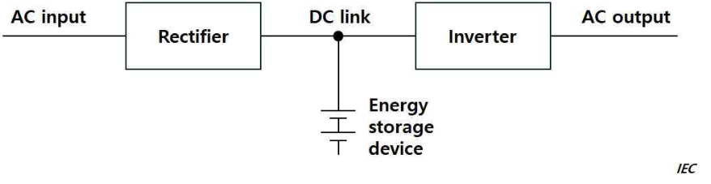
> Description: Block diagram of the double conversion topology: AC input feeds a Rectifier, whose output (DC link) feeds an Inverter delivering the AC output; an energy storage device is connected to the DC link node. Source marked "IEC".

(3) Line interactive topology

A UPS topology comprises bidirectional AC to DC power conversion, generally through a bidirectional converter and an AC power interface. When AC input power voltage or frequency is out of UPS pre-set tolerances, the UPS runs in stored energy mode. (Refer to Annex B to IEC 62040-3:2021)

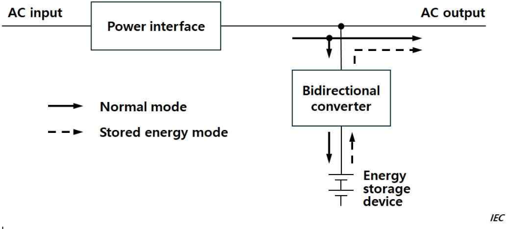
> Description: Block diagram of the line interactive topology: AC input passes through a Power interface to the AC output; a Bidirectional converter connected to the output line charges/discharges an energy storage device. Solid arrows indicate normal mode and dashed arrows indicate stored energy mode. Source marked "IEC".

(4) Standby topology

A UPS topology comprises a battery charger, a DC to AC converter, generally a unidirectional inverter and a UPS switch. When the AC input power is out of UPS pre-set tolerances, the UPS operates in stored energy mode. (Refer to Annex B to IEC 62040-3:2021)

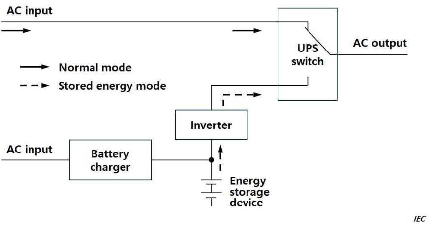
> Description: Block diagram of the standby topology: in normal mode (solid arrows) the AC input is fed directly through the UPS switch to the AC output; a second AC input feeds a Battery charger connected to the energy storage device, which in stored energy mode (dashed arrows) supplies the Inverter whose output is selected by the UPS switch. Source marked "IEC".

(5) Energy storage device

System consisting of a single or multiple devices designed to provide power to the UPS inverter/converter. (IEC 62040-3:2021)

(6) AC input power failure

Variation in the AC input power which could cause the UPS to operate in stored energy mode. (IEC 62040-3:2021)

(7) Bidirectional converter

Converter which has the functions of both a rectifier and an inverter, and which can reverse the flow of power from AC to DC and vice-versa. (IEC 62040-3:2021)

3. **Design and construction**

(1) UPS units are to be constructed in accordance with IEC 62040-1:2017+AMD1:2021+AMD2:2022, IEC 62040-2:2016, IEC 62040-3:2021, IEC 62040-4:2013, and/or IEC 62040-5-3:2016 as applicable, or an acceptable and relevant national or international standard.

(2) The operation of the UPS units is not to depend on external services.

(3) The configuration and topology of UPS unit employed is to be appropriate to the power supply requirements of the connected load equipment.

(4) When external bypass is provided, bypass transfer switch is to be arranged to protect the load against power disturbances or interruption arising from inrush or fault current. (Refer to Annex C to IEC 62040-3:2021)

(5) The UPS unit is to be monitored, and audible and visual alarms are to be given in continuously manned station(s) for

(A) Power supply failure (voltage and frequency) to the connected load

(B) Earth fault

(C) Operation of battery protective device

(D) When the battery is being discharged

(E) When the bypass is in operation in case an external bypass is provided

(F) Any other fault and abnormal conditions of the UPS unit, as applicable.

4. **Arrangement**

(1) The UPS unit for emergency services in **1** (1) (A) and (B) is to be suitably located for use in an emergency condition.

(2) UPS units utilizing valve regulated sealed batteries may be located in compartments with normal electrical equipment, provided the ventilation arrangements are in accordance with the requirements of IEC 62040-1:2017+AMD1:2021+AMD2:2022, IEC 62040-2:2016, IEC 62040-3:2021, IEC 62040-4:2013, and/or IEC 62040-5-3:2016 as applicable, or an acceptable and relevant national or international standard.

5. **Performance**

(1) The output power is to be maintained for the duration time required for the connected equipment as specified in **203. 2** of the Rules.

(2) No additional circuits are to be connected to the UPS unit without verification that the UPS unit has adequate capacity. The UPS battery capacity is, at all times, to be capable of supplying the designated loads for the time specified in the regulations.

(3) On restoration of the input power, the rating of the charge unit shall be sufficient to recharge the batteries while maintaining the output supply to the load equipment.

6. **Testing and inspection**

(1) UPS units of 50 kVA and over are to be surveyed by the Society during manufacturing and testing, in accordance with (2).

(2) Appropriate test is to be carried out to demonstrate that the UPS unit is suitable for its intended environment. This is expected to include as a minimum the following tests:

(A) Visual inspection

(B) Functionality, including operation of alarms in **3** (5)

(C) Temperature rise

(D) Ventilation rate

(E) Battery capacity

(3) Where the supply is to be maintained without a break following a power input failure, this is to be verified after installation by practical test.

#### 1204. Rectifiers

1. **Construction**

(1) Rectifier valve units, rectifier stacks or cells are to be so arranged that they can be removed from equipment without dismantling the complete unit.

(2) Air-cooled rectifiers are to be suitably installed or protected against the effects of salty air and humidity.

(3) Where mercury vapour are liable to be generated, self-cooling and air-cooled semi-conductor rectifiers are not to be used.

(4) Where rectifier elements are connected in series or parallel, they are so arranged that the voltage or current on each element will become equal as far as practicable.

2. **Arrangement**

(1) Rectifiers are to be installed in such a manner that the circulation of cooling air is not impeded and that the temperature of the inlet air to the air-cooled rectifier stacks does not exceed the allowable value.

(2) Rectifiers are to be separated from resistors, steam pipes or other sources of radiant heat as far as practicable.

3. **Protective devices**

(1) Where forced cooling is provided, the rectifier is to be so arranged that the rectifier can not remain loaded unless effective cooling is maintained.

(2) Where necessary, means are to be provided to guard against transient over-voltage caused by switching and breaking of the circuits and *d.c.* voltage rise due to regenerative power.

4. **Temperature of rectifier cells**

The maximum permissible temperature rise of junction of rectifier cells is to be such a value as will be specified by the manufacturer. Where the information is not available, the maximum permissible temperature rise of junction of rectifier cells is not to exceed the following values :

Selenium : 70℃

Silicon : 150℃ (thyristor : 125℃)

5. **Transformers for rectifiers**

Transformers for rectifier are to be of two separate windings.

6. **Thyristor control**

(1) Gate control circuits

(A) Gate control circuits of thyristors are to be so arranged that they can generate the gate pulse not exceeding the gate rating and having the pulse width enough to fire all thyristors connected. The gate control circuits are also to be protected from misfire caused by electrostatic induction and electromagnetic induction.

(B) Where thyristors are connected in series or parallel, gate control circuits are to be so arranged that firing timings of each thyristor are not irregular.

(2) Thyristor control for *d.c.* motor

(A) Where commutation of d.c. motor may be affected by the harmonics of thyristor output waveform, appropriate measures are to be taken to reduce such harmonics.

(B) Where electric sources may be affected by lower power factor resulted from the phase control of thyristor, means are to be provided to compensate it.

(C) In case where motors are operated in either direction of rotation by means of changing-over the field polarity, interlock is to be made so as to reverse the polarity of field after armature-current reaching zero, and in addition, suitable means are to be provided to limit electrical non-locked conditions of armature.

7. **Testing and inspection**

(1) General **【See Guidance】**

Rectifiers and their accessories are to be tested in accordance with the following requirements. The test required by (2), however, may be omitted subject to the Society's permission for each product which is produced in series having identical type with its first unit tested in the presence of the Surveyor.

(2) Temperature test **【See Guidance】**

Temperature test of rectifiers and their accessories is to be carried out under normal working conditions, and the test results are to comply with the requirements in **4** not exceeding the values specified in the requirements in **702.** as well.

(3) Operation test **【See Guidance】**

Instruments, switching devices and protective devices are to be checked under operating conditions.

(4) High voltage test

Rectifiers are to withstand the high voltage by applying the test voltage of **Table 6.1.30** for 1 minute between rectifier cells or live parts of components charged with main circuit potential and earth. *(2018)*

**Table 6.1.30 Test voltages for equipment connected to main circuits *(2018)***

<table>
<thead>
<tr><th rowspan="2">Rated insulation voltage (V)</th><th colspan="2">Test voltages (V)</th></tr>
<tr><th><i>a.c.</i> (r.m.s)</th><th><i>d.c.</i></th></tr>
</thead>
<tbody>
<tr><td align="center">≤ 50</td><td align="center">1250</td><td align="center">1770</td></tr>
<tr><td align="center">≤ 100</td><td align="center">1300</td><td align="center">1840</td></tr>
<tr><td align="center">≤ 150</td><td align="center">1350</td><td align="center">1910</td></tr>
<tr><td align="center">≤ 300</td><td align="center">1500</td><td align="center">2120</td></tr>
<tr><td align="center">≤ 600</td><td align="center">1800</td><td align="center">2550</td></tr>
<tr><td align="center">≤ 1000</td><td align="center">2200</td><td align="center">3110</td></tr>
</tbody>
</table>

(5) Insulation resistance test

After the high-voltage test, insulation resistance between live parts of rectifiers and their accessories and earth is not to be less than 1 MΩ when tested with d.c. voltage of at least 500 V.

### Section 13 Accumulator Batteries

#### 1301. General **【See Guidance】**

1. The requirements of this Section apply to all types of rechargeable lead acid and alkaline(Ni-Cd) batteries.

2. Accumulator batteries are to comply with national standards, internationally recognized codes or those which are considered equivalent by the Society.

3. Vented type batteries are those ones in which electrolytes can be replaced and which may release gases when they are being charged and overcharged.

4. Valve-regulated sealed type batteries are those ones in which cells are closed but have an arrangement(valve) that allows the emission of gas if the internal pressure exceeds a predetermined value. The electrolyte cannot normally be replaced.

#### 1302. Construction

The cells of all batteries are to be so constructed and secured as to prevent spilling of the electrolyte due to the vibration, inclination, etc., of the ship and to prevent emission of acid or alkaline spray.

#### 1303. Location

1. Batteries are to be located where they are not exposed to excessive heat, extreme cold, spray, steam or other conditions which would impair performance or accelerate deterioration.

2. Alkaline batteries and lead acid batteries are not to be in the same compartment.

3. Batteries are not to be placed in living quarters.

4. Large batteries are to be installed in the dedicated battery room. However, valve-regulated sealed type batteries may be installed in appropriate space. **【See Guidance】**

5. Engine starting batteries are to be located as close as practicable to the engines served. If such batteries cannot be accommodated in the battery room, they are to be installed so that adequate ventilation is ensured.

#### 1304. Electrical installation in battery compartment

1. Lighting fittings in battery rooms are to be of explosion-proof type. **【See Guidance】**

2. Switches, fuses and other electrical equipment liable to cause an arc are not to be fitted in battery compartments.

3. Cables, with the exception of those appertaining to the battery or the local lighting, are not to be installed in battery compartments as a rule.

#### 1305. Protection against corrosion

The interior of all battery compartments is to be protected with lead-sheet lining of 1.6 mm thick or more or corrosion-resistant paint in accordance with the following Paragraphs :

(1) The entire floor and all walls up to 150 mm high of battery rooms are to be lined with lead-sheet and the linings are to be watertight. Where approved by the Society, lead-sheet lining may be substituted by acid-resisting paint.

(2) Ceilings, walls other than those specified in (1), battery shelves and wooden crates are to be painted with acid-resisting paint.

(3) Battery tray and sulfuric acid bottle base are to be lined with lead-sheet. **【See Guidance】**

(4) Ventilating ducts and fans are to be made of corrosion-resisting material or their interior surfaces are to be coated with corrosion-resisting paint.

#### 1306. Ventilation **【See Guidance】**

1. All rooms, lockers and boxes for accumulator batteries are to be arranged to avoid accumulation of inflammable gas. Where batteries are arranged in two or more tiers, all shelves are to have not less than 50 mm space, front and back, for circulation of air.

2. The ventilation of battery room may be conducted with either natural ventilation or ventilating fan.

3. The battery room is to be provided with effective air inlet near floor surface.

4. Ventilating fans are to be so constructed and be of a material such as not to arise sparking in the event of the impeller touching the fan casing.

5. Fan motor associated with a duct used to exhaust the air from a battery space is, in principle, to be placed outside of the duct.

6. Ventilating ducts terminating at least 1.25 m above in a gooseneck shape or equivalent are to be provided above the top of battery boxes. Holes for air inlets are to be provided on at least two opposite sides of the box.

7. Where vented type batteries and/or valve-regulated sealed type batteries are installed, it is to be ensured that there is adequate ventilation. For vented type batteries, the Society’s requirements relevant to the location and installation are complied with. *(2026)*

#### 1307. Charging facilities

1. For floating service, the maximum battery voltage is not to exceed the permissible maximum voltage of any connected apparatus. A voltage regulator or other means of voltage control may be provided for this purpose. *(2025)*

2. Battery charging facilities by means of *d.c.* generator and series resistor are to be provided with protection against reversal of current when the charging voltage is 20 % of the line voltage or higher.

3. The Chargers are to be constructed to simplify maintenance operation. In addition indications are to be provided to visualize the proper operation of the charger and for alarms. *(2025)*

#### 1308. Maintenance record of battery *(2026)*

1. Where batteries are fitted for use for essential and emergency services a schedule of such batteries is to be compiled and maintained. The schedule, which is to be reviewed by the Society's site Surveyor during the newbuilding survey, is to include at least the following information regarding the batteries:

(1) Type and manufacturer's type designation

(2) Voltage and ampere-hour rating

(3) Location

(4) Equipment and/or systems served

(5) Maintenance/replacement cycle dates

(6) Dates of last maintenance and/or replacement

(7) For replacement batteries in storage, the date of manufacture and shelf life

2. Procedures are to be put in place to ensure that where batteries are replaced that they are of an equivalent performance type.

3. Details of the schedule and of the procedures are to be included in the ship’s safety management system and be integrated into the ship’s operational maintenance routine as appropriate to be verified by the Society’s Surveyor.

### Section 14 Lightning Conductors

#### 1401. General

Lightning conductors are to be fitted on each mast of ships having wooden masts.

#### 1402. Size of lightning conductors

1. Lightning conductors are to be composed of continuous copper tape or rope having a section not less than 75 mm². Lightning conductors are to run as straight as possible and sharp bends are to be avoided.

2. The resistance of lightning conductor between the mast top and the point on the earth plate or hull is not to exceed 0.02 ohms.

### Section 15 High Voltage Electrical Installations

#### 1501. General

1. **Application** **【See Guidance】**

(1) The requirements in this Section apply to *a.c.* three-phase supply systems with nominal voltages in the range above 1 kV up to and including 15 kV. Nominal voltage is the voltage between phases.

(2) The high voltage electrical installations are to comply with IEC 60092-503:2007 and the applicable requirements in this Chapter in addition to those in this Section. *(2022)*

2. **High-voltage, low-voltage segregation** Equipment with voltage above about 1 kV is not to be installed in the same enclosure as low voltage equipment, unless segregation or other suitable measures are taken to ensure that access to low voltage equipment is obtained without danger.

#### 1502. System Design **【See Guidance】**

1. **Distribution**

(1) Network configuration for continuity of ship services

It is to be possible to split the main switchboard into at least two independent sections, by means of at least one circuit breaker or other suitable disconnecting devices, each supplied by at least one generator. If two separate switchboards are provided and interconnected with cables, a circuit breaker is to be provided at each end of the cable. Services which are duplicated are to be divided between the sections.

(2) Earthed neutral systems

In case of earth fault, the current is not to be greater than full load current of the largest generator on the switchboard or relevant switchboard section and not less than three times the minimum current required to operate any device against earth fault. It is to be assured that at least one source neutral to ground connection is available whenever the system is in the energized mode. Electrical equipment in directly earthed neutral or other neutral earthed systems is to withstand the current due to a single phase fault against earth for the time necessary to trip the protection device.

(3) Neutral disconnection

Means of disconnection are to be fitted in the neutral earthing connection of each generator so that the generator may be disconnected for maintenance and for insulation resistance measurement.

(4) Hull connection of earthing impedance

All earthing impedances are to be connected to the hull. The connection to the hull is to be so arranged that any circulating currents in the earth connections do not interfere with radio, radar, communication and control equipment circuits.

(5) Divided systems

In the systems with neutral earthed, connection of the neutral to the hull is to be provided for each section.

2. **Degrees of protection**

(1) General

Each part of the electrical installation is to be provided with a degree of protection appropriate to the location, as a minimum the requirements of IEC 60092-201:2019. *(2022)*

(2) Rotating machines

The degree of protection of enclosures of rotating electrical machines is to be at least IP 23. The degree of protection of terminals is to be at least IP44. For motors installed in spaces accessible to unqualified personnel, a degree of protection against approaching or contact with live or moving parts of at least IP4X is required.

(3) Transformers

The degree of protection of enclosures of transformers is to be at least IP23. For transformers installed in spaces accessible to unqualified personnel a degree of protection of at least IP4X is required. For transformers not contained in enclosures, see **1507. 1.**

(4) Switchgear, controlgear assemblies and converters

The degree of protection of metal enclosed switchgear, controlgear assemblies and static convertors is to be at least IP32. For switchgear, control gear assemblies and static converters installed in spaces accessible to unqualified personnel, a degree of protection of at least IP4X is required.

3. **Insulation**

(1) Air clearance

In general, phase-to-phase air clearances and phase-to-earth air clearances between non-insulated parts of equipment are to be not less than those specified in **Table 6.1.31**. However, air clearance may be reduced subject to the Society's permission.

**Table 6.1.31 Air Clearance of High Voltage Electrical Installations**

| Nominal Voltage(kV) | Minimum air clearance(mm) |
|:---:|:---:|
| 3 (3.3) | 55 |
| 6 (6.6) | 90 |
| 10 (11) | 120 |
| 15 | 160 |

(2) Creepage distances

Creepage distances between live parts and between live parts and earthed metal parts are to be in accordance with IEC 60092-503:2007 for the nominal voltage of the system, the nature of the insulation material and the transient overvoltage developed by switch and fault conditions. *(2022)*

4. **Protection**

(1) Faults on the generator side of circuit breaker

Protective devices are to be provided against phase-to-phase faults in the cables connecting the generators to the main switchboard and against interwinding faults within the generators. The protective devices are to trip the generator circuit breaker and to automatically de-excite the generator. In distribution systems with a neutral earthed, phase to earth faults are also to be treated as above.

(2) Faults to earth

Any earth fault in the system is to be indicated by means of a visual and audible alarm. In low impedance or direct earthed systems provision is to be made to automatic disconnect the faulty circuits. In high impedance earthed systems, where outgoing feeders will not be isolated in case of an earth fault, the insulation of the equipment is to be designed for the phase to phase voltage.

(3) Power transformers

Power transformers are to be provided with overload and short circuit protection. When transformers are connected in parallel, tripping of the protective devices at the primary side has to automatically trip the switch connected at the secondary side.

(4) Voltage transformers for control and instrumentation

Voltage transformers are to be provided with overload and short circuit protection on the secondary side.

(5) Fuses

Fuses are not to be used for overload protection.

(6) Low voltage systems

Lower voltage systems supplied through transformers from high voltage systems are to be protected against overvoltages. This may be achieved by:

- direct earthing of the lower voltage system
- appropriate neutral voltage limiters
- earthed screen between the primary and secondary windings of transformers.

#### 1503. Rotating machinery

1. **Stator windings of generators**

Generator stator windings are to have all phase ends brought out for the installation of the differential protection.

2. **Temperature detectors**

Rotating machinery is to be provided with temperature detectors in their stator windings to actuate a visual and audible alarm in a normally attended position whenever the temperature exceeds the permissible limit. If embedded temperature detectors are used, means are to be provided to protect the circuit against overvoltage.

3. **Tests**

In addition to the tests normally required for rotating machinery, a high frequency high voltage test in accordance with IEC 60034-15:2009 is to be carried out on the individual coils in order to demonstrate a satisfactory withstand level of the inter-turn insulation to steep fronted switching surges. *(2022)*

#### 1504. Power Transformers

1. **General** *(2022)*

Dry type transformers have to comply with IEC 60076-11:2018. Liquid cooled transformers have to comply with IEC 60076. Oil immersed transformers are to be provided with the following alarms and protections:

- liquid level (Low)-alarm / trip or load reduction
- liquid temperature (High)-alarm / trip or load reduction
- gas pressure relay (High)-trip

2. Test voltage of High voltage test is given in **Table 6.1.32**.

**Table 6.1.32 High Voltage Test of Power Transformers *(2026)***

<table>
<thead>
<tr><th>Highest voltage for equipment(kV)</th><th><i>a.c.</i> Test voltage of High voltage(kV), 1min. commercial frequency(50Hz or 60Hz)</th></tr>
</thead>
<tbody>
<tr><td align="center">≤ 1.1</td><td align="center">3</td></tr>
<tr><td align="center">3.6</td><td align="center">10</td></tr>
<tr><td align="center">7.2</td><td align="center">20</td></tr>
<tr><td align="center">12</td><td align="center">28</td></tr>
<tr><td align="center">15</td><td align="center">38</td></tr>
</tbody>
</table>

#### 1505. Cables **【See Guidance】**

1. **General** *(2022)*

Cables are to be constructed in accordance with the IEC 60092-353:2016 and IEC 60092-354:2020 or other equivalent Standard.

2. Test voltage of High voltage test is given in **Table 6.1.33**.

**Table 6.1.33 High Voltage Test of Cables**

<table>
<thead>
<tr><th>System nominal voltage(kV)</th><th><i>a.c.</i> Test voltage of High voltage(kV), 5min. commercial frequency(50Hz or 60Hz)</th></tr>
</thead>
<tbody>
<tr><td align="center">1 ∼ 1.1</td><td align="center">3.5</td></tr>
<tr><td align="center">3 ∼ 3.3</td><td align="center">6.5</td></tr>
<tr><td align="center">6 ∼ 6.6</td><td align="center">11</td></tr>
<tr><td align="center">10 ∼ 11</td><td align="center">15</td></tr>
<tr><td align="center">15</td><td align="center">22</td></tr>
</tbody>
</table>

#### 1506. Switchgear and controlgear assemblies

1. **General** *(2024)*

Switchgear and controlgear assemblies are to be constructed according to IEC 62271-200:2011 and **1506. 2, 3** and **4** of the Rules.

2. **Construction**

(1) Mechanical construction

Switchgear is to be of metal enclosed type in accordance with IEC 62271-200:2011 or of the insulation enclosed type in accordance with IEC 62271-201:2014. *(2022)*

(2) Locking facilities

Withdrawable circuit breakers and switches are to be provided with mechanical locking facilities in both service and disconnected positions. For maintenance purposes, key locking of withdrawable circuit breakers and switches and fixed disconnectors is to be possible. Withdrawable circuit breakers are to be located in the service position so that there is no relative motion between fixed and moving portions.

(3) Shutters

The fixed contacts of withdrawable circuit breakers and switches are to be so arranged that in the withdrawable position the live contacts are automatically covered. Shutters are to be clearly marked for incoming and outgoing circuits. This may be achieved with the use of colours or labels.

(4) Earthing and short-circuiting

For maintenance purposes an adequate number of earthing and short-circuiting devices is to be provided to enable circuits to be worked upon with safety.

(5) Internal Arc Classification(IAC)

Switchgear and controlgear assemblies are to be internal arc classified(IEC 62271-200:2011, Annex AA). Where switchgear and controlgear are accessible by authorized personnel only, Accessibility Type A is required. Accessibility type B is required if accessible by non-authorised personnel. Installation and location of the switchgear and controlgear are to correspond with its internal arc classification and classified sides (F, L and R). *(2022)*

3. **Auxiliary systems**

(1) Source and capacity of supply

If electrical energy and/or physical energy is required for the operation of circuit breakers and switches, a store supply of such energy is to be provided for at least two operations of all the components. However, the tripping due to overload or short-circuit, and under-voltage is to be independent of any stored electrical energy sources. This does not preclude shunt tripping provided that alarms are activated upon lack of continuity in the release circuits and power supply failures.

(2) Number of external supply sources

When external source of supply is necessary for auxiliary circuits, at least two external sources of supply are to be provided and so arranged that a failure or loss of one source will not cause the loss of more than one generator set and/or set of essential services. Where necessary one source of supply is to be from the emergency source of electrical power for the start up from dead ship condition.

4. **Testing and inspection** *(2024)* **【See Guidance】**

(1) Temperature test

Where accepted by the Society, test may be exempted.

(2) High voltage test

A power-frequency voltage test is to be carried out on any switchgear and controlgear assemblies. The test voltages are to be in accordance with the following **Table 6.1.34** and the test procedure is to be in accordance with the IEC 62271-200:2011 Sec 7 Routine tests.

**Table 6.1.34 High Voltage Test of Switchgear and Controlgear Assemblies**

<table>
<thead>
<tr><th>System nominal voltage(kV)</th><th><i>a.c.</i> Test voltage of High voltage(kV), 1min. commercial frequency(50Hz or 60Hz)</th></tr>
</thead>
<tbody>
<tr><td align="center">1 ∼ 1.1</td><td align="center">2.8</td></tr>
<tr><td align="center">3 ∼ 3.3</td><td align="center">10</td></tr>
<tr><td align="center">6 ∼ 6.6</td><td align="center">20</td></tr>
<tr><td align="center">10 ∼ 11</td><td align="center">28</td></tr>
<tr><td align="center">15</td><td align="center">38</td></tr>
</tbody>
</table>

#### 1507. Installation

1. **Electrical equipment**

(1) Where equipment is not contained in an enclosure but a room forms the enclosure of the equipment, the access doors are to be so interlocked that they cannot be opened until the supply is isolated and the equipment earthed down.

(2) At the entrance of the spaces where high-voltage electrical equipment is installed, a suitable marking is to be placed which indicates danger of high-voltage. As regard the high-voltage electrical equipment installed out-side a.m. spaces, the similar marking is to be provided.

(3) The switchboard is to be provided with safe and effective measures to vent the accidental arc gases within the switchboard. **【See Guidance】**

(4) An adequate, unobstructed working space is to be left in the vicinity of high voltage equipment for preventing potential severe injuries to personal performing maintenance activities. In addition, the clearance between the switchboard and the ceiling/deckhead above is to meet the requirements of the Internal Arc Classification(see **1506. 2** (5)).

2. **Cables**

(1) Runs of cables

In accommodation spaces, high voltage cables are to be run in enclosed cable transit systems.

(2) Segregation

High voltage cables are to be segregated from cables operating at different voltage ratings each other; in particular, they are not to be run in the same cable bunch, nor in the same ducts or pipes, or, in the same box. Where high voltage cables of different voltage ratings are installed on the same cable tray, the air clearance between cables is not to be less than the minimum air clearance for the higher voltage side in **1502. 3** (1). However, high voltage cables are not to be installed on the same cable tray for the cables operating at the nominal system voltage of 1 kV and less.

(3) High voltage cables, in general, are to be provided with a continuous metallic sheath or armour which is effectively bonded to earth and be installed on cable trays; otherwise high voltage cables are to be installed for their entire length in metallic castings effectively bonded to earth. *(2023)*

(4) Terminations

Terminations in all conductors of high voltage cables are to be, as far as practicable, effectively covered with suitable insulating material. In terminal boxes, if conductors are not insulated, phases are to be separated from earth and from each other by substantial barriers of suitable insulating materials. High voltage cables of the radial field type, i.e. having a conductive layer to control the electric field within the insulation, are to have terminations which provide electric stress control. Terminations are to be of a type compatible with the insulation and jacket material of the cable and are to be provided with means to ground all metallic shielding components(i.e. tapes, wires etc).

(5) Marking

High voltage cables are to be readily identifiable by suitable marking.

(6) Test after installation

(A) Before a new high voltage cable installation, or an addition to an existing installation, is put into service a voltage withstand test is to be satisfactorily carried out on each completed cable and its accessories. The test is to be carried out after an insulation resistance test.

(B) For cables with rated voltage($U_0$/U) above 1.8/3 kV(Um=3.6 kV) an *a.c.* voltage withstand test may be carried out upon advice from high voltage cable manufacturer. One of the following test methods to be used:

(a) test for 5 min with the phase-to-phase voltage of the system applied between the conductor and the metallic screen/sheath

(b) test for 24 h with the normal operating voltage of the system

where,

- $U_0$ is the rated power frequency voltage between conductor and earth or metallic screen for which the cable is designed.
- $U$ is the rated power frequency voltage between conductors for which the cable is designed.
- $Um$ is the maximum value of the "highest system voltage" for which the equipment may be used.

(C) Alternatively, a *d.c.* test voltage equal to 4 $U_0$ may be applied for 15 minutes, notwithstanding the requirements in (B) above.

(D) For cables with rated voltage($U_0$/U) up to 1.8/3 kV(Um=3.6 kV) a *d.c.* voltage equal to 4 $U_0$ is to be applied for 15 minutes.

(E) After completion of the test, the conductors are to be connected to earth for a sufficient period in order to remove any trapped electric charge. An insulation resistance test is then repeated.

### Section 16 Electric Propulsion Unit

#### 1601. General *(2017)*

1. **Application** *(2023)*

(1) The requirements in this section are in addition to those in Sec.2 to Sec.15 and apply to propulsion systems, where the main propulsion is performed by electric motors.

(2) Bow and stern thrusters intended as auxiliary steering devices, shaft generators operated in a power take-in(PTI) or power take-home(PTH) modes are excluded.

2. **Protection against torsional vibration, etc.**

Prime movers, generators, motors, shafting and propellers are to be such that harmful torsional vibrations or excessive electrical oscillations in alternating-current systems are not observed at any normal operating speed.

3. **Integrated electric propulsion system**

(1) Integrated electric propulsion system is a system where a common set of generators supply power to the vessel service loads as well as the propulsion loads.

(2) The generating capacity of integrated electric propulsion system is as follows.

For vessels with an integrated electric propulsion system, under normal sea-going conditions, when one generator is out of service, the remaining generator capacity is to be sufficient to carry all of the loads for vessel services (essential services, normal services and for minimum comfortable conditions of habitability) and the propulsion loads to provide for a speed of not less than 7 knots or one half of the design speed, whichever is the lesser.

4. **Protection against moisture and condensate**

Effective means, for example space heaters or air dryers, are to be provided in generators, propulsion motors, electric power convertors, transformers and switchboards to prevent accumulation of moisture and condensate.

#### 1602. Prime movers

1. **General**

Prime movers are to comply with the requirements of **Pt 5, Ch 2, Sec 2** and **3,** and their rated power in conjunction with their overloading facilities and load built-up facilities is to be adequate to supply the needed power during transitional changes in operating conditions of electrical equipment.

2. **Speed governor**

(1) Prime movers of any type are to be provided with a governor capable of maintaining the pre-set steady speed within a range not exceeding 5 % of the rated full-load speed for load changes from full-load to no load.

(2) The governors are to be such that they will automatically maintain the momentary speed within 10 % of the rated speed when the full load is suddenly thrown off.

(3) In the case of parallel operation of generators, the governing system used are to permit stable operation to be maintained over the entire operational speed range of the prime movers.

(4) The speed governor characteristics of prime movers are to be such that in parallel operation the load on individual generators is shared, as far as possible, in proportion to the output of each generator.

(5) Where the speed control of the propeller requires speed variation of the prime mover, the governor is to permit a very gradual variation of speed within the necessary speed range and means are to be provided to enable local manual control as well as remote control of the governor.

(6) The overspeed governor is to be set to a speed in excess of the highest possible speed during periods of regenerated power, and the generator set including prime mover is to be so designed that no damage will be caused by an overspeed equal to that at which the governor is set.

#### 1603. Rotating machines *(2025)*

1. **General**

(1) When variable speed rotating machines are fitted with an integral fan and have to be operated at speeds below the rated speed with full-load torque, full-load current, full-load excitation or the like, temperature limits according to **Table 6.1.5** are not to be exceeded.

(2) The rotors are to be so constructed that they will withstand for 2 minutes at an overspeed in accordance with the requirements in **Table 6.1.7.** However, the overspeed of turbo-generators and electromagnetic slip-couplings is to be 120 % of the rated speed.

(3) The collector rings and commutators are to be suitably arranged to be maintained easily. For purposes of inspection and repair, provision is to be made for easy access to each kind of coils and bearings, and for withdrawal and replacement of the field coils as well.

(4) Stator windings of generators rated above 500 kVA, stator windings of *a.c.* motors rated above 500 kW and interpole, mainpole and compensation windings of *d.c.* motors rated above 500 kW are to be provided with temperature sensors, and the temperature indicator is to be mounted in a convenient position to read a temperature on the control board.

(5) Generators above 1 500 kVA are to be equipped with differential current protection.

(6) For *d.c.* motors liable to overspeed excessively, overspeed protection devices are to be provided, and the rotors are to be suitably constructed to prevent damage due to temporary overspeed.

2. **Motor torque**

(1) Torque available for maneuvering a ship is to be capable of stopping or reversing of the ship in a reasonable time when the ship is running at the maximum service speed.

(2) Adequate torque margin is to be provided in *a.c.* propulsion systems to guard against the motor to be pulled out of synchronism during rough weather and at the time of turning in a multiple-screw ship.

3. **Bearing and lubrication**

(1) Lubrication of the bearings of propulsion motors and shafting is to be effective at all operational speeds including creep speeds.

(2) When a forced lubrication system is used for the bearings of rotating machines and prime movers, low oil pressure alarm and alarm for attainment of excessive bearing temperatures are to be provided.

(3) No lubricating liquid is to flow out of the bearings and penetrate into the machine.

(4) All bearings are to be equipped with temperature devices or a thermometer is to be installed.

(5) Adequate lubricating is to be ensured even in inclined positions. Provision is to be made for checking the bearing lubrication.

(6) Sleeve bearings are to be easily replaceable.

(7) Roller bearings are to be sufficiently preloaded.

4. **Means of excitation**

(1) Separately excited rotating machines are to be provided with at least 2 independent sources of excitation.

(2) The strength of shafts and couplings of exciter is to be suitable for the increased output necessary during maneuvering and sudden short-circuit conditions.

5. **Electromagnetic slip-couplings**

(1) Means are to be provided to facilitate periodical checking of the air gaps of the magnetic circuit, and appropriate calibrated gauges are to be supplied for this purpose.

(2) Electromagnetic slip-couplings are to be at least of drip-proof type. Where they are of non-enclosed type, suitable means are to be taken to prevent accidental touch with rotating parts and ingress of foreign material.

6. **Cooling**

(1) The temperature of the cooling air of machines provided with forced air ventilation, air ducts, air filters or water coolers is to be continuously monitored by means of thermometers which are readable from outside the machine. Temperature sensors are to be provided to trigger an alarm.

(2) For machines with water cooled heat exchangers, leakage monitoring is required.

7. **Single essential propulsion components and their reliability (UI SC305)** *(2026)*

In accordance with SOLAS Regulation II-1/26.2, single essential propulsion components and their reliability shall comply with the following requirements.

(1) The possibility of failures in electric machines shall be considered. Sufficient propulsion capacity shall be maintained or restored within due time for the following failure modes of electric machines, as a minimum:

(A) winding insulation failures; and

(B) excitation failures.

(2) Single electric propulsion motors (both single and dual winding with a single rotor) for main propulsion shall not be considered to provide the reliability required for a single essential propulsion component. A separate propulsion unit sufficient to give the ship a navigable speed should be required for such arrangements.

(3) Propulsion arrangements with two independent rotors on a single shaft shall be considered to provide the required reliability, provided it is possible to de-excite or de-flux each of the rotors individually and to supply independently the stators.

#### 1604. Control gear **【See Guidance】**

1. **General**

(1) Control gears for propulsion equipment are to be designed for the appropriate voltages and are to include the apparatus necessary for starting, stopping, reversing and controlling the speed of motors together with essential instruments and safety devices.

(2) Where, on stopping or reversing the propeller, the regenerated energy transmitted by the propulsion motor is such as to cause a dangerous increase of speed in the prime mover, means are to be provided for suitably absorbing or limiting such energy(e.g., braking resistors). *(2017)*

(3) All levers, handles and their accessories for switches and contactors are to be of such proportions as to permit a satisfactory manual operation.

(4) All levers for operating contactors, line switches, field switches and the like are to be interlocked to prevent their wrong operation. These interlocks are to be of mechanical type as far as practicable.

(5) Where steam and oil gauges are mounted on the main control assembly, provisions are to be made so that in case of leakage, steam and oil may not come into contact with the energized parts.

(6) When power-aided control is used, other suitable means are to be provided to restore control in a short time in the event of power failure.

(7) The control gears are to be so arranged that in case of damage to the equipment outside the engine room, control can always be executed from the engine room maneuvering control stations.

(8) In the event of failure of the control gears or failure of power supply for control gear, it shall be ensured that the propeller speed does not increase excessively.

2. **Location of maneuvering control**

(1) Control of the rotating machines for propulsion may be carried out from the bridge or deck. Alternative control in the engine room is to be provided, Transfer of control to the engine room in an emergency is to be possible without excessive loss of time.

(2) When two or more control stations are provided, indicating lights are to be located at each control station to indicate which station is in control. Means are to be provided to make incapable of being operated simultaneously from different stations.

(3) The local control station is to be located in the vicinity of the drives or electric power convertors so that changes in the control of propulsion can be recognized.

(4) Each control station is to have an emergency stop device which is independent of the drive's control and the active control place.

3. **Main circuit and control circuit**

(1) Propulsion system having two or more generator or motors respectively on one propeller shaft, is to be so arranged that any unit of them can be taken out of service and isolated electrically.

(2) Field circuits are to be provided with means of suppressing voltage rise when a field switch is opened.

4. **Protection**

(1) Over-current protective devices, if any, in the main circuits are to be set sufficiently high so that there is no possibility of their operating due to over-currents caused by maneuvering or normal operation in heavy seas.

(2) Where separately driven *d.c.* generators are connected electrically in series, means are to be provided to prevent reversal of the rotation of a generator at the failure of the driving power of its prime mover.

(3) In excitation circuits, there is to be no overload protection causing the opening of the circuit.

(4) Means are to be provided to detect sudden short circuit currents and to protect against phase unbalance. When damage likely to cause to the electrical equipment is more serious than the possible consequences of losing propulsion power, consideration is to be given to providing means for rapid reduction of the magnetic fluxes of the generators or motors.

(5) Means for earth leakage detection are to be provided for the main propulsion circuit, and these are to be arranged to operate an alarm upon the occurrence of an earth fault.

(6) Insulated excitation circuits are to be provided with earth leakage detection which may consist of voltmeters or lamps.

(7) Reduction of power

A request for manual load reduction shall be issued, visually and acoustically on the bridge, or an automatic load reduction shall be arranged in case of :

(A) Low lubricating oil pressure to propulsion generators and motors

(B) High winding temperature in propulsion generators and motors

(C) Lack of coolant in machines and convertors

(D) Fan failure in machines and convertors provided with forced ventilation, or failure of cooling system.

(E) Load limitation of generators or inadequate available power.

5. **Control gears for electromagnetic slip-couplings**

Control gears for electromagnetic slip-couplings are to include a two-pole disconnecting switch, short-circuit protection and an ammeter for the coupling excitation circuit. Interlocking gear is to be provided to prevent the coupling from being energized when the driving machine control levers are in an inappropriate position. Such controlgear may be combined with the prime mover speed control and reversing gears.

6. **Measuring, indicating, control and monitoring equipment** *(2017)*

(1) Main propulsion plants are to be provided with at least the following measuring and control equipment as well as indicators at control stations:

(a) At local control station

- speed setting,
- local remote switch,
- ammeter for each supply side current of each load component,
- indication excitation on,
- revolution indicator for each shaft,
- pitch indication for plants with variable pitch control,
- indication plant ready for operation,
- indication convertor on/off,
- indication plant disturbed,
- indication power limited,
- indication control from engine control room,
- indication control from the bridge,
- indication control from local.

(b) At (main) control station on the bridge

- control levers,
- revolution indicator for each shaft,
- shaft power meter,
- indication plant ready for switching on,
- indication plant ready for operation,
- indication plant disturbed,
- indication power limitation,
- indication request to reduce the power if not automatically controlled or equipped with override push button,
- indication control from engine control room,
- indication control from the local control station,
- indication generators used for propulsion.

(c) At (main) control station in the engine control room

- control levers,
- revolution indicator for each shaft,
- shaft power meter,
- indication plant ready for switching on,
- indication plant ready for operation,
- indication plant disturbed,
- indication power limitation,
- indication request to reduce the power if not automatically controlled or equipped with override push button,
- indication control from the local control station,
- indication control from the bridge,
- indication generators used for propulsion.

7. **Start blockings** *(2017)*

(1) The start-up process of the propulsion plant shall be interlocked such that starting is impossible if existing malfunctions would trigger a shutdown or if the start-up process itself would cause damage to the propulsion plant. The following interlocks should be considered, if applicable:

- shaft locking device not released,
- no cooling of static converter (overridable),

- no cooling of propulsion motor (overridable),
- no cooling of propulsion transformer (overridable),
- malfunction in exciter device,
- malfunction in static converter,
- convertor control: shutdown activated,
- propulsion switchboard switch-off active,
- emergency stop actuated,
- set point not equal to zero,
- bearings: lubrication oil pressure too low,
- conductivity of the cooling medium too high,
- protection triggered,
- switchgear circuit breaker malfunction,
- missing enabling signal from variable-pitch propeller.

(2) The pilot light “plant ready to start for switching on” may only be activated when all the prerequisites for start-up have been met.

(3) The pilot light “plant ready for operation” may only be activated if the propulsion plant would respond to set point setting.

#### 1605. Propulsion transformers

1. **General** *(2023)*

(1) Complete insulation is to be made between primary windings and secondary windings of transformers. Auto transformers are permitted for motor starting.

(2) Transformers producing low voltage from high voltage are to be equipped with an earthed shield winding between the high-voltage and low-voltage coil.

(3) Means of monitoring the winding temperatures of propulsion transformers are to be provided.

(4) Degree of protection

Transformers located in engine room are to have a protection degree of at least IP 23 and high voltage transformers are to have a protection degree of at least IP 44. All transformers located in dedicated locked electrical spaces or in the spaces which can access to qualified personnel only as engine room may have any degree of protection of at least IP 2X.

2. **Cooling**

(1) Liquid cooled transformers

(a) A fire detector and a suitable fire extinguishing system are to be installed in the vicinity of the transformer.

(b) Liquid cooled transformers are to be provided with gas-actuated protection devices.

(c) Means of monitoring the liquid temperature is to be provided. A pre-alarm is to be actuated before the maximum permissible temperature is attained. When the maximum permissible temperature limit is reached, the transformer is to be switched off.

(d) The liquid filling level is to be monitored by means of two separate sensors. The monitoring system is to actuate an alarm at the first stage and is to trigger a shutdown at the second stage, when the permissible limit is exceeded.

(2) For air cooled transformers, means of monitoring ventilators and temperatures of the cooling air for forced-ventilated transformers are to be provided.

(3) For transformers with a closed circuit cooling method with a heat exchanger, means of monitoring the flow of primary and secondary coolants are to be provided. Leakage-water and condensed moisture is to be kept away from the windings. Leakage monitoring is required.

3. **Instrumentation**

Propulsion transformers are to be equipped with a three-phase ammeter on primary side.

4. **Protection**

(1) Each propulsion transformer is to be protected against overcurrent and short-circuit at the primary and secondary side.

(2) Protection on secondary side may be achieved by the electric power convertor.

#### 1606. Electric power convertors

1. **General** *(2023)*

If the electric power convertor feeds a permanently excited synchronous motor, a switch disconnector is to be fitted in the motor-electric power convertor line which opens automatically in case of an inverter fault. Devices which support fault diagnosis are to be installed.

2. **Design of semiconductor electric power convertors**

(1) Propulsion electric power convertors are to be designed for the nominal torque of the drive. Short-term overload and speed variation resulting from overloads are not to lead to a shutdown of the system.

(2) The cabinets for semiconductor electric power convertors are to meet the standards of the main switchboard.

(3) The power components for semiconductor electric power convertors are to be easy replaceable.

3. **Cooling of semiconductor electric power convertors**

(1) If semiconductor electric power convertors are fitted with forced-cooling, means for monitoring the cooling system are to be provided.

(2) In case of a failure of the cooling system, measures are to be taken to prevent damage to the electric power convertor. An alarm is to be given. The alarm signal can be generated by the flow of the coolant, or by the temperature of the semiconductors.

(3) Single failures in electric power convertor cooling systems are not to lead to the tripping of all electric power convertors of the ship's propulsion.

4. **Protection**

(1) Operational overvoltages in a supply system to which electric power convertors are connected are to be limited by suitable devices to prevent damage. Means of monitoring protective fuses for these devices are to be provided.

(2) A suitable control is to ensure that the permissible current of semiconductor elements cannot be exceeded during normal operation.

(3) Semiconductors are not to be damaged by direct short circuit at the terminals. Protection by fuses is permitted. The electric power convertor is to control the current in such a way that no components are damaged when the electric power convertor is switched on to a blocked motor.

#### 1607. Cables

Conductors of cables and wiring are to consist of not less than 7 strands and conductors of a cross sectional area smaller than 1.5 mm² are not to be installed except cables or wiring for automatic equipment not directly connected to main circuits.

#### 1608. Testing and inspection

After electric propulsion plants are installed on board ship, sea trial is to be carried out.

### Section 17 Tests after Installation on Board

#### 1701. Insulation resistance test

1. **Electric propulsion, auxiliary power and lighting circuits**

Each circuit of electric propulsion, auxiliary power and lighting is to have insulation resistances not less than the values in **Table 6.1.35** between conductors and between each conductor and earth.

**Table 6.1.35 Insulation Resistance *(2025)***

<table>
<tr><th>Rated voltage $U_n$ (V)</th><th>Minimum test voltage (V)</th><th>Minimum insulation resistance (MΩ)</th></tr>
<tr><td>$U_n \le 250$</td><td>$2 \times U_n$</td><td rowspan="2">1</td></tr>
<tr><td>$250 < U_n \le 1,000$</td><td>500</td></tr>
<tr><td>$1,000 < U_n \le 7,200$</td><td>1,000</td><td rowspan="2">$1 + (U_n/1,000)$</td></tr>
<tr><td>$7,200 < U_n \le 15,000$</td><td>5,000</td></tr>
</table>

2. **Internal communication circuits**

Insulation resistances of internal communication circuits are to comply with the following requirements:

(1) Each circuit of 100 V and above is to have an insulation resistance not less than 1 MΩ between conductors and between each conductor and earth.

(2) For circuits below 100 V, the insulation resistance is to be at least 1/3 MΩ.

(3) During the test for (1) and (2) any or all appliances connected thereto may be disconnected from the circuit.

3. **Generators and motors**

The insulation resistance of each generator and motor under working temperature is to be in accordance with the requirements in **Table 6.1.8.**

4. **Switchboards**

The insulation resistance of each switchboard under working temperature is to be in accordance with the requirements in **406. 5.**

#### 1702. Performance test

1. **Generators**

Generators are to be tested as follows:

(1) The operation of overspeed trip and other safety devices is to be demonstrated.

(2) Tests are to be conducted to verify that voltage regulation is within acceptable limits and various combinations of parallel operation are satisfactory. *(2025)*

(3) All generators are to be run at full rated load for a duration sufficient to demonstrate that temperature rises, commutation, absence of vibration and others are satisfactory.

2. **Switchboards**

All switches, circuit-breakers and associated equipment on the switchboard are to be operated on load to demonstrate suitability, and also section boxes and distribution boxes are to be tested as above.

3. **Motors**

Motors are to be tested as follows :

(1) Motors and their controlgears are to be examined under working condition that wiring, capacity, speed and operation are satisfactory.

(2) Motors driving various auxiliary machinery pumps, etc. are to be operated to demonstrate that operating characteristics are satisfactory.

(3) Motors driving cargo winches and windlasses are to hoist and lower their specified loads.

4. **Lighting system**

Lighting system is to be tested as follows :

(1) Circuits are to be tested to demonstrate that all lighting fittings, branch boxes, switches, plugs, receptacles and other connected fittings are in suitable operating condition.

(2) Emergency lighting circuits are is to be tested in the same manner as specified in (1) above.

5. **Electric heaters and electric cooking ranges**

Electric heaters, electric cooking ranges and the like are to be tested to demonstrate that the heating elements function satisfactorily.

6. **Internal communication systems**

Each internal communication system is to be thoroughly tested to demonstrate its specified functioning. Particular attention is to be paid to the tests of operation of the ship's essential electric communication systems which include engine order telegraphs, helm indicators, fire alarms, emergency signals, morse signal lamp, navigation light indicator panel and telephones.

7. **Voltage drop**

During above tests, it is to be ascertained that the voltage drop of feeder circuits does not exceed the values specified in **503. 2.**

### Section 18 Spare Parts, Tools and Instruments

#### 1801. Spare parts

1. **General** **【See Guidance】**

(1) For the rotating machines and controlgears intended for electric propulsion plants, the spare parts mentioned in **Tables 6.1.36**, **6.1.38** and **6.1.40** are to be supplied.

(2) For ship′s service generators, essential service motors and their controlgears and switchboards, the spare parts mentioned in **Tables 6.1.36** to **6.1.40,** so far as applicable, are recommended to be supplied as a standard.

(3) Quantity mentioned in (1) and (2) is the quantity of spare parts for identical installation per ship.

(4) For steering gear motors and motor-generators, if no stand-by machine is installed, spare parts in **Table 6.1.36** are required in addition to the spare parts for motors enumerated in **Table 6.1.37.**

**Table 6.1.36 Spare Parts for Generators, Exciters and Motors**

<table>
<tr><th>Spare parts</th><th>Quantity (ea)</th><th>Remarks</th></tr>
<tr><td>Bearing or bearing linings</td><td>1 for each 4 or less</td><td>Including oil rings</td></tr>
<tr><td>Brush holders</td><td>1 for each 10 or less</td><td></td></tr>
<tr><td>Springs</td><td>1 for each 4 or less</td><td>For brush holder</td></tr>
<tr><td>Brushes</td><td>1 for each 1</td><td></td></tr>
<tr><td>Field coils</td><td>1 for each 10 or less</td><td>For d.c. machines only. Excluding uninsulated interpoles coils</td></tr>
<tr><td>Resistors for field rheostat and discharge resistors</td><td>See <b>Table 6.1.38</b></td><td>For generators and exciters</td></tr>
<tr><td>Amatures of cargo winch</td><td>1 for 6 or more</td><td>Stator in case of a.c. cage-rotor motor. Rotor in case of a.c. wound-rotor motor.</td></tr>
<tr><td>Slip-rings</td><td>1 for each kind and size</td><td>Required for rotating machines for electric propulsion only.</td></tr>
</table>

**Table 6.1.37 Additional Spare parts for Steering Gear Motors without Stand-by Motor-Generator**

<table>
<tr><th colspan="2">Spare parts</th><th>Quantity (ea)</th></tr>
<tr><td>d.c.</td><td>Amatures of motors and motor-generators</td><td>1 for each size (incl. shaft and coupling)</td></tr>
<tr><td rowspan="2">a.c.</td><td>Stators of cage-rotor motors</td><td>1</td></tr>
<tr><td>Rotors of wound-rotor motors</td><td>1 (incl. shaft and coupling)</td></tr>
</table>

**Table 6.1.38 Spare parts for Controlgear**

| Spare parts | Quantity (ea) | Remarks |
|:--|:--|:--|
| Contact pieces | 1 for each 2 sets or less | For arcing and wear parts only |
| Springs | 1 for each 4 or less | |
| Operating and shunt coils | 1 for each 10 or less | |
| Resistors | 1 for each 10 or less | For each kind and size |
| Fuses and their elements | See **Table 6.1.40** | |
| Lenses and lamps for pilot lamps | See **Table 6.1.40** | |

**Table 6.1.39 Spare Parts for Brakes**

| Spare parts | Quantity (ea) | Remark |
|:--|:--|:--|
| Shoe linings and rivets | 1 for each 4 or less | |
| Springs | 1 for each 4 or less | |
| Coils | 1 for each 10 or less | |

**Table 6.1.40 Spare Parts for Switchboards, Section Boards and Distribution Boards**

| Spare parts | Quantity (ea) | Remarks |
|:--|:--|:--|
| Fuses (not renewable) | 1 for each 1 | Need not exceed 20 |
| Fuse (renewable) | 1 for each 10 | Need not exceed 10 |
| Fuse elements | 1 for each 1 | |
| Arcing contacts | 1 for each 1 | Need not exceed 10 |
| Springs | 1 for each 1 | Need not exceed 10 |
| Complete trip element assembly for moulded case thermal type circuit-breakers | 1 for each 10 identical trip elements or less | Applicable where interchangeable elements are used |
| Complete moulded case thermal type circuit-breakers | 1 for each group of 10 identical breakers or less | Applicable where non-interchangeable trip elements are used |
| Potential coils | 1 for each kind | |
| Resistors | 1 for each kind | |
| Lenses of pilot and signal lamps | 1 for each 10 identical lenses or less | |
| Lamps for pilot and singnal lamps | 1 for each 1 | |

2. **Emergency lighting fittings**

Where the voltage of emergency lighting circuits are different from that of general service, 1 for each 2 lamps are to be supplied as the spare.

#### 1802. Testing instruments

Ships having electrical equipment of 50 kW and above are to be provided with a 500 volt insulation resistance measuring instrument in order that the insulation may be tested at regular intervals. In addition, the following portable instruments are recommended :

(1) One portable voltmeter, a.c. or d.c. or both as required.

(2) One portable ammeter, a.c. or d.c. or both as required, with shunts or current transformers as required.

#### 1803. Disassembling tools

Where special tools are required to adjust or to disassemble electrical equipment, one set of each tool is to be provided.

#### 1804. Storing method

All spare parts, instruments and tools are to be packed in suitable wooden boxes or corrosion protected steel boxes and are to be marked to indicate the contents on the surface of boxes and are to be stored in suitable locations. Where lockers are provided to store these spare parts, individual boxes may be omitted.

## CHAPTER 2 CONTROL SYSTEMS

### Section 1 General

#### 101. General

1. **Application** **【See Guidance】**

(1) The requirements in this Chapter apply to the systems of control, alarm and safety which are used to control all machinery and equipment which are subject to Rule requirements.

(2) Where considered necessary by the Society, the requirements in this Chapter are correspondingly applied to the systems of control, alarm and safety which are used for controlling machinery and equipment.

2. **Terminology** *(2017)*

Terms used in this Chapter are defined as follows:

(1) **Monitoring station** (excluding control station) is a position where measuring instruments, indicators, alarms, etc. for the machinery and equipment are centralized and necessary information to grasp the operating condition of them can be obtained. Where, however, a monitoring station is provided with the ship in addition to a control station mentioned in (2) below, the requirements of the Rules relating to a monitoring station do not apply to the monitoring station concerned.

(2) **Control station** is a position which has a function as a monitoring station and from which the machinery and equipment can be controlled.

(3) **Main control station** is a control station provided with equipment necessary and sufficient to control the main propulsion machinery (this equipment will be referred to as "main control equipment" in this (3) and (4) and from which the main propulsion machinery is normally controlled, of the ship which provides the main control equipment at the outside of the navigation bridge.

(4) **Main control station on bridge** is a navigation bridge of the ship which provides main control equipment at the navigation bridge and that the main propulsion machinery is normally controlled there.

(5) **Sub-control station** is such a control station at which the main propulsion machinery is capable of being controlled, except for local control station for the main propulsion machinery, that is provided in the machinery room of the ship provided with a main control station on bridge.

(6) **Bridge control devices** are remote control devices for the main propulsion machinery or controllable pitch propellers provided on a navigation bridge or a main control station on bridge.

(7) **Sequential control** is a pattern of control that can be carried out automatically in the redetermined sequence.

(8) **Program control** is a pattern of control that desired values can be changed in the predetermined schedule.

(9) **Local control** is direct manual control of the machinery and equipment performed at or near their locations, receiving the necessary information from the measuring instruments, indicators and so on.

(10) **Remote control systems** comprise all equipment necessary to operate units from a control position where the operator cannot directly observe the effect of his actions.

(11) **Safety system** is a system which operates automatically, in order to prevent damages to the machinery and equipment in case where serious impediments to functioning should occur on them during operation so that one of the following actions will take place.

(A) Starting of standby machinery or equipment.

(B) Reduction of outputs of the machinery or equipment.

(C) Shutting off the fuel or power supplies thereby stopping the machinery or equipment.

(12) **Computer-based system** is a system of one or more computers(including programmable electronic device), associated software, peripherals and interfaces, and the computer network with its protocol.

(13) **Integrated system** is a system consisting of two or more subsystem having independent functions connected by a data transmission network and operated from one or more workstations.

(14) **Expert system** is an intelligent knowledge-based system that is designed to solve a problem with information that has been compiled using some form of human expertise.

(15) **Software** is the program, procedures and associated documentation pertaining to the operation of the computer system.

(16) **Basic software** is the minimum software, which includes firmware and middleware, required to support the application software.

(17) **Application software** is a software performing tasks specific to the actual configuration of the computer-based system and supported by the basic software.

(18) **Interface** is a transfer point at which information is exchanged. (examples : interfaces including input/output interface; communications interface)

(19) **Peripheral** is a device performing an auxiliary function in the system(examples : printer, data storage device)

(20) **Failure mode and effect analysis(FMEA)** is a failure analysis methodology used during design to postulate every failure mode and the corresponding effect or consequences.

(21) **Combinator curve** is the relationship between the propeller pitch setting and the propeller speed. *(2025)*

3. **Drawings and data** *(2017)*

(1) Drawings and data concerning automation

(A) List of measuring points

(B) List of alarm points

(C) Control devices and safety devices

(a) List of controlled objects and controlled variables

(b) Kinds of sources of control energy (self-actuated, pneumatic, electric, etc.)

(c) List of conditions for emergency stopping, speed reduction (automatic or demand for reduction), etc.

(2) Following drawings and data for the automatic control devices and remote control devices for main propulsion machinery or controllable pitch propellers:

(A) Operating instructions of main propulsion machinery such as starting and stopping, changeover of direction of revolution, increase and decrease of output, etc.

(B) Arrangements of safety devices (including those attached to the engines) and pilot lamps

(C) Controlling diagrams

(3) Following drawings and data for the automatic control devices and remote control devices for boilers:

(A) Operating instructions of sequential control, feed water control, pressure control, combustion control and safety devices

(B) Diagrams for automatic combustion control devices and automatic feed water control devices

(4) Diagrams and operating instructions for automatic control devices for electric generating sets (automatic load sharing devices, preference tripping devices, automatic starting devices, automatic synchronous making devices, sequential starting devices, etc.)

(5) Drawings of control panel in bridge

(6) Drawings of control panel in engine room

(7) Drawings of remote control system (for main propulsion machinery, generator and boiler)

(8) Manufacturing drawings for alarm and control system (including list of alarm points)

(9) Panel arrangements of monitoring panels, alarming panels and control stands at respective control stations

(10) Schedules of on-board tests and sea trials

### Section 2 System and Control

#### 201. System design *(2017)*

1. **System design requirements**

(1) Control systems, alarm systems and safety systems are to be so designed that one fault does not result in other faults as far as practicable and the extent of the damage could be kept to a minimum.

(2) Control systems, alarm systems and safety systems are to be designed on the fail-to-safe principle. The characteristics of fail-to-safe is to be evaluated on the basis not only of the respective systems themselves and associated machinery and equipment, but also the total safety of the ship.

(3) Systems of automatic or remote control are to be sufficiently reliable under service conditions.

(4) Cables for signals are to be installed in such a manner that harmful induced interference can be avoided.

2. **Supply of power**

(1) Supply of electric power

The supply of electric power is to be in accordance with the following:

(A) Electric supply circuits to control systems, alarm systems and safety systems are not to branch off from the power circuits and lighting circuits, except that the electric power to the control systems, alarm systems and safety systems may be supplied from the power circuits to the machinery and equipment they serve.

(B) The electric power to alarm systems and safety systems for electric generating sets is also to be supplied from an accumulator battery.

(2) Supply of oil pressure

The supply of control oil pressure is to be in accordance with the following:

(A) Sources of oil pressure are to be capable of supplying stably necessary pressure and quantity of purified oil.

(B) Overpressure preventive devices are to be provided on the delivery side of oil pressure pumps.

(C) Two or more sets of oil pressure pumps for the control of main propulsion machinery and main shaftings are to be provided and they are to be so arranged that in case one of the pumps in operation becomes out of action, standby pump(s) may start automatically or may be readily remotely started. In this case, the oil pressure pumps are not to be used for the control of other machinery and equipment other than main propulsion machinery and main shaftings.

(3) Supply of pneumatic pressure

The supply of control air is to be in accordance with the following:

(A) Control systems are to be provided with an air reservoir having a capacity capable of supplying air to control devices at least for 5 minutes in the event of failure of the control air compressor.

(B) Where starting air reservoirs for main propulsion diesel engines are used as control air reservoirs, pressure reducing valves are to be duplicated.

(C) There are to be two or more sets of air compressors which may be used as a source of control air. Each air compressor is to have redundant capacity even in the event of failure of either one of them.

(D) Control air is to pass through a filter and, if necessary, a drier so that solid, oil and water may be removed to a minimum.

(E) Control air pipes are to be independent of general service air pipes and starting air pipes.

3. **Environmental conditions**

Systems of automatic or remote control are to be capable of withstanding the environmental conditions of the places where they are installed.

4. **Control systems**

(1) Independence of control systems

Control systems for main propulsion machinery or controllable pitch propellers, boilers, electric generating sets and auxiliaries for main propulsion of the ship(hereinafter referred to as "essential auxiliary machinery") are to be independent of each other or designed such that failure of one

system does not degrade the performance of another system. *(2025)*

(2) Interconnection devices *(2025)*

In case of plural main propulsion machinery or controllable pitch propellers, electric generating sets or important auxiliaries which are designed to be operated simultaneously in multiple under the same condition, interconnection devices may be provided between the control devices of these installations.

(3) Control characteristics

Remote control devices and automatic control devices are to have control characteristics in conformity with the dynamic properties of the machinery and equipment they serve and to be considered not to invite malfunction and hunting due to disturbance.

(4) Interlock

Control devices are to be provided with suitable interlocking arrangements in order to prevent damages to the machinery and equipment due to anticipated malfunction and maloperation of the machinery and equipment.

(5) Change-over to manual operating

Change-over to manual operating is to comply with the following requirements:

(A) Main propulsion machinery or controllable pitch propellers, boilers, electric generating sets and auxiliaries for main propulsion of the ship are to be so arranged as to be manually started, operated and controlled even in the event where automatic control devices become out of action. *(2025)*

(B) Automatic control devices are generally to be provided with provisions to stop manually the automatic function of these devices.

(C) The provisions specified in (B) are to be capable of stopping the automatic function of the automatic control devices, even where any part of the automatic control devices become out of action.

(6) Cancellation of remote control function

For remote control devices, the function of remote control is to be capable of being manually cancelled.

(7) Indication of control locations **【See Guidance】**

In case where the machinery and equipment are capable of being operated from more than one station, the following requirements in (A) and (B) are to be complied with. However, this requirement need not be complied with in case the safety of the machinery and equipment and the safety at the time of maintenance work can be obtained by means of other measures considered appropriate by the Society.

(A) At each control station there is to be an indicator showing which station is in control of the machinery and equipment.

(B) Control of the machinery and equipment is to be possible only from one station at a time.

5. **Alarm systems**

(1) Function of alarm systems is to comply with the following requirements:

(A) In case where an abnormal condition is detected devices to issue visual and audible alarms (hereinafter referred to as "alarm devices" in this Chapter) are to operate.

(B) In case where arrangements are made to silence audible alarms they are not to extinguish visual alarms.

(C) Two or more faults are to be indicated at the same time.

(D) Audible alarms for machinery and equipment are to be clearly distinguishable from other audible alarms such as general alarm, fire alarm, CO2 flooding alarm, etc.

(2) Function of the alarm systems provided in the monitoring station for main propulsion machinery or controllable pitch propellers is to comply with the following requirements, in addition to the requirements in (1).

(A) The visual indications of visual alarms are to remain until the fault has been corrected.

(B) The acceptance of any alarm is not to inhibit another alarm.

(C) If an alarm has been acknowledged and a second fault occurs prior to the first being rectified, alarm devices are again to operate.

(D) Manual stopping of each alarm system is to be clearly indicated.

(3) Visual alarms are to be such that each abnormal condition of the machinery and equipment is readily distinguishable and so arranged that acknowledgement is clearly noticeable.

6. **Safety systems**

(1) Constitution of systems

Constitution of safety systems is to comply with the following requirements:

(A) The safety systems are to be, as far as practicable, provided independently of the control systems and alarm systems.

(B) The safety systems for the main propulsion machinery, boilers, electric generating sets and auxiliaries for main propulsion of the ship are to be independent each other. *(2025)*

(2) Function of safety systems

Function of the safety systems is to comply with the following requirements:

(A) The alarm systems which have functions prescribed in **Par 5** are to operate when the safety system is put into action.

(B) In case where the safety system is put into action and the operation of the machinery or equipment is stopped, they are not to automatically restart before manual reset is made.

(3) Override arrangements

Where arrangements for stopping temporarily the functions of safety system in part or in whole(hereinafter referred to as "override arrangements") are provided, the following requirements in (A) and (B) are to be complied with:

(A) Visual indication is to be given at the relevant control stations of the machinery and equipment when an override is operated.

(B) The override arrangements are to be such that inadvertent operation is prevented.

#### 202. Automatic and remote control of main propulsion machinery or controllable pitch propellers *(2025)* **【See Guidance】**

1. **General**

Remote control devices for main propulsion machinery or controllable pitch propellers are to be complied with the requirements of this **202**.

2. **Remote control devices for main propulsion machinery or controllable pitch propellers** *(2025)*

(1) General

Remote control devices for main propulsion machinery or controllable pitch propellers are to comply with the following requirements: *(2025)*

(A) The remote control devices for main propulsion machinery or controllable pitch propellers are to be capable of controlling the propeller speed and the direction of thrust (the blade angle of propellers in the case of controllable pitch propellers) by means of a simple operation.

(B) The remote control devices for main propulsion machinery or controllable pitch propellers are to be provided for each propeller. Where multiple propellers are designed to operate simultaneously, they may be controlled by one control device. *(2025)*

(C) In case where the speed of the main diesel engines is controlled by governors, the governors are to be adjusted so that main engine may not exceed 103 % of the maximum continuous revolutions. The governors are to be capable of maintaining the safe minimum speed.

(D) In case where the program control is adopted, the program for increase and decrease of output is to be so designed that undue mechanical stresses and thermal stresses do not occur in any parts of machinery.

(E) In the remote control stations and monitoring stations for the main propulsion machinery, the following instruments are to be provided:

(a) Indicators for propeller speed and direction of rotation in the case of solid propellers.

(b) Indicators for propeller speed and pitch position in the case of controllable pitch propeller.

(F) In the remote control stations for main propulsion machinery or controllable pitch propellers, alarm devices necessary for the control of main propulsion machinery are to be provided.

(2) Transfer of control

The remote control devices for main propulsion machinery or controllable pitch propellers are to comply with the following requirements with respect to transfer of control:

(A) Each control station for main propulsion machinery or controllable pitch propellers is to be provided with means to indicate which of them is in control.

(B) Remote control of the main propulsion machinery or controllable pitch propellers is to be possible only from one location at a time. *(2025)*

(C) Transfer of control is to be possible only with order by the serving station and acknowledgement by the receiving station except for the following cases.

(a) Transfer of control between local control station for main propulsion machinery or controllable pitch propellers and main control station or sub-control station. *(2025)*

(b) Transfer of control during the stopping condition of the main propulsion machinery.

(D) When main propulsion machinery or controllable pitch propellers are controlled from the navigating bridge or navigation control station on bridge, the control shall be transferable to the local or main control station without requiring a transfer command from the navigating bridge or navigation control station on bridge. *(2025)*

(E) Means are to be provided to prevent the propelling thrust from altering significantly when transferring control from one location to another except for the transfer of control described in (C) (a) and (D).

(3) Failure of remote control systems of main propulsion machinery or controllable pitch propellers

The following requirements are to be complied with in case of failure of remote control devices for main propulsion machinery or controllable pitch propellers:

(A) In the remote control stations for main propulsion machinery or controllable pitch propellers alarm devices which operate in the event of failure of the remote control devices for main propulsion machinery or controllable pitch propellers are to be provided.

(B) In the event of failure of the remote control devices for main propulsion machinery or controllable pitch propellers, the main propulsion machinery or controllable pitch propellers are to be possible to control locally. *(2025)*

(C) In the event of failure of the remote control devices for main propulsion machinery or controllable pitch propellers, the preset speed and direction of the propeller thrust are to be maintained until the control is in operation at the main control station or the local control station, unless this is considered impracticable by the Society. In particular, lack of power (electric, pneumatic, hydraulic) is not to lead to major and sudden change in propulsion power or direction of propeller rotation.

(D) In the event of failure of the remote control devices for main propulsion machinery or controllable pitch propellers, the transfer of control to the main control station or the local control station is to be possible by a simple operation.

(E) Remote control stations for main propulsion machinery or controllable pitch propellers are to be provided with independent emergency stopping devices for the main propulsion machinery, which are effective in the event of failure of the remote control devices for main propulsion machinery or controllable pitch propellers.

(4) Remote starting of main propulsion machinery

Starting by means of remote control devices for main propulsion machinery or controllable pitch propellers is to comply with the following:

(A) The number of starting of main propulsion machinery is to satisfy the number specified in **Pt 5, Ch 6, 1101**.

(B) The remote control devices for main propulsion machinery arranged to automatically start are to be so designed that the number of automatic consecutive attempts which fail to produce a start is limited to three times. In the event of failure of starting, a visual and audible alarm is to be issued at the relevant control station and the main control station or monitoring station for the main propulsion machinery.

(C) Where compressed air is used for starting of the main propulsion machinery, alarm devices to indicate the low starting air pressure are to be provided at the remote control station and the monitoring station for the main propulsion machinery.

(D) The low starting air pressure mentioned in (C) for the operation of alarm devices is to be set at a level to permit further main propulsion machinery starting operations.

3. **Bridge control devices** *(2025)*

Bridge control devices are to comply with the following requirements as well as those in **202. 2.**

(1) Even when the main propulsion machinery is controlled from the navigating bridge, the telegraph orders at the navigating bridge are to be indicated in the main control station.

(2) The remote control for propulsion machinery is to be provided with means of preventing overload and prolonged running in critical speed ranges of the propelling machinery.

(3) The bridge control system is to be independent from the other transmission system; however, one control lever for both system may be accepted.

(4) Operations following any setting of the bridge control device including reversing from the maximum ahead service speed in case of emergency are to take place in an automatic sequence and with time intervals acceptable to the machinery.

(5) Automation system is to be designed in a manner which ensures that threshold warning of impending or imminent slowdown or shutdown of the propulsion system is given to the officer in charge of the navigational watch in time to assess navigational circumstances in an emergency. In particular, the systems shall control, monitor, report, alert and take safety action to slow down

or stop propulsion which providing the officer in charge of the navigational watch an opportunity to manually intervene, except for those cases where manual intervention will result in total failure of the engine and/or propulsion equipment within a short time, for example in the case of overspeed.

4. **Safety measures**

(1) Safety measures for main propulsion machinery or controllable pitch propellers

Safety measures for main propulsion machinery or controllable pitch propellers are to comply with the following requirements:

(A) The following safety measures are to be taken to the remote control devices for the main propulsion machinery or controllable pitch propellers: *(2025)*

(a) Necessary interlocking devices are to be provided to prevent serious damage due to mis-operation.

(b) Where the auxiliaries for propulsion of the ship are driven by electric motors, the main propulsion machinery is to be so designed as to stop automatically in the event of failure of the main source of electric power or to be capable of being stopped

(c) The main propulsion machinery is to be so arranged as not to re-start automatically when electric power is restored after the failure of the main source of electric power whereas the main propulsion machinery was stopped.

(d) The remote control devices for main propulsion machinery or controllable pitch propellers are to be so designed that the main propulsion machinery may not be abnormally overloaded in the event of failure of them.

(B) Stopping devices for main propulsion machinery or controllable pitch propellers are to be provided at the monitoring station for main propulsion machinery or controllable pitch propellers.

(2) Safety systems for main propulsion machinery or controllable pitch propellers *(2025)*

Safety systems for main propulsion machinery or controllable pitch propellers are to comply with the following requirements:

(A) A device to shut off the fuel or steam supply to the main propulsion machinery (this device hereinafter being referred to as "safety device") is not to be automatically activated except in cases which could lead to complete breakdown, serious damage or explosion.

(B) The safety systems for main propulsion machinery or controllable pitch propellers are to be so designed as not to lose their function or as to fail-to-safe, even in the event of failure of main electric source or air source.

(3) Self-reversing diesel engines

As least the following safety measures are to be taken to the remote control devices for self-reversing diesel engines:

(A) Starting operation is to be possible only when the camshaft is surely at the position of "Ahead" or "Astern".

(B) During reversing operation, fuel is not to be injected.

(C) Reversing operation is to be conducted after "Ahead" revolution is reduced to a predetermined value.

(4) Multiple sets of propulsion machinery coupled to a single shaft

At least the following safety measures are to be taken to the remote control devices for multiple sets of propulsion machinery coupled to a single shaft:

(A) Each propulsion machinery is to be provided with an overload preventive device.

(B) Each propulsion machinery is not to be subjected to an abnormally unbalanced load.

(5) Main propulsion machinery with clutch

At least the following safety measures are to be taken to the remote control devices for main propulsion machinery with clutch:

(A) The clutch equipped with multiple sets of main propulsion machinery coupled to a single shaft is to be disengaged when the main propulsion machinery is stopped in an emergency. While the main propulsion machinery is operating in different directions of rotation their clutches are not to be engaged simultaneously.

(B) Engaging and disengaging of clutches are to be carried out below a predetermined value of the number of revolutions of the main propulsion machinery.

(C) A overspeed protective device specified in **Pt 5, Ch 2, 203. 1.** or **304. 1.**

(D) In case where there is fear that the speed of the propulsion motor would exceed 125 % of the rated revolutions when the clutch is disengaged, an overspeed protective device as deemed appropriate by the Society is to be approved.

(6) Main propulsion machinery driving controllable pitch propellers

At least the following safety measures are to be taken to the remote control devices for main propulsion machinery driving controllable pitch propellers:

(A) Overload preventive devices are to be provided.

(B) Starting of engines or engaging of clutches is to be performed while the propeller blades are in a neutral position.

(C) An overspeed protective device as specified in **Pt 5, Ch 2, 203. 1.** or **304. 1.**

(D) In case where there is fear that the speed of the propulsion motor would exceed 125 % of the rated revolutions when the propeller pitch is altered, an overspeed protective device as deemed appropriate by the Society is to be provided.

(7) Remote starting of the propulsion machinery is to be automatically inhibited if conditions exist which may hazard the machinery, e.g. shaft turning gear engaged, drop of lubricating oil pressure. *(2025)*

(8) For steam turbines a slow-turning device is to be provided which operates automatically if the turbine is stopped longer than admissible. Discontinuation of this automatic turning from the bridge must be possible. For attended machinery spaces, the slow turning device may be arranged to be operated manually. *(2025)*

#### 203. Automatic and remote control of boilers

1. **General**

(1) The systems of automatic control for both combustion and feed water of oil-fired boilers are to comply with the requirements in **Pars 2** to **4** respectively.

(2) The systems of automatic control for either combustion or feed water of oil-fired boilers are to comply with the relevant requirements in **Par 2** or **3** as well as the requirements in **Par 4.**

(3) Automatic control of boilers other than oil-fired boilers or having a special feature will be considered in each case. **【See Guidance】**

(4) Remote water level indicators are to comply with the requirements in **Pt 5, Ch 5, 129.**

2. **Automatic combustion control systems**

(1) General

Automatic combustion control systems are to comply with the following requirements:

(A) The automatic combustion control systems are to be able to control so as to obtain planned steam amount, steam pressure and steam temperature and to secure stable combustion.

(B) The devices to control the fuel supply to meet the load imposed are to be capable of ensuring stable combustion in the controllable range of fuel supply.

(C) Where combustion control is carried out according to the pressure of the boiler, the upper limit of this pressure is to be lower than the set pressure of the safety valves.

(2) Combustion control devices for intermittent operation

The combustion control devices for intermittent operation are to comply with the following requirements and they are to operate according to the planned sequence:

(A) Before ignition on the pilot burner or before ignition on the main burner if the pilot burner is not fitted, the combustion chamber and flue are to be prepurged by air of not less than four times the volume of combustion chamber and flue up to the boiler uptake. For small boilers with only one burner, prepurge for not less than 30 seconds will be accepted.

(B) In case of direct ignition which is the method of ignition that the main burner is fired by ignition spark, opening of the fuel valve is not to precede the ignition spark.

(C) In case of indirect ignition which is a method of ignition that the main burner is fired by pilot burner, opening of the fuel valve for pilot burner (hereinafter referred to as "ignition fuel valve") is not to precede the ignition spark, and opening of the fuel valve for main burner (hereinafter referred to as "main fuel valve") is not to precede the opening of ignition fuel valve.

(D) Firing is to be surely carried out within the planned period. Main fuel valve is to be so designed as to close after opening of the valve not exceeding 10 seconds in the case of direct ignition and 15 seconds in the case of indirect ignition if the firing on the main burner has failed.

(E) Firing on main burners is to be carried out at their low firing position.

(F) After closure of the main fuel valve, postpurge is to be carried out for not less than 20 seconds to ensure adequate combustion air to completely burn all fuel oil remaining between the fuel oil valve and the burner nozzle. This requirement need not be complied with in the case of auxiliary boilers where approved by the Society. **【See Guidance】**

(3) Combustion control devices for the control of the number of firing burners

The combustion control devices for the control of the number of firing burners are to comply with the following requirements:

(A) Each burner is to be fired and extinguished according to the planned sequence. However, the base burner may be fired by manual operation and other burners may be fired by flame of a burner(s) already fired.

(B) The remaining fuel in the extinguished burner is to be automatically burnt up in order not to interfere the restarting. However, while the pilot burner is not fired, the remaining fuel in the base burner is not to be removed by steam or air when it is in place.

(C) The burners for main boilers are to be capable of being fired and extinguished from the main control station, except for the firing of base burner.

(4) Other combustion control devices **【See Guidance】**

Other combustion control devices will be considered in each case by the Society, as well as they are to comply with the relevant requirements in (2) and (3).

3. **Automatic feed water control devices**

(1) The automatic feed water control devices are to be capable of controlling automatically the feed water in order to maintain the water level in the boilers in a predetermined range.

(2) Main boilers are to be provided with not less than three water level detectors used for feed water control device, remote water level indicator, low water level safety device and low-water level alarm device.

4. **Safety measures**

(1) Safety devices

Safety devices are to comply with the requirements in **Pt 5, Ch 5, 133. 1.**

(2) Heating of fuel oil

In case where heated fuel oil is used, an automatic temperature control device is to be provided to the heater and the boiler is to be provided with a device to shut off automatically the fuel supply to the burners or an alarm device which operates when the temperature of fuel oil falls below a predetermined value.

5. **Alarms**

Alarm devices are to comply with the requirements in **Pt 5, Ch 5, 133. 2.**

#### 204. Control system of electric generating sets

1. **General**

(1) Electric generating set arranged to be automatically or remotely started is to be provided with interlocking devices necessary for safe operation.

(2) Electric generating set arranged to be automatically started is to be so designed that the number of automatic consecutive attempts which fail to produce a start is limited to two times and to be provided with an alarm device which operate at the time of the failure of starting.

(3) In case where a diesel engine to drive a propulsion generator is remote started the number of starting is to conform to the required number specified in **Pt 5, Ch 2, 202. 5.**

(4) Where automatic start of the standby generating set with automatic connection to the switchboard busbars is provided, automatic closure on to the busbars is to be limited to one attempt, in the event of the original power failure being caused by short circuit.

(5) Automatic control and remote control systems for the electric generating set, whose generator is driven by the main propulsion machinery and supplies electrical power to the electrical installations necessary for normal operating and living conditions and is operated while the main propulsion machinery is controlled by the bridge control devices, are to comply with the requirements in **Pt 6, Ch 1, 202.** in addition to those in this Article.

2. **Alarms and safeguards for emergency reciprocating I.C. engines** *(2024)*

These requirements apply to reciprocating I.C. engines, which use distillate marine fuels covered by ISO 8217:2017, required to be immediately available in an emergency and capable of being controlled remotely or automatically operated.

(1) Alarms and safeguards are to be fitted in accordance with **Table 6.2.1**.

(2) Devices referred to in (1) are to provide alarms at both local and control positions. The visual alarms at control positions may be of group indication.

(3) Each diesel engine with a maximum continuous output of 220 kW or over is to be provided with an overspeed protective device specified in **Pt 5, Ch 2, 203. 1** (2).

(4) When devices to shutdown the diesel engines are provided other than those referred to in **Table 6.2.1**, means are to be provided to override those devices automatically during navigation.

(5) In addition to the fuel oil control from outside the space, a local means of engine shutdown is to be provided.

(6) The silencing of the audible alarms from the control positions is not to cause the silencing of the audible alarm at local position.

**Table 6.2.1 Alarms and safeguards for emergency reciprocating I.C. engines *(2024)***

<table>
<tr><th colspan="2">Parameter</th><th>Alarm activation</th><th>Auto Shutdown</th></tr>
<tr><td colspan="2">Fuel oil leakage from high pressure pipes (fuel injection pipes and common rails)</td><td>O</td><td></td></tr>
<tr><td>Lubricating oil temperature(1)</td><td>High</td><td>O</td><td></td></tr>
<tr><td>Lubricating oil pressure</td><td>Low</td><td>O</td><td></td></tr>
<tr><td colspan="2">Activation of oil mist detection arrangements (or activation of the temperature monitoring systems or equivalent devices of: - the engine main and crank bearing oil outlet; or - the engine main and crank bearing)(2)(3)</td><td>O</td><td></td></tr>
<tr><td>Pressure or flow of cooling water(1)</td><td>Low</td><td>O</td><td></td></tr>
<tr><td>Temperature of cooling water (or cooling air)</td><td>High</td><td>O</td><td></td></tr>
<tr><td colspan="2">Overspeed activated(1)</td><td>O</td><td>O</td></tr>
</table>

(NOTE)

(1) For engines having a power of or more than 220 kW.

(2) For engines having a power of more than 2250 kW or a cylinder bore of more than 300 mm.

(3) Oil mist detection system is to be of the approved type by the Society, tested by **Ch 3, Sec. 10 of the Guidance for Approval of Manufacturing Process and Type Approval, Etc.** and applied to **Pt.5 Ch 2, 203.**

#### 205. Automatic and remote control of auxiliary machinery

1. **Automatic operation of air compressors**

In case where air compressors for starting and air compressors for controlling are automatically operated, alarm devices are to be provided to indicate pressure drop in air reservoirs.

2. **Automatic starting and stopping of bilge pumping arrangements**

In case where the bilge pumps are capable of being started and stopped automatically, alarm devices are to be provided to indicate high level of bilge in the relevant bilge wells and running of pumps for a long time.

3. **Thermal oil installations**

Thermal oil installations arranged to be automatically controlled are to comply with the following:

(1) Standby pumps

Pumps listed in the following of the thermal oil installations for important use are to be provided in two sets or more. The standby pumps are to be so arranged that they can start automatically or are capable of being started without delay from the relevant monitoring station when the discharge pressure or flow rate from the working pump falls below a predetermined value or when the pump stops.

(A) Thermal oil circulating pumps

(B) Fuel oil supply pumps

(2) Control devices

Control devices are to comply with **203. 2** (1) and (2), and also with **Pt 5, Ch 5, 202. 1** and **2.**

(3) Safety devices

Safety devices are to comply with **Pt 5, Ch 5, 201.** and **202. 5.**

(4) Alarm devices

Thermal oil installations are to be provided with alarm devices which operate in the following cases:

(A) When the safety devices required in (3) have operated.

(B) When the temperature of fuel at the inlet of burner has fallen.

4. **High temperature alarm for oil heaters**

In case where temperature for fuel oil and lubricating oil is automatically controlled, high temperature alarm devices are to be provided, except where oils are not heated above the flashpoint.

5. **Opening and closing devices for sea valves**

In case where sea valves to be fitted on the shell plating below the load water line are remotely or automatically controlled, other opening and closing devices which can be easily operated even in the event of failure of the automatic or remote control devices are to be provided.

6. **Liquid level alarm systems for fuel oil tanks**

In case where fuel transfer to fuel oil tanks is automatically controlled, the receiving tanks are to be provided with high and low level alarm systems.

7. **Mooring arrangements**

In case where mooring arrangements are provided with remote control devices, the mooring arrangements are to be capable of being locally operated.

8. **Fuel oil filling arrangements**

In case where arrangements for filling fuel oil into respective fuel oil tanks from the outside of the ships (hereinafter referred to as "fuel oil filling arrangements" in this Chapter) are provided with remote control devices, the fuel oil filling arrangements are to be such as not to interfere with filling of fuel even in the event of failure of the remote control devices.

9. **Emergency Diesel Engines**

The requirements in **204. 2** apply correspondingly to the automatic or remote control devices for emergency diesel engines used for non-emergency purposes other than those mentioned in **204. 2**.

#### 206. Control system of electric propulsion unit

It is to comply with the requirements in **Ch 1, Sec 16** in addition to the relevant requirements of this Chapter.

### Section 3 Tests *(2017)*

#### 301. Shop tests **【See Guidance】**

1. **Type approval**

Devices, units and sensors (hereinafter referred to as "automatic devices" in the Rules) and automatic equipment composed of automatic devices and basic software (if applicable) are to be type approved, in principle, according to the test methods approved by the Society before being taken into use.

2. **Shop tests of automation system**

The automatic devices which have passed through the type approval tests specified in **Par 1.** are to be subjected to the following tests after completion of assembly as automation system.

(1) Hardware

(A) External examination

(B) Operation tests and performance tests

(C) Insulation resistance tests and high voltage tests (to be applied to electric devices, electronic devices and so on)

(D) Pressure tests (to be applied to hydraulic devices, pneumatic devices and so on)

(E) Other tests considered necessary by the Society

(2) Software *(2017)*

Software acceptance tests of computer-based systems are to comply with **Sec 4**.

#### 302. On-board tests **【See Guidance】**

After installed on board the systems of automatic or remote control of the machinery and equipment are to be confirmed that they operate effectively, under as far practical condition as possible. However, part of these tests may be carried out during sea trials. The proper documents, in which test procedures, set value for alarms and for operation of safety systems and so on are recorded, are to be kept on board.

#### 303. Sea trials **【See Guidance】**

1. **Main propulsion machinery** *(2025)*

The control systems for propulsion machinery is to be subjected to the following tests. After completion of the test on transfer of control specified in (3), it is to be shown that the main propulsion machinery can be smoothly operated from the respective control stations.

(1) The main propulsion machinery is to be subjected to starting tests, ahead-astern tests and running tests in the whole range of output, by means of the remote control devices from the main control station.

(2) In addition to output increase and decrease tests, the operation tests of the main propulsion machinery using the bridge control devices are to be carried out at the discretion of the Society.

(3) In case where there are other control stations for propulsion machinery such as navigating bridge, the test on transfer of control for the main propulsion machinery is to be carried out during ahead and astern operations of the main propulsion machinery. In case where, however, considered appropriate by the Society, the test on transfer of control to the local control stations may be carried out during stoppage of the main propulsion machinery.

2. **Controllable pitch propellers** *(2025)*

(1) Scope of the tests

(A) Pitch response test

(a) A full range of tests is to be carried out to get the pitch response and verify that it coincides with the combinator curve of the propeller. The tests are to be carried out for at least three positions of the control lever in ahead and astern directions (e.g., dead slow ahead / astern, half ahead / astern, full ahead / astern).

(b) The tests are to be carried out in normal and emergency operating conditions.

(c) Tests that are not affected by the control position may be carried out from one control position only.

(B) Test of the fail-to-safe characteristics

A test of the fail-to-safe characteristics of the propeller pitch control system is to be carried out to demonstrate that failures in the pitch command and control or feedback signals are alarmed and do not cause any change of thrust. Such failures are to be clearly identified and included in the test procedure.

(C) Test procedure

Test procedure is to be prepared and proposed by the pitch control system manufacturer or integrator and agreed with Classification Society.

(2) Parameters to be recorded

(A) The list of the parameters to be recorded during the pitch response test within this UR is to be established by the pitch control system manufacturer or integrator and agreed with the Society. This should include at least the following parameters:

(a) Position of the control handle

(b) Actual pitch indication (local indication, remote indications)

(c) Rotational speed of the propeller

(d) Response time between the pitch change order (modification of the lever position) and the instant when the pitch and propeller speed have reached their final position

(e) Propelling thrust variation during the transfer of the control from one location to another one

(3) Tests results

Tests are to demonstrate:

(A) that the propelling thrust is not significantly altered when transferring control from one location to another and in case of failures in the pitch command and control or feedback signals.

(B) that the pitch response times measured during the test do not exceed the maximum value to be defined by the pitch control system manufacturer or integrator.

3. **Boilers**

The control systems for boilers are to be subjected to the following tests.

(1) With respect to the main boilers, it is to be confirmed that the feed water control devices, combustion control devices and so on can operate stably in response to load variation of the main boilers, and the main boilers can supply steam stably to the main propulsion machinery, electric generating sets and auxiliaries for propulsion of the ship, without local manual operation.

(2) With respect to auxiliary boilers used for important use, it is to be confirmed that they can supply steam stably to the auxiliaries for propulsion of the ship without manual operation.

(3) In case where an exhaust gas economizer is used as a source of steam supply to a turbine for driving a generator and steam supply from a boiler is carried out automatically in the case of low power condition of the main propulsion machinery, operation tests of automatic control devices for this system are to be carried out.

4. **Electric generating sets**

In case where generators which supply electric power to the loads necessary for propulsion of ships and whose motive power is relying upon the propulsion systems, the systems of automatic or remote control of electric generating sets are to be subjected to operation tests.

5. **Electric propulsion plants**

After electric propulsion plants are installed on board ship, sea trial is to be carried out in accordance with the test procedure.

### Section 4 Computer Based Systems *(2024)*

#### 401. Introduction

1. **Scope**

(1) The requirements of this Section apply to design, construction, commissioning and maintenance of computer based systems where they depend on software for the proper achievement of their functions.

(2) The requirements of this Section apply to systems which provide control, alarm, monitoring, safety, or internal vessel communication functions that are subject to classification requirements.

2. **Exclusion**

(1) Computer based systems that are covered by statutory regulations are excluded from the requirements of this Section. Examples of such systems are navigation systems and radio communication system required by SOLAS chapter V and IV, and vessel loading instrument/stability computer.

(2) For loading instrument/stability computer, IACS recommendation no. 48 may be considered.

3. **References**

(1) Normative standards

For the purposes of this Section, the following standards are normative:

(A) **Ch 3**, **Sec 23** of the **Guidance for Approval of Manufacturing Process and Type Approval, Etc.**

(B) IACS UR E26, Cyber resilience of ships

(C) IACS UR E27, Cyber resilience of on-board systems and equipment

(2) Informative standards

For the purposes of this Section, the following standards are listed for information and may be used for the development of hardware/software of computer based systems:

(A) IEC 61508:2010, Functional safety of electrical/electronic/programmable electronic safety-related systems

(B) SO/IEC 12207:2017, Systems and software engineering - Software life cycle processes

(C) ISO 9001:2015, Quality Management Systems - Requirements

(D) ISO/IEC 90003:2018, Software engineering - Guidelines for the application of ISO 9001:2008 to computer software

(E) IEC 60092-504:2016, Electrical installations in ships - Part 504: Special features - Control and instrumentation

(F) ISO/IEC 25000:2014, Systems and software engineering - Systems and software Quality Requirements and Evaluation (SQuaRE) - Guide to SQuaRE

(G) ISO/IEC 25041:2012, Systems and software engineering - Systems and software Quality Requirements and Evaluation (SQuaRE) - Evaluation guide for developers, acquirers and independent evaluators

(H) IEC 61511:2016, Functional safety - Safety instrumented systems for the process industry sector

(I) ISO/IEC 15288:2015, Systems and software engineering - system life cycle process

(J) ISO 90007:2017 Quality management – Guidelines for configuration management

(K) ISO 24060:2021 Ships and marine technology - Ship software logging system for operational technology

Other industry standards may also be considered.

4. **Structure**

(1) The general certification requirements for computer based systems and the relation to type approval is described in **402.** The requirements and extent of verification of a computer based system depends on its categorization into one of three categories. The categories are described in **403.**

(2) The requirements of this section cover the lifecycle of computer based system from design through operations. The requirements are split into groups representing the different phases of the life cycle and the roles responsible for fulfilling the requirements. The activities related to the development and delivery of a computer based system is described in **404.**, while the activities related to the maintenance in the operational phase are described in **405.**

(3) Management of changes to software and systems is given special attention in this Section, and the main aspects of a management of change process are described in **406.**

(4) Most requirements in this Section are related to the way of working, and thus focus on activities to be performed, but it also contains some technical requirements. The technical requirements on computer based systems have been gathered in **407.**

(5) Each activity contains a requirement part which describes the minimum requirements on the role in question, and a part which describes the Society's verification of the activity in question.

5. **Definition of abbreviations and terminology**

(1) Abbreviations

| Abbreviation: | Expansion: |
|:---:|---|
| Cat I | Category one systems as defined in **403. 1** |
| Cat II | Category two systems as defined in **403. 1** |
| Cat III | Category three systems as defined in **403. 1** |
| COTS | Commercial off-the-shelf |
| FAT | Factory acceptance test |
| FMEA | Failure mode and effect analysis |
| IT | Information technology |
| OT | Operational technology |
| PMS | Planned maintenance system |
| SAT | System acceptance test |
| SOST | System of systems test |
| SSLS | Ship software logging system |
| UR | Unified requirement |

(2) Terminology

<table>
<tr><th>Term:</th><th>Definition:</th></tr>
<tr><td>Black-box description</td><td>A description of a system's functionality and behaviour and performance as observed from outside the system in question</td></tr>
<tr><td>Black-box test methods</td><td>Verification of the functionality, performance, and robustness of a system, sub-system or component by only manipulating the inputs and observing the outputs. This does not require any knowledge of the system's inner workings and focuses only on the observable behaviour of the system/component under test in order to achieve the desired level of verification.</td></tr>
<tr><td>Computer based system (CBS)</td><td>A programmable electronic device, or interoperable set of programmable electronic devices, organized to achieve one or more specified purposes such as collection, processing, maintenance, use, sharing, dissemination, or disposition of information. CBSs onboard include IT and OT systems. A CBS may be a combination of subsystems connected via network. Onboard CBSs may be connected directly or via public means of communications (e.g. Internet) to ashore CBSs, other vessels' CBSs and/or other facilities.</td></tr>
<tr><td>Failure mode description</td><td>A document describing the effects due to failures in the system, not failures in the equipment supported by the system, and includes the following along with a list of failures to be evaluated. - list of failures which are subject to assessment, with - description of the system response to each of the above failures - comments to the consequence of each of these failures</td></tr>
<tr><td>Owner</td><td>The organization or person which orders the vessel in the construction phase or the organization which owns or manages the vessel in service. In the context of this UR this is a defined role with specific responsibilities.</td></tr>
<tr><td>Parameterization</td><td>To configure and tune system and software functionality by changing parameters. It does not usually require-computer programming and is normally done by the system supplier or a service provider, not the operator or end-user.</td></tr>
<tr><td>Programmable device</td><td>Physical component where software is installed</td></tr>
<tr><td>Robustness</td><td>The ability to respond to abnormal inputs and conditions</td></tr>
<tr><td>Service supplier</td><td>A person or company, not employed by an IACS Member, who at the request of an equipment manufacturer, shipyard, vessel's owner or other client acts in connection with inspection work and provides services for a ship or a mobile offshore unit such as measurements, tests or maintenance of safety systems and equipment, the results of which are used by surveyors in making decisions affecting classification or statutory certification and services</td></tr>
<tr><td>Simulation test</td><td>Monitoring, control, or safety system testing where the equipment under control is partly or fully replaced with simulation tools, or where parts of the communication network and lines are replaced with simulation tools.</td></tr>
<tr><td>Society Certificate</td><td>Compliance document issued by the Society certifies the following: - conformity with applicable Classification Technical Rules and requirements. - the tests and inspections have been carried out on the finished certified component itself or, when applicable, on samples taken from earlier stages in the production of the component. - the inspection and tests were performed in the presence of the Surveyor or in accordance with special agreements.</td></tr>
<tr><td>Software component</td><td>A standalone piece of code that provides specific and closely coupled functionality.</td></tr>
<tr><td>Software master files</td><td>The computer-files that constitutes the original source of the software. For custom made software this may be readable source- code files, and for COTS software it may be different forms of binary files.</td></tr>
<tr><td>Software-structure</td><td>Overview of how the different software components interact and is commonly referred to as the Software Architecture, or Software Hierarchy</td></tr>
<tr><td>Sub-system</td><td>Identifiable part of a system, which may perform a specific function or set of functions.</td></tr>
<tr><td>Supplier</td><td>A generic term used for any organisation or person that is a contracted or a subcontracted provider of services, system components, or software.</td></tr>
<tr><td>System</td><td>A combination of components, equipment and logic which has a defined purpose, functionality, and performance. In the context of this section, a specific system is delivered by one system supplier.</td></tr>
<tr><td>System of systems</td><td>A system which is made up of several systems. In the context of this section, the system of systems encompasses all monitoring, control and safety systems delivered from the Shipyard as a part of a vessel.</td></tr>
<tr><td>System supplier</td><td>An organisation or person that is contracted or a subcontracted provider of system components or software under the coordination of the Systems integrator. In the context of this UR this is a defined role with specific responsibilities.</td></tr>
<tr><td>Systems integrator</td><td>Single organization or a person coordinating interaction between suppliers of systems and sub-systems on all stages of life cycle of computer based systems in order to integrate them into a verified vessel-wide system of systems and to provide proper operation and maintenance of the computer based systems. In the context of this UR this is a defined role with specific responsibilities. During the design and delivery phase the Shipyard is the default Systems integrator, during operations phase the Owner is the default.</td></tr>
<tr><td>Type approval Certificate</td><td>Compliance document issued by the Society by which the Society declares that a product design meets a minimum set of technical requirements.</td></tr>
<tr><td>Vessel</td><td>Ship or offshore unit where the computer based system is to be installed.</td></tr>
</table>

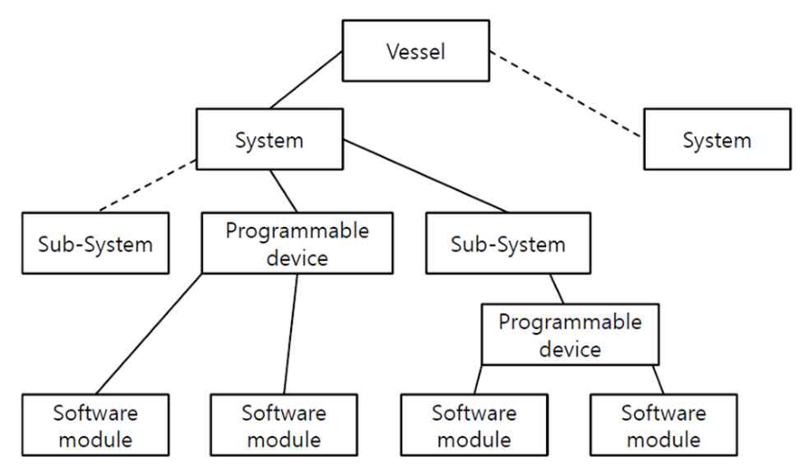

Note : dashed lines show non-developed branches of diagram

**Fig 6.2.1 llustrative System Hierarchy**

> Description: Tree diagram of the system hierarchy: a Vessel contains Systems; a System branches into Sub-Systems and a Programmable device, each Programmable device (directly under the System or under a Sub-System) contains Software modules. Dashed lines (Vessel to a second System, System to a Sub-System) show non-developed branches.

#### 402. Approval of systems and components

1. **System certification**

(1) Computer based systems that are necessary to accomplish vessel-functions of category II or category III (as defined in **403. 1** below) shall be delivered with a vessel-specific Society certificate. The objective of the vessel-specific system certification is to confirm that design and manufacturing of the system has been completed and that the system complies with applicable rules of the Society.

(2) Vessel-specific system certification consist of two main verification activities:

(A) Assessment of vessel-specific documentation (see **404. 2** and **406.**)

(B) Survey and testing of the system to be delivered to the vessel (see **404. 2** (7))

(3) The Society may accept Alternative Certification Scheme (ACS) provided that the requirements are met, and that the system is provided with a vessel-specific certificate.

2. **Type approval of computer based systems**

(1) Computer based systems that are routinely manufactured and include standardized software functions may be type approved in accordance with specified rules of the Society. Hardware shall be documented according to the requirement in **404. 2** (4).

(2) The type approval consist of two main verification activities:

(A) Assessment of type-specific documentation

(B) Survey and testing of the standardized functions

(3) Type approval will normally not yield exemption from vessel-specific system certification since vessel-specific functions, parameter configurations and installation elements demand vessel-specific verification.

#### 403. System categories

1. **System category definitions**

(1) The categorization of a system in this section is based on the potential severity of the consequences if the system serving the function fails. **Table 6.2.2** provides the definitions of the categories.

**Table 6.2.2 System categories**

<table>
<tr><th>Category</th><th>Effects</th><th>Typical System functionality</th></tr>
<tr><td align="center">I</td><td>Those systems, failure of which will not lead to dangerous situations for human safety, safety of the vessel and/or threat to the environment.</td><td>- Monitoring, informational and administrative functions</td></tr>
<tr><td align="center">II</td><td>Those systems, failure of which could eventually lead to dangerous situations for human safety, safety of the vessel and/or threat to the environment.</td><td>- Vessel alarm, monitoring and control functions which are necessary to maintain the vessel in its normal operational and habitable conditions</td></tr>
<tr><td align="center">III</td><td>Those systems, failure of which could immediately lead to dangerous or catastrophic for human safety, safety of the vessel and/or threat to the environment.</td><td>- Control functions for maintaining the vessel's propulsion and steering - Vessel safety functions</td></tr>
</table>

2. **Class Societies' scope**

(1) Category I systems are normally not subject to verification by the Society, as failure of these systems shall not lead to dangerous situations. However, information pertinent to category I systems shall be required upon request to determine the correct category or ensure that they do not influence the operation of systems in category II and category III.

3. **System category examples**

(1) The category of a system shall always be evaluated in the context of the specific vessel in question; thus, the categorization of a system may vary from one vessel to the next. This means that the examples of categories below are given as guidance only. For determining the categorization of systems for a specific vessel, see **404. 3** (3).

(2) Examples of category I systems: Fuel monitoring system, maintenance support system, diagnostics and troubleshooting system, closed circuit television, cabin security, entertainment system, fish detection system.

(3) Examples of category II systems: Fuel oil treatment system, alarm monitoring and safety systems for propulsion and auxiliary machinery, Inert gas system, control, monitoring and safety system for cargo containment system.

(4) Examples of category III systems: Propulsion control system, steering gear control system, electric power system (including power management system), dynamic positioning system (IMO classes 2 and 3).

(5) The list of example systems is not exhaustive.

#### 404. Requirements on development and certification of computer based systems

1. **General requirements**

(1) Life cycle approach with appropriate standards

(A) Requirement:

A global top-down approach shall be undertaken in the design and development of both hardware and software and the integration in sub-systems, systems, and system of systems, spanning the complete system lifecycle. This approach shall be based on the standards as listed herein or other standards recognized by the Society.

(B) Class Society's verification:

It is verified by the Society as a part of the quality management system verification described in (2).

(2) Quality management system

(A) Systems integrators and system suppliers shall, in the development of computer based systems for category II and category III, comply to a recognised quality standard such as ISO <!-- p.105 --> 9001; also incorporating principles of IEC/ISO 90003.

(B) The quality management system shall as a minimum include the **Table 6.2.3**, applicable for both category II and category III systems:

**Table 6.2.3 Quality management system**

<table>
<tr><th colspan="2">Area</th><th colspan="2">Role</th></tr>
<tr><th>#</th><th>Topic</th><th>System supplier</th><th>Systems integrator</th></tr>
<tr><td align="center">1</td><td>Responsibilities and competency of the staff</td><td align="center">O</td><td align="center">O</td></tr>
<tr><td align="center">2</td><td>The complete lifecycle of delivered software and of associated hardware</td><td align="center">O</td><td align="center">O</td></tr>
<tr><td align="center">3</td><td>Specific procedure for unique identification of a computer based system, it's components and versions</td><td align="center">O</td><td></td></tr>
<tr><td align="center">4</td><td>Creation and update of the vessel's system architecture</td><td></td><td align="center">O</td></tr>
<tr><td align="center">5</td><td>Organization set in place for acquisition of software and related hardware from suppliers</td><td align="center">O</td><td align="center">O</td></tr>
<tr><td align="center">6</td><td>Organization set in place for software code writing and verification</td><td align="center">O</td><td></td></tr>
<tr><td align="center">7</td><td>Organization set in place for system validation before integration in the vessel</td><td align="center">O</td><td></td></tr>
<tr><td align="center">8</td><td>Specific procedure for conducting and approving of systems at FAT and SAT</td><td align="center">O</td><td align="center">O</td></tr>
<tr><td align="center">9</td><td>Creation and update of system documentation</td><td align="center">O</td><td></td></tr>
<tr><td align="center">10</td><td>Specific procedure for software modification and installation on board the vessel, including interactions with shipyard and owner</td><td align="center">O</td><td align="center">O</td></tr>
<tr><td align="center">11</td><td>Specific procedures for verification of software code</td><td align="center">O</td><td></td></tr>
<tr><td align="center">12</td><td>Procedures for integrating systems with other systems and testing of the system of systems for the vessel</td><td align="center">O</td><td align="center">O</td></tr>
<tr><td align="center">13</td><td>Procedures for managing changes to software and configurations before FAT</td><td align="center">O</td><td></td></tr>
<tr><td align="center">14</td><td>Procedures for managing and documenting changes to software and configurations after FAT</td><td align="center">O</td><td align="center">O</td></tr>
<tr><td align="center">15</td><td>Checkpoints for the organization's own follow-up of adherence to the quality management system</td><td align="center">O</td><td align="center">O</td></tr>
</table>

(C) Class Society's verification:

The quality management system may be verified by two alternative means:

(a) The Society confirming that the quality management system is certified as compliant to a recognized standard by an organisation with accreditation under a national accreditation scheme.

(b) The Society confirming compliance to a standard through a specific assessment of the quality management system. The documentation requirements will be defined per case.

2. **Requirements on the system supplier**

(1) Define and follow a quality plan

(A) Requirement:

(a) The system supplier shall document that the quality management system is applied for the design, construction, delivery, and maintenance of the specific system to be delivered.

(b) All applicable items described in **1** (2) (for the system supplier role) shall be <!-- p.106 --> demonstrated to exist and being followed, as relevant.

(B) Class Society's verification:

(a) Category I: No documentation required

(b) Category II and III: The quality plan shall be available during survey (FAT) or submitted for information upon request (FI).

(2) Unique identification of systems and software

(A) Requirement:

(a) A method for unique identification of a system, its different software components and different revisions of the same software component shall be applied. The method shall be applied throughout the lifecycle of the system and the software.

(b) See also **407. 1** for related technical requirements on the system in question. The documentation of the method is typically a part of the quality management system, see **1** (2).

(B) Class Society's verification:

(a) Category I: Not required

(b) Category II and III: Application of the identification system is verified as a part of the FAT (**2** (7)) and SAT (**3** (6)).

(3) System description

(A) Requirement:

(a) The system's specification and design shall be determined and documented in a system description. In addition to serve as a specification for the detailed design and implementation, the purpose of the system description is to document that the entire system-delivery is according to the specifications and in compliance with applicable rules and regulations.

(b) The system description shall contain information of the following:

(i) Purpose and main functions, including any safety aspects

(ii) System category as defined

(iii) Key performance characteristics

(iv) Compliance with the technical requirements and the Society rules

(v) User interfaces/mimics

(vi) Communication and Interface aspects

- Identification and description of interfaces to other vessel systems

(vii) Hardware-arrangement related aspects:

- Network-architecture/topology, including all network components like switches, routers, gateways, firewalls etc.
- Internal structure with regards to all interfaces and hardware nodes in the system (e.g. operator stations, displays, computers, programmable devices, sensors, actuators, I/O modules etc)
- I/O allocation (mapping of field devices to channel, communication link, hardware unit, logic function)
- Power supply arrangement
- Failure mode description

(c) The information listed above is in this section collectively referred to as the system description. It may however be divided into a number of different documents and models.

(B) Class Society's verification:

(a) Category I: The system description documentation shall upon request be submitted for information (FI).

(b) Category II and III: The system description documentation shall be submitted for approval (AP).

(4) Environmental compliance of hardware components

(A) Requirement:

(a) Evidence of environmental type testing according to **Ch 3**, **Sec 23** of the **Guidance for Approval of Manufacturing Process and Type Approval, Etc.** regarding hardware elements included in the system and sub-systems shall be submitted to the Society.

(B) Class Society's verification:

(a) Category I: This requirement is not mandatory for category I systems. Reference to Type approval certificate or other evidence of type testing shall upon request be submitted for information (FI), see **403. 2**.

(b) Category II and III: Reference to Type approval certificate or other evidence of type testing shall be submitted for information (FI).

(5) Software code creation, parameterization, and testing

(A) Requirement:

(a) The software created, changed, or configured for the delivery project shall be developed and have the quality assurance activities assessed according to the selected standard(s) as described in the quality plan.

(b) The quality assurance activities may be performed on several levels of the software-structure and shall include both custom-made software and configured components (e.g. software libraries) as appropriate.

(c) The verification of the software shall as a minimum verify the following aspects based on black-box methods:

(i) Correctness, completeness and consistency of any parameterization and configuration of software components

(ii) Intended functionality

(iii) Intended robustness

(d) For components in systems of Category II and III, the scope, purpose, and results of all performed reviews, analyses, tests, and other verification activities shall be documented in test reports.

(e) Some of the methods utilized in this activity are sometimes referred to as "software unit test" or "developer test" and may also include verification methods like code-reviews and static- or dynamic code analysis.

(B) Class Society's verification:

(a) Category I: No documentation required

(b) Category II and III: Software test reports shall upon request be submitted for information (FI).

(6) Internal system testing before FAT

(A) Requirement:

(a) The system shall as far as practicable be tested before the FAT. The main purpose of the system test is for the system supplier to verify that the entire system delivery is according to the specifications, approved documentation and in compliance with applicable rules and regulations; and further, that the system is completed and ready for the FAT.

(b) The testing shall at least verify the following aspects of the system:

(i) Functionality

(ii) Effect of faults and failures (including diagnostic functions, detection, alerts response)

(iii) Performance

(iv) Integration between software and hardware components

(v) Human-machine interfaces

(vi) Interfaces to other systems

(c) Faults are to be simulated as realistically as possible to demonstrate appropriate system fault detection and system response.

(d) Some of the testing may be performed by utilizing simulators and replica hardware.

(e) The test-environment shall be documented, including a description of any simulators, emulators, test-stubs, test-management tools, or other tools affecting the test environment and its limitations.

(f) Test cases and test results shall be documented in test programs and test reports respectively.

(B) Class Society's verification:

(a) Category I: No documentation required

(b) Category II and III: Internal system test report shall be made available during FAT or submitted upon request (FI).

(7) Factory acceptance testing (FAT) before installation on board

(A) Requirement:

(a) A factory acceptance test (FAT) shall be arranged for the system in question. The main purpose of the FAT is to demonstrate to the Society that the system is completed and compliant with applicable classification rules, thus enabling issuance of a Society Certificate for the system.

(b) The FAT test program shall cover a representative selection of the test items from the internal system test (described in (6)), including normal system functionality and response <!-- p.108 --> to failures.

(c) For category II and III systems, network testing to verify the network resilience requirements in **407. 2** (1) shall be performed. If agreed by all parties, the network testing may be performed as a part of the system test onboard the vessel.

(d) The FAT shall as a rule be performed with the project specific software operating on the actual hardware components to be installed on board, with necessary means for simulation of functions and failure responses, however other solutions such as replica hardware or simulated hardware (emulators) may be agreed with the Society.

(e) For each test-case it shall be noted if the test passed or failed, and the test-results shall be documented in a test report. The test report shall also contain a list of the software (including software versions) that were installed in the system when the test was executed.

(f) For complex systems there may be a large difference in scope between the "Internal system testing before FAT" activity and the FAT, while for some systems the scope may be identical.

(B) Class Society's verification:

(a) Category I: FAT not required

(b) Category II and III: The FAT program shall be approved (AP) before the test is executed.

(i) The FAT execution shall be witnessed by the Society.

(ii) The FAT report shall be submitted for information (FI).

(iii) Additional FAT documentation including e.g., user manuals and internal system test report shall be made available during FAT or submitted upon request for information (FI).

(8) Secure and controlled software installation on the vessel

(A) Requirement:

(a) The initial installation and subsequent updates of the software components of the system shall be done according to a management of change procedure which has been agreed between the system supplier and the systems integrator.

(b) The management of change procedure shall comply with the requirements in **406.**

(c) Cyber security measures shall be observed as described in **Guidance for Cyber Resilience of Ships and Systems**.

(B) Class Society's verification:

(a) Category I: Not required

(b) Category II and III: The management of change procedure shall upon request be submitted for information (FI).

3. **Requirements on the systems integrator**

(1) Responsibilities

For the purposes of this section, the Shipyard is considered as the systems integrator in the development and delivery phase unless another organization or person is explicitly appointed by the Shipyard.

(2) Define and follow a quality plan

(A) Requirement:

(a) The systems integrator shall document that the quality management system is applied for the installation, integration, completion, and maintenance of the systems to be installed on board. All applicable items described in **1** (2) (for the systems integrator role) shall be demonstrated to exist and being followed, as relevant.

(B) Class Society's verification:

(a) Category I: No documentation required

(b) Category II and III: The quality plan shall be made available during survey (at SAT/SOST) or upon request submitted for information (FI).

(3) Determining the category of the system in question

(A) Requirement:

(a) For each system delivery to a particular vessel, it shall be decided which category the system falls under based on the failure effects of the system (as defined in **403.**). The category for a specific system must be conveyed to the relevant system supplier. The Society may decide that a risk-assessment is needed to verify the proper system category.

(B) Class Society's verification:

(a) Category I, II and III: The category for the different systems shall upon request be documented and submitted for approval (AP).

(4) Risk assessment of the system

(A) Requirement:

(a) If requested by the Society, a risk assessment of a specific system in context of the specific vessel in question shall be performed and documented in order to determine the applicable category for the system.

(b) IEC/ISO 31010 "Risk management - Risk assessment techniques" may be used as guidance in order to determine method of risk assessment.

(B) Class Society's verification:

(a) Category I, II and III: The risk assessment report shall upon request be submitted for approval (AP).

(5) Define the vessel's system-architecture

(A) Requirement:

(a) The system of systems (SoS) shall be specified and documented. This architecture specification provides the basis for category determination and development of the different integrated systems by allocating functionality to individual systems and by identifying the main interfaces between the systems. It shall also serve as a basis for the testing of the integrated systems on the vessel level (see **3** (7)).

(b) The vessel's system architecture shall at least contain description of:

(i) Overview of the total systems architecture (the system of systems)

(ii) Each system's purpose and main functionality

(iii) Communication and interface aspects between different systems

(c) See also **Ch.1** of **Guidance for Cyber Resilience of Ships and Systems** for diagram of security zones and conduits

(B) Class Society's verification:

(a) Category I, II and III: The vessel's system architecture shall upon request be submitted for information (FI).

(6) System acceptance test (SAT) onboard the vessel

(A) Requirement:

(a) A system acceptance test shall be arranged onboard the vessel. The main purpose of the system acceptance test (SAT) is to verify the system functionality, after installation and integration with the applicable machinery/electrical/process systems on board including possible interfaces with other control and monitoring systems.

(b) For each test-case it shall be noted if the test passed or failed, and the test-results shall be documented in a test report. The test report shall also contain a list of the software (including software versions) that were installed in the system when the test was executed.

(B) Class Society's verification:

(a) Category I: Not required

(b) Category II and III: The SAT program shall be submitted for approval (AP) before the test is executed.

(i) The SAT execution shall be witnessed by the Society.

(ii) The SAT report shall be submitted for information (FI).

(7) Testing of integrated systems on vessel-level (SOST)

(A) Requirement:

(a) Integration tests shall be conducted after installation and integration of the different systems in its final environment on board. The purpose of the tests is to verify the functionality of the complete installation (system of systems) including all interfaces and inter-dependencies in compliance with requirements and specifications.

(b) The testing shall at least verify the following aspects of the system of systems:

(i) The overall functionality of the interacting systems as a whole

(ii) Failure response between systems

(iii) Performance

(iv) Human-machine interfaces

(v) Interfaces between the different systems

(c) For complex systems there may be a large difference in scope between the "System acceptance test (SAT) onboard the vessel" activity and the SOST, while for some systems the scope may be overlapping or identical. It is possible to combine the two activities into one when the test scope is similar.

(B) Class Society's verification:

(a) Category I: Not required

(b) Category II and III: The SOST program shall submitted for approval (AP) before the test is executed.

(i) The SOST execution shall be witnessed by the Society.

(ii) The SOST report shall be submitted for information (FI).

(8) Change management

(A) Requirement:

(a) The systems integrator shall follow procedures for management of change to the system as described in **406.**

(B) Class Society's verification:

(a) Category I: No documentation requirements

(b) Category II and III: The management of change procedure shall upon request be submitted for information (FI).

#### 405. Requirements on maintenance of computer based systems

1. **Requirements on the Vessel Owner**

(1) Responsibilities

(A) For the purposes of this section, the vessel owner is considered to be the systems integrator in the operations phase unless another organization or person is explicitly appointed by the owner.

(B) Accordingly, the Society shall in a timely manner be informed by the owner about the appointed systems integrator which is responsible for implementing any changes to the systems in conjunction with system supplier(s).

2. **Requirements on the Systems integrator**

(1) Change management

(A) Requirement:

(a) The systems integrator shall ensure that necessary procedures for software and hardware change management exist on board, and that any software modification/upgrade are performed according to the procedure(s). For details about change management please see **406.**

(b) Changes to computer based systems in the operational phase shall be recorded.

(c) The records shall contain information about the relevant software versions and other relevant information as described in **406. 11**.

(B) Class Society's verification:

(a) Category I: No documentation requirements

(b) Category II and III: See **406. 12**.

3. **Requirements on the System Supplier**

(1) Change management

(A) Requirement:

(a) The system supplier shall follow procedures for maintenance of the system including procedures for management of change as described in **406.**

(B) Class Society's verification:

(a) Category I: No documentation requirements

(b) Category II and III: See **406. 12**.

(2) Testing of changes before installation onboard

(A) Requirement:

(a) The system supplier shall make sure that the planned changes to a system have passed relevant in-house tests before the change is made to systems on board.

(B) Class Society's verification:

(a) Category I: No documentation requirements

(b) Category II and III: See **406. 12**.

#### 406. Management of change

1. **General**

(1) **406.** provides requirements for the management of change throughout the lifecycle of a <!-- p.111 --> computer based system.

(2) Different procedures for the management of change may be defined for specific phases in a system's lifecycle as the different phases typically involve different stakeholders.

(3) The Society's verification is described in **12**.

2. **Documented change management procedures**

(1) Requirement:

(A) The organization in question shall have defined and documented change management procedures applicable for the computer based system in question covering both hardware and software.

(B) After FAT, the system supplier shall manage all changes to the system in accordance with the procedure. Examples could be qualification of new versions of acquired software, new hardware, modified control logic, changes to configurable parameters.

(C) The procedure(s) shall at least describe the activities listed in **3** through **11**.

(D) The outcome of the impact analysis in **406. 8** will determine to what extent the activities in **3** to **12** shall be performed.

(E) Change records (described in **11**) shall always be produced.

3. **Agreement between relevant stakeholders**

(1) Requirement:

(A) The management of change process shall be coordinated and agreed between the relevant stakeholders along the different stages of the lifecycle of the computer based system.

(B) Typically, the management of change address at least three different stages:

(a) Development and internal verification before FAT; involving the system supplier and sub-suppliers

(b) From FAT to handover of the vessel to the owner; involving the system supplier, the systems integrator, the Society, and the owner

(c) In operation; involving the system supplier, service suppliers, the owner, and the Society

4. **Approved software shall be under change management**

(1) Requirement: If changes are required to a system after it has been approved by applicable stakeholders (typically the systems integrator and the Society at FAT) the modifications shall follow defined change management procedures.

5. **Unique identification of system and software versions**

(1) Requirement: The system supplier shall make sure that each system and software version is uniquely identifiable, see **404. 2** (2).

6. **Handling of software master files**

(1) Requirement: There shall be defined mechanisms for handling of the files that constitutes the master-files for a software component. Personnel authorities shall be clearly defined along with the tools and mechanisms used to ensure the integrity of the master files.

7. **Backup and restoration of onboard software**

(1) Requirement: It shall be clearly defined how to perform backup and restoration of the software components of a computer based system onboard the vessel.

8. **Impact analysis before change is made**

(1) Requirement: Before a change to the system is made, an impact analysis shall be performed in order to:

(A) Determine the criticality of the change.

(B) Determine the impact on existing documentation.

(C) Determine the needed verification and test activities.

(D) Determine the need to inform other stakeholders about the change.

(E) Determine the need to obtain approval from other stakeholders (e.g. the Society and/or Owner) before the change is made.

9. **Roll-back in case of failed software changes**

(1) Requirement:

(A) When maintenance includes installation of new versions of the software in the system, it shall be possible to perform a rollback of the software to the previous installed version with <!-- p.112 --> the purpose of returning the system to a known, stable state.

(B) Roll-backs shall be documented and analysed to find and eliminate the root cause.

10. **Verification and validation of system changes**

(1) Requirement:

(A) To the largest degree practically possible, modifications shall be verified before being installed onboard.

(B) After installation, the modification(s) shall be verified onboard according to a documented verification program containing:

(a) Verification that the new functionalities and/or improvements have had the intended effect.

(b) Regression test to verify that the modification has not had any negative effects on functionality or capabilities that was not expected to be affected.

11. **Change records**

(1) Changes to systems and software shall be documented in change records to allow for visibility and traceability of the changes. The change records shall contain at least the following items:

(A) The purpose for a change

(B) A description of the changes and modifications

(C) The main conclusions from the impact analysis (see **8**)

(D) The identity and version of any new system or software version(s) (see **5**)

(E) Test reports or tests summaries (see **10**)

(2) Documentation of the changes to software may be recorded in the planned maintenance system (PMS), in a software registry or equivalent.

12. **Verification of change management by the Society**

(1) In operation phase (existing ship)

(A) The verification by the Society regarding the management of change in operation is generally performed during the annual survey of the vessel. Procedures for management of change and relevant change records (see **11**) shall be made available at the time of survey.

(B) In the cases where the change requires approval from the Society up front, the relevant procedures and documentation for the change in question may be verified at that time.

(2) During newbuilding (new building ship)

(A) The verification of management of change in the newbuilding phase is divided into two; Procedures are verified as a part of the verification of the quality management system (**404. 1** (2)), while project specific implementation of the procedures are verified during FAT (**404. 2** (7)) and after FAT (**406. 12** (1)).

#### 407. Technical requirements on computer based systems

The paragraphs below contain technical requirements on computer based systems. The compliance to these requirements shall be documented in the design documentation (see **404. 2** (3)) and verified through the verification activities described in this section.

1. **Reporting of system and software identification and version**

(1) System identification

(A) The system shall provide means to identify its name, version, identifier, and manufacturer. It is recommended that the system can automatically report the status of its software to a ship software logging system (SSLS) as specified in the international standard ISO 24060.

2. **Data links**

(1) General requirements for category II and III systems

Loss of a data link shall be specifically addressed in risk assessment analysis/FMEA. See **404. 2** (3).

(A) A single failure in data link shall not cause loss of vessel- functions of category III. Any effect of such failures shall meet the principle of fail-to-safe for the vessel-function(s) being served.

(B) For vessel-functions of category II and III, any loss of functionality in the remote control system shall be compensated for by local/manual means.

(C) The data link shall have means to prevent or cope with excessive communication rates.

(D) Data links shall be self-checking, detecting failures or performance issues on the link itself and data communication failures on nodes connected to the link.

(E) Detected failures shall initiate an alarm.

(2) Specific requirements for wireless data links

(A) Category III systems shall not use wireless data links unless specifically considered by the Society on the basis of an engineering analysis carried out in accordance with an international or national standard acceptable to the Society.

(B) Category I and II systems may use wireless data links with the following requirements.

(a) Recognised international wireless communication system protocols shall be employed, incorporating:

(i) Message integrity. Fault prevention, detection, diagnosis, and correction so that the received message is not corrupted or altered when compared to the transmitted message.

(ii) Configuration and device authentication. Shall only permit connection of devices that are included in the system design.

(iii) Message encryption. Protection of the confidentiality and or criticality of the data content.

(iv) Security management. Protection of network assets, prevention of unauthorized access to network assets.

(b) The internal wireless system within the vessel shall comply with the radio frequency and power level requirements of International Telecommunication Union and flag state requirements.

(c) Consideration should be given to system operation in the event of port state and local regulations that pertain to the use of radio-frequency transmission prohibiting the operation of a wireless data communication link due to frequency and power level restrictions.

(d) For wireless data communication equipment, tests during harbour and sea trials are to be conducted to demonstrate that radio-frequency transmission does not cause failure of any equipment and does not self-fail as a result of electromagnetic interference during expected operating conditions.

3. **Verification of technical requirements by the Society**

(1) The implementation of the technical requirements provided in this article is verified by the Society as part of the system description (**404. 2** (3)), FAT (**404. 2** (7)) and SAT (**404. 3** (6)) described above.

#### 408. Summary of documentation submittal

**Table 6.2.4** and **Table 6.2.5** below summarise the documentation to be submitted to the Society.

**Table 6.2.4 Summary of documentation submittal by the system supplier**

<table>
<tr><th colspan="2">Item</th><th colspan="3">System category</th></tr>
<tr><th>Paragraph reference</th><th>Document</th><th>Cat I</th><th>Cat II</th><th>Cat III</th></tr>
<tr><td><b>404. 2</b> (1)</td><td align="center">Quality plan</td><td align="center">-</td><td align="center">FI on req.</td><td align="center">FI on req.</td></tr>
<tr><td><b>404. 2</b> (3)</td><td align="center">System description</td><td align="center">FI on req.</td><td align="center">AP</td><td align="center">AP</td></tr>
<tr><td><b>404. 2</b> (4)</td><td align="center">Environmental compliance</td><td align="center">FI on req.</td><td align="center">FI</td><td align="center">FI</td></tr>
<tr><td><b>404. 2</b> (5)</td><td align="center">Software test reports</td><td align="center">-</td><td align="center">FI on req.</td><td align="center">FI on req.</td></tr>
<tr><td><b>404. 2</b> (6)</td><td align="center">System test report</td><td align="center">-</td><td align="center">FI on req.</td><td align="center">FI on req.</td></tr>
<tr><td><b>404. 2</b> (7)</td><td align="center">FAT program</td><td align="center">-</td><td align="center">AP</td><td align="center">AP</td></tr>
<tr><td><b>404. 2</b> (7)</td><td align="center">FAT report</td><td align="center">-</td><td align="center">FI</td><td align="center">FI</td></tr>
<tr><td><b>404. 2</b> (7)</td><td align="center">Additional FAT docs. (e.g. user manual, etc)</td><td align="center">-</td><td align="center">FI on req.</td><td align="center">FI on req.</td></tr>
<tr><td><b>404. 2</b> (8)</td><td align="center">Management of change procedure</td><td align="center">-</td><td align="center">FI on req.</td><td align="center">FI on req.</td></tr>
<tr><td colspan="5">(Legend) AP = Approval, FI = For Information, "-" = No requirement, on req. = Upon request from the Society</td></tr>
</table>

**Table 6.2.5 Summary of documentation submittal by the system integrator**

<table>
<tr><th colspan="2">Item</th><th colspan="3">System category</th></tr>
<tr><th>Paragraph reference</th><th>Document</th><th>Cat I</th><th>Cat II</th><th>Cat III</th></tr>
<tr><td><b>404. 3</b> (2)</td><td align="center">Quality plan</td><td align="center">-</td><td align="center">FI on req.</td><td align="center">FI on req.</td></tr>
<tr><td><b>404. 3</b> (3)</td><td align="center">List of system categorizations</td><td align="center">AP on req.</td><td align="center">AP on req.</td><td align="center">AP on req.</td></tr>
<tr><td><b>404. 3</b> (4)</td><td align="center">Risk assessment report</td><td align="center">AP on req.</td><td align="center">AP on req.</td><td align="center">AP on req.</td></tr>
<tr><td><b>404. 3</b> (5)</td><td align="center">Vessel's system architecture</td><td align="center">FI on req.</td><td align="center">FI on req.</td><td align="center">FI on req.</td></tr>
<tr><td><b>404. 3</b> (6)</td><td align="center">SAT program</td><td align="center">-</td><td align="center">AP</td><td align="center">AP</td></tr>
<tr><td><b>404. 3</b> (6)</td><td align="center">SAT report</td><td align="center">-</td><td align="center">FI</td><td align="center">FI</td></tr>
<tr><td><b>404. 3</b> (7)</td><td align="center">SOST program</td><td align="center">-</td><td align="center">AP</td><td align="center">AP</td></tr>
<tr><td><b>404. 3</b> (7)</td><td align="center">SOST report</td><td align="center">-</td><td align="center">FI</td><td align="center">FI</td></tr>
<tr><td><b>404. 3</b> (8)</td><td align="center">Change management procedure for software</td><td align="center">-</td><td align="center">FI on req.</td><td align="center">FI on req.</td></tr>
<tr><td colspan="5">(Legend) AP = Approval, FI = For Information, "-" = No requirement, on req. = Upon request from the Society</td></tr>
</table>

#### 409. Summary of test witnessing and survey

**Table 6.2.6** below summarises the activities that shall be witnessed or surveyed by the Society. The responsible role shall facilitate the activity of the Surveyor.

**Table 6.2.6 Summary of test witnessing and survey**

<table>
<tr><th colspan="2">Item</th><th rowspan="2">Responsible role</th><th colspan="3">System category</th></tr>
<tr><th>Paragraph reference</th><th>Activity</th><th>Cat I</th><th>Cat II</th><th>Cat III</th></tr>
<tr><td><b>404. 2</b> (7)</td><td align="center">FAT witnessing</td><td align="center">System supplier</td><td align="center">-</td><td align="center">X</td><td align="center">X</td></tr>
<tr><td><b>404. 3</b> (6)</td><td align="center">SAT witnessing</td><td align="center">System integrator</td><td align="center">-</td><td align="center">X</td><td align="center">X</td></tr>
<tr><td><b>404. 3</b> (7)</td><td align="center">SOST witnessing</td><td align="center">System integrator</td><td align="center">-</td><td align="center">X</td><td align="center">X</td></tr>
<tr><td align="center"><b>406. 12</b></td><td align="center">Verification of changes</td><td align="center">System integrator</td><td align="center">-</td><td align="center">X</td><td align="center">X</td></tr>
<tr><td colspan="6">(Legend) "x" = Witnessing required, "-" = Witnessing not required</td></tr>
</table>

2026

Guidance Relating to the Rules for the Classification of Steel Ships

# Part 6 Electrical Equipment and Control Systems

GA-06-E

**APPLICATION OF THE GUIDANCE RELATING TO THE RULES**

This "Guidance relating to the Rules for Classification of Steel Ships" (hereafter called as the Guidance Relating to the Rules) is prepared with the intent of giving details as to the treatment of the various provisions for items required the unified interpretations and items not specified in the Rules, and the requirements specified in the Guidance Relating to the Rules are to be applied, in principle, in addition to the various provisions in the Rules.

As to any technical modifications which can be regarded as equivalent to any requirements in the Guidance Relating to the Rules, their flexible application will be properly considered.

## APPLICATION OF PART 6 "ELECTRICAL EQUIPMENT AND CONTROL SYSTEMS"

1. Unless expressly specified otherwise, the requirements in the Guidance apply to ships for which contracts for construction are signed on or after 1 July 2026.
2. The amendments to the Guidance for 2025 edition and their effective date are as follows;

Effective Date : 1 January 2026 (based on the contract date for ship construction, Related Circular No.: 2025-13-E)

**CHAPTER 1 ELECTRICAL EQUIPMENT**

**Section 5 Cables**

\- 504. 1. (3) has been amended.

\- 1603. 1. has been newly added.

Effective Date : 1 July 2026

**CHAPTER 1 ELECTRICAL EQUIPMENT**

**Section 2 System Design**

\- 202. 2. (3) has been amended.

\- Table 6.1.7 has been amended.

\- 203. 2. (2) has been amended.

**Section 13 Accumulator Batteries**

\- 1306. has been amended.

## CONTENTS

- **CHAPTER 1 ELECTRICAL EQUIPMENT**
  - Section 1 General
  - Section 2 System design
  - Section 3 Rotating Machinery
  - Section 4 Switchboards, Section Boards and Distribution Boards
  - Section 5 Cables
  - Section 6 Transformers for Power and Lighting
  - Section 7 Control-gears for Motors and Magnetic Brakes
  - Section 8 Fuses, Circuit-breakers and Electromagnetic Contactors
  - Section 9 Explosion-protected Electrical Equipment
  - Section 10 Lighting Fittings, Heating Appliances, Wiring Accessories and Miscellaneous Equipment
  - Section 11 Internal Communications
  - Section 12 Semi-Conductor Converters
  - Section 13 Accumulator Batteries
  - Section 15 High Voltage Electrical Installations
  - Section 16 Electric Propulsion Unit
  - Section 18 Spare Parts, Tools and Instruments
- **CHAPTER 2 CONTROL SYSTEMS**
  - Section 1 General
  - Section 2 System and Control
  - Section 3 Tests

## CHAPTER 1 ELECTRICAL EQUIPMENT

### Section 1 General

#### 101. General

1. **Application** **【See Rule】**

(1) The requirements in **Pt 6, Ch 1** of the Rules do not apply to the following electrical equipment except the case where the explosion-protected construction is necessary:

(A) Radiotelegraph or radiotelephone equipment installed in accordance with the international laws or law of the flag state.

(B) Navigation aids installed in accordance with the international laws or law of the flag state (those prescribed in regulation V/19 of Amendment 2009 to SOLAS Convention 1974)

(2) Electrical equipment for working and cargo handling, and home electrical appliances to be brought to ships such as television sets, radio sets, etc., are not applied to the requirements specified in **Pt 6, Ch 1** of the Rules excluding protection against electrical shock, firing and other casualties(including explosion). Electrical appliances not applied to the requirements of the Rules, as far as possible, are to comply with Korean Industrial Standards.

(3) Cables and protection devices (circuit breakers and fuses) connected to the electrical equipment or appliances stipulated in the requirements of (1) and (2) above, are to comply with the relevant requirements in **Pt 6, Ch 1** of the Rules.

(4) In application to **101. 1** (1) of the Rules, ships with special limitations for their service or small ships (less than 500 tons) mean the ships specified in the following:

(A) Ships having service restriction notations of machinery of KRM 0 as ships with gross tonnage less than 500 tons. *(2017)*

(B) Ships not having service restriction notations of equipment specified in (A) above as ships with gross tonnage less than 500 tons.

(C) Ships having service restriction notations of equipment specified in (A) above as ships with 500 tons gross tonnage or more, and ships complying with the requirements in **Pt 8 Annex 8-3, 1.** (1) and (2), **3.** (12) of the Guidance.

(D) Ships having class notations "$n \cdot f$" and service restriction notations of equipment specified in (A) above as ships with 500 tons gross tonnage or more and ships not complying with the requirements in **Pt 8 Annex 8-3, 1.** (1) and (2), **3.** (12) of the Guidance.

(5) Electrical equipment on board the ships specified in (4) above are to be in accordance with (1) through (3) above, and the following:

**Mitigated requirements for ships described in (A) to (D)** *(2020)*

<table>
<tr><th></th><th colspan="2">Relevant requirements1) (mitigated requirements)</th><th>(A)</th><th>(B)</th><th>(C)</th><th>(D)</th></tr>
<tr><td>(a)</td><td>Rule 201. 6</td><td>Ambient conditions</td><td>O</td><td></td><td>O</td><td></td></tr>
<tr><td rowspan="2">(b)</td><td>Rule 402. 1 (1)</td><td>Main switchboards' construction</td><td>O</td><td>O</td><td>O</td><td></td></tr>
<tr><td>Rule 402. 1 (2)</td><td>Generator switchboard's construction</td><td>O</td><td>O</td><td>O</td><td></td></tr>
<tr><td>(c)</td><td>Rule 404. 1</td><td><i>d.c.</i> ship's service generator panels</td><td>O</td><td></td><td>O</td><td></td></tr>
<tr><td>(d)</td><td>Rule 404. 2</td><td><i>a.c.</i> ship's service generator panels</td><td>O</td><td></td><td>O</td><td></td></tr>
<tr><td>(e)</td><td>Rule 701. 2</td><td>Grouped starters</td><td>O</td><td>O</td><td></td><td></td></tr>
<tr><td>(f)</td><td>Rule 504. 3 (2)</td><td>Precaution against fire protection of cables</td><td>O</td><td>O</td><td>O</td><td></td></tr>
<tr><td>(g)</td><td>Rule 1203.</td><td>Protective devices, etc.</td><td>O</td><td>O</td><td>O</td><td></td></tr>
<tr><td>(h)</td><td>Rule 202. and 1601. 3</td><td>Main source of electrical power</td><td>O</td><td>O2)</td><td>O</td><td></td></tr>
<tr><td>(i)</td><td>Rule 601.</td><td>Transformers</td><td>O</td><td></td><td>O</td><td></td></tr>
<tr><td>(j)</td><td>Rule 203.</td><td>Emergency source of electrical power</td><td>O</td><td>O</td><td>O</td><td></td></tr>
<tr><td>(k)</td><td>Rule 204. 6 (3)</td><td>Feeder circuits of navigation lights indicator</td><td>O</td><td>O</td><td>O3)</td><td></td></tr>
<tr><td>(l)</td><td>Rule 1801.</td><td>Spare parts</td><td>O</td><td></td><td>O</td><td>O</td></tr>
<tr><td>(m)</td><td>Rule 204. 1 (3)</td><td>Insulation monitoring system</td><td>O</td><td></td><td></td><td></td></tr>
<tr><td>(n)</td><td>Rule 205. [3 (2)]</td><td>Protective devices [circuit breakers and fuses]</td><td>O</td><td></td><td>O4)</td><td></td></tr>
<tr><td>(o)</td><td>Rule 202. 5</td><td>Where the main source of electrical power is necessary for propulsion and steering of the ship</td><td>O</td><td>O</td><td>O</td><td>O</td></tr>
<tr><td>(p)</td><td>Rule 1106.</td><td>Public address systems</td><td>O</td><td>O</td><td>O</td><td>O</td></tr>
<tr><td>(q)</td><td>Rule 401. 1 (2)</td><td>Installation of main switchboard</td><td>O</td><td></td><td>O</td><td>O</td></tr>
</table>

NOTES)

1\) : The detailed contents are to comply with the below (A)

2\) : The detailed contents are to comply with the below (B) (b)

3\) : The detailed contents are to comply with the below (C) (c)

4\) : The detailed contents are to comply with the below (C) (b)

(A) Ships specified in (4) (A) above

(a) In **201. 6** of the Rules, air temperature may apply 40℃ instead of 45℃, and sea water temperature may apply 27℃ instead of 32℃. However, ships engaged in tropical regions service are to be applied to the requirements in the Table. (refer to **Pt 5, Table 5.1.3** of the Rules)

(b) The requirements in **402. 1** (1) and (2) of the Rules do not apply.

(c) In **404. 1** of the Rules, where ships are provided with two or more *d.c.* generators engaged in single running only, ammeter and voltmeter are provided with each 1 set and are used in common for the generators. But, where the number of meters are made reduce, portable ammeter and voltmeter complied with the requirements in **1802.** of the Rules are to be equipped.

(d) In **404. 2** of the Rules, where the ships are provided with two or more *a.c.* generators engaged in single running only, ammeter, voltmeter and wattmeter are provided with each 1 set and are used in common for the generators. But, where the number of meters are made reduce, portable ammeter and voltmeter complied with the requirements in **1802.** of the Rules are to be equipped.

(e) The requirements in **701. 2** of the Rules do not apply.

(f) The requirements in **504. 3** (2) of the Rules do not apply.

(g) The requirements in **1203.** of the Rules do not apply.

(h) In application to **202.** and **1601. 3** of the Rules, a generator, transformer and converter may be provided with 1 set, except ships having class notation UMA and ships with coastal and the farther service. *(2024)*

(i) In **601.** of the Rules, where a accumulator battery with sufficient capacity necessary for electrical services of lightings, signal devices, radio equipment, etc. is provided, a reserved transformer may be omitted.

(j) The requirements in **203.** of the Rules do not apply. However emergency source of electrical power capable of supplying simultaneously the following services at least for 6 hours (for a period of 30 minutes with continuous operation for the below (iv) & (v) system), is to be provided. *(2024)*

(i) All communication equipment required in an emergency

(ii) Navigation lights and signal lights (not under command lights, anchor lights)

(iii) Emergency lights installed in the following station

① Embarkation station of life boats, life rafts, etc. and over the sides

② Accommodation alleyways, stairways and exits

③ Machinery spaces and spaces installed emergency source of electrical power

④ Control stations for main engine

(iv) Intermittent operation of the daylight signalling lamp, the ship's whistle, and all internal signals that are required in an emergency.

(v) The fire detection system and manually operated call point.

(k) In **204. 6** (3) of the Rules, navigation light indicators may be served by one circuit fed from the emergency source. The following may be considered the emergency source.

(i) Either of the two generators which come into immediately operation in the event of loss of the normal power

(ii) Charging devices for electric batteries

(l) In case of ships provided with efficient manual auxiliary steering gear, the requirements in **1801.** of the Rules do not apply.

(m) In **204. 1** (3) of the Rules, a earth indicator may be installed instead of the device capable of continuously monitoring the insulation level to earth. in case of lamp type earth indicator, the indicator is to be of 2 lamp type or 3 lamp type having metal filament of capacity of 30W or less, and distance between lamps less than 150 mm.

(n) The requirements in **205. 3** (2) of the Rules do not apply. But, for the passenger ships, tankers and ships carrying dangerous chemicals in bulk, the plug-in type is to be applied only for the main switchboard and group start panels.

(o) The requirements in **202. 1** (3) of the Rules do not apply, except ships having class notation UMA and passenger ships engaged on international voyages.

(p) The requirements in **1106.** of the Rules do not apply.

(q) The requirements in **401. 1** (2) of the Rules do not apply. *(2019)*

(B) Ships specified in (4) (B) above

(a) The requirements in (A) (b), (e), (f), (g), (j), (k), (o) and (p) above apply.

(b) In **202. 1** (2) of the Rules, the capacity of generator is to be possible to supply services necessary to provide normal operational conditions of propulsion and safety in spite of the event of any one generating set being stopped. And the requirements in **202. 1** (3) and (5) of the Rules do not apply. *(2025)*

(C) Ships specified in (4) (C) above

(a) The requirements in (A) (a), (b), (c), (d), (f), (g), (i), (j), (l), (o), (p) and (q) above apply. *(2020)*

(b) The requirements in **205.** of the Rules do not apply. Group stater panels separated No.1 group and No.2 group are to be provided. But, for the passenger ships, tankers and ships carrying dangerous chemicals in bulk, the plug-in type is to be applied only for the main switchboard and group start panels. *(2018)*

(c) In **204. 6** (3) of the Rules, The navigation light indicator may be fed from the main switchboard and emergency switchboard or a lighting distribution board installed in the wheel house.

(d) In application to **202.** and **1601. 3** of the Rules, a generator driven by independent auxiliary engine may be provided with 1 set, except ships having class notation UMA and ships with coastal and the farther service. *(2019)*

(D) Ships specified in (4) (D) above

(a) The requirements in (A) (l), (o), (p) and (q) above apply. *(2020)*

(6) Where a ship applied to the requirements of (4) and (5) above makes an alteration of service area, purpose, etc., electrical equipment are to be installed in accordance with the Rules.

(7) The requirements for the emergency power on board passenger ships employed to domestic voyage are to apply as follows;

(A) The passenger ships employed to domestic voyage shall be equipped with the independent emergency power which satisfies following requirement of (a). However, for the passenger ships, of which navigation area is below the level of smooth water area, provided with the batteries for main power, if these batteries satisfy the item (7) with the following requirements of (a), the independent emergency power requirement is exempted.

(a) The batteries (equipped with electric discharge indicator) shall be charged with needed power always and be able to be charged imminently without radical drop of voltage

(b) For the case of the generator driven by the independent oil suppliers and the effective motors with the starter recognized to be proper by the Society.(limited to the ones of which fuel oil's flash point of not less than 43 ℃). Emergency switchboard is to be installed as near as possible to emergency power.

(B) Emergency power according to the above (A) shall be charged imminently and automatically in the event of failure of the main source of electrical power due to malfunction, etc.

(C) Emergency source of electric power installed according to the above requirement (A) is to be supplied at least for 12 hours for the following services. However, in case of the ships expected voyage period with less than 6 hour, electric power may be supplied for 6 hours.

(a) Navigation lights

(b) Signal lights supplied from main source of electric power

(c) Emergency lights installed in the following stations.

(i) Corridors, stairways, ladders and exits

(ii) Main engine room, main generating room and engine control room

(iii) Navigation bridge, chart rooms and radio rooms

(iv) Places installed life boats, life rafts or life buoys and embarkation places.

(v) Other places where considered necessary by the Society

(d) Electric alarm system and indicators

(e) Fire detection system and manually operated call point.

(f) Other communication system, etc.

(D) Emergency source of electric power installed according to the above (A) is to be installed in accordance with the requirements of the followings.

(a) It is to be located above the uppermost continuous deck

(b) It is to be located outside the boundaries of engine spaces.

(c) It is to be located afterward of the collision bulkhead

(d) Supply of emergency electrical power is not to be interfered due to a fire or other casualty in spaces of engine rooms

(e) It is to be separated and ventilated from a fire or electrical sparks.

(8) In application to **402. 1** (2) of the Rules, The separation of the main switchboard busbars do not apply to fishing vessels.

(9) The requirements for the emergency power of fishing vessels are to apply as follows;

(A) A self-contained emergency source of electrical power located outside the machinery spaces is to be provided and so arranged as to ensure its functioning in the event of fire or other causes of failure of the main electrical installations.

(B) The independent emergency power which applies to any one of the following requirements is to be equipped in the fishing vessels;

(a) The accumulator battery which is always charged as required power and is to be sufficient to supply those services

(b) The emergency generator which is driven by a suitable prime mover with an independent supply of fuel, having a flashpoint of not less than 43°C

(i) Emergency generating sets are to be capable of being readily started in their cold condition at a temperature of 0℃. If this is impracticable, or if lower temperatures are likely to be encountered, provision acceptable to the Society is to be made for maintenance of heating arrangements, to ensure ready starting of the generating sets.

(ii) Each emergency generating set arranged to be automatically started is to be equipped with approved starting devices approved by the Society with a storage energy capability of at least three consecutive starts. In addition, a second source of energy is to be provided for an additional three starts within 30 minutes unless manual starting can be demonstrated to be effective.

(iii) Electrical and hydraulic starting systems are to be maintained from the emergency switchboard.

(c) Electrical and hydraulic starting systems are to be maintained from the emergency switchboard.

(d) Compressed air starting systems may be maintained by the main or auxiliary compressed air receivers through a suitable non-return valve or by an emergency air compressor which, if electrically driven, is supplied from the emergency switchboard.

(e) All of these starting, charging and energy storing devices are to be located in the emergency generator space. These devices are not to be used for any purpose other than the operation of the emergency generating set. This does not preclude the supply to the air receiver of the emergency generating set from the main or auxiliary compressed air system through the non-return valve fitted in the emergency generator space.

(C) The emergency source of electrical power installed according to above (A) is to be capable of supplying simultaneously at least the following services for the period of 3 hours (6 hours for the equipment of (a) to (c)) : *(2020)*

(a) Radiocommunication equipment

(b) All internal communication equipment and signals, the fire detection and fire alarm system as required in an emergency

(c) Navigation lights

(d) Signal lights supplied from main source of electric power

(e) Emergency lights installed in the following station

(i) Embarkation station of life boats, life rafts, etc. and over the sides

(ii) Accommodation alleyways, stairways and exits

(iii) Machinery spaces and spaces installed emergency source of electrical power

(iv) Control stations for main engine

(v) Fish handling and process stations

(vi) An each installation location of emergency fire pump, sprinkler pump and emergency bilge pump and at the starting position of their motors

(D) The emergency switchboard which supply emergency power to the fishing vessels is to comply with the following :

(a) The emergency switchboard is to be installed as near as is practicable to the emergency source of electrical power.

(b) Where the emergency source of electrical power is a generator, the emergency switchboard is to be located in the same space unless the operation of the emergency switchboard would thereby be impaired.

(c) Automatically connecting to the emergency switchboard in the event of failure of the main source of electrical power.

(d) Where the emergency source of electrical power is an accumulator battery, an indicator is to be mounted to indicate when the battery is being discharged.

(e) The emergency switchboard is to be supplied during normal operation from the main switchboard by an interconnector feeder which is to be adequately protected at the main switchboard against overload and short circuit and which is to be disconnected automatically at the emergency switchboard upon failure of the main source of electrical power. Where the system is arranged for feedback operation the interconnector feeder is also to be protected at the emergency switchboard at least against short circuit.

(10) In application to **202. 1** (3) of the Rules, for fishing vessels, the requirements apply to ships assigned the class notations of UMA.

**2.** In application to **101. 2** of the Rules, the term "as deemed appropriate by the Society" means the acceptance in accordance with **Pt 1, Ch 1, 104.** of the Rules. *(2020)* **【See Rule】**

**3.** In application to **101. 4** (1) of the Rules, a gas explosive atmosphere is the condition in which the gas that combustion can be continuous because it is not ignited and consumed in atmospheric condition and combustible materials in vapour condition are compounded. Where concentration of mixture exceeds the upper explosive limit, because it is easy to be explosible spaces, although it is not a gas explosive atmosphere, this condition is considered as a gas explosive atmosphere. **【See Rule】**

#### 102. Drawings and data **【See Rule】**

**1.** In application to **102. 1** (14) of the Rules, the term "Drawings and data as deemed necessary by the Society" means the acceptance in accordance with **Pt 1, Ch 1, 104.** of the Rules. *(2020)*

#### 103. Testing and inspection

**1.** The generators, switchboards and transformers used for cargo refrigerating installations and cargo handling arrangements specified in **Pt 9** of the Rules, are to be tested and inspected in accordance with the requirements in **103.** of the Rules.

**2.** The cables to be type approved by the requirements in **103. 1** (2) of the Rules are in accordance with the followings. **【See Rule】**

(1) Cables used for supply and distribution circuits for power, lighting and internal communications

(2) Sheathed portable cords used for supplying and distribution circuits for power

(3) Polyvinylchloride insulated multi-core cables for 150 V electronic equipment

(4) Cables used for control circuit(insulation cables used for distribution boards and control gears)

(5) Cables used for communication such as optical fiber cables, coaxial cables and etc.

**3.** Type approval test for sheathed portable cords and Polyvinylchloride sheath cords other than cables specified in above, may be carried out according to manufacturer's request.

**4.** Tests and inspections on type approved products **【See Rule】**

In application to **103. 6** of the Rules, it is to be in accordance with the followings.

(1) The inspections and tests in the presence of the Surveyor for individual product of followings among type-approved electrical equipment may be wholly omitted.

(A) Fuse

(B) Circuit breaker

(C) Magnetic contactor

(D) Cable trays/protective casings made of plastic materials

(E) Protection relay

(2) The individual products of followings among type-approved electrical equipment are to be tested in the presence of the Surveyor as follows: *(2025)*

(A) Explosion-proof type electrical equipment (rotating machinery only)

Tests and inspections of explosion-proof type rotating machinery is carried out according to **309.** of the Rules. *(2018)*

**5.** "Where deemed appropriate by the Society" required in notes (5) and (8) in **103. 1 Table 6.1.1** of the Rules means "the cases approved by QA or others." **【See Rule】**

**6.** In application to **103. 4** of the Rules, the term “when it deems necessary" means the acceptance in accordance with **Pt 1, Ch 1, 104.** of the Rules. *(2020)* **【See Rule】**

**7.** In application to No.13 in **103. 1 Table 6.1.1** of the Rules, if there is IECEx, ATEX, KC or equivalent explosion-proof certificate, type approval may be exempted. *(2023)* **【See Rule】**

### Section 2 System design

#### 201. General

**1. Construction and installation**

(1) Protection devices **【See Rule】**

In application to **201. 2** (3) of the Rules, power source switch of electrical equipment is to be so arranged that the equipment is not charged through control circuit or pilot lamp when the switch is in "off" position.

(2) Installation and protective enclosure **【See Rule】**

(A) In a case where the characteristic letter IP showing the protection type of enclosures in accordance with the IEC 60529 is used for the protective enclosures of electrical equipment, the following requirements are to be complied with.

(a) Degree and expression of protection of enclosures

The degree of protection of enclosures is to be as given in **Table 6.1.1** of the Guidance. Protection type is to be expressed by the combination of symbol IP, first characteristic numeral which shows the degree of protection against access to hazardous parts and ingress of solid foreign objects, second characteristic numeral which shows degree of protection against ingress of water with harmful effects and additional letter which shows the protection against access to hazardous parts. And protection type is to be carved on the surface of product or to be marked with other appropriate means.

(b) Construction and test method of degree of protection

Construction and test methods of degree of protection are in accordance with **Table 6.1.2, Table 6.1.3, Table 6.1.4** and **Table 6.1.5** of the Guidance. The manufacturer is to carry out the relevant test for initial product at least, and is to identify effectiveness of protection type marked on the product. An individual test for the products may be carried out according to the discretion of the Surveyor.

(c) Application of degree of protection

As a guide for the selection of degree of protection for the electrical equipment on the basis of the circumstances of the place of installation, the requirements given in **Table 6.1.6** of the Guidance are to be taken into consideration.

**Table 6.1.1 Degree of Protection and Expression**

<table>
<tr><th rowspan="2">Code letters</th><th>First characteristic numeral</th><th>Second characteristic numeral</th><th>Additional letter(optional)</th><th>Supplementary letter(optional)</th></tr>
<tr><th>Against access to hazardous parts and ingress of solid foreign objects</th><th>Against ingress of water with harmful effects</th><th>Against access to hazardous parts</th><th>Supplementary information</th></tr>
<tr><td>IP</td><td>0 1 2 3 4 5 6</td><td>0 1 2 3 4 5 6 7 8</td><td>A B C D</td><td>H M S W</td></tr>
</table>

(NOTES)

Out of expression, when either one of the first characteristic numeral or the second characteristic numeral is to be expressed, the degree of protection unnecessary is to be represented by X

Examples : IPX8 - Degree of protection only against ingress of water with harmful effects

IP5X - Degree of protection only against access to hazardous parts and ingress of solid foreign objects

**Table 6.1.2 Degree of protection against access to hazardous parts and ingress of solid foreign objects shown by the first characteristic numeral**

<table>
<tr><th>First characteristic numeral</th><th>Construction of protection</th><th>Testing methods and criteria</th></tr>
<tr><td>0</td><td>Non protected</td><td>-</td></tr>
<tr><td>1</td><td>Protected against access to hazardous parts with the back of a hand and protected against solid foreign objectsof 50mmϕ and greater</td><td>The sphere of 50(+0.05, -0) mm is not to fully penetrate with 50 N ±10 % of test force and adequate clearance form hazardous parts is to be kept.</td></tr>
<tr><td>2</td><td>Protected against access to hazardous parts with a finger and protected against solid foreign objects of 12.5 mmϕ and greater</td><td>The jointed test finger of 12 mmϕ, 80 mm length, may penetrate up to its 80 mm length with test force of 10 N±10 %, but adequate clearance form hazardous parts is to be kept. In addition, the sphere of 12.5(+0.05, -0) mm is not to fully penetrate with 30 N± 10 % of test force.</td></tr>
<tr><td>3</td><td>Protected against access to hazardous parts with a tool and protected against solid foreign objects of 2.5 mmϕ and greater</td><td>The test rod of 2.5(+0.05, -0) mm is not to penetrate with 3N± 10 % of test force and adequate clearance form hazardous parts is to be kept.</td></tr>
<tr><td>4</td><td>Protected against access to hazardous parts with a wire and protected against solid foreign objects of 1.0 mmϕ and greater</td><td>The test rod of 1.0(+0.05, -0) mm is not to penetrate with 1N± 10 % of test force and adequate clearance form hazardous parts is to be kept.</td></tr>
<tr><td>5</td><td>Protected against access to hazardous parts with a wire and dust-protected</td><td>(1) Testing methods and criteria against the first characteristic numeral 4 are to be complied with. (2) The enclosure where the normal working cycle of the equipment causes reductions in air pressure within the enclosure below that of the surrounding air, e.g., due to thermal cycling effects (hereinafter referred to as Category 1 enclosure) is to comply with the following (a) and (b). At the end of the test, talcum powder is not to be accumulated in a quantity or location such that it could interfere with the correct operation of the equipment or impair safety. (a) The test is to be made using a dust chamber. The powder circulation pump circulates and floats the talcum powdercontinuously in the test chamber. The talcum powder used is to be capable of passing through a square meshed sieve the nominal wire diameter of which is 50 μm and the nominal width between wires 75 μm. The amount of talcum powder is to be 2 kg/m² of the testchamber. It is not to be used for more than 20 tests. The enclosure under test is to be supported inside the chamber by fixing or hanging. The pressure inside the enclosure is to be maintained below the surrounding atmospheric by a vacuum pump. The depression of the pressure is not to exceed 2 kPa. (b) If an extraction rate of 40 to 60 vol/hour is obtained the duration of the test is to be 2 hours. If, with a maximum depression of 2 kPa, the extraction rate is less than 40 vol/hour, the test is to be continued until 80 vol. have been drawn through, or a period of 8 <i>hours</i> has elapsed (3) Enclosures where no pressure difference relative to the surrounding air is present (hereinafter referred to as Category 2 enclosures) are to comply with the above (2) tests in condition that the enclosure under the test is supported in its normal operating position, but is not connected to a vacuum pump. The test is to be continued for a period of 8 <i>hours</i>. At the end of the test, talcum powder is not to be accumulated in a quantity or location such that it could interfere with the correct operation of the equipment or impair safety.</td></tr>
<tr><td>6</td><td>Protected against access to hazardous parts with a wire and dust-tight</td><td>(1) Testing methods and criteria against the first characteristic numeral 4 are to be complied with. (2) The above (2) tests against the first characteristic numeral 5 are to be carried out and deposit of dust is not to be observed inside the enclosure at the end of the test.</td></tr>
</table>

(NOTES)

The detailed test methods and criteria are referred to IEC 60529.

**Table 6.1.3 Degree of protection against ingress of water with harmful effects shown by the second characteristic numeral**

<table>
<tr><th>Second characteristic numeral</th><th>Construction of protection</th><th>Testing methods and criteria</th></tr>
<tr><td>0</td><td>Non protected</td><td>-</td></tr>
<tr><td>1</td><td>Protected against vertically falling water drops</td><td>The enclosure under test is to be placed in its normal operating position and 200 mm below the drip box. A flow of water drops, of which flow rate is 1(+0.5, -0) mm/min are to be produced for 10 min. At the end of the test, water is not to have accumulated in a quantity or location such that it could interfere with the correct operation of the equipment or impair safety</td></tr>
<tr><td>2</td><td>Protected against vertically falling water drops when enclosure tilted up to 15 degrees</td><td>The enclosure under test is to be placed in its normal operating position and 200 mm below the drip box. A flow of water drops, of which flow rate is 3(+0.5, -0) mm/min, are to be produced for 2.5 min in each of four fixed positions. These positions are to be 15 degrees on either side of the vertical. At the end of the test, water is not to have accumulated in a quantity or location such that it could interfere with the correct operation of the equipment or impair safety</td></tr>
<tr><td>3</td><td>Protected against spraying water</td><td>The enclosure under test is to be placed in its normal operating position. A uniform flow of water drops are to be produced over the whole area between vertical and 60 degrees on either side of the vertical at the distance of 300 mm to 500 mm from the enclosure. The delivery rate of water flow is to be 10(+0.5, -0.5) mm/min. The pressure to achieve this delivery rate is to be the range of 50 kPa to 150 kPa. The test duration is to be 1 min/m² of the calculated surface area of the enclosure(excluding any mounting surface), with a minimum of 5 min. At the end of the test, water is not to have accumulated in a quantity or location such that it could interfere with the correct operation of the equipment or impair safety</td></tr>
<tr><td>4</td><td>Protected against splashing water</td><td>The enclosure under test is to be placed in its normal operating position. A uniform flow of water drops are to be produced over the whole area between vertical and 180 degrees on either side of the vertical at the distance of 300 mm to 500 mm from the enclosure. The delivery rate of water flow is 10(+0.5, -0.5) <i>l</i>/min. The pressure to achieve this delivery rate is to be the range of 50 kPa to 150 kPa. The test duration is to be 1 min/m² of the calculated surface area of the enclosure(excluding any mounting surface), with a minimum of 5 min. At the end of the test, water is not to have accumulated in a quantity or location such that it could interfere with the correct operation of the equipment or impair safety</td></tr>
<tr><td>5</td><td>Protected against water jet</td><td>The enclosure under test is to be placed in its normal operating position. A stream of water from a standard nozzle of which internal diameter is 6.3 mm is to be sprayed to the enclosure from all directions. The distance between the nozzle and the enclosure is to be 2.5 m to 3.0 m. The delivery rate is (12.5 <i>l</i> ± 0.5 %) /min. Core of the substantial stream is to be a circle of approximately 40mm diameter at 2.5 m distance from nozzle. Test duration per square metre of enclosure surface area likely to be sprayed is to be 1 min. Minimum test duration is to be 3 min. At the end of the test, water is not to have accumulated in a quantity or location such that it could interfere with the correct operation of the equipment or impair safety</td></tr>
<tr><td>6</td><td>Protected against powerful jet</td><td>The enclosure under test is to be placed in its normal operating position. A stream of water from a standard nozzle, of which internal diameter is 12.5 mm, is to be sprayed on the enclosure from all directions. The distance between the nozzle and the enclosure is to be 2.5 m to 3.0 m. The delivery rate is (100 <i>l</i> ± 0.5 %)/min. Core of the substantial stream is to be a circle of approximately 120 mm diameter at 2.5 m distance from nozzle. Test duration per square metre of enclosure surface area likely to be sprayed is to be 1 min. Minimum test duration is to be 3 min. At the end of the test, no water is to have entered into the enclosure.</td></tr>
<tr><td>7</td><td>Protected against the effects of temporary immersion in water</td><td>The highest point of enclosures is to be located deeper than 150 mm below the surface of water, and also the lowest point of the enclosures is to be located deeper than 1000 mm below the surface of water. The duration of the test is to be 30 min. The water temperature is not to differ from that of the equipment by more than 5K. However, it may be waived where the equipment is energized and/or its parts in motion. At the end of the test, no water is to have entered into the enclosure.</td></tr>
<tr><td>8</td><td>Protected against the effects of continuous immersion in water</td><td>The test conditions are to be subject to agreement between manufacturer and user, but they are to be more severe than the conditions for the second characteristic numeral 7 and they are to take account of the condition that the enclosure will be continuously immersed in actual use. At the end of the test, no water is to have entered into the enclosure.</td></tr>
</table>

(NOTES)

The detailed test methods and criteria are referred to IEC 60529.

**Table 6.1.4 Degree of protection against access to hazardous parts shown by the additional letters**

| Additional letter | Construction of enclosure | Test methods and criteria |
|:---:|---|---|
| A | Protected against access with the back of the hand | The access probe, sphere of 50 mmϕ, is to have adequate clearance form hazardous parts with 50 N ± 10 % of test force. |
| B | Protected against access with a finger | The jointed test finger of 12 mmϕ, 80 mm length, is to have adequate clearance form hazardous parts with 10 N ± 10 % of test force. |
| C | Protected against access with a tool | The access probe of 2.5 mmϕ, 100 mm length, is to have adequate clearance form hazardous parts with 3 N ± 10 % of test force. |
| D | Protected against access with a wire | The access probe of 1.0 mmϕ, 100 mm length, is to have adequate clearance form hazardous parts with 1 N ± 10 % of test force. |

(NOTES)

The detailed test methods and criteria are referred to IEC 60529.

**Table 6.1.5 Supplementary information shown by the supplementary letters**

| Supplementary letter | Significance |
|:---:|---|
| H | High voltage apparatus |
| M | Tested for harmful effects due to the ingress of water when the movable parts of the equipment, e.g., the rotor of the rotating machine, are in motion |
| S | Tested for harmful effects due to the ingress of water when the movable parts of the equipment, e.g., the rotor of the rotating machine, are stationary |
| W | Suitable for use under specified weather conditions and provided with additional protective features or process |

**Table 6.1.6 Application of Degree of Protection** *(2024)*

<table>
<tr><th>Example of location</th><th>Condition of location</th><th>Switchboard, etc(1)</th><th>Generators</th><th>Motors</th><th>Transformers(7), Converters</th><th>Lighting fixtures</th><th>Heating appliances</th><th>Accessories(2)</th></tr>
<tr><td>Dry accommodation space</td><td rowspan="2">Danger of touching live parts only</td><td>IP 20</td><td>-</td><td>IP 20</td><td>IP 20</td><td>IP 20</td><td>IP 20</td><td>IP 20</td></tr>
<tr><td>Dry control rooms(4)</td><td>IP 20</td><td>-</td><td>IP 20</td><td>IP 20</td><td>IP 20</td><td>IP 20</td><td>IP 20</td></tr>
<tr><td>Control rooms</td><td rowspan="8">Danger of dripping water and(or) moderate mechanical damage</td><td>IP 22</td><td>-</td><td>IP 22</td><td>IP 22</td><td>IP 22</td><td>IP 22</td><td>IP 22</td></tr>
<tr><td>Engine rooms and boiler rooms above floor plates(5)</td><td>IP 22</td><td>IP 22</td><td>IP 22</td><td>IP 22</td><td>IP 22</td><td>IP 22</td><td>IP 44</td></tr>
<tr><td>Steering gear rooms</td><td>IP 22</td><td>IP 22</td><td>IP 22</td><td>IP 22</td><td>IP 22</td><td>IP 22</td><td>IP 44</td></tr>
<tr><td>Refrigerating machinery rooms</td><td>IP 22</td><td>-</td><td>IP 22</td><td>IP 22</td><td>IP 22</td><td>IP 22</td><td>IP 44</td></tr>
<tr><td>Emergency machinery rooms</td><td>IP 22</td><td>IP 22</td><td>IP 22</td><td>IP 22</td><td>IP 22</td><td>IP 22</td><td>IP 44</td></tr>
<tr><td>General store rooms</td><td>IP 22</td><td>-</td><td>IP 22</td><td>IP 22</td><td>IP 22</td><td>IP 22</td><td>IP 22</td></tr>
<tr><td>Pantries</td><td>IP 22</td><td>-</td><td>IP 22</td><td>IP 22</td><td>IP 22</td><td>IP 22</td><td>IP 44</td></tr>
<tr><td>Provision rooms</td><td>IP 22</td><td>-</td><td>IP 22</td><td>IP 22</td><td>IP 22</td><td>IP 22</td><td>IP 22</td></tr>
<tr><td>Bathrooms and showers</td><td rowspan="6">Danger of spraying water and(or) increased danger of mechanical damage</td><td>-</td><td>-</td><td>-</td><td>-</td><td>IP 34</td><td>IP 44</td><td>IP 55</td></tr>
<tr><td>Engine rooms and boiler rooms below floor plates</td><td>-</td><td>-</td><td>IP 44</td><td>-</td><td>IP 34</td><td>IP 44</td><td>IP 55(3)</td></tr>
<tr><td>Closed fuel oil or lubricating oil separator rooms</td><td>IP 44</td><td>-</td><td>IP 44</td><td>-</td><td>IP 34</td><td>IP 44</td><td>IP 55(3)</td></tr>
<tr><td>Ballast pump rooms, bow thruster rooms and similar spaces below load line</td><td>IP 44</td><td>-</td><td>IP 44(6)</td><td>IP 44</td><td>IP 34</td><td>IP 44</td><td>IP 55</td></tr>
<tr><td>Refrigerated rooms</td><td>-</td><td>-</td><td>IP 44</td><td>-</td><td>IP 34</td><td>IP 44</td><td>IP 55</td></tr>
<tr><td>Galleys and laundries</td><td>IP 44</td><td>-</td><td>IP 44</td><td>IP 44</td><td>IP 34</td><td>IP 44</td><td>IP 44</td></tr>
<tr><td>Shaft or pipe tunnels in double bottom</td><td rowspan="2">Danger of jet water, existence of cargo dust particle, serious mechanical damage and(or) aggressive fumes</td><td>IP 55</td><td>-</td><td>IP 55</td><td>IP 55</td><td>IP 55</td><td>IP 55</td><td>IP 56</td></tr>
<tr><td>Holds for general cargo</td><td>-</td><td>-</td><td>-</td><td>-</td><td>IP 55</td><td>-</td><td>IP 55</td></tr>
<tr><td>Open decks</td><td>Exposure to heavy seas</td><td>IP 56</td><td>-</td><td>IP 56</td><td>-</td><td>IP 56</td><td>IP 56</td><td>IP 56</td></tr>
<tr><td>Bilge wells</td><td>Exposure to submersion</td><td>-</td><td>-</td><td>-</td><td>-</td><td>IP X8</td><td>-</td><td>IP X8</td></tr>
</table>

(NOTES)

(1) It contains distribution boards, motor control centers and controllers.

(2) Accessories include switches, detectors, junction boxes, etc.

(3) Socket outlets are not to be installed in engine rooms, boiler rooms below floor plates, enclosed fuel and lubricating oil separator rooms or spaces requiring certified safe equipment.

(4) Navigation bridge may be categorized as a "dry control room" and consequently, the installation of IP 20 equipment would suffice therein provided that : (a) the equipment is located at to preclude being exposed to stream, or dripping/spraying water emanating from pipe flanges, valves, ventilation ducts and outlets, etc., installed in its vicinity, and (b) the equipment is placed to preclude the possibility of being exposed to sea or rain.

(5) Where the equipment is located within areas protected by local fixed pressure water spraying or water-mist fire extinguishing system and its adjacent areas, it is to be complied with **Pt 8 Ch 8 406. 3** of the Guidance.

(6) Electric motors and starting transformers for thrusters shall be equipped with heating elements (space heater, etc) for standstill heating. Provided the space will not be used as pump room for ballast, fuel oil, etc., the thrusters motor may be accepted with IP 22 enclosure type.

(7) When applied to an electric propulsion unit, it is to be in accordance with **Ch 1, 1605.** of the Rules.

\* “-” marks indicate installation of electrical equipment is not recommended., selection for explosion-protected construction is to be in accordance with the relevant requirements of **Pt 6, Ch 1** of the Rules.

(B) Paint stores, battery rooms, acetylene stores and relevant ventilation ducts are classified as "zone 1". Explosion protecting classes are not to be less than the followings in accordance with IEC 60079.

(a) Paint store : Gas vapour group IIB, temperature class T3

(b) Battery room : Gas vapour group IIC, temperature class T1

(c) Acetylene store : Gas vapour group IIC, temperature class T2

(C) The areas on open deck within 1 m from ventilation openings of paint stores, battery rooms, acetylene stores or 3 m from outlets of mechanical ventilation equipments is classified as "zone 2".

(D) Electrical equipment installed in paint stores, battery rooms, acetylene stores and enclosed spaces giving access to the paint store, battery room and acetylene store are to be in accordance with the followings.

(a) Electrical equipment installed in paint stores, battery rooms, acetylene stores and ventilating ducts for the paint store, battery room and acetylene store are to be of explosion-protected type and cables of armoured type or installed in metallic conduits are to be used.

(b) In the areas on open deck within 1 m of inlet and exhaust ventilation openings or within 3 m of exhaust mechanical ventilation outlets, the following electrical equipment is to be installed:

(i) Electrical equipment with the same explosion-protected structure as permitted in relevant enclosed spaces(zone 1) ; *(2022)*

(ii) Equipment of protection class Exn ; *(2022)*

(iii) Appliances which do not generate arcs in service and whose surface does not reach unacceptably high temperature ; or *(2022)*

(iv) Appliances with simplified pressurized enclosures or vapour-proof enclosures (minimum class of protection IP55) whose surface does not reach unacceptably high temperature

(c) The enclosed spaces giving access to the paint store, battery room and acetylene store may be considered as non-hazardous spaces, provided that :

(i) The door to the paint store, battery room and acetylene store is to be a gastight or watertight door with self-closing devices without holding back arrangements ;

(ii) The paint store, battery room and acetylene store are provided with an acceptable, independent, natural ventilation system ventilated from a safe area ; and *(2022)*

(iii) Warning notices are fitted adjacent to the paint store, battery room and acetylene store entrance stating that the store contains flammable liquids.

(d) Switches, protective devices, and motor control gear of electrical equipment installed in the paint store, battery room and acetylene store are to interrupt all poles or phases and are to be located in non-hazardous space.

(3) In application to **201. 2** (9) of the Rules, when current not more than rated values of electrical equipment and cables flows, deviation of magnetic compass needle not more than ±0.5° is not considered as a bad effect. And the excessive effect happened at the time of circuit on and off may not be considered, but the circuits switched on and off frequently are to be considered. **【See Rule】**

**2. Earthing of electrical equipment** **【See Rule】**

(1) In application to **201. 3** (2) of the Rules, the following exposed metal parts may not be earthen:

(A) Non-current-carrying metal parts of electrical equipment which are unlikely to be touched by persons during their service

(B) Lamp caps

(C) Shades, reflectors and guards, supported on lampholders or lighting fittings constructed of, or shrouded in non-conducting material

(D) Metal parts or screw separated by insulators from the current-carrying parts or from earthen non-current-carrying parts which are not charged or earthen under normal service condition

(E) Bearing housing insulated to prevent circulation of current in the bearing

(F) Clips of fluorescent lighting tube

(G) Equipment supplied at safety voltage

(H) Cable clips

(2) Earthing may be made under the requirements as specified below:

(A) All earthing connections are to be made through copper or other corrosion resistance material and to be securely installed to hull structure. All earthing conductors are to be protected, where necessary, against mechanical damage and electrolytic corrosion.

(B) Where the metal frame or enclosure of electrical equipment is directly fitted to hull structure, and the surface in contact are clean and free from rust, scales and paints, and bolted firmly, no earthing conductors may be provided.

(C) Under any circumstances, a lead cable sheath is not to be used as a sole earthing means.

(D) Nominal cross-sectional areas of all copper earthing conductors are to be as given in **Table 6.1.7** of the Guidance, In a case where earthing conductors other than copper are used, their conductances are to be of more than that of copper conductors given in **Table 6.1.7** of the Guidance.

(E) Connections between earthing conductors and hull structure are to be made in an accessible position, and to be secured by a screw of brass or other corrosion resistance material of diameter not less than 4 mm which is to be used for this purpose only. In any case, the contact faces are to have glossy metal surface when screws are tightened.

(3) **In a power distribution system where one line of the system is earthen and normally of non-current** carrying line, the earthing connection is to be as specified in (2) above. However, the upper limit value 70 mm² of the cross-sectional area of the earthing conductor given in **Table 6.1.7** of the Guidance does not apply. *(2026)*

**Table 6.1.7 Sizes of Earthing Conductor** *(2026)*

<table>
<tr><th colspan="2">Kind of earthing conductor</th><th>Conductor's sectional area of current-carrying parts</th><th>Minimum sectional area of copper earthing conductor</th></tr>
<tr><td colspan="2" rowspan="2">1. Earthing conductor in flexible cables and flexible cords</td><td>16 mm² or less</td><td>100 % of conductor's sectional area of current-carrying parts</td></tr>
<tr><td>Over 16 mm²</td><td>50 % of conductor's sectional area of current-carrying parts, but minimum 16 mm²</td></tr>
<tr><td rowspan="4">2. Earthing conductor in cable runs secured</td><td rowspan="2">Insulated earthing conductor</td><td>16 mm² or less</td><td>100 % of conductor's sectional area of current-carrying parts, but minimum 1.5 mm²</td></tr>
<tr><td>Over 16 mm²</td><td>50 % of conductor's sectional area of current-carrying parts, but minimum 16 mm²</td></tr>
<tr><td rowspan="2">Bared earthing conductor connected directly with lead sheath</td><td>2.5 mm² or less</td><td>1 mm²</td></tr>
<tr><td>Over 2.5 mm² ~ 6 mm²</td><td>1.5 mm²</td></tr>
<tr><td colspan="2" rowspan="3">3. Single earthing conductor</td><td>(a) 2.5 mm² or less</td><td>100 % of conductor's sectional area of current-carrying parts, but minimum 1.5 mm² in case of lead wire, and minimum 2.5 mm² in case of the others</td></tr>
<tr><td>(b) Over 2.5 mm² ~ 120 mm²</td><td>50 % of conductor's sectional area of current-carrying parts, but minimum 4 mm²</td></tr>
<tr><td>(c) over 120 mm²</td><td>70 mm²</td></tr>
</table>

(4) In application to **201. 3** (3) of the Rules, portable electrical appliances are to be in accordance with the followings.

(A) The non-current-carrying metal parts of portable electrical appliances are to be earthed through plugs and receptacles by mean of earthing conductors provided in flexible cables or cords.

(B) Portable electrical appliances insulated doubly may not be earthed.

(5) Aluminium superstructures

Methods of securing aluminium superstructures to the steel hull of a ship often include insulation to prevent electrolytic corrosion between these materials. In such case, a separate bonding connection is to be provided between superstructure and the hull which should be made in such a manner that electrolytic corrosion is avoided and the points of connection may readily be inspected.

**3. Ambient conditions** **【See Rule】**

(1) In application to **201. 6** (1) of the Rules, "Ambient temperatures for electrical equipment installed in environmentally controlled spaces" are in accordance with the followings.

(A) Where electrical equipment is installed within environmentally controlled spaces the ambient temperature for which the equipment is to be suitable may be reduced from 45 °C and maintained at a value not less than 35 °C provided:

(a) The equipment is not for use for emergency services.

(b) Temperature control is achieved by at least two cooling units so arranged that in the event of loss of one cooling unit, for any reason, the remaining unit(s) is capable of satisfactorily maintaining the design temperature.

(c) The equipment is able to be initially set to work safely within a 45 °C ambient temperature until such a time that the lesser ambient temperature may be achieved; the cooling equipment is to be rated for a 45 °C ambient temperature.

(d) Audible and visual alarms are provided, at a continually manned control station, to indicate any malfunction of the cooling units.

(B) In accepting a lesser ambient temperature than 45 °C , it is to be ensured that electrical cables for their entire length are adequately rated for the maximum ambient temperature to which they are exposed along their length.

(C) The equipment used for cooling and maintaining the lesser ambient temperature is to be classified as a secondary essential service.

**4. Clearance and creepage** **【See Rule】**

(1) Clearance and creepage are in accordance with **706. 2** of the Guidance.

#### 202. Main source of electrical power *(2019)*

**1. Capacity and arrangement of generating sets**

(1) In application to **202. 1** of the Rules, the diversity factor can be taken into account when calculating the generator capacity.

(2) In application to **202. 1** (4) of the Rules, the shaft driven generator systems are to comply with following requirements. **【See Rule】**

(A) Forming part of the ship's main source of electrical power

(a) They are to be capable of operating under all weather conditions during sailing and during maneuvering, also when the vessel is stopped, within the specified limits for the voltage variation in **305. 4** and **306. 2** of the Rules and the frequency variation in **201. 5** (3) **Table 6.1.2** of the Rules.

(b) Their rated capacity is safeguarded during all operations given (A) above and is such that in the event of any other one of the generators failing, the essential services and services for habitability can be maintained.

(c) The short circuit current of the generator/generator system is sufficient to trip the generator/generator system circuit-breaker taking into account the selectivity of the protective devices for the distribution system. Protection is to be arranged in order to safeguard the generator/generator system in case of a short circuit in the main bus bar. The generator/generator system is to be suitable for further use after fault clearance.

(d) Standby generators are automatically started.

(B) Not forming part of the ship's main source of electrical power

Generators and generator systems, having the ship's propulsion machinery as their prime mover but not forming part of the ship's main source of electrical power may be used whilst the ship is at sea to supply electrical services required for normal operational and habitable conditions provided that:

(a) There are sufficient and adequately rated additional generators fitted, which constitute the main source of electrical power required by **202. 1** (1), (2) and (3) of the Rules.

(b) Arrangements are fitted to automatically start one or more of the generators, constituting the main source of electrical power required by **202. 1** (1), (2) and (3) of the Rules and also upon the frequency variations exceeding ±10% of the limits specified in (c) below. *(2025)*

(c) The specified limits for the voltage variations in **305. 4** and **306. 2** of the Rules and the frequency variation in **201. 5** (3) **Table 6.1.2** of the Rules can be met within the declared operating range of the generators and/or generator systems.

(d) The short circuit current of the generator and/or generator system is sufficient to trip the generator/generator system circuit-breaker taking into account the selectivity of the protective devices for the distribution system.

(e) Where considered appropriate, load shedding arrangements are fitted.

(f) On ships having remote control of the ship's propulsion machinery from the navigating bridge means are provided, or procedures be in place, so as to ensure that supplies to essential services are maintained during maneuvering conditions in order to avoid a blackout situation.

(3) Provisions for maintaining or immediately restoring the electrical supply to equipment propulsion and steering specified in **202. 1** (3) of the Rules are to comply with followings: **【See Rule】**

(A) Where the electrical power is normally supplied by more than one generator set simultaneously in parallel operation, provision of protection, including automatic disconnection of sufficient non-essential services and if necessary secondary essential services and those provided for habitability, is to be made to ensure that, in case of loss of any of these generating sets, the remaining ones are kept in operation to permit propulsion and steering and to ensure safety.

(B) Where the electrical power is normally be supplied by one generator, the following requirements are to be complied with.

(a) provision is to be made, upon loss of power, for automatic starting and connecting to the main switchboard of stand-by generator(s) of sufficient capacity with automatic restarting of the essential auxiliaries, in sequential operation if required.

(b) The time for automatic starting and connecting to the main switchboard of a standby generator specified in (A) above is to be preferably within 30 seconds, but in any case not more than 45 seconds, after loss of power.

(4) In application to **202. 1** (3) of the Rules, preference tripping may be carried out in two or more stages and the following services do not apply preference tripping:

(A) Emergency services in accordance with **203.**

(B) Primary essential services

(C) Secondary essential services that, when disconnected, will:

(a) cause immediate disruption of systems required for safety and navigation of the vessel, such as navigation lights, aids and signals, internal safety communication equipment, lighting system.

(b) prevent services necessary for safety from being immediately reconnected when the power supply is restored to its normal operating conditions, such as fire pumps and other fire extinguishing medium pumps, bilge pumps, ventilation fans for engine and boiler rooms.

**2. Transformers and Convertors**

(1) Capacity and number of transformer **【See Rule】**

(A) In application to **202. 2** (1) of the Rules, where 3 sets of single phase transformer are arranged with $D$ circuit connection at each first and second stage, and sufficient capacity necessary for essential services can be supplied in spite of arranging $V$ circuit connection due to failure of 1 set among them, a reserved transformer does not need to be installed specially. But, where 3 phase transformer of $Y$-$D$ circuit connection is used, a reserved 3 phase transformer is to be installed.

(B) Arrangement of transformers are to be as follows. (see **Fig 6.1.1** of the Guidance)

(a) Each transformer is to be located as a separate unit with separate enclosure or equivalent thereto.

(b) Each transformer is to be served by separate circuits on the primary and secondary side.

(c) Each primary circuit is to be provided with switch-gear and protection devices in each phase.

(d) Each of the secondary circuits is to be provided with a multipole isolating switch.

(e) Transformers supplying bow thruster are excluded.

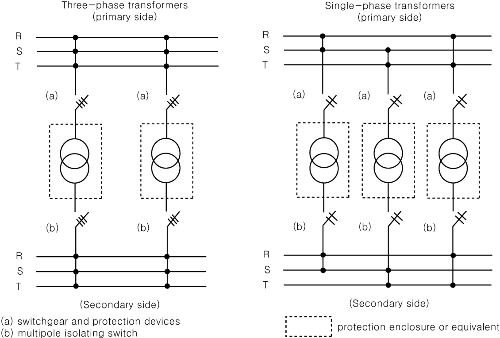

**Fig 6.1.1 Arrangement of Transformers**

> Description: Two single-line arrangements between R-S-T busbars on the primary side (top) and the secondary side (bottom): on the left, two three-phase transformers; on the right, three single-phase transformers each connected across two phases. Every transformer is placed in a dashed "protection enclosure or equivalent", with (a) switchgear and protection devices on its primary circuit and (b) a multipole isolating switch on its secondary circuit.

#### 203. Emergency source of electrical power

**1. Application** **【See Rule】**

(1) In application to **203. 1** (4) of the Rules, "exceptionally" whilst the vessel is at sea, means the following:

(A) Blackout situation

(B) Dead-ship situation

(C) Routine use for testing

(D) Short-term parallel operation with the main source of electrical power for the purpose of load transfer

(2) The emergency generator may be used during lay time in port for the supply of the ship mains, provided the requirements as per items (A) and (B) below are complied with.

(A) Requirements

(a) To prevent the generator or its prime mover from becoming overloaded when used in port, arrangements are to be provided to shed sufficient non-emergency loads to ensure its continued safe operation.

(b) The prime mover is to be arranged with fuel oil filters and lubrication oil filters, monitoring equipment and protection devices as required for the prime mover for main power generation and for unattended operation.

(c) The fuel oil supply tank to the prime mover is to be provided with a low level alarm, arranged at a level ensuring sufficient fuel oil capacity for the emergency services for the period of time as required by SOLAS.

(d) The prime mover is to be designed and built for continuous operation and should be subjected to a planned maintenance scheme ensuring that it is always available and capable of fulfilling its role in the event of an emergency at sea.

(e) Fire detectors are to be installed in the location where the emergency generator set and emergency switchboard are installed.

(f) Means are to be provided to readily change over to emergency operation.

(g) Control, monitoring and supply circuits, for the purpose of the use of the emergency generator in port are to be so arranged and protected that any electrical fault will not influence the operation of the main and emergency services. When necessary for the safe operation, the emergency switchboard is to be fitted with switches to isolate the circuits.

(B) Instructions are to be provided on board to ensure that when the vessel is under way all control devices(e.g. valves, switches) are in a correct position for the independent emergency operation of the emergency generator set and emergency switchboard. These instructions are also to contain information on required fuel oil tank level, position of harbour/sea mode switch if fitted, ventilation openings, etc.

**2. Capacity of emergency source of power** **【See Rule】**

(1) The power supply period for the navigation lights (masthead lights, side lights and stern lights) specified in **203. 2** (2) (C) of the Rules, may be reduces to 3 hours under the acceptance of the domestic regulations of flag state of the ship.

(2) In application to **203. 2** (2) (E) (a) of the Rules, "Internal communication equipment" means the following: *(2026)*

(A) For both passenger and cargo ships

(a) The means of communication which is provided between the navigating bridge and the steering gear compartment.

(b) The means of communication which is provided between the navigating bridge and the position in the machinery space and control room from which the engines are normally controlled(including Engine telegraph).

(c) The means of communication which is provided between the bridge and the radio telegraph or radio telephone stations, where separately arranged outside the bridge.

(d) The general emergency alarm system as required by SOLAS III/6.4.2

(e) The public address system required by SOLAS III/6.4.2 for cargo ships and the public address system required by SOLAS III/6.5.4 for passenger ships.

(B) Additionally for passenger ships only

(a) The means of communication which is provided between the officer of the watch and the person responsible for closing any watertight door which is not capable of being closed from a central control station as defined in SOLAS II-2/3.9.

(b) The means of communication which is provided between the navigating bridge and the fire control station.

(c) The means of communication which is provided between the safety centre, the central control station, the navigation bridge, the engine control room, the storage room(s) for fire extinguishing system(s) and fire equipment lockers, as required by SOLAS II-2/23.5.

(d) Internal communications in support of fire-fighting as required for passenger and crew notification and evacuation, as required by SOLAS II-2/22.3.1.2.

(3) In application to **203. 2** (2) (E) (b) of the Rules, in case where domestic regulations of flag of the ship accept, the capacity of emergency source of power may be in accordance with the following:

(A) Ships having gross tonnage 5000 tons or more may be reduced to the service period of rudder angle indicator specified in **Pt 5, Ch 7, 206.** (2) of the Rules.

(B) Ships having gross tonnage less than 5000 tons are to be in accordance with the followings:

(a) It is not required to supply emergency source the following navigation equipment.

(i) Gyro-compass

(ii) Echo-sounding device

(iii) Device to indicate speed and distance through the water

(iv) Rudder angle indicator, revolution meter of each propeller, propellers and the pitch and operational mode of controllable pitch propellers

(b) Service period for navigation radar may be reduced to the period by domestic regulations of flag of the ship (until 3 hours in case of having Korean flag ship).

(4) In case where domestic rules of flag of ship are accepted, the service period of the load in **203. 2** (2) (E) (d) and fire alarm system in **203. 2** (2) (E) (c) of the Rules may be reduced until 30 minutes.

**3. Kind and performance of emergency source of electrical power**

(1) In application to **203. 3** (2) (A) of the Rules, where the inverter or converter is connected to the output circuit of the batteries (consumer side), the maximum permitted voltage fluctuations may be taken as those specified in **Table 6.1.2** (a) or (b) in **201. 5** of the Rules respectively, notwithstanding the voltage drop on the battery. **【See Rule】**

(2) Starting from dead ship condition **【See Rule】**

In application to **203. 3** (4) of the Rules, the followings are to be complied with.

(A) The emergency generator and other means needed to restore the propulsion are to have a capacity such that the necessary propulsion starting energy is available within 30 minutes of blackout/dead ship condition. Emergency generator stored starting energy is not to be directly used for starting the propulsion plant, the main source of electrical power and/or other essential auxiliaries(emergency generator excluded).

(B) For steam ships, the 30 minute time limit can be interpreted as time from blackout/dead ship condition defined above to light-off of the first boiler.

**4. Transitional source of emergency electrical power** **【See Rule】**

In application to **203. 4** (1) of the Rules, where the inverter or converter is connected to the output circuit of the batteries(consumer side), the requirements specified in **203. 3** (1) may be applied.

**5. Starting arrangements for emergency generating sets** **【See Rule】**

(1) The starting devices specified in **203. 6** (2) of the Rules are to be comply with the following requirements:

(A) The source of stored energy is to be capable of starting the prime mover at least six times.

(B) In case where the automatic starting system is of the consecutive starts, the number of starts is to be three or less.

(C) For the automatic starting system, means are to be provided to hold such an allowance of source of energy capable of starting the prime mover three times further after making the initial consecutive starts.

(2) If the charging devices specified in **203. 6** (2) of the Rules uses an electrical method, it is to be comply with the following requirements: *(2025)*

(A) The charging facilities are to incorporate independent means such as overvoltage protection to prevent gas evolution in excess of the manufacturer's design quantity. If necessary, temperature compensated chargers are to be provided in accordance with manufacturer’s recommendations.

(B) Spacing for proper airflow is be provided in accordance with manufacturer's recommendations, in absence of such recommendation then adequate spacing for proper airflow is to be provided between batteries.

(C) For float charging of starting batteries utilizing VRLA type batteries, the charger voltage is to be specified in the batteries maintenance schedule based on manufacturer’s recommendations.

(D) Boost charge facilities (where provided) is to be arranged such that they are automatically disconnected when the battery enclosure or each battery temperature rises above manufacturer’s recommendations. A visible and audible alarm is be provided in a continually manned space, such as the navigation bridge, the engine control room, etc. to indicate the activation of the automatic disconnection. Automatic return to float charging mode is not acceptable.

(E) For preferred values for float/boost charge current, reference can be made to Table 1 of IEC 62485-2: 2010.

#### 204. Distribution

**1. Methods of distribution**

(1) Insulation monitoring system **【See Rule】**

(A) Distribution system is the circuit such as the followings.

(a) First stage distribution circuit connected with circuit of electric generator

(c) Second stage distribution circuit connected by way of insulation transformer from the first stage distribution circuit in (a) above. But, as far as not specifying specially, second stage distribution circuit of specific equipment (for example, Suez canal search light, heater and lighting circuit for specific crane, etc.) is to be excluded.

(c) Lighting circuit using accumulator batteries as electrical source or main busbar of distribution boards connected to the circuit

(B) Alarm setting value of insulation monitoring device may be set to international standards(e.g. IEC 61439-1) recognized by the Society. *(2025)*

(C) Where insulation monitoring device is used with earth lighting, interlocking device between them is to be provided.

(2) Hull return distribution **【See Rule】**

(A) The term "Electrical circuit subjected to the approval of the Society in **204. 1** (4) (A) (d) of the Rules" is the intrinsically safe circuit.

(B) The term "special precautions taken to the satisfaction of the Society in **204. 1** (4) (B) of the Rules" is the followings.

(a) All final sub-circuit is to consist of two insulated wires, and the hull return circuit is to be achieved by connecting directly to the hull one of the busbars of the distribution board from which they originate

(a) Earth wires are to be installed in readily accessible locations to permit their examination and disconnection for testing of insulation.

**2. Shore connections** **【See Rule】**

(1) Protector of connection box

In application to **204. 3** (2) of the Rules, in case where portable means checking the phase sequence or polarity is provided on-board, means checking the phase sequence or polarity for shore connection may be omitted.

**3. Navigation light circuits** **【See Rule】**

(1) Installation of navigation light indicator

In application to **204. 6** (5) of the Rules, navigation light indicator is to be placed in both an accessible position on the navigation bridge and an easily accessible position for operating, and alarm is to be provided for power failure of navigation lights and in case that navigation lights are turned out due to short circuit, etc.

**4. Feeder circuits for communication and signalling system, other lights** **【See Rule】**

(1) Daylight signalling lamp

In application to **204. 8** (3) of the Rules, the power supply of the daylight signalling lamps is to comply with following requirements.

(A) Daylight signalling lamps are not to be solely dependent upon the ship's main or emergency sources of electrical energy.

(B) Daylight signalling lamps are to be provided with a portable battery with a complete weight of not more than 7.5 kg.

(C) The portable battery is to have sufficient capacity to operate the daylight signalling lamp for a period of not less than 2 hours.

(D) The portable battery is to be charged from the ship's main or emergency sources of electrical energy.

#### 205. Protective devices

**1. Protection against short-circuit** **【See Rule】**

(1) In application to **205. 5** of the Rules, the circuit-breakers approved by the Society are recognized as the circuit-breaker having the following making capacity, but the case specified in **205. 5** (3) of the Rules is excluded.

(A) *d.c.* circuit-breaker: value same as the rated short-circuit current

(B) *a.c.* circuit breaker: value specified in **Table 6.1.8** of the Guidance

(2) In *a.c.* circuit breaker, short-circuit test is to be carried out by test circuit having power factor different from the value specified in **Table 6.1.8** of the Guidance, the value calculated by the formula is to be used as a standard value for the making capacity of circuit-breaker passed the test.

$$I_{making} = I_{sy} \times n\ (A), \qquad n = \sqrt{2}\left\{1 + \sin\phi \times e^{-\frac{\frac{\pi}{2}+\phi}{\tan\phi}}\right\}$$

- $I_{making}$ : Making current
- $I_{sy}$ : Rated short-circuit current (effective value of short-circuit current in contrast to 1/2 cycle after shorting the circuit)

**Table 6.1.8 Making Current of *a.c.* Circuit Breaker**

<table>
<tr><th>Kind</th><th>Rated short-circuit current $I_{sy}$ (<i>A</i>)</th><th>Making current $I_{making}$ (<i>A</i>)</th><th>$n$ $I_{making}$ $/I_{sy}$</th><th>Power factor of circuit for short-circuit test $\cos\phi$</th></tr>
<tr><td rowspan="15">Moduled-case circuit- breaker</td><td>2,500</td><td>4,250</td><td rowspan="6">1.7</td><td rowspan="6">0.5</td></tr>
<tr><td>5,000</td><td>8,500</td></tr>
<tr><td>7,500</td><td>12,750</td></tr>
<tr><td>10,000</td><td>17,000</td></tr>
<tr><td>14,000</td><td>23,800</td></tr>
<tr><td>18,000</td><td>30,600</td></tr>
<tr><td>22,000</td><td>48,400</td><td rowspan="9">2.2</td><td rowspan="9">0.2</td></tr>
<tr><td>25,000</td><td>55,000</td></tr>
<tr><td>30,000</td><td>66,000</td></tr>
<tr><td>35,000</td><td>77,000</td></tr>
<tr><td>42,000</td><td>92,400</td></tr>
<tr><td>50,000</td><td>110,000</td></tr>
<tr><td>65,000</td><td>143,000</td></tr>
<tr><td>85,000</td><td>187,000</td></tr>
<tr><td>100,000</td><td>220,000</td></tr>
<tr><td rowspan="5">Air circuit- breaker</td><td>10,000</td><td>20,000</td><td>2.0</td><td>0.3</td></tr>
<tr><td>20,000</td><td>44,000</td><td>2.2</td><td>0.2</td></tr>
<tr><td>40,000</td><td>92,000</td><td>2.3</td><td>0.15</td></tr>
<tr><td>70,000</td><td>161,000</td><td>2.3</td><td>0.15</td></tr>
<tr><td>90,000</td><td>207,000</td><td>2.3</td><td>0.15</td></tr>
</table>

(3) In case where determination of cascade breaking capacity of breakers necessary for employing for short-circuit protection is intended in accordance with **205. 5** (2) of the Rules, the test method and criteria are to be as specified the followings.

(A) Test method

Back-up circuit breakers and fuses are to be connected in series with the circuit breakers on load side, and short-circuit tests under an operating duty of O - 2 minutes\* - CO 1 time for one circuit breaker on load side are to be carried out.

Note: In case where the thermal trip reset time and fuse replacement time exceed 2 minutes, the time asterisked is the one deemed appropriate by the Society.

(B) Criteria after tests

The circuit breakers on load side are to satisfy the following requirements.

(a) No short-circuit is to be caused if the back-up circuit breaker is reclosed with the power supply being connected, and no voltage is to be applied on the terminals of the circuit breaker on load side.

(b) Circuit breaker can be safely and easily replaced with a spare.

(c) No damage is to be caused on the case body and cover.

(d) Maker and break of circuit is to be possible.

(e) High voltage test is to be carried out at a voltage 2 times the rated voltage, and to prove that it resists the voltage.

(f) Insulation resistance is to be 0.5 MΩ or over.

**2. Protection of generator** **【See Rule】**

In application to **205. 6** of the Rules, protection of generator is to be in accordance with the following.

(1) The trip current scale adjusting value of over-current trip device, with time delay, for generator is to be selected as value protected at safety over-current according to heat capacity of generator and characteristics of over-current trip device, with time delay. And where kind and adjusting value of over-current trip device, with time delay (long delay and short delay), for short-circuit protection device are selected, cooperation between protection devices is to be

considered.

(2) When parallel running of two sets or more of generators is capable, and selection trip device is provided, the adjusting value and characteristics of over-current trip device, with time delay, are so selected that over-current trip device of generator is not to operate with preference trip device at the same time. And when essential service motors are in danger of operating selection trip device at starting, the device may be interlocked during operating the motors.

(3) The following adjusting values for reverse power protection device are standard value.

(A) Generator driven by turbine : 2 ~ 6 %

(B) Generator driven by diesel engine : 6 ~ 15 %

**3. Protection of feeder circuits** **【See Rule】**

In application to **205. 9** of the Rules, rated current or trip current value of protection device used in single motor circuit excluding circuit for steering gear motors and small motors of rated current value 6 A or less is, as possible as, to be not more than value specified in **Table 6.1.9** of the Guidance.

**Table 6.1.9 Protection of feeder circuits**

<table>
<tr><th colspan="2">Kind of motor (starting method)</th><th>Rated current of fuse or moduled-case circuit-breaker</th></tr>
<tr><td colspan="2"><i>d.c.</i> motor</td><td rowspan="2">150</td></tr>
<tr><td colspan="2">Winding type induction motor</td></tr>
<tr><td colspan="2">Single phase, squirrel cage type, and synchronous motor (full voltage, reactor and resistor starting)</td><td>300</td></tr>
<tr><td rowspan="2">Squirrel cage type and synchronous motor (single winding transformer starting), special squirrel cage type motor</td><td>less than 30 A</td><td>250</td></tr>
<tr><td>30 A or over</td><td>200</td></tr>
</table>

**4. Protection of circuits** **【See Rule】**

(1) In application to **205. 2** (2) of the Rules, “where the Society may exceptionally permit” means the followings.

(A) When it is impracticable, for example engine starting battery circuit

(B) For essential motors which are duplicated and thruster motor, the overload protection may be replaced by an overload alarm

(C) For exceptional permission according to **Pt 5, Ch 7, 207. 5** and **301. 2** (5) of the Rules.

### Section 3 Rotating Machinery

#### 302. Prime movers for generators *(2020)* **【See Rule】**

In application to **302. 2** (2) of the Rules Application of electrical load in more than 2 load steps can only be permitted, if the conditions within the ship's mains permit the use of such prime movers which can only be loaded in more than 2 load steps (see **Fig. 6.1.2** for guidance on 4-stroke diesel engines expected maximum possible sudden power increase) and provided that this is already allowed for in the designing stage. This is to be verified in the form of system specifications to be approved and to be demonstrated at ship's trials. In this case, due consideration is to be given to the power required for the electrical equipment to be automatically switched on after black-out and to the sequence in which it is connected. This applies analogously also for generators to be operated in parallel and where the power has to be transferred from one generator to another in the event of any one generator has to be switched off.

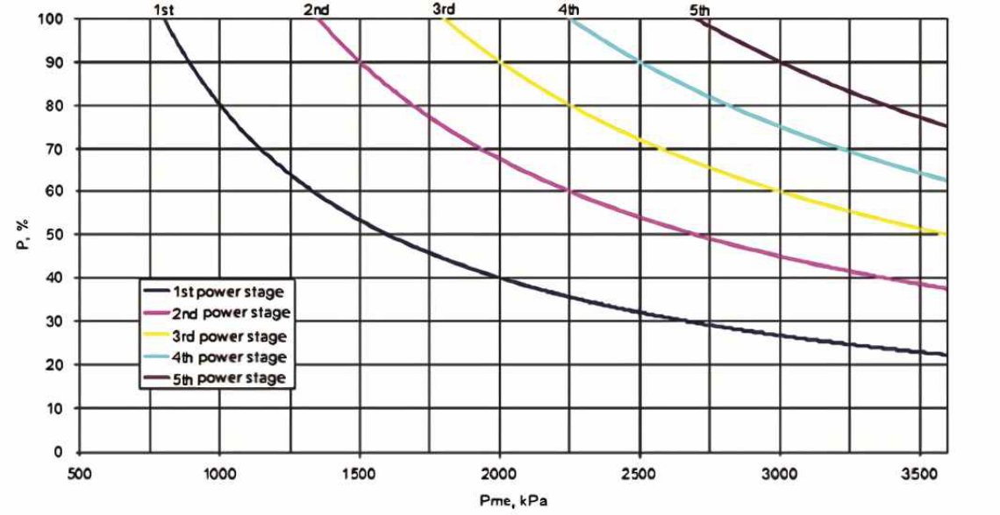
**Fig 6.1.2 Reference values for maximum possible sudden power increases as a function of brake mean effective pressure, $P_{me}$, at declared power (four-stroke diesel engines)**
> Description: Graph of the possible sudden power increase P (%, vertical axis 0–100) against mean effective pressure Pme (kPa, horizontal axis 500–3500). Five descending curves are drawn for the 1st to 5th power stages, starting at 100 % at about 800, 1350, 1800, 2250 and 2700 kPa respectively and falling with increasing Pme (e.g. the 1st power stage drops to about 22 % at 3600 kPa).

Note)

- $P_{me}$ : declared power mean effective pressure
- $P$ : power increase referred to declared power at site conditions

However, in case where the above throwing-on method applies, the manufacturers or shipyards are requested to submit a throw-on power calculation sheet demonstrating that the thrown load and base load at each step of operation do not exceed the value determined by the formulae above under any circumstances, to the Society for approval.

(1) At the time of power restoration after blackout

(2) At the time of sequential starting

(3) At the time of starting with a large start-up load

(4) At the time of instantaneous load transfer when one set of the generators fails (during parallel running)

#### 303. Rotating machinery shaft

**1. Rotating machinery shaft** **【See Rule】**

(1) In application to **303. 1** of the Rules, The fillet radius on edge part is to be 0.08 times the shaft's actual diameter to prevent the stress concentration. In a case where the filet radius is less than 0.08 times the shaft's actual diameter, the shaft diameter is to be increased proportionally according to the coefficient of stress concentration.

(2) “Where it is apprehended that the torque is remarkably greater than normal torque” means where the auto synchronizing device is not installed. In this case the value of F is to be 120 % of the value given in accordance with **Table 6.1.4** of the Rules.

#### 304. Temperature rise **【See Rule】**

**1.** In application to **304. 1** of the Rules, temperature rising of bearing is to be in accordance with the followings.

(1) Temperature rising limit of bearing (self-cooling type) is 35℃ when it measures at the surface, and is 40℃ when it measures by keeping temperature sensor under the metal. However, where heat-proof lubricating oil is used, it is 50℃ when it measures at the surface.

(2) Where rotating machinery used heat-proof insulation material of up-grade than F-Grade is difficult to apply to (1) above, data for heat-proof temperature rising limit is to be submitted to the Society, and is to be approved by the Society.

**2.** Temperature measuring method for winding of rotating of machinery forced cooling type by air cooler is to be the method of keeping temperature sensor under the winding or bridge method.

**3.** When cooling water temperature of rotating machinery of forced cooling type by air cooler is over 32℃, the temperature limit is to be in accordance with the discretion of the Society.

#### 308. Welding **【See Rule】**

**1.** The manufacturers are to submit the detailed data in connection with the welding work for examination of the Society if they plan to make coupling of generator shaft welded with flange for the first time. And fatigue test is to be included in the welding process qualification test.

**2.** The manufacturers are to submit the following data in connection with the welding work for examination of the Society if they plan to make generator shaft welded with rib, etc.

(1) Standard design stress and strength calculation data for rib, etc. attached to the shaft by welding

(2) Standard for welding workmanship and details for control standard

(3) Welding process qualification test record. The test results carried out by means of the test specimen manufactured according to the standard for welding workmanship specified in above (2), are to be included to the record, and macro test, micro test and hardness distribution measurement for welding parts are to be carried out.

**3.** The torque transmission parts such as spider(center of rotor), etc. with welded construction are to be in accordance with 2 above.

**4.** Welding for electric motor shaft is to be in accordance with the followings.

(1) The essential auxiliary driving motors having output of 100 kW or over are to be in accordance with **1** and **2** above.

(2) The motors having output less than 100 kW are to be in accordance with the followings.

(A) Shaft coupling flanges with welded construction are to be applied with appropriate modification of (1) above.

(B) For rib, etc. with welded construction, standard for welding workmanship only instead of (A) above may be submitted.

#### 309. Testing and inspection

**1. Temperature test** **【See Rule】**

In application to **309. 3** of the Rules, temperature test of rotating machinery, as a general rule, is carried out at actual load. But, in an unavoidable case, the zero power factor method or the temperature deduction method may apply to synchronous machines, and the equivalent load method may apply to induction machinery, such as the followings.

(1) Synchronous machines

(A) Zero power factor method

The rotating machinery is to be over-excited at unload condition by generator or motor, and is to be tested by flowing current close to rated current of zero power factor at rated voltage and frequency. The zero power factor method is capable of applying to synchronous machines for compensating of power factor, but where the method applies to synchronous
generator or motor, sufficient field current to get value close to rated output providing for the case a hard to get the rated output by short of field current, is to flow at the test, and the test result is to be corrected according to the followings.

(a) Temperature test is to be carried out for each rated voltage and no-load (armature open circuit), and rising temperature $t_0$ of armature winding and rising temperature $t_{c0}$ of iron core of armature are to be get from the test.

(b) In zero power factor method

- $t'$ = rising temperature of windings at voltage $V'$, current $I'$
- $t'_c$ = rising temperature of iron cores at voltage $V'$, current $I'$
- $t'_f$ = rising temperature of field windings at field current $I'_f$

(c) when rated voltage is $V$, Rising temperature can be calculated by the following formula.

Armature windings :

$$T = t_0 + (t' - t_0) \times \left( \frac{I}{T} \right)^2$$

Iron core of armature :

$$T = t_{c0} + (t' - t_{c0}) \times \left( \frac{I}{T} \right)^2$$

Field windings :

$$I_f = t'_f \times \left( \frac{I_f}{T_f} \right)^2$$

The test voltage $V'$, as far as possible, is to be rated voltage, but voltage over than 90 % of rated voltage.

(B) Temperature deduction

Whichever is available among the followings.

(a) The rising temperature of iron core at rated output is the rising temperature of iron core when rotating machinery is operated at unload condition of terminal voltage equivalent to 110 % of rated voltage, and the rising temperature of armature windings at rated output is the rising temperature of armature windings when rotating machinery is operated at short condition of all terminals carrying armature current equivalent to 125 % of rated output.

(b) Total rising temperature of iron cores and armature windings, in each case, measured final temperature of iron core and armature windings when rotating machinery is operated at unload condition of rated voltage or at short condition of all terminals carrying rated current, is each rising temperature for rated output.

(c) The circulation current equivalent to rated current armature at *d.c.* or single phase source is to be transmitted at the condition of that windings are connected by ring shape(triangle) line connection type, and opened one side, the terminal voltage equivalent to rated voltage, rising temperature of armature iron cores and windings are almost same as rated output when rotating machinery operates at rated speed through exciting to generate voltage of terminals equivalent to rated voltage. The current of field is to be corrected by zero power factor method.

(2) Inductors

(A) First stage synthesizing equivalency load method

This method is test method carried out by increasing and decreasing the voltage and frequency after synthesizing the voltage of main source and low voltage having frequency different from the voltage of main source when the inductor for testing connected such as **Fig 6.1.3** of the Guidance operates at no-load condition, and in general, the method synthesizing first stage current and total load current (current standard method), is used. The method (loss standard method) that input is equalized with loss at rated load calculated from the circle diagram method for inductors of special squirrel cage, 2 pole machinery and large output.

(B) Second stage synthesizing load method

This method is test method transmitted full load current to first stage by increasing and decreasing the voltage and frequency after synthesizing the second stage voltage and low voltage having low frequency when the inductor for testing connected as **Fig 6.1.4** of the Guidance operates at no-load condition.

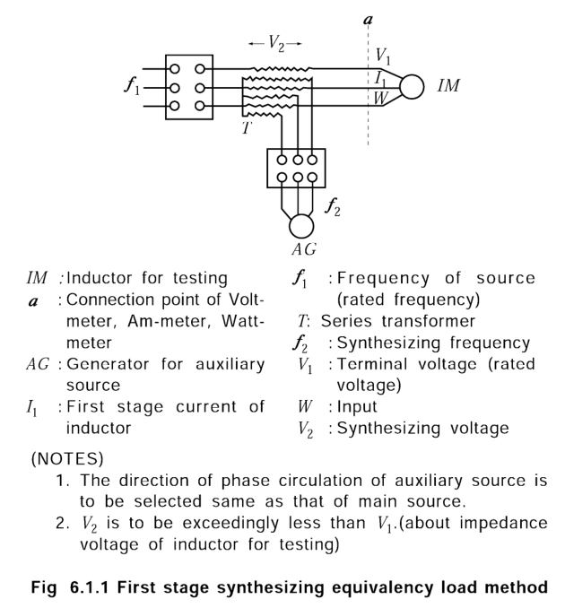
**Fig 6.1.3 First stage synthesizing equivalency load method**
> Description: Circuit diagram in which the inductor for testing $IM$ is fed from the main source ($f_1$) through series transformer $T$, whose secondary is supplied by the generator for auxiliary source $AG$ at synthesizing frequency $f_2$; $V_1$, $I_1$ and $W$ are measured at connection point $a$ and $V_2$ is the synthesizing voltage. The legend defines $IM$, $a$, $AG$, $I_1$, $f_1$, $T$, $f_2$, $V_1$, $W$, $V_2$, and the notes state that the phase circulation of the auxiliary source is to be the same as that of the main source and that $V_2$ is to be exceedingly less than $V_1$ (about the impedance voltage of the inductor for testing). The caption embedded in the image reads "Fig 6.1.1 First stage synthesizing equivalency load method".

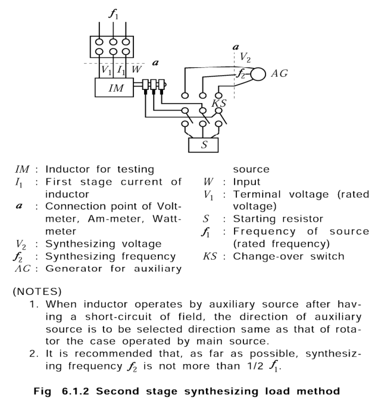
**Fig 6.1.4 Second stage synthesizing load method**
> Description: Circuit diagram in which the inductor for testing $IM$ is fed from the main source ($f_1$; $V_1$, $I_1$, $W$ measured at point $a$) and its slip rings are connected through change-over switch $KS$ either to starting resistor $S$ or to the generator for auxiliary source $AG$ supplying synthesizing voltage $V_2$ at synthesizing frequency $f_2$. The notes state that, when the inductor operates by the auxiliary source after short-circuiting the field, the direction of the auxiliary source is to be the same as the rotation under the main source, and that $f_2$ is recommended to be not more than 1/2 $f_1$. The caption embedded in the image reads "Fig 6.1.2 Second stage synthesizing load method".

**2. Over-current or excess torque test** **【See Rule】**

In application to **309. 4** of the Rules, excess torque test of special type motor may be carried out as the following unless otherwise designated.

Single phase motor : excess torque of 33 % during 15 seconds

Motor used for deck machinery : excess torque of 50 % during 15 seconds

Synchronous induction motor : excess torque of 35 % during 15 seconds

**3. Over speed test** **【See Rule】**

In application to **309. 5** of the Rules, over speed test for 2 pole induction motor having 500 kW or over, is to be carried out at 120 % of synchronizing speed.

**4. High voltage test** **【See Rule】**

In application to **309. 7** of the Rules, the term "as deemed appropriate by the Society" of notes 3 in the **Table 6.1.9** means agreement between the manufacturer and purchaser.

**5. Voltage regulation test** **【See Rule】**

(1) In application to **309. 8** of the Rules, voltage regulation test for generator, as a general rule, is to be carried out at the condition that the generator is connected directly with prime mover. Where the test is carried out by generator only, it is supposed that speed between no load and full load is changed in a straight line, and the voltage regulation rate is 3.5 % in the case of that there is no data about speed variation of prime mover.

(2) In application to **309. 8** (2) of the Rules, In the absence of precise information concerning the maximum values of the sudden loads, the following conditions may be assumed: 60 % of the rated current with a power factor of between 0.4 lagging and zero to be suddenly switched on with the generator running at no load, and then switched off after steady-state conditions have been reached. Subject to Classification Society's approval, such voltage regulation during transient conditions may be calculated values based on the previous type test records, and need not to be tested during factory testing of a generator. *(2017)*

**6. Commutation test** **【See Rule】**

(1) In application to **309. 10** of the Rules, grade of spark between commutator and brush of *d.c.* machinery is divided into 8 kinds specified in **Fig 6.1.5** of the Guidance, the sparks of No.5 through No.8 are considered as harmful spark.

(2) Nevertheless (1) above, when surface of commutator after the temperature test and over-load test becomes black or gets damaged depending on spark, or the brush wears down or gets damaged, the spark is considered harmful spark.

(3) The spark of No.2 or No.1 are recommended as spark at load of rated output or less.

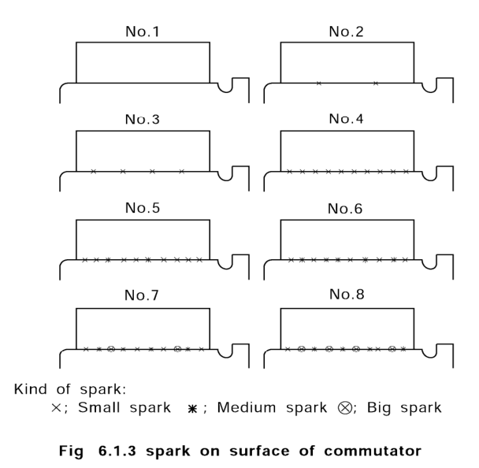
**Fig 6.1.5 spark on surface of commutator**
> Description: Eight sketches (No.1 to No.8) of a brush on the commutator surface with increasing sparking along the brush edge: No.1 shows no spark, No.2 to No.4 show increasing numbers of small sparks (×), No.5 and No.6 add medium sparks (✱), and No.7 and No.8 also include big sparks (⊗). The legend reads "Kind of spark: × Small spark, ✱ Medium spark, ⊗ Big spark"; the caption embedded in the image reads "Fig 6.1.3 spark on surface of commutator".

**7.** In application to **309. 11** of the Rules, in order to provide sufficient information to the party responsible for determining the discrimination settings in the distribution system where the generator is going to be used, the generator manufacturer is to provide documentation showing the transient behaviour of the short circuit current upon a sudden short-circuit occurring when excited, and running at nominal speed. The influence of the automatic voltage regulator is to be taken into account, and the setting parameters for the voltage regulator are to be noted together with the decrement curve. Such a decrement curve is to be available when the setting of the distribution system's short-circuit protection is calculated. The decrement curve need not be based on physical testing. The manufacturer's simulation model for the generator and the voltage regulator may be used where this has been validated through the previous type test on the same model. *(2017)* **【See Rule】**

**8.** In application to **309. 16** of the Rules, “the Society's permission" of notes (9) in **Table 6.1.10** of the Guidance means type approval means type approval, test report's confirmation, etc. **【See Rule】**

**9.** In application to **309. 16** of the Rules, “the Society's permission" of notes (10) in **Table 6.1.10** of the Guidance means type approval, design approval's confirmation, etc. **【See Rule】**

### Section 4 Switchboards, Section Boards and Distribution Boards

#### 401. General **【See Rule】**

**1. Locations**

In application to **401. 1** (1) of the Rules, in a case where steam pipes, water pipes, oil pipes, etc. are inevitably laid in the proximity of switchboards, flanges of these pipes are to be of welded joints or means are to be so provided that no detrimental effects would be exerted on switchboards if a leakage occurs.

**2.** In application **401. 1** (2) of the Rules, the followings are to be complied with.

(1) The main generating station is to be situated within the machinery space, i.e. within the extreme main transverse watertight bulkheads.

(2) Any bulkhead between the extreme main transverse watertight bulkheads is not regarded as separating the equipment in the main generating station provided that there is access between the spaces.

(3) The main switchboard is to be located as close as practicable to the main generating station, within the same machinery space and the same vertical and horizontal A-60 fire boundaries.

(4) Where essential services for steering and propulsion are supplied from section boards, these and any transformers, converters and similar appliances constituting an essential part of electrical supply system are also to satisfy the foregoing.

**3. Safety spaces of operators**

In application to **401. 2** of the Rules, where switchboards are constructed so that necessary operation and maintenance can be done from their front, the passageway at the rear side of switchboards may be omitted. *(2018)*

**4. Safety precautions to operators**

In application to **401. 3** of the Rules, insulating matting is to be in accordance with the dielectric tests according to IEC 61111 or equivalent. *(2020)*

#### 402. Construction **【See Rule】**

**1.** Flame retardant test of insulation material is to be carried out at the normal temperature and the condition of that there is no wind, and round bar or thin steel plate having minimum length 120 mm, breadth 10 mm and thickness 3 mm is to be used as a standard for test specimen. The specimen is to be so tied up with a fine wire that breadth becomes an angle of about 45° vertically and length becomes horizontally. The test is to be used liquefied natural gas, and the flame is to be so adjusted vertically in air that the height of flame becomes about 125 mm and blue area of the flame becomes about 35 mm. The centerline of the flame is to become vertically, and the front of blue area of the flame is to be attached 5 times every 15 seconds intervals during 15 seconds at bottom of the specimen. It may be recognized that the specimen burns out after testing. Where the damaged length of the specimen is 60 mm or less, it is recognized as flame retardant material.

**2.** Flame retardant test of sealing compound for penetration of cables through fire-proof bulkheads and decks is to be applied with appropriate modifications of the requirements of 1 above. Where the damaged length of the specimen is 60 mm or less, the material is recognized as flame retardant compound (material equivalent to compound of non-combustible material).

**3.** The following devices which busbars can be split easily and safely may be regarded as the "other approved means" specified in **402. 1** (2) of the Rules. However, bolted links, for example bolted busbar sections, are not to be accepted. *(2018)*

(1) Circuit breaker without tripping mechanism

(2) Disconnecting link *(2018)*

(3) Switch *(2018)*

#### 403. Busbars and equalizer connections **【See Rule】**

**1.** Busbars and the contact faces of busbars and linking conductors are to be protected against corrosion or oxidization by means of silver plating, tin plating or dipping in solder bath, etc.

**2.** Current rating of busbars may generally be determined by **Table 6.1.10** of the Guidance.

**Table 6.1.10 Current Rating of Busbars**

<table>
<tr><th colspan="3">Type</th><th>Current rating</th></tr>
<tr><td rowspan="3">For Generator</td><td colspan="2">In case where only one generator is feeding power to the busbars</td><td>100 % or more of the rated current of the generator</td></tr>
<tr><td rowspan="2">In case where two or more generators are feeding power at their full capacities to the busbars</td><td>Subdivided busbar arrangement (distribution systems consisting of multiple busbars)</td><td>For each busbar (including spare circuits), {(100 % of the large capacity rated currents (e.g. bow thruster, etc.)) + (75 % of sum of the rated currents of the rest of feeding circuits)} or more</td></tr>
<tr><td>Single busbar arrangement (distribution system consisting of single busbar)</td><td>{(100 % of the rated current of one generator of the largest capacity) + (80 % of sum of the rated currents of the rest of generators)} or more</td></tr>
<tr><td rowspan="2">For Power Feeding</td><td colspan="2">In case of general power feeding circuit</td><td>75 % of sum of the rated currents of the feeding circuits (including spare circuits) or more, but need be not more than the capacity of generator busbar</td></tr>
<tr><td colspan="2">In case where the feeding circuit has only one load circuit, or where power is fed to a group of motors under continuous service</td><td>The total rated current or more</td></tr>
</table>

#### 404. Measuring instruments for switchboards **【See Rule】**

**1. Instrument scales**

In application to **404. 3** of the Rules, instrument scales mean effective measuring range. And where the scale of current meter for electrical motor needs to be extended for starting current, the extended scales do not apply with this requirement.

#### 406. Testing and inspection

**1.** Switchboards of same type are those manufactured by same method at the same factory, and are to comply with the following. **【See Rule】**

(1) External dimension, internal capacity and ventilating method of generator panel having synchronizer panel are to be about the same.

(2) Type and rated values of generator circuit-breaker are to be same, and dimension, and arrangement of busbar and construction of terminal for connection are to be about the same.

(3) Load currents of busbar are to be about the same or less than the current.

(4) The arrangements of attached components in panels adjoined with heat source such as relay, fuse, resistor, etc. are to be about the same, and their total consumption power is to be about the same or less than the power.

(5) Construction and arrangement of terminals excluding maneuvering circuit, circuit for instrument, etc. are to be about the same.

**2. Temperature test** **【See Rule】**

In application to **406. 2** of the Rules, where coil is used with Class F insulation or Class H insulation, temperature rising limit of the coil is in accordance with the **Table 6.1.11** of the Guidance.

**Table 6.1.11 Temperature Rising Limit of the Coil (°C) (Based on ambient temperature of 45°C)**

| Kind of insulation \ Test method | Thermometer method | Resistance method |
|---|---|---|
| Class F insulation | 95 | 115 |
| Class H insulation | 120 | 140 |

**3. High voltage test** **【See Rule】**

(1) In **406. 4** of the Rules, auxiliary apparatus means connected indicating lamp, small transformer, relay, etc. between different poles or each phase

(2) When high voltage test for distribution boards is carried out according to **406. 4** of the Rules, instrument and auxiliary apparatus are to be removed. But the high voltage test for a unit of each apparatus is to be carried out for a unit of each apparatus and to comply with **406. 4** of the Rules.

(3) Electronic equipment or installations which is assembled within distribution boards, but are not connected directly with essential circuits of distribution boards or main circuits of supply and distribution on board, excluding special cases, do not apply to the Rules.

### Section 5 Cables *(2025)*

#### 501. General **【See Rule】**

**1.** IIn application to **501.** of the Rules, the term “consideration” means following IEC 60092 series or standards considered as equivalent thereto. *(2022)*

(1) IEC 60092-350:2020

(2) IEC 60092-352:2005

(3) IEC 60092-353:2016

(4) IEC 60092-354:2020

(5) IEC 60092-360:2014

(6) IEC 60092-370:2019

(7) IEC 60092-376:2017

**2.** Cables manufactured and tested to standards other than those specified in **Par 1** above or **501.** of the Rules will be accepted provided they are in accordance with an acceptable and relevant international or national standard and are of an equivalent or higher safety level than those listed in **Par 1** above. However, cables such as flexible cable, fibre-optic cable, etc. used for special purposes may be accepted provided they are manufactured and tested in accordance with the relevant standards accepted by the Society. *(2017)*

#### 502. Application of cables

**1.** In application to **502. 2** (2) of the Rules, "except where specially approved by the Society regarding mechanical damages" means that it is able to use un-armoured cables as long as the following tests are satisfied. **【See Rule】**

(1) **Tensile testing** is to be either of the followings.

(A) Tensile strength of inner sheath is to be 20 $\mathrm{N/mm^2}$ and above, tensile strength of outer sheath is to be 13 $\mathrm{N/mm^2}$ and above. Fracture elongation of inner or outer sheath is to be 250 % and above.

(B) Tensile strength of inner & outer sheath is to be 17 $\mathrm{N/mm^2}$ and above. Fracture elongation of inner or outer sheath is to be 400 % and above.

(2) **Impact testing and wear resistant testing**

Testing method and contents are to be approved by the Society.

(3) **Compression testing**

Insulation is not to be destructed by force of 1ton.

**2.** In application to **502. 3** of the Rules, flame retardant and fire resisting cables are to satisfy the followings; **【See Rule】**

(1) Flame retardant cable : IEC 60332 series

(2) Fire resistant cable : IEC 60331 series

#### 503. Current rating of cable **【See Rule】**

**1. Voltage drop** In application to **503. 2** of the Rules, calculation of voltage drop is to complying with the following formulae as the standard :

(1) In the case of *d.c.* circuit

$$\text{Voltage drop}(\%) = \frac{R_{20} \times K \times 2L \times I \times 100}{V}$$

(2) In the case of *a.c.* circuit

· Single phase *a.c.* circuit

$$\text{Voltage drop}(\%) = \left( \frac{R_{20} \times K \times 2L \times I \times 100}{V} \right) \times \delta \quad (\%)$$

· Three phase *a.c.* circuit

$$\text{Voltage drop}(\%) = \left( \frac{R_{20} \times K \times 2L \times I \times 100}{V} \right) \times \frac{1.73}{2} \times \delta \quad (\%)$$

- $L$ : Length of cable for single passage $(\mathrm{m})$
- $I$ : Maximum load current $(\mathrm{A})$
- $V$ : Circuit voltage $(\mathrm{V})$
- $R_{20}$ : *d.c.* resistance at 20℃ $(\Omega/\mathrm{m})$
- $K$ : Temperature factor at the maximum allowable temperature of conductor (60℃ : 1.16, 75℃ : 1.22, 80℃ : 1.24, 85℃ : 1.26)
- $\delta$ : Factor of voltage drop (Refer to **Table 6.1.12** and **Table 6.1.13** of the Guidance)

**2.** In circuits of electric motors, voltage drop is to be calculated by taking into account the starting current of an electric motor with the largest capacity. Further, in circuits of generators, approximately 115 % of the rated current is to be regarded as the maximum load thereby it is recommended that voltage drop is to be controlled to 1 % or less as far as practicable. Also, voltage drop in circuits of accumulator batteries, shore connection, etc. is to be controlled to 2 % or less as far as practicable.

**Table 6.1.12 Factor of *a.c.* Voltage Drop in Rubber Insulated Cables (*d*)**

<table>
<tr><th rowspan="2">Nominal sectional area of conductor (mm2)</th><th colspan="7">Power factor (%)</th><th colspan="2">Inductance (mH/km)</th></tr>
<tr><th>100</th><th>95</th><th>90</th><th>85</th><th>80</th><th>75</th><th>70</th><th>660 V</th><th>250 V</th></tr>
<tr><td>325</td><td>1.15</td><td>1.51</td><td>1.61</td><td>1.68</td><td>1.72</td><td>1.74</td><td>1.75</td><td>0.244</td><td></td></tr>
<tr><td>250</td><td>1.10</td><td>1.37</td><td>1.45</td><td>1.49</td><td>1.51</td><td>1.52</td><td>1.52</td><td>0.246</td><td></td></tr>
<tr><td>200</td><td>1.06</td><td>1.26</td><td>1.31</td><td>1.34</td><td>1.34</td><td>1.34</td><td>1.33</td><td>0.248</td><td></td></tr>
<tr><td>150</td><td>1.04</td><td>1.19</td><td>1.22</td><td>1.22</td><td>1.22</td><td>1.21</td><td>1.18</td><td>0.249</td><td></td></tr>
<tr><td>125</td><td>1.03</td><td>1.13</td><td>1.14</td><td>1.14</td><td>1.12</td><td>1.10</td><td>1.07</td><td>0.254</td><td></td></tr>
<tr><td>100</td><td>1.02</td><td>1.10</td><td>1.09</td><td>1.08</td><td>1.06</td><td>1.03</td><td>1.00</td><td>0.254</td><td></td></tr>
<tr><td>80</td><td>1.01</td><td>1.06</td><td>1.05</td><td>1.03</td><td>1.00</td><td>0.99</td><td>0.94</td><td>0.258</td><td></td></tr>
<tr><td>60</td><td>1.01</td><td>1.04</td><td>1.02</td><td>1.00</td><td>0.97</td><td>0.93</td><td>0.90</td><td>0.262</td><td></td></tr>
<tr><td>50</td><td>1.00</td><td>1.02</td><td>1.00</td><td>0.96</td><td>0.93</td><td>0.89</td><td>0.86</td><td>0.268</td><td></td></tr>
<tr><td>38</td><td>1.00</td><td>1.00</td><td>0.98</td><td>0.94</td><td>0.90</td><td>0.87</td><td>0.82</td><td>0.272</td><td>0.217</td></tr>
<tr><td>30</td><td>1.00</td><td>0.99</td><td>0.96</td><td>0.92</td><td>0.88</td><td>0.84</td><td>0.80</td><td>0.276</td><td>0.221</td></tr>
<tr><td>22</td><td>1.00</td><td>0.98</td><td>0.94</td><td>0.90</td><td>0.86</td><td>0.82</td><td>0.77</td><td>0.280</td><td>0.227</td></tr>
<tr><td>14</td><td>1.00</td><td>0.97</td><td>0.93</td><td>0.89</td><td>0.84</td><td>0.80</td><td>0.75</td><td>0.294</td><td>0.239</td></tr>
<tr><td>8</td><td>1.00</td><td>0.96</td><td>0.92</td><td>0.87</td><td>0.83</td><td>0.78</td><td>0.73</td><td>0.312</td><td>0.255</td></tr>
<tr><td>5.5</td><td>1.00</td><td>0.96</td><td>0.91</td><td>0.87</td><td>0.82</td><td>0.77</td><td>0.72</td><td>0.330</td><td>0.265</td></tr>
<tr><td>3.5</td><td>1.00</td><td>0.96</td><td>0.91</td><td>0.86</td><td>0.81</td><td>0.76</td><td>0.72</td><td>0.354</td><td>0.279</td></tr>
<tr><td>2.0</td><td>1.00</td><td>0.95</td><td>0.91</td><td>0.86</td><td>0.81</td><td>0.76</td><td>0.71</td><td>0.388</td><td>0.309</td></tr>
<tr><td>1.25</td><td>1.00</td><td>0.95</td><td>0.90</td><td>0.85</td><td>0.81</td><td>0.76</td><td>0.71</td><td>0.428</td><td>0.343</td></tr>
</table>

**Table 6.1.13 Factor of *a.c.* Voltage Drop in Mineral Insulated Cables ($\delta$)**

<table>
<tr><th rowspan="2">Nominal sectional area of conductor (mm2)</th><th colspan="7">Power factor (%)</th><th rowspan="2">Inductance (mH/km)</th></tr>
<tr><th>100</th><th>95</th><th>90</th><th>85</th><th>80</th><th>75</th><th>70</th></tr>
<tr><td>1.0</td><td>1.000</td><td>0.953</td><td>0.904</td><td>0.855</td><td>0.805</td><td>0.756</td><td>0.706</td><td>0.428</td></tr>
<tr><td>1.5</td><td>1.000</td><td>0.954</td><td>0.905</td><td>0.857</td><td>0.807</td><td>0.758</td><td>0.709</td><td>0.401</td></tr>
<tr><td>2.5</td><td>1.000</td><td>0.956</td><td>0.908</td><td>0.860</td><td>0.811</td><td>0.763</td><td>0.714</td><td>0.368</td></tr>
<tr><td>4</td><td>1.000</td><td>0.959</td><td>0.912</td><td>0.865</td><td>0.817</td><td>0.769</td><td>0.720</td><td>0.344</td></tr>
<tr><td>6</td><td>1.000</td><td>0.962</td><td>0.917</td><td>0.871</td><td>0.821</td><td>0.776</td><td>0.728</td><td>0.321</td></tr>
<tr><td>10</td><td>1.001</td><td>0.969</td><td>0.927</td><td>0.882</td><td>0.837</td><td>0.791</td><td>0.744</td><td>0.298</td></tr>
<tr><td>16</td><td>1.001</td><td>0.980</td><td>0.941</td><td>0.899</td><td>0.856</td><td>0.811</td><td>0.766</td><td>0.279</td></tr>
<tr><td>25</td><td>1.002</td><td>0.994</td><td>0.961</td><td>0.923</td><td>0.883</td><td>0.841</td><td>0.799</td><td>0.265</td></tr>
<tr><td>35</td><td>1.005</td><td>1.011</td><td>0.983</td><td>0.950</td><td>0.913</td><td>0.874</td><td>0.834</td><td>0.254</td></tr>
<tr><td>50</td><td>1.009</td><td>1.034</td><td>1.016</td><td>0.988</td><td>0.956</td><td>0.922</td><td>0.885</td><td>0.245</td></tr>
<tr><td>70</td><td>1.016</td><td>1.071</td><td>1.059</td><td>1.040</td><td>1.014</td><td>0.984</td><td>0.952</td><td>0.237</td></tr>
<tr><td>95</td><td>1.026</td><td>1.106</td><td>1.110</td><td>1.101</td><td>1.088</td><td>1.060</td><td>1.033</td><td>0.231</td></tr>
<tr><td>120</td><td>1.040</td><td>1.150</td><td>1.168</td><td>1.168</td><td>1.157</td><td>1.140</td><td>1.119</td><td>0.226</td></tr>
<tr><td>150</td><td>1.046</td><td>1.204</td><td>1.237</td><td>1.248</td><td>1.246</td><td>1.150</td><td>1.221</td><td>0.223</td></tr>
</table>

#### 504. Installation of cables **【See Rule】**

**1. Precaution against fire protection**

(1) In application to **504. 3** (1) of the Rules, "special precautions" means the installation work of cables in the enclosed space or semi-enclosed space in ships meets either of the following requirements. However, the works (B) (iii) below are to be approved by the Society in accordance with the requirements in **Pt 3, Sec 22** of the「**Guidance for Approval of Manufacturing Process and Type Approval, etc.**」

(A) One cable is installed independently. Where the distance between those cables is to be of 5 times or more the diameter of the larger cable, the distance between one cable and bunched cables is to be of 5 times or more the diameter of the largest (the minimum value: the width of bunched cables or more), or an adequate fire stop is to be provided between one independently installed cable and others, they may be installed independently.

(B) In a case where bunched cables are installed, the following requirements are to be complied with:

(a) Flame retardant cables in a bunched condition which have passed the test of Category A, IEC 60332-3-22:2018 in accordance with the requirements in **Pt 3, Sec 21 2108** of the「**Guidance for Approval of Manufacturing Process and Type Approval, etc.**」are to be used. *(2022)*

(b) In case where cables other than those specified in (a) above are used, the following means are to be taken (Refer to **Fig 6.1.6** of the Guidance).

(i) Fire stops having at least B-0 penetrations fitted as follows:

- cable entries at the main and emergency switchboard,
- where cables enter engine control rooms,
- cable entries at centralized control panels for propulsion machinery and essential auxiliaries,
- at each end of totally enclosed cable trunks (additional fire stops do not need to be installed inside totally enclosed cable trunks); and

(ii) Cable runs in non-totally-enclosed trunks and open cable runs are to comply with the following:

- to have fire protection coating applied to at least 1m in every 14m and to entire length of vertical runs, or
- to be fitted with fire stops having at least B-0 penetrations every second deck or approximately 6 m for vertical runs and at every 14 m for horizontal runs.

(iii) The cable penetrations are to be installed in steel plates of at least 3 mm thickness(see **Fig 6.1.6** (3) of the Guidance), but need not extend through ceilings, decks, bulkheads or solid sides of trunk. In cargo area, fire stops need only be fitted at the boundaries of the spaces.

(c) In case where the effect of the proposed means for preventing flame propagation are considered to be compatible with or better than that available with those specified in (b) above, such method may be used.

(2) In (1) above, in case where cables are taken additional measures, the additional measures are not to have a bad effect on the cables, and be of heat-resistance materials considered as equivalent to the cables.

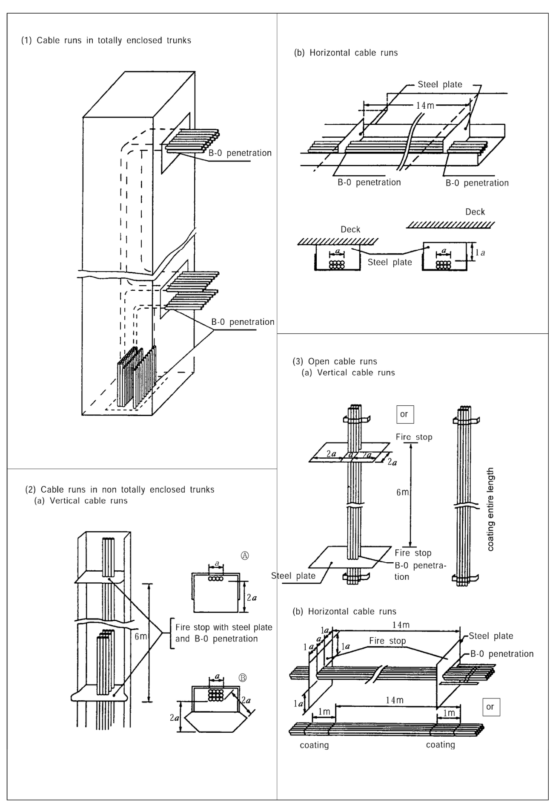
**Fig 6.1.6 Flame propagation prevention measures**
> Description: Composite figure of fire stop arrangements for cable runs. (1) Cable runs in totally enclosed trunks, with B-0 penetrations where the cables leave the trunk; (2) cable runs in non totally enclosed trunks: (a) vertical cable runs with a fire stop of steel plate and B-0 penetration every 6 m (details Ⓐ and Ⓑ showing the plate extending 2$a$ beyond the cable bunch of width $a$) and (b) horizontal cable runs with steel plates and B-0 penetrations 14 m apart, the plate extending 1$a$ below the deck; (3) open cable runs: (a) vertical cable runs with fire stops (steel plate extending 2$a$ around the cables, B-0 penetration) every 6 m, or coating over the entire length, and (b) horizontal cable runs with fire stops (steel plate extending 1$a$, B-0 penetration) every 14 m, or 1 m of coating in every 14 m.

(3) In application to **504. 3** (3) of the Rules, the followings are to be complied with. *(2026)*

(A) Electrical services required to be operable under fire conditions are as follows:

(a) Control and power systems to power-operated fire doors and status indication for all fire doors

(b) Control and power systems to power-operated watertight doors and their status indication

(c) Emergency fire pump

(d) Emergency lighting

(e) Fire and general alarms

(f) Fire detection systems

(g) Fire-extinguishing systems and fire-extinguishing media release alarms

(h) Low location lighting

(i) Public address systems

(j) Remote emergency stop/shutdown arrangements for systems which may support the propagation of fire and/or explosion

(B) Compliance with the requirements for cables and cable installation used for the purpose of (A) may be achieved by either of the following measures:

(a) Cables being of a fire resistant type complying with IEC 60331-1:2018 for cables of greater than 20 mm overall diameter, and IEC 60331-2:2018 for cables with an overall diameter not exceeding 20 mm, are installed and run continuous to keep the fire integrity within the high fire risk area. (see **Fig 6.1.7** of the Guidance)

(b) At least two-loops/radial distributions run as widely apart as is practicable and so arranged that in the event of damage by fire at least one of the loops/radial distributions remains operational.

(c) Systems that are self monitoring, fail safe or duplicated with cable runs as widely separated as is practicable may be exempted.

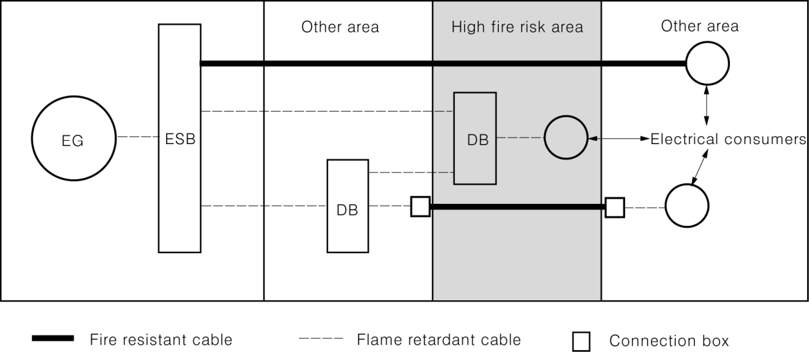
**Fig 6.1.7 Example for Application of Fire Resistant Cables**
> Description: Schematic in which the emergency generator (EG) feeds the emergency switchboard (ESB), which supplies electrical consumers through distribution boards (DB) across "Other area", a shaded "High fire risk area" and another "Other area". Cables passing through the high fire risk area to consumers beyond it are fire resistant cables (thick line), with connection boxes at the area boundaries, while the other circuits, including a DB and consumer located inside the high fire risk area, use flame retardant cables (dashed line).

(C) The electrical cables to the emergency fire pump are not to pass through the machinery spaces containing the main fire pumps and their source(s) of power and prime mover(s). They are to be of a fire resistant type, in accordance with above (B) (a), where they pass through other high fire risk areas.

(D) The definition of “high fire risk areas” is, at a minimum, to be considered as follows:

(a) Machinery spaces as defined by **Pt 8, Ch 1, 103. 30** of the Rules, except spaces having little or no fire risk as defined by **Pt 8, Ch 7, 102. 3** (2) (B) ⑩ of the Rules. (Including the interpretations for tables 9.3, 9.4, 9.5, 9.6, 9.7 and 9.8 given in MSC/Circ.1120 as amended by MSC.1/Circ.1436 and MSC.1/Circ.1510)

(b) Spaces containing fuel treatment equipment and other highly flammable substances

(c) Galley and Pantries containing cooking appliances

(d) Laundry containing drying equipment

(e) Cargo spaces except cargo tanks for liquids with flashpoint above 60°C and except cargo spaces exempted in accordance with SOLAS regulations II-2/10.7.1.2 or II- 2/10.7.1.4; and

(f) Vehicle, ro-ro and special category spaces.

(E) In application to **504. 3** (2) of the Rules, the following spaces are to be as a minimum considered as “other high fire risk areas”:

(a) Cargo spaces except cargo tanks for liquids with flashpoint above 60°C and except cargo spaces exempted in accordance with SOLAS regulations II-2/10.7.1.2 or II- 2/10.7.1.4;

(b) Vehicle, ro-ro and special category spaces;

(c) Spaces containing flammable liquids; and

(d) Pantries containing cooking appliances.

(F) Fire resistant type cables are to be easily distinguishable.

(G) For special cables, requirements in the following standards may be used:

(a) Electric data cables : IEC 60331-23:1999 *(2022)*

(b) Optical fibre cables : IEC 60331-25:1999 *(2022)*

(4) The interconnecting cable between a generator and the main switchboard is to be routed clear fuel oil purifier spaces, above the other generator engines and fuel oil purifiers except the cables are;

(A) subdivided into at least two groups separated throughout their length as widely as practicable,

(B) fire resisting cables which have passed the test specified in IEC 60331, or

(C) protected by means deemed appropriate by the Society.

**2.** The wording "a fire in an adjacent space" in **504. 3** (2) of the Rules generally means the fire from which standard time-temperature curves are obtainable in the standard fire test defined in regulation II-2/3.47 of Annex to SOLAS Convention.

**3.** Cables in refrigerated spaces In application to **504. 7** of the Rules, in case where non-metallic sheaths such as PVC or polychloroprene are used for cables installed in refrigerated spaces, materials which are not affected at the lowest temperature of refrigerated spaces are to be selected and the cables are to be installed in such a manner that they are not subjected to mechanical damage.

**4.** In case where installation of cables specified in **501. 1** of the Guidance in the space specified in **504. 3** of the Rules is unavoidable, these cables are to be installed in insulated steel pipes or steel ducts equivalent to A-60 or more, or fire resisting cables which have passed the test specified in IEC 60331 are to be used.

**5. Cables in dangerous spaces**

Where cables are installed in dangerous spaces worried over fire or explosion due to electrical accident, the cable are to be protected properly.

(1) Dangerous spaces generally mean the following areas:

(A) Dangerous spaces specified in **Pt 7, Ch 1, Sec 11** of the Rules, Rules for Ships Carrying Liquefied Gases in Bulk (**Pt 7, Ch 5** of the Rules), and Rules for Ships Carrying Dangerous Chemical in Bulk (**Pt 7, Ch 6** of the Rules).

(B) Cargo holds specified in **Pt 7, Ch 3, Sec 9** of the Rules

(C) Battery rooms, paint store and flammable gas bottle room such as acetylene gas bottle storage room

(2) Protections for cables to be installed in the dangerous spaces specified in (1) above are to comply with the following requirements:

(A) Cables to be installed in dangerous spaces specified in (1) (A) above may be regarded to have the protection by this requirement if the relevant requirements in **Pt 7, Ch 1, Sec 11** of the Rules, Rules for Ships Carrying Liquefied Gases in Bulk (**Pt 7, Ch 5** of the Rules), and Rules for Ships Carrying Dangerous Chemical in Bulk (**Pt 7, Ch 6** of the Rules) are complied with.

(B) Cables to be installed in cargo holds specified in (1) (B) above may be respectively regarded to have the protection by this requirement if the relevant requirements in **Pt 7, Ch 3, Sec 9** of the Rules are complied with.

(C) The protections for cables to be installed in each compartment specified in (1) (C) above are to comply with the following requirements:

(i) Cables are, in principle, to be of the metal armoured ones.

(ii) Protections for preventing mechanical damage to cables are to be provided as necessary.

#### 506. Earthing **【See Rule】**

**1. Earthing of Metallic Coverings**

In application to **506. 1** of the Rules, earthing of metallic coverings of cables may comply with the requirements as specified below:

(1) Cable sheaths and armours may be earthen with earthing glands so designed as to allow effective earthing. Glands are to be installed in such a manner that they are securely fixed to the earthen metal structure with good electrical contact.

(2) Conduits may be earthen by being screwed into a metal enclosure, or by nuts on both sides of
the wall of a metallic enclosure, provided the surfaces in contact are clean and free from rust, scale or paint and that the enclosure is securely earthen. The connection is to be painted immediately after assembly in order to inhibit corrosion.

(3) Cable sheaths and armour, and conduits may be earthen by means of clamps or clips of corrosion resistant materials making effective contact with sheath or armour and earth metal in lieu of the procedures specified in (1) and (2) above.

(4) All contacts of metal conduits, ducts and metal sheaths of cables used for earth continuity are to be soundly made and, where necessary, to be protected against corrosion.

#### 507. Securing of cables **【See Rule】**

**1. Clips, support and accessories**

(1) In application to **507. 3** of the Rules, in case where non-metal cable bands and supports are used, their specification of material, dimension, property and manner is to be submitted to the society for obtaining approval. However, that those used for the interior of switchboards, etc. may be excluded from this requirement.

(2) In application to **507. 3** (4) of the Rules, the wording 'special considerations are to be given in order to prevent the release of the cable means the reinforcement by metal cable bands. Metal cable bands are to be arranged at intervals of 1 to 2 m considering the outside diameter of the cable.

#### 508. Penetration of bulkheads and decks

**1. Maintenance of the water-tightness and gas-tightness** **【See Rule】**

In application to **508. 1** of the Rules, in maintenance of the water-tightness and gas-tightness at the cable penetrations, the construction and characteristics of materials of the cables are to be considered.

**2. Penetration through fireproof bulkheads and decks** **【See Rule】**

In application to **508. 2** of the Rules, penetration of bulkheads and decks is to be in accordance with the followings:

(1) The cable penetrations through A class bulkheads or decks are to be approved by the Society in accordance with the requirements of **Ch 3** of the「**Guidance for Approval of Manufacturing Process and Type Approval, etc.**」

(2) In case where cable glands are used those in the cable penetration through A class bulkheads or decks are to be filled with the non-combustible compound approved by the Society at least to a thickness of 25 mm or more may be accepted notwithstanding the requirements specified above. In this case, except A-0 class divisions, thermal insulation material is to be fitted additionally according to the class of fire protection as in other cases.

(3) The compound used in the cable penetrations through B class bulkheads or decks is to be of the non-combustible compound approved by the Society. In case where the compound is used to fill the sealing box or coaming, the length of the filled part is to be at least 50 mm or more.

(4) The compound approved to be used at the cable penetrations through A class bulkheads or decks under the requirements specified in (1) above may be regarded as the non-combustible compound meeting the requirements in (2) and (3) above.

#### 510. Cables for alternating current

**1.** In application to **510.** (5) of the Rules, distance between cable and steel bulkhead, as far as possible, is to be 50 mm or over. **【See Rule】**

**2.** "Large cross section" in **510.** (6) of the Rules means conductor having section area 185 $\mathrm{mm^2}$ or over. **【See Rule】**

#### 511. Joints and branch circuits **【See Rule】**

**1.** In application to **511. 2** of the Rules, "propulsion cable" means the cable of entire length between generators and electric motors for propulsion in electric propulsion ships.

### Section 6 Transformers for Power and Lighting

#### 602. Construction **【See Rule】**

**1. Transformer for accommodation**

In application to **602. 1** of the Rules, the box and cover of dry type transformer are to be of metal and be of drip-proof type excluding where transformers are installed in switchboard or control panel having enclosure of appropriate construction. And the opening is to be of gab not more than 12 mm or to have grating not entered rounding bar of diameter 12 mm or over, and is to be of construction which a mouth, etc. cannot enter into the opening.

#### 605. Testing and inspection

**1. General** **【See Rule】**

In application to **605. 1** of the Rules, "transformer which is produced in series having identical type" is a transformer of identical capacity, voltage, current, major dimensions, cooling method and insulation grade, and manufactured by same manufacturing method at same factory.

**2. Voltage variation test** **【See Rule】**

In application to **605. 3** of the Rules, rate of voltage variation by calculation formula in is accordance with the following.

$$\text{Rate of voltage variation} = q_r + \frac{q_z^2}{200} \quad (\%)$$

- $q_r$ : Voltage drop by resistance (%)

· In case of single phase :

$$q_r = \frac{P_{75}}{EI} \times 100 \quad \text{or} \quad q_r = \frac{P_{115}}{EI} \times 100$$

· In case of 3 phase :

$$q_r = \frac{P_{75}}{\sqrt{3}\,EI} \times 100 \quad \text{or} \quad q_r = \frac{P_{115}}{\sqrt{3}\,EI} \times 100$$

- $q_x$ : Voltage drop by reactance $= \dfrac{E_x}{E} \times 100 \ (\%)$
- $P_t$ : Loss against rated capacity at t°C $(\mathrm{W})$
- $P_{75}$ : Loss against rated capacity calculated in terms of 75°C $(\mathrm{W})$
- $P_{115}$ : Loss against rated capacity calculated in terms of 115°C $(\mathrm{W})$
- $E_z$ : impedance voltage $(\mathrm{V})$, i.e. voltage between first stage terminals when $P_t$ is measured.
- $E_x$ : Reactance voltage $(\mathrm{V})$

· In case of single phase :

$$E_x = \sqrt{E_z^2 - \left( \frac{P_t}{I} \right)^2}$$

· In case of 3 phase :

$$E_x = \sqrt{E_z^2 - \left( \frac{P_t}{\sqrt{3}\,I} \right)^2}$$

- $E$ : Rated first stage voltage $(\mathrm{V})$
- $I$ : Rated first stage current $(\mathrm{A})$

And $P_{75}$ in calculation formula above apply to $A$, $E$ and $B$ grade insulation, $P_{115}$ apply to $F$ and $H$ grade insulation.

### Section 7 Control-gears for Motors and Magnetic Brakes

#### 701. Construction **【See Rule】**

**1. Magnetic contactor and over-current relay for electric motor**

In application to **701. 5** of the Rules, thermal relays or magnetic over-current relays for electric motor are to comply with the following at environmental temperature of 45℃.

(1) To be operated within 2~30 seconds under the condition of flowing the current of 600 % of the full load.

(2) To be operated within 4 minutes under the condition of flowing the current of 200 % of the current value after passing the current corresponding to the full load of electric motor until saturated temperature.

(3) To be not operated under the condition of flowing the current of 100 % of the full load, and to be operated within 2 hours under the condition of flowing the current of 125 % of the current value after saturated temperature.

#### 703. Emergency stopping apparatus **【See Rule】**

In application to **703.** of the Rules, emergency stopping apparatus of equipments installed in machinery spaces are to be installed at the outside of machinery spaces.

#### 706. Clearance and creepage distance of control appliances **【See Rule】**

**1.** The rated insulating voltage means the voltage having no difficulty in use as standard insulating voltage for design of control-gear, and the rated insulating voltage is the rated voltage or over.

**2.** Minimum creepage distances in **706.** (2) of the Rules are to be in accordance with **Table 6.1.15** and **Table 6.1.16** of the Guidance according to the grades specified in **Table 6.1.14** of the Guidance.

**3.** Clearance and creepage distance of control-gear is to be in accordance with the following (refer to **Table 6.1.17** of the Guidance). Grade C in the following means degree of protection and ambient condition specified in **706.** (1) of the Rules.

(1) Clearance is to be decided on the minimum distance between bare live parts, minimum value of Grade C is the value specified in **Table 6.1.22** of the Rules, and minimum value of Grade A and B is the value specified in **Table 6.1.15** and **6.1.16** of the Guidance.

(2) Creepage is to be decided on the minimum distance adjoining the surface of insulating material inserted between bare live parts, minimum value of Grade C is the value specified in **Table 6.1.22** of the Rules, and minimum value of Grade A and B is the value specified in **Table 6.1.15** and **6.1.16** of the Guidance. But the space such as the following existing in the surface of insulating material is to be decided to be no space.

(A) Breadth or depth of space less than 1 mm in Grade B rated insulating voltage 125 V over and Grade C rated insulating voltage 250 V or less

(B) Breadth or depth of space less than 2 mm in Grade C rated insulating voltage 250 V over

(3) In (1) and (2) above, where insulating material is divided by metal between bare live parts, creepage distance of control-gear is to comprise one of the followings.

(A) The maximum value among the divided insulation material is to be decided on, in case of Grade C, the value specified in **Table 6.1.22** of the Rules or more, and in case of Grade A and B, the each value specified in **Table 6.1.15** and **6.1.16** of the Guidance or more.

(B) The sum of two higher values among the divided insulation material is to be, in case of Grade C, the value specified in **Table 6.1.22** of the Rules or more, and in case of Grade A and B, the each value specified in **Table 6.1.15** and **6.1.16** of the Guidance or more. But the divided insulation materials less than 1mm in Grade B rated insulating voltage 125 V over and Grade C rated insulating voltage 250 V or less, and those less than 2 mm in Grade C rated insulating voltage 250 V or less are excluded.

**Table 6.1.14 Class for Protection Condition and Environmental Condition**

| Class | Minimum value | Protection condition | Environmental condition |
|---|---|---|---|
| A | **Table 6.1.15** | Inside of control-gear protected enough to be not affected with environmental condition such as moisture, dust, etc. Example: Inside of dust-protection type relay, plated printing distribution board. | Control gear using at excellent environmental condition which has nothing to worry about pollution Example: Air-conditioning clean room |
| B | **Table 6.1.16** | Control-gear protected enough to be not affected with environmental condition such as moisture, dust, etc. Example: Small relay for control device, exclusive use socket, not plated printing distribution board. | Control gear using at good environmental condition Example: Clean electrical equipment room |

**Table 6.1.15 Minimum Clearance and Creepage Distance for Class A Control Appliances**

<table>
<tr><th rowspan="2">Rated insulating voltage V</th><th colspan="4">Class A</th></tr>
<tr><th colspan="2">Clearance mm</th><th colspan="2">Creepage (3)(4) mm</th></tr>
<tr><th>(<i>d.c.</i>, <i>a.c.</i>)</th><th><i>L</i>−<i>L</i>(1)</th><th><i>L</i>−<i>A</i>(2)</th><th><i>a</i></th><th><i>b</i></th></tr>
<tr><td>Not exceeding 12</td><td>0.2</td><td>0.2</td><td>0.2</td><td>0.2</td></tr>
<tr><td>Exceeding 12 to 30</td><td>0.4</td><td>0.4</td><td>0.4</td><td>0.4</td></tr>
<tr><td>Exceeding 30 to 60</td><td>0.5</td><td>0.5</td><td>0.5</td><td>0.5</td></tr>
<tr><td>Exceeding 60 to 125</td><td>0.5</td><td>0.5</td><td>0.5</td><td>1</td></tr>
<tr><td>Exceeding 125 to 250</td><td>1</td><td>1</td><td>1</td><td>1.5</td></tr>
<tr><td>Exceeding 250 to 380</td><td>1.5</td><td>1.5</td><td>1.5</td><td>2</td></tr>
<tr><td>Exceeding 380 to 500</td><td>2</td><td>2</td><td>2</td><td>3</td></tr>
</table>

**Table 6.1.16 Minimum Clearance and Creepage Distance for Class B Control Appliances**

<table>
<tr><th rowspan="2">Rated insulating voltage V</th><th colspan="4">Class B</th></tr>
<tr><th colspan="2">Clearance mm</th><th colspan="2">Creepage (3)(4) mm</th></tr>
<tr><th>(<i>d.c.</i>, <i>a.c.</i>)</th><th><i>L</i>−<i>L</i>(1)</th><th><i>L</i>−<i>A</i>(2)</th><th><i>a</i></th><th><i>b</i></th></tr>
<tr><td>Not exceeding 12</td><td>0.4</td><td>0.4</td><td>0.4</td><td>0.4</td></tr>
<tr><td>Exceeding 12 to 30</td><td>1</td><td>1</td><td>1</td><td>1.5</td></tr>
<tr><td>Exceeding 30 to 60</td><td>1</td><td>1</td><td>1</td><td>2</td></tr>
<tr><td>Exceeding 60 to 125</td><td>1.5</td><td>1.5</td><td>1.5</td><td>2.5</td></tr>
<tr><td>Exceeding 125 to 250</td><td>2</td><td>3</td><td>2</td><td>3</td></tr>
<tr><td>Exceeding 250 to 380</td><td>3</td><td>3</td><td>3</td><td>4</td></tr>
<tr><td>Exceeding 380 to 500</td><td>4</td><td>4</td><td>4</td><td>6</td></tr>
</table>

(NOTES)

(1) "$L-L$" applies to clearance between bare live parts, and between live part and earthen metal part.

(2) "$L-A$" applies to clearance between live part and metal part which accidently becomes dangerous.

(3) Creepage distance is to be determined by type and shape of insulation. a applies to ceramic insulator (steatite and porcelain), and comparable other insulator which is particularly safe against leaked electricity provided with ribbed construction or vertical partitions proved to be equally effective as ceramic insulator through experiments having a tracking index greater than 140 e.g., phenol resins formed items. "$b$" applies to other insulation materials.

(4) In case where "$L-A$" is greater than the corresponding creepage "$a$" or "$b$", the creepage distance between bare live parts and insulated metals which operator may readily touch and which becomes live parts by the deterioration of insulation are to be "$L-A$" or more.

(5) Current value is to be expressed by the rated current-carrying value.

**Table 6.1.17 Selection of Clearance and Creepage Distance**

<table>
<tr><th>No.</th><th>Figure</th><th>Condition</th><th>Clearance (<i>G</i>)</th><th>Creepage (<i>L</i>)</th></tr>
<tr><td>1</td><td>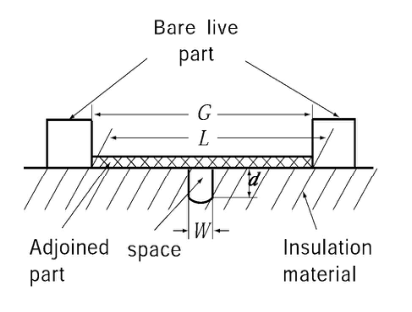</td><td>For $W$ or $d$&lt;1mm Class B: Exeeding 125V Class C: 250V or under For $W$ or $d$&lt;2mm Class C: Exeeding 250V</td><td>$G$</td><td>$L$</td></tr>
<tr><td>2</td><td>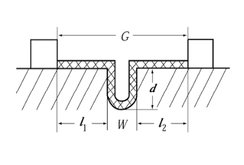</td><td>For $W$ or $d \ge$ 1mm Class B: Exeeding 125V Class C: 250V or under For $W$ or $d \ge$ 2mm Class C: Exeeding 250V</td><td>$G$</td><td>$L = l_1+l_2+W+2d$</td></tr>
<tr><td>3</td><td>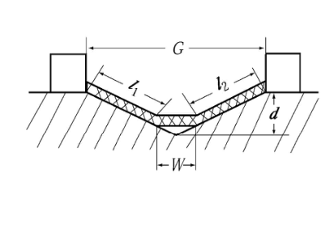</td><td>For $W$=1mm or $d \ge$ 1mm Class B: Exeeding 125V Class C: 250V or under For $W$=2mm or $d \ge$ 2mm Class C: Exeeding 250V</td><td>$G$</td><td>$L = l_1+l_2+W$</td></tr>
<tr><td>4</td><td>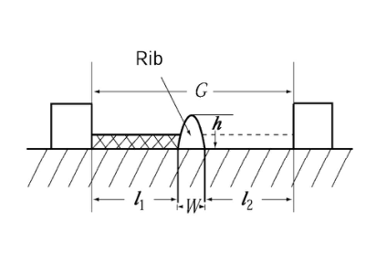</td><td>For $h$&lt;1mm Class B: Exeeding 125V Class C: 250V or under For $h$&lt;2mm Class C: Exeeding 250V</td><td>$G$</td><td>$L = l_1+l_2+W$</td></tr>
<tr><td>5</td><td>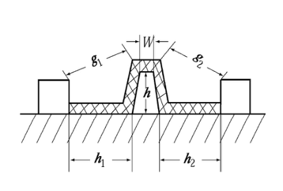</td><td>For $h \ge$ 1mm Class B: Exeeding 125V Class C: 250V or under For $h \ge$ 2mm Class C: Exeeding 250V</td><td>$G=g_1+g_2+W$</td><td>$L=l_1+l_2+W+2h$</td></tr>
<tr><td>6</td><td>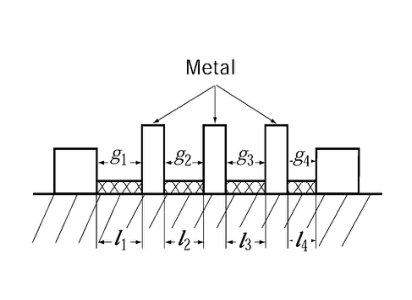</td><td>In case where metal exists between live parts Example: $g_1&gt;g_2&gt;g_3&gt;g_4$ $l_1&gt;l_2&gt;l_3&gt;l_4$ For $g_2$ and $l_2 \ge$ 1mm Class B: Exeeding 125V Class C: 250V or under For $g_2$ and $l_2 \ge$ 2mm Class C: Exeeding 250V</td><td>$g_1 \ge$ requirement value or $g_1+g_2 \ge$ requirement value × 1.25</td><td>$l_1 \ge$ requirement value or $l_1+l_2 \ge$ requirement value × 1.25</td></tr>

<!-- 원본: images/5ad74dbeb1f7.png -->

<tr><td>7</td><td>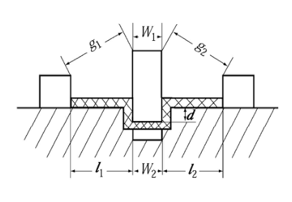</td><td>Where the depth of space of insulation material is deeper than inserting part.</td><td>$G = g_1+g_2+W_1$</td><td>$L = l_1+l_2+W_2+2d$</td></tr>
<tr><td>8</td><td>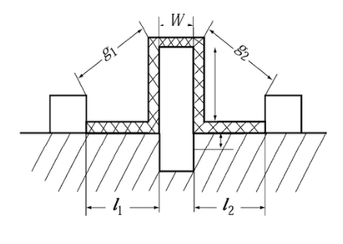</td><td>Where the insulation material and rib are so inserted as to be seen one body.</td><td>$G=g_1+g_2+W$</td><td>$L=l_1+l_2+W+2h$</td></tr>
<tr><td>9</td><td>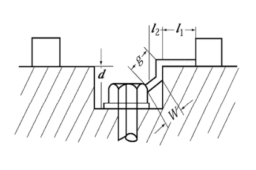</td><td>For $W=1$mm or $l_2<1$mm Class B: Exeeding 125V Class C: 250V or under For $W=2$mm or $l_2 \geq 2$mm Class C: Exeeding 250V</td><td>$G = g+l_1$</td><td>$L = l_1+d$</td></tr>
<tr><td>10</td><td>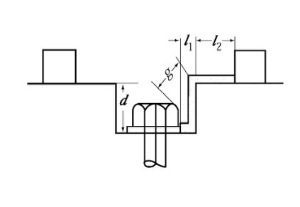</td><td>For $l_2 \geq 1$mm Class B: Exeeding 125V Class C: 250V or under For $l_2 \geq 2$mm Class C: Exeeding 250V</td><td>$G = g+l_1$</td><td>$L = l_1+l_2+d$</td></tr>
<tr><td>11</td><td>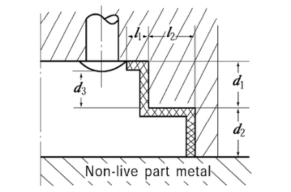</td><td>For $l_2 \geq 1$mm Class B: Exeeding 125V Class C: 250V or under For $l_2 \geq 2$mm Class C: Exeeding 250V</td><td>$G = d_2+d_3$</td><td>$L = l_1+l_2+d_1+d_2$</td></tr>
<tr><td>12</td><td>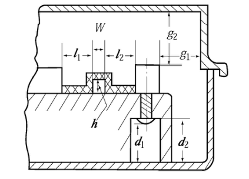</td><td>In case where there is in receptacle of metal</td><td>$G_1 = l_1+l_2+W$ (between bare live parts) $G_2 = g_1(g_1 \langle g_2 \langle d_1)$ (between ground)</td><td>$L_1 = l_1+l_2+W+2h$ (between bare live parts) $L_2 = d_2$ (between ground)</td></tr>
</table>
<!-- 원본: images/1bcfe5ff3d81.png -->

(4) In (1) and (2) above, where rib exists in the surface of insulating material inserted between bare live parts, the creepage and clearance are to be decided on the values excluded the height such as the followings.

(A) Height of rib less than 1 mm in Grade B rated insulating voltage 125 V over and Grade C rated insulating voltage 250 V or less

(B) Hight of rib less than 2 mm in Grade C rated insulating voltage 250 V over

(5) In (1) and (2) above, where the other rib inserted in insulating material between bare live parts, and the inserted distance is less than the depth of space of insulation material, creepage is to be decided on minimum distance along the line of the inserted rib.

(6) In (5) above, where the rib of material able to see as same insulating material is inserted, creepage and clearance are to be decided on minimum distance along the line of surface of the rib.

(7) Creepage to earth and clearance to earth are to be decided on minimum distance according to (1) and (2) above.

(8) The insulation distance of those having insulating metal which becomes bare live part by deterioration is to be decided according to (3) above.

#### 707. Testing and inspection

1. **General** **[See Rule]**

In application to **707. 1** of the Rules, the term “subject to the Society's permission” means type approval, test report's confirmation, etc. and the term “control-gear which is produced in series having identical type” is a control-gear manufactured by same manufacturing method at same factory and complying with the followings.

(1) External dimension of panel, box, etc., internal capacity and ventilating method are to be about the same.

(2) Type and rated values of circuit-breaker, magnetic contactor of main circuit are same, and dimension and arrangement of main circuit conductor and construction of terminal for connection are to be about the same.

(3) Load currents of main circuit are to be about the same or less than the current.

(4) The arrangement of attached components in panel adjoined with heat source such as relay, fuse, resistor, etc. are to be about the same, and their total consumption power is to be about the same or less than the power.

2. **High voltage test** **【See Rule】**

In **707. 4** of the Rules, the high voltage test is to be in accordance with **406. 4** of the Rules.

### Section 8 Fuses, Circuit-breakers and Electromagnetic Contactors

#### 801. General **【See Rule】**

1. Korean Industrial Standards or equivalent are the followings. And where products made by manufacturer other than Korean flag, the standard established by the nation may apply according to the discretion of the Society. However, the standards are to be updated. And where these standards are not standard for ship's store, the products are to be considered with ship's environmental condition (to comply with **Pt 6, Ch 1, Sec 2** of the Rules).

(1) Fuse : IEC 60269

(2) Circuit breaker : IEC 60947-2

(3) Electromagnetic contactor : IEC 60947-4-1

### Section 9 Explosion-protected Electrical Equipment

#### 901. General

1. **Material** **【See Rule】**

"Material which minimizes the risk of spark by friction" in **901. 5** (2) of the Rules means material which does not occur explosion owing to spark caused by friction or impact between metals. That means material identified anti-ignition tested by using the drop tester specified in KS E 3903.

2. **Construction** **【See Rule】**

Pressurized protected and intrinsically safe electrical equipment are to be indicated the followings in addition to requirements specified in **901. 6** (5) of the Rules.

(1) Pressurized protected electrical equipment

Ventilating type and sealing type are to be indicated the followings.

(A) Internal capacity of equipment

(B) Required wind pressure and wind capacity at the protection gas inlet of equipment

(C) Required wind pressure at the protection gas outlet of equipment (ventilating type only)

(D) Permissible maximum wind pressure of container

(2) Intrinsically safe electrical equipment

(A) The followings are to be indicated. But for detector, etc. the requirements (a) through (c) may be omitted.

(a) Rated value of intrinsically safe circuit

(b) Rated value of non-intrinsically safe circuit

(c) Useful condition

(B) Where a non-intrinsically safe circuit in incorporated equipment is not explosion-protected type, the followings are to be indicated in addition to (A) above.

(a) Caution for prohibition from installing in dangerous spaces

(b) Caution for prohibition from alteration, modification for component of equipment, wiring, etc.

(C) A intrinsically safe circuit in incorporated equipment is to be indicated clearly with the purport at terminals. Wiring diagram of equipment is to be attached and seen inside cover of equipment.

3. **Simple apparatus** **【See Rule】**

In application to **901. 7** of the Rules, simple apparatus is to comply with the following.

(1) Passive components, for example switches, junction boxes, resistors and simple semiconductor devices

(2) sources of generated energy which do not generate more than 1.5 V, 100 mA and 25 mW.

#### 902. Special requirements **【See Rule】**

The wording “as deemed appropriate by the Society” in **902.** of the Rules means the followings.

1. **Flameproof type electrical equipment**

(1) Where flameproof lighting fittings are fitted with bulkheads penetrated through, they are to be so installed as not to impair the integrity of the bulkheads.

(2) In case where a drain discharging devices is provided to the enclosure of flameproof construction, it is to be so constructed as not to impair the flameproof characteristics even with the device in the open position.

(3) In case where a waterproof packing is provided to the flameproof construction, it is to be so constructed as not to impair the flameproof joints, such as length of flame path and gaps etc., caused by the water intrusion.

(4) In case where a cable is connected to a terminal box by the cable pipe connecting method, sealing fittings are to be provided near the terminal box.

(5) When installing equipment, its flameproof joints are not to be installed within the distance specified in **Table 6.1.8** of the Guidance with respect to a bulkhead or solid object.

**Table 6.1.18 Minimum Installation distance of Flameproof Type Electrical Equipment**

<table>
<tr><th>Gas group</th><th>Minimum distance mm</th></tr>
<tr><td>IIA</td><td>10</td></tr>
<tr><td>IIB</td><td>30</td></tr>
<tr><td>IIC</td><td>40</td></tr>
</table>

(6) Flameproof joints are to be protected against corrosion with suitable non-hardening grease.

2. **Intrinsically safe type electrical equipment**

(1) Intrinsically safe electrical equipment is to be installed independently against general electrical equipment. Where the combined installation with general equipment is necessary, earthed metallic partitions are to be provided between these equipment.

(2) The wires for intrinsically safe circuits are to be measured to discriminate easily against those for other circuits. And the wires are also to be screens or separated 50mm or more from those for other circuits to avoid adverse effects by external electric or magnetic fields. *(2018)*

(3) Connection terminal for intrinsically safe circuit and non-intrinsically safe circuit under the combined installation are to comply with either of the followings.

(A) Connection terminals for the both circuits are to be installed in individually circuit boards separated from 50mm each other.

(B) Earthed metallic partitions having efficient mechanical strength and insulation are to be provided between the connection terminals for the both circuits.

(4) Even if an electrical fault for general circuit other than intrinsically safe circuits is happened, the function of a safety barrier is to be kept operating.

(5) Safety barriers are to be located in non-hazardous areas.

(6) Safety barriers are to be structured by at least two same components unless one component specified below is used. In case where one of the components is broken, an explosion protecting performance is to be maintained.

(A) Power Transformers

The insulation between first and second field windings is to be ensured by earthed partitions made by copper. And each field winding is to have an efficient insulation performance.

(B) Current Limitation Resistors

The surface of the resistors is to be covered by a synthetic resin or the resistors are to be embedded in a formed resin.

(C) Blocking Condensers

The condenser is to be structured by two solid dielectric type capacitors connected with each other in series which have high reliability. Electrolytic capacitors including tantalum type are not to be used.

(7) Each unused core in a multi-core cable is to be adequately insulated from earth and from each other at both ends by the use of suitable terminations.

3. **Increased safety type electrical equipment**

(1) Enclosures of increased safety lighting fittings are to be of a robust construction made of non-hygroscopic flame-retardant or incombustible material, and also they are to be of watertight construction or equivalent thereto.

(2) In case where an increased safety type motor or transformer is used, the efficient protection for overload and overheat is to be provided. Especially for a squirrel cage induction motor, the additional protection is to be provided not so as to use it over an allowable restraint time and abnormal temperature rise is not to be occurred under the restraint condition of the rotor.

(3) In case where there is a limitation for use in order to maintain an explosion protecting performance, the approval for use by the Society is to be necessary.

(4) To avoid the risk of short-circuits between adjacent conductors in terminal blocks, the insulation of each conductor is to be maintained up to the metal of the terminal.

4. **Pressurized protected type electrical equipment**

(1) When air is used as the pressurized medium, the air inlet is to be located in a safe space.

(2) Where air or inert gas is used as the pressurized medium, an interlock device is to be provided to ensure a displacement of air within the apparatus of at least 10 times the free volume of its enclosure and thus to obtain the required pressure before it can be energized.

(3) Pressurized protected electrical equipment is to be automatically disconnected from the source of electrical power in the event of the loss of pressure within its enclosure. However, if this arrangement increases the hazard to the ship, it may be permitted for loss of pressure to operate an alarm device only.

5. **Powder filling type electrical equipment**

(1) The enclosure is to be at least IP54 or higher. If it is IP55 or higher grade, a breathing device is to be provided.

(2) A powder material filled in the enclosure is to be quartz or solid glass particles and have an efficient insulation performance.

(3) The total stored energy of all capacitors in an enclosure is not to exceed 20J in normal operation.

(4) In case where there is a limitation for use in order to maintain an explosion protecting performance, the approval for use by the Society is to be necessary.

6. **Oil immersion type electrical equipment**

(1) The oil level indicating device is to be provided so that the liquid level can easily checked in service.

(2) Live parts of the electrical equipment are to be immersed to a depth of not less than 25mm below the surface of protective liquid.

(3) Where connecting cables are dipped into protective liquid, they are to be of oil resistant type.

(4) In case where there is a limitation for use in order to maintain an explosion protecting performance, the approval for use by the Society is to be necessary.

7. **Encapsulation type electrical equipment**

(1) Where some protection components are installed in order to limit a temperature rise, the setting value is not to be changed.

(2) In case where there is a limitation for use in order to maintain an explosion protecting performance, the approval for use by the Society is to be necessary.

8. **Non-sparking type electrical equipment**

(1) Non-sparking type electrical equipment applied to electrical equipment such that, in normal operation and in certain specified regular expected occurrences, it is not capable of igniting a surrounding explosive gas atmosphere.

(2) It shall not produce an operational arc or spark unless that arc or spark is prevented from causing ignition of a surrounding explosive gas atmosphere separately.

(3) Degree of protection is to be more than either of the followings

(A) IP 54 where there are bare live parts, or IP 44 where there are insulated live parts

(B) IP 4X where there are bare live parts, or IP 2X where there are insulated live parts where the equipment is intended for installation only in locations providing adequate protection against the entry of solid foreign objects or water capable of impairing safety.

### Section 10 Lighting Fittings, Heating Appliances, Wiring Accessories and Miscellaneous Equipment

#### 1001. General **【See Rule】**

Lighting fitting, heating appliances, etc., as a rule, are to comply with Korean Industrial Standard or equivalent thereto.

#### 1002. Lighting fittings

1. **Construction and location** **【See Rule】**

In application to **1002. 1** (3) of the Rules, a guard for globes made by materials other than glass materials may be omitted according to the discretion of the Society.

2. In application to **1002. 2** (4) and **3** of the Rules, the following requirements shall be complied with. However type approval may be omitted subject to the Society's permission, in this case, they are to comply with KS or equivalent thereto. **【See Rule】**

(1) Application standard

(A) IEC 60092-306

(B) KS C 8100

(C) KS standard or equivalent thereto for safety and function requirements of LED lighting in ships.

(D) In application to the above (A) and (B), in case that there are different contents about the same requirements, IEC 60092-306 shall be complied with.

(E) Other equivalent KS or IEC standard

(2) Test *(2019)*

Test is to be carried out in accordance with **Sec 31** of **Guidance for Approval of Manufacturing Process and Type Approval, etc**. However, test may be partly exempted when the Society considers necessary.

#### 1003. Heating appliances **【See Rule】**

1. Protection guard for heating elements is to be fixed firmly and to be prevented from touching the live parts, and an opening parts of protection guard are to be minimized for preventing standard test finger from touching the heating elements.

2. Live parts of cooking heater are to be prevented cooking appliances from touching cooking appliances.

3. Where the heating element is employed in liquid, it is to be protected by anti-corrosive metal sheath.

4. In case of heating appliance used for a bath, heating elements are to be arranged to avoid electrical shock in bath, and operating switches are to be of multi pole connection type and to be provided with indicating lamp and name plate.

5. Portable cooking heaters are to be of construction not falling over sideways.

### Section 11 Internal Communications

#### 1102. Essential internal communication systems **【See Rule】**

1. Essential internal communication and signal systems are to be inclusive of the followings.

(1) Navigation lights, signalling lamps and signal alarms required in International Convention

(2) Internal communications

(A) Communications between the following

(a) Between navigation bridge and main engine control station

(b) Between navigation bridge and steering gear room

(c) Engineer's alarm

(d) Available communications between navigation bridge, centralized control room, engine control station and engineer's accommodation at failure of main power.

(3) Internal signal alarms

(A) General emergency alarm

(B) Fire alarm

(C) CO2 release alarm

(4) Steering gear control system and rudder angle indicator

(5) Navigation equipment required in International Convention as deemed necessary by the Society

(6) Other internal communications, signal alarms and navigation equipment

#### 1105. General emergency alarm system **【See Rule】**

Where circuit breakers for overcurrent protection are provided for feeder circuits of general emergency alarm system, the notice of "To be always kept 'ON'" is to be posted. It is, however, not necessary to post the notice if protected by fuses.

#### 1106. Public address system **【See Rule】**

1. A public address system is not be required in the spaces such as under deck passage way, bosun's locker, hospital and pump room.

2. Where an individual loudspeaker has a device for local silencing, an override arrangement from the control stations, including the navigating bridge, shall be in place

3. In application to **1106. 6** (1) of the Rules, the sound pressure levels for cabin and state rooms shall be attained as required, during sea trials.

4. In application to **1106. 7** of the Rules, the method to minimize the effect of a single failure is as follows :

(1) The use of multiple amplifiers

(2) The use of segregated cable routes from each amplifier to public rooms, alleyways, stairways and control stations

(3) The use of more than one device for generating electronic sound signals

(4) The use of electrical protection for individual loudspeakers against short circuits.

### Section 12 Semi-Conductor Converters *(2021)*

#### 1204. Rectifiers

1. **General** **【See Rule】**

In application to **1204. 7** (1) of the Rules, the term “subject to the Society's permission” means type approval, test report's confirmation, etc.

2. **Temperature test** **【See Rule】**

In application to **1204. 7** (2) of the Rules, the appropriateness for requirements in **1204. 4** of the Rules may be identified by temperature measuring of cooling pin, case, refrigerant, etc. But, where the temperature rising limit for cooling pin, case, refrigerant, etc. is in the limit, it is presumed the temperature of joining parts as the designated case not exceeded the allowable maximum temperature.

3. **Operation test** **【See Rule】**

In application to **1204. 7** (3) of the Rules, operation test for protection devices means interlocking test between cooling fan and switch, and destructive test such as protection fuse test for rectifier elements may be omitted.

### Section 13 Accumulator Batteries

#### 1301. General **【See Rule】**

1. In case where accumulator batteries are made by foreign manufacturer, the accumulator batteries are to comply with the standards recognized by the nation and to comply with ship's stores.

2. Accumulator batteries of an adequate discharge rate are to be selected according to their application.

3. In case where alkali batteries are used, the specification including the construction, performance, method of installation, etc. is to be submitted at each time to the Society for obtaining approval.

#### 1303. Location **【See Rule】**

1. In application to **1303. 4** of the Rules, the followings are to be complied with.

(1) The term "large batteries" means the accumulator batteries connected to battery charging facilities with an output of 2 kW or more. The output of battery charging facilities is to be the product of the rated current of the rectifier and nominal voltage of battery group.

(2) Accumulator batteries connected to battery charging facilities with a capacity in a range from 0.2 kW to 2 kW are to be placed in a battery box installed within a battery compartment or on the upper deck or upward. Where the accumulator batteries are unable to be placed in such areas, one of the following requirements is to be complied with;

(A) To be placed in a storage box or locker installed at an adequate area.

(B) To be placed in an open state within the machinery space.

(C) To be placed in a compartment with good air ventilation.

(3) Accumulator batteries connected to battery charging facilities with a capacity in a range 0.2 kW or less may be installed in open states at adequate areas or may be installed in battery boxes.

(4) The output of the battery charging facility is to be of the value obtained by the following formula or more. *(2019)*

$$P = U \times I \quad (\mathrm{W})$$

- $P(\mathrm{W})$ : Calculated battery charging power
- $U(\mathrm{V})$ : Rated battery voltage
- $I(\mathrm{A})$ : Charging current

2. In application to **1303. 4** of the Rules, valve-regulated sealed batteries may be located in compartments with standard marine or industrial electrical equipment provided that the following ventilation requirements are complied with.

(1) Equipment that may produce arcs, sparks or high temperatures in normal operation is not to be in close proximity to battery vent plugs or pressure relief valve outlets.

(2) Where valve-regulated sealed batteries are installed, the charging facilities are to incorporate independent means such as overvoltage protection to prevent gas emission in excess of the manufacturer's design quantity.

(3) Boost charge facilities, where provided, are to be arranged such that they are automatically disconnected when the battery compartment ventilation system fail.

#### 1304. Electrical installation in battery compartment **【See Rule】**

Explosion protecting classes of the explosion-protected electrical equipment installed in the battery rooms for lead acid and alkaline batteries are to be higher than at least the classes specified in **201. 1** (2) (B) (b) of the Guidance.

#### 1305. Protection against corrosion **【See Rule】**

In application to **1305.** (3) of the Rules, it may be exempted in case the entire floor and all walls up to 150 mm high of battery rooms are to be lined with lead-sheet and the linings are to be watertight.

#### 1306. Ventilation **【See Rule】**

1. The ventilation arrangements for installation of batteries which have charging power higher than 2 kW are to be such that the quantity of air expelled is at least equal to: *(2026)*

(1) Vented type batteries

$$Q = 110 \times I \times n \quad (\mathrm{l/h})$$

- $Q$ : Exhaust capacity
- $I\ (\mathrm{A})$ : Maximum current delivered by the charging equipment during gas formation, but not less than 25 % of the maximum obtainable charging current in amperes
- $n$ : Number of cells in series

(2) Valve-regulated sealed type batteries

The ventilation rate for compartments containing valve-regulated sealed type batteries may be reduced to 25 per cent of that given above.

(3) As an alternative to (1), other industrial standards may be utilized to calculate ventilation rate, for example, section 7.2 and 7.3 of IEC 62485-2:2010, or section CC.2 of Annex CC to IEC 62040-1:2017, as appropriate.

2. The minimum cross-sectional area of ventilation ducts is to be of the value obtained by the following formula or more. *(2019)*

(1) Vented type batteries

$$A = 5.6/1000 \times Q \quad (\mathrm{Cm^2})$$

- *Air velocity* : Assuming 0.5(m/s)

3. It is recommended that the ventilation system for a compartment containing accumulator batteries connected to battery charging facilities with an output of 2 kW or more is to be of the mechanical exhaust-ventilation.

### Section 15 High Voltage Electrical Installations

#### 1501. General **【See Rule】**

1. The supply voltages and frequency specified in **Table 6.1.19** of the Guidance are recognized as a standard.

**Table 6.1.19 Supply Voltages and Frequency of High Voltage Electrical Installations**

| System nominal voltage (kV) | Commercial frequency (Hz) |
|:---:|:---:|
| 3(3.3) | 50 or 60 |
| 6(6.6) | 50 or 60 |
| 10(11) | 50 or 60 |
| 15 | 50 or 60 |

#### 1502. System design **【See Rule】**

1. **Standards applied to high voltage equipment**

The following equipment is to comply with the relevant IEC Pub. or equivalent and above.

(A) Circuit breakers : IEC 62271-100

(B) Switches : IEC 60265

(C) Fuses : IEC 60282

(D) Contactors : IEC 60470

(E) Current transformers for instruments : IEC 60044

(F) Voltage transformers for instruments : IEC 60044

(G) Relays : IEC 60255

(H) Rotating machinery : IEC 60529 and 60034-5

2. In application to **1502. 2** (2), (3) of the Rules, equipment located in machinery spaces are to be considered as being accessible to qualified personnel only. The equipment located in other compartments are to be considered as being accessible to qualified personnel only when the equipment are to be kept locked under the responsibility of the ship's officers.

3. In application to **1502. 3** (1) of the Rules, the term "subject to the Society's permission" means that sufficient insulating performance is confirmed according to clause 4.2 of IEC 62271-1.

#### 1505. Cables **【See Rule】**

1. **Application**

In application to **1505.** of the Rules, IEC 60183 may apply.

#### 1506. Switchgear and controlgear assemblies **【See Rule】**

1. In application to **1506. 4** of the Rules, the high voltage test procedure is to be in accordance with the IEC 62271-200:2011, or equivalent and higher standards, data proving that the assembly will withstand temperature rise(e.g testing in accordance with 6.5 of IEC62271-200:2011) and an internal arc(e.g. testing in accordance with Appendix AA of IEC 62271-200:2011) is to be submitted to the Society for information service. *(2024)*

#### 1507. Installation **【See Rule】**

In application to **1507. 1** (3) of the Rules, “safe and effective measures” means the followings.

(1) Pressure-release flaps are to be installed.

(2) Ducts of sufficient cross-section are to be provided.

(3) Combustible materials and electrical equipments are not admissible in the area of coming out gases.

### Section 16 Electric Propulsion Unit

#### 1603. Rotating Machines *(2026)*

1. In application to **1603. 7** of the Rules, examples of acceptable arrangements for roatating machines are illustrated in **Figures 6.1.8** to **6.1.10**.

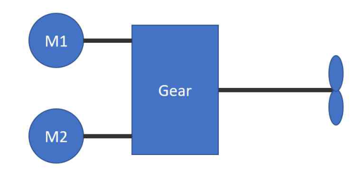
**Fig 6.1.8 Asynchronous machines or machines that can be de-excited**
> Description: Two motors M1 and M2 are each connected directly by a shaft to a common gear box (Gear), whose single output shaft drives the propeller.

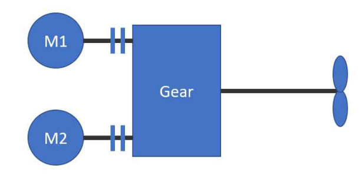
**Fig 6.1.9 Permanent magnet machines with clutches**
> Description: Two motors M1 and M2 are each connected through a clutch (double bar symbol) to a common gear box (Gear), whose output shaft drives the propeller.

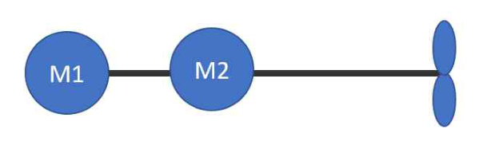
**Fig 6.1.9 Asynchronous machines or machines that can be de-excited**
> Description: Two motors M1 and M2 are arranged in tandem on one common shaft directly driving the propeller, without a gear box.

#### 1604. Control gear **【See Rule】**

1. In application to **1604. 4** (7) of the Rules, “machines" mean transformers directly used to electric propulsion unit.

2. **Remote control devices for electric propulsion unit**

(1) For the remote control station for propulsion motors, alarm devices activating on the following cases are to be provided in addition to those specified in **Ch 2, 202. 2** (1) of the Guidance:

(A) Insulation resistance drop of supply circuits

(B) An abnormal stopping of cooling fan for semi-conductor electric power converter

(C) Pressure drop of cooling water for semi-conductor electric power converter (temperature rising or stopping of cooling water pump)

(D) Starting of semi-conductor safety devices for semi-conductor electric power converter

(2) Visual alarm specified in (1) above is to be capable of identifying kind of abnormal conditions and the related equipment. However, in case of ships remote-controlled in bridge and the other space, visual alarm installed in bridge does not apply this requirement. And visual alarms discriminated easily by the other gauges and meters in engine room do not apply this requirement.

### Section 18 Spare Parts, Tools and Instruments

#### 1801. Spare parts **【See Rule】**

1. For the kind and quantity of spare parts, the requirements of this section are for general guidance purpose and in general are not mandatory for classification. Kind and quantity of spare parts specified in this section may be added or reduced when deemed appropriate by the Society in consideration of the design, recommendations of the manufacturer, the discussion with owner, production records and maintenance method. *(2017)*

2. For the electric or electro-hydraulic steering gears equipped with two or more steering gear motors or motor generators, the spare armature or stator specified in **1801. 1** (4) of the Rules may be omitted.

3. The requirements in **1801. 1** (4) of the Rules do not apply to electric motors for steering control systems.

## CHAPTER 2 CONTROL SYSTEMS

### Section 1 General

#### 101. General **【See Rule】**

1. **Application**

(1) In application to **101. 1** (1) of the Rules, for control system of the electric generation sets(including prime movers) in electric propulsion ship, the requirements to "**204. Control system in electric generation sets**" of the Rules are to be applied.

### Section 2 System and Control

#### 201. System design *(2017)* **【See Rule】**

1. In application to **201. 4** (7) of the Rules, the term "other measures considered appropriate by the Society" means the acceptance in accordance with **Pt 1, Ch 1, 104.** of the Rules. *(2020)*

#### 202. Automatic and remote control of main engines or controllable pitch propellers *(2025)* **【See Rule】**

1. **Application**

In case where the local control handle fitted to main propulsion machinery is moved to the main control station, the requirements in **202.** of the Rules may not apply except the following case:

(1) when the main control station is provided outside the space where main propulsion machinery is installed.

(2) When the main control station is provided inside the space where main propulsion machinery is installed, and environmental enclosure.

2. **Remote control devices for main engines or controllable pitch propellers**

(1) At the remote control station for the main propulsion machinery, alarm devices which come into action on the following cases is to be provided.

(A) Lubricating oil low pressure

(B) Cooling fresh water low pressure (or high temperature, cooling water pump stop, etc.)

(C) Low pressure of hydraulic oil or air for remote control system, or failure of electrical source

(D) Starting of emergency stopping devices.

(2) Visual alarm specified in (1) above is to be capable of identifying kind of abnormal conditions and the related equipment. However, in case of ships remote-controlled in bridge and the other space, visual alarm installed in bridge does not apply this requirement. And visual alarms discriminated easily by the other gauges and meters in engine room do not apply this requirement.

(3) For the remote control system of main propulsion steam turbine, means for automatic opening of astern intermediate valves at the operation into astern maneuvering are to be provided.

(4) In case where control devices specified in above **1** (2) are installed, the local control equipment for the main engine can be omitted. However, in case where control equipment is installed in main control station, it is recommended that the emergency local control equipment for main propulsion machinery be installed.

(5) Countermeasure for the event of failure of the source (electric power, pneumatic pressure and hydraulic pressure) for remote control system due to the failure of main engine remote control system is to be provided.

(6) Main engine starting by remote control system for main propulsion machinery and starting air low pressure alarm are in accordance with the followings:

(A) In case where the low pressure alarm activate after satisfying the number of starting specified in **Pt 5, Ch 6, 1101. 1** of the Rules, startings after this are be controlled at the main control station.

(B) In case where the low pressure alarm activate before satisfying the number of starting specified in **Pt 5, Ch 6 1101. 1** of the Rules, the next startings is to be capable at the remote control station and the number of starting is to be satisfied in the requirements.

3. **Bridge Control Devices**

(1) It is recommended that the operating handle (or button) of the bridge control devices is linked with the engine room telegraph.

(2) In application to **202. 3** (3) of the Rules, where override may result in total failure of the engine and/or propulsion equipment within a short time is as followings.

(A) All diesel engines

(a) Overspeed

(b) Failure of lubricating oil system

(c) Crankcase explosive condition

(B) All steam turbine

(a) Failure of lubricating oil system

(b) Overspeed

(c) Back-pressure for auxiliary turbines

(C) All boiler

(a) Failure of flame

(b) Failure of flame scanner

(c) Low water level

(d) Failure of forced draft pressure

(e) Failure of control power

(D) All reduction gears

Shutdown prime movers upon failure of reduction gear lubricating oil system

(E) Generators

For generators fitted with forced lubrication system only: shutdown prime movers upon failure of generator lubricating oil system

(F) Electric propulsion system

(a) Short-circuit in electrical propulsion system

(b) Overspeed of electrical propulsion *d.c.* motor

#### 203. Automatic and remote control of boilers

1. **General** **【See Rule】**

In application to **203. 1** (3) of the Rules, the term "considered in each case" means the acceptance in accordance with **Pt 1, Ch 1, 104.** of the Rules. *(2020)*

2. **Automatic combustion control systems**

(1) In application to **203. 2** (2) (F) of the Rules, the term "where approved by the Society" means the acceptance in accordance with **Pt 1, Ch 1, 104.** of the Rules. *(2020)* **【See Rule】**

(2) In application to **203. 2** (4) of the Rules, the term "considered in each case by the Society" means the acceptance in accordance with **Pt 1, Ch 1, 104.** of the Rules. *(2020)* **【See Rule】**

### Section 3 Tests *(2017)*

#### 301. Shop tests **【See Rule】**

1. **Type approval**

(1) In application to **301. 1** of the Rules, "automatic equipment" to be type-approved, in principle, are following equipment as essential services specified in **Ch 1 101. 4.** (13) of the Rules. *(2023)*

(A) Alarm and monitoring systems

(B) Control systems for, main engine, generators, boilers and essential auxiliary machinery, etc.

(C) Computer-based systems

(D) Fire detection systems

(E) Gas detection systems

(F) Electronic governor systems

(G) Speed and shaft horsepower sensing equipment

(H) Controller

(I) Sensors(including Transmitters or Switches for flow, level, limit, pressure, temperature detection)

(J) Oil mist detectors

(K) Electrical and electronic indicators

(L) Optical sensors and optical application device applied to the above (A) ∼ (K)

(M) Those considered necessary by the Society

(2) "Test methods approved by the Society" specified in **301. 1** of the Rules means the requirements specified in **Ch 3, Sec 23** of the「**Guidance for Approval of Manufacturing Process and Type Approval, etc.**」

2. **Shop tests of automation system**

(1) In application to **301. 2** (1) (C) of the Rules, test products including the circuits (electronic products or PCB card, etc), for which applying test voltage is undesirable, are allowed to be tested after isolating the relevant circuits. However, in case that the relevant circuits' construction is difficult to be isolated, insulation resistance test and high voltage test may be exempted by admitting the record of type approval test.

(2) In application to **301. 2** of the Rules, where the Society permits that the control logic is simple and failure mechanism is easy to understand when it is type approved, shop tests of automatic system may be omitted.

(3) In application to **301. 2** (1) (E) of the Rules, the term "other tests considered necessary by the Society" means the acceptance in accordance with **Pt 1, Ch 1, 104.** of the Rules. *(2020)*

#### 302. On-board tests **【See Rule】**

(1) In **302**. of the Rules, the confirmations of the machinery and equipment's operation in case of failures of control systems as deemed necessary by the Society, in general, are to include followings:

(A) The confirmation that the rotational speed of propeller and direction of thrust are maintained as before failure, in case of failure of remote control devices for main propulsion machinery or controllable pitch propellers specified in **202. 2** of the Rules.

(B) The confirmation that the boilers burning systems cease burning in case of failure of automatic and remote control system of boilers specified in **203.** of the Rules.

(C) The confirmation that the burning systems cease burning in case of failure of automatic and remote control system of thermal oil installations specified in **205. 3** of the Rules.

(2) Following conditions, at least, are to be included as assumed failure conditions of control system.

(A) Power failure of control systems

(B) Malfunction of computer for control use

#### 303. Sea trials **【See Rule】**

1. **Main propulsion machinery and controllable pitch propellers** *(2025)*

(1) As for the test procedures specified in **303. 1** and **2** of the Rules to test the main engine or controllable pitch propellers by bridge control devices, those according to **Pt 9, Ch 3, 206** of the Rules are to be considered as the standard practice.

(2) In application to **303. 1** (3) of the Rules, the term "considered appropriate by the Society" means the case satisfied with **202. 2** (3) of the Rules.

Rules for the Classification of Steel Ships

Guidance Relating to the Rules for the Classification of Steel Ships

**PART 6 Electrical Equipment and Control Systems**

Published by

**KR**

36, Myeongji ocean city 9-ro, Gangseo-gu,
BUSAN, KOREA

TEL : +82 70 8799 7114

FAX : +82 70 8799 8999

Website : http://www.krs.co.kr

Copyright© 2026, KR

Reproduction of this Rules and Guidance in whole or in parts is prohibited without permission of the publisher.
